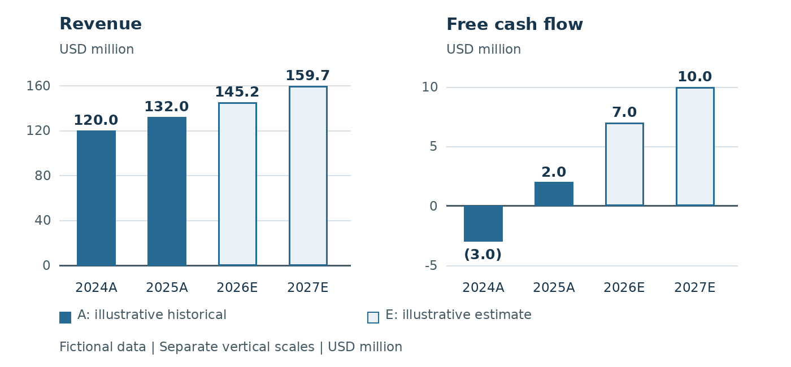
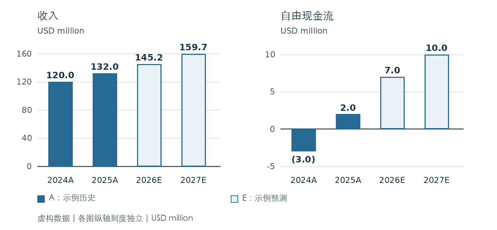

# Lattice Harbor Components / 栅港组件

## English metadata

- title: Lattice Harbor Components
- subtitle: Cash conversion determines the recovery
- publisher: Example Research Studio (fictional)
- report_type: Fictional equity research exercise
- date: 2026-10-26
- authors: Illustrative editorial team
- Identity: Fictional manufacturer
- Financial unit: USD million
- 2026E revenue: 145.2
- 2026E free cash flow: 7.0

## 简体中文元数据

- title: 栅港组件
- subtitle: 现金转化决定复苏质量
- publisher: 示例研究工作室（虚构）
- report_type: 虚构股票研究示例
- date: 2026-10-26
- authors: 示例编辑团队
- 身份: 虚构制造商
- 财务单位: USD million（百万美元）
- 2026E收入: 145.2
- 2026E自由现金流: 7.0

<!-- block: fixture-status -->

## English

Fictional illustration. Lattice Harbor Components, the publisher and all financial data in this report are invented solely to exercise bilingual document export. This is not research on a real security and contains no investment recommendation.

## 简体中文

虚构示例。本报告中的栅港组件、发布方及全部财务数据均为双语文档导出演示而创作。本报告不研究真实证券，也不提供投资建议。

<!-- /block: fixture-status -->

<!-- block: thesis-heading -->

## English

### Thesis: cash conversion determines the recovery

## 简体中文

### 核心论点：现金转化决定复苏质量

<!-- /block: thesis-heading -->

<!-- block: thesis-demand -->

## English

The fictional manufacturer supplies precision connectors to industrial equipment makers. The scenario assumes that repeat orders support a gradual recovery, while customers retain the ability to defer deliveries. Revenue rises from USD 132.0 million in 2025A to USD 145.2 million in 2026E; this is an illustrative assumption, not an observed order book.

## 简体中文

这家虚构制造商向工业设备厂商供应精密连接器。情景假设重复订单支持逐步复苏，但客户仍可推迟交付。收入由2025A的USD 132.0 million增至2026E的USD 145.2 million；这是示例假设，并非已观察到的在手订单。

<!-- /block: thesis-demand -->

<!-- block: thesis-cash -->

## English

The central question is whether production efficiency reaches cash generation. Illustrative free cash flow improves from USD (3.0) million in 2024A to USD 7.0 million in 2026E. Lower capital spending contributes alongside operating cash flow; the model does not attribute the entire improvement to pricing power. See Footnote 1 for sign conventions.

## 简体中文

核心问题在于生产效率能否转化为现金。示例自由现金流由2024A的USD (3.0) million改善至2026E的USD 7.0 million。资本支出下降与经营现金流共同促成改善；模型并未将全部改善归因于定价能力。符号约定见脚注1。

<!-- /block: thesis-cash -->

<!-- block: catalysts -->

## English

- Catalyst: repeat orders convert into deliveries without longer payment terms.
- Watchpoint: inventory and receivables absorb the expected cash recovery.
- Invalidation: sustained customer deferrals or weaker cash collection undermine the scenario.

## 简体中文

- 催化因素：重复订单转化为交付，同时付款账期没有延长。
- 观察重点：存货及应收账款是否占用预期恢复的现金。
- 失效条件：客户持续推迟交付或回款转弱，将削弱本情景。

<!-- /block: catalysts -->

<!-- block: break-financials -->

---
<!-- /block: break-financials -->

<!-- block: financials-heading -->

## English

### Financial model and definitions

## 简体中文

### 财务模型与定义

<!-- /block: financials-heading -->

<!-- block: financial-table -->

## English

Exhibit 1. Illustrative financial model (USD million)

| Metric | 2024A | 2025A | 2026E | 2027E |
| --- | --- | --- | --- | --- |
| Revenue | 120.0 | 132.0 | 145.2 | 159.7 |
| Gross profit | 36.0 | 42.2 | 49.4 | 57.5 |
| EBITDA | 14.4 | 17.2 | 21.8 | 25.6 |
| EBITDA margin | 12.0% | 13.0% | 15.0% | 16.0% |
| Net income | (2.4) | 3.3 | 7.3 | 9.6 |
| Operating cash flow | 8.0 | 12.0 | 16.0 | 20.0 |
| Capital expenditure | (11.0) | (10.0) | (9.0) | (10.0) |
| Free cash flow | (3.0) | 2.0 | 7.0 | 10.0 |
| Debt | 24.0 | 22.0 | 20.0 | 18.0 |
| Cash | 8.0 | 9.0 | 10.0 | 12.0 |

Source: original fictional dataset authored for this export example.

A = illustrative historical period; E = illustrative estimate. All periods are fictional. Percentages are shown only in the margin row.

## 简体中文

图表1：示例财务模型（USD million）

| 指标 | 2024A | 2025A | 2026E | 2027E |
| --- | --- | --- | --- | --- |
| 收入 | 120.0 | 132.0 | 145.2 | 159.7 |
| 毛利润 | 36.0 | 42.2 | 49.4 | 57.5 |
| EBITDA | 14.4 | 17.2 | 21.8 | 25.6 |
| EBITDA利润率 | 12.0% | 13.0% | 15.0% | 16.0% |
| 净利润 | (2.4) | 3.3 | 7.3 | 9.6 |
| 经营现金流 | 8.0 | 12.0 | 16.0 | 20.0 |
| 资本支出 | (11.0) | (10.0) | (9.0) | (10.0) |
| 自由现金流 | (3.0) | 2.0 | 7.0 | 10.0 |
| 债务 | 24.0 | 22.0 | 20.0 | 18.0 |
| 现金 | 8.0 | 9.0 | 10.0 | 12.0 |

来源：为本导出示例原创的虚构数据集。

A＝示例历史期间；E＝示例预测。全部期间均为虚构。百分比仅用于利润率行。

<!-- /block: financial-table -->

<!-- block: footnote-signs -->

## English

Footnote 1. Figures use USD million unless a percentage is shown. Parentheses indicate negative amounts: (3.0) means -3.0. Capital expenditure is recorded as an outflow; free cash flow equals operating cash flow plus the signed capital expenditure. Totals may reflect rounding to one decimal place.

## 简体中文

脚注1：除百分比外，数值单位均为USD million（百万美元）。括号表示负数：(3.0)即-3.0。资本支出列为流出；自由现金流等于经营现金流加带符号的资本支出。合计数可能受到保留一位小数的舍入影响。

<!-- /block: footnote-signs -->

<!-- block: footnote-profit -->

## English

Footnote 2. EBITDA is a model subtotal before interest, tax, depreciation and amortization; it is not a substitute for cash flow. The illustrative 2024A net loss of USD (2.4) million includes depreciation and financing costs absent from EBITDA. No audited financial statements underlie this fixture.

## 简体中文

脚注2：EBITDA为模型中的息税折旧摊销前小计，不能替代现金流。2024A的示例净亏损USD (2.4) million包含EBITDA未计入的折旧及融资成本。本测试材料不以经审计财务报表为依据。

<!-- /block: footnote-profit -->

<!-- block: break-valuation -->

---
<!-- /block: break-valuation -->

<!-- block: valuation-heading -->

## English

### Cash profile and illustrative valuation

## 简体中文

### 现金表现与示例估值

<!-- /block: valuation-heading -->

<!-- block: cash-chart -->

## English

Exhibit 2. Growth and cash recovery (USD million)

Revenue and free cash flow use separate vertical scales. Data labels reproduce Exhibit 1. Outlined bars denote E periods; filled bars denote A periods. The negative cash bar crosses below zero.

Source: Exhibit 1, original fictional dataset; no external market data.

## 简体中文

图表2：增长与现金恢复（USD million）

收入与自由现金流使用各自独立的纵轴刻度。数据标签对应图表1。描边柱表示E期间，实心柱表示A期间。负现金流柱位于零线下方。

来源：图表1的原创虚构数据集；未使用外部市场数据。

<!-- /block: cash-chart -->

<!-- block: valuation-method -->

## English

For illustration, applying 8.0x to 2026E EBITDA of USD 21.8 million gives enterprise value of USD 174.4 million. Deducting assumed net debt of USD 10.0 million yields equity value of USD 164.4 million. Dividing by 20.0 million assumed shares gives $8.22 per share. This is scenario arithmetic, not a target price or a quoted market price.

## 简体中文

作为示例，对2026E的EBITDA USD 21.8 million采用8.0x倍数，得到企业价值USD 174.4 million。扣除假设净债务USD 10.0 million后，股权价值为USD 164.4 million。除以假设的20.0 million股，得到每股$8.22。这是情景算术结果，不是目标价或市场报价。

<!-- /block: valuation-method -->

<!-- block: valuation-sensitivity -->

## English

Holding EBITDA, net debt and share count constant, 7.0x implies $7.13 per share and 9.0x implies $9.31. These multiples are chosen to test sensitivity; they are not sourced trading comparables. The exercise gives no probability weights and does not establish fair value.

## 简体中文

在EBITDA、净债务及股数不变时，7.0x对应每股$7.13，9.0x对应每股$9.31。选择这些倍数是为了检验敏感性，它们并非来自可比公司的市场交易数据。本练习不赋予概率权重，也不据此认定公允价值。

<!-- /block: valuation-sensitivity -->

<!-- block: break-risks -->

---
<!-- /block: break-risks -->

<!-- block: risks-heading -->

## English

### Risks, source notes and disclosure

## 简体中文

### 风险、来源说明与披露

<!-- /block: risks-heading -->

<!-- block: risks -->

## English

- Demand: customers can postpone equipment purchases; repeat orders are not guaranteed revenue.
- Execution: yield losses and expedited freight can absorb the modeled margin improvement.
- Liquidity: slower collection or higher inventory can reverse positive free cash flow despite accounting profit.
- Valuation: the illustrative multiple is an assumption and can change independently of operating results.

## 简体中文

- 需求：客户可能推迟设备采购，重复订单并不保证收入实现。
- 执行：良率损失及加急运费可能抵消模型中的利润率改善。
- 流动性：即使有会计利润，回款放缓或存货上升仍可能使正自由现金流转负。
- 估值：示例倍数属于假设，可能独立于经营结果发生变化。

<!-- /block: risks -->

<!-- block: source-authority -->

## English

Source authority. This complete bilingual original and its localized chart images are the source for the example JSON. Every financial value is authored for this fixture. The reference destination below tests a long clickable HTTPS link and provides no evidence for the company, estimates or valuation.

## 简体中文

来源权威性。本完整双语原稿及配套本地化图表构成示例JSON的来源。每个财务数值均为本测试材料原创。下列引用地址用于测试较长的可点击HTTPS链接，不为公司、预测或估值提供证据。

<!-- /block: source-authority -->

<!-- block: reference-methodology -->

## English

[Illustrative methodology link (link-format test only): https://example.com/fictional-research/lattice-harbor-components/2026-10-26/methodology?currency=USD&scale=million&scenario=illustrative&language=en-and-zh-CN&purpose=layout-validation](https://example.com/fictional-research/lattice-harbor-components/2026-10-26/methodology?currency=USD&scale=million&scenario=illustrative&language=en-and-zh-CN&purpose=layout-validation)

## 简体中文

[示例方法说明链接（仅用于链接格式测试）：https://example.com/fictional-research/lattice-harbor-components/2026-10-26/methodology?currency=USD&scale=million&scenario=illustrative&language=en-and-zh-CN&purpose=layout-validation](https://example.com/fictional-research/lattice-harbor-components/2026-10-26/methodology?currency=USD&scale=million&scenario=illustrative&language=en-and-zh-CN&purpose=layout-validation)

<!-- /block: reference-methodology -->

<!-- block: fixture-disclosure -->

## English

Disclosure for this fictional example. Example Research Studio and the illustrative editorial team are neutral invented identities, with no claimed connection to a bank or real issuer. The text makes no analyst certification, independence assertion or real-world conflicts declaration. It is an export demonstration and must not be reused as disclosure language for an actual investment report.

## 简体中文

本虚构示例的披露。示例研究工作室与示例编辑团队均为中性的虚构身份，不声称与任何银行或真实发行人有关联。本文不作分析师认证、独立性声明或现实中的利益冲突声明。本材料仅用于导出演示，不得将其作为真实投资报告的披露措辞重复使用。

<!-- /block: fixture-disclosure -->
