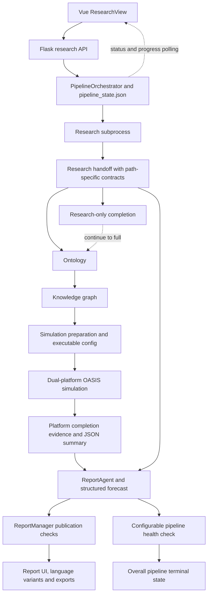

# DeepResearchForecast: main-branch workflow and Python study

This study describes committed main at `c20ec60`. The source was frozen before delegated reading, so concurrent edits in the working checkout do not change the meaning of the report. The finharness feature branch is excluded. This is a source study; no application imports, provider calls, pipeline launches, saved-run mutations, or application tests were used to establish runtime success.

## The workflow spine

The Vue application enters through `ResearchView`, sends a research-run request to Flask, and observes the background pipeline through polling. `PipelineOrchestrator` is the active coordinator. It calls backend services directly and communicates with research and simulation subprocesses through durable files and progress/state records.

The static stage bands are RESEARCH 0–30, ONTOLOGY 30–40, GRAPH 40–60, PREPARE 60–72, RUN 72–92, REPORT 92–100. Research-only has one 0–100 stage. Later work estimates can rescale the latter stages; an activity percentage is not artifact completion evidence. Sources: `backend/app/services/pipeline_orchestrator.py:95`, `:8894`, `:8916`; `backend/app/services/research_progress.py:147`.

## Source authority and reading map

The frozen inventory contains 146 tracked Python files outside `backend/tests`, and 180 backend test files indexed as references. Bridge patch tests and operational test-named scripts remain in the non-backend-test inventory and are labeled by their role. The application-source total is not a claim that all tests or all third-party dependencies were read.

| Area | Detailed report | Main responsibility |
|---|---|---|
| Orchestrator foundations | [orchestrator-foundation.md](orchestrator-foundation.md) | State, research subprocess hosting, budgets, sealing, merging, actor reception, run manifest |
| Orchestrator execution | [orchestrator-execution.md](orchestrator-execution.md) | Lifecycle, stage control, reuse, recovery, health checks, ensembles |
| Research | [research.md](research.md) | Research engines, tools, evidence, runtime deployment, structured handoff |
| Graph and actors | [graph-actors.md](graph-actors.md) | Ontology, graph storage/retrieval, identity, provenance, context and role compilation |
| Simulation | [simulation.md](simulation.md) | Preparation, OASIS processes, rounds, interactions, decisions, projections, checkpoints |
| Reports | [report.md](report.md) | Forecast extraction, prose, citations, publication, charts, language variants and report API |
| UI and API | [ui-api.md](ui-api.md) | Browser entry/polling, Flask startup/security/configuration, APIs and MCP surfaces |
| Operations | [operations.md](operations.md) | Launch/setup, LLM routing/telemetry, scripts, tests/CI and alternative drf2 path |
| Supporting modules | [supporting-services.md](supporting-services.md) | Project/task state, requirements, progress, parsing, dates, atomic writes and security utilities |

The [module navigation index](MODULES.md) lists the 146 scoped files and their principal definitions, covering 151,957 source lines. `python-inventory.json` records hashes, line counts, imports, top-level symbols and owners. `study-contract.json` defines ownership and exclusions. The two orchestrator readers divide one coordinator-owned file into explicit ranges. Coverage and review receipts accompany the completed area reports.

## Public lifecycle and durable state

`start` creates a `pipe_<12 hex>` ID, a process-local task, durable pipeline directories/state, and a daemon thread, then returns immediately. It pins the actor-intelligence and containment-related safety policies into options. The artifact IDs link pipeline → project → graph → simulation → report. `TaskManager` is process-local; `PipelineManager` and its `pipeline_state.json` are the durable run record. Sources: `backend/app/services/pipeline_orchestrator.py:660`, `:683`, `:860`, `:7920`; `backend/app/models/task.py:54`.

The pipeline directory uses `pipeline_state.json` and `handoff/`; it may also contain `run.json`, telemetry, and `handoff/manifest.json`, subject to their flags and successful writes. The generic artifact manifest is distinct from `research_contract_manifest.json`. `resolve_handoff_dir` follows a contained stored research-handoff reference, which matters because scenario forks share the base handoff; the generic manifest helper uses the pipeline's local handoff path. Sources: `backend/app/services/pipeline_orchestrator.py:888`, `:915`, `:1108`, `:9703`, `:10374`.

| User operation | Implemented behavior |
|---|---|
| Cancel | A live local pipeline receives its cancellation event. Research and simulation work stop at their control points; other stages observe cancellation in callbacks. An orphan can be marked cancelled in durable state. |
| Resume | Keeps the same pipeline ID, creates a new polling task/attempt, checks schema and liveness, and re-enters stage logic with artifact-reuse checks. A completed degraded/failed-health pipeline requires the force path to regenerate REPORT. |
| Continue | Requires a completed research-only pipeline and research report; switches that pipeline to full mode and resets downstream stages. |
| Scenario fork | Creates a new pipeline sharing base prompt/project/graph/handoff and actor policy; PREPARE, RUN and REPORT are fresh. |
| Delete | Blocks live local work and, unless forced, deletion of a base with dependent forks. |

Source anchors: `backend/app/services/pipeline_orchestrator.py:7982`, `:8043`, `:8107`, `:8214`, `:8280`. These operations were traced in source and were not invoked.

## Research selection and stage reception

Main's fresh backend default is research engine `v3`. The aliases `v3` and `linear` select v3; `legacy`, `deerflow`, and `agentic` select legacy. V3 uses one outer lane because its internal key-question fan-out shares evidence and query deduplication. Legacy can use multiple outer angle lanes. A saved run with `actor_intelligence_policy_v1.required == true` selects legacy because that engine produces its required sealed actor plane. New v3 admissions pin that requirement to false and disclose why: v3 produces unsealed report-grounded actor rows. This is why older branch-specific agentic-engine notes cannot describe all current main runs. Sources: `backend/app/services/pipeline_orchestrator.py:832`, `:5895`, `:5906`, `:5937`, `:5955`.

Before marking RESEARCH complete, the orchestrator calls handoff finalization, which validates and seals sanctioned changes only when a research contract manifest already exists. Full runs also apply the pinned actor reception policy; research-only runs skip actor reception. The default single-lane v3 path does not acquire the legacy sealed actor-plane contract through this call. The orchestrator preserves producer bytes when lint would alter the audited contract, validates existing contracts before reuse, and can take synthesis-only recovery from an evidence manifest. A completed research-only run exits at this boundary. Sources: `backend/app/services/pipeline_orchestrator.py:3628`, `:11919`, `:12084`, `:12267`, `:12294`.

V3 persists plan → gather → gap → synthesize → QA → finalize. Bounded key-question investigators use `web_search`/`web_fetch`, share a source ledger, and hand notes to section writers. Numerical overlap checks distinguish fetched support from snippets; they are not full semantic entailment proofs. Its QA metadata and degradation paths differ from the legacy dossier/judge contract. The direct bridge CLI has a different unset-engine default—legacy—while the backend explicitly passes its selected canonical engine, v3 by default; required sealed-actor runs and legacy-only lane contracts select legacy. Sources: `deerflow_bridge/linear_research.py:2674`, `:4186`, `:4485`, `:4808`, `:5166`, `:5526`; `deerflow_bridge/deerflow_research.py:16381`; `backend/app/services/pipeline_orchestrator.py:2295`. The [research report](research.md) traces both implementations and their stopping conditions.

## Graph, preparation, and simulation boundaries

Ontology generation consumes the actor dossier when present, the research report, the user's prediction requirement, and structured actor context. It stores the project ontology and attempts a handoff copy. Graph construction sanitizes/chunks research text, seeds applicable researched identities/relationships, and ingests episodes. Configured community detection, identity resolution, pruning and priors are attempted; their failure paths are generally logged and tolerated. Sealed-v1 seed readback is enforced when that contract is present. Sources: `backend/app/services/pipeline_orchestrator.py:12307`, `:12346`, `:12375`, `:12462`, `:12574`, `:12639`.

The compatibility-named `graphiti_client.Zep` delegates to an app-local Graphiti runtime. `GRAPH_BACKEND=auto` selects FalkorDB when `FALKORDB_HOST` is set, otherwise import-discoverable FalkorDBLite, otherwise import-discoverable Kuzu; if none is available it raises a no-backend error. This is configuration/import selection, not a connection-failure retry cascade. Embeddings use a lazy local SentenceTransformer and optional vector caches. Sources: `backend/app/services/graphiti_client/client.py:349`; `backend/app/services/graphiti_client/runtime.py:283`; `backend/app/services/graphiti_client/embedder.py:205`, `:284`. The [graph/actor report](graph-actors.md) maps the retrieval, temporal, identity, and visibility boundaries.

New PREPARE writes the cast, profiles and executable-config seal; selected dossier actors additionally produce context/role artifacts. Legacy reuse has compatibility allowances. Scenario overlays and world-state seed injection are conditional and tolerate some failures; a successfully mutated config must be resealed before PREPARE completion records its fingerprint. A completed simulation reuse path retains the config's exact bytes. Sources: `backend/app/services/pipeline_orchestrator.py:12733`, `:12855`, `:12924`, `:12933`; `backend/app/services/simulation_manager.py:982`, `:1242`, `:1278`, `:1352`.

RUN starts the parallel-platform runner, polls round progress, watches cancellation/stagnation, and attempts subprocess-cost accounting even on failure. Its completion predicate accepts each enabled platform's persisted completion bit or a `simulation_end` event in its actions-file tail, plus publication of a nonempty summary that passes the generic JSON object/list probe. Legacy enabled-platform inference falls back to actions-file presence. A process exit or overall completed status alone is insufficient; this is not a full semantic validation of summary identity, agents, or rounds. Sources: `backend/app/services/pipeline_orchestrator.py:7433`, `:9942`, `:10059`, `:10086`, `:12974`, `:13101`; `backend/app/services/simulation_runner.py:1187`.

The parallel script owns the dual-platform round loops, social actions/reactions, event scheduling, per-platform SQLite stores, action logs, checkpoints and later interview IPC. Unfinished-round resume is distinct from completed-result reuse and does not establish identical execution to an uninterrupted run. Decision-channel world state is labeled `elicited_model_projection`; valid outputs have diagnostic/no-update policies, while `validated_update` is unavailable. Sources: `backend/scripts/run_parallel_simulation.py:3752`, `:3802`, `:4792`, `:4838`, `:5920`; `backend/app/services/decision_channel.py:733`. See [simulation.md](simulation.md) for the exact round and process sequence.

## Report delivery and final completion

The pipeline passes the research report, actors, sources, situation brief, graph/simulation IDs and available quantitative/contested/timeline/prior artifacts into `ReportAgent`. Configured report-owned visualizations are attempted; chart generation can be disabled or skipped. Research chart paths are not blindly passed into every report section. Reuse is assessed against the deliverable and artifact identities, rather than only a REPORT stage bit. Sources: `backend/app/services/pipeline_orchestrator.py:13195`, `:13285`, `:13301`; `backend/app/services/report_agent.py:1533`, `:8882`.

After REPORT stage completion, optional extra seeds may publish ensemble sidecars without rewriting the primary audited forecast. The orchestrator invokes the configurable pipeline health check before saving the overall status as completed; REPORT completion can already have persisted global progress at 100%. With the check enabled, collected hard report defects fail the pipeline, degraded health permits completion, and assessment exceptions are logged and ignored. Disabling the check bypasses it. Sources: `backend/app/services/pipeline_orchestrator.py:8723`, `:9026`, `:9445`, `:13333`, `:13345`.

Pipeline completion and customer publication are separate decisions. `ReportManager.publication_status` checks completed report metadata, final-audit policy/fingerprints, section state and applicable professional gates. Report APIs revalidate before exposing the final body or exports and can withhold a completed report. Bilingual generation is optional and failure-tolerant inside report generation; each variant has its own source-identity and publication bindings. Sources: `backend/app/services/report_agent.py:11577`, `:12435`, `:12533`; `backend/app/api/report.py:45`, `:725`, `:1069`. [report.md](report.md) traces generation, forecast data, citations, charts, translation and access contracts.

Finalization attempts telemetry persistence on handled success/failure/cancellation/outage paths. The normal `telemetry.md` sidecar is separate from customer prose; `REPORT_TELEMETRY_APPENDIX=true` can additionally append it to the report. These writes are best effort. Sources: `backend/app/services/pipeline_orchestrator.py:13393`, `:13429`, `:13464`.

## Contract discrepancy and limits

The sealed actor plane has a source-level roster-digest discrepancy: the producer and parent reception validator use a canonical JSON multiplicity-map hash for `actor_ids_sha256`, while `actor_context` checks that field against newline-joined sorted IDs. The context fixture constructs the latter recipe. A successful current-v1 producer-to-PREPARE passage has not been established by this study. Sources: `deerflow_bridge/deerflow_research.py:3813`, `:3895`; `backend/app/services/pipeline_orchestrator.py:5404`; `backend/app/services/actor_context.py:1267`; `backend/tests/test_actor_context_runtime.py:172`. This concerns the sealed legacy/current-v1 path; fresh v3 emits unsealed actor rows. The discrepancy is recorded for follow-up, with no runtime fix or execution claimed.

## Verification status

All 326 frozen Python files passed SHA-256 comparison with their inventory and static AST parsing. The nine reader receipts reconcile to full reads of all 146 scoped Python files and 151,957 lines, with no range or hash errors. The 180 backend test files were indexed; receipts cover 12 in full and 15 partially, without claiming the entire suite was read or run. `coverage-validation.json` records the range unions and receipt hashes. This proves source integrity and reported read scope, not runtime acceptance.

Independent review corrected the original overstatements about sealing, RUN evidence, optional outputs and completion/publication. The later rereview's selected-engine and backend-availability wording was also corrected. Review history is preserved in [independent-review.md](independent-review.md); numeric source-anchor and local-link checks are recorded separately in `document-validation.json`. No application tests, builds, CI jobs, providers, renderers or browser flows were executed as proof for this study.

The live checkout changed concurrently and contains unrelated edits/deletions. `initial-status.txt` and `checkout-python-drift.json` retain that distinction. Third-party runtime internals, untracked data-MCP work, and finharness branches are excluded except for clearly labeled runtime boundary references.

The earlier reusable-workflow request produced a [compact shortlist](workflow-shortlist.md) and a narrow extension of the existing `source-command-research-codebase` skill, with an [independent forward test](skill-forward-test.md). Existing verification, cost-forensics, literary and automation assets were reused or left unchanged; no new automation or custom-agent definition was created. `skill-extension.patch` and `skill-extension.json` preserve the installed extension and its final identity.
