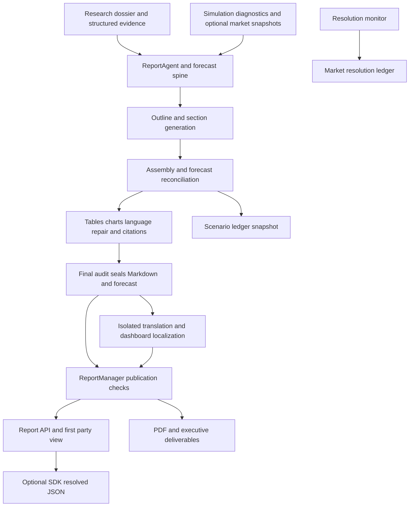

# Main codebase study: report generation and its consumers

## Scope and evidence convention

This report documents the implementation at commit `c20ec60909fa1aa15154bb6fdb3fdb71c421e10e`. All application and test references below refer to the frozen tracked tree at `/tmp/drf-main-study-c20ec60-20261011/source`, not to the current working tree or a feature branch. The `report` ownership group contains 11 Python files and 30,224 source lines. `report-coverage.json` records whole-file SHA-256 values and the actual inclusive numbered read ranges. The large generator module is divided among three bounded readers; the coverage receipt identifies those boundaries.

The study is static: tests are read as behavior characterizations, never executed. No application imports, provider requests, pipelines, dependency installation, renderer execution, configuration changes, live-run inspection, commits, or pushes form part of this work. Only this report and its JSON coverage receipt are written. Supporting caller, frontend, configuration and test excerpts are separately identified and do not imply whole-file review of another ownership group. Prior map filenames were inventoried; their claims are not used as evidence.

An anchor such as `backend/app/api/report.py:585` means the source declaration or controlling block at that repository-relative line. “Reviewed” describes source directly read by this study's readers. “Inferred” is reserved for conclusions that extend beyond those reviewed blocks. Defaults mentioned here are source defaults, not verified settings of any installation.

## Entry points and the report API contract

`report_bp` is defined in `backend/app/api/__init__.py:9` and mounted at `/api/report` in `backend/app/__init__.py:203`. The separately defined `/api/v1` blueprint is mounted only when `Config.API_V1_ENABLED` is true (`backend/app/__init__.py:210`); the first-party report dashboard uses the report blueprint directly. Registration is a reviewed supporting excerpt, not a whole-file bootstrap study.

Both prefixes inherit the application's API authentication hook. OPTIONS, health and non-API paths are exempt; a loopback connection is accepted only when forwarding headers do not indicate a remote client. Other API requests require configured `APP_API_TOKEN` and a constant-time comparison of `X-API-Token`; absent server token returns 403 and mismatch returns 401 (`backend/app/__init__.py:154`). This is a reviewed gate excerpt; forwarding-address parsing itself remains in the bootstrap owner's area. Non-debug JSON responses have a top-level traceback removed by the global response hook (`backend/app/__init__.py:183`).

`generate_report()` is the report-specific asynchronous entry point (`backend/app/api/report.py:267`). Its JSON input is `{simulation_id, force_regenerate?}`. It validates simulation existence, the associated project, a graph ID chosen from simulation then project, and a nonempty simulation requirement. Without `force_regenerate`, a completed report is reused only when `ReportManager.is_publishable()` also succeeds. A newly allocated `report_<12 hex>` ID is placed in `report_generate` task metadata with simulation and graph IDs before a daemon worker is started. The response immediately includes `simulation_id`, `report_id`, `task_id`, `status: generating`, and `already_generated: false`.

The worker loads the research dossier with `load_research_dossier_for_simulation()`, then passes `situation_brief`, `actors`, `sources` and `research_report` to `ReportAgent` (`backend/app/api/report.py:377`). The dossier is best effort; absence permits the agent's graph-oriented path. It forwards the agent's stage/progress/message callback to `TaskManager`, calls `agent.generate_report(report_id=...)`, and saves the resulting `Report`. Task completion requires both `ReportStatus.COMPLETED` and publication approval. A nonpublishable result fails the task using the report error or publication reasons. Successful forced regeneration may delete the other reports for the same simulation; cleanup exceptions are logged and do not fail the new published report (`backend/app/api/report.py:406`). `POST /generate/status` accepts task ID and/or simulation ID; the simulation fast path reports completion only for a published completed report, otherwise it reads the requested task (`backend/app/api/report.py:468`).

The unified pipeline is a second reviewed caller. Its REPORT block first looks up the persisted report ID, then the simulation's report, assesses report health, honors `force_report_regen`, and calls `_reuse_ok()` before reuse (`backend/app/services/pipeline_orchestrator.py:13185`). New generation clears attempt-owned artifact pointers, persists a new report ID, optionally performs an LLM preflight, and supplies the dossier plus `quantitative.json`, `contested.json`, `timeline.json`, `graph_priors.json` and `graph_priors_structural.json` (`backend/app/services/pipeline_orchestrator.py:13285`). Compatibility `TypeError` fallback omits the additional structured artifact arguments. Report generation failure propagates as REPORT stage failure. The orchestrator may then run the optional seed ensemble and enforces pipeline health before marking the pipeline completed (`backend/app/services/pipeline_orchestrator.py:13320`). The seed-specific caller passes the main scenario spine when available and returns `(simulation_id, report_id, forecast)` (`backend/app/services/pipeline_orchestrator.py:8867`). These are concrete caller excerpts; the full orchestrator belongs to its own study owner.

### Metadata, published artifacts, and live drafts

`_report_publication_payload()` adds `publishable`, `publication_issues`, and `draft_withheld` to serialized metadata. A nonpublishable report retains metadata and the outline skeleton but loses both `markdown_content` and every outline section's `content`; each withheld section is marked `draft_withheld: true` (`backend/app/api/report.py:26`, `backend/app/api/report.py:45`). The same payload is used by detail, by-simulation and list routes. Metadata can therefore return HTTP 200 while the body is withheld. `translations` is rebuilt from the verified `translation_status.translation` row, requiring availability, audit verification, and source Markdown, variant Markdown and final-audit hashes; it is not an unconditional serialization of saved translation metadata.

Published artifact rejection is standardized as HTTP 409 with `{success:false, error, publishable:false, publication_issues:[...]}` (`backend/app/api/report.py:74`). The draft exception is separate. `_draft_exposure_gate()` loads a reconstructible `Report` and its publication state; drafts are visible only if the report is published, or it has `pending`/`planning`/`generating` status and recent generator activity (`backend/app/api/report.py:153`). The latest mtime of `meta.json`, `progress.json`, `outline.json`, `agent_log.jsonl`, `console_log.txt`, or a `section_*.md` must be within an absolute 1,800-second window of the current clock. Missing files, unreadable metadata, stale generation and far-future timestamps fail that exception. PDF/cache updates do not count as generator activity (`backend/app/api/report.py:105`, `backend/app/api/report.py:120`).

`GET /<id>/sections` returns the `ReportManager` section objects in a `data` envelope plus `total_sections`, `is_complete`, publication fields and the draft flag (`backend/app/api/report.py:1621`). `GET /<id>/sections-partial` instead returns top-level `{success, sections, done, publishable, publication_issues, draft_withheld}`. Its rows are `{index,title,status,content_md}`, with `status: completed` for disk sections and an optional `generating` row from `progress.current_section`. The implementation sets `done` from publication approval; the preceding docstring's statement about file existence is not the controlling implementation (`backend/app/api/report.py:1709`, `backend/app/api/report.py:1765`). A withheld list returns an empty collection; a withheld single-section request returns 409. Unexpected outer exceptions in the partial route actually return HTTP 500 with an empty collection and `done:false` (`backend/app/api/report.py:1776`), despite the broader docstring's degrade-safe description.

Agent logs retain event skeletons while `_withhold_agent_log_drafts()` removes `details.content` from section-content/completion events, `details.response` from LLM responses, and `details.thought` from ReACT thoughts (`backend/app/api/report.py:90`, `backend/app/api/report.py:221`). Console-log redaction targets quoted draft excerpts on four named audit/reflection log-line patterns while retaining their diagnostic prefixes (`backend/app/api/report.py:193`). Incremental log routes accept `from_line`; the `/stream` variants return a complete snapshot, not an SSE stream (`backend/app/api/report.py:1895`, `backend/app/api/report.py:1964`, `backend/app/api/report.py:2001`). `/check/<simulation_id>` uses publication approval for `interview_unlocked`, so a completed metadata status alone does not unlock it (`backend/app/api/report.py:1838`).

### Endpoint matrix

All paths below are relative to `/api/report`; ordinary successful object responses use `{success:true,data:...}` unless stated otherwise.

| Method and path | Input / result | Gate and fallback |
|---|---|---|
| POST `/generate` | Simulation ID and optional force flag; report/task IDs returned immediately | Valid simulation/project/graph/requirement; reuse requires published completion; worker records task failure otherwise. `backend/app/api/report.py:267` |
| POST `/generate/status` | Task ID or simulation ID; task data or completed report pointer | Published completed simulation fast path; missing input 400, unknown task 404. `backend/app/api/report.py:468` |
| GET `/<id>`, `/by-simulation/<sim>`, `/list` | Serialized report or report array; list filter and limit | Unpublished body and outline section prose withheld; unknown detail 404. `backend/app/api/report.py:543`, `backend/app/api/report.py:630`, `backend/app/api/report.py:669` |
| GET `/<id>/forecast?lang=en|zh` | `{report_id,simulation_id,forecast,available,localization}` | Primary publication gate; invalid explicit language 400; published legacy report can return 200 and `forecast:null`; localized sealed copy or original forecast. `backend/app/api/report.py:585` |
| GET `/<id>/download` | Markdown attachment | Publication gate; in-memory response fallback if the Markdown path is absent after validation. `backend/app/api/report.py:709` |
| GET `/<id>/full_report.<lang>.md` | Variant Markdown attachment | Only en/zh; missing/unsupported variant 404, failed publication 409. `backend/app/api/report.py:757` |
| POST `/<id>/translations/<lang>?force=1` | Translation task/state | Invalid lang 400, missing report 404, source/target state disallows generation 409, queued/active 202, already available 200. `backend/app/api/report.py:804` |
| GET `/<id>/translations/<lang>/status?task_id=...` | Durable translation state plus optional task | Task metadata must match both report and language; mismatch 409. Task-bound availability describes that task's new output. `backend/app/api/report.py:977` |
| GET `/<id>/pdf?lang=...` | PDF attachment | `REPORT_PDF_EXPORT`; invalid lang 400; failed publication 409; disabled/build failure typed 503; stable internal-error 500. `backend/app/api/report.py:1037` |
| GET `/<id>/exec-brief`, `/<id>/exec-brief.pdf`, `/<id>/digest` | Deterministic derived Markdown/PDF | Publication gate; feature-disabled/missing outputs 404. Invalid brief language defaults to primary; digest has no language selector. `backend/app/api/report.py:1106`, `backend/app/api/report.py:1166`, `backend/app/api/report.py:1225` |
| GET `/<id>/charts/<path>` | Image or sandboxed interactive HTML | Report publication, extension/path/realpath/no-symlink checks; invalid resource 404. `backend/app/api/report.py:1279` |
| GET `/<id>/viz-manifest` | Top-level `{success,schema_version,data,count,skipped}` | Publication; schema-v2 object or legacy list normalized; missing manifest produces empty schema-v1 list. `backend/app/api/report.py:1358` |
| GET `/<id>/progress` | Persisted progress object | No body-publication gate; missing progress 404. `backend/app/api/report.py:1580` |
| GET sections/log routes | Live section prose or event/console diagnostics | Draft exception described above; completion flags require publication. `backend/app/api/report.py:1621`, `backend/app/api/report.py:1895` |
| POST `/chat` | `{simulation_id,message,chat_history?}` to agent chat result | Valid simulation/project/graph; best-effort dossier; passes to `ReportAgent.chat()`. `backend/app/api/report.py:1478` |
| DELETE `/<id>` | Delete report and return success | Manager deletion; missing ID 404. `backend/app/api/report.py:1450` |
| POST `/tools/search`, `/tools/statistics` | Graph debug-tool requests | Required graph/query inputs; `ZepToolsService` result serialized. These are tool routes rather than report artifact reads. `backend/app/api/report.py:2091`, `backend/app/api/report.py:2139` |

The chart route accepts `.png`, `.svg`, `.jpg`, `.jpeg`, `.gif`, `.webp` and `.html` in its implementation; its older docstring mentions Mermaid `.mmd`, which is not in that served extension set (`backend/app/api/report.py:1300`). Every request recomputes containment and rejects symlinks along the resource path. HTML may inline a sibling Plotly bundle, then receives `sandbox allow-scripts`, no default/network sources, inline scripts/styles and data/blob images. SVG receives a script-disabled opaque sandbox (`backend/app/api/report.py:1320`). Manifest normalization separately accepts only report-owned `charts/...` paths and sanitizes `png_path` (`backend/app/api/report.py:1364`).

### Translation task submission

`generate_report_translation()` first checks an existing `report_translate` task for the exact report/language pair or durable generating state before waiting on the lease, so a second tab can receive 202 promptly while a worker owns it (`backend/app/api/report.py:845`). Under `ReportManager._translation_generation_lease()` it rechecks state and tasks, then writes a pending runtime status with source Markdown SHA-256, task ID, `pid:<pid>` owner, progress and issues before releasing the submission lease. The worker invokes `generate_translation_variant(force=regenerate)`, maps progress into `TaskManager`, and writes durable `available` or `failed` state (`backend/app/api/report.py:876`, `backend/app/api/report.py:896`). A forced update of a published variant returns task availability as false until that task succeeds; the old published variant can remain available independently. Status polling validates the requested task's metadata and requires completed task status plus `result.available` and `result.updated` (`backend/app/api/report.py:989`).

## Report inputs, evidence and pre-prose forecast authority

The `Report` dataclass separates generation status from delivery metadata. `ReportStatus` has pending, planning, generating, completed and failed; `ReportSection` has title/content/description plus an internal `padded` flag omitted from serialization. `Report.to_dict()` always emits failed sections and computed `partial`, and includes telemetry/translations only when present (`backend/app/services/report_agent.py:478`, `backend/app/services/report_agent.py:539`). `ReportLogger` appends complete structured event details under the report directory with a write lock. Console logging uses a report ContextVar and stamp/match filters to route records, with locked handler installation/removal (`backend/app/services/report_agent.py:92`, `backend/app/services/report_agent.py:393`).

`ReportAgent.__init__()` accepts graph/simulation IDs, requirement, injectable LLM/Zep tools, dossier text and structured actors/sources, scenario/base-simulation identifiers, chart descriptors, quantitative/contested/timeline inputs, graph priors and a named `scenario_spine` (`backend/app/services/report_agent.py:1533`). It builds background, chart, contested, chronology and source-index blocks and initializes caches. `REPORT_OUTPUT_LANGUAGE` overrides language detection; otherwise `requirement_spec.detect_output_language()` receives the requirement, research report and situation brief, with English fallback after an exception. Main unified-pipeline construction passes richer structured evidence than manual report generation; both routes are described above.

`derive_report_shape()` uses a positive page budget at most eight for compact output: 5–8 sections, floor 1,500 characters, target 1,800–2,800 and eight tool calls per chapter. Expanded defaults are 6–14 sections, floor 2,000, target 3,000–6,000 and twelve calls; invalid/nonpositive budgets select expanded behavior (`backend/app/services/report_agent.py:929`). `_effective_min_tool_calls()` gives padded sections zero and evidence-matched sections at most one, otherwise the configured minimum (`backend/app/services/report_agent.py:2332`). `_compact_retrieval_query()` caches a bounded question and can append up to six actor names; adaptive previous-section budgeting is conditional on `ADAPTIVE_CONTEXT` (`backend/app/services/report_agent.py:2176`, `backend/app/services/report_agent.py:2346`).

### Research evidence blocks and source identity

`_build_background_block()` distinguishes the situation brief, what-if label, actor date, forecast inputs, evidence grading and optional actor relationship roster (`backend/app/services/report_agent.py:1841`). The metric block selects rows with a metric/definition, orders evidence tier then descending date, caps at 40 by source default and displays value/unit/date/tier/source; stale markers include `is_stale` or more than 180 staleness days. Contested claims cap at 15, with bounded positions/sources. Chronology selects the most recent 25 dated events then displays ascending order and deduplicates date/event prefixes. Risk/uncertainty sections receive contested material; history/background sections receive chronology (`backend/app/services/report_agent.py:2036`, `backend/app/services/report_agent.py:2077`, `backend/app/services/report_agent.py:2106`, `backend/app/services/report_agent.py:2308`).

The roster selects eligible actors by salience, limits relationship buckets and incentives, and uses degree priors/aliases and structural chokepoints for graph context (`backend/app/services/report_agent.py:1906`). Chart descriptors accept lists or wrappers, but paths must be safe relative `charts/` resources of permitted types. `_prepend_research_background()` combines those nonempty blocks with the source index, forecast spine, signal pack, market pack and section evidence (`backend/app/services/report_agent.py:2276`).

`_build_sources_index()` keeps the original source positions by substituting `None` for inadmissible rows rather than renumbering (`backend/app/services/report_agent.py:2217`). The default unified grammar uses `sources_index_unified()` with research-cited/tier/order prioritization and source limit 60. Tiered/legacy suffix indexing and a positional first-40 fallback remain alternatives. `_citation_index_or_fallback()` can build the full positional map for later repair (`backend/app/services/report_agent.py:3882`). Source admissibility requires a dictionary, no explicit invalid-URL flag, a locally admissible URL; the normalized title must not equal `http`, `https`, `source`, `untitled`, `unknown` or `en`. Empty/domain-only titles remain admissible when the URL passes, and display titles can be derived from its path. URL checking rejects credentials, whitespace/control characters, undotted hosts, suspicious truncation and certain incomplete Wikipedia forms; accepted URLs are not fetched by these checks (`backend/app/services/report_agent.py:1156`).

Prompts request bare `[S<n>]` beside the particular supported claim/table row, prohibit invented sources/numbers/URLs/dates/quotes, and reserve blockquotes for source-grounded quotations (`backend/app/services/report_agent.py:758`). The planning template asks for outcome/probability/driver/risk/resolution chapters and excludes internal-method titles. The ReACT protocol has an explicit tool-call versus final-answer grammar (`backend/app/services/report_agent.py:673`, `backend/app/services/report_agent.py:855`). These are prompt instructions alongside deterministic audits, not a claim that provider output always follows them.

### Simulation and market inputs

`_build_signal_pack()` returns empty for `SIMULATION_FORECAST_EFFECT=no_update`. Other policies can collect world-state shares, optional projected edges, simulation outcomes, coalition/causal structure and base/scenario comparison, with missing individual components omitted (`backend/app/services/report_agent.py:2373`). The rendered header identifies this as nonobservational model-elicited diagnostic material and prohibits probability updates from it. Actor-count salience tiers can be suppressed when counts are nearly flat. `_world_state_block()` reads the trajectory and adds schema-v3 calendar waypoints/convergence/default-horizon disclosure; `_temporal_horizon_date()` searches trajectory then simulation configuration (`backend/app/services/report_agent.py:2472`, `backend/app/services/report_agent.py:2544`).

The pre-prose forecast caller supplies simulation signal text only for `legacy_prompt`; normal source policy `diagnostic_only` supplies an empty signal string to `derive_forecast_spine()` (`backend/app/services/report_agent.py:2847`, `backend/app/config.py:1492`). Binary extraction independently enforces that policy. Thus a diagnostic pack can exist for contextual use without establishing simulation-caused numeric probability updates. The derivation function itself has broader optional inputs, discussed below; the reviewed main caller does not pass `base_distribution` or `quantitative_facts`.

`_load_prediction_markets()` prefers matching pipeline handoff `prediction_markets.json`, accepting a list or `markets` wrapper, and requotes selected rows (`backend/app/services/report_agent.py:2570`). If no handoff data is available it can construct a Polymarket client, derive queries with the report LLM, retrieve and score relevant markets and optionally persist `prediction_markets_recovered.json` with query/attempt metadata. That is a conditional recovery path in source; this study did not execute it. Requoting preserves research prices, adds current prices/deltas and marks stale snapshots on disabled/unavailable/failed refresh; a second refresh can precede binary extraction (`backend/app/services/report_agent.py:2689`, `backend/app/services/report_agent.py:2723`). The market pack presents prices as calibration anchors, with explanation requested for divergences beyond ten points.

`render_market_comparison_block()` consumes explicit comparisons or derives them from binary anchors, sorts absolute divergence and distinguishes within-band, explained, explain and review verdicts. It can show unmatched volume-ranked markets and durable market-influence prior/revised probabilities with removed/restored-anchor state (`backend/app/services/report_agent.py:1275`, `backend/app/services/report_agent.py:1347`).

### Source matching and repair

`_run_repair_passes()` conditionally processes simulation leakage, low quantitative citation coverage, ungrounded quotes, literal placeholders and dangling markers, reruns affected audits when Markdown changes or verified dangling citations are registered, and updates the Report/attempts a Markdown rewrite only when a Report object is supplied (`backend/app/services/report_agent.py:3217`). Citation backfill requires a discriminative number and at least two nongeneric English lexical anchors uniquely identifying a source; years alone and tied matches do not qualify (`backend/app/services/report_agent.py:3406`, `backend/app/services/report_agent.py:3466`). Placeholder repair uses `[S1]` only when exactly one dictionary source exists, otherwise removes placeholder markers. Dangling repair works on the marker's punctuation-bounded owning clause, registers/remaps uniquely supported tags and removes unmatched tags without touching fenced code (`backend/app/services/report_agent.py:3862`, `backend/app/services/report_agent.py:4525`).

Semantic support uses persisted title/supports/excerpt/snippet/quote/summary/description/content/text evidence, excluding URL/domain/date/tier as claim evidence. Its result is supported, unsupported or unverifiable. English matching uses lexical/phrase/material-number agreement; CJK matching uses compatible numbers, contained signatures or strong bigram overlap. Cross-language/inconclusive material can remain unverifiable (`backend/app/services/report_agent.py:3912`, `backend/app/services/report_agent.py:3950`). Semantic repair strips unsupported markers without remapping; audits retain examples, unverifiable ratio and per-source concentration (`backend/app/services/report_agent.py:4259`, `backend/app/services/report_agent.py:4345`).

Final quantitative repair preserves authored forecast/resolution regions, References, fences/headings and numeric fragments already containing a source marker, then uniquely cites supported external numeric claims, preserves market-supported/unverifiable material or removes deterministically unsupported numeric sentences/cells (`backend/app/services/report_agent.py:3495`). Market support requires market-context language and a bounded match against current/research-price variants, without inventing a source tag (`backend/app/services/report_agent.py:4168`, `backend/app/services/report_agent.py:4206`). Overuse repair protects numeric citations even when they exceed the source cap; later audit judges the remaining concentration (`backend/app/services/report_agent.py:4427`).

Quote audit v2 normalizes text and tests head/middle/tail material against research/background/brief/source evidence, distinguishes simulated attribution, and exempts system summary/table notes. Unmatched source-marked quotations become `cited_unverbatim`; unmatched others become `ungrounded`. Repair removes ungrounded quote lines/orphan leads or recasts unverbatim cited quotations as paraphrase (`backend/app/services/report_agent.py:3741`, `backend/app/services/report_agent.py:4863`). Leakage repair first uses deterministic cleanup, then optionally model rewrites bounded paragraphs and finally removes still-matching sentences. Numeric consistency compares prose scenario percentages to structured values; extreme-statistic observation separates same-line cited growth extremes from uncited ones (`backend/app/services/report_agent.py:4629`, `backend/app/services/report_agent.py:4940`, `backend/app/services/report_agent.py:4985`).

## Structured forecast extraction and reconciliation

`forecast_extractor.py` contains functions and dictionary contracts rather than schema classes. `extract_structured_forecast()` extracts from report Markdown; `derive_forecast_spine()` produces the forecast before prose (`backend/app/services/forecast_extractor.py:999`, `backend/app/services/forecast_extractor.py:3180`). `_assemble_forecast()` emits schema version 1, headline, horizon, scenarios, key uncertainties, confidence and rationale. A scenario contains name/probability/summary/key drivers/resolution criteria, optionally base-rate anchor and adjustment rationale; confidence normalizes to low/medium/high with medium fallback (`backend/app/services/forecast_extractor.py:1032`).

Scenario normalization drops nondictionaries, coerces probabilities, normalizes positive total, applies `FORECAST_PROB_FLOOR` (source default 0.03), renormalizes and rounds to four decimals (`backend/app/services/forecast_extractor.py:98`). This transformation is distinct from validation. Post-hoc extraction uses a head/tail source slice, source-default 40,000-character budget, head ratio 0.6, bounded brief, temperature 0.2 and 4,096 output tokens; `forecast_language_rule()` applies language to readable strings while retaining JSON keys/enums (`backend/app/services/forecast_extractor.py:972`).

The spine prompt requests two to five mutually exclusive, approximately exhaustive scenarios including a residual/status category and anchor-adjust reasoning. Input blocks have independent caps. Empty initial scenarios receive one retry. `REPORT_SPINE_SELFCONSISTENCY_K=1` is the source default; when multiple draws succeed, the first supplies canonical scenario text, matching names supply pooled mean probabilities and sample deviation, and intervals are adjusted to contain normalized/floored point estimates. Average spread can demote confidence. `apply_self_consistency_intervals()` reconstructs missing bounds from top-level K/spread and explicitly labels `self_consistency_spread` (`backend/app/services/forecast_extractor.py:3041`, `backend/app/services/forecast_extractor.py:3115`). A supplied optional WorldState base distribution can record divergence and widen bounds, but that optional argument is not supplied by the reviewed main ReportAgent caller.

`audit_scenario_contract()` allows a dictionary with no `scenarios` key, but when present requires 2–5 dictionary rows, unique nonempty names, finite probabilities in [0,1], nonempty criteria, total within 1±0.015 and a residual label (`backend/app/services/forecast_extractor.py:675`). It detects only narrowly parseable interval overlap for the same normalized metric/unit/time scope; touching endpoints are not positive-width overlap, and ambiguous compound criteria are skipped. It also checks stale probability-bearing critique notes and explicit allocation arithmetic. The receipt is `{valid,issue_count,issues,examples}` with bounded JSON-safe examples. `validate_resolution_criteria()` separately reports number/date/metric signals and their combined sharpness (`backend/app/services/forecast_extractor.py:905`).

`self_critique_forecast()` makes one JSON critique attempt, preserves the original on failures, supplies a valid residual without silently normalizing away the residual mass, rejects malformed probability sets, caps a newly excessive peak, closes rounding and validates the scenario contract before accepting `critiqued:true` (`backend/app/services/forecast_extractor.py:3582`). Original stale numeric notes are retained diagnostically when rewritten. Optional `premortem_forecast()` can transfer a small bounded amount between named scenarios and repair interval coverage; `REPORT_PREMORTEM` is a false-fallback attribute hook rather than an enabled declared environment default in the reviewed Config (`backend/app/services/forecast_extractor.py:3713`).

### Independent binary propositions

`_normalize_binaries()` requires a statement and numeric probability, deduplicates normalized statements, filters circular prediction-market-price propositions, clamps each independently to [0.02,0.98] and rounds to two decimals (`backend/app/services/forecast_extractor.py:1457`). Binary probabilities do not sum to one as a collection. Rows carry ID, statement, probability, criteria/source, theme, horizon year, base-rate/rationale, provenance source, stable proposition ID and sharpness. Missing proposition IDs derive from a statement SHA prefix. Explicit `scenario_membership.derivable`/`yes_scenarios` declarations require actual boolean and list shapes; invalid declarations retain errors and do not fall through to a heuristic.

`extract_binary_forecasts()` uses a source-default 48,000-character dossier budget, initial minimum draw, one count top-up, and an optional low-probability supplement when spread is small or all probabilities exceed one half (`backend/app/services/forecast_extractor.py:2652`). IDs are then F1..Fn. Count-draw failures can reach the caller; optional supplement/secondary-model/market enhancements have local degradation handlers. `_binary_quality()` measures population spread, inclusive 0.40–0.60 midband share, conviction at ≤0.30 or ≥0.70, sharpness and theme counts. Passing requires minimum count, spread ≥0.12, midband share ≤0.40, at least three conviction calls and sharp count ≥`int(0.8*n)`; a concentrated theme is separately recorded (`backend/app/services/forecast_extractor.py:1599`).

Provenance is bound to the prompt actually supplied. `allowed_signal_labels()` recognizes seven signal-block families and uses the same first 4,000 characters injected into the binary prompt. Unsupported/invented claimed labels become `research-prior` with `source_claimed` retained. Research prior and scenario partition remain admissible; market labels require market prompt material. Simulation sensitivity requires legacy policy, enabled flag and nonempty signals. Detected world-state shares can produce a `sim_adjustment` diagnostic without overwriting scenario probabilities (`backend/app/services/forecast_extractor.py:1142`, `backend/app/services/forecast_extractor.py:1230`, `backend/app/services/forecast_extractor.py:2845`).

`FORECAST_ENSEMBLE_MODELS` defaults empty, leaving optional cross-model binary extraction inactive. Selected secondaries use provider-specific credential environment names (`<PROVIDER>_API_KEY` or metadata `key_env`, with primary-key fallback only for the matching primary); no values are inspected here (`backend/app/services/forecast_extractor.py:2593`). Pooling matches normalized statements then IDs, and records models/probabilities/pooled value/spread; supporting `ensemble.pool_binary_forecasts()` can use arithmetic or logit/extremized pooling (`backend/app/services/ensemble.py:261`). This cross-model path is distinct from spine self-consistency and optional multi-seed pipeline ensembles.

### Market anchors and proposition consistency

`anchor_binaries_to_markets()` batch-matches against at most 24 supplied markets. Source default minimum equivalence near admits exact/near semantic matches. `_build_market_anchor()` takes price from the supplied snapshot and binds anchor question/statement/criteria using proposition IDs, SHA-256 identities, match method/confidence and market metadata (`backend/app/services/forecast_extractor.py:1714`, `backend/app/services/forecast_extractor.py:1862`). `enforce_market_divergence()` considers more than ten points of divergence only when match confidence meets source-default 0.6 and existing rationale does not cite the market. Accepted revisions must cite the market; revisions that actually change an existing probability receive durable `market_influence` with prior probability. `build_market_comparison()` recomputes divergence from current canonical probabilities and preserves influence records independently of remaining anchors (`backend/app/services/forecast_extractor.py:1948`).

`reconcile_forecast_contract()` mutates the forecast and returns before/after diagnostics (`backend/app/services/forecast_extractor.py:2435`). A valid derivable binary receives the sum of YES scenario bins; selected legacy US congressional-control propositions also have recognition logic. Differences beyond 0.015 are corrected with `pre_reconciliation_probability` and `source:scenario-partition`. Statement/criterion conflicts and invalid memberships are audited. Market attachments must satisfy recognized-proposition or byte-bound semantic contracts; invalid anchors can be removed, rich metadata merged, a unique recognized anchor transferred, and divergences recalculated. Removed market influence restores a prior only if the stamped revision still governs the current probability; a scenario-partition probability takes precedence (`backend/app/services/forecast_extractor.py:2109`).

### Grounding and finalization consumers

Citation audits split quantitative claims into prose sentences and individual table body cells, excluding headers/delimiters/fences. `coverage` admits source or simulation/edge grounding, `source_coverage` admits source markers only, and supplied namespace produces stricter `resolved_coverage`. Empty claim sets have coverage 1. Authored forecast sections can be excluded by exact headings or balanced ownership markers (`backend/app/services/forecast_extractor.py:4033`). `validate_citation_markers()` separately reports occurrence order/counts, dangling tags and unused entries. Deterministic renderers generate binary tables, scenario-resolution text and spine blocks; binary upsert returns inserted/replaced/noop (`backend/app/services/forecast_extractor.py:3307`, `backend/app/services/forecast_extractor.py:3353`, `backend/app/services/forecast_extractor.py:3459`, `backend/app/services/forecast_extractor.py:3508`).

ReportAgent pins a populated pre-prose spine early to `forecast.json`, with failed derivation clearing the cache and allowing post-hoc extraction. `_finalize_structured_forecast()` prefers that spine, otherwise extracts from report prose; binary extraction prefers `research_report` over generated prose, reconciles contracts, recomputes binary quality, checks horizon consistency, attaches audit/repair/calibration/indicator data and persists forecast/optional ledger (`backend/app/services/report_agent.py:2847`, `backend/app/services/report_agent.py:2951`). Its later final read-only audit is authoritative after text mutations. Source comments explicitly defer publication judgment to that later stage.

## Generation schedule, state and persistence

`ReportAgent.generate_report()` creates a `Report`, report directory, structured and console loggers, initial metadata and progress, then advances through pending, planning and generating (`backend/app/services/report_agent.py:11113`). Planning may prepare a signal pack, prediction-market pack and pre-prose forecast spine before `plan_outline()`. The outline planner combines simulation context, dossier evidence, bounded insight/outcome sweeps, optional baseline comparison, and the pinned forecast block, then calls `chat_json()` for title/summary/section descriptions (`backend/app/services/report_agent.py:9851`). It can rename method-oriented titles, pad an undersized outline with sections marked `padded`, truncate an oversized outline, or set `_outline_degraded` and return the default outline after an exception.

`_generate_sections_concurrent()` divides ordinary sections from summary/conclusion-style tail sections. Ordinary sections run in a bounded thread pool, each with its own copy of the parent's ContextVar context and the shared outline synthesis brief; tail sections then run sequentially with the completed body in outline order (`backend/app/services/report_agent.py:10064`). Exceptions become `SECTION_FAILURE_PLACEHOLDER`. If every title is classified as tail, all are treated as body. With concurrency greater than one and more than one outline section, this pre-generation finishes before the ordered loop saves section files and emits its per-section progress. With serial execution, generation happens inside that loop; `REPORT_SECTION_CONTEXT_MODE=brief` uses the synthesis brief, while the full-context alternative uses accumulated section prose (`backend/app/services/report_agent.py:11287`). Source Config defaults are six workers and brief context; missing attributes fall back locally to one worker and full context (`backend/app/config.py:1529`).

`_generate_section()` attempts native tools when `self.llm.supports_native_tools()` allows them; any native exception selects textual ReACT (`backend/app/services/report_agent.py:10118`). `_generate_section_with_retry()` retries exceptions using `REPORT_SECTION_RETRY_MAX` and linearly increasing `REPORT_SECTION_RETRY_BACKOFF_S`, capped at 60 seconds; source defaults are two retries and eight seconds. After successful drafting it enforces language and invokes reflection/revision. Language enforcement measures CJK/Latin ratios outside fences and URL-containing lines, skips small samples, and accepts only a sufficiently long, uncontaminated rewrite. Reflection requests `PASS` or an instruction concerning forecast probability, grounding, length or repetition; a revision that shrinks too much is rejected, and detected truncation can receive one continuation (`backend/app/services/report_agent.py:10138`, `backend/app/services/report_agent.py:10185`, `backend/app/services/report_agent.py:10414`).

The native path converts the live tool registry to OpenAI-style function schemas and allows up to 14 loop iterations (`backend/app/services/report_agent.py:10479`, `backend/app/services/report_agent.py:10505`). It uses a smaller intermediate token budget until evidence-call minimums are met, limits tool batches to remaining allowance, records matching tool messages and caps tool-result context. Premature prose receives an evidence reminder. Exhaustion requests a separate plain-chat final draft. ReACT also allows 14 iterations, parses textual tool calls and `Final Answer:`, corrects call/final conflicts before degrading to tool-first handling, executes at most the first parsed call per turn, and corrects unknown names without spending a real tool allowance when the registry exists (`backend/app/services/report_agent.py:10656`). Repeated contaminated output becomes the shared failure placeholder; these are implemented runtime alternatives, not evidence that either was exercised in this study.

The ordered save loop assigns progress, optionally prepends a deterministic comparison table to the section and writes `comparison.json` separately, tracks placeholder titles, and saves the section body. A degraded outline plus two initial consecutive placeholders can trigger the outage abort, as can an all-placeholder result, when `REPORT_ABORT_ON_LLM_OUTAGE` is enabled. Before assembly, `_resurrect_failed_sections()` can make one recovery pass through the existing generation/retry chain when `REPORT_RESURRECT_FAILED_SECTIONS` is enabled (`backend/app/services/report_agent.py:11061`). Successful recovery rewrites the relevant saved section; remaining failures stay in `failed_sections`. Serial section telemetry records meter deltas and tool calls; concurrent pre-generation does not attribute shared counters to individual sections.

The live tool registry includes `insight_forge`, `panorama_search`, `quick_search`, `interview_agents`, `simulation_outcomes`, `coalition_map`, `opinion_shift` and `trace_cascade`; graph-community retrieval conditionally adds `faction_brief`, and a base simulation adds `scenario_diff` (`backend/app/services/report_agent.py:9471`). Construction removes interviews when IPC liveness is unavailable. `_execute_tool()` dispatches to Zep tools with parameter defaults/conversions, interview clamp and `as_of` support; exceptions return textual tool results. Legacy names such as `search_graph`/`get_simulation_context` remain dispatcher alternatives (`backend/app/services/report_agent.py:9553`). XML parsing normalizes tool/params keys and preserves unknown names for correction; bare/trailing JSON must validate against live tools or legacy aliases (`backend/app/services/report_agent.py:9725`).

Report chat is a separate, shorter loop. `_resolve_report_cached()` memoizes the newest report for the simulation; `chat()` includes up to 40,000 characters only when that report is publishable, otherwise uses the no-report prompt (`backend/app/services/report_agent.py:11719`). It uses the last ten history entries, up to two ReACT iterations and at most one call per turn with 1,500-character result snippets, followed by a final response call if needed. The returned `{response,tool_calls,sources}` uses query strings from tool-call parameters as `sources`, rather than the `citations.json` marker schema (`backend/app/services/report_agent.py:11727`).

After assembly the in-memory report is set completed, but finalization can still fail it. The caller orders structured forecast finalization; binary table; visual injection; three-part structure; resolution section; language purity; editorial lint; citation/Markdown stabilization; exact final audit; then optional bilingual generation (`backend/app/services/report_agent.py:11479`). Most enrichment hooks have local warning fallbacks. Stabilization and final audit propagate failure into the outer handler; bilingual failures leave the primary report intact. Final successful persistence writes completed progress at 100, including failed-section data and `forecast_ok`. Outer failure marks the report failed, clears completion time, records the error, attempts failed metadata/progress persistence, and closes logging. Telemetry context is restored in `finally` (`backend/app/services/report_agent.py:11605`).

The condition nesting matters: forecast finalization, binary/table/visual/three-part/resolution insertion and language purity are inside `REPORT_STRUCTURED_FORECAST`; editorial lint, citation finalization, final audit and bilingual generation are outside that block, each under its own control (`backend/app/services/report_agent.py:11500`). `REPORT_FINAL_READ_ONLY_AUDIT` defaults true and gates audit execution at generation time (`backend/app/services/report_agent.py:11577`, `backend/app/config.py:190`). Disabling execution can leave completed metadata without a new audit; request-time `publication_status()` still requires a current matching audit. Similarly, citation stabilization executes only when `REPORT_CITATION_FINALIZER` is enabled. The active-flow ordering above assumes these source-default controls.

The front-of-report composition is explicit: `_prepend_binary_forecasts_section()` renders authoritative binaries from the cached forecast, appends the deterministic market cross-check and upserts Part 1 (`backend/app/services/report_agent.py:8643`). `_apply_three_part_skeleton()` requires Part 1 and no existing Part 2; it asks `_build_part2_synthesis()` for a bounded framework synthesis, then places Part 2 and a Part 3 detailed-analysis wrapper before existing detailed sections. Empty/short synthesis preserves the prior structure (`backend/app/services/report_agent.py:8774`, `backend/app/services/report_agent.py:8832`). `_append_resolution_section()` uses structured forecast and research indicators in the report language (`backend/app/services/report_agent.py:4807`). These presentation blocks are inserted before the final audit.

### Stored objects and artifact ownership

`ReportManager.REPORTS_DIR` is `Config.UPLOAD_FOLDER/reports` (`backend/app/services/report_agent.py:11845`). Its report-owned bundle has these producer/consumer roles:

| File | Structure / producer | Principal consumer |
|---|---|---|
| `meta.json` | Serialized Report: identities, requirement, status, outline, Markdown, times, error, failed sections, telemetry, translations | Manager reconstruction; API metadata; publication status; brief builder |
| `outline.json` | `{title,summary,sections:[{title,content,description}]}` | Persisted outline for API/debug consumers; generation/assembly use the in-memory ReportOutline |
| `section_NN.md` | One-based H2 heading plus cleaned section body | Assembly and draft section routes |
| `full_report.md` | Assembled, repaired, citation-finalized primary text | Final audit, API, PDF, translation, brief/digest |
| `progress.json` | Status, progress, message, current section, completed sections, updated time; optional failure/health/forecast fields | Polling routes and live-draft heartbeat |
| `agent_log.jsonl`, `console_log.txt` | Structured events and console lines | Incremental/snapshot diagnostic routes and heartbeat |
| `forecast.json` | Structured forecast with extraction provenance and quality audits | Sealed dashboard loader, charts, binary/resolution sections, brief, ledger/backtest |
| `citations.json` | Marker namespace, resolved source metadata, counts and unresolved tags | Final audit, translation, PDF footnotes |
| `final_audit.json` | Schema-v2 audit, policy version, exact Markdown/forecast fingerprints, hard/quality findings | Publication status and sealed forecast loader |
| `viz_manifest.json`, `charts/*` | Visualization schema-v2 and report-owned assets | Markdown placement, API/gallery, PDF dependencies |
| `comparison.json`, `ensemble_forecast.json` | Optional scenario comparison and ensemble data | Structured comparison and visualization |
| `telemetry.json` | `{totals,sections}` with report/run IDs, costs, tokens, latency and durations | Operations and brief honesty note |
| `full_report.<lang>.md`, `citations.<lang>.json`, `final_audit.<lang>.json` | Isolated language publication bundle | Verified language selection/download/export |
| `translation_status.<lang>.json` and `.lock` | Durable generation state and lease | Automatic/retry workers and status API |
| `forecast.<lang>.json` | Localized reader strings plus source-forecast hash | Dashboard loader; optional fallback to sealed original |
| `full_report[.<lang>].pdf` and `.manifest.json` | Rendered PDF plus exact input/output manifest | PDF API/cache |

`save_section()` cleans duplicate initial headings, retains H3, converts other embedded heading levels to bold, and writes atomically (`backend/app/services/report_agent.py:13903`). `assemble_full_report()` concatenates sorted sections beneath the title and summary and normalizes heading/blank-line artifacts (`backend/app/services/report_agent.py:14102`). `update_progress()` removes failed titles from completed titles when failure data is supplied, adds `placeholder_count`, and marks degraded health for remaining placeholders (`backend/app/services/report_agent.py:14012`).

`save_report()` persists metadata, available outline, nonempty Markdown and the simulation index. `_sim_index.json` maps simulation IDs to report-ID lists; read/modify/write is locked within the process. Lookup chooses the newest valid candidate by `created_at`, then falls back to directory/legacy JSON scanning. Retrieval supports old `reports/<id>.json` and its embedded Markdown, otherwise tries the folder `full_report.md`; deletion additionally removes old paired `reports/<id>.md` storage (`backend/app/services/report_agent.py:13657`, `backend/app/services/report_agent.py:14263`, `backend/app/services/report_agent.py:14353`). Log readers read to EOF, skip malformed JSONL records, and return incremental cursor/count metadata. These storage contracts explain which persisted state the API can recover after a process restart.

## Citation publication and the final barrier

`_finalize_citations()` removes existing canonical References H2 chunks, resolves and repairs body source markers, performs bounded semantic citation repair, and rebuilds visible reference entries in first-use order (`backend/app/services/report_agent.py:7845`). Its `citations.json` marker rows carry `tag`, `display`, `count`, `title`, `url`, `url_valid`, `domain`, `date` and `tier`; payload metadata includes grammar, generated time, heading and unresolved tags. When it begins from an empty explicit index, it preserves the fallback namespace before repairing references. `_finalize_citations_for_publish()` makes finalizer exceptions hard failures when source markers were present; marker-free text can log and continue (`backend/app/services/report_agent.py:7973`).

`_stabilize_publish_markdown()` repeats citation finalization, overuse repair, final quantitative grounding, quote grounding, lint and citation finalization until the published text reaches its checked fixed point (`backend/app/services/report_agent.py:7991`). Its pass budget is clamped to 1–8; the generation caller reads `REPORT_PUBLISH_STABILIZER_PASSES` directly from the environment with default six. Normal stability requires dry quote/quantity/lint probes to leave bytes unchanged, quantitative grounding to pass, semantic unsupported count zero and no overused sources. An alternate `lint_forced_fixed_point` receipt can accept a nonempty idempotent lint result when its specified semantic/lint conditions hold. Exhaustion raises, with the latest stability measurements. These mutation passes precede the final read-only audit.

`_audit_final_published_markdown()` reads the disk Markdown, compares it with memory, separates References from claims, and computes grounding, source resolution, citation-artifact consistency, semantic support, verbatim quote provenance, scenario probability consistency, required structured forecast presence, scenario/proposition contracts, market anchors, extreme-statistic observations, and a dry final lint (`backend/app/services/report_agent.py:8437`). It does not apply the dry lint candidate to the audited text. The resulting schema-v2 audit includes policy version 3, Markdown/disk hashes, failed sections and component findings. It updates forecast quality, serializes forecast JSON with nonfinite numbers forbidden, and writes the final external audit with the exact serialized `forecast_sha256`.

Hard integrity checks include failed sections, disk/memory mismatch, invalid required forecast/scenario contracts, dangling or inconsistent citation artifacts, unsupported/overconcentrated citations, language or process leakage, table truncation, scenario probability drift, pending lint changes, unverbatim direct quotations, proposition contradictions and invalid market anchors (`backend/app/services/report_agent.py:8280`). Unverifiable citation matches are distinguished from affirmative unsupported results: high unverifiable counts become a failure only when the matcher also produced positive or negative verdicts, while an entirely unverifiable collection is treated as matcher coverage. `_require_final_publish_audit()` rejects absent results, hard issues, or a failed enabled professional-quality gate (`backend/app/services/report_agent.py:8405`).

`_apply_publish_gate()` merges quality rather than discarding previous audits (`backend/app/services/report_agent.py:9151`). It prefers resolved quantitative citation coverage over legacy coverage, checks scenario probability sum within 0.05 of one, requires a residual/status/baseline category, includes binary quality and quote/numeric/final-audit findings, and distinguishes `hard_issues` from `epistemic_issues`. Source Config's coverage threshold is 0.75; the local missing-attribute fallback is 0.5 (`backend/app/config.py:179`). Epistemic findings demote confidence at most one level from a preserved pre-publish baseline; repeated audits do not repeatedly demote, and a clean re-audit restores that baseline. Evaluator exceptions become hard gate failures. Disabling the professional gate does not imply that the independent hard final-audit requirements disappear.

### Request-time publication and sealed forecasts

`ReportManager.publication_status()` rechecks current artifacts whenever a caller asks (`backend/app/services/report_agent.py:12435`). Primary publication requires completed metadata with no failed/partial sections; readable Markdown; a hard-passed final audit with current policy, no hard issues and matching Markdown SHA; a passed professional gate if recorded enabled; valid required structured/scenario/citation contracts; and a matching forecast SHA whenever the audit says forecast required or present. Its return is `{report_id,lang,publishable,reasons,...fingerprints}`. It is not equivalent to file existence or to `ReportStatus.COMPLETED`.

Variant publication additionally requires primary publication. The isolated audit must match report ID, target language, detected source language and the exact primary Markdown SHA. The language citation map must match all those identities and variant Markdown SHA. Saved translation metadata must include an available row for that report/source/hash, exact `full_report.<lang>.md` basename and target (`backend/app/services/report_agent.py:12533`). Manager helpers normalize unsupported languages to primary, while the report HTTP routes separately enforce their explicit-language contracts.

`_load_sealed_forecast()` independently requires a current hard-passed policy audit with no hard issues, explicit structured-forecast `present:true` and `valid:true`, a recorded forecast SHA and matching raw file bytes, then a parsed dictionary (`backend/app/services/report_agent.py:11926`). It returns `(object,sealed_sha)` or `(None,None)`; callers exposing it must also check report publication. A parseable forecast beside an audited legacy report is therefore not automatically consumed. `load_localized_forecast()` accepts a localized dictionary when `localization.lang` and `source_forecast_sha256` match the sealed source; it reports localized completeness, but matching incomplete localized data can still be returned. Missing/stale localization returns the sealed original (`backend/app/services/report_agent.py:11973`).

## Translation engine, leases and visible variants

`_lang_override()` explicitly requires the chosen output language throughout headings, sentences, tables and quotations even when dossier/template text is another language (`backend/app/services/report_agent.py:5026`). `_apply_language_purity()` detects foreign-language segments, can translate heavily contaminated H2 chunks, then makes bounded inline-repair rounds preserving code/URLs and protected facts (`backend/app/services/report_agent.py:5307`). Fast-tier batched `chat_json` translations can escalate unresolved segments to individual stronger calls; acceptance preserves canonical facts and citation multiplicities, and failures leave source text available for later audit (`backend/app/services/report_agent.py:5089`).

### Immutable facts and Markdown structure

`_protect_translation_tokens()` returns protected Markdown plus ordered `(placeholder,restored_text)` pairs (`backend/app/services/report_agent.py:5586`). Digit-free alphabetic suffixes name whole-fence `⟦F…⟧` and opaque `⟦X…⟧` tokens; numbers/citations use self-describing base64url `⟦P…:…⟧`; target-rendered dates and quantities use `⟦D…⟧` and `⟦Q…⟧`. It also protects fused identifiers such as FY2030/Q3/H100 without treating ordinary ordinals/decades as that identifier class. Restoration accounts for both placeholders and already rendered raw tokens, reports missing/duplicated representations, and removes redundant units through the deterministic helper modules (`backend/app/services/report_agent.py:5697`).

Translation units target 4,200 characters at paragraph boundaries while keeping complete fences; single oversized paragraphs/tables are retained as units (`backend/app/services/report_agent.py:5756`). Structural fallback builds a literal Markdown scaffold with prose slots: blank lines, headings/list/quote prefixes, indentation, pipe cells, delimiters and protected-only content remain fixed (`backend/app/services/report_agent.py:5824`). `_resolve_prose_slots()` tries batches of 16, then four, then individual unresolved cores; acceptance requires changed nonempty text, identical placeholders/facts and no newly bare citation markers. Unresolved slots reassemble from source text (`backend/app/services/report_agent.py:5899`, `backend/app/services/report_agent.py:6044`).

The ordinary Markdown translation call restores tokens and compares heading-level sequence, table widths, canonical numeric facts and citation counts. Token/structure drift selects skeleton reconstruction (`backend/app/services/report_agent.py:6664`). `_translate_chunks_with_integrity()` processes H2 chunks with configured concurrency (source default four), copying run context into each worker; references bypass model translation except deterministic heading localization (`backend/app/services/report_agent.py:7246`). Each nonreference chunk can retry; a candidate is adopted only if its `(hard_issue_count,residual_count)` improves. Bounded segment and whole-line cleanup subsequently attempts residual foreign prose while preserving facts, markers and structure (`backend/app/services/report_agent.py:6746`, `backend/app/services/report_agent.py:6879`).

### Variant audit and publication order

`_audit_translation_variant()` returns an audit and isolated citation payload without saving them (`backend/app/services/report_agent.py:6393`). It compares headings, table row widths, canonical date/quantity/number multisets, full fence bytes, whole-document and body citation counts. When citation namespace enforcement is enabled, visible body sources and References must resolve through the primary map and retain relevant URLs. It also checks foreign prose, process leakage and pending lint changes. Residual foreign-language tolerance is bounded by the configured cap and report body size; a zero cap is strict. Successful audits record residual lines as warnings for the UI rather than hiding them (`backend/app/services/report_agent.py:6634`).

`_generate_bilingual_report()` applies `LLMCache.bypass()` and a configurable call timeout (source default 240 seconds), starts dashboard localization and joins it before returning (`backend/app/services/report_agent.py:7414`). Source English targets Simplified Chinese; source Chinese targets English, with language-detection safeguards against unsupported low-Latin input. Its uncached implementation translates, localizes chart alt text, rejects materially unchanged/empty output, repairs residual prose and iterates lint on the exact body view used by the audit (`backend/app/services/report_agent.py:7483`). Successful persistence writes `citations.<lang>.json`, `final_audit.<lang>.json`, then `full_report.<lang>.md`, followed by available metadata/runtime state. Metadata records identity, file paths, hashes, sizes, timestamp, model, translator version and quality. Translator version in this snapshot is `2026-09-29.2`.

Failed initial generation removes stale variant/publication artifacts. A forced update can retain an existing published variant on empty/identical output or audit rejection and write `.rejected.md`/`.rejected.json` diagnostics. Remaining chunk citation drift prevents new publication. Artifact-persistence failure unconditionally removes the variant Markdown/PDF/PDF-manifest/citation bundle and its translation metadata entry, including during forced regeneration, then records durable failure (`backend/app/services/report_agent.py:7552`, `backend/app/services/report_agent.py:7633`, `backend/app/services/report_agent.py:7672`). The primary report is not rewritten by an unavailable sidecar. `translate_research_markdown()` exposes the same engine as a no-filesystem-I/O method returning `{available,src,tgt,translated_md,audit,citations}`; research API callers perform their own persistence (`backend/app/services/report_agent.py:7732`).

### Durable lease and status semantics

`_translation_generation_lease()` combines a per-report/language threading lock and advisory lock on `translation_status.<lang>.json.lock` (`backend/app/services/report_agent.py:12098`). The advisory helper uses `fcntl.flock` when available and otherwise runs without that cross-process lock (`backend/app/services/report_agent.py:13017`). Runtime status merges identity fields instead of replacing them; core fields are schema version 1, report ID, language, status and UTC update time, supplemented by source SHA/task/owner/progress/message/issues/output SHA. Active states refresh heartbeat; terminal states default progress to 100 (`backend/app/services/report_agent.py:12041`).

`translation_status()` handles missing reports, unsupported languages, source-language requests, target availability, current primary publication and feature eligibility (`backend/app/services/report_agent.py:12162`). `can_generate` requires a publishable primary and enabled bilingual generation. Available variants return verified identities and hashes, audit residual counts and translator version. Older/unstamped variants can be classified `outdated` with `can_update`; date-aware facts permit attribution of one unstamped older translator version. Active runtime records must match the current source SHA: a known local PID is interrupted when dead or beyond one hour, while an unknown owner uses a 900-second timeout. Failed/stale/invalid audit state and blocked/disabled generation remain distinct.

`generate_translation_variant()` checks target and primary under the lease, reuses an available variant unless forced, initializes the minimal ReportAgent translation state and sealed forecast, and calls the existing bilingual engine (`backend/app/services/report_agent.py:12353`). It rejects a changed primary source SHA after generation and merges only `translations` into existing metadata. A forced update reports `updated:false` when Markdown bytes did not change, along with attempt issues. This distinction is consumed by task-bound API status and prevents an older available artifact from being mistaken for a successful update.

### Structured dashboard localization

`_forecast_text_fields()` enumerates reader-facing headline/confidence/uncertainty strings, scenario narratives/drivers, binary statements/resolution descriptions, market-comparison text and premortem signals (`backend/app/services/report_agent.py:6966`). `_localize_forecast()` deep-copies the structured object, translates foreign strings using protected facts/citations, and propagates renamed scenario names into binary `yes_scenarios` and selected premortem joins (`backend/app/services/report_agent.py:7026`). It preserves numeric probabilities and other nontext fields. `_ensure_localized_forecast()` binds `forecast.<lang>.json` to the exact sealed source forecast SHA and stores localization schema/version/language/hash/time/model/completion information; failures are best effort (`backend/app/services/report_agent.py:7138`). This artifact is independent of the language Markdown audit bundle and is served through the primary-publication-gated forecast endpoint.

## Full report PDF rendering and export

`ReportManager.export_pdf()` is publication-gated and serialized by per-report/language threading and advisory file locks (`backend/app/services/report_agent.py:13461`). It validates requested variant input, prepares chart paths, optionally prerenders Mermaid with `mmdc`, and optionally converts the first occurrence of a resolved source marker into a Pandoc footnote. Chart rewriting limits extensions, containment, existence and symlinks; arbitrary links remain links. Mermaid names are derived from code SHA1, and rendering failure leaves fenced source. Variant PDF citations never fall back to primary citations (`backend/app/services/report_agent.py:13048`, `backend/app/services/report_agent.py:13086`, `backend/app/services/report_agent.py:13123`, `backend/app/services/report_agent.py:13163`).

The preferred exporter resolves Pandoc/XeLaTeX from known platform locations then PATH, resolves configured/portable main/CJK/mono fonts, and uses A4, 2.5cm margins and TOC, with Chinese figure/table/TOC labels for Chinese text (`backend/app/services/report_agent.py:12656`, `backend/app/services/report_agent.py:13226`, `backend/app/services/report_agent.py:13236`). Main font is required; Han text also requires CJK font. Unique temporary source/PDF names, a timeout, nonempty output and `%PDF-` signature checks precede replacement. The PyMuPDF Story alternative handles simpler Markdown through basic HTML and optional image archive; tables (including GFM delimiter rows without outer pipes) or footnotes require Pandoc, so that alternative is not selected for them (`backend/app/services/report_agent.py:13005`, `backend/app/services/report_agent.py:13325`).

`_validate_pdf_content()` parses the PDF, requires positive pages, checks replacement/NUL glyphs and protected Unicode counts, H1/H2 anchors, numeric and citation multiplicities, Latin word/unique-word coverage and Han bigram coverage (`backend/app/services/report_agent.py:12830`). Latin and Han thresholds are 0.72, with additional short-document body checks. First-footnote conversion has an explicit citation allowance. Renderer success alone is insufficient for this wrapper's success.

The PDF input fingerprint includes primary/selected Markdown, audit, citation map, visualization manifest, eligible chart asset hashes and renderer configuration. Renderer identity records version `report-pdf-v4-zh-latex-labels`, binary/font path-size-mtime fingerprints, page/margin/TOC settings and citation-footnote policy (`backend/app/services/report_agent.py:12702`, `backend/app/services/report_agent.py:12725`). Cached reuse requires manifest schema 1, equal inputs, PDF signature, matching PDF SHA and positive stored page count (`backend/app/services/report_agent.py:12971`). After a fresh content-valid render, dependencies and publication are rechecked; the atomic output manifest records report/language, renderer, UTC time, input fingerprint, output SHA, page count and content audit. Rejected output or manifest-write failure removes PDF and manifest.

`export_document_pdf()` offers the low-level renderers/content checks for arbitrary Markdown and a caller-supplied folder/output/label, without the report publication/cache wrapper (`backend/app/services/report_agent.py:13597`). The executive-brief exporter described later has its own lighter mtime/signature contract. Those are separate callable export surfaces.

## Visualization, manifests and static fallbacks

`ReportVisualizer.build_all(report_id,report_dir,artifacts)` takes loaded artifact dictionaries/lists, writes report-owned `charts/` outputs, persists `viz_manifest.json`, and returns item rows (`backend/app/services/report_visualizer.py:1768`, `backend/app/services/report_visualizer.py:4313`). It performs deterministic preparation/render orchestration without research or LLM calls. The injection hook separately checks `REPORT_VISUALIZATIONS`, collects data, builds charts and places them in the report; import/build/placement failures log and preserve available Markdown (`backend/app/services/report_agent.py:8882`).

Artifact collection prefers disk `forecast.json` to the cached spine, fills missing embedded market comparison from its standalone file, reads report comparison/ensemble files, passes constructor actors/quantitative/sources/contested/priors, and reads simulation world-state trajectory. Pipeline-matched timeline precedes constructor timeline fallback. `handoff_dir` supports later price-history lookup (`backend/app/services/report_agent.py:8926`). `build_all()` accepts a `calibration` input, but the reviewed main collector does not populate it; calibration rendering remains available to other callers.

### Chart inventory and input contracts

| Family | Input contract / normalized meaning | Orchestration status |
|---|---|---|
| Scenario probability bars | `forecast.scenarios`, optional ensemble rows matched by stable ID/name/alias; canonical forecast point probability retained | Normal HTML with PNG/static alternatives. `backend/app/services/report_visualizer.py:1997`, `backend/app/services/report_visualizer.py:2915`, `backend/app/services/report_visualizer.py:5025` |
| Binary dotplot | Independent binary statement/probability; optional confidence and market anchors | Normal interactive family. `backend/app/services/report_visualizer.py:3231` |
| Model versus market | At least three anchored binaries for chart density | Normal interactive chart; one or two valid anchors with Plotly enabled become a Markdown table, zero produce neither. Static builder skips below three. `backend/app/services/report_visualizer.py:2086`, `backend/app/services/report_visualizer.py:3012` |
| Timeline lanes | List or `{timeline:[...]}` with date/event key aliases and precision | Normal HTML/static family. `backend/app/services/report_visualizer.py:2225`, `backend/app/services/report_visualizer.py:3343` |
| Metric trajectories | Research metric rows; explicit family/year/dimension or legacy date/name grouping | Normal interactive family. `backend/app/services/report_visualizer.py:3792` |
| Technology shares / regional comparisons | Comparable family/unit rows at latest qualifying target year | Normal interactive families. `backend/app/services/report_visualizer.py:3880`, `backend/app/services/report_visualizer.py:3927` |
| Quantitative benchmarks | Comparable denominator/rate/physical-unit facts grouped by as-of, time basis and measure/subject | Normal interactive chart when dense; eligible but entirely sparse panels produce a table, while no eligible panels produce neither. `backend/app/services/report_visualizer.py:3976` |
| Published forecast revisions | Same publisher/outlook, fixed target year, unit/metric/definition; ≥3 publication vintages | Normal interactive family. `backend/app/services/report_visualizer.py:4091` |
| World-state outcome area | List or `{trajectory:[{round,shares,as_of?,period_end?}]}`; ≥2 snapshots | Normal HTML/static family. `backend/app/services/report_visualizer.py:2149`, `backend/app/services/report_visualizer.py:3106` |
| Market price history | `{market_id:[{t,p}]}` with anchor metadata; ≥2 points per selected market | Normal family when price-history flag permits. `backend/app/services/report_visualizer.py:2656`, `backend/app/services/report_visualizer.py:3170` |
| Scenario comparison / calibration | `{dimensions:[{baseline,scenario,...}]}` and list/`bins` with prediction/observed frequency | Matplotlib additions when data supplied. `backend/app/services/report_visualizer.py:2558`, `backend/app/services/report_visualizer.py:2610` |
| Actor network / source mix | Actor aliases/relationships/priors; source metadata hierarchy | Opt-in through `REPORT_META_CHARTS`. `backend/app/services/report_visualizer.py:2357`, `backend/app/services/report_visualizer.py:3466`, `backend/app/services/report_visualizer.py:3708` |
| Actor bubble / driver tornado / contested dumbbell | Salience, ensemble drivers or claim evidence weights | Callable helpers; normal `build_all()` records exclusion reasons instead of invoking them. `backend/app/services/report_visualizer.py:3624`, `backend/app/services/report_visualizer.py:4145`, `backend/app/services/report_visualizer.py:4230`, `backend/app/services/report_visualizer.py:4392` |
| Mermaid timeline/causal/coalition/network | Structured timeline/path/cluster/actor inputs to fenced Mermaid text | Retained library alternatives; not invoked by normal `build_all()`. `backend/app/services/report_visualizer.py:1795`, `backend/app/services/report_visualizer.py:4665` |

Scenario normalization never appends unmatched ensemble categories to canonical forecast taxonomy. Each matching ensemble row is used at most once; interval bounds must contain the plotted canonical point. Invalid ensemble bounds fall back to canonical bounds with their own provenance. Ensemble-only fallback must sum within 0.95–1.05; that particular total check is not applied to canonical forecast rows (`backend/app/services/report_visualizer.py:5025`). Declared, ensemble and self-consistency intervals have distinct styles/legend labels and provenance-specific rendered titles/subtitles; manifest title/caption remain fixed Scenario Probabilities. Point-only charts explicitly say so (`backend/app/services/report_visualizer.py:4978`). Binary marker color uses confidence only when every plotted proposition supplies [0,1] numeric confidence, not distance from one half. The binary chart can still display market anchors when the separate market-comparison density gate selects a table.

### Research metrics and comparability

Metric normalization uses an interval midpoint from textual `value` before `value_num`; otherwise numeric `value_num` precedes extracting the first textual number. Explicit year precedes target/period-end then publication alternatives; region precedes geography; explicit value kind precedes inference (`backend/app/services/report_visualizer.py:1288`, `backend/app/services/report_visualizer.py:1312`). `_metric_row_is_publishable()` requires a source/analyst, definition and parseable as-of date. Forecast rows additionally need a syntactic HTTP(S) source URL and no internal/dossier/interpolation provenance pattern; it does not fetch the URL (`backend/app/services/report_visualizer.py:867`).

Explicit family trajectories group by family and canonical unit, need two years, and split on the first qualifying populated dimension among region/technology/analyst. Within a line/year actual rows take priority over forecast rows, then selected values are averaged with count/staleness/representative metadata retained (`backend/app/services/report_visualizer.py:1342`, `backend/app/services/report_visualizer.py:1390`). If family preparation has no panels, legacy folding groups metric names/units across dates and retains the first point per date (`backend/app/services/report_visualizer.py:1459`). Numeric-year axes, categorical legacy dates, actual/forecast marker shapes, stale borders and provenance hover text preserve those distinctions.

Technology share panels use the latest year with at least two technologies and divide each technology's average by the total; regional panels require two regions and prefer actual data for each region (`backend/app/services/report_visualizer.py:1502`, `backend/app/services/report_visualizer.py:1566`). Comparable benchmark panels exclude generic percentages/counts/aggregate currency and require denominator/rate semantics or supported physical units. They group exact source date, time basis, denominator and measure family, then shared subject terms; negative-staleness nonprojections are excluded. Per-panel density requires four points or two metrics; sparse-only data writes a table (`backend/app/services/report_visualizer.py:1055`, `backend/app/services/report_visualizer.py:3976`). Published revision series require at least three distinct vintages with matching publisher/outlook/target/definition identity and prefer stronger evidence on duplicate vintage (`backend/app/services/report_visualizer.py:1634`). This is publication-vintage revision, distinct from target-year growth trajectory.

### Time, networks and market history

Timeline preparation accepts exact, month/year and quarter dates, retains display precision, deduplicates similar same-date events by token Jaccard ≥0.55, selects salient rows under the cap and assigns ordered keyword lanes. Month/year and quarter dates receive deterministic representative dates, not asserted exact event dates (`backend/app/services/report_visualizer.py:5179`, `backend/app/services/report_visualizer.py:5292`). Label planners avoid estimated collisions and may number events with an explanatory key. Actor-network preparation canonicalizes exact aliases before bounded containment, removes self loops, deduplicates typed edges and ranks capped nodes by prior/degree/order. NetworkX spring layout is seeded; absence/failure uses concentric rings (`backend/app/services/report_visualizer.py:5337`, `backend/app/services/report_visualizer.py:5378`).

World-state area charts preserve supplied shares without renormalization and fill missing categories with zero. They use calendar dates only when every selected snapshot has a usable date; otherwise the entire axis uses forecast update step (`backend/app/services/report_visualizer.py:2149`, `backend/app/services/report_visualizer.py:5235`). Price history merges supplied mapping, report file and handoff file in that precedence, filling only missing IDs. It sorts Unix timestamps, clamps probability to [0,1], requires two points and can use latest history probability when anchor price is absent (`backend/app/services/report_visualizer.py:4748`, `backend/app/services/report_visualizer.py:4881`).

### Rendering and manifest provenance

Matplotlib uses Agg; Plotly/NetworkX/Kaleido are optional import-time capabilities (`backend/app/services/report_visualizer.py:141`). CJK static rendering checks actual font character coverage and skips charts requiring unavailable glyphs rather than replacing identity text (`backend/app/services/report_visualizer.py:376`). HTML writing normally shares one `plotly.min.js` per charts directory, adds metadata/load-failure notice and writes atomically; inline JavaScript is selected by the relevant setting or bundle-write failure (`backend/app/services/report_visualizer.py:2753`, `backend/app/services/report_visualizer.py:2793`). PNG export queues batch jobs; batch exceptions fall back to individual exports. An exception in an individual `_save_png()` disables subsequent process-level Kaleido attempts; a nonthrowing export that lacks an output file does not set that circuit breaker. Matplotlib supplements scenario, market, timeline, opt-in network, world-state and history families where equivalent static builders exist; other families can remain HTML-only (`backend/app/services/report_visualizer.py:2856`, `backend/app/services/report_visualizer.py:4547`).

The schema-v2 manifest is `{schema_version:2,items:[...],skipped:[...],provenance?:...}`. Items have ID/path/type/title/caption/source/placement hint and optional PNG twin; caption aliases title. Skip records identify builder/reason and optional fallback path; a static fallback item may coexist with an earlier Plotly skip (`backend/app/services/report_visualizer.py:4364`, `backend/app/services/report_visualizer.py:4681`). `provenance.inputs_sha256` hashes canonical sorted compact JSON of supplied artifact values, recording unserializable keys in `unhashed_inputs`; it does not hash original source-file bytes or later price-history fallback files. Policy includes renderer/theme/schema/inline-JavaScript setting with its own SHA. Failure can omit this optional block (`backend/app/services/report_visualizer.py:4706`).

`_place_visualizations()` uses path-based `<!-- viz:path -->` idempotence, first matching bilingual H2 hints, and a localized annex for unmatched items (`backend/app/services/report_agent.py:9043`). PNG embeds as image; HTML uses an existing static twin or link; retained Mermaid items read their stored source. Research charts remain a different namespace from report charts. Supporting pipeline excerpts register report manifest/chart artifacts and validate declared files on reuse; the main report API normalizes items but does not expose the provenance block in its returned manifest envelope (`backend/app/services/pipeline_orchestrator.py:9556`, `backend/app/api/report.py:1435`).

## Forecast ledgers, resolution and backtesting

`forecast_ledger.py` uses JSONL files. `ledger_dir()` selects `FORECAST_LEDGER_DIR`, otherwise `PIPELINE_DATA_DIR/_forecast_ledger`, with an `uploads/pipelines/_forecast_ledger` fallback if Config lookup fails (`backend/app/services/forecast_ledger.py:23`). `append_forecast()` writes a compact scenario snapshot to `ledger.jsonl`: report ID, horizon/resolution date, creation time, scenario names/probabilities/criteria, confidence, `resolved:false`, null outcome, schema version 1 and optional objective signals (`backend/app/services/forecast_ledger.py:66`). It returns the entry or None for absent scenarios/write failure. It does not deduplicate report IDs. Horizon-to-year-end interpretation delegates to simulation timeline parsing. Readers skip blank/malformed lines; `due_for_resolution()` selects unresolved rows by textual resolution-date comparison (`backend/app/services/forecast_ledger.py:188`, `backend/app/services/forecast_ledger.py:212`, `backend/app/services/forecast_ledger.py:264`).

`append_golden_result()` writes resolved YES/NO scenario pairs marked golden/characterization/evaluation. If directed at production it redirects to sibling `_evaluation_ledger`; production calibration also excludes such rows by record type unless explicitly included (`backend/app/services/forecast_ledger.py:38`, `backend/app/services/forecast_ledger.py:49`, `backend/app/services/forecast_ledger.py:113`). `calibration_summary()` consumes eligible resolved entries as `{forecast:{scenarios},outcome}` and returns sample count, mean Brier and calibration error (`backend/app/services/forecast_ledger.py:233`). `recalibration_param()` returns fitted slope and an enabled attribute flag; bounded source searches found no external production calls to due-for-resolution/recalibration/apply-recalibration helpers, so their existence is documented without claiming active main-path use (`backend/app/services/forecast_ledger.py:277`, `backend/app/services/backtest.py:230`).

Market resolution has a separate `resolutions.jsonl` contract. `append_market_resolution()` stores report/forecast/market IDs, terminal outcome/YES price, model and research market probabilities, Brier contribution, resolution timestamp and schema version (`backend/app/services/forecast_ledger.py:369`). It deduplicates that identity triple under a process lock plus best-effort file `flock`, keeping the first record. `market_brier_summary()` counts records and averages numeric stored contributions (`backend/app/services/forecast_ledger.py:423`). Reviewed monitor code constructs `(model_p-y)^2`, with y=1 for terminal YES price ≥0.5, and skips unresolved/unknown-price outcomes (`backend/scripts/resolution_monitor.py:260`). That market ledger is separate from scenario ledger snapshots and report-local SDK resolution.

The assigned ledger module has no scenario-resolution rewrite function. Reviewed `POST /api/v1/resolve` scores an outcome and atomically writes report-local `resolved.json` containing the forecast snapshot; it does not rewrite `ledger.jsonl` (`backend/app/api/sdk.py:283`). The reviewed forecast-tools CLI backtest reads a supplied resolved list and prints scores without rewriting the ledger (`backend/scripts/forecast_tools.py:49`). Scenario-ledger test source constructs resolved rows by directly rewriting JSONL (`backend/tests/test_forecast_ledger.py:36`). These are separate observed source paths, not an assumed end-to-end resolution merger.

### Scoring semantics

`score_forecast(forecast,outcome)` matches normalized scenario names and computes multiclass Brier `sum((p_i-y_i)^2)` without normalizing the supplied probability vector (`backend/app/services/backtest.py:41`). `probability` precedes `mean_probability`; unavailable numeric values become zero. Matched log-loss is `-ln(clamp(realized_p,1e-9,1))`. An unmatched name has zero realized probability, null log-loss, all-zero labels for Brier and `outcome_matched_a_scenario:false`. A missing scenario collection returns an error/None score. The introductory mention of outcome indices is not an index-selection implementation.

`calibration_report()` defaults to five probability bins and buckets every scenario, not just each realized forecast (`backend/app/services/backtest.py:73`). ECE is the scenario-count-weighted absolute difference between mean probability and raw hit rate. Displayed rates separately use Jeffreys smoothing `(hits+0.5)/(n+1)` and a clipped normal approximation of the beta posterior interval. The output includes mean forecast Brier, per-bin raw/smoothed rates and intervals, reliability/resolution/uncertainty decomposition and pooled per-scenario Brier. `CAL_MIN_RESOLVED`, a Config-attribute hook with fallback zero and no reviewed Config declaration, marks thin samples without suppressing results. `fit_recalibrator()` requires at least ten scenario-label points, fits bounded slope [0.1,5] over 500 gradient steps at learning rate 0.05, and otherwise returns identity; `apply_recalibration()` applies sigmoid(slope*logit(p)) (`backend/app/services/backtest.py:188`).

### Resolution autorun

`resolution_autorun._run_once()` builds `[sys.executable, resolution_monitor.py, "run", "--all-recent"]`, runs it in the script directory with captured output and a 900-second timeout, and returns success or typed missing-script/timeout/launch/nonzero diagnostics (`backend/app/services/resolution_autorun.py:38`). `trigger_once()` uses an in-process in-flight lock and daemon worker, resetting the flag in `finally`; duplicate triggers return false (`backend/app/services/resolution_autorun.py:63`). `start()` returns None for nonpositive intervals; otherwise its thread waits an initial 60 seconds then triggers at the configured hours and exposes `_drf_stop_event` (`backend/app/services/resolution_autorun.py:88`). Source default `RESOLUTION_MONITOR_AUTORUN_HOURS=0` disables automatic scheduling. Reviewed startup calls it from `backend/run.py:24`; the research API manual trigger independently responds 202 for a new run or 409 while in flight (`backend/app/api/research.py:342`). No scheduler or monitor was started for this study.

## Deterministic editorial lint

`report_lint.py` is a pure string-to-string/report module. `lint_report(md,lang,mode="final",spine=None)` returns `(cleaned_md, report_dict)` and does not itself use model calls, ReportAgent state or disk I/O (`backend/app/services/report_lint.py:1534`). Its primitives use fence-aware traversal where implemented, normalization of source tokens, sentence boundaries that retain trailing citations, and separate summary/body deduplication scopes. The leading module comment describes historical expert-panel labels, while `rewrite_sim_labels()` currently emits “Evidence-based assessment” / “证据分析” phrasing (`backend/app/services/report_lint.py:359`).

The common sequence removes `[citation:...]` residue, rewrites raw graph edge syntax, converts legacy simulation labels, removes tool citation tokens and dangling attribution leads, strips bracketed pass narration, canonicalizes citation variants, and removes exact long-sentence duplicates. A citation range expands in order within a bounded range of 20; unsupported/reversed spans retain endpoints (`backend/app/services/report_lint.py:120`). Sentence deduplication keys include normalized content and the source-ID set, so different cited support remains distinct; executive summaries and body prose have separate seen sets (`backend/app/services/report_lint.py:733`).

Research mode is any mode other than the literal `final`. For each adopted common rewrite it compares the body's first-occurrence source-ID sequence and, except for duplicate-sentence removal, the full citation Counter. A change to either invariant rolls the rule back, zeroes its action counts and records `citation_guard_rules` (`backend/app/services/report_lint.py:1558`). Round-parenthesis `(S1)` source-tier labels are not normalized in research mode; bracketed citations are. The body scanner excludes the last references section but resumes counting any later body section (`backend/app/services/report_lint.py:699`). This is a source-namespace preservation contract for downstream `sources.json` indexing, not a semantic support audit.

Final mode additionally strips failed-generation boilerplate, telemetry appendices, internal Basis/graph parentheticals, uncited relation-bullet dumps, standalone citations, corrupted mixed punctuation and empty-header tables. It then scrubs simulation mechanics, repairs a bounded list of legacy prose splice artifacts and missing sentence spaces, and prunes empty H2+ sections (`backend/app/services/report_lint.py:1580`, `backend/app/services/report_lint.py:1612`). Mechanics scrubbing rewrites known outcome-bearing phrases while retaining their numbers/citations; unresolved mechanics sentences are removed and offending table cells become em dashes. Reference entries and fenced code receive explicit exemptions in that operation (`backend/app/services/report_lint.py:1364`). Sentence-space repair masks URLs, Markdown links, paths and dotted identifiers before editing (`backend/app/services/report_lint.py:1473`).

The report dictionary includes action counts, guard reverts, `language_contamination:{lines,samples}`, table truncation samples, scenario probability mismatches, `leakage_flags`, `outcome_focus_ok` and `changed`. Scenario checking compares a nearby percentage with the spine value within one point; it is detection, not probability rewriting (`backend/app/services/report_lint.py:787`). Language detection includes headings, table/link prose and quotes, masks URL/inline-code tokens and excludes reference metadata (`backend/app/services/report_lint.py:535`). These deterministic checks sit alongside the generator's model-assisted repair and final publication audit; the pure lint return alone is not the publication decision.

## Date and quantity preservation across translation

`translation_dates.py` exposes `DateExpression(start,end,year,month,day,lang)`, a conservative recognizer, `render_date()`, `canonical_date_fact()` and `mask_dates()` (`backend/app/services/translation_dates.py:124`, `backend/app/services/translation_dates.py:144`). It recognizes English month/day/year, day/month/year, month/year, Chinese year/month/day and month/day, and selected bare months in temporal contexts. Month-name matching remains case-sensitive even inside a larger case-insensitive pattern. “Long March” names are excluded, and bare English months require a temporal prefix or dashed month-range partner (`backend/app/services/translation_dates.py:77`). The parser bounds month to 1–12 and day to 1–31; it is not a calendar-validity validator for each month's length.

English `December 2024` and Chinese `2024年12月` become the same `date:2024-12`; a day-only expression can become `date:--10-09`. Bare months carry no canonical numeric fact. `mask_dates()` blanks recognized date spans and returns the canonical facts separately so other loose numerals remain countable (`backend/app/services/translation_dates.py:190`, `backend/app/services/translation_dates.py:215`). Target rendering is deterministic before the model translates surrounding prose. Prompt rules tell the model to copy whole `⟦D…⟧` date tokens and `⟦Q…⟧` quantity tokens exactly; Chinese-number words translated to English are requested as words to avoid adding digits absent in the source (`backend/app/services/translation_dates.py:248`, `backend/app/services/translation_dates.py:273`). Restoration can remove an appended Chinese date unit from an already complete protected date (`backend/app/services/translation_dates.py:290`).

`translation_quantities.py` represents an amount as `Quantity(start,end,values:tuple[Decimal,...],currency,lang)`; a range has two values (`backend/app/services/translation_quantities.py:111`). Its regex recognizes English million/billion/trillion and mn/bn/tn, currency-qualified single-letter magnitude suffixes, and Chinese 万/亿/万亿 families (`backend/app/services/translation_quantities.py:60`). An ordinary company name such as `3M` is not treated as an amount, “thousand” is left to ordinary numeral preservation, and a year before a spaced 万-name is rejected (`backend/app/services/translation_quantities.py:134`).

`interpret_quantity_match()` multiplies Decimal numerals by the scale, normalizes currency and preserves ambiguous `¥` as a symbol. `render_quantity()` chooses units appropriate to the target language: `$3.7 billion` becomes `37亿美元`; `37亿美元` becomes `$3.7 billion`; sub-million English amounts use grouped plain numerals (`backend/app/services/translation_quantities.py:202`). `quantity_facts()` uses `qty:<absolute value>` at one million or more and a grouped numeral below that threshold. Currency is rendered but intentionally is not part of this canonical magnitude fact (`backend/app/services/translation_quantities.py:230`). `mask_quantities()` returns blanked prose plus facts, and `strip_redundant_quantity_unit()` removes scale/currency text repeated around a token only when the rendered token already carries it (`backend/app/services/translation_quantities.py:249`, `backend/app/services/translation_quantities.py:280`). Thus parity can accept changed numeral spelling with equal value and detect equal-looking numerals with a wrong magnitude.

## Executive brief and digest derivation

`ExecBriefBuilder.build(report_id,report_dir,force=False)` derives lightweight deliverables from report artifacts without model generation (`backend/app/services/exec_brief.py:553`, `backend/app/services/exec_brief.py:602`). Inputs are `full_report.md`, `forecast.json` and `meta.json`; missing Markdown falls back to `meta.markdown_content`. `REPORT_EXEC_BRIEF` disables output. Helpers return `None` on missing/unreadable inputs, and atomic text writes use a temporary file then `os.replace()` (`backend/app/services/exec_brief.py:136`, `backend/app/services/exec_brief.py:154`). The method's normal return is `{artifact_key:absolute_path}` for `exec_brief`, `digest` and available `exec_brief.<lang>` variants.

Primary language is detected from CJK's share of CJK plus Latin characters, with greater than 20% choosing zh. The brief question falls back from `meta.simulation_requirement` to outline title, forecast headline and the Markdown H1/report ID. The thesis uses the first substantive paragraph under a recognized executive-summary/framework heading, then primary-language outline summary, then the first substantive body paragraph; it strips inline markup/citation noise and selects up to three sentences (`backend/app/services/exec_brief.py:168`, `backend/app/services/exec_brief.py:284`, `backend/app/services/exec_brief.py:674`).

Binary forecasts are stably ranked by `abs(probability - 0.5)` and capped at eight. Probability displays optional `ensemble.spread`; market divergence comes from `market_anchor.divergence` or `model - implied_yes_prob`. Resolution display is extracted from criteria/source text, then `horizon_year` (`backend/app/services/exec_brief.py:430`, `backend/app/services/exec_brief.py:478`). Up to five scenario rows are sorted by probability. The three watch indicators prefer `criteria_sharp` then nearest parseable resolution dates; its date parser is the brief's own English/ISO/month-year parser, with month-only sorting day 28 (`backend/app/services/exec_brief.py:307`, `backend/app/services/exec_brief.py:503`, `backend/app/services/exec_brief.py:527`).

The brief chooses a legacy-list PNG item with `placement_hint:scenarios`, otherwise `charts/scenario_probabilities.png`; only an existing file is referenced (`backend/app/services/exec_brief.py:340`). Its honesty note optionally follows `telemetry.json.totals.run_id` to sibling pipeline state and reads `options.pipeline_health`, run health and organic actions; it also summarizes forecast scenario/binary quality and citation coverage (`backend/app/services/exec_brief.py:360`). These are runtime behaviors described from source; no actual telemetry or pipeline-state file was opened in this study.

`digest.md` contains the headline, up to three scenario bullets, the highest-conviction binary forecast, the largest absolute market divergence and API links to brief/digest/full report/PDF (`backend/app/services/exec_brief.py:748`). The primary brief/digest cache is triggered by the brief's freshness versus `full_report.md` and `forecast.json`; translation briefs are generated for en/zh metadata rows with an existing `full_report.<lang>.md`. Their prose thesis comes from translated Markdown, while the builder still reads the shared `forecast.json` and shared metadata; this path does not call the localized dashboard loader (`backend/app/services/exec_brief.py:625`, `backend/app/services/exec_brief.py:646`). Publication is checked by the calling API, not by `build()` itself.

Brief PDF generation is a separate implementation from the full-report PDF content-addressed export: `build_pdf()` caches by brief Markdown mtime and calls a no-TOC Pandoc/XeLaTeX path with 1.8cm margins, then the manager's PyMuPDF renderer on failure (`backend/app/services/exec_brief.py:824`). Its own temporary filenames are `_exec_brief_source.md` and `_exec_brief.building.pdf`. The Pandoc result must be nonempty and have a PDF signature before replacement; the builder expresses one-page layout intent but does not count pages here (`backend/app/services/exec_brief.py:870`).

## First-party display and stable API consumers

The first-party API client marks generation and chat POSTs as non-idempotent and does not add automatic retries (`frontend/src/api/report.js:5`). It uses `/api/report/<id>/forecast`, independent of SDK registration; optional forecast `null` or HTTP failure means no dashboard (`frontend/src/api/report.js:129`). Translation Markdown is fetched as raw text, while primary/variant downloads and PDFs use explicit URLs. Relative chart paths map to the report's artifact routes (`frontend/src/api/report.js:84`, `frontend/src/api/report.js:109`, `frontend/src/api/report.js:153`). This client was read in full as supporting context, outside the 11-file ownership denominator.

Reviewed excerpts of `ForecastReport.vue` show initial detail loading followed by manifest/dashboard loading only when a final Markdown body is returned (`frontend/src/components/research/ForecastReport.vue:353`). Forecast requests are deduplicated by load version/report/language and stale responses cannot populate a different report; optional failure stores null (`frontend/src/components/research/ForecastReport.vue:389`). The current displayed Markdown is the selected translation when cached, otherwise primary. Visible language options are obtained from `reportLanguageOptions()` rather than arbitrary file existence. The display language also determines dashboard-language requests (`frontend/src/components/research/ForecastReport.vue:509`).

`verifiedTranslationContext()` checks report identity, available state, supported and different source/target languages, a valid Markdown SHA-256, variant basename and matching verified metadata; `normalizeReportTranslations()` then checks each row's report, language, source hash and citation/final-audit paths (`frontend/src/utils/reportLanguages.js:29`, `frontend/src/utils/reportLanguages.js:53`, `frontend/src/utils/reportLanguages.js:67`). The UI exposes retry for a missing/failed generatable translation, update for an available outdated variant, and a note when audited output retains source-language lines (`frontend/src/components/research/ForecastReport.vue:519`, `frontend/src/components/research/ForecastReport.vue:532`). Poll classification distinguishes active tasks, terminal failures, task mismatch/missing IDs and terminal success with no actual artifact (`frontend/src/utils/reportLanguages.js:135`).

The report view parses visible References into citation hover labels and passes resource resolution plus manifest-backed interactive twins to `renderMarkdown()` (`frontend/src/components/research/ForecastReport.vue:444`). PNG-to-HTML twin linking is offered only when the corresponding safe HTML path exists in the returned manifest. Progressive polling accepts both top-level and data-wrapped partial section responses, refreshes detail metadata, and continues until report and translation status are terminal; the implemented interval is 3 seconds (`frontend/src/components/research/ForecastReport.vue:915`, `frontend/src/components/research/ForecastReport.vue:968`).

Reviewed SDK API excerpts show a different optional-forecast contract. `GET /api/v1/forecast/<report_id>` first requires publication, then returns 409 when structured forecast is absent, rather than the first-party route's successful `forecast:null`; its success object includes `resolved.json` if readable (`backend/app/api/sdk.py:238`). `POST /api/v1/resolve/<report_id>` also gates publication before scoring, accepts `outcome` or `outcomes` (first list item/string), delegates to `score_forecast()` and prepares a resolution record with report/simulation IDs, outcome, scoring, timestamp and the forecast snapshot (`backend/app/api/sdk.py:283`). This describes the reviewed SDK route blocks, not a separately verified external SDK package.

## Characterization tests read directly in this study

These are test-source observations only; no test was run and no passing status is claimed.

| Source anchor | Behavior asserted in reviewed test body |
|---|---|
| `backend/tests/test_report_publication_barrier.py:79` | Missing audit withholds detail/by-simulation/list prose while retaining HTTP 200 metadata. |
| `backend/tests/test_report_publication_barrier.py:99` | Post-audit Markdown mutation invalidates publication by fingerprint. |
| `backend/tests/test_report_publication_barrier.py:125` | Unpublished Markdown/translation/PDF return 409. |
| `backend/tests/test_report_publication_barrier.py:150` | Completed metadata does not make partial sections done or unlock interview. |
| `backend/tests/test_report_publication_barrier.py:195` | First-party structured forecast works without enabling the SDK blueprint. |
| `backend/tests/test_report_publication_barrier.py:235` | Audited legacy report can return successful null forecast; an unbound legacy sidecar is ignored. |
| `backend/tests/test_report_publication_barrier.py:265` | Mutating an audit-bound forecast rejects the forecast endpoint. |
| `backend/tests/test_report_draft_exposure.py:201` | Missing/unloadable metadata withholds drafts, including apparently passing audit files. |
| `backend/tests/test_report_draft_exposure.py:256` | Active generation exposes section/agent-log draft prose; stale generation withholds it and keeps event skeletons. |
| `backend/tests/test_report_draft_exposure.py:315` | Recent agent-log activity keeps generation live; PDF refresh and far-future activity do not. |
| `backend/tests/test_report_lint_citations.py:237` | Research tier labels stay prose; bracketed variants normalize without dropping source IDs. |
| `backend/tests/test_report_lint_citations.py:288` | Research citation guard rolls back edge rewrites that drop citation content. |
| `backend/tests/test_report_lint_citations.py:342` | Sentence splitting keeps trailing spaced citations; Counter guard protects repeated citations and body after References. |
| `backend/tests/test_translation_dates.py:46` | English/Chinese date forms render and canonicalize to the same fact; ambiguous months and non-dates remain conservative. |
| `backend/tests/test_translation_dates.py:107` | Dates are whole target-rendered tokens; URLs/code are protected and redundant units removed. |
| `backend/tests/test_translation_dates.py:145` | Equivalent date representations compare equal while changed day/dropped month compare unequal. |
| `backend/tests/test_translation_quantities.py:43` | English/Chinese magnitudes and ranges render with correct scale. |
| `backend/tests/test_translation_quantities.py:72` | A year between amounts cannot open a false amount range. |
| `backend/tests/test_translation_quantities.py:84` | Value-based facts distinguish tenfold magnitude drift despite otherwise equal numerals. |
| `backend/tests/test_translation_quantities.py:103` | Whole amount tokens protect magnitude/currency; repeated units are removed on restore. |
| `backend/tests/test_exec_brief.py:226` | Brief/digest assembly, conviction cap of eight, missing-forecast fallback and meta Markdown fallback. |
| `backend/tests/test_exec_brief.py:280` | Translation brief uses translated thesis and target-language labels. |
| `backend/tests/test_exec_brief.py:302` | mtime reuse/rebuild and feature-disabled empty result. |
| `backend/tests/test_exec_brief.py:325` | Mocked Pandoc success/cache and PyMuPDF fallback for brief PDF. |

Additional source assertions reviewed by the bounded readers connect the remaining modules:

| Source anchor | Behavior asserted in reviewed test body |
|---|---|
| `backend/tests/test_report_concurrent_sections.py:59` | Concurrent brief/tail context and failed-section placeholder behavior. |
| `backend/tests/test_report_repair_and_reflection.py:103` | Backfill needs unique evidence; calendar year alone is insufficient. |
| `backend/tests/test_report_repair_and_reflection.py:131` | Quantitative repair preserves authored forecast regions. |
| `backend/tests/test_report_repair_and_reflection.py:254` | CJK numeric contradiction versus cross-language/near-match uncertainty. |
| `backend/tests/test_report_market_crosscheck.py:184` | Market comparison ordering and explained/review verdicts; requote tests begin at line 297. |
| `backend/tests/test_report_market_evidence.py:69` | Market-price evidence preservation during quantitative repair. |
| `backend/tests/test_forecast_extractor.py:354` | Residual mass handling in scenario critique. |
| `backend/tests/test_forecast_extractor.py:1130` | Canonical scenario probability and reconciliation cases. |
| `backend/tests/test_forecast_extractor.py:1275` | Explicit scenario membership rejection cases. |
| `backend/tests/test_sessionb_forecast_provenance.py:30` | Prompt-derived provenance allowlist and claimed-label fallback. |
| `backend/tests/test_foglamp_containment.py:316` | Legacy versus diagnostic simulation prompt inputs. |
| `backend/tests/test_market_influence_boundary.py:49` | Match eligibility and durable market influence; restoration/partition precedence cases at line 143. |
| `backend/tests/test_forecast_ledger.py:20` | Scenario JSONL append/read/due selection; resolution rows and concurrent market deduplication. |
| `backend/tests/test_foglamp_containment.py:372` | Evaluation-ledger isolation from production calibration. |
| `backend/tests/test_ensemble_backtest.py:34` | Brier 0.18 for a 0.7/0.3 forecast realized as A. |
| `backend/tests/test_calibration_rigor.py:216` | Scenario-level bins, smoothing/decomposition and recalibrator fitting. |
| `backend/tests/test_resolution_autorun.py:29` | Subprocess command/timeout, disabled scheduling and trigger semantics. |
| `backend/tests/test_resolution_monitor.py:158` | Market binary Brier; idempotence/dry-run cases at line 275. |
| `backend/tests/test_report_bilingual.py:236` | Immutable token restoration and skeleton fallback. |
| `backend/tests/test_report_bilingual.py:603` | Heading/table/language drift rejection. |
| `backend/tests/test_report_bilingual.py:1027` | Durable lease deduplication and duplicate requests while generation holds the lease. |
| `backend/tests/test_report_bilingual.py:1141` | Published variant survives a failed update; rejected attempt retained diagnostically. |
| `backend/tests/test_report_forecast_localization.py:179` | Reader-string selection, preserved probabilities/provenance, renamed joins and sealed-source binding. |
| `backend/tests/test_final_publish_audit.py:75` | Exact post-citation Markdown fingerprint and read-only final audit. |
| `backend/tests/test_final_publish_audit.py:300` | Stabilizer removes a quote exposed by semantic citation repair. |
| `backend/tests/test_final_publish_audit.py:439` | Truncated cells/scenario drift and invalid scenario-contract rejection. |
| `backend/tests/test_report_viz_and_pdf.py:389` | PDF cache invalidation/single-flight; content-loss rejection cases at line 539. |
| `backend/tests/test_wave9_visualizer.py:364` | Canonical scenario taxonomy and ensemble-only coherence; confidence encoding at line 418. |
| `backend/tests/test_viz_manifest_provenance.py:16` | Input/policy hashes and additive provenance persistence. |
| `backend/tests/test_sessionb_forecast_charts.py:121` | External forecast provenance gate and metric-family fallback. |
| `backend/tests/test_report_chart_quality.py:231` | Interval provenance, chart density and label wrapping. |
| `backend/tests/test_loop006_static_viz_fallbacks.py:155` | CJK/static fallback and glyph preservation contracts. |
| `backend/tests/test_report_visualizer_axes.py:74` | Numeric trajectory axes and shared Plotly bundle contract. |

## Active main path, alternatives and retained interfaces

The source-default flow is the unified pipeline's REPORT stage or report-generation API → evidence blocks → forecast spine before prose → outline/sections → assembly/extraction/reconciliation/repairs → deterministic tables and report-owned charts → lint/citation stabilization → read-only final audit → saved primary → optional audited opposite-language sidecar and localized dashboard → publication-gated consumers. This is source wiring with source defaults, not a statement about a specific deployed run.

The diagram's ledger arrow deliberately originates before final publication: the forecast finalizer appends its scenario snapshot before the later audit. The SDK resolution path and market monitor terminate in separate stores. The simulation arrow supplies diagnostics; probability extraction's active policy boundary is described in the evidence/extractor sections.

| Branch/interface | Existing selection or use |
|---|---|
| Post-hoc scenario extraction | Used when spine-first is disabled or derivation does not yield scenarios; source-default spine-first is enabled. |
| Native versus ReACT section generation | Selected by client capability, with native-exception fallback to ReACT. |
| Serial versus concurrent sections | Config-selected; source-default six body workers and deferred tail sections. |
| Research-dossier versus graph-oriented retrieval | Rich constructor evidence when available; manual/no-dossier path retains graph tools. |
| `legacy_prompt` / `no_update` simulation policies | Implemented alternatives to diagnostic-only; legacy can inject signals into probability extraction. |
| Multi-draw, multi-model and multi-seed forecasts | Separate optional mechanisms; source defaults K=1, empty model list and one seed. |
| `scenario_spine` constructor argument | Signature/documentation/assignment retained at `backend/app/services/report_agent.py:1552` and `backend/app/services/report_agent.py:1621`; a full-module search finds no consumer beyond that assignment in this snapshot. The seed caller passing it does not itself establish use. |
| Translation retry/update | Same engine under durable leases; empty/identical output or rejected audit can preserve an existing forced-update variant, while artifact-persistence failure removes its bundle. |
| Full report / generic document / brief PDF | Separate wrappers with distinct publication, fingerprint and cache contracts. |
| Mermaid/meta charts/excluded analytical helpers | Retained callables or opt-ins, not all members of normal `build_all()`. |
| Calibration curve input | Accepted visualizer contract; absent from the reviewed main collector. |
| Due-for-resolution/recalibration helpers | Implemented functions; bounded backend caller searches did not establish active production use. |
| Legacy report storage and manifest lists | Manager/API compatibility reads alongside folder bundles/schema-v2 manifests. |

## Configuration names and source defaults

Only names and source literals appear here; no environment/configuration values from a live installation were inspected.

| Area | Relevant controls and defaults established in reviewed source |
|---|---|
| Forecast and professional delivery | `REPORT_STRUCTURED_FORECAST=true`, `REPORT_FORECAST_SPINE_FIRST=true`, `REPORT_FORECAST_SELF_CRITIQUE=true`, `REPORT_PUBLISH_GATE=true`, coverage 0.75, final audit policy 3 (`backend/app/config.py:159`). |
| Citation namespace | `REPORT_CITATION_SINGLE_GRAMMAR`, `REPORT_SOURCES_INDEX_MAX=60`, `REPORT_CITATION_FINALIZER`, `REPORT_CITATION_REPAIR`, `REPORT_MAX_CITATIONS_PER_SOURCE=20`, `REPORT_TRANSLATION_CITATION_PARITY` (`backend/app/config.py:184`, `backend/app/config.py:251`). |
| Section generation | `REPORT_AGENT_MAX_TOOL_CALLS`, `REPORT_AGENT_MIN_TOOL_CALLS`, `REPORT_NATIVE_TOOLS`, `REPORT_AGENT_SECTION_MAX_TOKENS`, `REPORT_AGENT_TOOL_TURN_MAX_TOKENS`, `REPORT_SECTION_TARGET_CHARS`, `REPORT_SECTION_FLOOR_CHARS`, `REPORT_SECTION_CONCURRENCY=6`, `REPORT_SECTION_CONTEXT_MODE=brief` (`backend/app/config.py:1107`, `backend/app/config.py:1522`). |
| Recovery/editorial | `REPORT_LLM_PREFLIGHT`, `REPORT_ABORT_ON_LLM_OUTAGE`, `REPORT_SECTION_RETRY_MAX=2`, `REPORT_SECTION_RETRY_BACKOFF_S=8`, `REPORT_CRITIQUE_BEFORE_PROSE`, `REPORT_REPAIR_PASSES`, `REPORT_LANGUAGE_PURITY`, `REPORT_SECTION_REFLECTION`, `REPORT_EDITORIAL_LINT`, `REPORT_SIMLEAK_REPAIR`, `REPORT_SECTION_LANG_ENFORCE`, `REPORT_REVISION_MIN_RATIO`, `REPORT_SECTION_TRUNCATION_CONTINUE` (`backend/app/config.py:503`, `backend/app/config.py:630`). |
| Direct stabilization/language override | `REPORT_PUBLISH_STABILIZER_PASSES` is read directly at finalization (default six), and `REPORT_OUTPUT_LANGUAGE` at construction; these are distinct from Config attribute fallbacks (`backend/app/services/report_agent.py:1533`, `backend/app/services/report_agent.py:11500`). |
| Bilingual | `REPORT_BILINGUAL=true`, `REPORT_TRANSLATION_CONCURRENCY=4`, `REPORT_TRANSLATION_RESIDUAL_LINES=3`, `REPORT_TRANSLATION_CALL_TIMEOUT_S=240`, `REPORT_TRANSLATION_RESIDUAL_LINE_RETRIES=12` (`backend/app/config.py:698`). |
| Optional forecast mechanisms | `FORECAST_EMIT_BINARY`, `FORECAST_BINARY_REQUIRE_SHARP` (declared but no backend consumer found), `FORECAST_PROB_FLOOR=0.03`, `REPORT_SPINE_SELFCONSISTENCY_K=1`, `REPORT_SPINE_ANCHOR_WORLDSTATE`, `FORECAST_BINARY_CONTRARIAN`, `FORECAST_SIM_SENSITIVITY`, `FORECAST_BINARY_THEMES`, `FORECAST_HORIZON_CHECK`, `FORECAST_ENSEMBLE_MODELS` empty, `FORECAST_ENSEMBLE_SPREAD_THRESHOLD=0.15` (`backend/app/config.py:317`, `backend/app/config.py:634`). |
| Market/extraction | `FORECAST_MARKET_ANCHORING=true`, minimum equivalence near, divergence revision enabled, minimum match confidence 0.6, `FORECAST_EXTRACT_BUDGET=40000`, `FORECAST_BINARY_EXTRACT_BUDGET=48000`, head ratio 0.6, extraction max tokens 4096 (`backend/app/config.py:721`). |
| Simulation policy | `SIMULATION_FORECAST_EFFECT=diagnostic_only`; Config also accepts legacy_prompt, no_update and validated_update. The reviewed spine/binary callers admit simulation input only under legacy_prompt; accepted validated_update syntax does not establish an active validated probability-update path here (`backend/app/config.py:1492`). |
| Visualization | `REPORT_VISUALIZATIONS`, `REPORT_VISUALIZER`, `REPORT_VIZ_INTERACTIVE`, `REPORT_VIZ_CHARTS`, `REPORT_VIZ_PNG_EXPORT` source-default enabled; DPI 160, timeline event cap 40, network node cap 60. `REPORT_META_CHARTS` and `REPORT_VIZ_PRICE_HISTORY` have Config/direct-environment fallbacks; `REPORT_VIZ_PLOTLYJS_INLINE` is a false attribute fallback without a reviewed Config declaration (`backend/app/config.py:203`, `backend/app/services/report_visualizer.py:1962`, `backend/app/services/report_visualizer.py:2793`, `backend/app/services/report_visualizer.py:4392`). |
| PDF/brief | `REPORT_PDF_EXPORT`, `REPORT_PDF_TIMEOUT=180`, `REPORT_PDF_CITATION_FOOTNOTES`, `REPORT_EXEC_BRIEF`; optional PDF main/CJK/mono font attribute hooks (`backend/app/config.py:244`, `backend/app/config.py:266`, `backend/app/services/report_agent.py:12684`). |
| Ledger/monitor | `REPORT_FORECAST_LEDGER`, `FORECAST_LEDGER_DIR`, `CAL_MIN_RESOLVED` (attribute-only fallback zero), `RESOLUTION_MONITOR_AUTORUN_HOURS=0` (`backend/app/config.py:277`, `backend/app/services/backtest.py:73`, `backend/app/services/resolution_autorun.py:95`). |
| SDK/telemetry | `API_V1_ENABLED=false`, `REPORT_TELEMETRY`, `LLM_TELEMETRY_ENABLED`, `REPORT_TELEMETRY_APPENDIX=false` (`backend/app/config.py:388`, `backend/app/services/report_agent.py:9418`). |

Some controls accessed through `getattr` are extension hooks rather than declared environment-backed settings. Reviewed searches did not find Config declarations for `CAL_MIN_RESOLVED`, `REPORT_REQUIRE_SHARP_CRITERIA`, `REPORT_REQUIRE_ANCHOR`, `REPORT_PREMORTEM`, `REPORT_PURITY_TRANSLATION_BATCH_SIZE`, `REPORT_PURITY_MAX_SEGMENTS`, or `REPORT_TRANSLATION_CONTAMINATION_RETRIES`; their local fallback semantics are documented where relevant. The default of a declared Config attribute can differ from a helper's missing-attribute literal, notably the publication coverage threshold and section concurrency.

## Coverage, review boundary and uncertainties

All 11 assigned Python files were read in full as numbered chunks by this owner and its bounded read-only readers. The coverage array records only those assigned files; supporting references are identified in prose/test tables and were read as whole small files or selected excerpts. Coverage describes source review, not execution or inference from prior maps. The report does not claim full review of the orchestrator, bootstrap/auth, SDK module, graph/simulation implementations, research producers, operational monitor, frontend view or test suite.

Effective environment settings, provider capabilities/responses, renderer/font availability, actual saved artifact contents, browser behavior, calibration sample counts and live publication outcomes remain unobserved. Conditional source paths are identified as conditional even when enabled by a source default. Callable helpers without a demonstrated main caller are not promoted into the active flow. Canonicalization/syntax checks establish local contracts rather than external verification of source statements or URLs. These are study boundaries, not proposed changes.

## Static delivery verification

The coverage receipt has exactly the 11 paths assigned to `report` in `study-contract.json`, with no duplicate paths, valid whole-file SHA-256 values and contiguous actual read ranges spanning all 30,224 assigned source lines. Each frozen file was compared byte-for-byte with `git cat-file blob c20ec60909fa1aa15154bb6fdb3fdb71c421e10e:<path>`; all 11 matched. JSON parsing/schema-shape checks and repository-relative anchor existence/line-bound checks passed. These checks read metadata/source bytes and do not import or execute application modules.

Five bounded readers checked the integrated descriptions against their already-read frozen areas. Their factual corrections were incorporated, including explicit simulation-policy literals, conditional market-influence stamps, exact source-admissibility fields, translation-persistence failure cleanup, in-memory outline consumption, legacy Markdown retrieval and visualization density/circuit-breaker semantics. The report remains documentation of existing behavior; test tables are source assertions, not test results. Only `report.md` and `report-coverage.json` were written by this study owner.
