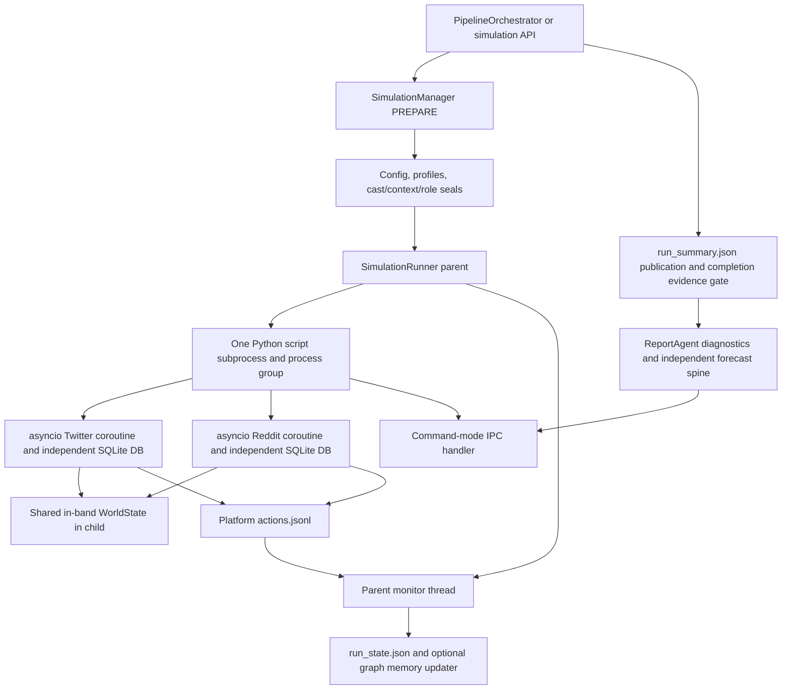

# Main simulation codebase study

Source authority: commit `c20ec60909fa1aa15154bb6fdb3fdb71c421e10e`, frozen tracked tree `/tmp/drf-main-study-c20ec60-20261011/source`. Owner: `simulation`. This document describes source behavior; no application, provider, pipeline, or test execution is part of this study.

## Study brief and verification scope

Read all 16 assigned Python files in full, then trace selected frozen-source callers, consumers, and characterization tests. Explain preparation, personas/configuration, process and IPC topology, round scheduling/actions/interactions, decision projections, checkpoint/resume, memory writeback, and report artifacts. The companion JSON records exact inspected ranges and SHA-256 identities. Cross-owner references are targeted reads and are not represented as full coverage. Only this report and its coverage JSON are written.

Status: complete as a static source study; runtime verification was not performed.

## Preparation and executable configuration

`SimulationManager.prepare_simulation` reads filtered graph entities, adds bounded dossier stand-ins with `ensure_dossier_actor_entities`, selects the cast, writes `actor_cast_manifest.json` (`actor-cast/v1`), and rejects a cast that drops any eligible dossier actor. Current `actor-intelligence/v1` selection admits every distinct eligible matched actor and ignores legacy numeric cast limits; legacy dossiers retain the cast-discipline and graph-fill alternatives. Anchors: `backend/app/services/simulation_manager.py:224`, `backend/app/services/simulation_manager.py:351`, `backend/app/services/simulation_manager.py:483`, `backend/app/services/simulation_manager.py:524`, `backend/app/services/simulation_manager.py:580`, `backend/app/services/simulation_manager.py:862`, `backend/app/services/simulation_manager.py:927`.

Before profiles run, selected actors receive sealed context packs through `build_actor_context_artifacts`; the manager validates their actor IDs, dossier/report hashes and count. It then generates and saves Reddit JSON/Twitter CSV profiles, verifies role count equals selected cast count, calls `SimulationConfigGenerator.generate_config`, appends audience profiles in configuration order, validates both platforms' role manifests, seals the executable config, and sets READY. Errors persist FAILED and are re-raised. Scripts remain under `backend/scripts`; they are not copied into the simulation directory despite the older method docstring. Anchors: `backend/app/services/simulation_manager.py:978`, `backend/app/services/simulation_manager.py:1081`, `backend/app/services/simulation_manager.py:1093`, `backend/app/services/simulation_manager.py:1113`, `backend/app/services/simulation_manager.py:1165`, `backend/app/services/simulation_manager.py:1188`, `backend/app/services/simulation_manager.py:1239`, `backend/app/services/simulation_manager.py:1242`, `backend/app/services/simulation_manager.py:1278`, `backend/app/services/simulation_manager.py:1300`.

`state.json` is preparation identity/state; `SimulationState` includes platform enables, counts, role/context contract versions, cast/context/profile-manifest hashes, config hashes, errors and timestamps. Manager writes share `SimulationRunner._run_state_lock`. `build_simulation_config_seal` writes `simulation-config-manifest/v1` with exact-byte and canonical JSON config hashes plus cast/context/role bindings. `validate_prepared_simulation_config` discovers manifests and prevents current contracts from taking the genuinely legacy unsealed path. `reseal_simulation_config` supports the orchestrator's later PREPARE overlays without retaining stale hashes. Anchors: `backend/app/services/simulation_manager.py:52`, `backend/app/services/simulation_manager.py:137`, `backend/app/services/simulation_manager.py:620`, `backend/app/services/simulation_manager.py:757`, `backend/app/services/simulation_manager.py:1318`, `backend/app/services/simulation_manager.py:1352`.

`SimulationParameters` serializes identity, `time_config`, `agent_configs`, `event_config`, per-platform configuration, model metadata and reasoning; nonempty `world_brief`, `temporal_config`, and `output_language` are additive. `AgentActivityConfig` separates activity/frequency/hours/delay, sentiment/stance, visibility (`influence_weight`), topics, incentive strings, actor-context behavior digest, typed gap audit, urgency and cadence. The typed dataclass does not declare `outcome_power`; decision code independently reads that optional key from dictionaries and uses declared-neutral power when absent. Anchors: `backend/app/services/simulation_config_generator.py:193`, `backend/app/services/simulation_config_generator.py:250`, `backend/app/services/simulation_config_generator.py:280`, `backend/app/services/simulation_config_generator.py:300`, `backend/app/services/simulation_config_generator.py:325`, `backend/app/services/simulation_config_generator.py:373`; `backend/app/services/decision_channel.py:360`.

`generate_config` resolves language/profile, builds shared evidence context, optionally builds a calendar timeline, produces time/event configuration, assembles a shared brief, generates batches of 15 behavior configurations, assigns seed publishers, appends audience, assigns cadence, creates follows and scheduled events, and emits platform defaults. Calendar time skips the time LLM and sets hours/minutes compatibility fields to `n_rounds`/60. Canonical v1 agent batches bypass the behavior LLM and use deterministic neutral activity defaults enriched by bounded context; legacy batches use JSON retries, ID/position recovery, then entity-type rules, researched influence and stance fallback. Anchors: `backend/app/services/simulation_config_generator.py:455`, `backend/app/services/simulation_config_generator.py:546`, `backend/app/services/simulation_config_generator.py:571`, `backend/app/services/simulation_config_generator.py:630`, `backend/app/services/simulation_config_generator.py:666`, `backend/app/services/simulation_config_generator.py:694`, `backend/app/services/simulation_config_generator.py:705`, `backend/app/services/simulation_config_generator.py:755`, `backend/app/services/simulation_config_generator.py:2752`, `backend/app/services/simulation_config_generator.py:2960`, `backend/app/services/simulation_config_generator.py:3005`, `backend/app/services/simulation_config_generator.py:3650`, `backend/app/services/simulation_config_generator.py:3675`.

Canonical shared context excludes the whole report and graph summaries. Public world facts, seed fallback and event/follow rows come from validated source-bound packs; analyst inference does not become shared fact. Relationship rows must match dossier fingerprints and pass `is_hard_public_relationship`; scheduled events require date, content, refs and public visibility. Behavior projection schema is `actor-config-context/v1`, bounded to 1,800 characters with whole-row trimming; structured incentives are prioritized. Evidence gaps survive separately under `evidence_gap_audit_not_actor_or_llm_knowledge` / `actor-config-evidence-gap-audit/v1` (65,536-byte bound) and are removed from the behavior view. Anchors: `backend/app/services/simulation_config_generator.py:1411`, `backend/app/services/simulation_config_generator.py:1494`, `backend/app/services/simulation_config_generator.py:1596`, `backend/app/services/simulation_config_generator.py:1662`, `backend/app/services/simulation_config_generator.py:1843`, `backend/app/services/simulation_config_generator.py:1939`, `backend/app/services/simulation_config_generator.py:3375`, `backend/app/services/simulation_config_generator.py:3394`, `backend/app/services/simulation_config_generator.py:3579`.

Legacy shared briefs combine question, situation brief, topics and optionally handoff `prediction_markets.json` pricing; lookup scans `PipelineManager` for the matching simulation. `SIM_WORLD_BRIEF`, `SIM_MARKET_PRIORS`, adaptive context and provider window bounds control that path. Current canonical brief returns before raw market rows are appended. Audience creation uses an independent seeded RNG (`SIM_SEED` XOR AUDI), up to 5,000 slots, and contiguous IDs; persona generation mirrors them so OASIS array indexes match. Cadence chooses influence >=0.6 head actors up to 20, with a half-cast guard when an entire cast above four actors would otherwise be principal. Anchors: `backend/app/services/simulation_config_generator.py:904`, `backend/app/services/simulation_config_generator.py:1335`, `backend/app/services/simulation_config_generator.py:1350`, `backend/app/services/simulation_config_generator.py:1876`, `backend/app/services/simulation_config_generator.py:1917`, `backend/app/services/simulation_config_generator.py:3816`, `backend/app/services/simulation_config_generator.py:3893`.

## Simulation time, projections and pure helpers

`sim_timeline.extract_horizon` tries explicit dates, anchored periods, relative spans, then the greatest usable bare year; candidates must be after as-of and within 30 years. Configuration adds one LLM fallback then a calendar-month default; as-of falls back to run date with a warning. `build_timeline` selects day/week/half-month/month/quarter/half-year around an ideal 16 rounds, coarsens for requested budgets, and uses a stride for long horizons. Actual period count is authoritative. Natural grid periods partition `(as_of,horizon]` inclusively, merging short first/last fragments; `round_for_date` uses period-end bisection and rejects out-of-window dates. Anchors: `backend/app/utils/sim_timeline.py:56`, `backend/app/utils/sim_timeline.py:266`, `backend/app/utils/sim_timeline.py:338`, `backend/app/utils/sim_timeline.py:352`, `backend/app/utils/sim_timeline.py:435`, `backend/app/utils/sim_timeline.py:491`, `backend/app/utils/sim_timeline.py:518`; `backend/app/services/simulation_config_generator.py:936`.

Scheduled event JSON rows are `{round,content,date,poster_agent_id,poster_name}`. Calendar events use interval inclusion, retain beyond-horizon events/warnings, and prefix content with the date. Hours events use proportional scheduling constrained to the execution budget; named publisher matching falls back to greatest influence. Follows are sorted, deduplicated ID pairs from authorized relationships (legacy adds bounded graph neighbors), then deterministic stance/topic clusters and head bridges. Anchors: `backend/app/services/simulation_config_generator.py:817`, `backend/app/services/simulation_config_generator.py:1028`, `backend/app/services/simulation_config_generator.py:1226`.

`AgentDynamicsTracker` seeds mood and opinion strength, then changes bounded mood, energy, strength and fatigue from received interaction valence and own activity. `extract_round_signals` resolves target author/user names; `state_line` renders only material deviations. `dynamics_summary.active` requires at least one received signal. Other pure helpers sample weighted non-self likes, cap seed follow actions without removing graph topology, detect consecutive broadcast-only rounds and calculate hours as executed rounds times minutes/60. `build_world_delta` produces next-period event/post/qualitative momentum text (default five posts, 900 characters), never renders numeric scenario shares from `leader_move`, and returns empty on failure. Anchors: `backend/app/services/agent_dynamics.py:39`, `backend/app/services/agent_dynamics.py:86`, `backend/app/services/agent_dynamics.py:150`, `backend/app/services/agent_dynamics.py:180`, `backend/app/services/agent_dynamics.py:193`, `backend/app/services/agent_dynamics.py:245`, `backend/app/services/agent_dynamics.py:310`, `backend/app/services/agent_dynamics.py:335`, `backend/app/services/agent_dynamics.py:390`; `backend/app/services/world_delta.py:21`.

`WorldState` normalizes base-rate scenario shares (uniform prior explicitly labeled if missing), accumulates `magnitude * outcome_power * confidence` commitments, blends toward their distribution by inertia, and optionally mixes calendar shares back toward the seed prior. `committed`/`abstained` are valid transitions; silent/failed/missing/infeasible freeze shares and EWMA while recording history. Convergence requires EWMA below epsilon plus at least three valid transitions, >=0.5 valid coverage and zero failed rounds (`foglamp-convergence-policy/v1`). Output is explicitly `elicited_model_projection`. Anchors: `backend/app/services/worldstate.py:43`, `backend/app/services/worldstate.py:59`, `backend/app/services/worldstate.py:81`, `backend/app/services/worldstate.py:122`, `backend/app/services/worldstate.py:159`, `backend/app/services/worldstate.py:234`, `backend/app/services/worldstate.py:255`, `backend/app/services/worldstate.py:283`.

`decision_channel.elicit_round` batches a roster into one `chat_json` request and writes typed status to its context. Prompts contain immutable base shares, incentives, optional round posts/affect and calendar period framing; evolving shares are hidden. `run_decision_channel` groups immutable actions by round, ranks visibility for roster selection, combines tail actors into `__public__` with summed power, caches equivalent roster/date or roster/period-label inputs, fans out elicitation, then steps one world state strictly in round order. Outcomes contain decisions/trajectory/accounting/validity; schema 2 becomes schema 3 for calendar. Invalid/inconclusive runs get `forecast_effect=no_update`; valid runs allow diagnostic_only or no_update, with validated_update unavailable. Anchors: `backend/app/services/decision_channel.py:173`, `backend/app/services/decision_channel.py:216`, `backend/app/services/decision_channel.py:289`, `backend/app/services/decision_channel.py:399`, `backend/app/services/decision_channel.py:442`, `backend/app/services/decision_channel.py:506`, `backend/app/services/decision_channel.py:535`, `backend/app/services/decision_channel.py:631`, `backend/app/services/decision_channel.py:655`, `backend/app/services/decision_channel.py:733`.

`ensemble.aggregate_forecasts` aligns normalized scenario names, optionally falls back to resolution-criteria token Jaccard (0.34 default), retains aliases, computes mean/spread/support, optionally pools extremized log odds, and renormalizes. Agreement uses pairwise total variation plus presence support, with None when fewer than two shared semantic buckets; probability +/- sample stdev supplies bounded intervals. `pool_binary_forecasts` matches statement then ID, pools model probabilities in place and records models/probabilities/spread; unmatched primary forecasts stay intact. These are pure aggregation utilities; their driver/consumer wiring is traced later. Anchors: `backend/app/services/ensemble.py:55`, `backend/app/services/ensemble.py:118`, `backend/app/services/ensemble.py:150`, `backend/app/services/ensemble.py:261`, `backend/app/services/ensemble.py:348`.

## Persona serialization and provenance

`OasisProfileGenerator.generate_profiles_from_entities` validates all current-v1 selected actor/pack identities synchronously before its worker pool. A current-v1 profile uses `_canonical_actor_role_profile`: compile `actor-role/v2` with exact actor-context provenance, use that prompt as the sole behavioral persona, keep structural name/type/entity ID, and propagate canonical failures instead of producing a generic stub. `_canonical_role_only_persona` rechecks the fragment hash on serialization. Legacy `generate_profile_from_entity` uses graph attributes/relations, optional Zep edge/node retrieval, optional community/ego enrichment, a three-attempt JSON persona generator or rule template, then always appends a deterministic role for a researched actor. Legacy exceptions become role-preserving stubs. Anchors: `backend/app/services/oasis_profile_generator.py:146`, `backend/app/services/oasis_profile_generator.py:388`, `backend/app/services/oasis_profile_generator.py:474`, `backend/app/services/oasis_profile_generator.py:609`, `backend/app/services/oasis_profile_generator.py:688`, `backend/app/services/oasis_profile_generator.py:865`, `backend/app/services/oasis_profile_generator.py:938`, `backend/app/services/oasis_profile_generator.py:1091`, `backend/app/services/oasis_profile_generator.py:1159`, `backend/app/services/oasis_profile_generator.py:1236`, `backend/app/services/oasis_profile_generator.py:1647`, `backend/app/services/oasis_profile_generator.py:2255`.

Realtime profiles contain only the completed contiguous prefix, retaining the invariant array index == entity/config ID despite out-of-order workers. Final Reddit JSON uses `username`, `persona`, bio, karma, created date and required loader fields; canonical demographic placeholders are empty, whereas legacy fields get age/gender/MBTI/country defaults. Twitter CSV headers are `user_id,name,username,user_char,description`; canonical `user_char` is the role alone with newlines replaced by spaces, legacy uses bio plus persona. JSON optionally stores `other_info.persona_design` and `actor_role`. Role manifests (`actor-role-manifest/v2`) bind whole profile bytes, full runtime-field hash, transformed role-fragment hash, profile index, actor ID, compiler limit, cast/context/dossier/roster hashes and canonical Reddit base-message hash. Validation recompiles current contracts and checks all bindings; genuine role/v1 uses sealed fragment verification without the old compiler. Anchors: `backend/app/services/oasis_profile_generator.py:2316`, `backend/app/services/oasis_profile_generator.py:2459`, `backend/app/services/oasis_profile_generator.py:2551`, `backend/app/services/oasis_profile_generator.py:2642`, `backend/app/services/oasis_profile_generator.py:2647`, `backend/app/services/oasis_profile_generator.py:2793`, `backend/app/services/oasis_profile_generator.py:2956`, `backend/app/services/oasis_profile_generator.py:3062`, `backend/app/services/oasis_profile_generator.py:3150`.

## Parent runner, persistence and IPC

`SimulationRunner.start_simulation` validates platform, checks actual process liveness, discovers role/context manifests, compares prepared state and authority closure, validates every prepared profile (including an unrequested platform), and rejects current contracts lacking state-bound config hashes. It starts `sys.executable backend/scripts/run_<platform>_simulation.py --config <path>` or the parallel script, passing parallel `--config-seal`, optional `--max-rounds`/`--resume`, with `cwd=sim_dir`, merged stdout/stderr to `simulation.log`, copied environment plus UTF-8 flags/optional per-run SIM_SEED/SIM_RESUME, and `start_new_session=True`. One daemon monitor thread tails both platform logs every two seconds; no platform subprocess is launched by this parent. Anchors: `backend/app/services/simulation_runner.py:451`, `backend/app/services/simulation_runner.py:497`, `backend/app/services/simulation_runner.py:655`, `backend/app/services/simulation_runner.py:733`, `backend/app/services/simulation_runner.py:873`, `backend/app/services/simulation_runner.py:907`, `backend/app/services/simulation_runner.py:929`, `backend/app/services/simulation_runner.py:943`, `backend/app/services/simulation_runner.py:969`, `backend/app/services/simulation_runner.py:1011`.

`run_state.json` holds `SimulationRunState` (runner status, enabled/running/completed platform flags, rounds/hours/actions, bounded recent actions, PID/PGID, graph-memory request/actual/error, truncation/resume and optional calendar fields). State serialization has its own RLock; disk saves use a shared lock and optional `SIM_RUNSTATE_SAVE_INTERVAL`, with forced/terminal writes bypassing throttling. `simulation_end` for every enabled platform promotes STARTING/RUNNING to COMPLETED while the command-mode process remains alive. A zero process exit without all completion events becomes FAILED. Existing terminal outcomes survive later command-mode exit/cleanup. `PAUSED` is an enum compatibility value; no pause/resume-in-memory operation is implemented. Anchors: `backend/app/services/simulation_runner.py:36`, `backend/app/services/simulation_runner.py:102`, `backend/app/services/simulation_runner.py:266`, `backend/app/services/simulation_runner.py:341`, `backend/app/services/simulation_runner.py:422`, `backend/app/services/simulation_runner.py:1056`, `backend/app/services/simulation_runner.py:1183`, `backend/app/services/simulation_runner.py:1387`, `backend/app/services/simulation_runner.py:2390`.

Fresh runs rotate platform actions/checkpoints and listed derived summaries/trajectory/decisions/health/telemetry to prior snapshots; resumable parallel runs retain logs/DBs. `SIM_RESUME` auto-selection requires a previous non-completed state and usable checkpoint; explicit resume is also supported, single-platform requests degrade to fresh. Parent `_resume_checkpoint_round` chooses greatest platform completed round for accounting and rejects differing present config hashes; child independently restores each platform. Process stop uses group/tree termination and records STOPPED only when termination is confirmed; orphan reconciliation checks script and simulation identity (Unix), probes FLASK_PORT before reclaim, synchronizes state and env-status. Anchors: `backend/app/services/simulation_runner.py:761`, `backend/app/services/simulation_runner.py:1289`, `backend/app/services/simulation_runner.py:1310`, `backend/app/services/simulation_runner.py:1340`, `backend/app/services/simulation_runner.py:1357`, `backend/app/services/simulation_runner.py:1441`, `backend/app/services/simulation_runner.py:1520`, `backend/app/services/simulation_runner.py:1591`, `backend/app/services/simulation_runner.py:1608`, `backend/app/services/simulation_runner.py:1664`.

Graph memory writeback is owned by the parent monitor: requested updater creation sets actual/error fields; ordinary action rows are passed to `ZepGraphMemoryManager.get_updater(...).add_activity_from_dict(action_data,platform)`, outside state locks. Monitor-finally, stop and global cleanup stop the updater. The updater's internal ingestion implementation belongs to graph-actors and is a cross-owner seam, not full-read coverage here. `join_monitor_thread` is the public convergence barrier for callers waiting for final log/updater cleanup. Anchors: `backend/app/services/simulation_runner.py:322`, `backend/app/services/simulation_runner.py:853`, `backend/app/services/simulation_runner.py:1120`, `backend/app/services/simulation_runner.py:1168`, `backend/app/services/simulation_runner.py:1277`, `backend/app/services/simulation_runner.py:1720`.

`SimulationIPCClient` writes UUID JSON commands under `ipc_commands`, polls `ipc_responses`, emits cancel markers on timeout and performs age-based cleanup. Command schema is `{command_id,command_type,args,timestamp}`, response adds `{status,result,error}`; types are interview/batch_interview/close_env. The reusable `SimulationIPCServer` atomically claims `.processing` and suppresses abandoned responses, but the parallel runtime uses its own `ParallelIPCHandler` (no claim rename), reviewed separately. `IPC_TELEMETRY_ENABLED` optionally records round-trip JSONL with latency/polls/status and summarizes timeout rate/p50/p95. Runner interview facades require env alive, scale batch timeout using agent count/concurrency, and return structured success/error; historical results come from `trace` where action='interview'. Close-env timeout is reported as command sent, not proof of termination. Anchors: `backend/app/services/simulation_ipc.py:117`, `backend/app/services/simulation_ipc.py:132`, `backend/app/services/simulation_ipc.py:158`, `backend/app/services/simulation_ipc.py:187`, `backend/app/services/simulation_ipc.py:209`, `backend/app/services/simulation_ipc.py:424`, `backend/app/services/simulation_ipc.py:475`, `backend/app/services/simulation_ipc.py:547`, `backend/app/services/simulation_ipc.py:599`, `backend/app/services/simulation_ipc.py:674`; `backend/app/services/simulation_runner.py:2594`, `backend/app/services/simulation_runner.py:2648`, `backend/app/services/simulation_runner.py:2712`, `backend/app/services/simulation_runner.py:2740`, `backend/app/services/simulation_runner.py:2804`, `backend/app/services/simulation_runner.py:2864`, `backend/app/services/simulation_runner.py:2912`.

`write_run_summary` reads the complete action history, timeline and per-agent stats. It distinguishes seed/injected actions from nonzero-round organic actions, computes real executed rounds from run-state, classifies errored/hollow/truncated/ok then optional llm_degraded, attaches dynamics/community/organic-ratio diagnostics, and writes `run_summary.json`. `top_posts` is explicitly a chronological sample of first 25 organic CREATE_POST/QUOTE_POST rows, not a propagation ranking. Calendar output adds unit/period count/horizon/provenance/coverage_end/span-days; hours are the compatibility formula even in calendar mode. Anchors: `backend/app/services/simulation_runner.py:1801`, `backend/app/services/simulation_runner.py:1897`, `backend/app/services/simulation_runner.py:1975`, `backend/app/services/simulation_runner.py:2026`, `backend/app/services/simulation_runner.py:2058`, `backend/app/services/simulation_runner.py:2086`, `backend/app/services/simulation_runner.py:2134`, `backend/app/services/simulation_runner.py:2149`, `backend/app/services/simulation_runner.py:2215`, `backend/app/services/simulation_runner.py:2232`, `backend/app/services/simulation_runner.py:2276`.

## Main orchestration and subprocess topology

The reviewed active full-pipeline call path is `PipelineOrchestrator._run` → `SimulationManager.prepare_simulation` → PREPARE-owned overlay/WorldState seed → `reseal_simulation_config` → `SimulationRunner.start_simulation(platform="parallel")` → `run_parallel_simulation.main`. Main creates both platforms. Config generation receives the research Markdown, admitted actor dossier, graph priors, explicit round budget and research language. The orchestrator injects `world_state_seed` from `world_state_seed_from_actors`, reconciles horizon metadata with `temporal_config`, and seals final bytes before completing PREPARE. It polls runner state, handles cancellation/stall termination, publishes the run summary and requires completion evidence before REPORT. Cross-owner anchors: `backend/app/services/pipeline_orchestrator.py:11883`, `backend/app/services/pipeline_orchestrator.py:12776`, `backend/app/services/pipeline_orchestrator.py:12811`, `backend/app/services/pipeline_orchestrator.py:12879`, `backend/app/services/pipeline_orchestrator.py:12925`, `backend/app/services/pipeline_orchestrator.py:12975`, `backend/app/services/pipeline_orchestrator.py:13049`, `backend/app/services/pipeline_orchestrator.py:13108`, `backend/app/services/pipeline_orchestrator.py:13134`.

The two platform environments execute as coroutines under one `asyncio.gather(..., return_exceptions=True)`, with exceptions isolated to their platform result. Each has its own graph/model/environment/database and logger; they share the process RNG and directory-keyed in-band evolution. `get_oasis_semaphore(..., platforms=2)` allocates each platform half the environment-selected cap. CLI model requests go through `asyncio.to_thread` and then the external CLI abstraction; HTTP-compatible models use CAMEL clients. No additional platform `multiprocessing.Process` is created in this script. It imports multiprocessing and stops the resource tracker on exit. Anchors: `backend/scripts/run_parallel_simulation.py:92`, `backend/scripts/run_parallel_simulation.py:114`, `backend/scripts/run_parallel_simulation.py:3255`, `backend/scripts/run_parallel_simulation.py:4692`, `backend/scripts/run_parallel_simulation.py:5228`, `backend/scripts/run_parallel_simulation.py:5930`, `backend/scripts/run_parallel_simulation.py:6148`; `backend/app/utils/oasis_llm.py:446`, `backend/app/utils/oasis_llm.py:603`.

`main` validates the config seal before loading executable config bytes, sets telemetry sink, initializes logs, checks available disk, and chooses dual-platform or explicit `--twitter-only`/`--reddit-only`. The subprocess supports `--no-wait` and `--resume`. It loads project/backend `.env` in its code, but no environment files were read by this study. The explicit parent `--config-seal` binds the child's validation to the parent-admitted manifest. Anchors: `backend/scripts/run_parallel_simulation.py:124`, `backend/scripts/run_parallel_simulation.py:1270`, `backend/scripts/run_parallel_simulation.py:1285`, `backend/scripts/run_parallel_simulation.py:5779`, `backend/scripts/run_parallel_simulation.py:5841`, `backend/scripts/run_parallel_simulation.py:5873`.

The direct simulation API is another caller: its preparation call passes graph/type/profile controls without `actors` or actor-context packs in the reviewed call, and its start call passes requested platform/round cap/graph writeback. It can therefore select the separate single-platform scripts. This is a callable alternative to the full orchestrator path, not proof that either path has run in this study. Anchors: `backend/app/api/simulation.py:619`, `backend/app/api/simulation.py:1640`.

## The parallel platform round loop

Each platform creates a model and wraps its request counter, loads its platform-specific profiles, optionally prunes social tools by role, injects world/calendar system context, wraps tool-argument normalization and self-like protection, creates the database-backed platform/environment, and resets the environment. Reddit additionally replaces OASIS' demographic template for canonical roles and attests the effective system bytes after the permitted role/world/calendar composition. `reddit_runtime_system_messages.json` (`reddit-runtime-system-messages/v1`) records profile index/actor ID, composition, message hash/length, role-manifest hash and validated config-manifest hash. Anchors: `backend/scripts/run_parallel_simulation.py:482`, `backend/scripts/run_parallel_simulation.py:559`, `backend/scripts/run_parallel_simulation.py:576`, `backend/scripts/run_parallel_simulation.py:630`, `backend/scripts/run_parallel_simulation.py:711`, `backend/scripts/run_parallel_simulation.py:749`, `backend/scripts/run_parallel_simulation.py:2341`, `backend/scripts/run_parallel_simulation.py:2420`, `backend/scripts/run_parallel_simulation.py:4742`, `backend/scripts/run_parallel_simulation.py:4811`, `backend/scripts/run_parallel_simulation.py:5277`, `backend/scripts/run_parallel_simulation.py:5294`, `backend/scripts/run_parallel_simulation.py:5318`.

Twitter's parallel action union includes post/like/repost/follow/do-nothing/quote plus comment/search-posts/trend. Reddit includes post/comment and post/comment likes/dislikes, search-posts/search-user/trend/refresh/do-nothing/follow/mute. Role affordances intersect these unions with a role policy and retain a post/comment/do-nothing floor; `student`, `alumni`, and `person` retain full union access. Interview is not an autonomous action; the IPC handler issues it manually. Anchors: `backend/scripts/run_parallel_simulation.py:214`, `backend/scripts/run_parallel_simulation.py:227`, `backend/scripts/run_parallel_simulation.py:269`, `backend/scripts/run_parallel_simulation.py:420`, `backend/scripts/run_parallel_simulation.py:465`, `backend/scripts/run_parallel_simulation.py:990`.

Fresh round zero posts seeds (multiple posts for one actor are a list), adds the complete initial-follow topology to the in-memory graph, then issues capped FOLLOW actions in passes so one follower can follow several targets. It drains seed trace rows immediately: initial CREATE_POST rows were already logged, while follow/other rows get round zero plus `is_seed_action`. Scheduled events fire before actor activation, log `is_scheduled_event`, and advance the trace cursor so injected posts do not appear a second time as organic output. Anchors: `backend/scripts/run_parallel_simulation.py:2460`, `backend/scripts/run_parallel_simulation.py:2531`, `backend/scripts/run_parallel_simulation.py:4847`, `backend/scripts/run_parallel_simulation.py:4869`, `backend/scripts/run_parallel_simulation.py:4904`, `backend/scripts/run_parallel_simulation.py:4912`, `backend/scripts/run_parallel_simulation.py:5037`, `backend/scripts/run_parallel_simulation.py:5414`.

For a representative nonempty round, the concrete order is:

1. Check shutdown and free disk; derive hours and optional calendar period; fire scheduled events.
2. Select active agents. Hours mode requires active hours and uses activity × normalized influence × hour multiplier, with a 1.5 recency boost and weighted sampling. Calendar mode skips hour filtering/multipliers and always activates `cadence="principal"` ahead of sampled actors. Invalid graph IDs are skipped.
3. Log round start. Empty rounds log round end, advance the in-band heartbeat and checkpoint, then continue.
4. Append optional dynamics state and a calendar world-clock USER memory note; advance the reaction post window; call `env.step({agent: LLMAction()})`.
5. Read newly written `trace` rows by `rowid`; map action names and enrich post/comment/target context; append platform JSONL actions.
6. Run the optional response phase, append its real DB actions to the same round, and write each actor's compact USER response memory.
7. Observe affect dynamics; optionally inject tagged sampled likes; deliver ordinary and response actions plus due events to shared world evolution.
8. Log round end with hours/period end and atomically write the checkpoint.

Anchors: `backend/scripts/run_parallel_simulation.py:1738`, `backend/scripts/run_parallel_simulation.py:1752`, `backend/scripts/run_parallel_simulation.py:1802`, `backend/scripts/run_parallel_simulation.py:1901`, `backend/scripts/run_parallel_simulation.py:1940`, `backend/scripts/run_parallel_simulation.py:5008`, `backend/scripts/run_parallel_simulation.py:5064`, `backend/scripts/run_parallel_simulation.py:5096`, `backend/scripts/run_parallel_simulation.py:5130`, `backend/scripts/run_parallel_simulation.py:5148`, `backend/scripts/run_parallel_simulation.py:5162`, `backend/scripts/run_parallel_simulation.py:5176`, `backend/scripts/run_parallel_simulation.py:5184`. Reddit repeats this ordering at `backend/scripts/run_parallel_simulation.py:5559`.

The DB extraction contract queries `trace(rowid,user_id,action,info)` and returns `{agent_id,agent_name,action_type,action_args}` plus the latest cursor. It advances over filtered `refresh`/`sign_up`, keeps bounded field selection rather than raw trace info, and joins `post`, `comment`, `user`, `follow` to enrich target author/content. Logger rows then add round/timestamp/result/success. Event rows instead use `event_type` with simulation or round counters and optional calendar labels/end date. The parent supplies platform from the file path; service `AgentAction.to_dict` uses `round_num`, whereas stored platform JSONL uses `round`. Anchors: `backend/scripts/run_parallel_simulation.py:1348`, `backend/scripts/run_parallel_simulation.py:1395`, `backend/scripts/run_parallel_simulation.py:1487`, `backend/scripts/run_parallel_simulation.py:1595`; `backend/scripts/action_logger.py:43`, `backend/scripts/action_logger.py:68`, `backend/scripts/action_logger.py:84`, `backend/scripts/action_logger.py:105`, `backend/scripts/action_logger.py:120`; `backend/app/services/simulation_runner.py:48`.

`run_reaction_phase` fetches at most 60 recent posts in a two-round ID window (first round includes seeds), excludes plain reposts, adds comments, and scores up to three candidates using mentions, topic/incentive overlap, follow direction, stance, recency, prior conversation and distribution penalties. It allows returning to one's own post only after another actor replies, and avoids repeating an unanswered own reply. A new helper `ChatAgent` reuses system prompt/model/bound tools but has independent memory and `max_iteration=1`; only `create_comment`, `like_post`, `like_comment` are offered if available. Requests share the environment semaphore. The main actor gets a compact response note, not the full candidates prompt. The wrapper rejects self-authored likes when DB ownership is determinable. Failure isolates to the actor/phase. Anchors: `backend/scripts/run_parallel_simulation.py:4091`, `backend/scripts/run_parallel_simulation.py:4234`, `backend/scripts/run_parallel_simulation.py:4260`, `backend/scripts/run_parallel_simulation.py:4364`, `backend/scripts/run_parallel_simulation.py:4450`, `backend/scripts/run_parallel_simulation.py:4521`, `backend/scripts/run_parallel_simulation.py:4536`, `backend/scripts/run_parallel_simulation.py:4559`, `backend/scripts/run_parallel_simulation.py:4629`, `backend/scripts/run_parallel_simulation.py:4660`.

The engagement sampler is a separate manual LIKE layer, automatic only when the reaction phase is off unless explicitly enabled. It samples non-self targets among newly created posts, weights by current engagement, advances trace IDs, and logs `is_engagement_sample`. Those samples add to action totals but are excluded from organic-ratio-collapse diagnostics. They are not appended to the `actual_actions` list passed to dynamics or world evolution. `env.step` exceptions record zero-action round endings/heartbeats/checkpoints, with a hard failure after a configured number of consecutive same-class exceptions; disk insufficiency raises before each round. Anchors: `backend/scripts/run_parallel_simulation.py:3866`, `backend/scripts/run_parallel_simulation.py:3884`, `backend/scripts/run_parallel_simulation.py:3897`, `backend/scripts/run_parallel_simulation.py:3977`, `backend/scripts/run_parallel_simulation.py:5105`, `backend/scripts/run_parallel_simulation.py:5167`.

## In-band evolution, post-hoc alternative and restart semantics

Calendar `_InbandWorldEvolution` is shared by absolute simulation directory. Each platform delivers a zero-based round buffer with actions/period/events, with duplicate events removed by `(date,content)`. Heartbeats advance platform watermarks without creating a pending buffer. `_advance` processes sorted pending rounds no further than the slowest live platform watermark, waits for every expected platform to appear, and flushes all remaining buffers on finalize. It elicits once per merged distinct-actor roster, steps `WorldState`, constructs qualitative delta text and appends quantitative `world_digest.jsonl`. It does not synchronously block a faster platform at a round boundary: the next prompt uses that platform loop's latest copied digest. Anchors: `backend/scripts/run_parallel_simulation.py:3366`, `backend/scripts/run_parallel_simulation.py:3452`, `backend/scripts/run_parallel_simulation.py:3483`, `backend/scripts/run_parallel_simulation.py:3493`, `backend/scripts/run_parallel_simulation.py:3554`, `backend/scripts/run_parallel_simulation.py:3574`, `backend/scripts/run_parallel_simulation.py:3659`, `backend/scripts/run_parallel_simulation.py:5180`.

In-band prompts use seed base shares, per-period framing, first available action content and declared power; no evolving numeric shares enter the next world-clock digest. The trajectory includes round zero at as-of, dated subsequent snapshots, decisions without the derived `weight` field and `WorldState` outcome/accounting/epistemic fields. Final envelope is schema 3/mode calendar with horizon provenance and optional unit. Unlike `run_decision_channel`'s post-hoc return, `force_finalize` does not add top-level `validity`, `forecast_effect`, or `round_accounting`; per-snapshot/outcome accounting still exists. This is an observed serialization distinction. Neither path terminates the calendar loop on convergence; `converged_at` is a signal. Anchors: `backend/scripts/run_parallel_simulation.py:3508`, `backend/scripts/run_parallel_simulation.py:3601`, `backend/scripts/run_parallel_simulation.py:3646`, `backend/scripts/run_parallel_simulation.py:3674`; `backend/app/services/decision_channel.py:733`.

After both platform loops, main finalizes pending in-band evolution. If no in-band trajectory was written and the environment's `SIM_DECISION_CHANNEL` is exactly `true`, it runs post-hoc `run_decision_channel`, writing the trajectory and decisions. `_read_actions_for_decision_channel` passes round/actor/name only, so the service's optional post/affect enrichment is not populated by this wrapper. Hours dates linearly map seed as-of to horizon; calendar fallback passes exact period rows. Post-hoc elicitation is cached and parallelized, followed by serial replay; in-band elicitation runs at watermark advance and has no roster cache. Anchors: `backend/scripts/run_parallel_simulation.py:3264`, `backend/scripts/run_parallel_simulation.py:3292`, `backend/scripts/run_parallel_simulation.py:3692`, `backend/scripts/run_parallel_simulation.py:3723`, `backend/scripts/run_parallel_simulation.py:5972`, `backend/scripts/run_parallel_simulation.py:5984`, `backend/scripts/run_parallel_simulation.py:6002`.

Platform `checkpoint.json` stores `{platform,completed_round,last_rowid,total_rounds,total_actions,updated_at,config_hash?,rng_state?}`. Writes default on through `SIM_CHECKPOINT`; `SIM_RESUME` also forces writing. A resume request requires a valid positive-round checkpoint and existing DB, checks a present config fingerprint against current configuration, restores the process RNG, keeps the DB/logs, skips seed posts/follows and starts at `completed_round`. It advances the trace cursor to at least the DB maximum, excluding partial-round trace residue from subsequent logging. It does not roll back partial DB effects. Conversation memory and dynamics are reconstructed; the in-band WorldState starts from its seed and covers resumed rounds. RNG state is process-wide and shared across platform coroutines, so the reviewed implementation records sampling state without establishing full cross-platform or provider determinism. Anchors: `backend/scripts/run_parallel_simulation.py:3737`, `backend/scripts/run_parallel_simulation.py:3752`, `backend/scripts/run_parallel_simulation.py:3764`, `backend/scripts/run_parallel_simulation.py:3776`, `backend/scripts/run_parallel_simulation.py:3802`, `backend/scripts/run_parallel_simulation.py:3838`, `backend/scripts/run_parallel_simulation.py:4792`, `backend/scripts/run_parallel_simulation.py:4838`, `backend/scripts/run_parallel_simulation.py:4998`, `backend/scripts/run_parallel_simulation.py:5345`, `backend/scripts/run_parallel_simulation.py:5391`.

Completed-result reuse is separate from unfinished-round resume. The orchestrator checks platform completion markers, valid summary if present, matching simulation identity, config/cast/context/role seal, optional runtime attestation and artifact manifest. With `SIM_RESUME_REUSE_COMPLETED` on, a missing RUN stage bit can be reconstructed from those durable artifacts without restarting; a missing legacy summary can be backfilled. Reused config/summary bytes are preserved. Anchors: `backend/app/services/pipeline_orchestrator.py:9976`, `backend/app/services/pipeline_orchestrator.py:10086`, `backend/app/services/pipeline_orchestrator.py:12831`, `backend/app/services/pipeline_orchestrator.py:12961`; `backend/app/config.py:596`.

## Models, fallback, telemetry and command lifetime

`create_oasis_model` resolves provider from environment → config JSON → `Config` → CLI fallback. CLI requests emulate one named tool call via a JSON text protocol when tools are offered and no prior tool-result message exists; parse failure becomes text-only output. Structured requests call `LLMClient.chat_json`. Native compatible models use `ModelFactory`, optional boost key/base/model, a Kimi coding-agent User-Agent where selected, configured reasoning extra-body and empty-assistant guards. Selected content-filter/quota/rate-limit exceptions may reissue through `LLMClient`, which can return emulated tool calls; fallback failure rethrows the original exception. `llm_fallback.jsonl` records provider/error-class/tool-output diagnostics when cwd contains config. This study did not inspect or invoke the provider/CLI transport implementation owned by operations. Anchors: `backend/app/utils/oasis_llm.py:78`, `backend/app/utils/oasis_llm.py:122`, `backend/app/utils/oasis_llm.py:162`, `backend/app/utils/oasis_llm.py:213`, `backend/app/utils/oasis_llm.py:272`, `backend/app/utils/oasis_llm.py:301`, `backend/app/utils/oasis_llm.py:320`, `backend/app/utils/oasis_llm.py:379`, `backend/app/utils/oasis_llm.py:481`, `backend/app/utils/oasis_llm.py:490`, `backend/app/utils/oasis_llm.py:557`.

The parallel script counts model-boundary requests/errors, merges per-platform `llm_health.json`, and accumulates token usage by model/source. Completion IDs prefixed `chatcmpl-cli-` are length estimates, other usage is classified provider, absent usage is missing; decision/in-band `LLMClient` calls have a separate wrapper. `sim_llm_telemetry.json` uses `sim-llm-telemetry/v1`, simulation ID, a per-process `meter_run_token`, calls/errors/token totals, by-source/by-model buckets and wall time. A snapshot is written after platform loops and again on exit, so the final snapshot can include interviews/post-hoc decisions. The orchestrator consumes the snapshot at RUN success/failure boundaries. Anchors: `backend/scripts/run_parallel_simulation.py:2047`, `backend/scripts/run_parallel_simulation.py:2064`, `backend/scripts/run_parallel_simulation.py:2097`, `backend/scripts/run_parallel_simulation.py:2123`, `backend/scripts/run_parallel_simulation.py:2179`, `backend/scripts/run_parallel_simulation.py:2231`, `backend/scripts/run_parallel_simulation.py:2270`, `backend/scripts/run_parallel_simulation.py:5952`, `backend/scripts/run_parallel_simulation.py:6140`; `backend/app/services/pipeline_orchestrator.py:13062`, `backend/app/services/pipeline_orchestrator.py:13119`.

`ParallelIPCHandler` is created after simulation/postprocessing and marks env alive with platform availability. Its handler polls JSON commands in mtime order, skips `.cancel`, and suppresses response when the caller has canceled/removed the command. Single interviews issue `ManualAction(INTERVIEW)` on the requested platform or gather both; one successful platform is enough for completed status. Batch requests group by platform (item platform overrides default), execute a batch step for Twitter then Reddit, and return keyed `twitter_<id>`/`reddit_<id>` results. Latest answers are read from each DB's interview trace, not from action-log text. Command mode polls every 0.5 seconds and closes after `SIM_IDLE_CLOSE_MIN` inactivity (default 60), explicit close or shutdown. First SIGTERM/SIGINT sets an event; a repeated signal requests exit. Main closes each available environment; result completion and resource liveness remain separate. Anchors: `backend/scripts/run_parallel_simulation.py:840`, `backend/scripts/run_parallel_simulation.py:881`, `backend/scripts/run_parallel_simulation.py:921`, `backend/scripts/run_parallel_simulation.py:976`, `backend/scripts/run_parallel_simulation.py:1004`, `backend/scripts/run_parallel_simulation.py:1075`, `backend/scripts/run_parallel_simulation.py:1176`, `backend/scripts/run_parallel_simulation.py:1219`, `backend/scripts/run_parallel_simulation.py:6028`, `backend/scripts/run_parallel_simulation.py:6049`, `backend/scripts/run_parallel_simulation.py:6083`, `backend/scripts/run_parallel_simulation.py:6101`.

## Alternatives, opt-in metrics and currently unused controls

The separately selectable `TwitterSimulationRunner` and `RedditSimulationRunner` scripts are complete alternate implementations, not aliases for the parallel coroutines. They load the same profile/config files, always rebuild their DB, sample by active hours/activity with a random target count, run hours-formula rounds from midnight, log platform start/round/end, then wait for local interview IPC. They do not dispatch on `temporal_config`, inject parallel world/calendar context, run reaction/in-band decision evolution, write checkpoints, or use the parallel tool guards. Their local IPC writes status/responses directly, does not implement `.processing` or cancellation checking, and has no idle-close timer. Standalone Twitter offers six actions without CREATE_COMMENT; standalone Reddit offers its thirteen-action union. Standalone Reddit collects multiple seeds per actor into lists; standalone Twitter uses one map value per actor. Anchors: `backend/scripts/run_twitter_simulation.py:153`, `backend/scripts/run_twitter_simulation.py:692`, `backend/scripts/run_twitter_simulation.py:742`, `backend/scripts/run_twitter_simulation.py:811`, `backend/scripts/run_twitter_simulation.py:911`, `backend/scripts/run_twitter_simulation.py:1006`, `backend/scripts/run_twitter_simulation.py:1043`; `backend/scripts/run_reddit_simulation.py:153`, `backend/scripts/run_reddit_simulation.py:692`, `backend/scripts/run_reddit_simulation.py:750`, `backend/scripts/run_reddit_simulation.py:804`, `backend/scripts/run_reddit_simulation.py:897`, `backend/scripts/run_reddit_simulation.py:996`, `backend/scripts/run_reddit_simulation.py:1033`.

`SIM_EMERGENT_METRICS=true` enables post-loop stance speech-count trajectories, lexicon sentiment variance, cross/within stance interaction ratios, follow communities and cascade statistics. It reads platform DBs/logs and writes `{platform}_emergent_metrics.json` plus aggregate `emergent_metrics.json`; unavailable networkx drops community detection, with modularity-to-label-propagation fallback. `final_stance_share` is last-round speech volume by configured stance, not an outcome probability. Cascade `depth` is explicitly replies+reposts+likes (direct interaction volume). Anchors: `backend/scripts/run_parallel_simulation.py:2792`, `backend/scripts/run_parallel_simulation.py:2838`, `backend/scripts/run_parallel_simulation.py:2912`, `backend/scripts/run_parallel_simulation.py:2990`, `backend/scripts/run_parallel_simulation.py:3077`, `backend/scripts/run_parallel_simulation.py:3140`, `backend/scripts/run_parallel_simulation.py:3203`, `backend/scripts/run_parallel_simulation.py:5957`.

`PlatformConfig.recency_weight/popularity_weight/relevance_weight/viral_threshold` are serialized/display fields; `build_oasis_platform` consumes recsys type, refresh count, max feed length, echo-derived following count and as-of start time in its wired branch. The default unwired Twitter branch can still build a model-free Reddit-style heuristic feed (refresh 5/max 100/following 3); failure or opt-out falls back to OASIS default. `SIM_CONVERGENCE_STOP` and `SIM_RESUME_FROM_ROUND` exist in Config but no references to those controls occur in the fully reviewed parallel/decision runner code; actual restart uses `SIM_RESUME`, while convergence remains diagnostic here. The generic `SimulationIPCServer` and legacy global `ActionLogger` are not the parallel runtime's selected implementations. Anchors: `backend/app/services/simulation_config_generator.py:300`, `backend/scripts/run_parallel_simulation.py:2626`, `backend/scripts/run_parallel_simulation.py:2646`, `backend/scripts/run_parallel_simulation.py:2690`, `backend/app/config.py:1502`, `backend/app/config.py:1507`, `backend/scripts/action_logger.py:214`, `backend/app/services/simulation_ipc.py:547`.

## Artifacts and producer-to-consumer handoff

Paths below are relative to the simulation directory under `backend/uploads/simulations/<simulation_id>` unless explicitly identified as pipeline/report artifacts. Generated schemas are described from source; no saved run was inspected.

| Artifact | Producer and shape | Concrete consumer/lifecycle |
|---|---|---|
| `state.json` | `SimulationManager`, preparation identity/status/counts/authority hashes | Manager/API; runner admission discovers roles/context and compares exact bindings. `backend/app/services/simulation_manager.py:757`, `backend/app/services/simulation_runner.py:501` |
| `actor_cast_manifest.json` | `actor-cast/v1`, dossier fingerprint and per-actor selection/exclusion decisions | Profile role bindings, config seal and runner cast-count/hash validation. `backend/app/services/simulation_manager.py:224`, `backend/app/services/simulation_manager.py:969`, `backend/app/services/simulation_runner.py:669` |
| `actor_context_manifest.json` plus referenced packs | External context compiler called with dossier/selected actors/report | Persona contract compiler and config behavior/public evidence projections; exact count/report/dossier checks at PREPARE/RUN. `backend/app/services/simulation_manager.py:985`, `backend/app/services/oasis_profile_generator.py:474`, `backend/app/services/simulation_config_generator.py:1411` |
| `reddit_profiles.json`, `twitter_profiles.csv` | Ordered persona rows, optional audience; JSON persona vs CSV user_char | OASIS graph loaders in parallel and standalone scripts. `backend/app/services/oasis_profile_generator.py:3062`, `backend/app/services/oasis_profile_generator.py:3150`, `backend/scripts/run_parallel_simulation.py:4742`, `backend/scripts/run_parallel_simulation.py:5277` |
| `*_profiles_roles.json` | `actor-role-manifest/v2`, roles and exact field/file/provenance hashes | Prepare, runner and canonical Reddit child validation; genuine role/v1 compatibility remains explicit. `backend/app/services/oasis_profile_generator.py:2647`, `backend/app/services/oasis_profile_generator.py:2793` |
| `simulation_config.json`, `simulation_config_manifest.json` | `SimulationParameters` plus orchestrator overlays/seed; `simulation-config-manifest/v1` closure | Parent runner and parallel child enforce executable bytes; resume config_hash uses a separate canonicalization. `backend/app/services/simulation_manager.py:52`, `backend/app/services/simulation_manager.py:1318`, `backend/scripts/run_parallel_simulation.py:1285`, `backend/scripts/run_parallel_simulation.py:3764` |
| `reddit_runtime_system_messages.json` | `reddit-runtime-system-messages/v1`, exact effective system-message attestations | Completed-result reuse compares the run's admitted config-seal hash. `backend/scripts/run_parallel_simulation.py:630`, `backend/app/services/pipeline_orchestrator.py:10048` |
| `twitter_simulation.db`, `reddit_simulation.db` | OASIS persistence; application queries trace/post/comment/user/follow | Real action extraction, reaction candidate threads, interview history and emergent metrics; fresh runs delete DB, checkpoints can retain it. `backend/scripts/run_parallel_simulation.py:1395`, `backend/scripts/run_parallel_simulation.py:4260`, `backend/scripts/run_parallel_simulation.py:4792` |
| `<platform>/actions.jsonl` | `PlatformActionLogger` action/event rows | Parent monitor, timeline/stats/summary, post-hoc decision wrapper, report tools; seed/scheduled/sample markers preserve generation origin. `backend/scripts/action_logger.py:22`, `backend/app/services/simulation_runner.py:1149`, `backend/app/services/simulation_runner.py:1801` |
| `run_state.json` | Parent `SimulationRunState` | API/orchestrator live status, completion/restart accounting and summary generation. `backend/app/services/simulation_runner.py:102`, `backend/app/services/simulation_runner.py:422` |
| `<platform>/checkpoint.json` | Round cursor/counts/config fingerprint/RNG snapshot | Parallel child per-platform restore; parent detects restart eligibility. `backend/scripts/run_parallel_simulation.py:3802`, `backend/app/services/simulation_runner.py:1357` |
| `world_digest.jsonl` | In-band round/period/digest/shares/leader/delta | Quantitative audit sidecar; only digest text is copied into a later world-clock USER note. `backend/scripts/run_parallel_simulation.py:3659`, `backend/scripts/run_parallel_simulation.py:1940` |
| `world_state_trajectory.json`, `decisions.jsonl` | In-band schema 3 or post-hoc schema 2/3; outcomes/trajectory/audit decisions | Report `_world_state_block`, visual artifact input and bounded trajectory API. `backend/scripts/run_parallel_simulation.py:3508`, `backend/scripts/run_parallel_simulation.py:6014`, `backend/app/services/report_agent.py:2472`, `backend/app/services/report_agent.py:8975`, `backend/app/api/simulation.py:2006` |
| `run_summary.json` | Parent aggregator: counts, health, posts sample, rounds and optional temporal/LLM/dynamics/community diagnostics | Orchestrator artifact publication and RUN evidence gate; API/report diagnostics. Report tool `simulation_outcomes` itself recomputes stats/timeline through runner rather than loading the summary. `backend/app/services/simulation_runner.py:2026`, `backend/app/services/pipeline_orchestrator.py:10059`, `backend/app/services/pipeline_orchestrator.py:10086`, `backend/app/services/zep_tools.py:2457` |
| `llm_health.json`, `*_dynamics_summary.json` | Per-platform request errors and whether received affect signals existed | `write_run_summary` health/dynamics fields. `backend/scripts/run_parallel_simulation.py:2270`, `backend/scripts/run_parallel_simulation.py:5202`, `backend/app/services/simulation_runner.py:2134` |
| `sim_llm_telemetry.json`, `llm_fallback.jsonl`, optional `ipc_telemetry.jsonl` | Cost/source buckets, fallback calls, command timing | Orchestrator RUN-meter import, operational diagnostics, optional IPC summary. `backend/scripts/run_parallel_simulation.py:2179`, `backend/app/utils/oasis_llm.py:272`, `backend/app/services/simulation_ipc.py:441`, `backend/app/services/pipeline_orchestrator.py:10473` |
| `env_status.json`, `ipc_commands/`, `ipc_responses/` | Active command handler/server and client | Runner interviews/close/env status; stopped status is resource liveness, distinct from result completion. `backend/scripts/run_parallel_simulation.py:840`, `backend/app/services/simulation_ipc.py:209`, `backend/app/services/simulation_runner.py:2594` |
| `*_emergent_metrics.json`, `emergent_metrics.json` | Optional read-only DB/log metric aggregation | Sensitivity/diagnostic artifacts; not WorldState shares. `backend/scripts/run_parallel_simulation.py:3140`, `backend/scripts/run_parallel_simulation.py:3203` |
| Pipeline/report `ensemble_forecast.json` and pipeline `ensemble_checkpoint.json` | Optional seed ensemble aggregate and completed seed registry | Independent sensitivity sidecar/state metadata; sealed primary report/forecast is not rewritten by the reviewed code. `backend/app/services/pipeline_orchestrator.py:8587`, `backend/app/services/pipeline_orchestrator.py:8717` |

The initial WorldState seed schema is `{scenarios:[name],base_rates:{name:prob},uniform_prior:bool}`. Its helper reads `forecast_inputs.scenarios`, prefers probability/likelihood/base_rate/prob, then probability_band midpoint, then reference-class base-rate outcome_frequency; an absent scenario set yields `{}`. The main orchestrator adds as-of/horizon/provenance. This is research-derived seed data, not new evidence from a run. Cross-owner anchor: `backend/app/utils/actors.py:2613`.

The default report handoff is diagnostic. `ReportAgent._build_signal_pack` includes world projection and deterministic simulation outcome/coalition/scenario-diff tools, labels these as internal model projections and forbids using them to produce/adjust probabilities. `no_update` suppresses the pack entirely. `_world_state_block` reads shares/trajectory, renders dated waypoints for schema 3, discloses a default horizon and displays an available non-valid verdict. `_derive_and_pin_forecast_spine` passes an empty simulation signal pack unless the explicit legacy_prompt policy is selected; binary extraction repeats that policy check. Calendar horizon metadata still informs the forecast's resolution date. Cross-owner anchors: `backend/app/services/report_agent.py:2373`, `backend/app/services/report_agent.py:2458`, `backend/app/services/report_agent.py:2472`, `backend/app/services/report_agent.py:2862`, `backend/app/services/report_agent.py:2890`, `backend/app/services/forecast_extractor.py:2685`.

The trajectory API is a projection of the artifact: it accepts trajectory-envelope or bare-list form, retains dictionary rows, bounds file size and row count, takes newest rows when capped, and exposes only selected bounded scalar metadata. Missing artifact is 404, oversized is 413, malformed JSON is 500. Visual artifact collection separately passes the full trajectory dictionary to report chart inputs. Cross-owner anchors: `backend/app/api/simulation.py:2006`, `backend/app/api/simulation.py:2047`, `backend/app/api/simulation.py:2060`, `backend/app/services/report_agent.py:8975`.

Graph writeback is an optional separate consumer. `add_activity_from_dict` skips event rows, maps JSONL into `AgentActivity`, and `add_activity` skips DO_NOTHING. A worker buffers per platform; batches become joined episode text sent through `client.graph.add`, with retries and a failure-recovery call; typed edges are separately gated. Default full-pipeline policy leaves this path off, with requested/actual/error state still visible. The exact graph ingestion/typed-edge internals are graph-actors ownership and were only sampled here. Cross-owner anchors: `backend/app/services/zep_graph_memory_updater.py:320`, `backend/app/services/zep_graph_memory_updater.py:350`, `backend/app/services/zep_graph_memory_updater.py:374`, `backend/app/services/zep_graph_memory_updater.py:405`, `backend/app/services/zep_graph_memory_updater.py:655`; `backend/app/config.py:1385`.

## Ensemble callers and stopping conditions

`PipelineOrchestrator._maybe_run_seed_ensemble` is opt-in through pinned `N_FORECAST_SEEDS>1`, full mode, structured forecasts and `ensemble_done` absence; source Config defaults to one seed. It derives seeds as base + k×7919, shares the original graph ID, creates independent simulation/report IDs and passes the primary scenario-name/resolution spine to seed reports. It reuses completed seed checkpoint reports, runs additional jobs serially or with bounded thread concurrency (maximum three), skips failed jobs, aggregates only when at least two forecasts exist, and writes independent ensemble sidecars to handoff/main-report folders. Actual code keeps the sealed primary report intact despite the older method docstring describing a confidence rewrite. `_run_one_seed` directly prepares/runs its simulation; the reviewed body does not repeat the primary PREPARE's later `world_state_seed` injection/reseal block. Cross-owner anchors: `backend/app/services/pipeline_orchestrator.py:8529`, `backend/app/services/pipeline_orchestrator.py:8566`, `backend/app/services/pipeline_orchestrator.py:8621`, `backend/app/services/pipeline_orchestrator.py:8631`, `backend/app/services/pipeline_orchestrator.py:8712`, `backend/app/services/pipeline_orchestrator.py:8723`, `backend/app/services/pipeline_orchestrator.py:8762`, `backend/app/services/pipeline_orchestrator.py:13335`; `backend/app/config.py:303`.

`forecast_tools.py cmd_ensemble` is the artifact-only CLI caller of `aggregate_forecasts`: read given forecast JSON files, aggregate and print/write JSON; it does not launch simulations. `forecast_extractor.extract_binary_forecasts` uses `pool_binary_forecasts` when nonempty `FORECAST_ENSEMBLE_MODELS` produces secondary draws, before deterministic market anchoring. Failed secondary providers leave primary forecasts intact and are flagged. Source Config sets geometric pooling factor `ENSEMBLE_EXTREMIZE_A=1.0`, semantic alignment true and overlap 0.34; the pure utility's arithmetic fallback applies only when no usable extremize factor is provided. Cross-owner anchors: `backend/scripts/forecast_tools.py:36`, `backend/app/services/forecast_extractor.py:2801`, `backend/app/config.py:333`, `backend/app/config.py:340`.

## Environment/control surface observed in source

This table describes checked-in defaults and read sites, not the user's current environment. Some script switches read environment directly; a Config attribute alone does not imply the script consumes that attribute.

| Control group | Names and reviewed behavior |
|---|---|
| Time generation | `SIM_TEMPORAL_MODE=calendar`, `SIM_CALENDAR_TARGET_MAX_ROUNDS=36`, `SIM_CALENDAR_HARD_MAX_ROUNDS=48`, `SIM_HORIZON_DEFAULT_MONTHS=12`, `OASIS_DEFAULT_MAX_ROUNDS=36`; runtime dispatch remains config-presence based. `backend/app/config.py:1063`, `backend/app/services/simulation_config_generator.py:552`, `backend/scripts/run_parallel_simulation.py:4726` |
| Language/context | `SIM_ACTIVITY_PROFILE`, `SIM_OUTPUT_LANGUAGE`, `SIM_WORLD_BRIEF`, `SIM_WORLD_BRIEF_MAX_CHARS`, `ADAPTIVE_CONTEXT`, `RESERVED_COMPLETION_TOKENS`, `SIM_PERSONA_DESIGN`, `PERSONA_BEHAVIORAL_DNA`, `PERSONA_FIELD_EXTRACTION`, `PERSONA_CONTEXT_FLOOR_CHARS`, `SIM_MARKET_PRIORS`; canonical branches restrict which inputs can enter behavior. `backend/app/services/simulation_config_generator.py:182`, `backend/app/services/simulation_config_generator.py:1917`, `backend/app/services/oasis_profile_generator.py:1367`, `backend/app/services/oasis_profile_generator.py:1941`, `backend/scripts/run_parallel_simulation.py:4151` |
| Cast/retrieval | `ACTOR_CAST_MAX`, `OASIS_MAX_AGENTS`, `ACTOR_EXCLUDE_MEDIA`, `GRAPH_CENTRALITY_PRIORS`, `SIM_TIER_ELIGIBILITY`, `SIM_SALIENCE_RANKING`, `SIM_VALENCED_RELATIONS`, `SIM_AUDIENCE_AGENTS`/`SIM_AUDIENCE_SIZE`, `SIM_SEED`, `PROFILE_ZEP_SKIP_WHEN_CONTEXT`, `PROFILE_ZEP_SEARCH_MAX_RETRIES`, `PROFILE_ZEP_SEARCH_RETRY_DELAY_SECONDS`, `GRAPH_COMMUNITY_RETRIEVAL`, `PERSONA_EGO_RETRIEVAL`, `PERSONA_EGO_MAX_NEIGHBORS`; current dossier authority bypasses legacy roster limits and legacy persona retrieval. `backend/app/services/simulation_manager.py:351`, `backend/app/services/oasis_profile_generator.py:938`, `backend/app/services/oasis_profile_generator.py:1236`, `backend/app/services/simulation_config_generator.py:3893` |
| Model bridge/concurrency | `LLM_PROVIDER`, `LLM_MODEL_NAME`, `LLM_BASE_URL`, `LLM_API_KEY`, `LLM_BOOST_API_KEY`, `LLM_BOOST_BASE_URL`, `LLM_BOOST_MODEL_NAME`, `OPENAI_API_KEY`, `OPENAI_API_BASE_URL`, `SIM_CLI_TOOL_EMULATION`, `SIM_LLM_FALLBACK`, `OASIS_CLI_SEMAPHORE`, `OASIS_SEMAPHORE`. Key names only; no values read. Helper defaults are 8/30; Config default is 8/24, while `get_oasis_semaphore` directly reads env with its own 30 fallback. `backend/app/utils/oasis_llm.py:490`, `backend/app/utils/oasis_llm.py:603`, `backend/app/config.py:1088` |
| Round behavior | `SIM_START_HOUR`, `SIM_RECENCY_CARRY`, `SIM_REACTION_PHASE=true`, `SIM_REACTION_SHARE=1.0`, `SIM_TOOL_ARG_NORMALIZE=true`, `SIM_ENGAGEMENT_SAMPLER=auto`, `SIM_ENGAGEMENT_RATE=0.3`, `SIM_MAX_FOLLOWS_PER_AGENT_ROUND=3`, `SIM_AGENT_DYNAMICS` (Config true), `SIM_DYNAMICS_MOOD_LR/OPINION_LR/FATIGUE_RATE/FATIGUE_DECAY`. `backend/app/config.py:584`, `backend/app/config.py:612`, `backend/app/config.py:617`, `backend/app/config.py:1399`, `backend/app/config.py:1473` |
| Decision projections | `SIM_DECISION_CHANNEL_INBAND=true` via env/Config, `WORLDSTATE_ENTROPY_MIX=true`, `DECISION_CHANNEL_MAX_ACTIVE`, `SIM_DECISION_INERTIA=0.7`, `SIM_CONVERGENCE_EPS=0.02`, `SIM_CONVERGENCE_WINDOW=3`; post-hoc wrapper directly tests env `SIM_DECISION_CHANNEL` default false although Config defaults true. `backend/app/config.py:1077`, `backend/app/config.py:1483`, `backend/scripts/run_parallel_simulation.py:3393`, `backend/scripts/run_parallel_simulation.py:3692`, `backend/scripts/run_parallel_simulation.py:5984` |
| Restart/lifecycle | `SIM_CHECKPOINT=true`, `SIM_RESUME=false`, `SIM_RESUME_REUSE_COMPLETED=true`, `SIM_IDLE_CLOSE_MIN=60`, `INTERVIEW_TIMEOUT_PER_AGENT=30`, `SIM_RUNSTATE_SAVE_INTERVAL`, `SIM_MIN_FREE_DISK_GB=2`, `SIM_STEP_FAILURE_LIMIT=3`, `SIMULATION_RECLAIM_PORT_PROBE`, `FLASK_PORT`; UTF-8 flags and `TOKENIZERS_PARALLELISM` are child runtime setup. `backend/app/config.py:588`, `backend/app/config.py:596`, `backend/app/config.py:600`, `backend/app/services/simulation_runner.py:422`, `backend/app/services/simulation_runner.py:1520`, `backend/scripts/run_parallel_simulation.py:70` |
| Optional output/writeback | `SIM_EMERGENT_METRICS` (direct env true test, default off), `SIM_ROLE_ACTION_PROFILES` (direct env true test, default off), `SIM_WIRE_RECSYS` (direct env true test), `SIM_TWITTER_MODEL_FREE_FEED`, `SIM_TWITTER_RECSYS`, `SIM_ORGANIC_RATIO_DETECTOR`, `SIM_ORGANIC_RATIO_MIN_CONSECUTIVE`, `SIM_GRAPH_FEEDBACK=false`, `SIM_TYPED_FEEDBACK_EDGES=false`, `SIM_INTERVIEW_GRAPH_FEEDBACK=false`, `IPC_TELEMETRY_ENABLED` (local fallback false). `backend/scripts/run_parallel_simulation.py:788`, `backend/scripts/run_parallel_simulation.py:2626`, `backend/scripts/run_parallel_simulation.py:5957`, `backend/app/config.py:1385`, `backend/app/services/simulation_ipc.py:36` |
| Forecast policy/ensembles | `SIMULATION_FORECAST_EFFECT=diagnostic_only`, `N_FORECAST_SEEDS=1`, `ENSEMBLE_SEED_CONCURRENCY`, `ENSEMBLE_SEMANTIC_ALIGN`, `ENSEMBLE_ALIGN_MIN_OVERLAP`, `ENSEMBLE_EXTREMIZE_A=1.0`, `FORECAST_ENSEMBLE_MODELS`, `FORECAST_ENSEMBLE_SPREAD_THRESHOLD`; legacy_prompt is an explicit alternate fixture path, validated_update has no promoted execution here. `backend/app/config.py:303`, `backend/app/config.py:333`, `backend/app/config.py:1492`, `backend/app/services/decision_channel.py:742`, `backend/app/services/forecast_extractor.py:2809` |

Module docstrings/comments that say dynamics or decision channel default OFF describe earlier/fallback assumptions; the reviewed checked-in Config defaults above establish main's declared configuration. Direct environment reads and saved temporal_config determine the actual selected script paths. No current settings were inferred from comments or history.

## Characterization tests reviewed as source

The following test bodies were read in the frozen tree. They are assertions/contracts encoded by existing tests, not passing test receipts. No test collection, import or execution occurred. Unlisted test bodies were only located by symbol search, or not examined, and are not part of full-read coverage.

| Frozen test reference (reviewed body ranges) | Existing characterization |
|---|---|
| `backend/tests/test_simulation_config_seal.py:80` (80–95), `backend/tests/test_simulation_config_seal.py:233` (233–247), `backend/tests/test_simulation_config_seal.py:250` (250–260) | Service/direct-child validation agree; post-PREPARE mutation and check/load byte change are rejected. |
| `backend/tests/test_simulation_config_seal.py:285` (285–294), `backend/tests/test_simulation_config_seal.py:297` (297–301) | Current roles cannot delete state-bound fingerprints to downgrade; unversioned unsealed child remains compatible. |
| `backend/tests/test_oasis_v1_provenance.py:167` (166–191), `backend/tests/test_oasis_v1_provenance.py:194` (194–234) | Canonical role path bypasses graph/LLM/rule helpers; exact JSON/CSV role-only fields resist base-persona mutation and keep empty demographics. |
| `backend/tests/test_oasis_v1_provenance.py:253` (253–309) | Effective canonical Reddit system message is attested; an extra unsealed suffix fails the composition check. |
| `backend/tests/test_sim_config_v1_provenance.py:177` (177–208), `backend/tests/test_sim_config_v1_provenance.py:211` (211–252) | Canonical agent config is deterministic, no behavior LLM, retains canonical incentives; typed evidence gaps persist outside behavior digest. |
| `backend/tests/test_calendar_round_loop.py:282` (282–376) | Fake-runtime calendar scenario checks full periods despite max_rounds=1, principal activation, log period fields, world-clock text/digest, trajectory schema and decision audit. |
| `backend/tests/test_calendar_round_loop.py:493` (493–521) | Complete checkpoint executes zero additional rounds; a one-round checkpoint skips round one and resumes two/three. |
| `backend/tests/test_sim_reaction_phase.py:290` (290–335) | Fake response helper sees only interaction tools; real fixture DB actions/logs and compact USER response notes preserve continuity. |
| `backend/tests/test_sim_reaction_phase.py:529` (529–538), `backend/tests/test_sim_reaction_phase.py:682` (682–720) | Auto sampler is off with reactions on; explicit override wins; self-like guard rejects own posts/comments and tolerates missing DB. |
| `backend/tests/test_audit_fixes_runner.py:346` (346–371), `backend/tests/test_audit_fixes_runner.py:422` (422–447) | All enabled completion events publish COMPLETED; exit zero without one platform completion publishes FAILED and env unavailable. |
| `backend/tests/test_audit_fixes_runner.py:679` (679–701), `backend/tests/test_audit_fixes_runner.py:759` (759–773) | Present mismatched config hash blocks restart, absent legacy hash is compatible; checkpoint carries config hash and RNG snapshot. |
| `backend/tests/test_decision_channel.py:81` (81–90), `backend/tests/test_decision_channel.py:94` (94–109) | Identical post-hoc rosters reuse one fake elicitation; activation influence and declared/unknown outcome power are separate. |
| `backend/tests/test_foglamp_containment.py:181` (181–196), `backend/tests/test_foglamp_containment.py:199` (199–236) | Provider failure yields invalid/no_update/nonconverged; abstention, silence, failure and genuine commitments have different accounting. |
| `backend/tests/test_foglamp_containment.py:276` (276–286), `backend/tests/test_foglamp_containment.py:316` (316–342) | Unknown power defaults neutral instead of loudness; default diagnostic policy excludes simulation pack from binary probability prompts, legacy_prompt includes it. |
| `backend/tests/test_world_delta.py:79` (79–94) | Numeric leader-share/delta fields do not enter qualitative momentum text. |
| `backend/tests/test_ensemble_backtest.py:15` (15–27), `backend/tests/test_ensemble_backtest.py:30` (30–31) | Name-normalized aggregation maintains support and probability normalization; empty input returns zero runs. |
| `backend/tests/test_sim_meter_persistence.py:118` (118–134), `backend/tests/test_sim_meter_persistence.py:227` (227–252) | Provider/estimate/missing token source buckets remain distinct; telemetry snapshots use a stable per-process token across rewrites. |

## Evidence boundaries and uncertainties

All assigned files are reviewed in full; concrete behavior above is anchored to those source bytes or explicitly identified targeted cross-owner excerpts. JSON `depth=full-source-reviewed` means full inspected source text, not executed correctness. The cross-owner reads establish the named seams only; they do not claim full coverage of the orchestrator, report service, actor utilities, graph updater, API or tests. Prior maps were enumerated as optional navigation aids but no load-bearing claim uses them. No feature branch or current provider/runtime configuration was consulted.

Third-party OASIS/CAMEL internals, installed versions, provider capability and real network/database behavior were not executed or exhaustively read. Joins, schema expectations, callback delivery and fallback semantics are described as implemented by application source. Test bodies use mocks/fakes and fixtures; this study establishes their assertions, not that they pass on this host. Full provider determinism, production forecast quality and live graph feedback are outside this evidence.

Observed distinctions that a reader must preserve are: Config defaults versus direct-env script fallbacks; in-band versus post-hoc output envelopes; result completion versus command-resource lifetime; resumed DB state versus reconstructed conversation/dynamics/WorldState; social voice-share versus elicited outcome shares; and independent ensemble sidecars versus the sealed primary forecast. No implementation changes or recommendations are part of this report.

## Static verification receipt and delivery status

Verified at 2026-10-11T15:53:00.368941+00:00. The contract assigns exactly 16 Python files, totaling 24,438 lines and 1,117,465 bytes. The companion `simulation-coverage.json` has exactly those 16 paths, each with SHA-256, actual inspected inclusive line ranges, full-source-reviewed depth and substantive notes. Range unions cover every assigned line with zero holes. All 16 hashes matched both frozen source bytes and the blobs at authorized commit `c20ec60909fa1aa15154bb6fdb3fdb71c421e10e` using read-only `git cat-file blob <commit>:<path>`; no other revision or branch was inspected. All 536 explicit source anchors resolved to existing frozen files and valid one-based lines.

The first combined read had output truncation around the end of agent_dynamics and start of world_delta; those tails/full small file were re-read in bounded output before coverage was marked complete. Subsequent chunks were inspected without truncation. SHA/range/anchor reconciliation is static artifact verification, separate from runtime tests. The report and coverage JSON are the only files written by this specialist. Application code, existing maps, saved runs, configuration and other team outputs were preserved.

Delivery status: complete for the assigned static study. No application tests, test collection, providers, pipelines, dependency installation, or live-run inspection were performed. Cross-owner excerpts are source-reviewed seams and listed test bodies are characterization references only. The coordinator can integrate this area report using the frozen commit and companion coverage record without treating it as execution evidence.
