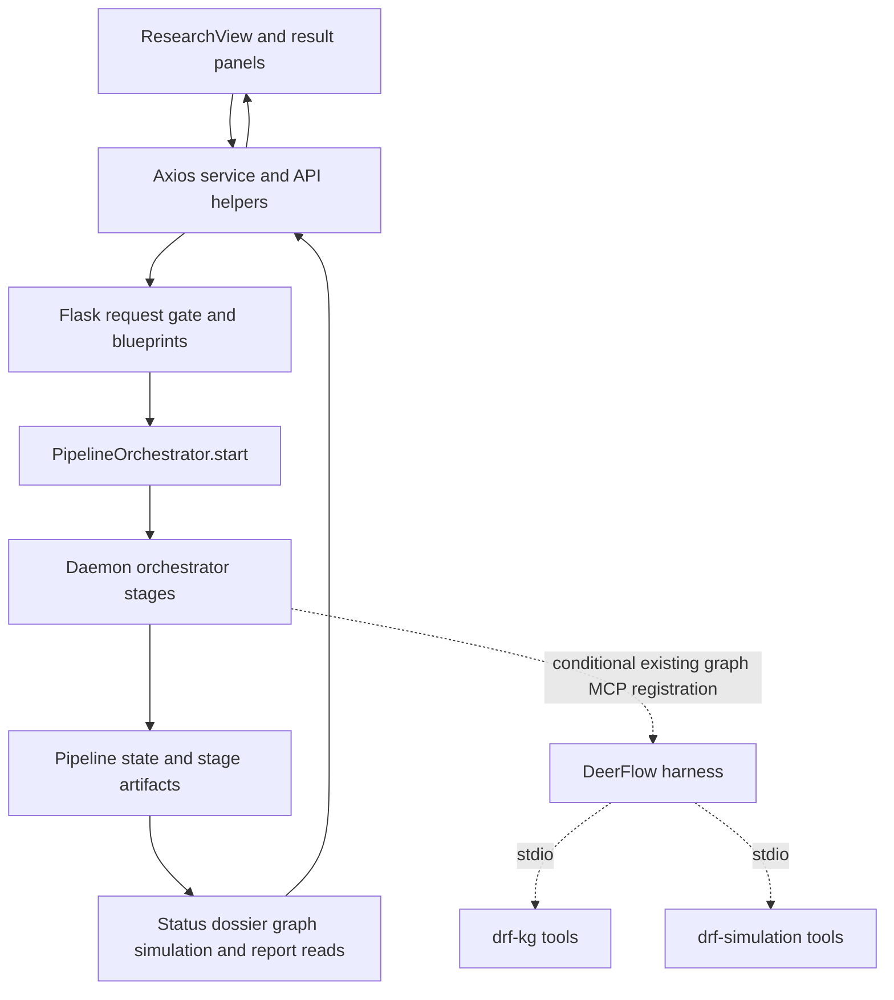

# Main codebase study: UI, Flask API, configuration, and MCP

Source authority: MAIN commit `c20ec60909fa1aa15154bb6fdb3fdb71c421e10e`, frozen tracked files at `/tmp/drf-main-study-c20ec60-20261011/source`. Owner: `ui-api`. Status: complete static area study; all assigned Python and frontend source/config files fully read.

This report documents existing behavior only. The study reads all 12 Python files assigned by `study-contract.json`, all `frontend/src` files, and frontend build/route configuration. It traces browser requests through Flask into service calls, then durable polling and result presentation. Supporting service and test references are distinguished from owned full reads in the coverage array. No application code, configuration, live runs, existing maps, or unrelated documentation is modified. No providers, pipelines, dependency installation, or application tests are invoked.

Acceptance checks are static: complete recorded read ranges and SHA-256 hashes for owned sources; concrete source anchors for each described boundary; explicit active/alternative/dormant distinctions and uncertainty limits. The reading is split into backend browser-facing APIs, configuration/SDK/MCP, frontend presentation, and frontend plumbing. This assigned report serves as the continuity record within the two-file write boundary.

## 1. Application surface and source interpretation

The primary UI belongs to the unified research pipeline: a prompt starts research, ontology generation, graph construction, simulation preparation, simulation execution, and report generation. The backend also retains independently callable graph-upload and simulation-management APIs. These alternatives are registered routes; their presence does not make them separate Vue pages. The optional versioned SDK and the two standalone MCP servers are separate entry surfaces. `backend/app/__init__.py:199`, `backend/app/api/research.py:50`, `backend/app/api/graph.py:121`, `backend/app/api/simulation.py:164`.

All anchors in this report are repository-relative and refer to the frozen commit, not the mutable working checkout. A full read means all source lines, including templates/styles/comments, were presented in bounded chunks to a study reader. Supporting service files were read only at the listed boundaries; their remaining implementation is outside this area's full-read claim. Described tests are static characterization evidence, not new test results. Historical memory was used only to identify the orchestrator boundary; its authority was rechecked in frozen source.



The dashed MCP edges describe the optional extension template and conditional research-child environment wiring; they do not mean every fresh run has an existing graph or a live simulation. `backend/app/services/pipeline_orchestrator.py:2411`, `deerflow_bridge/extensions_config.json:3`.

## 2. Flask factory, startup, routing, and request boundary

`backend/run.py:25` calls `Config.validate()`, prints errors and exits with code 1 when validation fails, then calls `create_app()`. The production entrypoint invokes `resolution_autorun.start()` after factory creation; it does not put that scheduler in the app factory. It binds the Flask development server with `threaded=True`, `FLASK_HOST` defaulting to `127.0.0.1`, `FLASK_PORT` defaulting to 5001, and `Config.DEBUG`. The non-loopback/no-token startup warning is printed by this entrypoint; effective HTTP access control is the factory's request gate. Windows startup sets UTF-8 stdout/stderr handling before application imports. `backend/run.py:8`, `backend/run.py:28`, `backend/run.py:39`, `backend/run.py:47`.

`create_app(config_class=Config)` loads the supplied object into Flask, disables JSON ASCII escaping, installs logging, and registers `/api/graph`, `/api/simulation`, `/api/report`, `/api/research`, and `/api/settings`. `sdk_bp` is imported by `api/__init__.py` but is mounted at `/api/v1` only when `Config.API_V1_ENABLED` is true. CORS, API token checks, and the SDK enable flag refer directly to `Config`; the factory's debug/TESTING decisions refer to `app.config`. `/health` returns `{status:'ok',service:'MiroFish Backend'}`. `backend/app/__init__.py:84`, `backend/app/__init__.py:109`, `backend/app/__init__.py:199`, `backend/app/api/__init__.py:7`.

The factory normally registers simulation cleanup, reconciles simulation orphans, reconciles pipeline orphans, and registers pipeline cleanup, in that order. `app.config.TESTING` or `DRF_TEST_PROCESS=1` suppresses these hooks. The code comments identify them as destructive runtime operations because they can signal processes and rewrite persisted uploads state; none was invoked by this study. `backend/app/__init__.py:118`.

### 2.1 Authentication and localhost semantics

The request gate allows OPTIONS, `/health`, and paths outside `/api/`. For API requests, `_is_loopback_addr()` accepts parsed loopback IPs, `localhost`, bracket/port forms, and IPv4-mapped IPv6 loopbacks. `_forwarded_client_addrs()` gathers every comma-separated `X-Forwarded-For`/`X-Real-IP` address and every `for=` value in RFC-style `Forwarded` elements. An unparseable value is non-loopback. A loopback peer bypasses authentication only if **none** of those forwarded values identifies a non-loopback client. Forwarding headers can reduce trust but cannot turn a remote peer into a trusted local one. `backend/app/__init__.py:36`, `backend/app/__init__.py:46`, `backend/app/__init__.py:62`, `backend/app/__init__.py:154`.

For every other `/api/` request, absent `APP_API_TOKEN` yields 403 and `success:false`; a configured token requires the matching `X-API-Token` header or yields 401. Matching uses `hmac.compare_digest`. This gate covers GETs and mutations alike. It is not a user/session/role system. Settings uses this same gate without an additional route-local localhost restriction. `backend/app/__init__.py:159`, `backend/app/api/settings.py:30`.

Request JSON is passed through `redact_secrets()` before debug logging. The response hook removes a **top-level** `traceback` field from JSON responses when DEBUG is false, leaving the other response fields intact. Many routes construct that field on exceptions; the factory centralizes its removal. `backend/app/__init__.py:175`, `backend/app/__init__.py:183`.

### 2.2 Frontend serving

`_frontend_dist_dir()` uses an absolute `FRONTEND_DIST` override or `<repo>/frontend/dist`. Flask creates its static route at the root URL space. Instead of competing with that route using another catch-all, the factory replaces the `static` view with `_serve_spa()`: existing safely joined files are served, non-API paths fall back to `index.html`, unknown `/api/*` paths remain JSON 404, and a missing frontend build returns a 200 JSON build hint. Static/UI retrieval is outside the API token gate; access to data remains in `/api/`. `backend/app/__init__.py:23`, `backend/app/__init__.py:228`, `backend/app/__init__.py:254`.

## 3. Browser-facing research API and orchestrator boundary

### 3.1 Admission and execution

`POST /api/research/run` (`run_pipeline`) accepts JSON with required stripped `prompt`, `mode` in `full|research_only` (default full), `depth` in `quick|standard|deep` (default `Config.DEERFLOW_RESEARCH_DEPTH`), optional `project_name`, integer-convertible `max_rounds`, per-run `language` (also accepted as `research_language`), and `model`. Language accepts `Chinese|English|auto`; `auto` becomes the empty-string override, while no override becomes `None`. A supplied model is lowercased and checked against `Config.SUPPORTED_DEERFLOW_MODELS`. This route converts `max_rounds` to int; unlike the standalone simulation start route it does not itself enforce positivity. Invalid fields or failed preflight return 400; successful admission returns `{success:true,data:{pipeline_id,task_id,mode,status}}`. `backend/app/api/research.py:50`, `backend/app/api/research.py:75`, `backend/app/api/research.py:82`, `backend/app/api/research.py:100`.

`preflight_pipeline(mode,model)` performs local existence/import/PATH/credential-presence checks; it does not call the network. Full mode checks graph-backend availability (including auto alternatives), report/simulation LLM provider requirements, and research-engine readiness; research-only skips graph and downstream provider checks. Both check the research script and selected research-model credential mechanism. This is presence/readiness validation, not a live provider-success assertion. `backend/app/services/pipeline_orchestrator.py:6779`.

`PipelineOrchestrator.start()` generates `pipe_<12 hex>`, makes the handoff directory, creates a task, initializes stage states and per-run options, captures actor and safety policy snapshots, saves state, registers a cancellation event, and starts daemon `_run(state)`. The request does not wait for stage completion. Full-mode stage bands are research 0–30, ontology 30–40, graph 40–60, prepare 60–72, run 72–92, report 92–100; research-only assigns research 0–100. Runtime options can supply dynamic bands at the updater boundary, so the fixed bands are defaults. `backend/app/services/pipeline_orchestrator.py:87`, `backend/app/services/pipeline_orchestrator.py:7920`, `backend/app/services/pipeline_orchestrator.py:8988`.

The direct service chain, rather than HTTP calls from one backend route to another, owns execution. `_run()` starts telemetry/manifest/heartbeat handling and enters research. After research, research-only saves `completed`/100 and returns. Full mode creates or reuses the project/ontology from the research markdown, constructs/reuses a graph, creates or validates prepared simulation artifacts, invokes `SimulationRunner.start_simulation(...,platform='parallel')`, polls runner state, and generates or reuses the report through `ReportAgent`/`ReportManager`. It enforces pipeline health before saving overall `completed`. Cancellation saves `cancelled`; provider outage and ordinary exceptions use the existing recoverable `failed` state. The study selectively read these call boundaries, not the entire research/graph/simulation/report implementations. `backend/app/services/pipeline_orchestrator.py:11883`, `backend/app/services/pipeline_orchestrator.py:12294`, `backend/app/services/pipeline_orchestrator.py:12307`, `backend/app/services/pipeline_orchestrator.py:12733`, `backend/app/services/pipeline_orchestrator.py:12940`, `backend/app/services/pipeline_orchestrator.py:13185`, `backend/app/services/pipeline_orchestrator.py:13320`, `backend/app/services/pipeline_orchestrator.py:13342`.

### 3.2 Durable state, status, and live telemetry

`PipelineState` contains `schema_version`, identity/prompt/mode/status, `global_progress`, `current_stage`, task/project/graph/simulation/report IDs, `handoff_dir`, research PID, owner PID/boot ID/heartbeat, last progress timestamp, errors/timestamps, `options`, `stages`, and `artifacts`. Each `StageState` carries name/status/progress/message/start/finish/error. `PipelineManager.state_path()` resolves `Config.PIPELINE_DATA_DIR/<id>/pipeline_state.json`; IDs are constrained to `pipe_` plus letters/digits/underscore/hyphen. `save()` uses a per-pipeline lock and atomic JSON writing. `load()` treats missing/malformed IDs or unreadable/non-dict files as absent, migrates older versions in memory, and can return a minimal `__incompatible_schema__` sentinel for newer versions under strict mode. `backend/app/services/pipeline_orchestrator.py:660`, `backend/app/services/pipeline_orchestrator.py:683`, `backend/app/services/pipeline_orchestrator.py:860`, `backend/app/services/pipeline_orchestrator.py:945`, `backend/app/services/pipeline_orchestrator.py:1136`.

`GET /api/research/status/<id>` reads that state, returns 404 when absent, and adds a computed `live` block using `heartbeat_status(PipelineState.from_dict(data))`. The helper supplies ETA/staleness/elapsed/owner/heartbeat age and, when present in the process meter, spend. A positive `LLM_RUN_BUDGET_TOKENS` adds `{limit_tokens,spent_tokens,remaining_tokens}`; missing spend contributes zero to this computed budget block. A helper failure omits `live` and still returns durable state. It sets `Cache-Control: no-store, max-age=0` and `Pragma: no-cache`. This route returns manager data directly, including a possible schema sentinel; it does not explicitly translate that sentinel to 409. Lifecycle methods perform their own incompatibility checks. `backend/app/api/research.py:306`, `backend/app/services/pipeline_orchestrator.py:10302`.

`_make_stage_updater()` checks cancellation/provider halt, writes stage progress/message and global progress, refreshes progress/heartbeat timestamps, opportunistically registers partial artifacts, saves state, and updates the task. `_complete_stage()` seals progress and completion timestamps and registers formal artifacts. Thus polling observes materialized state, not a browser-owned execution loop. Finally, the runner stores run telemetry and a compact `options.llm_telemetry` summary and retires heartbeat/thread/event registrations. `backend/app/services/pipeline_orchestrator.py:8949`, `backend/app/services/pipeline_orchestrator.py:9009`, `backend/app/services/pipeline_orchestrator.py:13393`.

`GET /api/research/list` wraps `{pipelines:[...]}` in `data`; the manager list is newest-first and includes pipeline ID/status/prompt/global progress/created/report ID, not full per-run options. Detail hydration requires the status endpoint. `backend/app/api/research.py:337`, `backend/app/services/pipeline_orchestrator.py:1204`.

### 3.3 Lifecycle API contracts

| Route under `/api/research` | Concrete action and result | Important branches |
|---|---|---|
| `POST /<id>/cancel` | `PipelineOrchestrator.cancel`; returns action status in `data` | 404 absent; 409 not running. In-process cancellation sets event and returns `cancelling`; orphan state can be directly marked cancelled. `backend/app/api/research.py:132`; `backend/app/services/pipeline_orchestrator.py:7982`. |
| `POST /<id>/resume` | Preflights saved mode, calls `resume(id,force=bool(body.force))`; same pipeline ID and fresh task ID, `resumed:true` | 404 absent; 400 readiness; 409 runtime conflict. Force can reset report for a completed degraded/failed-health run; ordinary resume preserves completed/recoverable artifacts. `backend/app/api/research.py:147`; `backend/app/services/pipeline_orchestrator.py:8107`. |
| `POST /<id>/continue` | Full-mode preflight then `continue_to_full`; `continued:true` | Requires completed research-only plus research report; changes mode to full, keeps research completed, makes later stages pending, launches same ID with fresh task. `backend/app/api/research.py:184`; `backend/app/services/pipeline_orchestrator.py:8214`. |
| `POST /<id>/scenario` | Requires label; full preflight; `fork` returns new pipeline/base/task/label/status | Fork checks base graph ID, shares base project/graph/handoff, records overlay/base ID, marks first three stages complete and starts PREPARE. Overlay fields include influence/stance overrides, injected events, max rounds, as-of shift. `backend/app/api/research.py:219`; `backend/app/services/pipeline_orchestrator.py:8280`. |
| `DELETE /<id>` | `delete_pipeline(id,force)` returns action result | 404 absent; 409 running or dependent forks; `force=1\|true\|yes` bypasses dependency refusal. `backend/app/api/research.py:260`. |
| `POST /clean` | `clean_terminal(tuple(statuses))` | Defaults failed/cancelled; any other status or nonempty-list violation returns 400. `backend/app/api/research.py:287`. |
| `GET /preflight` | Compact `{ready,errors,mode}` or `format=full` environment report | Invalid mode becomes full; full format optionally accepts `model` and `deep`; import/runtime failure falls back compact. `deep` can invoke live probes if this endpoint is called; this study did not call it. `backend/app/api/research.py:355`. |
| `POST /resolution-monitor/run` | `resolution_autorun.trigger_once()` | 202 started; 409 inflight. Independent of automatic scheduling knob. `backend/app/api/research.py:342`. |

The cancellation route's docstring mentions process termination, but the inspected `cancel()` body sets the event; actual stopping happens at runner cancellation points. Scenario-sharing is why dossier/progress/translation/chart readers use `resolve_handoff_dir()`, which accepts a state-specified path only within the pipeline data root and otherwise falls back to the local handoff path. `backend/app/services/pipeline_orchestrator.py:888`, `backend/app/services/pipeline_orchestrator.py:7982`, `backend/app/services/pipeline_orchestrator.py:8958`, `backend/app/services/pipeline_orchestrator.py:13006`.

### 3.4 Dossier files, editing, translations, PDF, and progress

`GET /<id>/dossier` resolves the handoff directory, returns 404 if it is absent, and reads `research_report.md`, `actors.json`, `sources.json`, `timeline.json`, `quantitative.json`, `contested.json`, `prediction_markets.json`, and `charts.json`. Its `data` contains `report`, the parsed structured values, `has_report`, and `sealed`. File read failures or JSON decoding failures become null fields. Market status and charts are returned even when there is no final model-versus-market comparison. The route returns the files' JSON shapes without enforcing a universal actor/source/chart schema. `backend/app/api/research.py:389`.

`PUT /<id>/dossier` admits completed research-only or failed/cancelled runs whose graph stage is not completed. It rejects missing state/directory and sealed research (409 with `sealed:true`); supplied string report text must have at least 400 trimmed characters. It atomically writes supplied string report and non-null actors, refuses a request that writes neither, then refreshes corresponding handoff manifest entries. Manifest-refresh failure reports 500 explicitly after the files were written. Sealing checks presence of a research contract manifest, actor lineage file, or an `actors.json` actor-intelligence contract; unsealed legacy manifest refresh preserves production timestamps and stamps `human_edited_at`. `backend/app/api/research.py:690`, `backend/app/services/pipeline_orchestrator.py:3423`, `backend/app/services/pipeline_orchestrator.py:3444`.

Research translation uses `research_report.<en|zh>.md`, `research_report.final_audit.<lang>.json`, `research_report.translation.<lang>.json`, and `research_report.<lang>.pdf`. POST `/dossier/translations/<lang>` validates en/zh and source existence, reuses a status bound to the current source SHA and existing variant, deduplicates with a process lock/inflight set, persists generating/owner state, starts a daemon worker, and returns 202. The worker calls `ReportAgent.translate_research_markdown()` using an `LLMClient`, checks translation target/availability, writes audit and variant atomically, and records available or failed. It clears the inflight key in `finally`. Those calls describe runtime behavior; they were not executed. `backend/app/api/research.py:444`, `backend/app/api/research.py:490`, `backend/app/api/research.py:555`.

GET of the translation returns `{status,available,issues,source_lang,target_lang,report}`. A generating record with a dead owner is reported interrupted. Variant text is served only for an available status with matching current source SHA and an existing readable file. A status can retain its recorded name while `available:false` if the current source differs. `GET /dossier/pdf` exports primary markdown or a language variant through `ReportManager.export_document_pdf()`. A requested variant requires available/current-source-bound status plus variant file, otherwise 409; unsupported language is 400; missing input is 404; export failures are 500. The route relies on the persisted translation status/worker audit path rather than directly rereading the audit JSON before serving. `backend/app/api/research.py:593`, `backend/app/api/research.py:636`.

`GET /<id>/progress` validates pipeline existence and `scope=tail|full`. Tail defaults to 200 lines and calls `merged_research_progress_tail`; full calls `merged_research_progress_full`. Both merge root/track logs through the service; full can include preserved failed-attempt events. Response `data` contains `scope`, `lines`, `returned`, `total`, `total_exact`, `snapshot_exact`, `event_fidelity:'summarized_progress_events'`, `source_count`, and `truncated`. Tail explicitly sets total null/exact flags false; full reports exact totals and refuses safety-limit overflow with 413. Invalid scope is 400; both successful forms disable caching. These are persisted human-readable progress summaries, not raw model transcripts. `backend/app/api/research.py:871`.

### 3.5 Artifact transport and chart containment

`GET /<id>/artifact/<name>` reads a path from state `artifacts`; chart names can use `<name>_partial` and finally a candidate in resolved handoff `charts/` when no registry pointer exists. Missing paths are 404. JSON returns `{name,content:<decoded>}`, other text `{name,content:<text>}`. PNG/SVG/JPG/JPEG/WebP/HTML are binary/content responses with mapped MIME types. For chart assets, serving revalidates the expected basename, resolved basename, no file symlink, regular-file status, and realpath containment in that handoff's charts directory. HTML can inline the sibling Plotly bundle and gets a sandbox CSP with scripts/styles inline, images/fonts data/blob as specified, and no network connections; SVG gets a sandbox CSP disallowing scripts. Both get nosniff/no-referrer. These serve-time checks do not claim a universal path policy for every other artifact kind. `backend/app/api/research.py:779`.

## 4. Graph API: upload alternative, async build, and UI data

The independently callable upload workflow is `POST /api/graph/ontology/generate` (`multipart/form-data`). It requires `simulation_requirement` and at least one named file; accepts optional project name/additional context; checks file extensions against `Config.ALLOWED_EXTENSIONS`; creates a project; saves accepted files; extracts and preprocesses text via `FileParser`/`TextProcessor`; persists concatenated extracted text; calls `OntologyGenerator.generate`; stores entity/edge ontology types and analysis summary; and saves `ONTOLOGY_GENERATED`. If no document was processed it deletes the newly created project and returns 400. Success contains project ID/name, ontology, analysis summary, files, and total text length. `backend/app/api/graph.py:25`, `backend/app/api/graph.py:121`.

`POST /build` requires the compatibility-named `Config.ZEP_API_KEY` guard, JSON project ID, a generated ontology and extracted text. `force` can reset building/failed/completed graph state; otherwise repeated building returns 400 with the existing task ID. Graph name and chunk size/overlap use request → project → Config defaults. It creates a task, saves `GRAPH_BUILDING`, and starts a daemon thread. The thread splits text, creates graph, saves graph ID early, sets ontology, adds text in batches of three, waits for episode processing, optionally computes layout, reads graph data, saves `GRAPH_COMPLETED`, and completes the task with project/graph/node/edge/chunk counts. Exceptions save project and task failed. The unified pipeline builds through services directly rather than calling this route. `backend/app/api/graph.py:259`, `backend/app/api/graph.py:374`.

| Route under `/api/graph` | Contract and consumer role | Anchor |
|---|---|---|
| `GET /project/<id>`, `GET /project/list?limit=50` | Project dict(s); absent detail 404; list includes count | `backend/app/api/graph.py:35` |
| `DELETE /project/<id>` | Deletes project through manager; unsuccessful delete 404 | `backend/app/api/graph.py:69` |
| `POST /project/<id>/reset` | Clears graph/task/error; ontology present → ontology-generated, else created | `backend/app/api/graph.py:88` |
| `GET /task/<id>`, `GET /tasks` | Task dict(s) for asynchronous operations | `backend/app/api/graph.py:533` |
| `GET /data/<graph_id>` | Builder graph payload; `top_k`, `min_degree`, `slim`; `full=true` clears top-k/min-degree but leaves slim unchanged | `backend/app/api/graph.py:576` |
| `GET /data/<id>/neighbors/<uuid>` | Builder neighborhood; depth default 1, slim default true; documented depth cap is delegated to service | `backend/app/api/graph.py:621` |
| `GET /data/<id>/node/<uuid>`, `/edge/<uuid>` | Full detail objects for slim graph UI; absent detail 404 | `backend/app/api/graph.py:642` |
| `POST /gc` | Optional retain converted to int; returns builder audit kept/deleted/failed/skipped | `backend/app/api/graph.py:676` |
| `DELETE /delete/<graph_id>` | Explicit graph delete, compatibility key guard | `backend/app/api/graph.py:700` |

All successful graph responses use `success:true` with data/message/count as applicable. Exceptions usually return 500 with error and traceback subject to the factory response hook. Builder backend selection and provider behavior belong to the graph area; these routes preserve `ZEP_API_KEY`/Zep naming at their boundary even though unified preflight checks local Graphiti backend availability. `backend/app/api/graph.py:285`, `backend/app/api/graph.py:590`, `backend/app/services/pipeline_orchestrator.py:6794`.

## 5. Simulation API: artifacts, process control, feeds, and interviews

### 5.1 Creation and preparation

`POST /api/simulation/create` requires project ID, loads the project, takes explicit graph ID or project graph ID, and calls `SimulationManager.create_simulation()` with Twitter/Reddit defaults true. It returns the state dict; missing project/graph returns 404/400. `GET /entities/<graph_id>` filters defined entity types with optional comma-separated type restriction and `enrich=true`; detail and by-type routes call `ZepEntityReader`. These preserve a compatibility key-presence guard. `backend/app/api/simulation.py:47`, `backend/app/api/simulation.py:92`, `backend/app/api/simulation.py:125`, `backend/app/api/simulation.py:164`.

`_check_simulation_prepared()` checks `<OASIS_SIMULATION_DATA_DIR>/<id>/state.json`, `simulation_config.json`, `reddit_profiles.json`, and `twitter_profiles.csv`. With nonzero `actor_role_count`, it verifies cast-manifest SHA, platform role-manifest SHAs, and role-prompt manifests using `OasisProfileGenerator`. It accepts ready/preparing/running/completed/stopped/failed only with `config_generated:true`; a preparing state with complete artifacts is atomically changed to ready under the runner lock. It reports reason/missing files/integrity error or prepare statistics; it does not require that the simulator process currently be alive. `backend/app/api/simulation.py:239`.

`POST /prepare` requires simulation/project/requirement, returns existing ready artifacts unless `force_regenerate`, reads project extracted text, accepts entity types, `use_llm_for_profiles` (true), and `parallel_profile_count` (5). It attempts a synchronous entity-count preview; preview failure is logged and left for background preparation to retry. It creates a task, saves PREPARING, and launches a daemon that calls `SimulationManager.prepare_simulation()`. Progress maps reading to 0–20%, generating_profiles to 20–70%, generating_config to 70–90%, copying_scripts to 90–100%, attaching stage/item details. Failure marks task and simulation FAILED. `POST /prepare/status` checks prepared disk artifacts first if simulation ID is supplied, then task ID; it can return ready/100, not_started/0, task state, or missing-task 404. Despite the earlier prepare docstring's GET wording, the decorator and implementation use POST for status. `backend/app/api/simulation.py:399`, `backend/app/api/simulation.py:511`, `backend/app/api/simulation.py:545`, `backend/app/api/simulation.py:678`.

### 5.2 State, configuration, profiles, and histories

| Route under `/api/simulation` | Output / fallback |
|---|---|
| `GET /<id>` | Manager state; ready state adds run instructions; absent 404. `backend/app/api/simulation.py:791`. |
| `GET /list?project_id=` | Manager states plus count. `backend/app/api/simulation.py:824`. |
| `GET /history?limit=20` | State enriched with config requirement/hours/recommended rounds, actual runner current/total/status, up to three project filenames, latest report by metadata created-at, version/date. Report lookup scans backend uploads/reports metadata. `backend/app/api/simulation.py:853`, `backend/app/api/simulation.py:912`. |
| `GET /<id>/profiles?platform=reddit` | Manager platform/count/profiles. `backend/app/api/simulation.py:1026`. |
| `GET /<id>/profiles/realtime` | Direct JSON/CSV read, count/expected count/file existence/mtime/generating; read-in-progress error → empty profiles. Any non-reddit platform selects Twitter CSV in this route. `backend/app/api/simulation.py:1064`. |
| `GET /<id>/config` | Manager full config or 404. Fields include time/agent/event/platform configuration and generation reasoning. `backend/app/api/simulation.py:1294`. |
| `GET /<id>/config/realtime` | Direct file read; nullable config, mtime/existence/generating/stage/config-generated plus optional summary; invalid partial JSON → null. Stage is inferred from state profiles-generated and preparing/ready flags. `backend/app/api/simulation.py:1174`. |
| `GET /<id>/config/download` | Attachment `simulation_config.json`. `backend/app/api/simulation.py:1330`. |
| `GET /script/<name>/download` | Allowlist of Twitter, Reddit, parallel simulation scripts and action_logger from backend/scripts. `backend/app/api/simulation.py:1359`. |
| `POST /generate-profiles` | Standalone graph → filtered entities → profiles; required graph ID; optional entity types/use_llm/platform; Reddit/Twitter-specific or generic serialization. Does not create a simulation. `backend/app/api/simulation.py:1413`. |

### 5.3 Start/stop, monitoring, and bounded trajectory

`POST /start` requires ID; platform must be twitter/reddit/parallel; supplied max rounds must be a positive integer; graph-memory-update defaults false. For non-ready state, it checks reusable preparation, rejects an actually running runner unless force, optionally stops/cleans run logs, and resets ready. Graph feedback needs a graph ID from simulation or project. `SimulationRunner.start_simulation()` returns the runner dict; manager state becomes RUNNING. Response exposes **actual** graph-memory active/requested/error status, max-rounds applied, force-restarted, and graph ID when requested. Config/profiles survive run-log cleanup. `POST /stop` stops runner and saves manager status PAUSED; runner status is a separate field/type. `backend/app/api/simulation.py:1487`, `backend/app/api/simulation.py:1574`, `backend/app/api/simulation.py:1639`, `backend/app/api/simulation.py:1685`.

`GET /<id>/run-status` returns runner dict or success/idle with zero counters when no state. `/run-status/detail` returns base state plus all actions, Twitter/Reddit subsets, current-round recent actions and round count; it reads all actions once and derives subsets in memory. `/actions` paginates/filters by platform, agent ID, round; `/timeline` summarizes a start/end round range; `/agent-stats` returns stats plus count. `backend/app/api/simulation.py:1746`, `backend/app/api/simulation.py:1804`, `backend/app/api/simulation.py:1904`, `backend/app/api/simulation.py:1958`, `backend/app/api/simulation.py:2104`.

`GET /<id>/trajectory` exposes `world_state_trajectory.json` as a decision-channel API artifact. The current Vue composition has no trajectory caller, as separately recorded in the active/alternative inventory below. It rejects empty/dot/path/control-character IDs, enforces realpath containment in the simulation root, rejects file symlinks, returns 404 for not-yet-produced data, 413 over 5 MiB, and 500 for malformed JSON. It accepts either `{trajectory:[...]}` or a bare list, retains dict rows only, keeps the latest 720 when capped, and reports rows_count/total_rows/truncated. It forwards only scalar `schema_version`, `converged`, and `settled_round` metadata. Rows can carry a `shares` map and optional period end, but this route does not deeply validate their numeric semantics. `backend/app/api/simulation.py:2000`.

`GET /<id>/posts` and `/comments` select `<platform>_simulation.db` under the API file's backend-relative uploads/simulations path. Posts read `post` rows ordered created-at descending with limit/offset and total; comments optionally filter post ID and use the same platform convention. No database returns successful empty data, and missing tables/SQL operational errors become empty lists. They return SQLite row dictionaries without a new normalized feed schema. These paths are separately constructed rather than using `Config.OASIS_SIMULATION_DATA_DIR` in these two functions. `backend/app/api/simulation.py:2133`, `backend/app/api/simulation.py:2211`.

### 5.4 Interviews and environment lifecycle

`optimize_interview_prompt()` prepends a Chinese instruction to answer from persona/memory/actions without tools, avoids duplicate prefix, and preserves empty prompts. Single, batch, and all-agent interview routes check required fields and valid optional platform and require `SimulationRunner.check_env_alive()`. They call matching runner interview functions with defaults 60/120/180 seconds, returning `{success:<runner success>,data:<runner result>}`. Value errors yield 400; timeouts 504. Batch copies items and prefixes each prompt; per-item platform may override the batch platform. Omitting platform permits both-platform behavior at the runner boundary. `backend/app/api/simulation.py:22`, `backend/app/api/simulation.py:2297`, `backend/app/api/simulation.py:2426`, `backend/app/api/simulation.py:2564`.

`POST /interview/history` accepts ID/platform/agent/limit and returns count/history. `/env-status` combines alive and platform-availability flags into a message. `/close-env` sends the runner's graceful environment-close command and saves manager COMPLETED, returning the runner success/result; it differs from `/stop`'s forced process stop and PAUSED manager state. The API-level interview guards test environment availability, while the report API's interview-unlocked field is based on report publication. The current Vue simulation panel exposes no interview controls. `backend/app/api/simulation.py:2667`, `backend/app/api/simulation.py:2739`, `backend/app/api/simulation.py:2804`, `backend/app/api/report.py:1838`.

## 6. Result API boundary consumed by the UI

The full report API belongs to the report owner; this study directly reviewed the specific payload/publication/progress/section/unlock boundaries. `_report_publication_payload()` adds `publishable`, publication issues, `draft_withheld`, translation status and verified translation references. An unpublishable report retains metadata and outline skeleton, but `markdown_content` and every outline section's content are blanked. A translation reference is listed only when availability, verified audit, source markdown SHA, translated markdown SHA, and final audit SHA fields are present. `GET /api/report/<id>` returns this payload. `backend/app/api/report.py:26`, `backend/app/api/report.py:45`, `backend/app/api/report.py:543`.

`GET /api/report/<id>/forecast` is available independently of the optional SDK. It requires a publishable report; an audited legacy report can return `forecast:null` and `available:false`. Optional en/zh localization returns either a source-bound localized forecast or the sealed original with localization metadata. Primary and variant download/PDF/chart/brief endpoints are exposed through frontend helpers; their full backend implementations are in the report owner's scope. `backend/app/api/report.py:585`.

There are two report-body states at the API: customer-facing finalized content uses the publication barrier, while progressive draft sections can be shown during demonstrably live generation. `_draft_exposure_gate()` allows drafts only if publication passes or metadata is loadable with pending/planning/generating status and generator-file activity within 30 minutes. It uses newest mtime among meta/progress/outline/agent log/console log and section markdown; future timestamps outside that window are not accepted as live. Missing/corrupt metadata, terminal unpublished content, or stale generation withholds prose. Agent-log and selected console-log draft excerpts use the same gate. `backend/app/api/report.py:85`, `backend/app/api/report.py:120`, `backend/app/api/report.py:153`, `backend/app/api/report.py:204`.

`GET /progress` returns `ReportManager.get_progress()` or 404. `/sections` uses `{success,data:{sections,total_sections,is_complete,publishable,publication_issues,draft_withheld}}`. `/sections-partial` intentionally has a different envelope: `{success,sections:[{index,title,status,content_md}],done,publishable,publication_issues,draft_withheld}` at the top level. It builds completed entries from section files and can append an empty generating placeholder from progress. The implementation sets `done` from publication status, regardless of the older docstring's final-markdown-exists wording. Unexpected outer failures return 500 with empty sections and done false; they do not fabricate completion. `backend/app/api/report.py:1580`, `backend/app/api/report.py:1621`, `backend/app/api/report.py:1681`.

`GET /check/<simulation_id>` distinguishes report existence/status/ID from `interview_unlocked`; the unlock field equals publication success, rather than raw report status. Whether the environment remains able to answer an interview is independently checked by the simulation API. `backend/app/api/report.py:1838`.

## 7. Static characterization evidence reviewed by the UI/API lead

These are descriptions of assertions in the frozen test files. No tests were run.

| Source and concrete cases | Behavior characterized |
|---|---|
| `backend/tests/test_auth_gate_forwarded.py:31`, `backend/tests/test_auth_gate_forwarded.py:47`, `backend/tests/test_auth_gate_forwarded.py:60` | Loopback/mapped/port parsing; all forwarding-header styles; local proxy pass; remote-forwarded fail-closed behavior; configured token matching; forwarding never upgrades remote trust. |
| `backend/tests/test_spa_serving.py:44` | Index root and history fallback, real asset verbatim, unknown API JSON 404, health priority, missing-dist hint, default absolute dist location. |
| `backend/tests/test_runtime_lifecycle_isolation.py:19`, `backend/tests/test_runtime_lifecycle_isolation.py:49`, `backend/tests/test_runtime_lifecycle_isolation.py:92` | Test marker suppresses lifecycle mutation; production ordering remains; simulation orphan reconciliation skips occupied backend port. |
| `backend/tests/test_dossier_edit_continue.py:99`, `backend/tests/test_dossier_edit_continue.py:117` | All three seal mechanisms reject edits without changing bytes; dossier exposes sealed status; legacy edits refresh SHA and preserve produced-at, survive reuse; raw unrefreshed edits fail reuse. |
| `backend/tests/test_status_live_block.py:56`, `backend/tests/test_status_live_block.py:74`, `backend/tests/test_status_live_block.py:100`, `backend/tests/test_status_live_block.py:120` | Running live telemetry, terminal ETA zero/frozen elapsed, budget remainder from meter, helper failure does not fail durable status. |
| `backend/tests/test_live_research_progress.py:231`, `backend/tests/test_live_research_progress.py:282`, `backend/tests/test_live_research_progress.py:337` | Bounded track-tail ordering/deduplication; full snapshot preserves duplicate/early/failed-attempt rows; full overflow fails explicitly; endpoint no-cache/exactness; markets/charts surface in dossier. Only lines 231–442 were directly read in this area. |
| `backend/tests/test_simulation_trajectory_api.py:45`, `backend/tests/test_simulation_trajectory_api.py:92`, `backend/tests/test_simulation_trajectory_api.py:122` | Wrapped/bare trajectory payloads, scalar metadata only, missing/path traversal/symlink behavior, newest-row cap and truncation flag, byte cap, malformed JSON without traceback. |

## 8. Reading and execution ledger

The UI/API lead read all of `backend/app/__init__.py`, `backend/app/api/__init__.py`, `backend/app/api/graph.py`, `backend/app/api/research.py`, `backend/app/api/simulation.py`, and `backend/run.py`, including docstrings and exception branches. Direct supporting reads inspected selected orchestrator/report-API boundaries and the tests in section 7. The companion JSON contains actual read ranges and byte-level hashes, with partial files explicitly marked.

All 46 mandatory source/config files were compared byte-for-byte against Git blobs at the specified commit: 12 owned Python files, 32 frontend source files, `frontend/package.json`, and `frontend/vite.config.js`; zero mismatches were found. The comparison read the named commit's objects only. It did not inspect feature branches, run application code, import the application, launch a server/pipeline, or execute tests. The only study writes are this report and `ui-api-coverage.json`.

### 8.1 File and schema crossings visible at this boundary

| File or structure | Producer / consumer relationship reviewed here | Shape and stopping condition |
|---|---|---|
| `<PIPELINE_DATA_DIR>/<pipe>/pipeline_state.json` | Orchestrator saves; research status/list and lifecycle routes load; browser hydrates status | PipelineState/StageState plus options/artifacts; overall completed, failed, cancelled are terminal. `backend/app/services/pipeline_orchestrator.py:683`, `backend/app/api/research.py:306`. |
| Resolved `handoff/research_report.md` and companion actor/source/timeline/quantitative/contested/market/chart JSON | Research service outputs, dossier route reads, project/ontology and report service consume | Dossier exposes raw decoded JSON or null; report text/actors editing constrained by state/seals. `backend/app/api/research.py:389`, `backend/app/services/pipeline_orchestrator.py:12317`, `backend/app/services/pipeline_orchestrator.py:13285`. |
| `handoff/manifest.json` | Stage artifact records and legacy dossier editing; resume reuse validation consumes hashes/bytes/schema | Optional legacy compatibility; registered entry mismatch rejects reuse; absent manifest can admit older existence-based reuse. `backend/app/services/pipeline_orchestrator.py:3444`, `backend/app/services/pipeline_orchestrator.py:9798`. |
| `research_report.translation.<lang>.json` plus variant/audit files | Translation worker persists; translation GET and PDF check source-bound availability | generating → available/failed; dead generating owner is presented interrupted. `backend/app/api/research.py:449`, `backend/app/api/research.py:555`, `backend/app/api/research.py:593`. |
| Root/track/attempt `research_progress.log` files | Research subprocess events; merged progress helpers/API; browser console | Tail is bounded and does not promise exact totals; full scope promises an exact recorded-event snapshot or 413. `backend/app/api/research.py:871`, `backend/tests/test_live_research_progress.py:282`. |
| Simulation `state.json`, config, profiles, actor cast/role manifests | SimulationManager/profile generator prepare; preparation gate and realtime endpoints consume | config-generated plus accepted state and required files; nonzero actor-role count adds exact fingerprint validation. `backend/app/api/simulation.py:239`. |
| Simulation runner state / action history | SimulationRunner → run-status/detail/actions/timeline/stats APIs | Missing run state is idle; detail derives per-platform/current-round slices from one all-action read. `backend/app/api/simulation.py:1746`, `backend/app/api/simulation.py:1804`. |
| `world_state_trajectory.json` | Decision-channel simulation output → bounded trajectory API; no current Vue caller | Wrapper/list, dict rows, latest 720, 5 MiB bound; no file in early rounds is 404. `backend/app/api/simulation.py:2006`. |
| `<platform>_simulation.db` tables `post`, `comment` | OASIS simulation → SQL feed readers → browser feed | Row dictionaries; newest-first limit/offset; absent database/table gives an empty result. `backend/app/api/simulation.py:2133`, `backend/app/api/simulation.py:2211`. |
| Report metadata/progress/section markdown/publication payload | ReportManager → report/status/partial/forecast APIs → result UI | Metadata and publication are separate; finalized content/forecast/unlock requires publishability; live draft exemption is time bounded. `backend/app/api/report.py:45`, `backend/app/api/report.py:153`, `backend/app/api/report.py:1681`. |
| Pipeline `run_telemetry.json`, `telemetry.json`, compact `options.llm_telemetry` | Orchestrator finalizer → state/artifact readers → vitals presentation | Best effort observations; process-meter spend may be unavailable across process lifetime, and durable summaries are separate. `backend/app/services/pipeline_orchestrator.py:10302`, `backend/app/services/pipeline_orchestrator.py:13393`. |

This table identifies schema treatment at the API boundary. It does not claim a full review of all producer implementations or runtime data from saved runs.

## 9. Frontend bootstrap, HTTP helpers, and pure view models

`frontend/package.json:6` defines Vite dev/build/preview and Node's built-in unit-test command; dependencies are Vue, Vue Router, Axios, D3, and locally packaged fonts. `main.js` imports self-hosted Space Grotesk/JetBrains Mono/Noto Sans SC/Inter styles and the shared tokens, installs router, and mounts `App` at `#app`. `App.vue` consists of router-view plus reset/base/print styles. The history router has one real page, eager-loaded `ResearchView` at `/`; `/research` and catch-all legacy/unknown paths redirect to `/`. There are no independently routed simulation/report/interaction pages in this source tree. `frontend/src/main.js:1`, `frontend/src/App.vue:1`, `frontend/src/router/index.js:1`.

Vite listens on `FRONTEND_HOST` or IPv4 loopback, strict port 3000, and proxies `/api` to `http://localhost:5001` with changeOrigin and `xfwd:true`. This forwarded address is what the Flask gate examines for proxied remote users. Production can instead use Flask's built frontend serving. Axios uses `VITE_API_BASE_URL` or `/`, a 300000 ms timeout, and JSON headers. Its request interceptor is a pass-through; it adds no token header or session credential mechanism. `apiUrl()` constructs direct image/link/download URLs from the same optional base prefix. `frontend/vite.config.js:13`, `frontend/src/api/index.js:4`, `frontend/src/api/index.js:15`, `frontend/src/api/index.js:68`.

The response interceptor returns `response.data`, rejecting a defined false-like `success` with `error|message`; non-JSON text responses are accepted when they have no success field. HTTP-error handling copies the backend's human-readable error into the Axios error message while preserving error.response for status branches. `requestWithRetry()` is an exported helper that attempts its callback up to maxRetries (default 3 total attempts), with exponential delays; it is not an installed Axios retry policy. The reviewed API wrappers call the shared service directly, including non-idempotent pipeline/ontology/build/simulation/report/interview actions. `frontend/src/api/index.js:25`, `frontend/src/api/index.js:75`, `frontend/src/api/research.js:19`, `frontend/src/api/graph.js:7`, `frontend/src/api/simulation.js:3`, `frontend/src/api/report.js:5`.

### 9.1 HTTP helper contracts

| Helper module | Exported surface and shape handling |
|---|---|
| `frontend/src/api/research.js:12` | `researchChartUrl` rewrites single-file `charts/<file>` to research artifact URLs. `runPipeline`, cancel/resume/continue/fork/delete/clean/status/list, preflight, get/edit dossier, request/get translation, PDF URL, monitor trigger, and progress pass through the research contracts. `resumePipeline` supplies no force body; delete supplies no force query; `getPreflight` supplies compact mode only. `getProgressLog(id,lines=200,scope='tail')` exposes full scope explicitly. |
| `frontend/src/api/graph.js:14` | Ontology sends multipart; build POST is single-shot; task/project GETs; graph overview goes through graphRequestParams; detail/neighborhood UUIDs are encoded. Helper declarations retain the upload alternative even though the router is research-only. |
| `frontend/src/api/simulation.js:10` | Create/prepare/status, profiles/config and realtime variants, list/start/stop, run status/detail, posts/comments/timeline/stats/actions, close/env status, batch interview and history. Posts default 50; comment helper default 200; both platform default reddit. No dedicated trajectory helper is defined in this module. |
| `frontend/src/api/report.js:11` | Generate/status, incremental agent/console logs, get/chat, viz manifest, top-level sections-partial, text variant markdown, task-bound translation request/status, primary/variant Markdown/PDF links, first-party forecast with language, and relative report assets. Translation status optionally sends task_id; force translation sends force=1. Variant markdown requests responseType text. |
| `frontend/src/api/settings.js:4` | GET/POST `/api/settings/llm`; test POST has 45000 ms timeout and documents no persistence. The runtime test can call a minimal completion for API providers; it was not called here. |

### 9.2 Language, markdown, graph, forecast, and telemetry helpers

`i18n.js` is a reactive dependency-free Chinese/English label switch. Initial choice reads `localStorage.drf_locale`, otherwise derives zh from a zh-prefixed navigator language and en otherwise, with guarded fallback. `setLocale()` persists choice and synchronizes document language/title; `L(zh,en)` reads reactive locale. This UI locale is separate from research/output language and report translation availability. `frontend/src/i18n.js:11`.

`markdown.js` escapes source text and generates a fixed subset of HTML for headings, paragraphs, lists, tables, fenced code, blockquotes, links, images and citation superscripts. It strips standalone pipeline HTML-comment blocks. Heading slug/outline helpers support navigation. Citation anchors are emitted only when reference-list anchors exist; repeated keys anchor the first item. Relative assets require a resolver, otherwise images collapse to alt text; the asset policy accepts http(s), data, or root-relative paths and rejects other explicit protocols. Interactive chart links come from the caller's manifest resolver. Wide tables have a horizontal scroll wrapper. These are concrete rendering rules, not a claim of a separate generic sanitization library. `frontend/src/utils/markdown.js:17`, `frontend/src/utils/markdown.js:38`, `frontend/src/utils/markdown.js:60`, `frontend/src/utils/markdown.js:79`, `frontend/src/utils/markdown.js:153`, `frontend/src/utils/markdown.js:287`.

`graphPayload.js` defaults overview requests to `top_k=0,slim=true`, with explicit full yielding only `full=true`. It derives total/returned/truncated/focus metadata, structural revision strings, and a deterministic bounded focus set. The focus budget defaults 400; retention order is active center, researched actor seeds, expanded neighbors, base overview, each degree-ranked with ID tie-breaks. `graphStyle.js` hashes entity names into an eight-color palette, resolves collisions by sorted-name probing, and scales node radii by square-root degree, using a uniform fallback when no positive maximum degree exists. `frontend/src/utils/graphPayload.js:1`, `frontend/src/utils/graphPayload.js:42`, `frontend/src/utils/graphPayload.js:73`, `frontend/src/utils/graphStyle.js:23`, `frontend/src/utils/graphStyle.js:46`, `frontend/src/utils/graphStyle.js:76`.

`liveProgress.js` hashes a four-line tail suffix as well as its length, so a full rolling tail still changes revision when new events arrive. `mergeProgressLines()` counts exact-line occurrences and merges novel chronological rows instead of losing duplicate emissions or earlier history. `needsFinalProgressSnapshot()` triggers once for terminal pipeline or completed research, allowing the UI to replace accumulated tails with a final exact snapshot. `frontend/src/utils/liveProgress.js:7`, `frontend/src/utils/liveProgress.js:41`, `frontend/src/utils/liveProgress.js:92`.

`binaryForecasts.js` maps structured `binary_forecasts` into rows for BinaryForecastTable. Missing statements are skipped; finite numbers/nonempty numeric strings become display values; absent data becomes null/em dash. Bounds require 0≤low≤high≤1, confidence becomes low/medium/high/other, model-market divergence is percentage points with tone based on rounded value, market links require absolute http(s), and market-influence audit badges are independent of retained anchors. It formats point probabilities without independently enforcing a 0–1 range. `frontend/src/utils/binaryForecasts.js:18`, `frontend/src/utils/binaryForecasts.js:76`, `frontend/src/utils/binaryForecasts.js:93`, `frontend/src/utils/binaryForecasts.js:118`, `frontend/src/utils/binaryForecasts.js:136`.

`vizManifest.js` normalizes old separate image/HTML twins and newer HTML/png_path rows into gallery cards. Paths must be relative charts paths without traversal, backslashes, percent encoding or control characters; known filename extensions override declared type. It prefers PNG images, keeps HTML-only cards, suppresses already embedded visuals, and translates a fixed caption dictionary when active report language is zh. `frontend/src/utils/vizManifest.js:4`, `frontend/src/utils/vizManifest.js:43`, `frontend/src/utils/vizManifest.js:77`, `frontend/src/utils/vizManifest.js:119`.

`researchTranslation.js` detects the other language by CJK-versus-Latin character counts, keeps source as null active language, binds cached variants to report identity, and resets caches when identity changes. `reportLanguages.js` is stricter for final reports: metadata report ID, source/target language, available status, SHA fields and exact variant/citation/audit filenames must agree before translated options appear. Translation polling distinguishes active/terminal/unknown states and treats task disappearance/mismatch as terminal. Availability is checked first; success without an available artifact is terminal-without-artifact. `createLatestRequestGate()` uses generation tokens and AbortController to cancel superseded work; filename parsing and PDF magic checks support validated downloads. `frontend/src/utils/researchTranslation.js:14`, `frontend/src/utils/researchTranslation.js:35`, `frontend/src/utils/reportLanguages.js:29`, `frontend/src/utils/reportLanguages.js:67`, `frontend/src/utils/reportLanguages.js:135`, `frontend/src/utils/reportLanguages.js:219`, `frontend/src/utils/reportLanguages.js:274`.

`runVitals.js` derives optional elapsed/ETA/liveness/spend/budget presentation; absent or unusable fields omit individual items or the whole model. Terminal duration derives from resumed-or-created → updated timestamps; terminal ETA is omitted. Dead owner overrides stale/heartbeat, fresh heartbeat threshold is 90 seconds, and a confirmed alive owner can suffice without heartbeat. Positive budget limits produce clamped fill percentages, becoming critical above 90%. `tokens.css` defines shared typography/colors/spacing/elevation/motion, visible focus rings, scrollbars and reduced-motion overrides. `frontend/src/utils/runVitals.js:17`, `frontend/src/utils/runVitals.js:94`, `frontend/src/utils/runVitals.js:129`, `frontend/src/styles/tokens.css:9`, `frontend/src/styles/tokens.css:82`, `frontend/src/styles/tokens.css:116`.

## 10. Configuration, defaults, model routing, and runtime settings

At module import, `project_root_env` points to the repository-root `.env` through `backend/app/../../.env`. With `DRF_TEST_PROCESS == "1"`, the module skips dotenv loading. Otherwise it loads that file with `override=True` when present, or calls `load_dotenv(override=True)` as its fallback. Class attributes are then evaluated from the resulting process environment. These are source defaults, not readings of the operator’s current configuration. `backend/app/config.py:10`

Flask/API defaults are:

- `SECRET_KEY`: environment-backed secret setting; values are omitted from this study.
- `DEBUG`: false unless `FLASK_DEBUG.lower() == "true"`.
- `JSON_AS_ASCII`: false.
- `APP_API_TOKEN`: empty, stripped.
- `APP_CORS_ORIGINS`: localhost and `127.0.0.1`, ports 3000 and 5001.
- `APP_BLOCK_PRIVATE_URLS`: false.
- `_provider_lock`: a process-local `threading.Lock` used by `apply_provider()`.

These declarations are at `backend/app/config.py:27`.

The primary-provider registry contains **eight providers**. `SUPPORTED_LLM_PROVIDERS` is derived from `PROVIDER_META.keys()`.

| Provider ID | API key required | Default HTTP base URL / model | Research model selected by `apply_provider()` | Provider-specific key environment mirror |
|---|---:|---|---|---|
| `claude-cli` | No | HTTP parameters unused by its CLI path | `claude` | None |
| `codex-cli` | No | HTTP parameters unused by its CLI path | `codex` | None |
| `openai` | Yes | `https://api.openai.com/v1` / `gpt-4o-mini` | `claude` | None |
| `kimi` | Yes | `https://api.kimi.com/coding/v1` / `kimi-k2.7` | `kimi` | `KIMI_API_KEY` |
| `minimax` | Yes | `https://api.minimaxi.com/v1` / `MiniMax-M3` | `minimax` | `MINIMAX_API_KEY` |
| `deepseek` | Yes | `https://api.deepseek.com/v1` / `deepseek-chat` | `deepseek` | `DEEPSEEK_API_KEY` |
| `qwen` | Yes | `https://dashscope-intl.aliyuncs.com/compatible-mode/v1` / `qwen-plus` | `qwen` | `DASHSCOPE_API_KEY` |
| `glm` | Yes | `https://api.z.ai/api/paas/v4` / `glm-4.6` | `glm` | `ZHIPUAI_API_KEY` |

The import-time `LLM_PROVIDER` default is `claude-cli`. `LLM_API_KEY` defaults to `None`. Explicit `LLM_BASE_URL` and `LLM_MODEL_NAME` environment values take precedence over provider defaults; providers outside the five special HTTP cases receive the OpenAI URL/model fallback in these attributes. `DEERFLOW_MODEL` is independently initialized from its environment variable, defaulting to `claude`; import-time initialization does not derive it from `LLM_PROVIDER`. Provider defaults and metadata are at `backend/app/config.py:744` and `backend/app/config.py:850`.

`PROVIDER_META["minimax"]["native_tools"]` is explicitly false. Other providers omit that capability field. The selectively inspected `LLMClient` consumes it with a default of true, subject to `REPORT_NATIVE_TOOLS`, HTTP-client availability, an optional `LLM_NATIVE_TOOLS_PROVIDERS` whitelist, and provider circuit-breaker state. `backend/app/utils/llm_client.py:637`

The configuration helper contracts are concrete:

| Function | Input and output | Resolution or fallback |
|---|---|---|
| `fast_model()` | No arguments → model name | `LLM_FAST_MODEL or LLM_MODEL_NAME` |
| `strong_model()` | No arguments → model name | `LLM_STRONG_MODEL or LLM_MODEL_NAME` |
| `context_window_for(provider)` | Provider string/empty → integer tokens | Lowercases provider; unknown provider uses `DEFAULT_CONTEXT_WINDOW` |
| `reasoning_extra_body(provider=None)` | Optional provider → dict or `None` | Explicit provider, then current provider; honors provider-specific thinking switches |
| `kimi_extra_body()` | No arguments → dict or `None` | Compatibility alias for `reasoning_extra_body()` |
| `provider_info()` | No arguments → settings payload | Current provider, research model, key-presence boolean, base/model, provider display metadata |
| `resolve_endpoint(provider, base_url=None, model=None)` | Provider and optional overrides → `(url, model)` | Explicit nonblank value → saved value only for current provider → provider default → generic OpenAI fallback |
| `apply_provider(provider, api_key=None, base_url=None, model=None)` | Provider-switch request → `provider_info()` payload | Validates, mutates class/environment, attempts `.env` persistence |
| `_persist_env(updates)` | Mapping of environment keys/values → no return value | Safe quoted upsert and atomic write; exceptions are swallowed |
| `report_section_target_chars()` | Reads configured `lo-hi` string → `(lo, hi)` | Requires positive `lo` and `hi > lo`; otherwise `(3000, 6000)` |
| `deerflow_depth_budget(depth)` | Depth → timeout seconds | Depth table or configured timeout; multiplies by 1.5 when any dual-track/subagent/fanout flag is on |
| `_is_placeholder(value)` | Value → boolean | Case-insensitive membership in the declared placeholder set |
| `validate()` | No arguments → list of error strings | Configuration validation described below |

Model/context helpers are at `backend/app/config.py:144`; reasoning helpers at `backend/app/config.py:825`; settings helpers at `backend/app/config.py:879`; section parsing at `backend/app/config.py:1124`; depth budgets at `backend/app/config.py:1558`.

`apply_provider()` normalizes the provider, rejects unsupported values, and requires a key for providers marked `needs_key`. A saved key can be retained only when the requested provider is already current. It sanitizes supplied key/model/base values and validates an explicitly supplied HTTP base URL. Under `_provider_lock`, it resolves the endpoint **before changing `LLM_PROVIDER`**, updates provider flags and `DEERFLOW_MODEL`, assigns HTTP settings when applicable, mirrors the key into the provider-specific variable, updates `os.environ`, calls `_persist_env()`, and returns the public settings payload. Selecting a CLI provider does not clear the stored HTTP key/base/model attributes. `backend/app/config.py:913`

`_persist_env()` preserves unrelated lines and comments, replaces matching keys, appends remaining keys, and delegates to `write_text_atomic()`. Values pass through `sanitize_env_value()` and `quote_env_value()`. Persistence is best effort: an exception does not undo the preceding runtime/environment mutation or propagate to the settings route. `backend/app/config.py:978`

The selectively inspected security functions reject newline/control characters, trim values, and quote dotenv-sensitive characters. `validate_safe_url()` requires HTTP(S) and a hostname, resolves the host, always rejects link-local/multicast/reserved/unspecified addresses, and additionally rejects loopback/private addresses when `block_private=True`. Its default permits local model endpoints. `backend/app/utils/security.py:68`

`validate()` returns errors for unsupported primary providers, missing `LLM_API_KEY` for key-requiring primary providers, unsupported graph backends, unsupported research models, and noninteger or less-than-one OASIS semaphore values. A missing provider-specific research key produces a warning rather than an error in this method. `_is_placeholder()` is declared separately and is not called by `validate()`. `backend/app/config.py:1583`

At module end, provider-specific key environment variables receive empty defaults through `os.environ.setdefault()`, and `GRAPHITI_MAX_COROUTINES` receives the configured value through `setdefault()`. The source comments describe these as compatibility bridges for environment-only consumers. `backend/app/config.py:1641`

### 10.1 Other configuration families

Values below are declarations; downstream operation was not executed.

| Configuration group | Declared defaults and conditional semantics | Anchor |
|---|---|---|
| LLM accounting and HTTP | Telemetry/cache/HTTP2 true; keepalive 128; token/USD run budgets 0; outage halt after 10 consecutive failures; cost override string empty | `backend/app/config.py:56` |
| Model tiers | Tiered routing true; fast/strong aliases and separate fast-provider URL/key/provider unset. Without aliases, model helpers return the current model. | `backend/app/config.py:82` |
| Context budgets | Adaptive context true; completion reserve 8192; item maximum 4096; persona floor 3000 chars; world-brief ceiling 3000 chars; unknown provider window 32000 | `backend/app/config.py:105` |
| Provider context windows | OpenAI 128000; Kimi 256000; MiniMax 512000; DeepSeek 1000000; Qwen 131072; GLM/Claude CLI/Codex CLI 200000 | `backend/app/config.py:129` |
| Thinking controls | Kimi/MiniMax/general disable-thinking flags true; UA `claude-cli/1.0.0`; Qwen uses `enable_thinking:false`, others use `thinking.type:"disabled"` | `backend/app/config.py:800` |
| Publication and forecasting | Structured forecast, health gate, spine-first, self-critique, publish gate, final read-only audit, resolution section true; minimum coverage 0.75; citations/source cap 20; audit policy version 3 | `backend/app/config.py:159` |
| Visual/export families | Visualizer, Mermaid, PNG charts, interactive HTML, PNG export, embedding, PDF, executive brief true; DPI 160; PDF timeout 180; general/timeline/network caps 40/40/60. Mermaid annex-only true. Comments define dependency-dependent degradation. | `backend/app/config.py:200` |
| Citations | Single grammar, finalizer, repair, translation parity, PDF footnotes true; source-index cap 60 | `backend/app/config.py:247` |
| Ledger/monitoring | Forecast ledger true; custom ledger directory empty; monitor recent count 10, lookback 0, drift threshold 0.05; autorun hours 0, so automatic scheduling defaults off | `backend/app/config.py:274` |
| Ensemble/calibration | One forecast seed, seed 0, concurrency clamped 1–3/default 2; probability floor 0.03; one spine draw; extremization 1.0; semantic alignment true/overlap 0.34 | `backend/app/config.py:295` |
| Binary forecasts | Emission and sharp criteria true; minimum count 10; optional multi-model provider list empty; disagreement threshold 0.15 | `backend/app/config.py:312`, `backend/app/config.py:638` |
| Ontology/persona/report evidence | Auto ontology selection, rich schema, cast reconciliation, dossier-derived ontology, behavioral DNA, bundled-context retrieval skip, signal pack, comparison table, causal spine, relational roster and evidence blocks true. Ego retrieval false. | `backend/app/config.py:360`, `backend/app/config.py:401` |
| Optional API/evaluation/operations | API v1, model comparison, evaluation, golden-eval ledger, scheduler, shared batch simulation false; scheduler tick 300s/concurrency 1; batch fanout 8; drift threshold 0.15 | `backend/app/config.py:388`, `backend/app/config.py:428` |
| Pipeline lifecycle/artifacts | Strict schema, heartbeat, live artifacts, artifact validation, visualization artifacts, orphan salvage and port probes true; heartbeat 30s/stale 120s; API stale 300s; stall 1800s; ETA cap 7200s; telemetry flush every 20 calls | `backend/app/config.py:346`, `backend/app/config.py:455` |
| Research budgets | Enabled; attempts 1800, searches global/lane 900/360, fetches global/lane 450/180, maximum epochs 3; negative-cache TTL 600/retries 1; compact merged dossier true/cap 80000 chars | `backend/app/config.py:526` |
| Research engine | `v3`, depth `deep`, language unset, subagents/fanout true, fanout width 8, outer tracks 3, global synthesis true, global subagent cap 9, per-track max 5, model concurrency 0. Comments state v3 uses one outer track and does not use legacy dual-track actor output. | `backend/app/config.py:1141`, `backend/app/config.py:1201` |
| Research models/budgets | Models: `claude,codex,minimax,deepseek,qwen,glm,kimi,antigravity`; depth budgets quick/standard/deep 900/7200/21600 seconds; configured research timeout 10800; opening recursion 400 | `backend/app/config.py:1541` |
| Graph backend/storage | Backend `auto`; local multilingual MiniLM embedding, dimension 384; reranker `rrf`; external FalkorDB host unset/port 6379; compatibility Zep key sentinel `local-graphiti`; retries 2 | `backend/app/config.py:1011` |
| Graph processing | Chunks 2500/overlap 250; chunk source `dossier_only`; build concurrency 4; coroutines 16; LLM/embed executors 64/4; node read cap 8000; entity resolution true/threshold 0.88; op timeout 900s | `backend/app/config.py:478`, `backend/app/config.py:1051`, `backend/app/config.py:1234` |
| Graph conditional features | Community building false; community retrieval follows that flag unless explicitly supplied; pruning true/entity cap 400/core hops 2/minimum core coverage 0.8; cast chunk filter true; chunk attempts 2; remote mode false. `GRAPH_PRUNE_MIN_DEGREE` remains a declared deprecated compatibility item. | `backend/app/config.py:1260` |
| Simulation bounds/clock | Default maximum 36 rounds; calendar mode; target/hard round budgets 36/48; fallback horizon 12 months; CLI/HTTP semaphores 8/24; agent maximum 80/main cast maximum 20/audience 0 | `backend/app/config.py:1059`, `backend/app/config.py:1352` |
| Simulation controls | Checkpoint and completed-simulation reuse true; `SIM_RESUME` and `SIM_RESUME_FROM_ROUND` false; reaction phase true/share 1.0; engagement sampler `auto`/rate 0.3; disk minimum 2 GB; step failure limit 3 | `backend/app/config.py:583`, `backend/app/config.py:601` |
| Simulation feedback/effect | Graph feedback, typed feedback, interview graph feedback and recsys wiring false; dynamics, world brief, persona design and decision channel true; forecast effect `diagnostic_only`; convergence stop true/epsilon 0.02/window 3 | `backend/app/config.py:1379`, `backend/app/config.py:1477` |
| Markets | Enabled, requote and horizon retry true; maximum markets 20, minimum volume 200, per-event maximum 3, per-query 15, minimum relevance 5; anchoring true/`near`; probability-influence confidence threshold 0.6 | `backend/app/config.py:717`, `backend/app/config.py:1420` |
| Report generation | Maximum tools 12/minimum 4/chat maximum 2; reflections 2; temperature 0.5; section output 32768 tokens/tool-turn output 8192; target 3000–6000 chars/floor 2000; concurrency 6/context `brief`; native tools true | `backend/app/config.py:1103`, `backend/app/config.py:1521` |
| Report editing/translation | Retries 2/backoff 8s; repair, language purity, reflection, editorial lint, simulation-leak repair, title lint, truncation continuation and bilingual generation true; translation concurrency 4/call timeout 240s | `backend/app/config.py:629`, `backend/app/config.py:698` |

The file also declares the platform action lists. Twitter: `CREATE_POST`, `LIKE_POST`, `REPOST`, `FOLLOW`, `DO_NOTHING`, `QUOTE_POST`. Reddit: `LIKE_POST`, `DISLIKE_POST`, `CREATE_POST`, `CREATE_COMMENT`, `LIKE_COMMENT`, `DISLIKE_COMMENT`, `SEARCH_POSTS`, `SEARCH_USER`, `TREND`, `REFRESH`, `DO_NOTHING`, `FOLLOW`, `MUTE`. `backend/app/config.py:1093`

Storage defaults resolve under `backend/uploads`: uploads themselves, `graphiti_db`, `simulations`, and `pipelines`. Uploads allow `pdf`, `md`, `txt`, `markdown`, with a fixed 50 MiB maximum. The research model lease database defaults to `uploads/research_model_leases.sqlite3`; the embedding cache defaults to `GRAPHITI_DATA_DIR/embed_cache.sqlite`. `backend/app/config.py:1046`, `backend/app/config.py:1214`, `backend/app/config.py:1251`, `backend/app/config.py:1580`

A selectively inspected consumer adds a distinct fallback mechanism: `LLMClient._try_fallback()` reads `LLM_FALLBACK_PROVIDER/MODEL/BASE_URL/API_KEY` directly from the environment. Those are not centralized attributes in this `Config` file. It is dormant without a different fallback provider; HTTP-compatible fallback requires an explicit fallback model; `_is_fallback` prevents recursion and preserves that model against global tier aliases. `antigravity` is an HTTP-compatible fallback identity in this consumer but is absent from the primary-provider settings registry. `backend/app/utils/llm_client.py:25`, `backend/app/utils/llm_client.py:356`, `backend/app/utils/llm_client.py:524`

### 10.2 Settings API, provider probes, and access gate

| Route / function | Input | Output and status |
|---|---|---|
| `GET /api/settings/llm` — `get_llm_settings()` | None | `200 {"success":true,"data":Config.provider_info()}` |
| `POST /api/settings/llm` — `set_llm_settings()` | JSON `{provider, api_key?, base_url?, model?}` | Successful provider switch returns the same public settings shape; missing provider or `ValueError` returns 400; other exceptions return 500 with `"internal server error"` |
| `POST /api/settings/llm/test` — `test_llm_settings()` | Same optional settings; omitted provider uses current provider | Completed probe returns 200 with `success:true` and `data.ok:true/false`; unsupported provider returns 400; unexpected route exception returns generic 500 |

`provider_info()` exposes `current`, `deerflow_model`, `has_api_key`, `base_url`, `model_name`, and a `providers` array of `{id,label,needs_key,deerflow_model}`. It does not return the key. Route implementations begin at `backend/app/api/settings.py:25`, with the test route at `backend/app/api/settings.py:151`.

Neither settings route implements a separate localhost/auth decorator. The shared `_auth_gate()` applies to `/api/*`:

- `OPTIONS`, `/health`, and non-API paths pass.
- A loopback peer passes only if forwarded-client headers contain no non-loopback or unparseable client address.
- A non-loopback request receives 403 when no token is configured.
- With a token configured, a missing/wrong `X-API-Token` receives 401; comparison uses `hmac.compare_digest()`.
- The gate applies to GET and POST alike. Loopback requests meeting the first condition pass even when a token exists.

The address parser handles `localhost`, bracket/port forms, and IPv4-mapped IPv6. Forwarded headers only reduce trust. `backend/app/__init__.py:36`, `backend/app/__init__.py:147`

`_test_cli_provider()` maps `claude-cli` to `claude`, otherwise to `codex`, checks `shutil.which()`, and optionally runs `--version` with a 10-second timeout. A binary found on PATH is considered available even if version retrieval fails; the function does not perform a model request or authenticate a subscription. It returns `{ok,detail}` or `{ok:false,error}`. `backend/app/api/settings.py:57`

`_test_openai_compat_provider()` requires a key, validates the URL, and constructs an OpenAI client with timeout 25 seconds and zero SDK retries. Its request is one user message asking for `pong`, `max_tokens=16`, and temperature 0 except Kimi’s coerced temperature. Kimi receives `Config.LLM_USER_AGENT`. The probe reads `_DISABLE_THINKING_EXTRA_BODY` directly, so it disables thinking independently of the ordinary reasoning-switch helper. Successful completion yields `{ok:true,latency_ms,model,reply}`, with reply capped at 80 characters; it does not require the returned content to equal `pong`. `backend/app/api/settings.py:77`

Upstream failure hints map 401 to invalid/expired key, 403 to permissions, 404 to endpoint/model mismatch, and 429 to exhausted quota/rate limiting. The client receives the mapped hint or generic connection-test message plus `status_code`; the raw exception is logged. Saved-key reuse is restricted to the current provider, and endpoint/model resolution uses `Config.resolve_endpoint()`. `backend/app/api/settings.py:117`

The frontend consumer consists of `getLlmSettings()`, `setLlmSettings()`, and `testLlmSettings()`; the latter uses a 45-second frontend timeout. `SettingsMenu.vue` consumes backend provider/research-model metadata and sends only nonblank optional fields when testing or saving. These callers were fully read within frontend coverage; this settings mapping was also selectively verified. `frontend/src/api/settings.js:1`, `frontend/src/components/research/SettingsMenu.vue:156`

## 11. Optional stable SDK API

The module has no action registry or provider-connectivity probe. `_ok(data,status=200)` and `_err(message,status=400)` define its normal envelopes:

```json
{"success": true, "data": "..."}
{"success": false, "error": "..."}
```

Its caught route exceptions return `str(e)` with HTTP 500. This differs from the settings routes’ generic unexpected-error message. `backend/app/api/sdk.py:58`

| Route / handler | Request contract | Service dispatch and response |
|---|---|---|
| `POST /api/v1/run` — `v1_run()` | Required nonblank `prompt`; `mode=full\|research_only`, default `full`; `depth=quick\|standard\|deep`, default Config depth; optional `project_name`, integer-convertible `max_rounds`, `language=Chinese\|English\|auto`, supported research `model` | Calls `preflight_pipeline(mode,model)`, then `PipelineOrchestrator.start(...)`; returns `{pipeline_id,task_id,mode,status}` |
| `GET /api/v1/status/<pipeline_id>` — `v1_status()` | Pipeline ID | `PipelineManager.load()`; missing → 404; otherwise returns the loaded dict directly |
| `GET /api/v1/list` — `v1_list()` | No query contract in this handler | `PipelineManager.list_pipelines()` → `{pipelines:[...]}` |
| `GET /api/v1/dossier/<pipeline_id>` — `v1_dossier()` | Pipeline ID | Reads four files from `PipelineManager.handoff_dir()`; returns `{report,actors,sources,timeline,has_report}` |
| `GET /api/v1/forecast/<report_id>` — `v1_forecast()` | Report ID | Requires report existence and publishability, loads sealed forecast, optionally reads resolution; returns `{report_id,simulation_id,forecast,resolved}` |
| `POST /api/v1/resolve/<report_id>` — `v1_resolve()` | `outcome`, or compatible `outcomes` alias | Requires report existence/publishability and sealed forecast; calls `score_forecast()`, atomically writes resolution, returns `{report_id,outcome,scoring}` |

The run handler lowercases mode/depth/model, preserves case-sensitive language choices, turns `auto` into an empty language string, and converts `max_rounds` with `int()` without a positivity check in this handler. A failed preflight returns HTTP 400 with the normal error fields plus top-level `preflight_errors`. `backend/app/api/sdk.py:76`

The selectively inspected `preflight_pipeline()` performs local checks: graph backend module availability for full mode; primary key or CLI availability for full mode; research checkout/script existence; and research model credential/CLI indicators. It does not send a provider request. `research_only` skips graph and report/simulation LLM checks. `backend/app/services/pipeline_orchestrator.py:6779`

`v1_status()` returns persisted state rather than adding progress calculations. The inspected `PipelineState` schema includes pipeline/prompt/schema/mode/status/progress/current stage, task/project/graph/simulation/report IDs, handoff path, research/owner process identifiers, heartbeat/progress timestamps, error, created/updated timestamps, options, stages, and artifact pointers. `PipelineManager.load()` may return an incompatible-schema sentinel; this SDK handler has no separate sentinel-to-409 conversion. List items are `{pipeline_id,status,prompt,global_progress,created_at,report_id}`, sorted newest first. `backend/app/api/sdk.py:156`, `backend/app/services/pipeline_orchestrator.py:683`, `backend/app/services/pipeline_orchestrator.py:1136`

The dossier handler reads:

```text
backend/uploads/pipelines/<pipeline_id>/handoff/
  research_report.md
  actors.json
  sources.json
  timeline.json
```

Missing/unreadable individual files become `null`; a missing handoff directory gives 404. JSON decoding occurs after text reads, so malformed nonempty JSON reaches the handler’s 500 path. The function uses the static `handoff_dir()` accessor, not the separately declared `resolve_handoff_dir()`. `backend/app/api/sdk.py:186`

Forecast/resolution storage is under `ReportManager.REPORTS_DIR`, declared as `Config.UPLOAD_FOLDER/reports`:

```text
backend/uploads/reports/<report_id>/
  meta.json
  full_report.md
  forecast.json
  resolved.json
```

`_forecast_path()` and `_resolved_path()` compute sidecar paths; `_load_forecast()` delegates to `ReportManager.load_structured_forecast()`. `_forecast_path()` is not used by the route’s actual load operation. `backend/app/api/sdk.py:223`, `backend/app/services/report_agent.py:11864`

Both forecast and resolve call `ReportManager.publication_status()` before exposing/scoring a forecast. They return 404 for a nonexistent report and 409 for an unpublished report or unavailable structured forecast. The inspected manager requires a current hard-passed audit, matching policy version, and matching artifact fingerprints; sealed forecast loading additionally requires the audit to mark the structured forecast present and valid and to match the exact `forecast.json` byte hash. `backend/app/api/sdk.py:238`, `backend/app/services/report_agent.py:11912`, `backend/app/services/report_agent.py:12435`

`v1_forecast()` tolerates missing/unreadable/malformed `resolved.json` by returning `resolved:null`. `v1_resolve()` prefers `outcome`; if absent, it takes the first item of an `outcomes` list or accepts its scalar value, converts it to a stripped string, and rejects empty outcome with 400. Matching/scoring is delegated to `score_forecast()`. The persisted record is:

```text
{
  report_id,
  simulation_id,
  outcome,
  scoring,
  resolved_at,   // datetime.now().isoformat()
  forecast       // snapshot used for scoring
}
```

The write uses `write_json_atomic()`. The response omits the snapshot and timestamp. `backend/app/api/sdk.py:283`

## 12. Standalone KG and simulation MCP servers

`backend/app/mcp/__init__.py` contains package documentation and `__all__ = ["kg_server","sim_server"]`; it does not build or start a server. Both server modules add the backend directory to `sys.path` if needed. Their `build_server()` functions import `FastMCP` locally and raise a descriptive `ImportError` if the SDK is unavailable. Building registers tools without starting transport. Their `main(argv=None)` functions parse default-ID flags and invoke `server.run(transport="stdio")`. Neither module defines HTTP/SSE transport startup or resource URI templates. `backend/app/mcp/__init__.py:1`, `backend/app/mcp/kg_server.py:317`, `backend/app/mcp/sim_server.py:200`

For **`drf-kg`**, default graph resolution is explicit nonblank tool argument → module `_DEFAULT_GRAPH_ID` → stripped `DRF_MCP_KG_GRAPH_ID` → structured missing-ID error. `build_server(default_graph_id="")` updates the module default only when passed a truthy value. `_get_service()` lazily constructs one `ZepToolsService`; a construction failure is cached in `_SERVICE_ERROR` and subsequently raised without reconstructing. `backend/app/mcp/kg_server.py:57`

All six tools return a Python dictionary. Normal success is `{ok:true,graph_id,result}`. Exceptions become `{ok:false,error:"ExceptionType: message"}`, with graph ID included when resolved. `_guarded()` resolves the graph and obtains the service, then awaits the synchronous implementation through `asyncio.to_thread()` and `asyncio.wait_for()`. `DRF_MCP_KG_TIMEOUT` defaults to 60 seconds; invalid or nonpositive values fall back to 60. The timeout bounds the awaited worker call; service construction happens before that wait, and the guard does not terminate the underlying synchronous thread. `backend/app/mcp/kg_server.py:107`

| Tool signature | Implementation/service call | `result` contract |
|---|---|---|
| `kg_search(query: str, limit: int=10, scope: str="edges", as_of: Optional[str]=None, graph_id: Optional[str]=None)` | `_impl_search()` → `as_of_search(...)` when `as_of` is truthy, otherwise `search_graph(...)`; calls `.to_text()` | Fact/search-result text |
| `kg_trace_cascade(source: str="", target: str="", center: str="", causal_only: bool=True, graph_id=None)` | `_impl_trace_cascade()` → `trace_cascade(...)` | Human-readable path/neighborhood text |
| `kg_entity_summary(entity_name: str, graph_id=None)` | `_impl_entity_summary()` → `get_entity_summary(...)` | `{entity_name,entity_info,related_facts,related_edges,total_relations}` |
| `kg_get_entities(entity_type: Optional[str]=None, limit: int=50, graph_id=None)` | `_impl_get_entities()` → `get_entities_by_type(...)` or `get_all_nodes(graph_id)` | List of `{uuid,name,type,summary}` |
| `kg_centrality_priors(top_k: int=20, graph_id=None)` | `_impl_centrality()` → node/edge reads plus graph statistics | `{total_nodes,total_edges,entity_types,top_by_degree_centrality}` |
| `kg_graph_statistics(graph_id=None)` | `_impl_statistics()` → `get_graph_statistics(graph_id)` | `{graph_id,total_nodes,total_edges,entity_types,relation_types}` from inspected service |

Explicit public signatures are at `backend/app/mcp/kg_server.py:223`; synchronous implementations at `backend/app/mcp/kg_server.py:145`.

Entity listing selects the first label other than `Entity`/`Node`, or empty string, and clamps its effective list limit to at least one. Centrality counts each nonempty source/target endpoint, ranks descending by incident-edge count, normalizes by the maximum degree, rounds to four decimals, and returns entries `{uuid,name,degree,degree_centrality}`. Only UUIDs appearing in the degree counter enter the ranking. Top-K is clamped to at least one. `backend/app/mcp/kg_server.py:167`

The selectively inspected cascade service prioritizes source+target mode over center mode, resolves canonical entity names, attempts causal edges first, and falls back to general relations if causal traversal is empty. It returns explanatory text for unavailable traversal, absent paths/neighborhoods, or insufficient parameters; such returned text remains a successful MCP invocation envelope. `backend/app/services/zep_tools.py:2719`

For **`drf-simulation`**, ID resolution is explicit nonblank `sim_id` → module default → `DRF_MCP_SIM_ID` → structured error. `DRF_MCP_SIM_TIMEOUT` defaults to 120 seconds, with invalid/nonpositive values falling back to 120. The public tool functions are closures defined inside `build_server()`, unlike the module-level KG tool functions. `backend/app/mcp/sim_server.py:53`

| Tool signature | Service calls and inputs | Returned payload |
|---|---|---|
| `sim_status(sim_id: Optional[str]=None)` | `get_run_state()`, `get_env_status_detail()`, `_env_alive()` | `{ok:true,sim_id,result:{found,run_state,env_status,interview_ready}}` |
| `sim_results(sim_id: Optional[str]=None, top_agents: int=20)` | `get_run_state()`, `get_timeline()`, `get_agent_stats()`, optional `run_summary.json` | `{ok:true,sim_id,result:{sim_id,partial,runner_status,timeline,agent_stats,run_summary}}` |
| `sim_interview_agents(sim_id=None, prompt: Optional[str]=None, agent_id: Optional[int]=None, interviews: Optional[List[Dict[str,Any]]]=None, platform: Optional[str]=None, timeout: Optional[float]=None)` | Directory/liveness check, then batch/single/all interview service | `{ok:true,sim_id,result:<service payload>}` or structured failure |

Tool definitions are at `backend/app/mcp/sim_server.py:218`.

`_impl_status()` marks `found` when a run-state object exists **or** the simulation directory exists. The state is serialized with `to_dict()`. `_env_alive()` constructs `SimulationIPCClient` only after confirming the directory and returns false for any exception. The inspected environment-status service reads `env_status.json`, defaulting to stopped/unavailable flags and a null timestamp. `backend/app/mcp/sim_server.py:86`, `backend/app/services/simulation_runner.py:2613`

`_impl_results()` returns the timeline, agent statistics sorted by `total_actions` and capped to at least one agent, and optional parsed `run_summary.json`. Missing state produces `runner_status:"unknown"`. `partial` is false for `completed`, `failed`, or `stopped`; otherwise true. The actual result dictionary contains the fields in the table and does not contain the full run-state object. `backend/app/mcp/sim_server.py:120`

The inspected timeline schema includes round number, platform/total action counts, active-agent count/IDs, action-type counts, and first/last timestamps. Per-agent statistics include agent ID/name, total/platform action counts, action types, and first/last timestamps. Both services aggregate complete action history. `backend/app/services/simulation_runner.py:1897`

Interview dispatch is ordered:

1. Nonempty `interviews` → `SimulationRunner.interview_agents_batch()`.
2. Otherwise, non-`None` `agent_id` plus truthy prompt → `interview_agent()`.
3. Otherwise, truthy prompt → `interview_all_agents()`.
4. Otherwise → structured insufficient-parameters error.

A missing directory or dead IPC environment is rejected before interview dispatch. `platform` is passed through; tool documentation describes `twitter`, `reddit`, or `None` for both. A positive requested timeout is used, otherwise the default; the outer guard adds 30 seconds to the inner IPC timeout. Status/results use the default timeout directly. `_run_guarded()` converts exceptions/timeouts into structured errors. `backend/app/mcp/sim_server.py:152`, `backend/app/mcp/sim_server.py:272`

The tracked extension template declares both stdio servers enabled, with commands using `{{DRF_BACKEND_PYTHON}}`, module arguments, and `{{DRF_REPO_ROOT}}` in `PYTHONPATH`. Loading the template is conditional on the harness’s extension-config selection. The inspected rendering function substitutes placeholders in parsed JSON values and rejects unresolved placeholders. The inspected research-startup branch injects the KG ID; it does not set a simulation ID in that branch. `deerflow_bridge/extensions_config.json:1`, `backend/app/services/pipeline_orchestrator.py:1379`

### 12.1 Static characterization of configuration, SDK, and MCP

| Fully read test | Assertions present in source |
|---|---|
| `test_settings_provider_info.py` | Every provider’s reported research model matches metadata; Kimi maps to Kimi and OpenAI to Claude; research stanzas exist in the tracked bridge config |
| `test_settings_endpoint_fallback.py` | Explicit → current configured → other-provider default precedence; test route uses saved current endpoint/key; resaving preserves endpoint; switching uses new-provider defaults |
| `test_mcp_servers.py` | Six KG/three simulation tools; reflected schemas; default/per-call IDs; service forwarding; structured failures/timeouts; dead-environment interview rejection; in-memory MCP handshakes; stdio initialize/list smoke-test definitions |
| `test_sdk_publication_barrier.py` | Unpublished forecast read and resolution return 409 without writing a resolution; current-policy audited forecast can be read |
| `test_config_optimization_defaults.py` | Pinned source defaults; graph concurrency paired with entity resolution; finite simulation/operation bounds; probability floor within `(0,1)`; a child-process default-loading procedure that was read but not run |

Anchors: `backend/tests/test_settings_provider_info.py:11`, `backend/tests/test_settings_endpoint_fallback.py:36`, `backend/tests/test_mcp_servers.py:137`, `backend/tests/test_sdk_publication_barrier.py:89`, `backend/tests/test_config_optimization_defaults.py:20`.


## 13. ResearchView: browser state, controls, polling, and terminal branches

`ResearchView` owns pipeline selection and persistence, setup options, run status, stage state, log history, dossier loading, graph loading, artifact IDs, workspace tabs, history/settings visibility, and cancellation/resumption/continuation controls. The children receive this state through props. The live-log, dossier, simulation, and forecast panels use `v-show`, so switching tabs does not unmount them or stop their internal timers. Graph rendering additionally requires `graphData`. `frontend/src/views/ResearchView.vue:179`, `frontend/src/views/ResearchView.vue:332`

`start()` calls `runPipeline()` with trimmed `prompt`, `mode`, `depth`, optional `max_rounds`, `language`, and `model`, then expects `res.data.pipeline_id`. `beginPipeline()` resets log-history state, persists the ID under `drf_active_pipeline`, and starts polling. On mount, the view restores that key, with a one-time migration from `mirofish_active_pipeline`; otherwise it performs preflight. `frontend/src/views/ResearchView.vue:456`, `frontend/src/views/ResearchView.vue:841`

The polling timing and ownership rules are explicit:

| Condition | Source behavior |
|---|---|
| Start or visible-page return | Schedule an immediate poll; reset delay to **2,500 ms** |
| Observed state/log change | Reset delay to **2,500 ms** |
| Unchanged fingerprint | Multiply delay by **1.5**, capped at **12,000 ms** |
| Hidden browser page | Skip network requests; retain a **12,000-ms** fallback wakeup |
| Request already in flight for this generation | Defer another attempt by **2,500 ms** |
| Pipeline switch/restart | Change generation; discard old status responses |
| Stop/reset/unmount | Disable polling, clear timeout, remove visibility listener |

`pollFingerprint()` includes status, global progress, current stage, stage statuses, and a content revision of the log. `runPoll()` avoids overlapping requests within a generation; a new generation can proceed independently of an old slow request. `frontend/src/views/ResearchView.vue:382`, `frontend/src/views/ResearchView.vue:600`

`poll()` concurrently obtains pipeline status and the required research-log response. It consumes `status`, `global_progress`, `current_stage`, `stages`, `mode`, `prompt`, `live`, timestamps, and graph/simulation/report IDs. The first automatic log request is a full snapshot; recurring requests use a bounded tail while research remains incomplete or no lines have arrived. An exact snapshot requires `scope === 'full'`, `total_exact === true`, and `truncated === false`. Exact snapshots replace history; other responses merge into accumulated lines. `frontend/src/views/ResearchView.vue:492`, `frontend/src/views/ResearchView.vue:662`

Research completion or pipeline terminal status requires a **distinct post-observation full-log snapshot**, rather than treating the concurrently fetched initial snapshot as final. `finalizeResearchLog()` permits **two automatic attempts**. Manual reload can request another full snapshot. `frontend/src/views/ResearchView.vue:523`

Terminal/error branches are:

- **`completed`, `failed`, or `cancelled`:** stop polling, remove persisted active ID, and attempt a dossier fetch if none is available.
- **`failed`:** display the first failed stage’s error, then pipeline error, then localized fallback.
- **Status-request 404:** stop polling, remove persisted ID, set status to failed, and report that the pipeline no longer exists.
- **Other polling errors:** continue retrying; show a connection message after **four consecutive failures**. A subsequent successful poll clears that connection message.

Research completion separately triggers a dossier fetch through `dossierFetched`. `frontend/src/views/ResearchView.vue:718`

Cancellation awaits `ConfirmDialog.open()` and posts cancellation; polling observes the resulting status. Resume is offered for failed/cancelled runs and resets final-log state before restarting polling. Continue is offered for completed `research_only` runs and changes the view to full mode after the continuation request. Both accept a returned replacement pipeline ID. `frontend/src/views/ResearchView.vue:297`, `frontend/src/views/ResearchView.vue:552`

### 13.1 ForecastReport: primary content, partial generation, publication metadata, and translations

`load()` calls `getReport(reportId)`, takes `res.data.markdown_content` as primary markdown, and stores the returned data as metadata. If markdown already exists, it loads visualization and forecast data without starting the progressive-generation loop. If markdown is absent, it starts progressive polling. The component renders primary content returned by the report API; it does not independently execute a backend publication audit. `frontend/src/components/research/ForecastReport.vue:325`

The progressive loop runs every **3,000 ms**:

1. Request `getSectionsPartial()`.
2. Accept `{ sections: [...] }` either directly or beneath `data`.
3. On a partial-endpoint **404**, stop requesting partial sections for that lifecycle and continue using `getReport()`.
4. Fetch `getReport()` as the authority for final markdown and current metadata.
5. Adopt final markdown when available.
6. Stop when report status is **failed**, or when it is **completed** and translation state is terminal.

The documented partial response contains `done`, but the component does not use that field as its stopping authority. Completed partial sections are ordered by `index`; the first noncompleted section supplies the writing indicator. `frontend/src/components/research/ForecastReport.vue:903`, `frontend/src/components/research/ForecastReport.vue:973`

Partial final reports use `meta.partial` when explicitly boolean; otherwise nonempty `failed_sections` implies partial status. The final layout lists failed section titles in a warning. Heading extraction drives contents navigation and title selection. `frontend/src/components/research/ForecastReport.vue:998`

Structured forecasts come from `getForecast(reportId, lang)`. The component caches by language and consumes scenarios, confidence/rationale, ensemble statistics, market comparisons, and binary forecasts. Errors—including unavailable or unpublished forecast responses—become `null`, leaving the markdown report display available. Scenario cards are probability-sorted and limited to six; market tiles are limited to six. `BinaryForecastTable` is separate from the scenario-dashboard visibility condition. `frontend/src/components/research/ForecastReport.vue:387`, `frontend/src/components/research/ForecastReport.vue:820`

Translation presentation uses `translation_status` and verified translation rows. The selectively read utility checks matching report identity, source/target language, availability, hashes, and expected artifact names:

```text
full_report.<lang>.md
citations.<lang>.json
final_audit.<lang>.json
```

These are frontend metadata checks; the component does not recompute artifact hashes. `switchLang()` fetches offered translated markdown as text, caches it, and checks report/request identity before applying it. `frontend/src/components/research/ForecastReport.vue:499`, `frontend/src/utils/reportLanguages.js:29`

Explicit generation/retry calls `requestReportTranslation()`, obtains a `task_id`, and polls every **1,500 ms**. Outcomes distinguish availability, active work, failed/interrupted states, missing or mismatched task identity, successful termination without a published artifact, and unknown status. A completed translation causes a metadata reload and is activated only if the reloaded language options offer it. During a forced update of an outdated published translation, task progress does not overwrite the existing published metadata. Residual source-language line counts are displayed when supplied. `frontend/src/components/research/ForecastReport.vue:590`, `frontend/src/components/research/ForecastReport.vue:645`

Markdown/PDF export uses `fetch()` with an abortable latest-request gate and report/language ownership checks. PDF responses must begin with `%PDF-`. Filenames come from `Content-Disposition` or a report/language fallback. The component creates a temporary Blob download and revokes its object URL. Reload, language switch, and unmount cancel export ownership. Unmount also clears report/translation polling and copy-feedback timers. `frontend/src/components/research/ForecastReport.vue:735`, `frontend/src/components/research/ForecastReport.vue:1074`

Visualization manifests support static previews, HTML-only interactive links, and static/HTML twins. Gallery entries already embedded in markdown are filtered out. Inline interactive links require a matching manifest twin. Citation tooltips are derived from the current markdown’s reference section. Styles include responsive contents navigation, reading-width constraints, wide-table scrolling, chart presentation, and print rules. `frontend/src/components/research/ForecastReport.vue:423`, `frontend/src/components/research/ForecastReport.vue:803`, `frontend/src/components/research/ForecastReport.vue:1909`

### 13.2 SimulationView: polling, feed contracts, and interview availability

`SimulationView` imports and calls five read helpers:

```text
getSimulationProfilesRealtime(simId, platform)
getSimulationPosts(simId, platform, 60, 0)
getSimulationComments(simId, platform, 200, 0)
getAgentStats(simId)
getRunStatus(simId)
```

`loadAll()` uses `Promise.allSettled()`, applies results only if simulation/platform still match, clears individual rejected datasets, and displays a request error only when all five fail. Profiles accept an array or `{ profiles: [...] }`. Posts/comments come from their respective response collections. `frontend/src/components/research/SimulationView.vue:187`, `frontend/src/components/research/SimulationView.vue:495`

`buildUserMap()` resolves profile IDs to names; missing matches display `Agent <id>`. Comments are grouped by parent `post_id` and ordered oldest first within each thread. Numeric stats become tiles. Calendar runs display `current_period_end` with round counts; other runs display current/total rounds. `frontend/src/components/research/SimulationView.vue:222`, `frontend/src/components/research/SimulationView.vue:339`, `frontend/src/components/research/SimulationView.vue:424`

After loading, another refresh is scheduled in **10,000 ms only when `runner_status` is `running` or `starting`**. Other statuses do not schedule another cycle. Mount, simulation-ID changes, platform changes, and manual refresh invoke loading. Unmount clears the scheduled timer. Because the parent uses `v-show`, selecting another workspace tab does not unmount this panel. `frontend/src/components/research/SimulationView.vue:584`

**There is no interview workflow in `SimulationView`:** no interview control in its template, no interview helper import/call, and no interview event to its parent. Its active browser controls are platform selection and refresh. It also does not expose simulation start/stop controls in this composition. This conclusion comes from the component’s full read, not from an assumed backend capability. `frontend/src/components/research/SimulationView.vue:1`, `frontend/src/components/research/SimulationView.vue:187`

### 13.3 GraphPanel: layouts, bounded views, interaction, and cleanup

The graph supports a bounded overview/focus view and an explicitly requested full view. The default shared UI cap is **400 nodes**, with a positive tracked-source environment override supported by the component. `resolveRenderData()` chooses available full data or a bounded candidate set. It uses a bounded server overview directly, otherwise tries server Top-K filtering and falls back to client degree ranking. Neighbor expansion merges additional payloads while retaining the node budget. Explicit full loading calls `getGraphData(gid, { full: true })`. `frontend/src/components/GraphPanel.vue:319`, `frontend/src/components/GraphPanel.vue:670`, `frontend/src/components/GraphPanel.vue:764`

Layout initialization has two sources:

- Positions preserved from the previous D3 simulation for matching node UUIDs.
- Backend `positions`, accepting `[x,y]` or `{x,y}`, normalized into the viewport with 60-pixel padding.

The force layout uses:

```text
link distance: 150 + (pair edge count - 1) * 50
many-body charge: -400
center: viewport center
collision radius: 50
X/Y centering strength: 0.04
```

Initial alpha becomes `0.3` when over half the nodes survive from the previous layout, or `0.08` when previous/backend positions cover over 90%. Otherwise D3’s initial simulation behavior applies. `frontend/src/components/GraphPanel.vue:945`, `frontend/src/components/GraphPanel.vue:1008`, `frontend/src/components/GraphPanel.vue:1196`

Multiple relations between an endpoint pair receive different quadratic curves. Self-loops are grouped into one arc with expandable individual details. Directed relations use arrow markers. Entity type derives from the first non-`Entity` label; imported helpers provide deterministic type colors and degree-based radii. Research-confirmed actor names are normalized and used for dashed seed rings. `frontend/src/components/GraphPanel.vue:1090`, `frontend/src/components/GraphPanel.vue:1292`

Zoom ranges from **0.1 to 4** and preserves the same-graph viewport across refreshes. Labels hide below zoom **0.8**; edge labels default off above **300 edges** unless the user has changed their preference. Large-graph dragging—over **300 rendered nodes**—moves the selected node and associated elements without reheating the global simulation. Search operates on rendered node names and cycles matches with Enter. Time filtering hides edges later than the selected `valid_at` cutoff without changing layout. `frontend/src/components/GraphPanel.vue:1257`, `frontend/src/components/GraphPanel.vue:1454`, `frontend/src/components/GraphPanel.vue:1558`

Graph ID/revision changes invalidate derived caches and outstanding request ownership. Node/edge detail loading uses selection versions; neighbor/full requests also carry identity/version guards. The graph has no recurring API polling timer. It uses coalesced renders, scene-local animation frames, and a **200-ms resize debounce**. Unmount removes the resize listener, clears the debounce and scene callbacks, and stops the D3 simulation. `frontend/src/components/GraphPanel.vue:902`, `frontend/src/components/GraphPanel.vue:1814`

The optional building/simulation hints depend on `currentPhase` and `isSimulating`; `ResearchView` does not pass these props, so those hints are dormant in this parent composition. Refresh, maximize, seed highlighting, search, focus/full selection, and details are wired. `frontend/src/components/GraphPanel.vue:46`, `frontend/src/views/ResearchView.vue:198`

### 13.4 Other assigned components and integration boundaries

| Component | Organized finding |
|---|---|
| `DossierViewer` | Presents research markdown, actors, situation brief, relations, timeline, markets, and sources. Prefers `dossier.timeline`, falling back to actor key events. Sealed dossiers display read-only editing state. Save sends `{report}` and emits `saved-continue`. Research translations have a separate 4-second polling timer, source fallback, language cache, and identity reset. The component declares no unmount hook. |
| `ResearchConsole` | Props-driven terminal with marker filters/colors, tool-call count, 2,000-line rendering pages, and bottom-follow behavior within 48 pixels. Emits `refresh`; performs no API polling. |
| `PipelineHistory` | Loads on mount/manual refresh/action completion. Emits selection/deletion/cancellation. Uses confirmation before destructive actions. Parent binds selection and deletion; cancellation status is observed through parent polling. |
| `StageTimeline` | Props-only canonical stages: research/ontology/graph/prepare/run/report, or research alone. Normalizes statuses/progress and derives completed elapsed time from timestamps. No API calls/events/timers. |
| `RunVitals` | Props-only presentation of elapsed/ETA/liveness/spend/budget. One-second local elapsed ticker; terminal duration derives from run timestamps, with ETA/liveness omitted. Ticker clears on unmount. |
| `SettingsMenu` | Source-defined settings read/apply/test controls and one-shot market-resolution trigger. Emits `changed` and `close`; monitor feedback clears after six seconds and on unmount. None was invoked during this study. |
| `ConfirmDialog` | Exposes `open(opts): Promise<boolean>`. Reopening resolves the prior pending request false. Scrim/close/Escape/cancel resolve false; confirm resolves true. No API/timers. |
| `BinaryForecastTable` | Collapsible presentation of `forecast.binary_forecasts`; absent rows suppress the component. Displays probability/interval/confidence, market anchor, divergence, and independent influence stamp. |

Source anchors: `frontend/src/components/research/DossierViewer.vue:251`, `frontend/src/components/research/ResearchConsole.vue:80`, `frontend/src/components/research/PipelineHistory.vue:110`, `frontend/src/components/research/StageTimeline.vue:111`, `frontend/src/components/research/RunVitals.vue:54`, `frontend/src/components/research/SettingsMenu.vue:105`, `frontend/src/components/research/ConfirmDialog.vue:51`, `frontend/src/components/research/BinaryForecastTable.vue:77`.

## 14. Active composition, callable alternatives, and unreferenced helpers

Here, active means wired into the frozen source's primary browser composition. Defaults are code defaults, not observed live configuration. Callable alternatives have registered backend routes or exported helpers but no current ResearchView control; unreferenced means no runtime reference was found in the fully reviewed frontend source, not that external consumers cannot exist.

| Surface | Classification at this commit | Source evidence |
|---|---|---|
| ResearchView at `/`, prompt full/research-only run, cancel/resume/continue, history/settings, dossier/graph/simulation/report panels | Active browser composition | `frontend/src/router/index.js:5`, `frontend/src/views/ResearchView.vue:179`, `frontend/src/views/ResearchView.vue:231`. |
| Setup defaults and research override menu | Browser defaults full/deep; seven explicit model options, default blank; server supports eight including antigravity | `frontend/src/views/ResearchView.vue:254`, `backend/app/config.py:1544`. |
| Preflight | Active compact mode check; a request failure is treated ready by UI, with run-route preflight still authoritative; full/deep format remains API alternative | `frontend/src/views/ResearchView.vue:283`, `backend/app/api/research.py:355`. |
| Graph retrieval | Lazy on graph-tab selection or explicit refresh, with service/helper overview defaults; parent does not repeatedly refetch graph every status cycle | `frontend/src/views/ResearchView.vue:442`, `frontend/src/views/ResearchView.vue:761`, `frontend/src/api/graph.js:59`. |
| Legacy upload → ontology → manual graph and standalone simulation create/prepare/start | Registered alternatives plus exported API wrappers; no corresponding legacy page in the current router | `backend/app/api/graph.py:121`, `backend/app/api/simulation.py:164`, `frontend/src/router/index.js:15`. |
| Scenario fork and arbitrary artifact JSON viewer | Backend routes and exported `forkScenario`/`getArtifact`; no component import/call of either helper in current frontend | `backend/app/api/research.py:219`, `frontend/src/api/research.js:78`, `frontend/src/api/research.js:92`. Chart artifact URL construction is separately active. |
| Simulation interviews and report interview-unlock check | Backend/MCP capabilities; exported batch interview helper has no current component caller and SimulationView has no interview controls | `backend/app/api/simulation.py:2297`, `backend/app/api/report.py:1838`, `frontend/src/api/simulation.js:191`, `frontend/src/components/research/SimulationView.vue:187`. |
| World-state trajectory | Registered API, including bounded/security behavior and tests; no trajectory URL/helper/caller in current `frontend/src` | `backend/app/api/simulation.py:2006`, `backend/tests/test_simulation_trajectory_api.py:45`. |
| SDK v1 | Optional route mount, default disabled; primary SPA forecast uses first-party report API | `backend/app/__init__.py:207`, `backend/app/config.py:388`, `frontend/src/api/report.js:142`. |
| KG/simulation MCP | Separate stdio processes, not Flask blueprints; template enables both when selected; research-child wiring requires an existing graph, flag and deployed template | `backend/app/mcp/kg_server.py:317`, `backend/app/mcp/sim_server.py:294`, `backend/app/services/pipeline_orchestrator.py:2411`. |
| Scheduled resolution monitor | Automatic startup lives in production `run.py`, configured off by default; manual settings trigger remains active | `backend/run.py:39`, `backend/app/config.py:274`, `frontend/src/components/research/SettingsMenu.vue:228`. |
| `requestWithRetry` | Exported utility, no wrapper calls in current frontend | `frontend/src/api/index.js:75`; reviewed API modules call service directly. |
| Research-language state helpers | Only `detectTranslationTarget` is imported by DossierViewer; other pure cache/state helpers are characterized by tests but the component implements its own cache/version state | `frontend/src/components/research/DossierViewer.vue:259`, `frontend/src/utils/researchTranslation.js:26`, `frontend/tests/researchTranslation.test.mjs:33`. |
| GraphPanel phase hints | Declared optional props/UI; ResearchView does not pass the phase/simulation props | `frontend/src/components/GraphPanel.vue:46`, `frontend/src/views/ResearchView.vue:198`. |

### 14.1 Exact response-shape observations

The shared Axios response interceptor returns the backend JSON body once. Research status, dossier, history, settings and report consumers normally use `res.data` as the payload, while sections-partial explicitly accepts top-level or nested section arrays. DossierViewer's research-translation `loadResearchTranslation()` and `generateResearchTranslation()` instead read `(res && res.data && res.data.data) || {}`. The reviewed translation routes emit `{success:true,data:{status,available,...}}`, and their helper uses the same shared Axios instance. These are the actual producer and consumer access shapes: with that ordinary single-envelope response, those component functions take the empty-object fallback for translation status/content. The generation function then defaults to generating and schedules a poll. This is a static control/data-flow observation; no browser run or translation attempt was made. `frontend/src/api/index.js:26`, `frontend/src/api/research.js:187`, `frontend/src/api/research.js:198`, `frontend/src/components/research/DossierViewer.vue:521`, `frontend/src/components/research/DossierViewer.vue:554`, `backend/app/api/research.py:555`, `backend/app/api/research.py:593`.

The research API can allow edits for failed/cancelled pre-graph runs, but this composition passes editable only from `canContinue` (completed research-only). Sealed-state checks further hide editing. Provider metadata supplies saved base/model names to callers; SettingsMenu.load reads provider/current/key-presence and leaves base/model entry fields blank, sending only nonblank optional overrides. Its placeholder defaults are a separate frontend table; backend endpoint resolution preserves current saved values when the fields are omitted. `frontend/src/views/ResearchView.vue:196`, `frontend/src/views/ResearchView.vue:297`, `backend/app/api/research.py:703`, `frontend/src/components/research/DossierViewer.vue:301`, `frontend/src/components/research/SettingsMenu.vue:133`, `frontend/src/components/research/SettingsMenu.vue:156`, `backend/app/config.py:896`.

## 15. Final static verification, evidence limits, and continuity

All 12 assigned Python files and all 32 frontend source files were fully read; the frontend package manifest and Vite config were also fully read. The frontend presentation subset is 11 component files plus ResearchView (12 files, 11,136 lines); an early reading prompt called it 13, but recursive source enumeration confirmed 12 and no file was omitted. A delegated plumbing reader did not return a usable receipt; the lead reclaimed that subset and completed its full reads directly. Configuration/SDK/MCP and presentation receipts were returned by the respective readers and integrated with lead reads.

Additional frontend tests were read statically: `frontend/tests/liveProgress.test.mjs:10` characterizes rolling-tail revisions, chronology and terminal snapshots; `frontend/tests/graphPayload.test.mjs:10` characterizes overview defaults, bounded actor/center retention and revision ordering; `frontend/tests/researchTranslation.test.mjs:13` characterizes language detection/cache identity/source fallback; `frontend/tests/markdown.test.mjs:6` distinguishes hidden pipeline comments from fenced text; `frontend/tests/vizManifest.test.mjs:11` characterizes HTML-only/twin/nested assets, embedded-gallery suppression, path refusal, and caption localization. These checks were not executed, and utility tests are not proof that every component integration was exercised.

The companion `ui-api-coverage.json` is a JSON array with `{path,sha256,read_ranges,depth,notes}`. Ranges are inclusive and reflect actual full-file or chunked reads. `full-read` means source content was reviewed throughout; `partial-read` means only the recorded supporting ranges were inspected. SHA-256 is of the entire frozen file in either case and does not imply a full read by itself. Reader provenance and static-test limits are in notes. No entry is promoted from inferred navigation to reviewed source.

Static source establishes registration, dispatch, persisted schema handling, input/output access, fallback branches, timing constants and declared default configuration. This study does not establish provider availability, installed optional dependencies, an existing built frontend, actual configured secrets/endpoints, a successful live run, all service-internal behavior, or browser/runtime rendering. Runtime provider changes mutate Config/environment and optionally `.env`; route documentation's new-run semantics were recorded, but existing in-flight objects and later service construction were not exercised. No external caller inventory can be inferred solely from the absence of a frontend caller.

All working sources came from the frozen root or the explicit ownership contract. Prior maps were not used as evidence. No application code, existing maps, live-run files, configuration or unrelated documentation was changed. No app/provider/pipeline/dependency/test execution was performed. The write scope remained the two assigned area files; Git staging, commits, pushes, issue changes and a separate handoff file were outside this narrower write authorization.

Continuity record: on 2026-10-11 the study read the ownership contract, completed bounded source reads, reconciled delegated receipts, verified the 46 mandatory files against the named commit, documented API/frontend/MCP contracts, and checked coverage/anchors. A continuation can use this report and its coverage array to identify exact reviewed boundaries; no implementation work is requested or pending in this area study. Remaining uncertainties are runtime/external-consumer questions listed above, not unread owned source.

### 15.1 Finalization receipt — 2026-10-12

After resuming from the user interruption, validation used immutable Git blobs at `c20ec60909fa1aa15154bb6fdb3fdb71c421e10e`, independent of current checkout contents. The temporary mirror was absent during that check and was subsequently restored by the lead at its original path; no completed source reading was repeated. The earlier mirror-to-commit comparison and the final commit-object check use the same source authority.

The final coverage validation found 71 unique entries: 63 full reads and eight explicitly partial supporting reads. All 12 assigned Python files, 32 frontend source files, and two frontend manifest/build configuration files have gap-free full-read ranges. All 71 SHA-256 values match the named commit; all recorded ranges are valid; all 471 source anchors resolve to lines inside reviewed ranges. The full-read entries cover 23,421 source/test lines in total. JSON structure, source inventory, status, fenced blocks, table delimiters, and unfilled-marker checks passed. These are document/source-integrity checks, not application tests.
