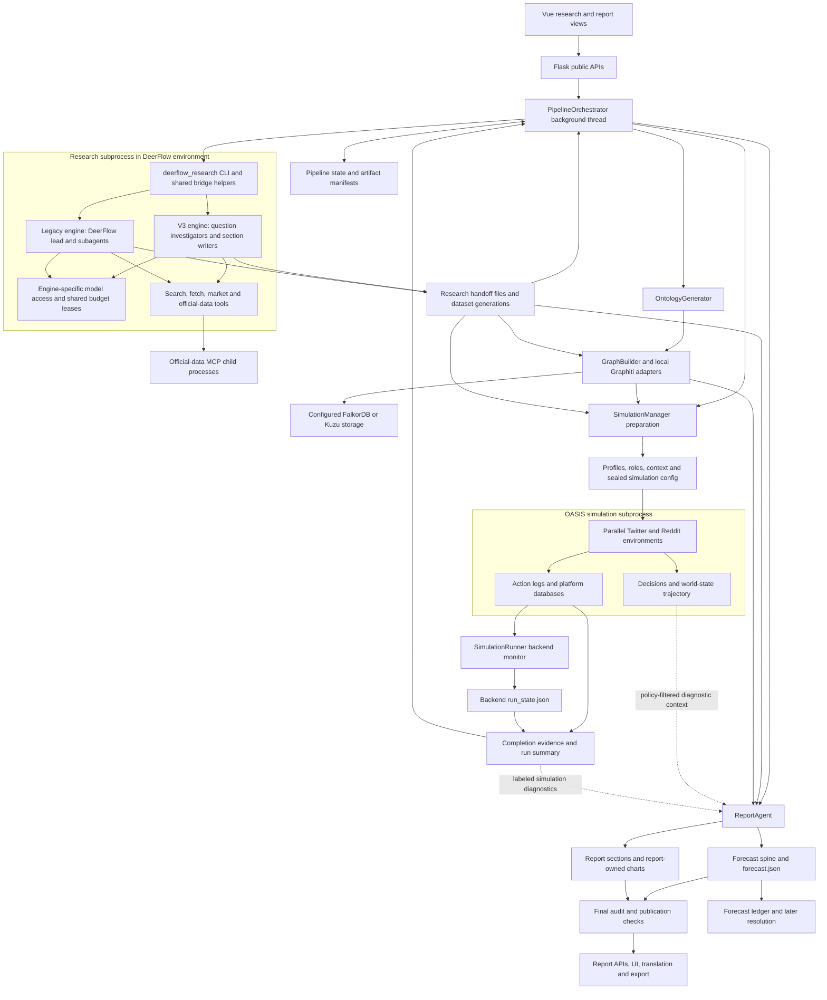
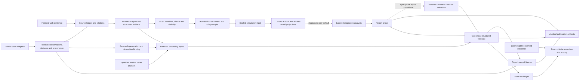

# Main-branch architecture and workflow diagrams

Source authority: `main` at `72545c65d8dbaee40e1c1e71e9909ab4741c7b9f`. These diagrams are static source traces. They do not assert that a deployed runtime, provider or saved pipeline was exercised.

## 1. Components and process boundaries



The parent explicitly selects the engine. V3 is the backend default and has one outer lane; its investigators and writers are internal fan-out. The legacy path executes the DeerFlow lead/subagent harness and can use outer evidence lanes plus the sealed actor plane. Both cross the same parent research subprocess/file boundary. Graphiti is reached through compatibility-named `Zep` adapters; that name does not identify a remote Zep dependency. The simulation platforms are internal OASIS environments.

Primary anchors: [backend/app/services/pipeline_orchestrator.py:6378](/tmp/drf-main-study-20261016-72545c65d8db/backend/app/services/pipeline_orchestrator.py:6378), [backend/app/services/pipeline_orchestrator.py:2207](/tmp/drf-main-study-20261016-72545c65d8db/backend/app/services/pipeline_orchestrator.py:2207), [backend/app/services/pipeline_orchestrator.py:12447](/tmp/drf-main-study-20261016-72545c65d8db/backend/app/services/pipeline_orchestrator.py:12447), [backend/app/services/pipeline_orchestrator.py:13308](/tmp/drf-main-study-20261016-72545c65d8db/backend/app/services/pipeline_orchestrator.py:13308), [backend/app/services/pipeline_orchestrator.py:13552](/tmp/drf-main-study-20261016-72545c65d8db/backend/app/services/pipeline_orchestrator.py:13552), [backend/app/services/pipeline_orchestrator.py:13787](/tmp/drf-main-study-20261016-72545c65d8db/backend/app/services/pipeline_orchestrator.py:13787), [backend/app/services/graph_builder.py:19](/tmp/drf-main-study-20261016-72545c65d8db/backend/app/services/graph_builder.py:19), [backend/app/services/simulation_runner.py:422](/tmp/drf-main-study-20261016-72545c65d8db/backend/app/services/simulation_runner.py:422), [backend/app/services/simulation_runner.py:969](/tmp/drf-main-study-20261016-72545c65d8db/backend/app/services/simulation_runner.py:969), [backend/app/services/simulation_runner.py:1012](/tmp/drf-main-study-20261016-72545c65d8db/backend/app/services/simulation_runner.py:1012).

## 2. One full pipeline, as a static sequence

```mermaid
sequenceDiagram
    participant User as Browser
    participant API as Flask
    participant P as PipelineOrchestrator
    participant R as Research child
    participant G as Ontology and Graphiti
    participant M as SimulationManager
    participant S as OASIS child
    participant A as ReportAgent
    participant Pub as Report publication

    User->>API: Start research/full pipeline
    API->>P: start(prompt, options)
    P-->>API: pipeline_id and task_id
    API-->>User: Accepted run identity
    Note over User,P: Browser polls durable state and progress

    P->>R: Explicit engine, prompt file, budgets and lineage
    R-->>P: Research handoff, sources, actors and datasets
    Note over P,R: Validate applicable contracts and pinned actor policy

    P->>G: Generate ontology; seed and ingest research
    G-->>P: graph_id and optional graph artifacts
    P->>M: Create simulation for project and graph
    M-->>P: simulation_id
    P->>P: Bind already-consumed research generation, if captured
    Note over P,M: Conflicting binding raises; other binding failures disclose unavailability
    P->>M: Prepare actors, profiles, roles and temporal config
    M-->>P: Sealed executable config
    P->>P: Apply sanctioned config mutations; reseal if changed

    P->>S: Start parallel simulation with admitted config
    S-->>P: Platform events and telemetry
    Note over P,S: Backend monitor projects run state from child events
    Note over P,S: Require enabled-platform completion evidence and summary

    P->>A: Research carriers, graph, simulation and bound official data
    A->>A: Normal path: forecast spine, then sections and charts
    Note over A: If the spine is unavailable, finalization can extract scenarios from prose
    A->>A: Structured finalization and final audit
    A-->>P: Report identity and status
    P->>P: Optional seed ensemble; pipeline health assessment
    P-->>User: Durable terminal pipeline status
    User->>Pub: Read report or requested variant/export
    Pub-->>User: Deliverable permitted by publication checks
```

Publication and pipeline health are distinct checks. Report-stage completion precedes the orchestrator's final pipeline health assessment. Optional graph enrichments, official-data availability, simulation diagnostics and overall delivery have different failure/degradation semantics. Sources: [backend/app/services/pipeline_orchestrator.py:12828](/tmp/drf-main-study-20261016-72545c65d8db/backend/app/services/pipeline_orchestrator.py:12828), [backend/app/services/pipeline_orchestrator.py:13427](/tmp/drf-main-study-20261016-72545c65d8db/backend/app/services/pipeline_orchestrator.py:13427), [backend/app/services/pipeline_orchestrator.py:10613](/tmp/drf-main-study-20261016-72545c65d8db/backend/app/services/pipeline_orchestrator.py:10613), [backend/app/services/pipeline_orchestrator.py:13954](/tmp/drf-main-study-20261016-72545c65d8db/backend/app/services/pipeline_orchestrator.py:13954), [backend/app/services/pipeline_orchestrator.py:9953](/tmp/drf-main-study-20261016-72545c65d8db/backend/app/services/pipeline_orchestrator.py:9953), [backend/app/services/report_agent.py:14003](/tmp/drf-main-study-20261016-72545c65d8db/backend/app/services/report_agent.py:14003), [backend/app/api/report.py:45](/tmp/drf-main-study-20261016-72545c65d8db/backend/app/api/report.py:45), [backend/app/api/report.py:603](/tmp/drf-main-study-20261016-72545c65d8db/backend/app/api/report.py:603).

## 3. Evidence, model projections and forecast authority



By default, the pre-prose forecast spine and the binary extractor's explicit signal-pack input exclude simulation signals. If no usable pre-prose spine exists, structured scenario finalization falls back to extraction from report prose, which may contain simulation diagnostics; this fallback does not establish complete simulation/probability separation. Static source shows this input path, not a measured probability change. `no_update` suppresses the diagnostic signal pack; `validated_update` is not automatically promoted by an ordinary run; the compatibility `legacy_prompt` branch must be distinguished from the default. A world-state share is an elicited model projection, not an observed outcome. Source: [backend/app/config.py:1518](/tmp/drf-main-study-20261016-72545c65d8db/backend/app/config.py:1518), [backend/app/config.py:1527](/tmp/drf-main-study-20261016-72545c65d8db/backend/app/config.py:1527), [backend/app/services/report_agent.py:3697](/tmp/drf-main-study-20261016-72545c65d8db/backend/app/services/report_agent.py:3697), [backend/app/services/report_agent.py:4180](/tmp/drf-main-study-20261016-72545c65d8db/backend/app/services/report_agent.py:4180), [backend/app/services/report_agent.py:4302](/tmp/drf-main-study-20261016-72545c65d8db/backend/app/services/report_agent.py:4302), [backend/app/services/forecast_extractor.py:1016](/tmp/drf-main-study-20261016-72545c65d8db/backend/app/services/forecast_extractor.py:1016), [backend/app/services/worldstate.py:283](/tmp/drf-main-study-20261016-72545c65d8db/backend/app/services/worldstate.py:283).

Official observations, uncertain/preliminary values, projections and market prices have different statuses and uses. Persistence and generation binding preserve which evidence was consumed; they do not grant every value authority as an actual, base rate or resolvable outcome. Research-only pipelines stop before ontology/graph/preparation and can later continue to full; scenario forks reuse the base research/graph and repeat downstream work. Source: [backend/app/services/official_data.py:138](/tmp/drf-main-study-20261016-72545c65d8db/backend/app/services/official_data.py:138), [backend/app/services/pipeline_orchestrator.py:8700](/tmp/drf-main-study-20261016-72545c65d8db/backend/app/services/pipeline_orchestrator.py:8700), [backend/app/services/pipeline_orchestrator.py:8766](/tmp/drf-main-study-20261016-72545c65d8db/backend/app/services/pipeline_orchestrator.py:8766).
