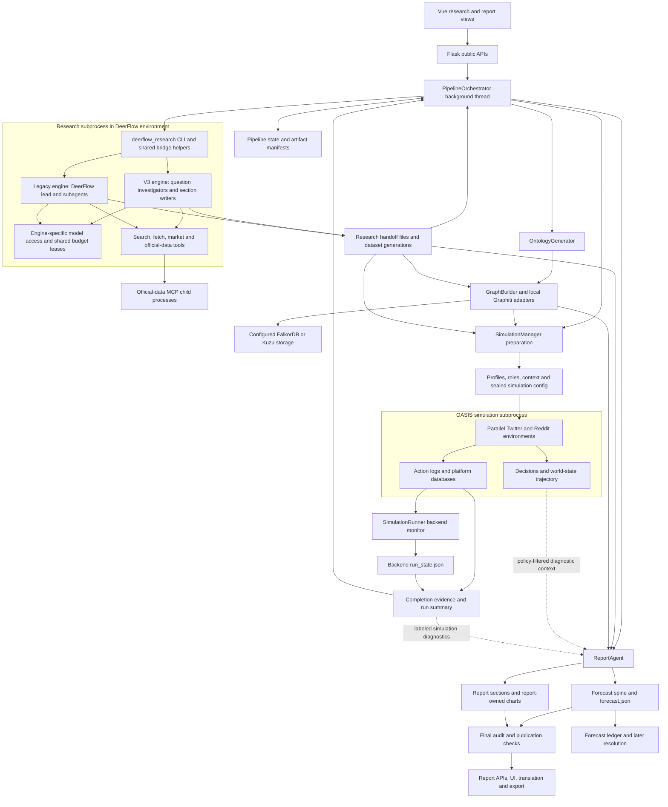
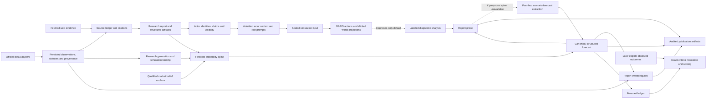

# DeepResearchForecast: main-branch architecture and workflow

The active application is a Vue/Flask system coordinated by `PipelineOrchestrator`. Its normal full workflow is **deep research → ontology → Graphiti graph → simulation preparation → OASIS simulation → forecast/report generation → separately gated publication**. Research files, graph identity, actor contracts, executable simulation inputs and report audits connect these components. The orchestrator calls backend services directly; research and simulation cross subprocess boundaries.

This study describes committed main **`72545c65d8dbaee40e1c1e71e9909ab4741c7b9f`**, frozen before team reading. Existing and concurrent working-tree changes are separate. Six primary specialists and all 26 delegated readers completed. This is source evidence, not an executed pipeline, provider, deployment, recovery or publication acceptance result.

During the study, another effort advanced main to **`8852ce123fa15a6b4f4c3e6e4e492435c0e3137b`**, adding research-method skills to both engines. The [later-main addendum](main-advance.md) maps that bounded change separately. Core maps and counts below retain their original source identity; the later snapshot has 472 tracked Python files. [main-advance.json](main-advance.json) and its inventory identify that generation explicitly.

Start with the workflow and boundaries below. The three integrated diagrams at the end show component/process ownership, a full-run sequence and evidence/forecast authority. [DIAGRAMS.md](DIAGRAMS.md) provides the same diagrams independently. The [Python module map](MODULES.md) navigates individual files and symbols.

## 1. Reading map and source authority

| Area | Detailed source-linked map | Python responsibility |
|---|---|---|
| Orchestration and recovery | [Coordinator](areas/coordinator.md) | Pipeline state, subprocess hosting, stage admission/reuse, lifecycle and health |
| V3 research and official data | [V3/data](areas/v3-data.md) | Planning, KIQ agents, evidence, synthesis/QA, MCP transport, datasets and research charts |
| DeerFlow harness and legacy research | [Legacy/harness](areas/legacy-harness.md) | Embedded DeerFlow lead/subagents, peer tracks, overlays, skill sync, actor sealing and gateway |
| Graphiti and actors | [Graph/actors](areas/graph-actors.md) | Ontology, graph storage/extraction/retrieval, actor identity, knowledge, context and role contracts |
| Multi-agent simulation | [Simulation](areas/simulation.md) | Preparation, OASIS processes/platforms, actions, IPC, decisions, world state and completion |
| Forecasts and reports | [Forecast/report](areas/forecast-report.md) | Probability spine, binary/scenario carriers, charts, audits, translations, ledgers and resolution |
| APIs and operations | [API/operations](areas/api-operations.md) | Flask route catalog, browser callers, startup, MCP services, operational scripts and drf2 |

All 469 tracked Python files in the core snapshot are hashed, counted and AST-parsed: 144 application/operations modules (173,655 lines), 279 test/reference files and 46 non-test vendor Python files. The six specialists fully read their 130 assigned modules. The coordinator fully read seven supporting modules and used targeted ranges for seven larger/support modules, including the complete six-stage `_run` method; eleven unchanged supporting modules also have separately identified, exact-hash historical full-read receipts. This is not a claim that all 469 files were read in full. Test and vendor coverage remains explicitly distinguished from application reads. See [coverage-validation.json](coverage-validation.json), [python-inventory.json](python-inventory.json) and [source-validation.json](source-validation.json).

Source anchors refer to the frozen mirror, not the modified live files. Links open those exact local source bytes. If that mirror is removed, any cited file can be recovered using `git show 72545c65d8dbaee40e1c1e71e9909ab4741c7b9f:path/to/file.py`; the commit and SHA-256 inventory remain durable. [checkout-python-drift.json](checkout-python-drift.json) records the observed live-source differences. Earlier maps supplied navigation, not current authority.

## 2. The public workflow and its authority

`ResearchView` calls `POST /api/research/run`; the route validates options and preflight before invoking `PipelineOrchestrator.start`. Start allocates a pipeline and polling task, pins actor/safety policies, saves state and launches a daemon thread. Browser polling reads durable pipeline state with best-effort live/heartbeat/ETA information. The identity chain is **pipeline → project → graph → simulation → report**. Sources: [backend/app/api/research.py:50](/tmp/drf-main-study-20261016-72545c65d8db/backend/app/api/research.py:50), [backend/app/api/research.py:306](/tmp/drf-main-study-20261016-72545c65d8db/backend/app/api/research.py:306), [backend/app/services/pipeline_orchestrator.py:8406](/tmp/drf-main-study-20261016-72545c65d8db/backend/app/services/pipeline_orchestrator.py:8406), [frontend/src/views/ResearchView.vue:465](/tmp/drf-main-study-20261016-72545c65d8db/frontend/src/views/ResearchView.vue:465).

`PipelineManager` and `pipeline_state.json` hold the durable run record. `TaskManager` is process-local; its task ID is useful for progress but does not replace persisted pipeline state. Schema-v2 migration, owner/boot fingerprints, heartbeats, per-run write locks and artifact checks support restart recovery. `run.json`, generic `handoff/manifest.json` and the path-specific research contract manifest have different purposes. Sources: [backend/app/models/task.py:54](/tmp/drf-main-study-20261016-72545c65d8db/backend/app/models/task.py:54), [backend/app/services/pipeline_orchestrator.py:683](/tmp/drf-main-study-20261016-72545c65d8db/backend/app/services/pipeline_orchestrator.py:683), [backend/app/services/pipeline_orchestrator.py:888](/tmp/drf-main-study-20261016-72545c65d8db/backend/app/services/pipeline_orchestrator.py:888), [backend/app/services/pipeline_orchestrator.py:945](/tmp/drf-main-study-20261016-72545c65d8db/backend/app/services/pipeline_orchestrator.py:945), [backend/app/services/pipeline_orchestrator.py:1136](/tmp/drf-main-study-20261016-72545c65d8db/backend/app/services/pipeline_orchestrator.py:1136).

| Stage | Main producer and input | Output / next consumer |
|---|---|---|
| Research | Selected child engine consumes prompt, depth/model/language, budgets and admitted checkpoint lineage. | Research prose, source ledger, actors and structured evidence in handoff; ontology/graph/report consumers. |
| Ontology | `OntologyGenerator` consumes report, optional actor dossier, requirement and actor context. | Project ontology and attempted handoff copy; graph builder and typed entity selection. |
| Graph | `GraphBuilderService` seeds admitted actors, ingests research chunks and eligible labeled statistical context. | Graph identity, optional communities/merges/priors; preparation and report retrieval. |
| Prepare | `SimulationManager` consumes graph entities, actors, report/context and priors. | Selected cast, profiles, role/context artifacts and sealed executable config. |
| Run | `SimulationRunner` launches OASIS from admitted config. | Action logs, backend run state, world projections, completion evidence and summary. |
| Report | `ReportAgent` consumes direct research carriers, graph/simulation identities and bound official data. | Forecast, prose, charts and audits; publication/API/translation/export consumers. |

The initial stage bands are 0–30, 30–40, 40–60, 60–72, 72–92 and 92–100; work estimates can adjust later bands. A percentage is a presentation estimate. Stage completion, pipeline completion, deliverable health and report publication have separate predicates. Source: [backend/app/services/pipeline_orchestrator.py:98](/tmp/drf-main-study-20261016-72545c65d8db/backend/app/services/pipeline_orchestrator.py:98), [backend/app/services/pipeline_orchestrator.py:9412](/tmp/drf-main-study-20261016-72545c65d8db/backend/app/services/pipeline_orchestrator.py:9412), [backend/app/services/pipeline_orchestrator.py:13933](/tmp/drf-main-study-20261016-72545c65d8db/backend/app/services/pipeline_orchestrator.py:13933).

## 3. Deep research and the DeerFlow harness

There are two research engines behind one parent subprocess/file interface. The shared `DeerFlowResearchRunner` name does not mean every child runs the legacy lead graph.

| Boundary | V3 / linear | Legacy / DeerFlow |
|---|---|---|
| Backend default | V3; `linear` aliases it. One outer lane. | Selected by `legacy`, `deerflow`, `agentic`, required sealed-actor policy or legacy-only lane modes. |
| Internal work | Plan/data/gather/gap/synthesize/QA/finalize; bounded KIQ investigators and section writers share evidence. | Embedded `DeerFlowClient` lead graph and native task subagents; bridge-managed peer research/actor workflows. |
| Outer tracks | Disabled because evidence and fan-out are internal. | Configurable evidence lanes with synthesis/merge contracts; distinct from native subagents. |
| Actor output | Unsealed report-grounded actors; admissions disclose when a requested sealed plane is unsupported. | Applicable versioned actor plane has dossier, evidence, lineage and seal checks before reception. |
| Standalone CLI | Must be selected explicitly when engine is unset. | The bare bridge CLI defaults to legacy, unlike the backend. |

Sources: [backend/app/services/pipeline_orchestrator.py:832](/tmp/drf-main-study-20261016-72545c65d8db/backend/app/services/pipeline_orchestrator.py:832), [backend/app/services/pipeline_orchestrator.py:6378](/tmp/drf-main-study-20261016-72545c65d8db/backend/app/services/pipeline_orchestrator.py:6378), [backend/app/services/pipeline_orchestrator.py:6427](/tmp/drf-main-study-20261016-72545c65d8db/backend/app/services/pipeline_orchestrator.py:6427), [deerflow_bridge/deerflow_research.py:17496](/tmp/drf-main-study-20261016-72545c65d8db/deerflow_bridge/deerflow_research.py:17496), [deerflow_bridge/deerflow_research.py:18013](/tmp/drf-main-study-20261016-72545c65d8db/deerflow_bridge/deerflow_research.py:18013), [deerflow_bridge/linear_research.py:8097](/tmp/drf-main-study-20261016-72545c65d8db/deerflow_bridge/linear_research.py:8097).

V3 plans key intelligence questions, acquires applicable official datasets, gathers source-grounded notes, runs bounded gap rounds, freezes a shared evidence digest and writes ordered sections. It then repairs/audits citations and publishes positional source IDs: final `[Sn]` resolves to `sources.json[n-1]`. A completed QA phase can have `passed=false`; finalization has separate minimum-report, model-contribution and stored-data checks. Its `v3/state.json` identity binds question/depth/model/language/version; legacy uses a separate checkpoint/thread/pass contract. Sources: [deerflow_bridge/linear_research.py:1128](/tmp/drf-main-study-20261016-72545c65d8db/deerflow_bridge/linear_research.py:1128), [deerflow_bridge/linear_research.py:4996](/tmp/drf-main-study-20261016-72545c65d8db/deerflow_bridge/linear_research.py:4996), [deerflow_bridge/linear_research.py:5752](/tmp/drf-main-study-20261016-72545c65d8db/deerflow_bridge/linear_research.py:5752), [deerflow_bridge/linear_research.py:6193](/tmp/drf-main-study-20261016-72545c65d8db/deerflow_bridge/linear_research.py:6193), [deerflow_bridge/linear_research.py:6658](/tmp/drf-main-study-20261016-72545c65d8db/deerflow_bridge/linear_research.py:6658), [deerflow_bridge/linear_research.py:7235](/tmp/drf-main-study-20261016-72545c65d8db/deerflow_bridge/linear_research.py:7235).

Legacy research separates broad research from the peer actor dossier. It supports multi-pass deep investigation, evidence-only lanes, synthesis-only recovery, tool-free structured extraction and applicable actor judging/sealing. Model subagents, bridge peer tracks and parent outer lanes are three different concurrency layers. Shared budget/provenance and model/subagent leases coordinate parts of that work, with documented degraded/fail-open branches; they are not an unconditional hard runtime cap. Sources: [deerflow_bridge/deerflow_research.py:12954](/tmp/drf-main-study-20261016-72545c65d8db/deerflow_bridge/deerflow_research.py:12954), [deerflow_bridge/deerflow_research.py:13783](/tmp/drf-main-study-20261016-72545c65d8db/deerflow_bridge/deerflow_research.py:13783), [deerflow_bridge/deerflow_research.py:17142](/tmp/drf-main-study-20261016-72545c65d8db/deerflow_bridge/deerflow_research.py:17142), [deerflow_bridge/research_budget.py:901](/tmp/drf-main-study-20261016-72545c65d8db/deerflow_bridge/research_budget.py:901), [deerflow_bridge/linear_research.py:8053](/tmp/drf-main-study-20261016-72545c65d8db/deerflow_bridge/linear_research.py:8053).

The harness integration also includes deployment: the parent synchronizes tracked bridge modules, managed skills and narrow middleware/model overlays into the configured DeerFlow environment; the child verifies the managed skill bundle before research. Lead/subagent transforms, loop detection, summarization, provider-call concurrency and tool-error middleware have separate responsibilities. Installed runtime bytes were not inspected or patched by this study. Sources: [backend/app/services/pipeline_orchestrator.py:1504](/tmp/drf-main-study-20261016-72545c65d8db/backend/app/services/pipeline_orchestrator.py:1504), [deerflow_bridge/runtime_skill_sync.py:1](/tmp/drf-main-study-20261016-72545c65d8db/deerflow_bridge/runtime_skill_sync.py:1), [deerflow_bridge/patches/apply_subagent_overlays.py:25](/tmp/drf-main-study-20261016-72545c65d8db/deerflow_bridge/patches/apply_subagent_overlays.py:25), [deerflow_bridge/patches/middlewares/model_concurrency_middleware.py:19](/tmp/drf-main-study-20261016-72545c65d8db/deerflow_bridge/patches/middlewares/model_concurrency_middleware.py:19).

## 4. Graphiti, ontology and actor identity

The historical `Zep` name is a **local Graphiti compatibility facade**. Services import the local `graphiti_client`; Graphiti runs through a background asyncio runtime and configured FalkorDB/Kuzu storage. `GRAPH_BACKEND=auto` chooses explicit-host FalkorDB, otherwise importable embedded FalkorDBLite, otherwise Kuzu, or raises if none is available. It is backend selection, not a connection-failure retry cascade. Graphiti extraction routes through the application's LLM adapter; local storage and embeddings do not imply provider-free extraction. Sources: [backend/app/services/graph_builder.py:19](/tmp/drf-main-study-20261016-72545c65d8db/backend/app/services/graph_builder.py:19), [backend/app/services/graphiti_client/client.py:349](/tmp/drf-main-study-20261016-72545c65d8db/backend/app/services/graphiti_client/client.py:349), [backend/app/services/graphiti_client/runtime.py:187](/tmp/drf-main-study-20261016-72545c65d8db/backend/app/services/graphiti_client/runtime.py:187), [backend/app/services/graphiti_client/runtime.py:283](/tmp/drf-main-study-20261016-72545c65d8db/backend/app/services/graphiti_client/runtime.py:283), [backend/app/services/graphiti_client/llm_adapter.py:139](/tmp/drf-main-study-20261016-72545c65d8db/backend/app/services/graphiti_client/llm_adapter.py:139).

Ontology generation chooses typed entity/relationship schemas using the requirement and research context. Graph construction combines deterministic researched actor seeds with prose extraction. Applicable sealed-v1 seeds use deterministic identity and physical readback after seeding, after graph mutations and on reuse. Communities, canonical alias resolution, pruning and graph priors are distinct, generally optional/best-effort steps; their existence is not implied by graph-stage completion. Sources: [backend/app/services/ontology_generator.py:539](/tmp/drf-main-study-20261016-72545c65d8db/backend/app/services/ontology_generator.py:539), [backend/app/services/graph_builder.py:131](/tmp/drf-main-study-20261016-72545c65d8db/backend/app/services/graph_builder.py:131), [backend/app/services/graph_builder.py:326](/tmp/drf-main-study-20261016-72545c65d8db/backend/app/services/graph_builder.py:326), [backend/app/services/pipeline_orchestrator.py:7566](/tmp/drf-main-study-20261016-72545c65d8db/backend/app/services/pipeline_orchestrator.py:7566), [backend/app/services/pipeline_orchestrator.py:13113](/tmp/drf-main-study-20261016-72545c65d8db/backend/app/services/pipeline_orchestrator.py:13113), [backend/app/services/pipeline_orchestrator.py:13228](/tmp/drf-main-study-20261016-72545c65d8db/backend/app/services/pipeline_orchestrator.py:13228).

The graph feeds typed entity selection, profile generation, report retrieval and graph MCP tools. Canonical actor context/role compilation further limits what each actor may know. A literal false knowledge flag vetoes the row; analyst inference remains modeler evidence; uncertainty is retained. Shared-world construction separately closes denials across validated canonical packs. Exact context, role and serialized platform fields have their own hashes/manifests, culminating in a traced Reddit final-message attestation path. Twitter's final instantiated system message was not established by the inspected boundary. Sources: [backend/app/services/actor_context.py:970](/tmp/drf-main-study-20261016-72545c65d8db/backend/app/services/actor_context.py:970), [backend/app/services/actor_context.py:1207](/tmp/drf-main-study-20261016-72545c65d8db/backend/app/services/actor_context.py:1207), [backend/app/services/actor_role_prompt.py:1500](/tmp/drf-main-study-20261016-72545c65d8db/backend/app/services/actor_role_prompt.py:1500), [backend/app/services/oasis_profile_generator.py:2642](/tmp/drf-main-study-20261016-72545c65d8db/backend/app/services/oasis_profile_generator.py:2642), [backend/app/services/simulation_config_generator.py:1675](/tmp/drf-main-study-20261016-72545c65d8db/backend/app/services/simulation_config_generator.py:1675), [backend/scripts/run_parallel_simulation.py:5285](/tmp/drf-main-study-20261016-72545c65d8db/backend/scripts/run_parallel_simulation.py:5285).

## 5. Preparation, OASIS and modeled world state

Fresh PREPARE creates a simulation, attempts to bind the already-consumed research generation, and then prepares actors/profiles/config. An existing different binding raises `ResearchBindingConflict`; other binding failures disclose unavailable official enrichment. Current actor contracts validate cast/context/role closure and seal the executable config. Scenario overlays or world-state seed injection occur afterward and require resealing if bytes change. Legacy unsealed compatibility remains explicitly conditional. Sources: [backend/app/services/pipeline_orchestrator.py:13364](/tmp/drf-main-study-20261016-72545c65d8db/backend/app/services/pipeline_orchestrator.py:13364), [backend/app/services/pipeline_orchestrator.py:13414](/tmp/drf-main-study-20261016-72545c65d8db/backend/app/services/pipeline_orchestrator.py:13414), [backend/app/services/pipeline_orchestrator.py:13427](/tmp/drf-main-study-20261016-72545c65d8db/backend/app/services/pipeline_orchestrator.py:13427), [backend/app/services/simulation_manager.py:35](/tmp/drf-main-study-20261016-72545c65d8db/backend/app/services/simulation_manager.py:35), [backend/app/services/simulation_manager.py:927](/tmp/drf-main-study-20261016-72545c65d8db/backend/app/services/simulation_manager.py:927), [backend/app/services/simulation_manager.py:1223](/tmp/drf-main-study-20261016-72545c65d8db/backend/app/services/simulation_manager.py:1223).

Normal RUN launches one child with two asynchronous internal OASIS platforms, Twitter and Reddit, with separate environments/databases/logs. The child writes actions; the backend monitor projects them into `run_state.json`. Calendar rounds and hours-based rounds have different time/activation/scheduling contracts. Single-platform scripts also differ from the richer parallel path. Sources: [backend/app/services/simulation_runner.py:422](/tmp/drf-main-study-20261016-72545c65d8db/backend/app/services/simulation_runner.py:422), [backend/app/services/simulation_runner.py:873](/tmp/drf-main-study-20261016-72545c65d8db/backend/app/services/simulation_runner.py:873), [backend/app/services/simulation_runner.py:1012](/tmp/drf-main-study-20261016-72545c65d8db/backend/app/services/simulation_runner.py:1012), [backend/scripts/run_parallel_simulation.py:2591](/tmp/drf-main-study-20261016-72545c65d8db/backend/scripts/run_parallel_simulation.py:2591), [backend/scripts/run_parallel_simulation.py:5916](/tmp/drf-main-study-20261016-72545c65d8db/backend/scripts/run_parallel_simulation.py:5916).

The decision channel elicits structured commitments and evolves seeded scenario shares with outcome-power weights, inertia and validity/convergence accounting. Those shares are **elicited model projections**, not observed outcomes. Qualitative world deltas and quantitative trajectories are separate carriers. Optional simulation-to-observed-graph feedback is off by default and separately pinned/gated. Sources: [backend/app/services/decision_channel.py:216](/tmp/drf-main-study-20261016-72545c65d8db/backend/app/services/decision_channel.py:216), [backend/app/services/decision_channel.py:350](/tmp/drf-main-study-20261016-72545c65d8db/backend/app/services/decision_channel.py:350), [backend/app/services/worldstate.py:130](/tmp/drf-main-study-20261016-72545c65d8db/backend/app/services/worldstate.py:130), [backend/app/services/worldstate.py:283](/tmp/drf-main-study-20261016-72545c65d8db/backend/app/services/worldstate.py:283), [backend/app/services/world_delta.py:21](/tmp/drf-main-study-20261016-72545c65d8db/backend/app/services/world_delta.py:21), [backend/app/config.py:1385](/tmp/drf-main-study-20261016-72545c65d8db/backend/app/config.py:1385).

RUN completion requires each enabled platform's persisted completion bit or tail `simulation_end` evidence, plus a summary passing the generic JSON probe. That probe is weaker than full semantic summary validation. Repair of the API-facing simulation projection is best effort. A completed simulation can retain a live child for interviews; result completion does not prove resource shutdown. Partial round resume preserves selected database/round/cursor/RNG state, not previous conversations or in-memory world evolution. Sources: [backend/app/services/pipeline_orchestrator.py:10496](/tmp/drf-main-study-20261016-72545c65d8db/backend/app/services/pipeline_orchestrator.py:10496), [backend/app/services/pipeline_orchestrator.py:10613](/tmp/drf-main-study-20261016-72545c65d8db/backend/app/services/pipeline_orchestrator.py:10613), [backend/app/services/pipeline_orchestrator.py:13745](/tmp/drf-main-study-20261016-72545c65d8db/backend/app/services/pipeline_orchestrator.py:13745), [backend/app/services/simulation_runner.py:1187](/tmp/drf-main-study-20261016-72545c65d8db/backend/app/services/simulation_runner.py:1187), [backend/scripts/run_parallel_simulation.py:3747](/tmp/drf-main-study-20261016-72545c65d8db/backend/scripts/run_parallel_simulation.py:3747), [backend/scripts/run_parallel_simulation.py:6028](/tmp/drf-main-study-20261016-72545c65d8db/backend/scripts/run_parallel_simulation.py:6028).

## 6. Forecasting, reports and publication

The report receives both graph/simulation identities and direct research carriers, including actors, sources, research prose, quantitative/contested claims, timeline and graph priors. Official data comes from the simulation's valid research binding. The normal authoring path derives a forecast spine before prose, then writes sections and report-owned charts, finalizes structured forecasts, stabilizes artifacts and performs the final audit. Research charts and report charts have separate ownership. Sources: [backend/app/services/pipeline_orchestrator.py:13865](/tmp/drf-main-study-20261016-72545c65d8db/backend/app/services/pipeline_orchestrator.py:13865), [backend/app/services/report_agent.py:4180](/tmp/drf-main-study-20261016-72545c65d8db/backend/app/services/report_agent.py:4180), [backend/app/services/report_agent.py:12770](/tmp/drf-main-study-20261016-72545c65d8db/backend/app/services/report_agent.py:12770), [backend/app/services/report_agent.py:13024](/tmp/drf-main-study-20261016-72545c65d8db/backend/app/services/report_agent.py:13024), [backend/app/services/report_agent.py:13106](/tmp/drf-main-study-20261016-72545c65d8db/backend/app/services/report_agent.py:13106).

Simulation/probability separation is **conditional**. The normal spine and binary extractor's explicit signal-pack inputs exclude simulation signals under the default diagnostic-only policy. If there is no usable spine, structured scenario finalization falls back to extracting from report prose, which may contain diagnostics. This source path prevents an unconditional separation claim; it does not establish that any particular run changed probabilities. Sources: [backend/app/services/report_agent.py:3707](/tmp/drf-main-study-20261016-72545c65d8db/backend/app/services/report_agent.py:3707), [backend/app/services/report_agent.py:4186](/tmp/drf-main-study-20261016-72545c65d8db/backend/app/services/report_agent.py:4186), [backend/app/services/report_agent.py:4302](/tmp/drf-main-study-20261016-72545c65d8db/backend/app/services/report_agent.py:4302), [backend/app/services/forecast_extractor.py:1016](/tmp/drf-main-study-20261016-72545c65d8db/backend/app/services/forecast_extractor.py:1016), [backend/app/services/forecast_extractor.py:4400](/tmp/drf-main-study-20261016-72545c65d8db/backend/app/services/forecast_extractor.py:4400).

`forecast.json` is the primary structured carrier. Scenario, binary, empirical base-rate, market-anchor and exact official-data-anchor processing have distinct validation. Optional seed aggregation occurs after the primary report, writes `ensemble_forecast.json` sidecars and does not rewrite the sealed primary forecast/confidence. Scenario calibration, evaluation rows, market outcomes, official outcomes and report-local `resolved.json` have separate storage/scoring paths. Spread-derived ensemble bounds are not demonstrated predictive coverage. Sources: [backend/app/services/forecast_extractor.py:1](/tmp/drf-main-study-20261016-72545c65d8db/backend/app/services/forecast_extractor.py:1), [backend/app/services/ensemble.py:118](/tmp/drf-main-study-20261016-72545c65d8db/backend/app/services/ensemble.py:118), [backend/app/services/pipeline_orchestrator.py:9198](/tmp/drf-main-study-20261016-72545c65d8db/backend/app/services/pipeline_orchestrator.py:9198), [backend/app/services/forecast_ledger.py:38](/tmp/drf-main-study-20261016-72545c65d8db/backend/app/services/forecast_ledger.py:38), [backend/app/services/forecast_ledger.py:369](/tmp/drf-main-study-20261016-72545c65d8db/backend/app/services/forecast_ledger.py:369), [backend/app/services/forecast_ledger.py:457](/tmp/drf-main-study-20261016-72545c65d8db/backend/app/services/forecast_ledger.py:457), [backend/app/api/sdk.py:283](/tmp/drf-main-study-20261016-72545c65d8db/backend/app/api/sdk.py:283).

Customer visibility is controlled by `ReportManager.publication_status` and API checks, including current audit policy and matching report/forecast artifact hashes. Completed metadata or ledger membership alone is not publication. Translation variants additionally bind source hashes and fact/audit checks; PDF, executive brief and demo export are separate derived consumers. Sources: [backend/app/services/report_agent.py:14003](/tmp/drf-main-study-20261016-72545c65d8db/backend/app/services/report_agent.py:14003), [backend/app/api/report.py:45](/tmp/drf-main-study-20261016-72545c65d8db/backend/app/api/report.py:45), [backend/app/api/report.py:603](/tmp/drf-main-study-20261016-72545c65d8db/backend/app/api/report.py:603), [backend/app/services/exec_brief.py:302](/tmp/drf-main-study-20261016-72545c65d8db/backend/app/services/exec_brief.py:302), [backend/scripts/export_demo_site_data.py:195](/tmp/drf-main-study-20261016-72545c65d8db/backend/scripts/export_demo_site_data.py:195).

## 7. Official data as a separate evidence plane

The bridge catalog, `McpHub`, normalizer and tool facade connect FRED, BLS, BIS, IMF, World Bank Data360 and US-government recipes. Discovery produces metadata; retrieval/persistence establishes citable evidence. MCP sessions and chart renderers are subprocess boundaries with explicit deadlines, concurrency and cleanup. Source status, units, periods, vintages, gaps and provenance survive normalization; display inference and automatic-resolution eligibility are different decisions. Sources: [deerflow_bridge/data_catalog.py:90](/tmp/drf-main-study-20261016-72545c65d8db/deerflow_bridge/data_catalog.py:90), [deerflow_bridge/data_mcp.py:239](/tmp/drf-main-study-20261016-72545c65d8db/deerflow_bridge/data_mcp.py:239), [deerflow_bridge/data_sources.py:111](/tmp/drf-main-study-20261016-72545c65d8db/deerflow_bridge/data_sources.py:111), [deerflow_bridge/research_gateway.py:4141](/tmp/drf-main-study-20261016-72545c65d8db/deerflow_bridge/research_gateway.py:4141).

Immutable JSON/CSV generations are indexed by `data/datasets.json` with persisted-byte hashes and source attribution. V3 links them to KIQs and remaps source IDs during final QA. Backend generation binding controls which persisted enrichment simulation/report consumers can adopt. Historical snapshots, forecast anchors, official indicators and chart captions consume stored data; explicit resolution work is a separate live-provider-capable path and requires exact eligible observation/period/cutoff proof. Sources: [deerflow_bridge/data_sources.py:1039](/tmp/drf-main-study-20261016-72545c65d8db/deerflow_bridge/data_sources.py:1039), [deerflow_bridge/data_sources.py:1205](/tmp/drf-main-study-20261016-72545c65d8db/deerflow_bridge/data_sources.py:1205), [deerflow_bridge/linear_research.py:6893](/tmp/drf-main-study-20261016-72545c65d8db/deerflow_bridge/linear_research.py:6893), [backend/app/services/official_data.py:90](/tmp/drf-main-study-20261016-72545c65d8db/backend/app/services/official_data.py:90), [backend/app/services/official_data.py:138](/tmp/drf-main-study-20261016-72545c65d8db/backend/app/services/official_data.py:138), [backend/app/services/official_data.py:417](/tmp/drf-main-study-20261016-72545c65d8db/backend/app/services/official_data.py:417), [backend/scripts/resolution_monitor.py:329](/tmp/drf-main-study-20261016-72545c65d8db/backend/scripts/resolution_monitor.py:329).

## 8. Artifacts and admission boundaries

| Producer → consumer | Artifact / identity | Meaning and limit |
|---|---|---|
| Research child → parent | `research_report.md`, `sources.json`, actors/timeline/quantitative/contested JSON | Applicable report, citation, generation and actor requirements govern reception; not every engine emits every seal. |
| Legacy synthesis → parent | `research_contract_manifest.json`, applicable judge/actor lineage | Manifest-last generation integrity; distinct from generic stage artifact registration. |
| Data producer → consumers | `data/datasets.json` and immutable JSON/CSV | Dataset identity/status/provenance; a recorded chart path is not proof that rendering succeeded. |
| Graph → preparation/report | graph ID, seed readback, optional communities/priors | Physical actor identity when required; optional graph enrichments can be absent. |
| Research → simulation | `official_research_binding.json` | Pins consumed research fingerprints; unavailable/invalid proof does not authorize adoption of newer mutable official data. |
| Preparation → runner | cast/context/role manifests and `simulation_config_manifest.json` | Exact executable-input closure for current contracts; downstream mutations require resealing. |
| Simulation → parent/report | actions, backend run state, run summary, decisions/trajectory | Platform completion, diagnostic projections and resource lifetime are separate facts. |
| Report → consumer | `forecast.json`, sections/full report, `viz_manifest.json`, `final_audit.json` | Publication is checked against current policy/artifact identity; stale/missing audit may withhold output. |
| Forecast → evaluation/resolution | production/evaluation/market/official ledgers; optional report-local resolution | Different denominator/eligibility/provenance contracts; membership is not report publication. |

The detailed producer/callee/schema/validation anchors are in the area reports. Main boundary anchors: [backend/app/services/pipeline_orchestrator.py:4077](/tmp/drf-main-study-20261016-72545c65d8db/backend/app/services/pipeline_orchestrator.py:4077), [backend/app/services/pipeline_orchestrator.py:10008](/tmp/drf-main-study-20261016-72545c65d8db/backend/app/services/pipeline_orchestrator.py:10008), [backend/app/services/pipeline_orchestrator.py:10352](/tmp/drf-main-study-20261016-72545c65d8db/backend/app/services/pipeline_orchestrator.py:10352), [backend/app/services/official_data.py:138](/tmp/drf-main-study-20261016-72545c65d8db/backend/app/services/official_data.py:138), [backend/app/services/simulation_manager.py:35](/tmp/drf-main-study-20261016-72545c65d8db/backend/app/services/simulation_manager.py:35), [backend/app/services/report_agent.py:14003](/tmp/drf-main-study-20261016-72545c65d8db/backend/app/services/report_agent.py:14003).

## 9. Alternative paths, operations and current versus planned architecture

| Operation | Implemented control flow |
|---|---|
| Research-only | Completes after research; skips ontology, graph and simulation. |
| Continue | Converts a completed research-only pipeline to full mode under the same pipeline ID, with fresh task/downstream stage work. |
| Resume | Retains pipeline ID, creates a fresh task/attempt, checks owner/schema and stage artifact identity; force can regenerate a broken/degraded completed report. |
| Scenario fork | Creates a new pipeline sharing base project/graph/handoff and actor policy; prepares/runs/reports anew. Admission checks base graph identity. |
| Cancel/delete | Cancellation acts through control points or orphan state; deletion guards live work and dependent forks unless forced. |

Sources: [backend/app/services/pipeline_orchestrator.py:8468](/tmp/drf-main-study-20261016-72545c65d8db/backend/app/services/pipeline_orchestrator.py:8468), [backend/app/services/pipeline_orchestrator.py:8529](/tmp/drf-main-study-20261016-72545c65d8db/backend/app/services/pipeline_orchestrator.py:8529), [backend/app/services/pipeline_orchestrator.py:8593](/tmp/drf-main-study-20261016-72545c65d8db/backend/app/services/pipeline_orchestrator.py:8593), [backend/app/services/pipeline_orchestrator.py:8700](/tmp/drf-main-study-20261016-72545c65d8db/backend/app/services/pipeline_orchestrator.py:8700), [backend/app/services/pipeline_orchestrator.py:8766](/tmp/drf-main-study-20261016-72545c65d8db/backend/app/services/pipeline_orchestrator.py:8766).

The mounted Flask routes use the current thread/file orchestrator. `drf2` has a separate driver/state/manifest/harness/engine contract and remains outside that normal route path. The workflow-authority ADR specifies a future database/outbox design and explicitly retains the legacy controller until cutover gates pass; it is not evidence that main already advances runs through that store. Backend KG/simulation MCP stdio servers expose existing services; `/api/v1` registration defaults off. Source: [backend/app/__init__.py:199](/tmp/drf-main-study-20261016-72545c65d8db/backend/app/__init__.py:199), [backend/app/mcp/kg_server.py:317](/tmp/drf-main-study-20261016-72545c65d8db/backend/app/mcp/kg_server.py:317), [backend/app/mcp/sim_server.py:200](/tmp/drf-main-study-20261016-72545c65d8db/backend/app/mcp/sim_server.py:200), [drf2/driver/pipeline.py:1](/tmp/drf-main-study-20261016-72545c65d8db/drf2/driver/pipeline.py:1), [docs/adr/0001-workflow-authority.md:50](/tmp/drf-main-study-20261016-72545c65d8db/docs/adr/0001-workflow-authority.md:50).

Operational scripts cover startup/preflight, environment drift, diagnostics, guarded tests, provider smoke, report/chart backfill, dead-letter replay, resolution monitoring, reruns and demo export. Their side effects range from read-only inspection to provider calls and artifact/process changes; none were invoked merely to document them. Telemetry joins backend, research-child and simulation-child accounting, but estimates and fallback attribution are not provider billing proof. Source: [backend/app/utils/telemetry.py:1](/tmp/drf-main-study-20261016-72545c65d8db/backend/app/utils/telemetry.py:1), [backend/app/services/pipeline_orchestrator.py:11024](/tmp/drf-main-study-20261016-72545c65d8db/backend/app/services/pipeline_orchestrator.py:11024); see the [operations map and exact route catalog](areas/api-operations.md).

## 10. Verification, review and remaining uncertainty

Static validation matched all 469 Python blobs to Git identities and SHA-256/line counts, with zero AST errors. Coverage union/hash checks pass for all 130 specialist assignments; coordinator and supplemental partial/historical reads remain labeled. Independent review corrected process ownership, preparation ordering, best-effort state reconciliation and the conditional forecast-prose fallback. Final integrated acceptance is recorded in [independent-review.md](independent-review.md); bounded earlier findings remain in [coordinator-review.md](coordinator-review.md). Documentation link/anchor/fence checks are recorded in [document-validation.json](document-validation.json).

No application modules or tests were run/imported. The study does not establish effective secret dotenv settings, installed/deployed DeerFlow or OASIS bytes, provider availability, database contents, saved-run validity, executed recovery, calibrated forecast quality, rendered artifact appearance or live publication. Those are runtime questions beyond this source study, not silently completed checks. The next session should start with [handoff.md](handoff.md), recheck current branch/source drift, and use the relevant area map and exact source anchors for any separately requested change.

## 11. Integrated diagrams

The diagrams below share the source authority and qualifications above. The full source-linked explanation is also available in [DIAGRAMS.md](DIAGRAMS.md).

### Components and process boundaries



The parent explicitly selects the engine. V3 is the backend default and has one outer lane; its investigators and writers are internal fan-out. The legacy path executes the DeerFlow lead/subagent harness and can use outer evidence lanes plus the sealed actor plane. Both cross the same parent research subprocess/file boundary. Graphiti is reached through compatibility-named `Zep` adapters; that name does not identify a remote Zep dependency. The simulation platforms are internal OASIS environments.

Primary anchors: [backend/app/services/pipeline_orchestrator.py:6378](/tmp/drf-main-study-20261016-72545c65d8db/backend/app/services/pipeline_orchestrator.py:6378), [backend/app/services/pipeline_orchestrator.py:2207](/tmp/drf-main-study-20261016-72545c65d8db/backend/app/services/pipeline_orchestrator.py:2207), [backend/app/services/pipeline_orchestrator.py:12447](/tmp/drf-main-study-20261016-72545c65d8db/backend/app/services/pipeline_orchestrator.py:12447), [backend/app/services/pipeline_orchestrator.py:13308](/tmp/drf-main-study-20261016-72545c65d8db/backend/app/services/pipeline_orchestrator.py:13308), [backend/app/services/pipeline_orchestrator.py:13552](/tmp/drf-main-study-20261016-72545c65d8db/backend/app/services/pipeline_orchestrator.py:13552), [backend/app/services/pipeline_orchestrator.py:13787](/tmp/drf-main-study-20261016-72545c65d8db/backend/app/services/pipeline_orchestrator.py:13787), [backend/app/services/graph_builder.py:19](/tmp/drf-main-study-20261016-72545c65d8db/backend/app/services/graph_builder.py:19), [backend/app/services/simulation_runner.py:422](/tmp/drf-main-study-20261016-72545c65d8db/backend/app/services/simulation_runner.py:422), [backend/app/services/simulation_runner.py:969](/tmp/drf-main-study-20261016-72545c65d8db/backend/app/services/simulation_runner.py:969), [backend/app/services/simulation_runner.py:1012](/tmp/drf-main-study-20261016-72545c65d8db/backend/app/services/simulation_runner.py:1012).

### One full pipeline, as a static sequence

```mermaid
sequenceDiagram
    participant User as Browser
    participant API as Flask
    participant P as PipelineOrchestrator
    participant R as Research child
    participant G as Ontology and Graphiti
    participant M as SimulationManager
    participant S as OASIS child
    participant A as ReportAgent
    participant Pub as Report publication

    User->>API: Start research/full pipeline
    API->>P: start(prompt, options)
    P-->>API: pipeline_id and task_id
    API-->>User: Accepted run identity
    Note over User,P: Browser polls durable state and progress

    P->>R: Explicit engine, prompt file, budgets and lineage
    R-->>P: Research handoff, sources, actors and datasets
    Note over P,R: Validate applicable contracts and pinned actor policy

    P->>G: Generate ontology; seed and ingest research
    G-->>P: graph_id and optional graph artifacts
    P->>M: Create simulation for project and graph
    M-->>P: simulation_id
    P->>P: Bind already-consumed research generation, if captured
    Note over P,M: Conflicting binding raises; other binding failures disclose unavailability
    P->>M: Prepare actors, profiles, roles and temporal config
    M-->>P: Sealed executable config
    P->>P: Apply sanctioned config mutations; reseal if changed

    P->>S: Start parallel simulation with admitted config
    S-->>P: Platform events and telemetry
    Note over P,S: Backend monitor projects run state from child events
    Note over P,S: Require enabled-platform completion evidence and summary

    P->>A: Research carriers, graph, simulation and bound official data
    A->>A: Normal path: forecast spine, then sections and charts
    Note over A: If the spine is unavailable, finalization can extract scenarios from prose
    A->>A: Structured finalization and final audit
    A-->>P: Report identity and status
    P->>P: Optional seed ensemble; pipeline health assessment
    P-->>User: Durable terminal pipeline status
    User->>Pub: Read report or requested variant/export
    Pub-->>User: Deliverable permitted by publication checks
```

Publication and pipeline health are distinct checks. Report-stage completion precedes the orchestrator's final pipeline health assessment. Optional graph enrichments, official-data availability, simulation diagnostics and overall delivery have different failure/degradation semantics. Sources: [backend/app/services/pipeline_orchestrator.py:12828](/tmp/drf-main-study-20261016-72545c65d8db/backend/app/services/pipeline_orchestrator.py:12828), [backend/app/services/pipeline_orchestrator.py:13427](/tmp/drf-main-study-20261016-72545c65d8db/backend/app/services/pipeline_orchestrator.py:13427), [backend/app/services/pipeline_orchestrator.py:10613](/tmp/drf-main-study-20261016-72545c65d8db/backend/app/services/pipeline_orchestrator.py:10613), [backend/app/services/pipeline_orchestrator.py:13954](/tmp/drf-main-study-20261016-72545c65d8db/backend/app/services/pipeline_orchestrator.py:13954), [backend/app/services/pipeline_orchestrator.py:9953](/tmp/drf-main-study-20261016-72545c65d8db/backend/app/services/pipeline_orchestrator.py:9953), [backend/app/services/report_agent.py:14003](/tmp/drf-main-study-20261016-72545c65d8db/backend/app/services/report_agent.py:14003), [backend/app/api/report.py:45](/tmp/drf-main-study-20261016-72545c65d8db/backend/app/api/report.py:45), [backend/app/api/report.py:603](/tmp/drf-main-study-20261016-72545c65d8db/backend/app/api/report.py:603).

### Evidence, model projections and forecast authority



By default, the pre-prose forecast spine and the binary extractor's explicit signal-pack input exclude simulation signals. If no usable pre-prose spine exists, structured scenario finalization falls back to extraction from report prose, which may contain simulation diagnostics; this fallback does not establish complete simulation/probability separation. Static source shows this input path, not a measured probability change. `no_update` suppresses the diagnostic signal pack; `validated_update` is not automatically promoted by an ordinary run; the compatibility `legacy_prompt` branch must be distinguished from the default. A world-state share is an elicited model projection, not an observed outcome. Source: [backend/app/config.py:1518](/tmp/drf-main-study-20261016-72545c65d8db/backend/app/config.py:1518), [backend/app/config.py:1527](/tmp/drf-main-study-20261016-72545c65d8db/backend/app/config.py:1527), [backend/app/services/report_agent.py:3697](/tmp/drf-main-study-20261016-72545c65d8db/backend/app/services/report_agent.py:3697), [backend/app/services/report_agent.py:4180](/tmp/drf-main-study-20261016-72545c65d8db/backend/app/services/report_agent.py:4180), [backend/app/services/report_agent.py:4302](/tmp/drf-main-study-20261016-72545c65d8db/backend/app/services/report_agent.py:4302), [backend/app/services/forecast_extractor.py:1016](/tmp/drf-main-study-20261016-72545c65d8db/backend/app/services/forecast_extractor.py:1016), [backend/app/services/worldstate.py:283](/tmp/drf-main-study-20261016-72545c65d8db/backend/app/services/worldstate.py:283).

Official observations, uncertain/preliminary values, projections and market prices have different statuses and uses. Persistence and generation binding preserve which evidence was consumed; they do not grant every value authority as an actual, base rate or resolvable outcome. Research-only pipelines stop before ontology/graph/preparation and can later continue to full; scenario forks reuse the base research/graph and repeat downstream work. Source: [backend/app/services/official_data.py:138](/tmp/drf-main-study-20261016-72545c65d8db/backend/app/services/official_data.py:138), [backend/app/services/pipeline_orchestrator.py:8700](/tmp/drf-main-study-20261016-72545c65d8db/backend/app/services/pipeline_orchestrator.py:8700), [backend/app/services/pipeline_orchestrator.py:8766](/tmp/drf-main-study-20261016-72545c65d8db/backend/app/services/pipeline_orchestrator.py:8766).
