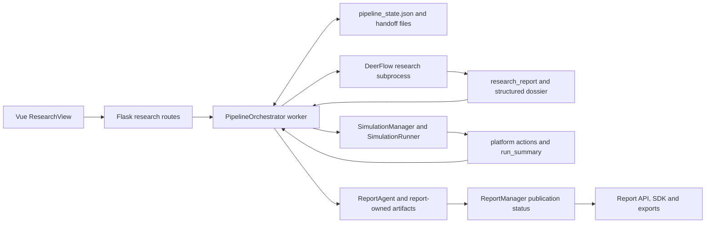
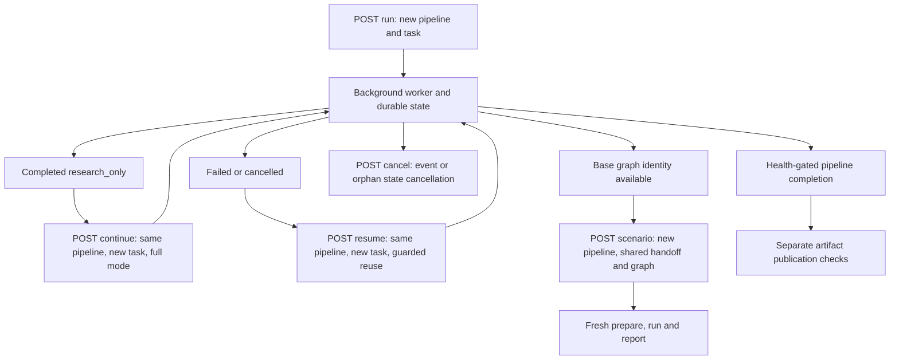

# API, startup, MCP and operations architecture

**Authority:** committed main `72545c65d8dbaee40e1c1e71e9909ab4741c7b9f`, frozen source mirror `/tmp/drf-main-study-20261016-72545c65d8db`. All `path:line` anchors below refer to that mirror generation, not the live working tree. **Method:** source-only reading. No application imports/execution, providers, network probes, saved runs, Git/index mutation, or application-file changes. **Status:** complete source study for api-operations. All three delegated readers returned terminal completion and were closed after receipt. The primary receipt covers 54/54 assigned Python files and 21,377 lines; auxiliary context and tests are listed separately below.

## Navigation

1. [Boundary summary and diagrams](#boundary-summary-and-diagrams)
2. [Startup, HTTP exposure and models](#startup-http-exposure-and-models)
3. [Unified research lifecycle](#unified-research-lifecycle)
4. [Dossier, translations and research artifacts](#dossier-translations-and-research-artifacts)
5. [Versioned SDK surface](#versioned-sdk-surface)
6. [Backend MCP servers](#backend-mcp-servers)
7. [Frontend consumer boundary](#frontend-consumer-boundary)
8. [Graph, settings, report and simulation routes](#graph-settings-report-and-simulation-routes)
9. [Operational scripts](#operational-scripts)
10. [drf2 alternative and further operations](#drf2-alternative-and-further-operations)
11. [Exact route catalog](#exact-route-catalog)
12. [Coverage, evidence-only tests and explicit uncertainties](#coverage-evidence-only-tests-and-explicit-uncertainties)

## Boundary summary and diagrams

The mounted Flask application enters the existing `PipelineOrchestrator`, whose durable record is `PIPELINE_DATA_DIR/<pipe_id>/pipeline_state.json`. Its worker delegates research to a subprocess and consumes handoff files, prepares and polls a `SimulationRunner` simulation, then invokes `ReportAgent`. Final API publication is a separate `ReportManager.publication_status` decision: a task or pipeline completion bit alone is not the predicate used to serve final forecast/report artifacts. The alternative `drf2/driver` has its own state, manifest and HTTP gateway contracts; the mounted route imports point at `app.services.pipeline_orchestrator`, not that alternative. Sources: `backend/app/__init__.py:199-214`; `backend/app/api/research.py:24-31`, `backend/app/api/research.py:109-125`; `backend/app/services/pipeline_orchestrator.py:860-885`, `backend/app/services/pipeline_orchestrator.py:12611-12639`, `backend/app/services/pipeline_orchestrator.py:13592-13655`, `backend/app/services/pipeline_orchestrator.py:13916-13962`; `backend/app/api/sdk.py:238-277`; `drf2/README.md:3-5`, `drf2/README.md:173`.

Diagram edges are grounded in `frontend/src/views/ResearchView.vue:465-493`; `backend/app/api/research.py:109-125`; `backend/app/services/pipeline_orchestrator.py:8418-8465`, `backend/app/services/pipeline_orchestrator.py:12447-12468`, `backend/app/services/pipeline_orchestrator.py:12611-12643`, `backend/app/services/pipeline_orchestrator.py:12879-12897`, `backend/app/services/pipeline_orchestrator.py:13364-13424`, `backend/app/services/pipeline_orchestrator.py:13702-13739`, `backend/app/services/pipeline_orchestrator.py:13888-13933`; `backend/app/api/report.py:544-810`; `backend/app/api/sdk.py:238-277`; `backend/scripts/export_demo_site_data.py:195-405`.

The lifecycle predicates and identities are in `backend/app/services/pipeline_orchestrator.py:8406-8502`, `backend/app/services/pipeline_orchestrator.py:8593-8835`, `backend/app/services/pipeline_orchestrator.py:12865-12876`, `backend/app/services/pipeline_orchestrator.py:13947-13997`. A graph ID is the implemented fork admission condition (`backend/app/services/pipeline_orchestrator.py:8780-8782`); the diagram does not strengthen this into an independently checked completed-GRAPH stage condition.

| Producer → consumer | Payload or persisted boundary | Admission / stopping condition |
|---|---|---|
| Browser → start route → orchestrator | JSON prompt/mode/depth/model/language/max_rounds; immediate pipeline/task identities | Route validation and preflight precede start; start saves running state before daemon thread (`backend/app/api/research.py:62-125`; `backend/app/services/pipeline_orchestrator.py:8418-8465`). |
| Orchestrator → research child → orchestrator | Separate-process `--out-dir` handoff; report plus actors/sources and optional data lanes | Reuse examines report length, research contract integrity/quality or completed legacy artifact manifest; synthesis recovery is distinct from replaying research (`backend/app/services/pipeline_orchestrator.py:12467-12539`, `backend/app/services/pipeline_orchestrator.py:12611-12643`). |
| Research → project/ontology | report text saved as extracted text; `project.json`; handoff `ontology.json` | Existing project ontology can be reused; generation receives report/dossier/actors and records project identity (`backend/app/services/pipeline_orchestrator.py:12879-12958`). |
| Prepare → runner | simulation identity/config, profiles, research-generation binding | Reuse checks manifest and config seal; rebuilt preparation invalidates downstream RUN reuse (`backend/app/services/pipeline_orchestrator.py:13322-13424`, `backend/app/services/pipeline_orchestrator.py:13544-13572`). |
| Runner → report stage | state, actions and valid run summary | Enabled-platform completion evidence plus valid summary is required before RUN completion; terminal state projection reconciliation is attempted best effort (`backend/app/services/pipeline_orchestrator.py:13702-13777`). |
| Report producer → external consumer | primary/translated Markdown, forecast, audit, charts, official data | Report APIs and SDK apply publication checks; report health and pipeline completion remain distinct layers (`backend/app/services/pipeline_orchestrator.py:13925-13962`; `backend/app/api/report.py:544-810`; `backend/app/api/sdk.py:238-277`). |

## Startup, HTTP exposure and models

`backend/run.py:25-37` calls `Config.validate()`, exits 1 with messages on invalid configuration, and then builds the app. It calls resolution autorun at `backend/run.py:39-42` before serving; whether that scheduler starts is delegated to its service/config. Flask defaults to host `127.0.0.1`, port `5001`, `Config.DEBUG`, and threaded requests (`backend/run.py:44-57`). The launch script executes this entry point through `backend/.venv/bin/python`, detached with redirected logs and a PID file; it separately detaches `npm run dev` and attaches a progress watcher in following mode (`scripts/start.sh:30-44`, `scripts/start.sh:361-381`, `scripts/start.sh:585-594`). These are invocation contracts, not an observation that any service was running.

The factory uses `FRONTEND_DIST` or `<repo>/frontend/dist` as its static root; CORS applies to `/api/*` using the configured origins (`backend/app/__init__.py:23-33`, `backend/app/__init__.py:84-116`). The shared request gate exempts OPTIONS and health/non-API paths. A loopback peer is trusted only when forwarded-client headers contain no nonloopback/unparseable address; forwarded headers can reduce trust. Other API peers receive 403 if no `APP_API_TOKEN` is configured or 401 for mismatched `X-API-Token`, compared with `hmac.compare_digest` (`backend/app/__init__.py:36-81`, `backend/app/__init__.py:154-172`). This gate applies to reads as well as writes. Config defaults include explicit localhost/127.0.0.1 frontend/backend CORS origins, DEBUG false and API_V1_ENABLED false (`backend/app/config.py:27-50`, `backend/app/config.py:388`).

Normal factory creation registers simulation cleanup and orphan reconciliation, then pipeline reconciliation and cleanup. `TESTING` or `DRF_TEST_PROCESS=1` suppresses these hooks (`backend/app/__init__.py:118-145`). Pipeline orphan reconciliation can skip when the configured backend port is already occupied; otherwise it combines in-process thread ownership with owner/heartbeat evidence, optionally salvages an already recorded report completion with nonempty Markdown and nonempty forecast dict, or marks the orphan failed. Research PIDs are checked against `deerflow_research.py` plus the pipeline ID before process-group signaling. Cleanup chains installed signal handlers and registers an atexit child cleanup (`backend/app/services/pipeline_orchestrator.py:8123-8256`, `backend/app/services/pipeline_orchestrator.py:8295-8403`). Salvage's file-presence predicate is not the external publication predicate.

The factory logs redacted JSON requests and strips top-level traceback fields from non-DEBUG JSON responses. Five SPA-oriented blueprints are mounted at `/api/graph`, `/api/simulation`, `/api/report`, `/api/research`, `/api/settings`; `API_V1_ENABLED` additionally mounts `/api/v1` (`backend/app/__init__.py:174-214`). `/health` returns a fixed service signature. Existing static files are served; missing non-API paths fall back to index.html, and missing dist yields a JSON build hint. Unmatched API paths remain JSON 404 (`backend/app/__init__.py:216-255`). The Vue router's entry is ResearchView and unmatched legacy routes redirect to `/` (`frontend/src/router/index.js:1-29`).

The project model contains identity/name/status/timestamps, file metadata/text length, ontology/analysis, graph/task IDs, requirement/chunk settings and error. `ProjectManager` uses `UPLOAD_FOLDER/projects/<project_id>/project.json`, `files/`, and `extracted_text.txt`; IDs are `proj_` plus a UUID suffix. Metadata saves use atomic JSON, uploads receive a random saved filename with the original extension, and deletion removes the project directory (`backend/app/models/project.py:17-98`, `backend/app/models/project.py:101-178`, `backend/app/models/project.py:225-309`). `TaskManager` instead holds a locked in-process singleton dictionary. Tasks carry status/progress/detail/result/error/metadata and timestamps; update of an unknown task is a no-op, and cleanup deletes old completed/failed entries. That task registry does not itself survive restart (`backend/app/models/task.py:14-51`, `backend/app/models/task.py:54-184`). Initializers expose these models and aggregate service imports (`backend/app/models/__init__.py:5-8`; `backend/app/services/__init__.py:5-73`; `backend/app/utils/__init__.py:5-8`).

`FileParser` dispatches PDF/Markdown/TXT; PDF extraction delegates PyMuPDF page text, while text decoding attempts UTF-8, charset_normalizer, chardet, then replacement decoding. Multi-file extraction embeds failure markers rather than dropping failed documents; its chunk helper seeks sentence boundaries with overlap (`backend/app/utils/file_parser.py:11-58`, `backend/app/utils/file_parser.py:61-191`). Security utilities recursively redact sensitive keyed values and recognizable inline tokens, reject control characters in .env values, quote dotenv-sensitive strings, and resolve/validate operator URLs; private/loopback blocking is conditional (`backend/app/utils/security.py:17-94`, `backend/app/utils/security.py:99-156`). These helpers were read, not called.

## Unified research lifecycle

The route's actual depth default is `Config.DEERFLOW_RESEARCH_DEPTH`, whose frozen default is **deep**, despite a route docstring mentioning standard. Mode defaults full. Prompt must be nonempty; depth is quick/standard/deep; language accepts Chinese/English/auto and the internal alias research_language. Auto becomes the empty-string sentinel; None retains Config default. Explicit models are normalized and checked against the supported list. max_rounds is integer-coerced here. Preflight occurs before `PipelineOrchestrator.start`, and failures return 400 with preflight_errors (`backend/app/api/research.py:41-129`; `backend/app/config.py:1152-1165`). Preflight is coded as local package/path/credential-presence checking: full mode adds graph/provider readiness while research_only skips those downstream requirements (`backend/app/services/pipeline_orchestrator.py:7265-7338`). No preflight was executed.

Start creates a fresh `pipe_<UUID suffix>`, process-local task, stages, running state and handoff directory, pins actor-intelligence/safety options, saves, then starts a daemon worker and returns the state. The worker records run context/manifest, starts heartbeat and chooses research reuse, synthesis recovery, or child research (`backend/app/services/pipeline_orchestrator.py:8406-8465`, `backend/app/services/pipeline_orchestrator.py:12447-12546`). Research-engine resolution defaults to v3; a required pinned actor-intelligence policy selects legacy. Those are dispatch rules, not observed run topology (`backend/app/services/pipeline_orchestrator.py:6378-6424`).

| Public action | Delegation and state semantics | Response / errors |
|---|---|---|
| POST `/api/research/run` | `start`; new pipeline/task, background `_run` | `{pipeline_id,task_id,mode,status}` in success envelope; validation/preflight 400; unexpected 500 (`backend/app/api/research.py:50-129`). |
| GET `/api/research/status/<id>` | `PipelineManager.load`; add heartbeat/ETA/spend/budget best effort | Durable state plus optional live; absent 404; no-store/no-cache (`backend/app/api/research.py:306-334`). |
| POST `/<id>/cancel` | `cancel`; local live worker event → cancelling; no local live worker → persisted cancelled | not_found 404; not_running 409; result otherwise 200 (`backend/app/api/research.py:132-144`; `backend/app/services/pipeline_orchestrator.py:8468-8502`). |
| POST `/<id>/resume` | Preflight saved mode, then `resume(force)`; same pipeline, fresh task, cleared error/research PID, incremented resume_count | missing 404; lifecycle/schema RuntimeError 409; other failure 500 (`backend/app/api/research.py:147-181`; `backend/app/services/pipeline_orchestrator.py:8593-8697`). |
| POST `/<id>/continue` | Full preflight then `continue_to_full`; only completed research_only plus nonempty research report; preserve research stage, reset downstream | same pipeline/fresh task/full mode; missing 404, incompatible/lifecycle 409 (`backend/app/api/research.py:184-216`; `backend/app/services/pipeline_orchestrator.py:8700-8763`). |
| POST `/<id>/scenario` | Label/full preflight then `fork`; require base graph ID; new pipeline/task, base prompt/project/graph/handoff, copied actor policy, overlay | base missing 404; label/preflight 400; graph/schema 409 (`backend/app/api/research.py:219-257`; `backend/app/services/pipeline_orchestrator.py:8766-8835`). |
| DELETE `/<id>` | `delete_pipeline(force)` under lifecycle lock; refuse live local thread, guard dependent forks unless force, clean orphan research before delete | missing 404; still_running/has_dependents 409; result otherwise (`backend/app/api/research.py:260-284`; `backend/app/services/pipeline_orchestrator.py:8505-8572`). |
| POST `/clean` | Allow only failed/cancelled statuses; delegate clean_terminal | list required/other statuses 400; deleted/skipped lists (`backend/app/api/research.py:287-303`; `backend/app/services/pipeline_orchestrator.py:8575-8590`). |

Resume rejects a live local worker, handles an incompatible schema, and can recover a persisted running orphan only with dead-owner evidence. Completed state needs force and degraded/failed pipeline_health, in which case REPORT is reset and regeneration requested. Missing safety policy is reconstructed with the current safe pin; existing pins are retained (`backend/app/services/pipeline_orchestrator.py:8606-8686`). Resume's admission does not imply every previous artifact is reusable: research contract validation, prepare manifest/seal checks, simulation identity/completion evidence and report health/artifact checks still occur in `_run` (`backend/app/services/pipeline_orchestrator.py:12467-12539`, `backend/app/services/pipeline_orchestrator.py:13322-13352`, `backend/app/services/pipeline_orchestrator.py:13544-13572`, `backend/app/services/pipeline_orchestrator.py:13791-13847`).

`PipelineManager` validates IDs, computes state/handoff/run.json/manifest paths, saves atomically under per-pipeline process-local locks, migrates older loaded schemas and returns an incompatible sentinel for newer strict schemas. Absent/unreadable/non-dict state returns None. Status routes return what load supplies; the explicit incompatible-schema rejection occurs in lifecycle methods. The handoff resolver honors a state-configured path only when contained by realpath beneath PIPELINE_DATA_DIR, otherwise it uses the static per-pipeline directory (`backend/app/services/pipeline_orchestrator.py:860-990`, `backend/app/services/pipeline_orchestrator.py:1078-1221`). This permits scenario forks to share base artifacts while retaining separate pipeline state.

During RUN, cancel events stop the simulation before raising PipelineCancelled; polling requires a run state, waits for COMPLETED, treats FAILED/STOPPED as error, and enforces inline plus independent stall watchdogs. A feedback-enabled run additionally joins the monitor and drains graph memory best effort. Summary production and enabled-platform completion evidence precede completed RUN state. Report construction receives dossier/source/quantitative/timeline/graph-prior/official-data inputs, with a TypeError compatibility branch falling back to the older constructor parameter set. Report status FAILED raises; optional ensemble follows; pipeline-health enforcement precedes final completed state (`backend/app/services/pipeline_orchestrator.py:13577-13777`, `backend/app/services/pipeline_orchestrator.py:13888-13962`). Cancellation marks only unfinished current-stage work cancelled; provider outage has a separate recoverable failure handler; ordinary errors fail and save the current stage and task (`backend/app/services/pipeline_orchestrator.py:13964-13997`).

## Dossier, translations and research artifacts

GET dossier uses `resolve_handoff_dir` and reads primary report, actors, sources, timeline, quantitative, contested, prediction markets and chart manifest. Missing/unparseable optional JSON becomes null, has_report reflects presence of readable report text, and sealed is explicit (`backend/app/api/research.py:389-441`). PUT is limited to completed research_only or failed/cancelled runs whose graph stage is not completed. It rejects sealed dossiers with 409; a submitted report must have at least 400 trimmed characters. Report and/or actors are individually written via temp+replace; the research artifact manifest is refreshed afterward. A manifest-refresh failure explicitly reports that bytes were already written (`backend/app/api/research.py:690-774`). Sealed means research contract manifest exists, actor lineage exists, or actors contains actor_intelligence_contract; unsealed manifest refresh recomputes changed entries while retaining produced_at and adding human_edited_at (`backend/app/services/pipeline_orchestrator.py:3868-3919`).

Research translation is POST/GET `/<id>/dossier/translations/<en|zh>`. Files are `research_report.<lang>.md`, `research_report.final_audit.<lang>.json`, `research_report.translation.<lang>.json`, and optional PDF. Status is source-SHA-bound; matching available bytes are reused; a process-local `(pipeline_id,lang)` set deduplicates workers. A daemon worker invokes the shared research Markdown translator on a deliberately constructed ReportAgent object, writes failed audit/status when unavailable, or audit/variant then available status when successful. Exceptions record failure and the in-flight key is always removed. GET marks dead generating owners interrupted and returns text only for current-source available status plus an existing variant (`backend/app/api/research.py:444-633`). This is a derivative translation plane, not modification of the sealed primary dossier.

GET dossier/pdf selects primary Markdown without lang, or requires available/current-source variant for en/zh; delegates `ReportManager.export_document_pdf`, verifies a resulting file and downloads it. Invalid language is 400, unavailable variant 409, missing source 404 and generation failures 500 (`backend/app/api/research.py:636-687`).

The artifact endpoint follows the state's named artifact pointer. Charts additionally fall back to `<name>_partial` and then shared handoff/charts when no pointer exists. Binary/image/HTML MIME types are explicit; chart serving rechecks basename, realpath containment, nonsymlink and regular-file status. HTML uses serve-time Plotly inlining plus a network-denying script sandbox; SVG uses a no-script sandbox. JSON is parsed; other text is returned in a name/content envelope (`backend/app/api/research.py:779-868`). The shared inliner matches a sibling plotly.min.js reference, caches bundles by realpath/mtime/size with max four entries, rejects an inline closing-script token, and returns None on missing/unreadable inputs so callers retain the original HTML (`backend/app/utils/chart_html.py:18-77`). No external asset retrieval occurs in that helper.

GET progress validates tail/full scope, calls the corresponding merged-progress reader and reports lines/returned/source_count/truncated with summarized_progress_events fidelity. Full alone sets exact counts/snapshot; default tail leaves total null. Limit errors are explicit 413; success disables caches (`backend/app/api/research.py:871-921`). GET list returns newest manager summaries (`backend/app/api/research.py:337-339`; `backend/app/services/pipeline_orchestrator.py:1204-1221`). GET preflight optionally calls the CLI's richer environment_report(format=full, deep), falling back to local concise preflight on exceptions. POST resolution-monitor/run delegates trigger_once with 202 started/409 already in flight (`backend/app/api/research.py:342-386`). Deep preflight and monitor endpoints are coded operational actions; none was invoked.

## Versioned SDK surface

`API_V1_ENABLED` defaults false and controls registration, while importing api/__init__ also imports the sdk module definitions (`backend/app/config.py:388`; `backend/app/__init__.py:207-214`; `backend/app/api/__init__.py:19-21`). v1 run independently validates and invokes the same start/preflight services. Its language field is language; the research_language alias in the SPA route is not present here. v1 status returns raw loaded state without the SPA route's live augmentation or explicit no-cache headers; v1 list uses the same manager. v1 dossier uses static `handoff_dir`, not `resolve_handoff_dir`, and returns report/actors/sources/timeline only. Its JSON decoding exceptions flow to the outer 500 response. These are literal route differences; no universal byte-for-byte alias claim is made (`backend/app/api/sdk.py:76-220`).

Forecast requires an existing report and current publication status, then structured forecast. Missing forecast is 409 rather than the first-party report route's optional-data envelope. Optional resolved.json is loaded if parseable. Resolve uses the same publication and forecast prerequisites, accepts outcome or outcomes (first list item/string), delegates score_forecast, and atomically writes report/simulation IDs, outcome, scoring, timestamp and embedded forecast snapshot to resolved.json (`backend/app/api/sdk.py:223-356`). There are no v1 resume/continue/fork/cancel/export decorators in this module; the catalog below is the actual surface. The external Python client mentioned in the module docstring was not supplied as part of this mirror scope and is not claimed inspected.

## Backend MCP servers

These are two `mcp.server.fastmcp.FastMCP` stdio services, distinct from Flask routes and from drf2's engine wrappers. Their package initializer only exports names; server `build_server` imports the SDK and registers tool functions, and `main` chooses defaults/starts stdio (`backend/app/mcp/__init__.py:24`; `backend/app/mcp/kg_server.py:317-358`; `backend/app/mcp/sim_server.py:200-312`). Python package imports still follow normal app/package initialization; lazy tool-service construction is not a claim of dependency-free startup.

| Backend MCP surface | Inputs and delegated operation | Results / errors |
|---|---|---|
| KG search | query/limit/scope/as_of plus optional graph_id; as_of switches from search_graph to as_of_search | text inside `{ok,graph_id,result}` (`backend/app/mcp/kg_server.py:145-152`, `backend/app/mcp/kg_server.py:223-226`). |
| KG traversal/entity/list/stats | causal path/neighborhood, entity summary, optional entity-type list, graph stats | service delegate; list projects uuid/name/type/summary (`backend/app/mcp/kg_server.py:155-178`, `backend/app/mcp/kg_server.py:214-253`). |
| KG centrality priors | top_k plus graph_id; count incident edges, normalize by maximum degree | deterministic top nodes and graph statistics; no LLM call in wrapper (`backend/app/mcp/kg_server.py:181-211`). |
| sim_status | sim_id explicit → process default → env default | found/run_state/env_status/interview_ready; guarded thread call (`backend/app/mcp/sim_server.py:57-117`, `backend/app/mcp/sim_server.py:229-236`). |
| sim_results | sim_id/top_agents | timeline, action-ranked agents, optional run_summary; partial unless runner completed/failed/stopped (`backend/app/mcp/sim_server.py:120-149`, `backend/app/mcp/sim_server.py:249-255`). |
| sim_interview_agents | interviews batch; else agent_id+prompt; else prompt to all; optional platform/timeout | requires existing directory and live IPC; runner delegates with result/error envelope (`backend/app/mcp/sim_server.py:152-184`, `backend/app/mcp/sim_server.py:272-290`). |

KG IDs resolve explicit call before process/environment default; absent ID becomes structured error. ZepToolsService is constructed on first call; construction failure is cached for the process. The synchronous service resolution occurs before the `wait_for(to_thread(...))` that wraps the operation. Operation waiting defaults 60 seconds. Simulation defaults 120 seconds; interviews add 30 seconds to the outer wait. Await timeout becomes `{ok:false,error}`; these wrappers do not demonstrate termination of underlying worker threads (`backend/app/mcp/kg_server.py:65-140`; `backend/app/mcp/sim_server.py:61-100`, `backend/app/mcp/sim_server.py:189-197`, `backend/app/mcp/sim_server.py:284-290`).

`deerflow_bridge/extensions_config.json:3-38` registers both commands as `python -m app.mcp.*`, with repository/backend interpreter placeholders and PYTHONPATH. Rendering replaces placeholders from parsed JSON and rejects leftovers; interpreter selection prefers the running backend Python (`backend/app/services/pipeline_orchestrator.py:1435-1470`). Research runner sets DEER_FLOW_EXTENSIONS_CONFIG_PATH and DRF_MCP_KG_GRAPH_ID only when it has kg_graph_id, RESEARCH_MCP_KG is true and the deployed config exists; missing config logs and continues. It then launches the research subprocess in a new process group (`backend/app/services/pipeline_orchestrator.py:2479-2505`). The first single-lane research call passes state.graph_id; a fresh start lacks it, while recovery can carry it (`backend/app/services/pipeline_orchestrator.py:12611-12638`). The inspected injection branch does not assign DRF_MCP_SIM_ID; the template allows ambient/per-tool simulation IDs. Actual deployment files, SDK installation, handshake, enabled runtime tools and default IDs were not inspected.

Vendored MCP provider Python is inventory-only in the overall study and is not counted among this area's full application reads. No claim here describes all vendor internals. This area establishes the backend SDK server commands and template/caller boundary; official data MCP transport/provider internals belong to the separate reader.

## Frontend consumer boundary

All six frontend API wrapper files were read. Axios defaults to same-origin `/`, five-minute timeout and JSON requests. Its response interceptor returns response.data (the `{success,data,...}` body), rejects explicit success=false, and converts backend error/error-message fields into the thrown message while retaining error.response. `apiUrl` builds direct image/download URLs from the same optional VITE_API_BASE_URL. An exponential retry helper exists, but the research/graph/report/simulation mutation wrappers use direct single calls (`frontend/src/api/index.js:4-88`; `frontend/src/api/research.js:28-84`; `frontend/src/api/graph.js:14-35`; `frontend/src/api/report.js:11-13`, `frontend/src/api/report.js:53-55`; `frontend/src/api/simulation.js:10-19`, `frontend/src/api/simulation.js:86-88`, `frontend/src/api/simulation.js:191-193`).

ResearchView start submits the user options, consumes `res.data.pipeline_id`, records the active ID in localStorage and starts polling. Continue/resume reuse that ID and clear stale live vitals; resume also clears final-log status so newly appended events can be read. Cancel waits for the polling result to flip terminal state (`frontend/src/views/ResearchView.vue:298-322`, `frontend/src/views/ResearchView.vue:460-493`, `frontend/src/views/ResearchView.vue:556-602`). Polling uses a self-scheduled timeout and generation ownership, pauses actual requests when the document is hidden, fetches status and initial-full/subsequent-tail progress concurrently, and takes a distinct exact snapshot after observing research/overall terminal state. It loads dossier once research completes, stops at completed/failed/cancelled, stops on 404, and retains retries for other connection errors (`frontend/src/views/ResearchView.vue:512-554`, `frontend/src/views/ResearchView.vue:604-767`). These caller ranges were read; the complete Vue component/UI rendering was not.

Research chart links map `charts/<filename>` into artifact/chart_<encoded filename>; PDF URLs bypass Axios. Report wrappers expose final Markdown/PDF/chart, language retry/status, partial sections, forecast and official-data APIs. Simulation wrappers expose create/prepare/status, stored/realtime profiles/config, start/stop/run status, actions/feed/timeline/stats, interviews and environment close. Settings has provider get/set/test and data-source probe with its own timeout (`frontend/src/api/research.js:12-16`, `frontend/src/api/research.js:187-236`; `frontend/src/api/report.js:57-170`; `frontend/src/api/simulation.js:10-203`; `frontend/src/api/settings.js:4-33`). No browser/UI workflow was executed; direct-link auth behavior for a deployed remote client is outside this static study.

## Graph, settings, report and simulation routes

The following synthesis incorporates the completed route reader. Each primary route file was read in full; the service internals referenced as context were partial reads. Zep-named route guards do not imply a hosted Zep dependency: `backend/app/services/graph_builder.py:19-20` imports the local adapter, and `backend/app/config.py:1034-1038` supplies the local-graphiti sentinel.

### Graph route behavior

`backend/app/api/graph.py:35-116` delegates project get/list/delete to ProjectManager and reset to project field changes followed by save_project. Get/delete/reset return 404 when absent (delete also when deletion returns false); list takes integer limit=50. Reset selects ONTOLOGY_GENERATED if an ontology exists, otherwise CREATED, and clears graph_id, graph_build_task_id and error. This resets local project metadata; this route itself does not call graph deletion.

`backend/app/api/graph.py:121-254` accepts multipart files, a required simulation_requirement, optional project_name (Unnamed Project) and additional_context. It creates a project, saves only allowed extensions via ProjectManager.save_file_to_project, extracts with FileParser.extract_text, preprocesses with TextProcessor, accumulates filename-marked text, and saves extracted text. No successfully processed documents causes project deletion and HTTP 400. OntologyGenerator.generate consumes document_texts, requirement and optional context; the route persists entity_types/edge_types and analysis_summary and changes status to ONTOLOGY_GENERATED, returning project identity, ontology, uploaded-file metadata and total text length. Unhandled errors return HTTP 500 plus traceback. File storage and extraction are traced in the models/FileParser section above.

`backend/app/api/graph.py:259-528` implements asynchronous /build. It requires ZEP_API_KEY, project_id, an existing project, a state other than CREATED, extracted text and ontology. GRAPH_BUILDING is rejected unless force; force resets GRAPH_BUILDING/FAILED/GRAPH_COMPLETED metadata. graph_name defaults to project name or MiroFish Graph, and chunk parameters fall back to project settings then Config defaults. The producer creates a TaskManager task, saves GRAPH_BUILDING/task_id, starts a daemon thread and immediately returns project_id/task_id. The worker constructs GraphBuilderService, splits text, creates the graph, persists graph_id, sets ontology, uploads chunks in batches of three, waits for episode processing, optionally calls compute_layout when GRAPH_LAYOUT_PRECOMPUTE defaults true, and reads graph_data. It persists GRAPH_COMPLETED and task COMPLETED with node/edge/chunk counts. Exceptions persist project FAILED/error and task FAILED with traceback. Callback progress maps add batches to 15-55 and episode wait to 55-90; status polling is GET /task/<task_id> or GET /tasks (`backend/app/api/graph.py:533-563`). These are source call relationships, not confirmation of delegated graph-backend behavior.

`backend/app/api/graph.py:568-725` exposes graph read and lifecycle delegates. GET /data/<graph_id> passes top_k/min_degree/slim; full clears top_k and min_degree but retains slim. Boolean true values are 1/true/yes/on. GET /data/<graph_id>/neighbors/<node_uuid> passes depth (default 1) and slim (default true); the route doc says depth max 3 and enforcement is delegated. GET node/edge details returns 404 when the service returns None. POST /gc converts optional retain to int and returns builder.gc_stale_graphs audit. DELETE /delete/<graph_id> delegates delete_graph. Full-data/delete routes explicitly require ZEP_API_KEY, while detail/neighborhood/GC instantiate the service directly. Caught exceptions return HTTP 500 with traceback. Graph storage, layout and GC internals belong to the graph reader; this area covers their route boundary.

### Settings route behavior

`backend/app/api/settings.py:33-57` exposes GET /llm → Config.provider_info and POST /llm → Config.apply_provider(provider, api_key, base_url, model). POST requires normalized nonempty provider; ValueError maps to 400 and other errors to stable internal-server-error 500. The module describes updating Config, process environment and .env for new pipelines (`backend/app/api/settings.py:1-12`); provider mutation is described in the settings-persistence paragraph below.

`backend/app/api/settings.py:65-194` implements POST /llm/test independently of switching. Omitted provider falls back to Config.LLM_PROVIDER; unsupported names return 400. Non-OpenAI-compatible providers use PATH lookup for claude/codex, optionally subprocess --version with 10-second timeout; presence alone returns ok even if version probing fails. API providers require a key, reuse the saved key only for the current provider, resolve endpoint/model, and validate_safe_url using APP_BLOCK_PRIVATE_URLS. A minimal chat-completions request has timeout 25, no retries, max_tokens 16, disabled-thinking extra body where configured, and Kimi User-Agent/temperature handling. SDK exceptions map 401/403/404/429 to public hints and retain detailed exceptions in logs. Completion yields HTTP 200 success true with data.ok true/false; request/internal failures are 400/500. This study did not execute a probe.

`backend/app/api/settings.py:197-470` exposes POST /data-sources/test → probe_data_sources. Environment combines os.environ with the orchestrator's resolved data-source subprocess env. A private McpHub/default server specs and DataSources pair is created; enabled providers are fred/bls/bis/imf/wb/usgov. BLS is handshake-only, other providers have one fixed cached-first sample. Default budget is 75 seconds plus 2 seconds worker grace and bounded hub close overhead, giving a documented ~90-second endpoint bound. DATA_SOURCES_ENABLED other than true returns disabled rows. A nonblocking lock prevents concurrent probes (409). Bridge construction failure returns all unavailable rows rather than 500. Workers handshake and request samples within remaining budget; providers() flags, sample availability, readiness and primary-key state produce ok/degraded/unavailable/disabled rows. FRED/BLS keyless routes are degraded; invalid is attached only to a present primary key. Secret query parameters/configured values are redacted and detail is whitespace-normalized/capped at 400 chars. Timeout/worker errors produce unavailable rows. Finally closes hub with its own bound, closes client and releases lock. The probe persists no settings; source permits cache/MCP-log activity through the clients, so no assertion of a write-free runtime probe is made.

Provider settings persistence is explicit in the frozen Config source. provider_info returns provider/model/base URL and presence-only API-key metadata. resolve_endpoint chooses explicit inputs, then current-provider settings, then provider defaults. apply_provider checks provider/key requirements, sanitizes values and validates a supplied compatible base URL, then under the provider lock updates Config and os.environ, including the research-model selection and provider-specific key environment mirror. _persist_env performs a quoted/sanitized atomic upsert into the repository .env and catches persistence exceptions; returned provider_info therefore describes in-process configuration without proving disk persistence (`backend/app/config.py:880-1009`). No credential value or .env file was read by this study.

### Report route behavior

`backend/app/api/report.py:26-244` separates metadata, final publication and progressive draft visibility. _report_publication_payload appends publication reasons, blanks Markdown and outline prose when unpublishable, and includes translations only with available/audit_verified and three digests. _draft_exposure_gate catches missing/malformed metadata/publication failures and allows drafts only for publishable bytes or PENDING/PLANNING/GENERATING reports with generator-written-file activity within 1800 seconds in either time direction. It reads mtimes from meta/progress/outline/logs/section files. Unloadable metadata or stale generation withholds prose; agent log draft fields and selected console quotations are stripped while diagnostic skeletons remain. Final artifact rejection returns HTTP 409.

`backend/app/api/report.py:267-539` starts asynchronous report generation from simulation_id and optional force_regenerate. Existing COMPLETED+publishable reports are reused unless forced. The route resolves simulation/project/graph/requirement, preallocates report_id and creates a report_generate task. Its daemon worker loads the research dossier, passes situation_brief/actors/sources/research_report/official_data to ReportAgent, generates and saves report, and completes the task only for COMPLETED+publishable output. Forced regeneration deletes other reports only after that success, with cleanup failure logged and ignored. Other terminal conditions fail the task with publication reasons. POST /generate/status first checks a publishable completed report by simulation_id, then requires/looks up task_id. The implemented decorator is POST, irrespective of GET wording in generation docstrings.

`backend/app/api/report.py:544-810` serves detail/by-simulation/list with publication-filtered payloads. Forecast requires publishability, validates optional en/zh language, and loads original/localized structured forecast, returning available=false with forecast=null for absent optional data. Official-data likewise gates publication, uses report-local digest-checked data and deterministic indicator summaries, returns available=false when absent, and fetches nothing at the route boundary. Markdown download checks publication; existing file uses send_file, absent file streams in-memory report Markdown without a temp file.

`backend/app/api/report.py:815-1090` implements language Markdown download plus POST translation retry and GET status. Language download requires en/zh (unsupported or absent file is 404) and language-specific publication. Translation retry returns an existing available variant or a 202 active/durable generation state; under a cross-process generation lease it rechecks those conditions and can_generate, persists task-bound pending state/source Markdown SHA/owner, and starts a daemon worker for generate_translation_variant. Force applies only to an available variant. Success requires available and updated; failure updates runtime/task state and issues. GET status validates report/language/task binding (409 on mismatch), combines durable state with task progress, and distinguishes the task's new output from an older available variant.

`backend/app/api/report.py:1095-1200` implements export flows. PDF requires valid optional en/zh, REPORT_PDF_EXPORT, publication and successful export_pdf+existing path. Disabled/build-failed are 503 with stable codes; unexpected errors use pdf_internal_error 500. Exec brief requires REPORT_EXEC_BRIEF, a report and publication, selects valid en/zh else primary, and delegates ExecBriefBuilder.build/brief_path; subsequent executive-brief paths are described below.

`backend/app/api/report.py:1164-1332` completes executive brief Markdown/PDF and digest. Feature flags/report/artifact absence produce 404; publication rejection 409. ExecBriefBuilder.build produces brief/digest; build_pdf is invoked after build for PDF and requires both feature flags. Unsupported brief lang falls back to primary (contrasting the explicit 400 on nonempty invalid full-report PDF lang). Digest uses primary publication and digest.md. Lazy builders may persist derived artifacts on a GET; runtime behavior was not exercised.

`backend/app/api/report.py:1337-1505` serves report-owned charts only after publication, with realpath containment, component symlink rejection and extension allowlist png/svg/jpg/jpeg/gif/webp/html. HTML may inline sibling Plotly bundle, then receives sandbox allow-scripts/default-src none/connect-src none CSP plus nosniff/referrer policy; SVG receives no-script sandbox policy. Invalid/missing/path errors return 404. Viz manifest supports legacy list or schema-v2 dict, sanitizes only charts/ relative paths (and optional png_path), preserves skipped rows if list, and returns an empty successful schema-v1 collection for an absent manifest. Parse failures return 500. Actual chart allowlist is narrower than docstring's mention of .mmd.

`backend/app/api/report.py:1508-1634` deletes reports through ReportManager and starts report-agent chat from simulation_id/message/optional chat_history. Chat resolves simulation/project and state.graph_id or project.graph_id, injects the same dossier fields as generation, and calls agent.chat. It does not call the artifact publication gate in the route body. Missing identifiers/message/graph are 400; missing simulation/project/report are 404; other caught errors 500.

`backend/app/api/report.py:1639-2235` exposes persisted progress, sections, sections-partial, single-section, publication-dependent interview-unlock check and agent/console logs. Sections return empty data when drafts are withheld; complete requires COMPLETED plus publication. Sections-partial extracts title from first Markdown heading else Section N, optionally adds a current-section generating placeholder, and implemented done derives from publication rather than file existence. Its outer exception is 500 with an empty sections payload. Single-section returns publication 409 before testing file absence (404). Check exposes report state but unlocks interview only for publishable output. Agent-log and console-log stream endpoints return complete JSON collections in a single response; their names do not denote SSE. Both incremental and full collections apply draft redaction. Debug tools/search requires graph_id/query and delegates search_graph(limit=10); tools/statistics requires graph_id and delegates get_graph_statistics.

### Simulation route behavior

`backend/app/api/simulation.py:47-241` provides filtered entities, entity detail and by-type through ZepEntityReader (explicit ZEP key; absent single entity 404). POST /create requires project_id, existing project and supplied graph_id or project.graph_id, defaults both platform enables true, calls manager.create_simulation and bind_project_simulation to attach the research generation. Returns state.to_dict.

`backend/app/api/simulation.py:244-401` checks prepared artifacts in Config.OASIS_SIMULATION_DATA_DIR/<id>: state.json, simulation_config.json, reddit_profiles.json, twitter_profiles.csv. Actor-role mode additionally verifies actor_cast_manifest digest, each role-manifest digest, role prompt manifests/count/cast identity. It accepts ready/preparing/running/completed/stopped/failed only with config_generated true and required files. A preparing state with completed artifacts is atomically updated to ready under SimulationRunner._run_state_lock; update failure is warning-only. Missing/corrupt files or integrity failures return false with diagnostics.

`backend/app/api/simulation.py:404-793` POST /prepare reuses artifacts unless force_regenerate. Otherwise requires existing simulation/project/requirement, loads document text, accepts entity_types/use_llm_for_profiles=true/parallel_profile_count=5, attempts an optional synchronous count preview, persists PREPARING and creates a simulation_prepare task. A daemon thread calls manager.prepare_simulation, translating stage progress into reading 0-20, profiles 20-70, config 70-90, scripts 90-100. Success completes task with simple simulation state; failure fails task and persists FAILED/error. POST /prepare/status checks artifacts before tasks, can return ready without a live task, returns not_started when only an unprepared simulation_id is provided, otherwise polls task (missing 404). This implemented route also uses POST despite GET wording in docstrings.

`backend/app/api/simulation.py:796-1028` serves simulation detail (adds run instructions only when READY), list by project, and history enriched from config/run-state/project/report metadata. History's total_rounds uses positive run-state total, else recommendation derived from total hours/minutes per round. Latest report identity is selected by metadata created_at with per-file errors skipped; this helper does not establish publication.

`backend/app/api/simulation.py:1031-1200` profiles delegate to SimulationManager; realtime profiles read platform file and state directly, return an empty list if profile reading fails, and report preparing/generation expectations and mtime. Realtime config continues from 1179 in the next source region described below.

`backend/app/api/simulation.py:1179-1487` completes realtime config, stored config/download, allowed generic script downloads and independent profile generation. Realtime config tolerates file parse errors with config=null, reads state preparing/profiles_generated to derive generating_profiles/generating_config, adds summary if config exists. Stored config/download missing returns 404. Script download permits precisely run_twitter_simulation.py, run_reddit_simulation.py, run_parallel_simulation.py and action_logger.py under backend/scripts; unknown is 400 and missing is 404. Generate-profiles needs graph_id and at least one filtered entity, uses LLM by default and emits reddit/twitter/generic representation according to platform without creating a simulation.

`backend/app/api/simulation.py:1492-1746` POST /start accepts simulation_id, platform=parallel, optional positive integer max_rounds, enable_graph_memory_update=false and force=false. If state is not READY it checks prepared artifacts; a prepared RUNNING simulation with runner state running requires force or is rejected. Force in that non-READY branch attempts stop (warning-only exception), calls cleanup_simulation_logs (warning-only unsuccessful audit) and resets READY. Prepared terminal/other states can likewise reset READY; unprepared state is 400. Graph-memory mode resolves simulation graph then project graph and requires one. Runner.start_simulation consumes id/platform/max_rounds/graph-memory settings; manager then persists RUNNING. Response uses actual graph_memory_active/requested/error, optional max_rounds_applied and force_restarted. POST /stop delegates runner.stop_simulation and saves manager state PAUSED. Both catch ValueError as 400 and other errors as 500. Process/file details remain delegated to the runner; its contextual reads do not constitute a full runner study.

`backend/app/api/simulation.py:1751-2000` GET run-status returns idle zero counters if no runner state. Detailed run-status returns idle empty action lists, else obtains get_all_actions once, partitions platforms, filters current-round recent actions and emits runner state plus counts. Actions passes limit=100/offset=0/platform/agent_id/round_num; timeline passes start_round=0/end_round. `backend/app/api/simulation.py:2011-2106` trajectory reads world_state_trajectory.json under realpath-contained simulation directory, rejects malformed id/file symlink/missing path with 404, file above 5 MiB with 413, invalid JSON with 500, supports dict trajectory or list, retains only dict rows/latest 720 and selected scalar metadata.

`backend/app/api/simulation.py:2109-2297` agent statistics delegates runner; posts/comments read platform_simulation.db under backend/uploads/simulations. Posts defaults reddit/limit50/offset0, returns missing/table OperationalError as empty successful results and includes total when table read succeeds. Comments likewise defaults reddit, supports optional post_id and treats missing/table errors as empty. These are SQLite consumer boundaries, not saved data inspected during this study.

`backend/app/api/simulation.py:2302-2876` interviews single/batch/all require simulation id and prompt(s)/agent id(s), validate optional twitter/reddit selection and check_env_alive before runner dispatch. Prompts receive a fixed role/memory/no-tools prefix unless already prefixed. Default timeouts are 60/120/180 seconds; ValueError is 400, TimeoutError 504, generic failure 500; success is taken from service result rather than assumed. Interview history delegates persisted history query with optional platform/agent_id/limit100. env-status combines environment liveness and platform availability. close-env delegates graceful close(timeout30) then persists COMPLETED when manager state exists and returns the service success flag. The assigned simulation file has no /resume, /cancel or /run decorator; unified orchestration routes live elsewhere and are traced in the unified research lifecycle section above.

## Operational scripts

These are separately invocable tools, not one implicitly active daemon. Their default/apply/probe behavior is described from source; none was executed.

### architecture_baseline.py

The stdlib CLI dispatches capture, verify, and compare from argparse (`backend/scripts/architecture_baseline.py:272-301`). Capture accepts an absolute existing non-symlink source directory, resolves fixture/manifest paths, and refuses a fixture inside the source (`backend/scripts/architecture_baseline.py:89-106`). It walks sorted non-symlink regular files, hashes relative path/size/mtime inventories before and after reading, and computes per-file SHA-256 (`backend/scripts/architecture_baseline.py:56-81`, `backend/scripts/architecture_baseline.py:108-150`). Credential-pattern matches produce quarantined manifest entries with source hash but no copied fixture; clean bytes are copied to fixture-relative destinations (`backend/scripts/architecture_baseline.py:84-86`, `backend/scripts/architecture_baseline.py:115-147`). A changed inventory returns 3 after copying and before manifest publication; this branch contains no fixture rollback (`backend/scripts/architecture_baseline.py:149-160`). Successful capture writes baseline-manifest/v1 with relative fixture root, inventory hash, source-root identifier hash, optional FOGLAMP_FAKE_NOW timestamp, and captured/quarantined metadata (`backend/scripts/architecture_baseline.py:162-186`). Verify consumes that manifest and checks captured fixture entries only, returning 0/1 for agreement/mismatch, 2 for caught manifest-load/schema errors (`backend/scripts/architecture_baseline.py:189-233`). Compare instead checks the whole candidate file set against every entry's sourceSha256, including quarantined entries, and reports sorted missing/extra/changed lists (`backend/scripts/architecture_baseline.py:236-269`). These are filesystem boundaries, with capture mutating fixture/manifest and verify/compare reading; there is no Flask or provider call in this script. CLI/file-system exceptions outside the explicit load/root checks propagate. Static uncertainty: source metadata comparison and the coded regexes describe the check, not a demonstrated stable snapshot or comprehensive secret detector.

### check_env_drift.py

This source-text audit resolves config.py, .env.example, and optional repo-root .env relative to its own file (`backend/scripts/check_env_drift.py:39-42`). Doc mode regex-scans Config os.environ reads, removes explicit infrastructure names and the dynamic disable-thinking pattern, and compares against commented or active .env.example assignments (`backend/scripts/check_env_drift.py:44-60`, `backend/scripts/check_env_drift.py:103-116`). Documented-but-unread names are informational; --strict returns 1 only for undocumented Config reads (`backend/scripts/check_env_drift.py:304-323`). Pin mode reads active dotenv-style assignments with optional export, matching-quote removal, unquoted whitespace-prefixed inline comments, and last assignment wins (`backend/scripts/check_env_drift.py:135-170`). First literal os.environ.get default wins; active example values provide fallback (`backend/scripts/check_env_drift.py:119-132`, `backend/scripts/check_env_drift.py:173-181`). Unknown/empty references, ignored variables, and normalized matches are omitted; retained records carry source, curated performance-critical flag, and credential-segment masking (`backend/scripts/check_env_drift.py:184-257`). --pins --strict fails only if a retained pin is performance-critical, otherwise advisory exit 0; text/JSON rendering is stdout-only (`backend/scripts/check_env_drift.py:260-302`). Config is never imported by this script and no .env mutation is present. Static uncertainty: this proves regex and string-normalization behavior, not evaluated Config defaults or runtime effective environment. Missing Config/read errors have no local recovery; missing .env is an empty mapping.

### datamcp_smoke.py

This is a live operational entry point: it imports bridge catalog/data_sources, selects explicit normalized/deduplicated ids without caps or catalog ids filtered by providers/key availability and round-robin family caps (IMF default 6) (`backend/scripts/datamcp_smoke.py:41-113`). _row transforms Series/DataError into observation, route, units-match, latest-observed and provenance summaries; units_match_catalog is reported separately from ok (`backend/scripts/datamcp_smoke.py:116-132`). run groups ids by provider, uses one thread/get_many per provider with a per-group deadline and BLS start option, converts thrown get_many errors/missing ids into DataError rows, joins all threads, and restores requested ordering (`backend/scripts/datamcp_smoke.py:135-169`). Main validates caps/provider/date/positive deadline, uses a fresh temp cache by default, sets DATA_SOURCES_CACHE_DIR and default FRED pacing 30 only for an owned DataSources instance, and records presence-only key status (`backend/scripts/datamcp_smoke.py:197-230`). It snapshots provider status and hub call/failure counts and closes only an owned source in finally (`backend/scripts/datamcp_smoke.py:231-240`). It writes the requested JSON report or cache-dir/datamcp-smoke-report.json and exits 0 only for nonempty requested ids with no failed rows; skips do not count as failures (`backend/scripts/datamcp_smoke.py:241-250`). Caches, MCP hub/provider work, and JSON report are operational side effects; no Flask HTTP call appears. Thread joins have no separate script-level timeout; deadline enforcement, provider normalization/caching/fallbacks and hub cleanup lie in the called DataSources boundary, not proven here. Exceptions outside get_many and input validation can escape and prevent report writing. No live call was made during this study.

### disk_usage_report.py

The filesystem-only CLI resolves six artifact areas from the backend/repo location, accepts --top (default 10), and prints volume free space plus per-area totals/top children (`backend/scripts/disk_usage_report.py:14-24`, `backend/scripts/disk_usage_report.py:64-90`). Recursive sizing excludes symlink directories/files and tolerates walk/stat errors; top_children excludes hidden entries, stats children without following symlinks and returns empty on OSError (`backend/scripts/disk_usage_report.py:27-61`). It subtracts pipelines/reports totals from uploads-other for aggregate accounting and ends with tracked footprint and fixed retention-observation text, returning 0 (`backend/scripts/disk_usage_report.py:77-104`). It performs no deletion, persistence, provider calls, or Flask request. The printed historical observations are literals, not live validation. Operational inputs are current filesystem contents; artifact provenance, permission-skipped bytes, and concurrent filesystem changes cannot be established from source alone.

### backfill_report_visuals.py

The CLI accepts repeated PIPELINE:REPORT pairs or three fixed default pairs and requires --apply to leave the planning branch (`backend/scripts/backfill_report_visuals.py:39-45`, `backend/scripts/backfill_report_visuals.py:805-821`). It imports Config/report/forecast/lint/visualizer/atomic services at module load (`backend/scripts/backfill_report_visuals.py:22-36`). _backfill_one_impl checks id regexes, pipeline_state.json ownership of report_id, report directory, handoff fallback and simulation id; without apply it returns file/identity planning metadata before artifact reconstruction (`backend/scripts/backfill_report_visuals.py:480-501`). Apply first backs up full_report*.md/pdf, meta/forecast/market comparison/viz manifest/pdf export, citations/final audit JSON families and charts into a UTC-second .codex-backup directory (`backend/scripts/backfill_report_visuals.py:426-446`, `backend/scripts/backfill_report_visuals.py:503-504`). _artifacts reads forecast/ensemble/comparison from report storage; actors/timeline/quantitative/sources/contested/markets/graph-prior files from handoff; and world_state_trajectory from simulation storage (`backend/scripts/backfill_report_visuals.py:368-393`). Official-data selection first consumes ReportManager's report-local loader and then load_for_simulation, swallowing fallback exceptions (`backend/scripts/backfill_report_visuals.py:348-365`); integrity enforcement belongs to those called loaders.

Forecast preprocessing removes circular market propositions, reconciles the contract, recomputes binary quality while retaining prior ensemble metadata, synchronizes embedded/standalone market comparisons, and labels an existing modal/base-preferred scenario as baseline only if no recognized residual label exists (`backend/scripts/backfill_report_visuals.py:198-227`, `backend/scripts/backfill_report_visuals.py:283-317`, `backend/scripts/backfill_report_visuals.py:508-537`). Scenario probabilities are read but not assigned in the labeling helper. Markdown cleanup strips generated annex/marker-owned visual blocks including source-attribution lines (`backend/scripts/backfill_report_visuals.py:87-142`), drops known circular table rows and refreshes bilingual count summaries (`backend/scripts/backfill_report_visuals.py:230-280`), and removes foreign-language prose while preserving fences/references and redacting table cells/image alt text (`backend/scripts/backfill_report_visuals.py:145-195`). The primary report alone is eligible for this deterministic prose repair (`backend/scripts/backfill_report_visuals.py:546-579`). A ReportAgent object is allocated with __new__ and only the repair/audit state is reconstructed, bypassing its normal initializer (`backend/scripts/backfill_report_visuals.py:396-423`). Visualizer.build_all, official manifest harmonization, placement and stabilization precede atomic primary Markdown writing; forecast lint and metadata are then refreshed and final publish audit is called (`backend/scripts/backfill_report_visuals.py:538-612`).

Translation candidates are reconstructed with localized visual titles, circular row cleanup and visualization placement, then audited against the finalized primary Markdown/citations (`backend/scripts/backfill_report_visuals.py:330-345`, `backend/scripts/backfill_report_visuals.py:614-655`). A failed hard audit removes active variant Markdown/PDF/citations, writes the failed audit, and adds unavailable metadata with original hash, backup-relative provenance and bounded issue list; no translation prose deletion is used to force a passing variant (`backend/scripts/backfill_report_visuals.py:664-691`). Passing variants write citations/audit before Markdown and become available metadata entries (`backend/scripts/backfill_report_visuals.py:693-722`). Primary and valid variants then force PDF export; missing or unrecognized PDFs raise, and pdf_export.json binds Markdown hashes/audit hashes/PDF sizes (`backend/scripts/backfill_report_visuals.py:724-751`). The returned plan reports repair counts, visual identities, final audit/publish status, variants and exports; main returns 0 after the results list completes, without independently evaluating those booleans (`backend/scripts/backfill_report_visuals.py:753-769`, `backend/scripts/backfill_report_visuals.py:819-821`).

Any apply exception triggers search for a newly created backup, restoration of all listed mutated families/charts, and replay_failure.json inside that backup; restore failure preserves both exception causes in a RuntimeError; the original replay exception otherwise re-raises (`backend/scripts/backfill_report_visuals.py:449-477`, `backend/scripts/backfill_report_visuals.py:772-802`). This is offline artifact replay by the script's explicit construction and helper calls, while applying is heavily mutating and may invoke local PDF/render tooling through service boundaries. Flask uses the same report store and companion files; API consumption is covered by the report route section. Static uncertainties: no application import/render/audit was executed, called method side effects are not inferred solely from the offline docstring, and multi-file publication/rollback behavior is described as coded rather than crash-atomic acceptance.

### batch_runs.py

The script is both CLI and importable batch library over PipelineOrchestrator/Manager, ReportManager and aggregate_forecasts (`backend/scripts/batch_runs.py:58-80`, `backend/scripts/batch_runs.py:795-841`). BatchManager validates ids and atomically persists PIPELINE_DATA_DIR/_batches/<batch_id>/batch.json with updated_at and pipeline schema; load tolerates invalid/missing/malformed records and list reports newest-first summaries (`backend/scripts/batch_runs.py:108-183`). start_batch strips prompts, requires at least one and mode=full, resolves shared-simulation/default fanout (8, clamped to at least 1), runs preflight, records excess extra prompts as skipped, and starts the first prompt as a normal full anchor (`backend/scripts/batch_runs.py:374-452`). It best-effort tags anchor options, writes preparing batch state, and blocks until graph_id plus completed graph stage appear (`backend/scripts/batch_runs.py:453-492`). Graph waiting checks cancel, BATCH_WAIT_TIMEOUT_S (default four hours, <=0 disables), absent/incompatible record and failed/cancelled/completed-without-graph conditions, at five-second polls (`backend/scripts/batch_runs.py:90-96`, `backend/scripts/batch_runs.py:191-229`). In shared mode it also waits for simulation_id plus completed run stage; any RuntimeError there records a downgrade to separate simulations rather than terminating the whole batch (`backend/scripts/batch_runs.py:494-507`, `backend/scripts/batch_runs.py:535-562`).

fork_question validates the base/schema/graph and optional simulation id, creates a new full PipelineState with question prompt, no project_id, shared graph and base handoff (`backend/scripts/batch_runs.py:268-287`). Executable initialization marks RESEARCH and GRAPH complete and leaves ONTOLOGY pending, despite broad reuse language in earlier docstrings; options carry base/project/depth/language/model and optional batch/max_rounds (`backend/scripts/batch_runs.py:289-315`). Shared mode additionally copies simulation id, marks PREPARE/RUN complete, and selects REPORT current_stage; separate mode selects ONTOLOGY (`backend/scripts/batch_runs.py:316-331`). It creates directories and a task, saves running state, registers a cancel event and daemon _run thread under the orchestrator lifecycle lock (`backend/scripts/batch_runs.py:333-366`). Extra prompts are forked sequentially while their threads run concurrently; each failure is logged/recorded and the batch is saved after each attempt (`backend/scripts/batch_runs.py:509-532`). This is a live/mutating orchestration entry point, not an offline runner; upstream provider/network behavior lives in the invoked orchestrator.

Status consumes each child's pipeline_state fields and optional report forecast.json, tolerating absent/malformed forecast files (`backend/scripts/batch_runs.py:570-606`). Aggregation is empty for no children, running when any child is running/preparing/None, completed only when all complete, otherwise partial (`backend/scripts/batch_runs.py:609-622`). batch_status best-effort rewrites a changed nonfailed record status, aggregates any dict forecasts irrespective of child terminal status, and returns combined/individual views, skips and errors (`backend/scripts/batch_runs.py:625-668`). Thus status is not strictly filesystem read-only; list merely loads saved summaries (`backend/scripts/batch_runs.py:781-792`). CLI run accepts repeated prompts and a comment-filtered prompt file, reports input errors as 2 and startup ValueError/RuntimeError as 1; successful launch exits 0 unless --wait is used (`backend/scripts/batch_runs.py:676-723`). The final --wait loop has no wall-clock bound here and stops only for missing record or completed/partial aggregate (0/1); it does not independently stop for empty (`backend/scripts/batch_runs.py:726-740`). Child workers are daemon threads, so continued execution is dependent on a living host process (`backend/scripts/batch_runs.py:354-358`). No batch recovery/cancel API is defined in this file beyond poll cancellation and orchestrator registration. Runtime reuse guards and Flask endpoints are outside this full-read file; caller context is partial and no saved batch/pipeline was opened.

### golden_eval.py

This CLI scores preexisting forecast probabilities against resolved golden questions and never starts a pipeline (`backend/scripts/golden_eval.py:19-45`, `backend/scripts/golden_eval.py:414-442`). Its pure core coerces finite [0,1] probabilities, computes binary Brier (lower better), epsilon-clamped log score (higher better), threshold-0.5 resolution accuracy, base rate, count-weighted calibration ECE over equal-width bins and category/difficulty summaries (`backend/scripts/golden_eval.py:71-204`). Empty scored sets have null aggregate metrics, and bins are clamped to at least one (`backend/scripts/golden_eval.py:105-160`). Golden JSON may be a list or a questions wrapper, must be nonempty and contain ids and boolean resolved_outcome; indexing strips ids and last duplicate wins (`backend/scripts/golden_eval.py:207-227`). Forecast extraction accepts binary_forecasts, nested forecast.binary_forecasts or a bare list, dropping nondict rows (`backend/scripts/golden_eval.py:230-244`). Matching is id intersection only, preserves each valid matched forecast row, separately reports invalid probabilities/unmatched forecast and golden ids, and carries cutoff/resolution metadata without checking temporal leakage (`backend/scripts/golden_eval.py:247-286`). The as-of fairness constraint is a documented producer obligation, not an enforced scorer input check (`backend/scripts/golden_eval.py:19-24`, `backend/scripts/golden_eval.py:275-276`).

score-forecast-file writes requested JSON/Markdown outputs or stdout and returns 3 only when nothing matched; successful scoring is not a threshold quality gate (`backend/scripts/golden_eval.py:397-442`). _ledger_enabled dynamically imports Config (swallowing import exceptions) and permits append when Config.GOLDEN_EVAL_LEDGER OR explicit --to-ledger is true, rather than requiring both (`backend/scripts/golden_eval.py:356-364`). Appending delegates each matched row to append_golden_result and counts writes/redirections (`backend/scripts/golden_eval.py:367-394`); the evaluation/production producer boundary is described in the shared context below. score-ledger imports ledger and backtest helpers, reads ledger entries, includes evaluation records in calibration_summary explicitly, and produces general calibration plus a golden YES-probability breakdown (`backend/scripts/golden_eval.py:445-489`). The output command dispatch accepts golden path/bins/out/Markdown and ledger options (`backend/scripts/golden_eval.py:492-522`). JSON/read/write/schema errors outside Config import propagate; the scorer has no provider call or Flask request. Its basic scoring core is offline, with optional output/ledger mutations and import side effects at the ledger/config boundary; no actual score or ledger was evaluated in this study.

### export_demo_site_data.py

The exporter resolves fixed backend/uploads and docs/demos roots and a static RUNS map; default full export may call the graph backend, whereas --skip-graph omits its explicit graph acquisition (`backend/scripts/export_demo_site_data.py:15-31`, `backend/scripts/export_demo_site_data.py:45-79`). Research-log export consumes merged_research_progress_full and writes canonical lines; missing canonical sources can retain a preexisting legacy log only in the broad export path with complete=False, otherwise raises (`backend/scripts/export_demo_site_data.py:114-150`). Provenance-only refresh requires matching existing demo metadata/pipeline identity and updates prompt, log metadata and log hash (`backend/scripts/export_demo_site_data.py:153-192`). Strict publication validation checks completed pipeline/stages, project/report/simulation/graph identities, project artifact binding, simulation state/config/run state/run summary, nonhollow recognized health, positive count fields, final read-only audit/publish/scenario gates and current report/forecast hashes (`backend/scripts/export_demo_site_data.py:195-405`). This is distinct from merely observing pipeline.status=completed. Chart-target parsing accepts only a local charts/filename pattern after URL decoding, preserves query/fragment/title suffixes and ignores external/anchor links (`backend/scripts/export_demo_site_data.py:408-455`). Asset copy resolves sources inside source_root, optionally uses a retained published asset only when its hash matches, stages a namespace, replaces its directory and normalizes trailing HTML whitespace; rewritten Markdown targets point to demos/<run>/<namespace>/... (`backend/scripts/export_demo_site_data.py:458-553`). Strict skip-graph requires existing graph.json with the same graph_id (`backend/scripts/export_demo_site_data.py:556-563`). Placeholder H2 sections with short generation-failure bodies can be omitted (`backend/scripts/export_demo_site_data.py:566-577`). The export orchestration and CLI are described in the continuation below.

### Demo export continuation

Forum export reads twitter/reddit actions.jsonl, skips invalid JSON and event markers, and emits round/agent/type/content/success feed rows (`backend/scripts/export_demo_site_data.py:580-610`). export_graph either issues urllib GET <graph-api>/api/graph/data/<quoted-id>?full=true with 120-second timeout and success-envelope validation, or calls GraphBuilderService.get_graph_data directly; it maps UUID nodes and endpoint-contained edges into compact nodes/links (`backend/scripts/export_demo_site_data.py:641-684`). HTTP errors become RuntimeError. rebuild_graph is a distinct mutating recovery path: it reads exported dossier/ontology, creates a new graph, sets ontology, chunks text, adds batches and waits for episodes (`backend/scripts/export_demo_site_data.py:613-638`). Full export catches graphiti ApiError 404 only: strict publication mode refuses substitution, ordinary mode rebuilds then exports a replacement graph; non-404 errors propagate (`backend/scripts/export_demo_site_data.py:960-986`). This recovery is not purely read-only despite the module's historical graph-export description. HTTP-mode RuntimeError does not enter the ApiError fallback as written.

Report variants require existing full_report.<lang>.md and ReportManager.is_publishable; that helper temporarily points REPORTS_DIR at this exporter's uploads/reports root and restores it in finally (`backend/scripts/export_demo_site_data.py:695-719`). Dossier variants require available translation status bound to current source hash plus hard audit and matching variant hash (`backend/scripts/export_demo_site_data.py:722-749`). _write_language_set writes primary and published variants and deletes active language files no longer in the available set (`backend/scripts/export_demo_site_data.py:752-772`). Dossier/report export unions assets across languages before replacing the corresponding research-charts/charts namespace, rebases links, and returns language/asset maps (`backend/scripts/export_demo_site_data.py:775-825`). Report primary placeholder sections can be stripped for site presentation. Reports-only refresh requires existing matching demo metadata, reexports report and conditionally translated/previously translated dossier, updates hashes and publication summary while retaining unrelated entries and metadata indentation (`backend/scripts/export_demo_site_data.py:842-912`); this branch does not call validate_publishable_run. Full export optionally validates before writes, otherwise missing pipeline state is printed/skipped; then writes research log/dossier/optional actors/sources, identity-bound ontology, optional graph, forum/report and final meta with identity, prompt/time, rounds/personas, log fidelity, language/asset maps, artifact hashes and publication summary (`backend/scripts/export_demo_site_data.py:915-1037`). Config is imported but UPLOADS and OUT_ROOT are fixed repo-relative constants (`backend/scripts/export_demo_site_data.py:47-52`). --research-log-only has precedence over --reports-only if both flags are present; --require-publishable is passed into provenance-only and full paths, not reports-only (`backend/scripts/export_demo_site_data.py:1040-1089`). An unknown --only key raises via RUNS indexing, missing state in ordinary full export merely skips, and uncaught errors stop the sequential run loop before exit 0. Export is a local publication writer with optional graph acquisition/rebuild, not a pipeline execution command or a globally transactional writer; no full-bundle rollback is present here. No actual saved artifact was read by this study.

### main_offline_pytest.py

This trusted-test runner requires isolated/no-site interpreter flags, a new evidence directory with canonical parent and no protected identity/credential/saved-data path, then installs Guard, a CPython audit hook, atexit shutdown receipt, environment configuration and optional hashed Python-child admission (`backend/scripts/main_offline_pytest.py:450-483`). --self-test executes the control test with runpy; otherwise pytest gets original selected args plus no cacheprovider, blank addopts, evidence-local basetemp and JUnit output. SystemExit becomes an exit code and finally writes completion evidence; atexit rewrites with shutdown_complete=True (`backend/scripts/main_offline_pytest.py:484-501`). No pytest run was performed here.

RedirectImports reads/hashes and AST-rewrites only named direct storage assignments in Config/logger/SimulationManager, raises when expected assignments change, and executes the otherwise current source bytes under their original file names (`backend/scripts/main_offline_pytest.py:35-92`). Its use of AST is runner behavior, not this study's coverage method. Guard defines allowed source/interpreter/evidence/system-font/timezone/SSL roots and one MIME file, explicitly excludes real backend uploads/logs/data and credential-like paths and finharness (`backend/scripts/main_offline_pytest.py:99-124`, `backend/scripts/main_offline_pytest.py:149-167`). Checks consider requested/resolved paths; writes require both entry and target inside evidence, reads require approved roots, and dir-fd paths are bound to tracked device/inode (`backend/scripts/main_offline_pytest.py:139-195`). Audit events deny identity mutation, forbidden reads/writes/deletions/renames/links/symlinks/metadata/chdir, network operations, unregistered process creation/signals and external/file-URI SQLite; anonymous family-1 sockets and hostname discovery have coded exceptions (`backend/scripts/main_offline_pytest.py:197-256`). Open integer FDs are treated as existing descriptors rather than named new opens (`backend/scripts/main_offline_pytest.py:203-207`).

Configuration keeps parent identity/locale only, clears ambient environment, disables dotenv/plugin autoload/bytecode/data sources/markets/HF access, redirects caches/temp/data paths, adds this interpreter's existing site-packages without .pth startup, installs dotenv no-op modules and the import redirector, and wraps os.open/close to track directory FDs (`backend/scripts/main_offline_pytest.py:258-331`). It preserves identity values (including unset values) rather than repurposing them. Allowed scripts must resolve canonically to .py in tests, evidence, or matching bridge skill renderer locations, and are hash-bound (`backend/scripts/main_offline_pytest.py:333-343`). Guarded Popen admits only the exact interpreter, approved argument form/hashed script/evidence cwd, at most 64 lifetime spawns and 8 active children; shell/preexec/executable/pass_fds and unregistered programs are denied. It wraps the child under this runner's -I -S -B -u, carries admitted shims and unchanged identity, and records registration (`backend/scripts/main_offline_pytest.py:345-410`). Guarded child reinstalls boundaries, verifies argv/script hash and executes target bytes, with its own receipts and shutdown (`backend/scripts/main_offline_pytest.py:504-540`). Child cleanup terminates then kills after three-second waits (`backend/scripts/main_offline_pytest.py:412-424`).

Evidence includes append-only events-<pid>.jsonl, process-<pid>.json, parent completed.json, junit.xml and redirected test artifacts/cache/temp. Receipt fields include status/exit code/shutdown, per-event counts, source hashes/drift, blocked library-probe attribution, admitted scripts/children and identity preservation (`backend/scripts/main_offline_pytest.py:126-137`, `backend/scripts/main_offline_pytest.py:426-447`). A blocked attempt remains an event, not proof of zero attempted operations (`backend/scripts/main_offline_pytest.py:434`). Completed receipt status is emitted with the actual exit_code, so completed does not itself mean tests passed (`backend/scripts/main_offline_pytest.py:443-447`, `backend/scripts/main_offline_pytest.py:499-501`). The declared boundary is CPython audit hooks, explicitly not an OS sandbox (`backend/scripts/main_offline_pytest.py:2-6`, `backend/scripts/main_offline_pytest.py:429-430`). Flask artifact tests can operate through redirected Config and MIME-file reads, but no Flask endpoint is directly invoked by this script. Native/unaudited behavior, the actual selected tests' behavior, shutdown completeness and zero source drift require runtime receipts; source-only reading does not establish them.

Report artifact storage is shared with Flask through ReportManager.REPORTS_DIR = Config.UPLOAD_FOLDER/reports and its report/meta/Markdown path helpers (`backend/app/services/report_agent.py:13406`, `backend/app/services/report_agent.py:13432-13451`). Official-data loading delegates to read_report_official_data (`backend/app/services/report_agent.py:13475-13477`); the called validation helper was not fully read here. Structured-forecast loading requires a current policy audit, hard pass, present/valid structured forecast and an exact forecast byte hash (`backend/app/services/report_agent.py:13494-13533`). These customer-publication boundaries are distinct from the batch script's optional raw forecast.json aggregation and the golden scorer's explicit input-file scoring.

Flask PDF serving checks report existence, requested language, export configuration and publication status before calling ReportManager.export_pdf; missing build returns 503 and unexpected errors return a stable 500 (`backend/app/api/report.py:1095-1159`). The selected export_pdf context shows report/language locks, publication checks, source reads, chart/citation preprocessing, dependency-based cache lookup and post-build dependency/publication recheck (`backend/app/services/report_agent.py:15029-15139`). The remaining renderer bodies and publication_status implementation were not fully read in this helper. Backfill's snapshot/restore scope is exactly its listed artifact globs/names and charts tree, not a claim that every possible service-generated sidecar is snapshotted (`backend/scripts/backfill_report_visuals.py:426-477`).

Flask chart serving requires a publishable report and contained regular chart paths, then handles HTML with inline Plotly and a sandbox/CSP response; SVG receives its own restrictive policy and exceptions return 404 (`backend/app/api/report.py:1337-1413`). The visualization-manifest endpoint checks publication, reads viz_manifest.json, normalizes legacy-list/schema-v2 items to safe charts-relative paths, and returns an empty list when absent (`backend/app/api/report.py:1416-1499`; the later exception tail was not read). Backfill produces this same report-owned Markdown/manifest/chart family; the demo exporter copies/rebases a selected static representation into docs/demos instead of using Flask chart URLs.

The demo exporter's HTTP graph path matches Flask's graph-data route: full=true clears top_k/min_degree before GraphBuilderService.get_graph_data and returns a success/data envelope; missing graph credential or caught service errors return 500 (`backend/app/api/graph.py:576-618`; `backend/scripts/export_demo_site_data.py:641-684`). Direct graph-store/provider details and 429 behavior remain in service bodies not read fully here. No HTTP request or graph operation was performed.

Config defines uploads, simulations and pipelines under backend-relative storage, GOLDEN_EVAL_LEDGER default false, BATCH_MAX_FANOUT default 8 and BATCH_SHARED_SIMULATION default false (`backend/app/config.py:435`, `backend/app/config.py:447-448`, `backend/app/config.py:1048`, `backend/app/config.py:1080`, `backend/app/config.py:1616`). The doctor shell caller invokes check_env_drift --strict and optionally --pins --strict and turns their failures into advisory warnings (`scripts/doctor.sh:117-135`). These source reads do not establish the current machine's effective configuration or dotenv contents.

The golden ledger producer marks rows golden/evaluation/characterization-only and redirects an omitted or abspath-equal production target to a sibling _evaluation_ledger, then appends ledger.jsonl; invalid inputs/write failures return None (`backend/app/services/forecast_ledger.py:23-63`, `backend/app/services/forecast_ledger.py:113-185`). read_ledger tolerates absent/corrupt lines, and calibration_summary excludes evaluation rows by default unless include_evaluation=True (`backend/app/services/forecast_ledger.py:212-260`). The golden scorer explicitly opts into evaluation inclusion (`backend/scripts/golden_eval.py:445-458`). This is source-observed path comparison/filtering, not tested filesystem-alias isolation or observed calibration behavior.

## drf2 alternative and further operations

The mounted main routes retain `PipelineOrchestrator` authority. The alternative tree labels itself scaffold/pre-cutover (`drf2/README.md:3-7`, `drf2/README.md:170-173`). Its tracked extension configuration invokes `drf2.engines.kg.server` and `drf2.engines.simulation.server` through explicit backend Python/PYTHONPATH paths and enables seven named skills (`drf2/config/extensions_config.json:3-42`). `drf2/driver/__init__.py:7-36` exports the driver/state/gates/manifest/ensemble/harness clients; the simulation initializer exports SimulationJobService (`drf2/engines/simulation/__init__.py:13-15`). These declarations do not establish that those processes or skills were deployed. The following complete reads cover all 15 drf2 Python files assigned to this owner; the sibling ensemble implementation was additionally read as auxiliary context.

### drf2/driver/__init__.py

`drf2/driver/__init__.py:1-36` exposes a deterministic alternative driver, state/manifest/gates/ensemble, real HTTP clients and offline doubles. `drf2/driver/legacy.py:15-25` resolves the backend app package by prepending backend only when app is not already discoverable; it raises ImportError if that bridge cannot resolve app. This reuses backend atomic writes, binary-quality scoring and ensemble mathematics rather than independently owning those capabilities.

### drf2/driver/cli.py

`drf2/driver/cli.py:159-227` offers run/resume/status. It loads only the YAML driver section, defaults state to .drf2/pipelines, supports explicit IDs/seeds and returns 0 for completion, 1 for a failed pipeline and 2 for handled usage/config failures. Dry mode constructs fixture-writing harness effects and scripted simulation statuses (`drf2/driver/cli.py:80-147`); these sources were read, not executed. Live mode needs a harness base_url; filesystem workspace_root and optional simulation base_url are separate configuration boundaries.

### drf2/driver/pipeline.py

`drf2/driver/pipeline.py:36-84` assigns research/ontology/graph/prepare/report slash-activated skills and exact file contracts under /mnt/user-data/outputs. The required outputs are research_report.md, ontology.json, kg_build_summary.json, simulation_config.json, run_summary.json, and full_report.md + forecast.json respectively. Optional research dossier/actors/sources/timeline/meta and preparation profiles are registered if present. `drf2/driver/pipeline.py:167-232` sequences those stages, saves before/after execution, treats required-output absence and hard gates as stage failure, and records degraded health separately from completion. The run stage reads simulation_config.json, calls the external simulation engine and persists its summary back into the harness workspace (`drf2/driver/pipeline.py:234-274`). An engine error without any summary or simulation directory raises; available-but-hollow/truncated simulation evidence is assessed as degraded. Seed mode runs each simulation/report pair sequentially in seed-N subdirectories, tolerates individual failures, fails when none succeeds, and writes ensemble_forecast.json plus per-seed manifest entries (`drf2/driver/pipeline.py:276-336`, `drf2/driver/ensemble.py:103-126`).

### drf2/driver/state.py

`drf2/driver/state.py:24-179` defines the ordered six-stage state machine, timestamps, attempts, reuse flags, health/issues/artifact maps, and a separate pipeline status. Invalid stage transitions raise. `drf2/driver/state.py:188-236` validates IDs, persists <base>/<id>/state.json and manifest.json using backend atomic JSON writing, rejects newer schemas, and contains a version migration loop whose current registry is empty. `drf2/driver/pipeline.py:112-118` returns already-completed pipeline state immediately; for other resume paths, completed stages are checked through the manifest. `drf2/driver/manifest.py:61-138` loads missing/unparseable manifests as empty, returns successful verification for an empty manifest, skips unregistered artifact entries, and otherwise checks recorded existence, byte size, available SHA and JSON/nonempty structure. These are the literal static conditions; the docstring's general hash-verification claim is qualified by the implemented compatibility branches.

### drf2/driver/harness_client.py

`drf2/driver/harness_client.py:56-142` creates a persistent gateway thread, starts background Runs API work with on_disconnect=continue and multitask_strategy=reject, polls terminal statuses, attempts cancellation on driver timeout, and maps guest output paths to host workspace users/<uid>/threads/<tid>/user-data/outputs. HTTP, transport and JSON errors become HarnessError. `drf2/driver/harness_client.py:193-236` specifies simulation HTTP create/status/stop paths; stop is best effort. `drf2/driver/harness_client.py:265-295` polls until completed/error, tracks changed current_round values, and attempts stop for stall/overall timeout. These source contracts do not establish an actually deployed compatible gateway.

### drf2/driver/gates.py

`drf2/driver/gates.py:74-109` hard-fails missing/short research and emits soft dossier/quality issues. `drf2/driver/gates.py:112-158` reports hollow, errored, truncated or unverifiable simulations as degraded; `drf2/driver/gates.py:161-186` filters finite [0,1] binary probabilities and delegates scoring to backend forecast_extractor._binary_quality. `drf2/driver/gates.py:189-226` hard-fails missing/short full reports, required empty forecasts, or wholly placeholder section sets; partial placeholder sections degrade. `drf2/driver/ensemble.py:28-100` matches scenario names, pools probabilities by arithmetic mean or an explicit extremized log-odds factor, normalizes, exposes support/spread/agreement and takes headline/horizon from the first successful forecast. Its published low/high values are point probability plus/minus observed stdev, clipped to [0,1]. This read supplies no empirical calibration or prediction-interval proof.

### drf2/config/market_tools.py

`drf2/config/market_tools.py:159-218` accepts up to six comma/newline-separated query strings and returns JSON text of normalized active Polymarket markets. It uses the public Gamma /public-search endpoint, expands event markets, requires ID/question/unclosed status/strictly-between-zero-and-one Yes price/minimum volume, deduplicates by market ID, sorts by volume and caps each event and the total (`drf2/config/market_tools.py:104-201`). HTTP import/transport/status/JSON failures degrade to empty fetches; transient statuses or transport failures get at most two attempts (`drf2/config/market_tools.py:76-101`). Missing langchain_core leaves the reflected tool variable None; otherwise it exposes prediction_market_search (`drf2/config/market_tools.py:226-248`). No snapshot file is persisted by this module. The tool returns source-market prices with a calibration-anchor note; no market call was performed in this study.

### drf2/engines/kg/server.py

`drf2/engines/kg/server.py:52-153` registers eight FastMCP tools and sets an optional process graph ID; `drf2/engines/kg/server.py:156-169` launches stdio. `drf2/engines/kg/__init__.py:1-9` explicitly treats drf2 and drf2.engines as namespace packages, accounting for absent shared init files. `drf2/engines/kg/tools.py:40-96` resolves explicit-before-default graph IDs and lazily initializes locked backend ZepToolsService, Graphiti runtime and GraphBuilderService singletons. Missing parameters return readable text; exceptions inside operations become KG engine error strings (`drf2/engines/kg/tools.py:99-113`, individual tool catches). Ingestion parses optional reference time, invokes runtime.add_episode and attempts read-cache invalidation (`drf2/engines/kg/tools.py:131-188`). Search, entities and edges return text with bounded limits (`drf2/engines/kg/tools.py:191-273`). Causal paths resolve canonical entity names, clamp hops/results and retry general relationship paths when a requested causal path search is empty, labeling that relaxation (`drf2/engines/kg/tools.py:276-323`). N-hop neighborhoods return JSON, trace-cascade delegates readable traversal and centrality-priors serializes backend graph info (`drf2/engines/kg/tools.py:326-402`). Graph persistence belongs to delegated backend services; these wrappers create no separate graph artifact file.

### drf2/engines/simulation/jobs.py

`drf2/engines/simulation/jobs.py:105-155` resolves an existing prepared simulation ID or JSON config path. A config already in a direct runner simulation directory is reused; an external config is copied into a new drf2sim_<timestamp>_<suffix>/simulation_config.json beneath SimulationRunner.RUN_STATE_DIR. `drf2/engines/simulation/jobs.py:159-199` delegates start/stop and returns backend state, preserving profile/checkpoint ownership in the runner. `drf2/engines/simulation/jobs.py:203-308` combines runner status, actual process-liveness probe, persisted updated_at age and env status to expose crashed/stale/completed-with-errors/terminal health, progress/action counts and interview readiness; the heartbeat default is 180 seconds, configurable with DRF2_SIM_HEARTBEAT_STALE_S. Unknown liveness is represented as None by the probe. `drf2/engines/simulation/jobs.py:312-360` reads run_summary.json and per-platform dynamics summaries; terminal missing summaries trigger delegated write_run_summary and nonterminal responses remain partial. `drf2/engines/simulation/jobs.py:364-430` supports single/batch/all-agent interviews, requires alive env status, rejects a confirmed dead process and best-effort marks env stopped, clamps timeout to at least five seconds, then delegates file IPC to runner methods. `drf2/engines/simulation/server.py:55-208` exposes five async stdio MCP tools, moves blocking work into asyncio.to_thread, logs errors on stderr and returns success=False/error payloads. This MCP service receives config_path or sim_id and returns nested progress/run_state; the driver's HttpSimEngine sends config/seed to /simulations and expects top-level completed/current_round/error (`drf2/driver/harness_client.py:193-236`). The files show distinct transport contracts; this study has not established an HTTP adapter/deployment connecting them.

### backend/scripts/process_diagnostics.py

`backend/scripts/process_diagnostics.py:29-61` parses ps into a recursive descendant tree. `backend/scripts/process_diagnostics.py:64-118` accepts a PID (default itself), emits JSON command line/children and optional SIGUSR1-send information, or prints a cooperative faulthandler installation snippet. No stacks are fetched into this tool's output: a registered target handler writes them to its own stderr. Missing PID returns 2; signaling lookup/permission failures are captured in the payload. It persists no files. Runtime process/signaling behavior was not exercised.

### backend/scripts/reclaim_report_space.py

`backend/scripts/reclaim_report_space.py:49-79` targets exact timestamp-named nonsymlink backup directories one level below report directories. `backend/scripts/reclaim_report_space.py:82-158` identifies exactly one large inline Plotly script by signature, keeps figure payload, checks a preexisting sibling bundle's byte size, and in apply mode uses temporary files + os.replace to produce charts/plotly.min.js and rewritten HTML. Main defaults to dry-run and both operations when neither selector is supplied, accepts a report root override, returns 1 for a missing root and prints estimated/reclaimed totals (`backend/scripts/reclaim_report_space.py:161-192`). Snapshot deletion and HTML conversion were not performed. The header's historical savings and its compatibility claim are source comments, not current measurement; chart serving is covered by the report/research artifact sections.

### backend/scripts/replay_zep_dead_letters.py

`backend/scripts/replay_zep_dead_letters.py:40-117` consumes <simulation-root>/_zep_dead_letter/<graph-id>.jsonl snapshots. It derives the target graph ID from the filename, extracts combined_text records, retains malformed/missing-text lines, batches successful text submissions through Zep.graph.add, stops a file after the first submission failure, and keeps unsent records plus newly observed appended tail lines. Remaining data is flushed/fsynced to a temporary file then replaced; an empty remainder is renamed .replayed-<timestamp>. Its limit is checked between batches. Main selects one graph/all files, supports dry-run without constructing Zep, isolates file failures and returns 1 for any failed file (`backend/scripts/replay_zep_dead_letters.py:120-161`). The physical rewrite and graph ingest form separate persistence boundaries; provider/idempotence/concurrent-append behavior has not been executed or proven here.

### docs/handoff/data-sources-mcp/eval/run_eval.py

`docs/handoff/data-sources-mcp/eval/run_eval.py:18-54` defines three named evaluation questions (US inflation/Fed, US data-center power, Chinese GDP) and invokes DeerFlowResearchRunner.run with quick depth, v3 research, and Chinese language for cn_gdp. It creates <out_root>/<qid>/handoff, appends/flushed progress.log and writes a bounded scalar/string runner_result.json plus wall time. `docs/handoff/data-sources-mcp/eval/run_eval.py:57-121` is an artifact consumer: it reads v3 plan, source ledger, per-KIQ records, QA and usage, plus handoff report/sources/quantitative/actors/charts/datasets/meta; it counts data-needs, dataset-linked and VERIFIED facts, baseline-section/figure presence, official source/quantitative rows and indicator/chart metadata, then writes summary.json. Missing/unparseable JSON becomes None and most callers substitute empty structures (`docs/handoff/data-sources-mcp/eval/run_eval.py:27-31`); further schema shape assumptions remain explicit in the body rather than a separate validator. `docs/handoff/data-sources-mcp/eval/run_eval.py:124-128` reads positional action/qid/root, runs live research only for action=run and always summarizes afterward, printing at most 8,000 characters of the summary. No action was executed and no saved evaluation artifacts were inspected. This is a live-evaluation entrypoint with a static summarizer, not evidence that these three live runs passed.

### backend/scripts/model_comparison.py

`backend/scripts/model_comparison.py:75-136` checks local provider metadata, CLI availability and keys, and constructs per-instance LLMClient overrides. Its providers subcommand reports credential presence, not live authentication. `backend/scripts/model_comparison.py:140-172` loads a baseline through PipelineManager and requires graph ID, simulation ID and a prompt; its literal checks establish identifier/context presence, while the header describes a completed-simulation prerequisite. Research dossier fields are passed from the shared simulation context into each ReportAgent. `backend/scripts/model_comparison.py:175-183` generates separate sanitized, randomized cmp__<base>__<provider>__<suffix> report IDs.

`backend/scripts/model_comparison.py:187-272` runs the selected provider's report synthesis and structured extraction against shared research/graph/simulation inputs, optionally self-critiques, attaches citation auditing, writes forecast.json under that provider's report folder, and takes a per-run LLMMeter snapshot. Client-construction and report/extraction failures become per-provider error records; telemetry context is cleared and its meter reset in finally. Report markdown persistence is delegated to ReportAgent/ReportManager, not recreated by this harness. `backend/scripts/model_comparison.py:281-358` joins successful forecasts by normalized scenario name and delegates aggregate probability/spread/agreement to backend ensemble; comparison output includes per-provider probabilities, confidence, citation coverage, report paths, telemetry totals and failures. The output is disagreement/consistency telemetry, not demonstrated empirical accuracy or independence of model evidence.

`backend/scripts/model_comparison.py:362-419` is the public comparison function: deduplicates/validates provider names, loads one baseline, executes providers sequentially and either omits unavailable providers (default) or records them as failures. `backend/scripts/model_comparison.py:423-469` applies MODEL_COMPARISON_ENABLED/--force at the CLI command boundary (the public function itself does not test that switch), parses temporary provider=key overrides, returns 3 when disabled and 2 for handled input/context errors, and writes optional comparison JSON atomically or prints it. A rendered comparison returns 0; success/failure cardinality remains in its payload. No providers, reports, credentials or saved baseline were accessed during this study.

### backend/scripts/preflight.py

`backend/scripts/preflight.py:73-152` constructs an environment_report from delegated preflight_pipeline(mode, model) errors, Config-derived provider/research-model/graph/cache/data-directory metadata, placeholder checks and optional deep probe results. Blocking errors become bad checks; warnings permit ready=True with exit_code=2; no bad/warning yields 0 (`backend/scripts/preflight.py:414-420`). Placeholder checks inspect configured report/simulation key and the chosen research model's key environment (`backend/scripts/preflight.py:155-189`). Source comments identify doctor.sh, POST /run and the full-format research-preflight API as consumers; those consumers were not reread under the latest seven-file-only instruction.

`backend/scripts/preflight.py:195-316` distinguishes live OpenAI-compatible probes from CLI PATH checks. It guards the endpoint with validate_safe_url, creates an SDK client with timeout=25 and max_retries=0, sends a small completion, disables thinking where configured and adjusts Kimi temperature/user-agent. The concrete request uses max_tokens=16 (`backend/scripts/preflight.py:229-254`), qualifying header references to a one-token probe. Mapped failure hints avoid echoing raw upstream exception text; SDK absence/unknown provider or model can return warnings. `backend/scripts/preflight.py:319-371` tests local HF cache marker files and only downloads through SentenceTransformer when pull=True. `backend/scripts/preflight.py:378-408` ascends nonexistent data paths to existing directories, deduplicates checks, and classifies free disk below 2 GiB as bad and below 5 GiB as warning. These are configured readiness thresholds, not measurements from this study.

`backend/scripts/preflight.py:461-513` offers text, structured JSON and a distinct --deep --json JSONL protocol. The latter emits only deep-probe {level,message} lines with worst severity, whereas other forms build the full environment report. A pull may populate an embedding cache; ordinary report generation emits readiness data rather than a saved readiness artifact. No readiness function, probe, SDK call, filesystem capacity measurement or download was executed.

### backend/scripts/scheduled_rerun.py

`backend/scripts/scheduled_rerun.py:96-145` obtains Config switches with defaults: daemon disabled, tick at least five seconds (default 60), concurrency at least one (default one), run limit default unlimited and probability threshold default 0.15 constrained to (0,1]. `backend/scripts/scheduled_rerun.py:157-295` owns uploads/schedules/<sched_id>/schedule.json. Creation requires a nonempty prompt and positive minute interval; it stores depth/options/project/research language/model, enablement, immediate first next_run_at, historical pipeline IDs and drift history with schema version 1. IDs follow a sched_ whitelist; saving uses backend atomic JSON; unreadable/missing records load as None; listing sorts by creation time. Deletion removes the selected schedule directory; enable/disable updates its record.

`backend/scripts/scheduled_rerun.py:303-358` locates forecast.json through PipelineManager.report_id and ReportManager folders, reads JSON with graceful None fallback and takes up to twelve actor/coalition labels. `backend/scripts/scheduled_rerun.py:361-471` aligns scenarios using backend ensemble normalization, records signed probability changes whose absolute value is >= threshold, records new/dropped scenarios and actor additions/removals plus new coalitions. The drift Boolean uses scenario changes/new/dropped scenarios/new actors/new coalitions; gone actors are included as detail but are not themselves included in that Boolean. `backend/scripts/scheduled_rerun.py:474-505` reads pipeline artifact pointers for dossier/communities, tolerates list-shaped community data and exposes has_prev_forecast/has_curr_forecast. A diff result therefore carries availability flags separately from its drift decision.

`backend/scripts/scheduled_rerun.py:513-536` POSTs optional drift JSON only after validate_safe_url and returns False on URL/transport failures. `backend/scripts/scheduled_rerun.py:569-605` starts one daemon thread only when enabled, attempts orphan reconciliation at startup, isolates tick exceptions and uses an event for shutdown. `backend/scripts/scheduled_rerun.py:609-685` counts persisted running pipelines, checks the latest scheduled pipeline's running state, then scans schedules for enabled/due state, max-run exhaustion and concurrency capacity. force_ids bypasses enablement and due time but retains max-run, in-flight and global-capacity checks. Missing/invalid next_run_at is due; max-run exhaustion disables the record; capacity delay leaves its due time intact.

`backend/scripts/scheduled_rerun.py:688-732` launches the main PipelineOrchestrator with the stored prompt plus mode/project/depth/max_rounds/language/model. A start exception postpones next_run_at and persists that change; success appends the returned pipeline ID and persists last/next times. When a predecessor exists, a separate daemon thread waits and compares. `backend/scripts/scheduled_rerun.py:735-780` waits until terminal status or deadline/stop, computes a diff, appends a concise drift-history entry to the schedule and optionally fires a webhook for drift. The comparison call follows the wait loop even when it ended on deadline or stop; availability remains governed by diff_pipelines' flags.

`backend/scripts/scheduled_rerun.py:792-938` exposes add/list/show/enable/disable/delete/run-once/tick/daemon/diff. The overall SCHEDULER_ENABLED switch gates daemon startup, not direct tick or run-once calls. Internal callers are CLI main → ScheduleStore/Scheduler, daemon _loop → tick → _launch, and its follow-up thread → _await_and_diff → diff_pipelines/fire_drift_webhook. Actual Config values and multi-process scheduling coordination are not runtime-verified. A source search of backend/app, backend/run.py and scripts found no scheduler startup call beyond the standalone script; the normal entry point separately starts resolution_autorun (`backend/run.py:39-42`). No schedule, pipeline, report, daemon or webhook was created or executed.

### backend/scripts/verify_deployment_fixtures.py

`backend/scripts/verify_deployment_fixtures.py:35-65` declares deployment helper/assertion names, six pure and seven native transport cases, four integration invocations (parent v3 clean/cut and SIGINT/SIGTERM handling), four shell parse targets and a fixed main_offline_pytest.py hash. `backend/scripts/verify_deployment_fixtures.py:68-92` hashes source bytes, snapshots identity-variable presence/hash and selects original top-level function/class AST bodies with decorators stripped and body hashes retained. AST is part of this script's execution design; the helper study itself read all 931 lines directly and ran none of those assertions.

`backend/scripts/verify_deployment_fixtures.py:95-180` builds fake executables (only fake node -v succeeds), creates a constrained environment preserving HOME/home/CODEX_HOME/USERPROFILE values and wraps approved bash/git/Python commands with bounded timeouts and child cleanup. `backend/scripts/verify_deployment_fixtures.py:183-242` journals owned fixture PIDs and brokers exact read-only ps queries through parent request/reply files, checking registration and excluding the outside sentinel. `backend/scripts/verify_deployment_fixtures.py:245-308` defines sandbox positive/negative controls: scratch read/write, denied outside reads/writes/signals, denied INET bind/unapproved exec, allowed anonymous Unix socketpair and owned-process observation/signaling. These are executable controls described by source, not results obtained in this study.

`backend/scripts/verify_deployment_fixtures.py:311-449` implements reversible attribute patching and TransportProcesses. It requires explicit argv, scratch executables/cwd (plus declared missing-executable cases and exact registered-PID ps), preserves identity inputs, journals source hashes and hashed Python -c bodies, observes spawn failures, and cleans owned handles/groups/registered descendants before restoring subprocess functions. `backend/scripts/verify_deployment_fixtures.py:452-469` writes a scratch Python bootstrap and shell shim that load the copied fixture controller and optionally install integration redirects. `backend/scripts/verify_deployment_fixtures.py:472-529` compiles selected transport assertions, supplies helper fixtures and reversible patches, records per-case elapsed/status/errors and writes transport-progress.json and worker-result.json with cleanup/identity receipt fields.

`backend/scripts/verify_deployment_fixtures.py:532-606` installs integration storage redirects before any app import. It makes per-PID scratch state/cache directories, disables dotenv and provider/data/market access through environment, verifies the frozen redirect runner hash, loads its RedirectImports transformer and records redirect/source/socket observation in app-imports-<pid>.json. Its audit hook is observation-only; OS policy is the stated enforcement boundary. `backend/scripts/verify_deployment_fixtures.py:609-656` explicitly imports pytest and copied integration test modules, runs four declared integration cases with hermetic fixture/MonkeyPatch setup, captures failures and emits integration-progress.json/worker-result.json. Thus the introductory never-imports-pytest-or-app wording at lines 4-5 describes the default deployment intent more narrowly than the integration branch's implemented behavior; integration imports are redirected into the scratch replica. This is a source boundary description, not an allegation.

`backend/scripts/verify_deployment_fixtures.py:659-743` is the worker dispatcher. It first verifies identity, OS controls and copy hashes, then runs integration, transport, controls-only or nine deployment cases. Default deployment compiles selected original assertions with supplied globals, forbids skips, loads copied runtime_skill_sync, and checks that fake tool log entries are only node -v. The worker records per-case results, error tracebacks, identity and cleanup; suite-specific workers own their own final receipt when dispatched.

`backend/scripts/verify_deployment_fixtures.py:746-772` emits a macOS sandbox-exec profile: deny default/network, allow declared runtime/scratch reads, scratch writes, limited executables, same-sandbox process information and signals. `backend/scripts/verify_deployment_fixtures.py:775-889` requires -I -S -B, a fresh evidence directory under a canonical existing parent and macOS sandbox-exec, then copies explicit source bytes and selected ignore files into work/repo. Integration additionally copies filtered backend/app Python and bridge-root Python, three integration test modules, the frozen runner and a dossier contract. It creates a synthetic scratch Git metadata tree (not the original repository), fake tools, sandbox profile and manifests with copy/original/body hashes. Existing mcp/anyio site-packages are required; no installation fallback exists. prepare-only writes prepared.json with prepared_not_executed and starts no worker.

`backend/scripts/verify_deployment_fixtures.py:890-927` starts an outside sentinel and ps broker, then a sandboxed worker in a new session with a 180-second parent deadline, termination/escalation and broker/sentinel cleanup. completed.json contains the worker exit/stdout/stderr, source hashes/drift, profile/body hashes, elapsed time, worker receipt pointer and reaping/broker status. It returns the worker process code; interpreting case acceptance, controls, drift and cleanup still requires these receipts. No evidence directory, worker, sandbox, process, test, copied Git tree, or deployment fixture was created/executed by this study. Runtime strength and results of its OS controls remain unverified here.

### scripts/salvage_orphaned_pipelines.py

`scripts/salvage_orphaned_pipelines.py:76-101` defines report eligibility without importing app: safe nonempty report_id, report stage status completed, nonempty full_report.md and parsable nonempty forecast JSON object. `scripts/salvage_orphaned_pipelines.py:147-172` scans sorted pipeline directories for pipeline_state.json in failed status (optionally cancelled) and applies that report predicate. These are artifact-presence/status conditions; no report semantic quality, source provenance, publication or ensemble completeness is established by them.

`scripts/salvage_orphaned_pipelines.py:104-144` mutates a selected dict to completed, clears global error, sets progress=100/timestamps/current_stage=report, appends a salvage issue and marks ensemble_done/ensemble_skipped/salvaged_orphan_at. New health objects become degraded and an existing ok health becomes degraded; another existing explicit health value is preserved. The report stage remains completed with progress/error/finish-time corrections and a skipped-ensemble message when appropriate. `scripts/salvage_orphaned_pipelines.py:175-205` defaults to dry-run; apply rereads state and skips missing/nonobject or newly running records before atomic rewrite. Its final count is based on candidate-list length, while per-candidate messages indicate skipped entries. `scripts/salvage_orphaned_pipelines.py:58-73` uses a same-directory temporary file, flush/fsync, os.replace and cleanup. Main supports path overrides and include-cancelled, anchors defaults to backend/uploads/{pipelines,reports}, and returns 0 after run (`scripts/salvage_orphaned_pipelines.py:208-231`).

### scripts/watch_pipeline_progress.py

`scripts/watch_pipeline_progress.py:15-57` defines active/terminal statuses, canonical stage order/display names and stage signatures (status, progress bucket, error). Progress is clamped to [0,100], retaining endpoints and using five-percent buckets otherwise; messages are cleaned and bounded for display. `scripts/watch_pipeline_progress.py:60-115` emits initial pipeline status and nonpending stages, later changed signatures and transitions to terminal pipeline status. Message-only changes are not in the signature and therefore do not emit a new stage event. Extra stages are shown after canonical stages in sorted order.

`scripts/watch_pipeline_progress.py:118-150` tolerates missing/unreadable/malformed/nonobject state JSON, polls sorted */pipeline_state.json paths, tracks prior state in memory by cleaned pipeline ID, suppresses already-inactive pipelines on the initial continuous poll, and removes disappeared/unreadable IDs from its state cache. `scripts/watch_pipeline_progress.py:153-187` requires --pipelines-dir, supports --once, defaults to a one-second poll interval with a 0.2-second lower bound, prints/flushes events and sets a stop flag for SIGINT/SIGTERM. Once mode includes current terminal states because its initial flag differs from continuous mode. The watcher persists nothing and makes no network/process-provider calls; its durable-state inputs are main pipeline_state.json files, distinct from drf2 StateStore's state.json. No saved state was inspected and no watcher was run.

## Exact route catalog

This table is a static extraction of literal Flask decorators from the same frozen files, following full source reading. It lists methods/path/function and source declaration; it is not an executed url_map or proof that optional v1 is enabled. Prefixes are mounted by `backend/app/__init__.py:199-214`.

### /api/graph

| Methods | Full path | Handler / source |
|---|---|---|
| GET | `/api/graph/project/<project_id>` | `get_project` — `backend/app/api/graph.py:35` |
| GET | `/api/graph/project/list` | `list_projects` — `backend/app/api/graph.py:54` |
| DELETE | `/api/graph/project/<project_id>` | `delete_project` — `backend/app/api/graph.py:69` |
| POST | `/api/graph/project/<project_id>/reset` | `reset_project` — `backend/app/api/graph.py:88` |
| POST | `/api/graph/ontology/generate` | `generate_ontology` — `backend/app/api/graph.py:121` |
| POST | `/api/graph/build` | `build_graph` — `backend/app/api/graph.py:259` |
| GET | `/api/graph/task/<task_id>` | `get_task` — `backend/app/api/graph.py:533` |
| GET | `/api/graph/tasks` | `list_tasks` — `backend/app/api/graph.py:552` |
| GET | `/api/graph/data/<graph_id>` | `get_graph_data` — `backend/app/api/graph.py:576` |
| GET | `/api/graph/data/<graph_id>/neighbors/<node_uuid>` | `get_graph_neighbors` — `backend/app/api/graph.py:621` |
| GET | `/api/graph/data/<graph_id>/node/<node_uuid>` | `get_graph_node_detail` — `backend/app/api/graph.py:642` |
| GET | `/api/graph/data/<graph_id>/edge/<edge_uuid>` | `get_graph_edge_detail` — `backend/app/api/graph.py:659` |
| POST | `/api/graph/gc` | `gc_stale_graphs` — `backend/app/api/graph.py:676` |
| DELETE | `/api/graph/delete/<graph_id>` | `delete_graph` — `backend/app/api/graph.py:700` |

### /api/research

| Methods | Full path | Handler / source |
|---|---|---|
| POST | `/api/research/run` | `run_pipeline` — `backend/app/api/research.py:50` |
| POST | `/api/research/<pipeline_id>/cancel` | `cancel_pipeline` — `backend/app/api/research.py:132` |
| POST | `/api/research/<pipeline_id>/resume` | `resume_pipeline` — `backend/app/api/research.py:147` |
| POST | `/api/research/<pipeline_id>/continue` | `continue_pipeline` — `backend/app/api/research.py:184` |
| POST | `/api/research/<pipeline_id>/scenario` | `fork_scenario` — `backend/app/api/research.py:219` |
| DELETE | `/api/research/<pipeline_id>` | `delete_pipeline` — `backend/app/api/research.py:260` |
| POST | `/api/research/clean` | `clean_pipelines` — `backend/app/api/research.py:287` |
| GET | `/api/research/status/<pipeline_id>` | `pipeline_status` — `backend/app/api/research.py:306` |
| GET | `/api/research/list` | `list_pipelines` — `backend/app/api/research.py:337` |
| POST | `/api/research/resolution-monitor/run` | `run_resolution_monitor` — `backend/app/api/research.py:342` |
| GET | `/api/research/preflight` | `preflight` — `backend/app/api/research.py:355` |
| GET | `/api/research/<pipeline_id>/dossier` | `get_dossier` — `backend/app/api/research.py:389` |
| POST | `/api/research/<pipeline_id>/dossier/translations/<lang>` | `start_research_translation` — `backend/app/api/research.py:555` |
| GET | `/api/research/<pipeline_id>/dossier/translations/<lang>` | `get_research_translation` — `backend/app/api/research.py:593` |
| GET | `/api/research/<pipeline_id>/dossier/pdf` | `get_research_pdf` — `backend/app/api/research.py:636` |
| PUT | `/api/research/<pipeline_id>/dossier` | `edit_dossier` — `backend/app/api/research.py:690` |
| GET | `/api/research/<pipeline_id>/artifact/<name>` | `get_artifact` — `backend/app/api/research.py:779` |
| GET | `/api/research/<pipeline_id>/progress` | `get_progress_log` — `backend/app/api/research.py:871` |

### /api/simulation

| Methods | Full path | Handler / source |
|---|---|---|
| GET | `/api/simulation/entities/<graph_id>` | `get_graph_entities` — `backend/app/api/simulation.py:47` |
| GET | `/api/simulation/entities/<graph_id>/<entity_uuid>` | `get_entity_detail` — `backend/app/api/simulation.py:92` |
| GET | `/api/simulation/entities/<graph_id>/by-type/<entity_type>` | `get_entities_by_type` — `backend/app/api/simulation.py:125` |
| POST | `/api/simulation/create` | `create_simulation` — `backend/app/api/simulation.py:164` |
| POST | `/api/simulation/prepare` | `prepare_simulation` — `backend/app/api/simulation.py:404` |
| POST | `/api/simulation/prepare/status` | `get_prepare_status` — `backend/app/api/simulation.py:683` |
| GET | `/api/simulation/<simulation_id>` | `get_simulation` — `backend/app/api/simulation.py:796` |
| GET | `/api/simulation/list` | `list_simulations` — `backend/app/api/simulation.py:829` |
| GET | `/api/simulation/history` | `get_simulation_history` — `backend/app/api/simulation.py:917` |
| GET | `/api/simulation/<simulation_id>/profiles` | `get_simulation_profiles` — `backend/app/api/simulation.py:1031` |
| GET | `/api/simulation/<simulation_id>/profiles/realtime` | `get_simulation_profiles_realtime` — `backend/app/api/simulation.py:1069` |
| GET | `/api/simulation/<simulation_id>/config/realtime` | `get_simulation_config_realtime` — `backend/app/api/simulation.py:1179` |
| GET | `/api/simulation/<simulation_id>/config` | `get_simulation_config` — `backend/app/api/simulation.py:1299` |
| GET | `/api/simulation/<simulation_id>/config/download` | `download_simulation_config` — `backend/app/api/simulation.py:1335` |
| GET | `/api/simulation/script/<script_name>/download` | `download_simulation_script` — `backend/app/api/simulation.py:1364` |
| POST | `/api/simulation/generate-profiles` | `generate_profiles` — `backend/app/api/simulation.py:1418` |
| POST | `/api/simulation/start` | `start_simulation` — `backend/app/api/simulation.py:1492` |
| POST | `/api/simulation/stop` | `stop_simulation` — `backend/app/api/simulation.py:1690` |
| GET | `/api/simulation/<simulation_id>/run-status` | `get_run_status` — `backend/app/api/simulation.py:1751` |
| GET | `/api/simulation/<simulation_id>/run-status/detail` | `get_run_status_detail` — `backend/app/api/simulation.py:1809` |
| GET | `/api/simulation/<simulation_id>/actions` | `get_simulation_actions` — `backend/app/api/simulation.py:1909` |
| GET | `/api/simulation/<simulation_id>/timeline` | `get_simulation_timeline` — `backend/app/api/simulation.py:1963` |
| GET | `/api/simulation/<simulation_id>/trajectory` | `get_simulation_trajectory` — `backend/app/api/simulation.py:2011` |
| GET | `/api/simulation/<simulation_id>/agent-stats` | `get_agent_stats` — `backend/app/api/simulation.py:2109` |
| GET | `/api/simulation/<simulation_id>/posts` | `get_simulation_posts` — `backend/app/api/simulation.py:2138` |
| GET | `/api/simulation/<simulation_id>/comments` | `get_simulation_comments` — `backend/app/api/simulation.py:2216` |
| POST | `/api/simulation/interview` | `interview_agent` — `backend/app/api/simulation.py:2302` |
| POST | `/api/simulation/interview/batch` | `interview_agents_batch` — `backend/app/api/simulation.py:2431` |
| POST | `/api/simulation/interview/all` | `interview_all_agents` — `backend/app/api/simulation.py:2569` |
| POST | `/api/simulation/interview/history` | `get_interview_history` — `backend/app/api/simulation.py:2672` |
| POST | `/api/simulation/env-status` | `get_env_status` — `backend/app/api/simulation.py:2744` |
| POST | `/api/simulation/close-env` | `close_simulation_env` — `backend/app/api/simulation.py:2809` |

### /api/report

| Methods | Full path | Handler / source |
|---|---|---|
| POST | `/api/report/generate` | `generate_report` — `backend/app/api/report.py:267` |
| POST | `/api/report/generate/status` | `get_generate_status` — `backend/app/api/report.py:469` |
| GET | `/api/report/<report_id>` | `get_report` — `backend/app/api/report.py:544` |
| GET | `/api/report/<report_id>/forecast` | `get_report_forecast` — `backend/app/api/report.py:586` |
| GET | `/api/report/<report_id>/official-data` | `get_report_official_data` — `backend/app/api/report.py:631` |
| GET | `/api/report/by-simulation/<simulation_id>` | `get_report_by_simulation` — `backend/app/api/report.py:688` |
| GET | `/api/report/list` | `list_reports` — `backend/app/api/report.py:727` |
| GET | `/api/report/<report_id>/download` | `download_report` — `backend/app/api/report.py:767` |
| GET | `/api/report/<report_id>/full_report.<lang>.md` | `get_report_translation_md` — `backend/app/api/report.py:815` |
| POST | `/api/report/<report_id>/translations/<lang>` | `generate_report_translation` — `backend/app/api/report.py:862` |
| GET | `/api/report/<report_id>/translations/<lang>/status` | `get_report_translation_status` — `backend/app/api/report.py:1035` |
| GET | `/api/report/<report_id>/pdf` | `get_report_pdf` — `backend/app/api/report.py:1095` |
| GET | `/api/report/<report_id>/exec-brief` | `get_report_exec_brief` — `backend/app/api/report.py:1164` |
| GET | `/api/report/<report_id>/exec-brief.pdf` | `get_report_exec_brief_pdf` — `backend/app/api/report.py:1224` |
| GET | `/api/report/<report_id>/digest` | `get_report_digest` — `backend/app/api/report.py:1283` |
| GET | `/api/report/<report_id>/charts/<path:filename>` | `get_report_chart` — `backend/app/api/report.py:1337` |
| GET | `/api/report/<report_id>/viz-manifest` | `get_report_viz_manifest` — `backend/app/api/report.py:1416` |
| DELETE | `/api/report/<report_id>` | `delete_report` — `backend/app/api/report.py:1508` |
| POST | `/api/report/chat` | `chat_with_report_agent` — `backend/app/api/report.py:1536` |
| GET | `/api/report/<report_id>/progress` | `get_report_progress` — `backend/app/api/report.py:1639` |
| GET | `/api/report/<report_id>/sections` | `get_report_sections` — `backend/app/api/report.py:1680` |
| GET | `/api/report/<report_id>/sections-partial` | `get_report_sections_partial` — `backend/app/api/report.py:1740` |
| GET | `/api/report/<report_id>/section/<int:section_index>` | `get_single_section` — `backend/app/api/report.py:1846` |
| GET | `/api/report/check/<simulation_id>` | `check_report_status` — `backend/app/api/report.py:1897` |
| GET | `/api/report/<report_id>/agent-log` | `get_agent_log` — `backend/app/api/report.py:1954` |
| GET | `/api/report/<report_id>/agent-log/stream` | `stream_agent_log` — `backend/app/api/report.py:2023` |
| GET | `/api/report/<report_id>/console-log` | `get_console_log` — `backend/app/api/report.py:2060` |
| GET | `/api/report/<report_id>/console-log/stream` | `stream_console_log` — `backend/app/api/report.py:2110` |
| POST | `/api/report/tools/search` | `search_graph_tool` — `backend/app/api/report.py:2150` |
| POST | `/api/report/tools/statistics` | `get_graph_statistics_tool` — `backend/app/api/report.py:2198` |

### /api/settings

| Methods | Full path | Handler / source |
|---|---|---|
| GET | `/api/settings/llm` | `get_llm_settings` — `backend/app/api/settings.py:33` |
| POST | `/api/settings/llm` | `set_llm_settings` — `backend/app/api/settings.py:38` |
| POST | `/api/settings/llm/test` | `test_llm_settings` — `backend/app/api/settings.py:159` |
| POST | `/api/settings/data-sources/test` | `test_data_sources` — `backend/app/api/settings.py:448` |

### /api/v1

| Methods | Full path | Handler / source |
|---|---|---|
| POST | `/api/v1/run` | `v1_run` — `backend/app/api/sdk.py:76` |
| GET | `/api/v1/status/<pipeline_id>` | `v1_status` — `backend/app/api/sdk.py:156` |
| GET | `/api/v1/list` | `v1_list` — `backend/app/api/sdk.py:173` |
| GET | `/api/v1/dossier/<pipeline_id>` | `v1_dossier` — `backend/app/api/sdk.py:186` |
| GET | `/api/v1/forecast/<report_id>` | `v1_forecast` — `backend/app/api/sdk.py:238` |
| POST | `/api/v1/resolve/<report_id>` | `v1_resolve` — `backend/app/api/sdk.py:283` |

## Coverage, evidence-only tests and explicit uncertainties

### Primary coverage and reader completion

The companion JSON is a plain list containing **only the 54 inventory paths assigned to api-operations**. All SHA-256 values match both the supplied inventory and current frozen mirror bytes. All recorded range unions start at line 1 and cover EOF without gaps. It retains actual bounded chunks/overlaps rather than inventing a single whole-file read. Source reading totals **21,377 assigned lines**. No AST/inventory operation is counted as reading. Truncated tool displays were reread; transport interruption did not add coverage.

The local reader completed 16 assigned files; the route helper completed 4, the first operations helper 9, and the drf2/remaining operations helper 25 assigned files plus the auxiliary sibling ensemble.py. **All three children returned terminal completed results and were closed after their outputs/receipts were collected.** The report includes their findings; helper checkpoint history was condensed into the final source map.

| Assigned file | Lines | Depth |
|---|---:|---|
| `backend/app/__init__.py` | 260 | full |
| `backend/app/api/__init__.py` | 22 | full |
| `backend/app/api/graph.py` | 725 | full |
| `backend/app/api/report.py` | 2235 | full |
| `backend/app/api/research.py` | 921 | full |
| `backend/app/api/sdk.py` | 356 | full |
| `backend/app/api/settings.py` | 470 | full |
| `backend/app/api/simulation.py` | 2876 | full |
| `backend/app/mcp/__init__.py` | 24 | full |
| `backend/app/mcp/kg_server.py` | 358 | full |
| `backend/app/mcp/sim_server.py` | 312 | full |
| `backend/app/models/__init__.py` | 9 | full |
| `backend/app/models/project.py` | 309 | full |
| `backend/app/models/task.py` | 184 | full |
| `backend/app/services/__init__.py` | 73 | full |
| `backend/app/utils/__init__.py` | 9 | full |
| `backend/app/utils/chart_html.py` | 77 | full |
| `backend/app/utils/file_parser.py` | 192 | full |
| `backend/app/utils/security.py` | 156 | full |
| `backend/run.py` | 62 | full |
| `backend/scripts/architecture_baseline.py` | 301 | full |
| `backend/scripts/backfill_report_visuals.py` | 825 | full |
| `backend/scripts/batch_runs.py` | 841 | full |
| `backend/scripts/check_env_drift.py` | 327 | full |
| `backend/scripts/datamcp_smoke.py` | 254 | full |
| `backend/scripts/disk_usage_report.py` | 108 | full |
| `backend/scripts/export_demo_site_data.py` | 1093 | full |
| `backend/scripts/golden_eval.py` | 522 | full |
| `backend/scripts/main_offline_pytest.py` | 540 | full |
| `backend/scripts/model_comparison.py` | 524 | full |
| `backend/scripts/preflight.py` | 513 | full |
| `backend/scripts/process_diagnostics.py` | 118 | full |
| `backend/scripts/reclaim_report_space.py` | 192 | full |
| `backend/scripts/replay_zep_dead_letters.py` | 161 | full |
| `backend/scripts/scheduled_rerun.py` | 938 | full |
| `backend/scripts/verify_deployment_fixtures.py` | 931 | full |
| `docs/handoff/data-sources-mcp/eval/run_eval.py` | 128 | full |
| `drf2/config/market_tools.py` | 248 | full |
| `drf2/driver/__init__.py` | 36 | full |
| `drf2/driver/cli.py` | 227 | full |
| `drf2/driver/gates.py` | 226 | full |
| `drf2/driver/harness_client.py` | 295 | full |
| `drf2/driver/legacy.py` | 25 | full |
| `drf2/driver/manifest.py` | 141 | full |
| `drf2/driver/pipeline.py` | 336 | full |
| `drf2/driver/state.py` | 236 | full |
| `drf2/engines/kg/__init__.py` | 9 | full |
| `drf2/engines/kg/server.py` | 173 | full |
| `drf2/engines/kg/tools.py` | 402 | full |
| `drf2/engines/simulation/__init__.py` | 15 | full |
| `drf2/engines/simulation/jobs.py` | 430 | full |
| `drf2/engines/simulation/server.py` | 214 | full |
| `scripts/salvage_orphaned_pipelines.py` | 231 | full |
| `scripts/watch_pipeline_progress.py` | 187 | full |

### Auxiliary read scope

The following ranges supplied integration context and are excluded from the 54 primary entries. Range lists represent direct reading, not search results. They remain partial architectural scope even when a small boundary file was viewed in entirety. Service-specific behavior outside these ranges belongs to other area readers.

| Source | Ranges read | Scope |
|---|---|---|
| `backend/app/config.py` | 27–67, 380–391, 850–1149, 880–1023, 1024–1052, 1128–1168 | auxiliary context |
| `backend/app/services/exec_brief.py` | 700–999, 811–1060 | auxiliary context |
| `backend/app/services/graph_builder.py` | 1–26, 1–300, 900–1199, 2600–2873 | auxiliary context |
| `backend/app/services/official_data.py` | 200–499 | auxiliary context |
| `backend/app/services/pipeline_orchestrator.py` | 660–776, 860–1023, 1078–1228, 1350–1649, 1435–1472, 2420–2505, 3868–3921, 6378–6426, 7200–7499, 7265–7340, 8123–8405, 8400–8699, 8406–8700, 8700–8999, 8701–8838, 9457–9559, 10853–10881, 12447–12546, 12600–12655, 12850–12965, 13322–13424, 13544–13678, 13679–13774, 13775–13855, 13856–13998, 13998–14035 | auxiliary context |
| `backend/app/services/report_agent.py` | 13400–13699, 13950–14249, 15000–15299, 15797–16046 | auxiliary context |
| `backend/app/services/simulation_manager.py` | 750–1049, 1050–1349, 1250–1544 | auxiliary context |
| `backend/app/services/simulation_runner.py` | 300–599, 600–899, 900–1199, 1300–1599, 1600–1899, 2200–2499 | auxiliary context |
| `deerflow_bridge/extensions_config.json` | 1–41 | auxiliary context |
| `drf2/README.md` | 1–25, 164–176 | auxiliary context |
| `drf2/config/extensions_config.json` | 1–44 | auxiliary context |
| `drf2/driver/ensemble.py` | 1–126 | auxiliary context |
| `frontend/src/api/graph.js` | 1–109 | auxiliary context |
| `frontend/src/api/index.js` | 1–88 | auxiliary context |
| `frontend/src/api/report.js` | 1–170 | auxiliary context |
| `frontend/src/api/research.js` | 1–236 | auxiliary context |
| `frontend/src/api/settings.js` | 1–33 | auxiliary context |
| `frontend/src/api/simulation.js` | 1–203 | auxiliary context |
| `frontend/src/router/index.js` | 1–29 | auxiliary context |
| `frontend/src/views/ResearchView.vue` | 296–324, 438–502, 506–604, 604–660, 660–778 | auxiliary context |
| `init.sh` | 1–30 | auxiliary context |
| `scripts/start.sh` | 1–300, 361–384, 585–594 | auxiliary context |

The first operations helper also read contextual ranges in report_agent.py (13400–13549, 14150–14239, 15020–15139), api/report.py (1090–1499), api/graph.py (576–620), forecast_ledger.py (23–260), config.py (272–281, 428–451, 1044–1052, 1076–1084, 1612–1620), and scripts/doctor.sh (110–140). Those are auxiliary, not new primary coverage claims. Full primary reads of the two API files already supersede the helper excerpts.

Stage callbacks are additional cancellation and provider-outage stopping points. They record bounded progress/current_stage/last_progress_at, register partial artifacts, save durable state and update the in-process task. Stage completion records artifacts and flushes telemetry; final cleanup stops the heartbeat and best-effort writes run telemetry (`backend/app/services/pipeline_orchestrator.py:9457-9557`, `backend/app/services/pipeline_orchestrator.py:13998-14035`).

### Tests read as evidence only

No tests were run. `backend/tests/test_research_fork_handoff.py:1-162` was read in full: it uses temporary state and asserts shared-handoff resolution, containment fallback, dossier/progress serving and chart-symlink rejection. `backend/tests/test_sdk_publication_barrier.py:1-113` was read in full: a temporary report fixture distinguishes unsealed/unpublished forecasts from a current audit-bound forecast and asserts withheld resolve writes. `backend/tests/test_runtime_lifecycle_isolation.py:1-114` was read in full: mocked hooks assert factory isolation/production ordering and occupied-port reconciliation bypass. `backend/tests/test_dossier_edit_continue.py:95-148` was read partially: its assertions cover sealed edit refusal and refreshed legacy manifest reuse. Test source describes intended acceptance scenarios with mocks/temp artifacts; it does not establish that they passed at this commit or that providers/deployment behaved accordingly.

### Explicit limits and stopping conditions

- The study documents committed behavior and source defaults. Effective dotenv values, installed dependencies, deployed bridge bytes, actual processes/owners/heartbeats, credentials and saved artifacts were not inspected. No runtime outcome is inferred from comments, test names or historical examples.
- Pipeline/task completion, simulation completion evidence, report health, publication, derivative translation availability and static demo export have separate predicates, documented above. Minimal orphan-salvage conditions do not prove publication or forecast quality (`backend/app/services/pipeline_orchestrator.py:8224-8256`; `scripts/salvage_orphaned_pipelines.py:76-101`; `backend/app/api/sdk.py:246-261`).
- Auxiliary service internals are partial; the main orchestrator, graph, actor, simulation, research and reporting readers retain ownership of their full internals. Backend MCP calls delegate those services. Threaded await timeouts do not prove termination of the thread or synchronous graph constructor (`backend/app/mcp/kg_server.py:115-140`; `backend/app/mcp/sim_server.py:189-197`).
- `drf2` has a separate state/file/skill/HTTP engine contract. The checked stdio simulation service does not itself establish the HTTP adapter expected by HttpSimEngine. No compatible deployed gateway/cutover or live end-to-end parity was demonstrated (`drf2/driver/harness_client.py:193-236`; `drf2/engines/simulation/server.py:55-208`; `drf2/README.md:170-173`).
- Operational scripts range from read-only filesystem observation to provider calls, process signals, local artifact rewrites, test execution, graph ingest and HTTP webhooks. Their side effects are described, not performed. CPython audit hooks and macOS sandbox fixture scripts are distinct mechanisms; source receipts alone establish neither executed controls nor passed tests (`backend/scripts/main_offline_pytest.py:2-6`; `backend/scripts/verify_deployment_fixtures.py:746-927`).
- Vendor MCP Python remains separately inventory-only. No comprehensive vendor-internal read is claimed. Source APIs, wrappers, imports and extension templates establish the boundaries read here.

**Final static verification:** primary file ownership/count, complete range unions, line counts and frozen SHA-256 values were checked using stdlib file operations only. Source anchors were checked against frozen paths and line bounds. Application quality gates, browser flows, provider calls, saved-run recovery and deployment checks were deliberately not executed under the source-only contract. The area is complete as a source study; runtime questions remain explicit uncertainties.

Static validation receipt: **54 unique assigned paths / 54 full / 0 partial; 21,377 lines; 567 checked source anchors; 0 path/line-bound errors; 2 source-anchored Mermaid diagrams; all 3 children completed and closed.** Hashes and coverage were checked against the frozen mirror and supplied inventory.
