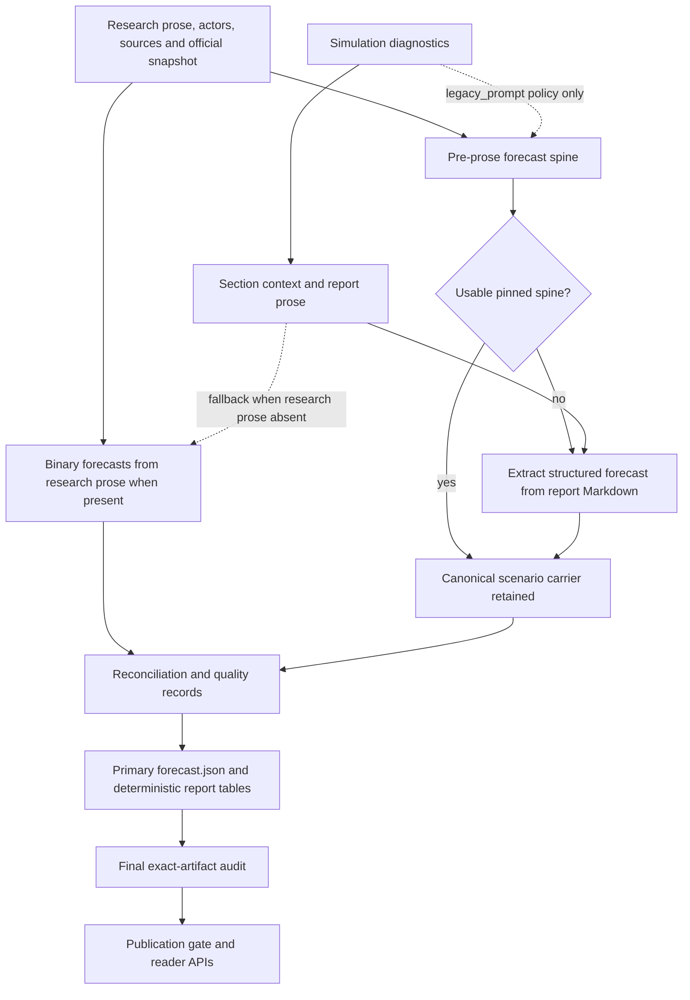
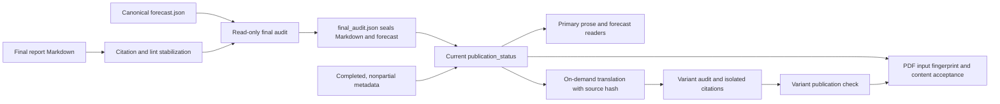

# Forecast and report architecture on frozen main

**Owner:** `forecast-report`
**Source:** committed main `72545c65d8dbaee40e1c1e71e9909ab4741c7b9f`
**Mirror:** `/tmp/drf-main-study-20261016-72545c65d8db`
**Status:** Complete source study; last updated 2026-10-15T20:01:02.776990+00:00
**Evidence:** static full source reads, targeted caller/test reads and hash/range validation. No application execution/imports, network/provider calls, saved-run inspection, Git/index operations or application edits.

The source identity and ownership come from [study-contract.json](../study-contract.json) and [python-inventory.json](../python-inventory.json). Earlier memory was used only as navigation; current behavioral claims were checked in frozen source. All relative `path.py:line` anchors below refer to that mirror and commit.

All **16 assigned application files / 35,055 lines** were fully read. The 16,046-line report agent was split into three disjoint readers; extractor and visualizer each had a dedicated reader. **All five delegated readers returned terminal results and were closed after receipt.** Ten additional files are targeted partial boundary/test reads, recorded separately in [forecast-report-coverage.json](forecast-report-coverage.json). Tests were read only. The coverage receipt retains actual chunk ranges, full-file hashes, reader attribution and truncation recovery notes; inventories and AST summaries are not counted as reads.

## Navigation and workflow spine

- [Conditional forecast dataflow](#conditional-forecast-boundary-diagram) and [publication boundary](#publication-boundary-diagram)
- [Forecast extraction, carrier and empirical outside view](#forecast-extraction-empirical-outside-view-and-proposition-authority)
- [Report generation, audit, translation and delivery](#report-generation-persisted-carrier-and-terminal-audit)
- [Charts and visual artifacts](#charts-and-visual-artifacts)
- [Main callers, ensemble, ledgers, resolution and support modules](#cross-area-callers-calibration-resolution-and-support-modules)
- [Artifact and consumer map](#artifact-and-consumer-map)
- [Coverage, verification and explicit uncertainties](#verification-and-explicit-uncertainties)

The active full-pipeline path supplies research/actor/source/official inputs to `ReportAgent.generate_report`, derives a forecast spine, writes sections, assembles report prose, finalizes structured/binary data, renders deterministic tables/charts, stabilizes citations/lint and performs a terminal exact-artifact audit. Reader APIs independently check publication rather than relying on completed metadata (`backend/app/services/pipeline_orchestrator.py:13888`, `backend/app/services/pipeline_orchestrator.py:13925`, `backend/app/services/report_agent.py:12637`, `backend/app/services/report_agent.py:13027`, `backend/app/services/report_agent.py:13094`, `backend/app/services/report_agent.py:14003`).

Three central distinctions govern this area. The canonical forecast is the primary sealed `forecast.json`, while post-report seed aggregation remains `ensemble_forecast.json` sidecar (`backend/app/services/report_agent.py:13494`, `backend/app/services/pipeline_orchestrator.py:9209`). Explicit simulation input is excluded from normal spine generation, but a no-spine fallback extracts from prose that may include diagnostics (`backend/app/services/report_agent.py:4186`, `backend/app/services/report_agent.py:4302`, `backend/app/services/forecast_extractor.py:1016`). Final visibility binds exact Markdown/forecast bytes and current audit policy, with additional source-bound contracts for translations and PDFs (`backend/app/services/report_agent.py:9836`, `backend/app/services/report_agent.py:14003`, `backend/app/services/report_agent.py:15029`).

## Conditional forecast boundary diagram

This diagram distinguishes direct structured inputs from indirect prose input. Its arrows describe source call paths, not measured influence on a probability.

The normal pre-prose branch passes an empty explicit simulation signal pack under `diagnostic_only`; `legacy_prompt` admits it. Empty/no-scenario derivation returns to allow post-prose extraction. The finalizer then either uses the pinned spine or passes report Markdown to `extract_structured_forecast`, whose LLM prompt directly contains that prose. Chapter prefix construction can include the signal pack even under diagnostic-only policy. Consequently explicit structured simulation exclusion is not an unconditional guarantee that diagnostics are absent from every probability-producing prompt. This is a conditional source path, not evidence that any particular probability changed (`backend/app/services/report_agent.py:3563`, `backend/app/services/report_agent.py:3583`, `backend/app/services/report_agent.py:3697`, `backend/app/services/report_agent.py:4171`, `backend/app/services/report_agent.py:4186`, `backend/app/services/report_agent.py:4240`, `backend/app/services/report_agent.py:4302`, `backend/app/services/forecast_extractor.py:1016`). The coordinator's separately owned [diagrams](../DIAGRAMS.md) provide the complete pipeline context.

## Publication boundary diagram

The stabilization and audit edge is implemented at `backend/app/services/report_agent.py:9388`, `backend/app/services/report_agent.py:9836`; external forecast sealing and read-side identity checks are at `backend/app/services/report_agent.py:9999`, `backend/app/services/report_agent.py:13494`, `backend/app/services/report_agent.py:14003`. On-demand translation uses the primary publication check and source identity at `backend/app/services/report_agent.py:13921`; variant auditing is at `backend/app/services/report_agent.py:7784`; PDF delivery checks current publication/input/content at `backend/app/services/report_agent.py:15029`. Progressive section/log drafts have the separate time-bounded live-generation exception described below (`backend/app/api/report.py:153`).

## Forecast extraction, empirical outside view, and proposition authority

### Canonical structured carrier

The authoritative report forecast is schema-1 `forecast.json`: `headline`, `horizon`, `scenarios`, `key_uncertainties`, `confidence`, `confidence_rationale`, and later quality/audit/enrichment fields. Scenario rows carry name/probability/summary/drivers/resolution criteria, with optional base-rate/rationale/metric-range/uncertainty fields. Scenario normalization divides a positive total, applies the optional probability floor, renormalizes and rounds to four decimals. Binary rows coexist as independent propositions rather than another mutually exclusive scenario distribution: statement/id/proposition identity, independent probability, criterion/source/theme/year, base-rate/adjustment rationale and sharpness, with optional scenario membership/market/official anchors. Binary probability normalization clamps to [0.02,0.98], rounds to two decimals and deduplicates normalized statements; binary probabilities do not sum-normalize (`backend/app/services/forecast_extractor.py:100`, `backend/app/services/forecast_extractor.py:1054`, `backend/app/services/forecast_extractor.py:3094`).

A usable pre-prose spine is pinned in memory, rendered into every chapter's forecast instructions and persisted early; finalization normally copies that spine instead of extracting a second scenario set from narrative. If no usable spine exists, the post-hoc extractor sends report prose head/tail directly to the LLM prompt (default 40,000-character budget, 60/40 split, temperature 0.2 and 4,096 output tokens). A non-object reply becomes an empty canonical object; provider exceptions reach caller handling. Later finalization appends binary/quality/indicator/track-record data, persists the forecast and retains the in-memory copy. The terminal audit then enriches final quality and externally seals exact forecast bytes (`backend/app/services/report_agent.py:4171`, `backend/app/services/report_agent.py:4240`, `backend/app/services/report_agent.py:4302`, `backend/app/services/report_agent.py:4508`, `backend/app/services/report_agent.py:4553`, `backend/app/services/forecast_extractor.py:976`, `backend/app/services/report_agent.py:9836`). The conditional simulation/prose path is shown in the diagram above; explicit simulation exclusion in the normal spine is not a universal prose-content guarantee.

The scenario contract audit checks 2–5 rows when scenarios exist, distinct names, finite JSON numeric probabilities in [0,1], sum within 1±0.015, criteria and a residual/status-quo/other bin. It checks stale probability narratives, allocation arithmetic and narrowly parseable metric/unit/time interval overlaps. The missing-scenarios case is also checked by later required-forecast gates, rather than inferred solely from this audit (`backend/app/services/forecast_extractor.py:679`, `backend/app/services/report_agent.py:9676`). Sharpness is a number+date+metric lexical heuristic. The binary quality score requires requested count, probability population stdev ≥0.12, at most 40% in [0.4,0.6], at least three conviction rows ≤0.3 or ≥0.7 and sharp count ≥int(0.8n). Theme collapse, empirical divergence and horizon mismatch are separately recorded diagnostics (`backend/app/services/forecast_extractor.py:909`, `backend/app/services/forecast_extractor.py:3267`, `backend/app/services/forecast_extractor.py:4681`).

### Evidence, market, simulation and scenario influence

The code contains several distinct mechanisms, not a single fixed numerical evidence/simulation/market weighting formula. Research prose, brief, forecast inputs, official facts and outside view enter model reasoning. Explicit simulation-pack admission depends on policy; proposition reconciliation and ensemble pooling can deterministically change probabilities; market matching can request a bounded model revision with a durable influence trace. Those mechanisms should not be described as identical forms of observed evidence (`backend/app/services/forecast_extractor.py:4365`, `backend/app/services/forecast_extractor.py:4751`, `backend/app/services/forecast_extractor.py:3525`, `backend/app/services/forecast_extractor.py:3707`, `backend/app/services/forecast_extractor.py:4551`).

Binary extraction prefers research prose, takes a bounded 48,000-character head/tail slice, makes one count top-up and can request a bounded low-probability addition. The explicit simulation pack is injected only for `legacy_prompt` plus enabled sensitivity plus a nonempty pack; selected dossier prose is still independently appended. Source claims are validated against the same 4,000-character injected signal slice; inadmissible simulation labels fall back to `research-prior` with original `source_claimed`. Optional secondary-model pooling precedes market matching; failures of low-probability/secondary/market enhancements degrade locally, whereas main/top-up exceptions can reach the report finalizer's warning boundary (`backend/app/services/forecast_extractor.py:1201`, `backend/app/services/forecast_extractor.py:4400`, `backend/app/services/forecast_extractor.py:4491`, `backend/app/services/forecast_extractor.py:4532`, `backend/app/services/forecast_extractor.py:4595`, `backend/app/services/report_agent.py:4387`).

Market matching uses a bounded semantic call over at most 24 snapshot markets; default equivalence admits exact/near. Snapshot price, question/id/URL/end date, confidence/equivalence, and proposition/contract/question hashes form the anchor. With >10 percentage-point divergence, no market-citing rationale and confidence ≥0.6, a follow-up may revise probability or justify disagreement; acceptance requires market-citing rationale. A changed probability gets durable `market_influence`. Final completeness requires confidence ≥0.5 and contract metadata. Removing an inadmissible anchor restores its pre-influence probability only while that revision is still the direct cause and scenario governance has not superseded it; influence audit remains (`backend/app/services/forecast_extractor.py:3345`, `backend/app/services/forecast_extractor.py:3525`, `backend/app/services/forecast_extractor.py:4013`, `backend/app/services/forecast_extractor.py:4081`). These are conditional source capabilities; this study observed no market-driven probability revision.

Explicit fully derivable scenario membership governs a binary by summing named mutually exclusive scenario bins; malformed membership is a contract failure, while `derivable=false` retains independent probability. A legacy chamber-control classifier applies only without explicit membership. Reconciliation records original probability/rationale before a correction >0.015. World-state `sim_adjustment` records shares/convergence/deltas without overwriting scenario probabilities (`backend/app/services/forecast_extractor.py:3707`, `backend/app/services/forecast_extractor.py:4081`, `backend/app/services/forecast_extractor.py:4271`).

### Official anchor and empirical base-rate contract

The official carrier adapter accepts schema 1 `series[]`, examines at most 24 rows and last 240 observations per row, validates unique canonical identity/transform, nonempty units, frequency, canonical dates, finite numeric/null values and source URL, and preserves publisher metadata/status. Complete historical observations feed latest actuals/empirical history; preliminary/estimate/projection/partial/unknown values have separate status semantics. Missing shared data API yields no usable carrier rows (`backend/app/services/forecast_extractor.py:1496`, `backend/app/services/forecast_extractor.py:1561`, `backend/app/services/forecast_extractor.py:1666`).

Automatic anchor admission requires the data-layer validation **and** an unambiguous prose match of metric, comparator, threshold, units, geography and exact period. Deadline/compound-condition/sibling-series qualifiers, fiscal years, magnitude scales and month-end readings are handled explicitly. An ambiguous proposition can retain its probability while losing automatic anchoring. Admitted metadata includes latest actual, empirical rate, auto-resolution eligibility and canonical settlement text; the explicit resolver later decides pending/manual/resolved (`backend/app/services/forecast_extractor.py:2263`, `backend/app/services/forecast_extractor.py:3072`, `backend/app/services/forecast_extractor.py:3243`, `deerflow_bridge/data_sources.py:1294`).

The empirical outside view uses monthly/quarterly/annual ordinals. For horizon h, it collects exact historical h-step changes, adds each to the latest complete actual and counts the share meeting the threshold. It requires at least 30 changes; payload includes p/n/h/window/latest/method, historical level share, quantiles p10/p25/p50/p75/p90 and distance in historical-change standard deviations. Monthly NSA series at nonannual horizons choose same-calendar-month starts, a measured seasonal profile with pooled deviations, or disclosed pooled starts according to sample/effect conditions. The seasonal effect threshold is 0.25; pooled `all_start_months` rates remain displayable but cannot trigger the >25pp empirical divergence diagnostic. The prompt-facing outside view includes latest-value percentile and disclosed standard-window fallback when target-horizon samples are thin. Empirical fans repeat the historical-change construction up to 120 steps by default. **These rates/fans attach outside-view evidence; they do not mechanically replace model probabilities** (`backend/app/services/forecast_extractor.py:1764`, `backend/app/services/forecast_extractor.py:1832`, `backend/app/services/forecast_extractor.py:1956`, `backend/app/services/forecast_extractor.py:2022`, `backend/app/services/forecast_extractor.py:2167`, `backend/app/services/forecast_extractor.py:3320`).

### Optional forecast policies and citation metrics

Repeated spine draws keep the first draw's canonical scenario names, average supplied probabilities, normalize/floor and record sample-spread bounds/confidence diagnostics; source K defaults 1. Red-team critique inserts a residual where needed, caps the revised peak against the original, preserves admitted metric ranges, synchronizes narrative and accepts only structurally audited output. Optional pre-mortem transfers at most min(0.05,0.25×source probability). Later interval reconstruction preserves spread provenance. These are model-draw dispersion/critique mechanisms, not demonstrated outcome calibration (`backend/app/services/forecast_extractor.py:4802`, `backend/app/services/forecast_extractor.py:5019`, `backend/app/services/forecast_extractor.py:5452`, `backend/app/services/forecast_extractor.py:5586`, `backend/app/config.py:329`). `base_distribution` can inject a world-state prior and widen uncertainty for divergence, but the traced active ReportAgent spine call does not pass it; the helper and a true configuration declaration alone do not activate that dataflow (`backend/app/services/forecast_extractor.py:5007`, `backend/app/services/forecast_extractor.py:5053`, `backend/app/services/report_agent.py:4228`).

Citation audit operates per sentence/table-body cell outside fences. It distinguishes generic source-or-simulation grounding, strict source coverage and source markers resolvable against the injected index. Owned authored forecasts can be excluded from empirical factual-claim coverage; dangling/uncited marker audit is separate. Final publish checks prefer resolved-source coverage over the broad historical metric. Historical scenario Brier/ECE is surfaced in forecast rationale and official binary track record separately; the inspected finalizer does not numerically recalibrate those probabilities (`backend/app/services/forecast_extractor.py:5659`, `backend/app/services/report_agent.py:4516`, `backend/app/services/report_agent.py:10673`).
## Report generation, persisted carrier, and terminal audit

### Authoring state and tools

ReportStatus has pending, planning, generating, completed and failed. A Report serializes identities, requirement, outline, Markdown, creation/completion time, error, failed sections/derived partial and optional telemetry/translations. ReportSection keeps title/content/description; the internal padded flag is omitted from serialization. JSONL logs include timestamp, elapsed time, report identity, action/stage/section and untruncated detail; console logging uses ContextVars plus filters so parallel report events are routed by report identity (`backend/app/services/report_agent.py:56`, `backend/app/services/report_agent.py:101`, `backend/app/services/report_agent.py:127`, `backend/app/services/report_agent.py:394`, `backend/app/services/report_agent.py:479`, `backend/app/services/report_agent.py:488`).

The constructor takes graph/simulation/question and optional LLM/Zep clients, actors/sources/research prose/brief, quantitative/contested/timeline/priors, scenario/base simulation and official carrier. It normalizes structured inputs, prepares evidence/index/data contexts, creates tool descriptions and caches, removes interview availability if the simulation IPC probe fails, and derives budget shape from the question. Compact ≤8-page requests use narrower outline/tool/length budgets; larger/invalid requests use the expanded defaults. Prompt instructions include citation discipline and evidence/model-estimate distinctions; these are authoring instructions, separate from final enforcement (`backend/app/services/report_agent.py:940`, `backend/app/services/report_agent.py:2152`, `backend/app/services/report_agent.py:2183`, `backend/app/services/report_agent.py:2245`, `backend/app/services/report_agent.py:2361`, `backend/app/services/report_agent.py:2380`, `backend/app/services/report_agent.py:769`).

Research evidence context includes admissible positional source sentinels, optional unified source index, latest metric/timeline/contested slices and eligible actor relations. Official series can append admissible dataset sources without renumbering existing source positions. The report-local official record contains schema version, canonical carrier SHA, source tags and optional research-binding fingerprint; reading rejects malformed shape/digest. Canonical official table/watch rows and chart captions are regenerated for byte/provenance comparison (`backend/app/services/report_agent.py:2496`, `backend/app/services/report_agent.py:2691`, `backend/app/services/report_agent.py:2872`, `backend/app/services/report_agent.py:2951`, `backend/app/services/report_agent.py:1811`, `backend/app/services/report_agent.py:3043`, `backend/app/services/report_agent.py:3071`, `backend/app/services/report_agent.py:3189`, `backend/app/services/report_agent.py:3387`).

Generation creates report/progress/log files, builds simulation signal and market context, and derives the forecast spine before planning. Market context first seeks a matching research handoff, refreshes saved markets if possible, marks stale quotes on failure, and can perform enabled late discovery; market tables and anchoring therefore use snapshots with explicit stale handling (`backend/app/services/report_agent.py:3894`, `backend/app/services/report_agent.py:4013`, `backend/app/services/report_agent.py:4063`, `backend/app/services/report_agent.py:12637`). Simulation signal construction includes world state, qualitative outcomes, coalition/causal/scenario comparison diagnostics with error catches and explicit internal-projection wording; no-update policy emits an empty pack (`backend/app/services/report_agent.py:3697`, `backend/app/services/report_agent.py:3796`, `backend/app/services/report_agent.py:3868`).

Planning receives forecast/data requirements, section bounds and fallback titles. Failed planning marks outline degraded and returns fallback sections. Body sections can use copied ContextVars concurrently while synthesis/tail sections receive the completed body context sequentially. Native tool calling falls back to ReAct on failure; section retry wraps generation, then language enforcement/reflection. Both tool loops are bounded to 14 iterations, enforce live tool budgets and minimum use, and attempt forced closure. Unknown tools/error results are returned as text; unavailable interviews short-circuit; interview max agents clamps to 1–6. ReAct parses normalized aliases, corrects conflicting tool/final output and provider contamination a bounded number of times, then records a failed section rather than assuming valid prose (`backend/app/services/report_agent.py:10993`, `backend/app/services/report_agent.py:11349`, `backend/app/services/report_agent.py:11566`, `backend/app/services/report_agent.py:11642`, `backend/app/services/report_agent.py:11709`, `backend/app/services/report_agent.py:12003`, `backend/app/services/report_agent.py:12029`, `backend/app/services/report_agent.py:12180`).

Failed sections have explicit placeholders/progress bookkeeping; an all-failed report aborts before resurrection. Optional resurrection retries failed title instances once, with duplicate titles counted independently. Assembly produces provisional completed content, then structured forecast, deterministic binary/official tables, chart generation, optional synthesis/resolution and language cleanup. Editorial lint runs even outside the structured-forecast block. Citation stabilization and final audit precede translation and final save; any terminal exception marks Report failed, clears completed_at and best-effort saves failure. Thus a provisional `completed` assignment during assembly is not evidence of a publishable final report (`backend/app/services/report_agent.py:12585`, `backend/app/services/report_agent.py:12834`, `backend/app/services/report_agent.py:12982`, `backend/app/services/report_agent.py:12997`, `backend/app/services/report_agent.py:13016`, `backend/app/services/report_agent.py:13027`, `backend/app/services/report_agent.py:13083`, `backend/app/services/report_agent.py:13094`, `backend/app/services/report_agent.py:13111`, `backend/app/services/report_agent.py:13192`, `backend/app/services/report_agent.py:13218`).

### Final stabilization and exact-artifact gate

Repair steps can backfill uniquely supported citations, remove/dequote ungrounded quotations, resolve placeholders, clean methodology leakage and repair dangling markers. Semantic numeric/source decisions distinguish supported, unsupported, unverifiable and market-supported; ties do not invent a source. Quote audit differentiates verbatim, cited-unverbatim and ungrounded text. These transformations happen before the terminal read-only audit (`backend/app/services/report_agent.py:4563`, `backend/app/services/report_agent.py:4816`, `backend/app/services/report_agent.py:4845`, `backend/app/services/report_agent.py:5094`, `backend/app/services/report_agent.py:5419`, `backend/app/services/report_agent.py:5479`, `backend/app/services/report_agent.py:5572`, `backend/app/services/report_agent.py:5629`, `backend/app/services/report_agent.py:6012`, `backend/app/services/report_agent.py:6231`).

The citation finalizer repairs markers, runs bounded semantic passes and emits a References section plus `citations.json` with only admissible cited entries and explicit unresolved entries. Publish stabilization repeatedly finalizes, repairs overuse/quantitative/quote surfaces, lints, finalizes again, persists and probes for a fixed point. Success requires stable bytes, quantitative acceptance and no unsupported/overused citations; a narrow forced lint-fixed-point branch exists, otherwise it raises. A thrown finalizer error with body markers is a hard stop (`backend/app/services/report_agent.py:9242`, `backend/app/services/report_agent.py:9370`, `backend/app/services/report_agent.py:9388`, `backend/app/services/report_agent.py:9572`).

The final audit measures the exact post-finalization Markdown, its memory/disk agreement, structured forecast shape, scenario/proposition/market contracts, citations/References, semantic support, concentration, quotes, numeric/statistical consistency, language and lint would-change. It replaces earlier quality measurements with these final ones. It writes the enriched forecast, fingerprints that serialized forecast externally in `final_audit.json`, and records Markdown SHA. It does not repair prose in the read-only phase. Integrity collection includes failed sections, absent required forecast, changed disk bytes, malformed/dangling citation artifacts, leakage, contamination, cut table cells, scenario drift, unverbatim quotes and contract failures. Missing audit, hard issues or an enabled failed professional quality gate raise before final publication (`backend/app/services/report_agent.py:9676`, `backend/app/services/report_agent.py:9803`, `backend/app/services/report_agent.py:9836`, `backend/app/services/report_agent.py:10054`).

The quality evaluator separates hard integrity from epistemic issues such as resolved citation coverage, degenerate distributions or binary quality. Epistemic issues lower confidence at most one level using a retained prepublish baseline, while evaluator exceptions become hard failures. Terminal `_require_final_publish_audit` and read-side publication checks still reject an enabled failed quality gate; a demotion is not a universal permission to publish (`backend/app/services/report_agent.py:10673`, `backend/app/services/report_agent.py:10801`, `backend/app/services/report_agent.py:9803`). Source defaults enable structured forecast, spine-first, critique, publish gate and final read-only audit; policy version is 3 and minimum publish coverage is 0.75 in Config, even though helper fallback thresholds differ (`backend/app/config.py:162`, `backend/app/config.py:171`, `backend/app/config.py:174`, `backend/app/config.py:178`, `backend/app/config.py:179`, `backend/app/config.py:190`, `backend/app/config.py:195`).

`ReportManager.publication_status` is a fresh read-side gate, not a cached completed label. It requires completed, nonpartial/nonfailed metadata; nonempty current Markdown; current-policy passing audit without hard issues; matching Markdown SHA and enabled gate success; required valid forecast/scenario contract/citations; and exact `forecast.json` SHA when forecast is required or present. Variant reads additionally require primary publishability and exact report/lang/source/variant hashes across audit, isolated citations and translation metadata. `load_structured_forecast` independently requires a current passing audit with exact forecast bytes; an unbound legacy forecast sidecar is not exposed (`backend/app/services/report_agent.py:13494`, `backend/app/services/report_agent.py:14003`).

### Translation and PDF delivery

Translation protects fences/URLs/citations/forecasts/identifiers and self-describing date/quantity tokens, then restores exact units and audits structure, numeric facts and citation multisets. Bounded batches and retries can retain source when an acceptable translation cannot be obtained. H2 chunks and reference blocks are handled separately; references retain provenance and receive a localized heading. Residual foreign-language detection is distinct from fact comparison. The variant audit covers headings, tables, facts, fences, citation parity/References, final lint/leakage and contamination, binding source/variant hashes (`backend/app/services/report_agent.py:6976`, `backend/app/services/report_agent.py:7087`, `backend/app/services/report_agent.py:7146`, `backend/app/services/report_agent.py:7215`, `backend/app/services/report_agent.py:7500`, `backend/app/services/report_agent.py:7568`, `backend/app/services/report_agent.py:7690`, `backend/app/services/report_agent.py:7784`, `backend/app/services/report_agent.py:8030`, `backend/app/services/report_agent.py:8643`).

Structured forecast localization is a deep-copy sidecar: only selected display strings are enumerated, probabilities/metadata are retained, and scenario-name references are reconciled. `forecast.<lang>.json` includes source forecast SHA, target language and completeness information. A stale/incomplete/missing localization falls back to sealed primary data; it cannot become a new probability authority (`backend/app/services/report_agent.py:8347`, `backend/app/services/report_agent.py:8423`, `backend/app/services/report_agent.py:8535`, `backend/app/services/report_agent.py:13520`).

Bilingual work bypasses LLM cache with bounded call timeouts, audits before accepting, and writes per-language Markdown/citations/final audit plus translation metadata. Failed updates can retain an older accepted variant with separate rejected-attempt diagnostics. Explicit generation uses a per-report/lang thread/file lease, verifies primary publication before work and detects primary source changes before accepting output; stale variant/PDF/cache/citations are removed on source change. Runtime translation states include progress/heartbeat/owner; dead or stale owners become interrupted. A published translation's availability, outdated translator version and active update attempt are separate status concepts (`backend/app/services/report_agent.py:8811`, `backend/app/services/report_agent.py:8880`, `backend/app/services/report_agent.py:9005`, `backend/app/services/report_agent.py:13609`, `backend/app/services/report_agent.py:13665`, `backend/app/services/report_agent.py:13730`, `backend/app/services/report_agent.py:13921`).

Report PDF export checks publication and uses bundle-keyed thread/file locks. Its input fingerprint includes Markdown/primary/audit/citations/viz, contained chart assets, renderer settings and tool/font signatures. A valid cached PDF requires matching fingerprint, PDF bytes/hash and page count. Pandoc uses TOC/A4/CJK-aware settings; simple documents can fall back to PyMuPDF, while rich table/footnote documents require pandoc. Acceptance parses the PDF, checks text/facts/glyphs/heading anchors, then rechecks input/publication and writes a PDF manifest; manifest failure removes the PDF. The generic `export_document_pdf` shares rendering/content gates but has no report publication check itself. No renderer or installed font was exercised in this study (`backend/app/services/report_agent.py:14293`, `backend/app/services/report_agent.py:14400`, `backend/app/services/report_agent.py:14539`, `backend/app/services/report_agent.py:14573`, `backend/app/services/report_agent.py:14804`, `backend/app/services/report_agent.py:14893`, `backend/app/services/report_agent.py:15029`, `backend/app/services/report_agent.py:15152`, `backend/app/services/report_agent.py:15165`).

### Persistence and recovery surfaces

Report folders live under `Config.UPLOAD_FOLDER/reports/<report_id>`. Outline/section/progress writes are atomic. Section assembly normalizes duplicate headings, preserves H3 and converts deeper headings to emphasis. Progress includes stage/status/percentage, section counts/time and optional failed-section/placeholder/degraded/forecast flags. Save persists `meta.json`, optional outline, nonempty Markdown and index; load can recover from folder metadata or legacy flat JSON and falls back to `full_report.md` if embedded Markdown is absent. By-simulation lookup tries index candidates then a directory scan; list sorts by created time. Deletion/cleanup helpers exist but were not called (`backend/app/services/report_agent.py:13387`, `backend/app/services/report_agent.py:15222`, `backend/app/services/report_agent.py:15456`, `backend/app/services/report_agent.py:15471`, `backend/app/services/report_agent.py:15580`, `backend/app/services/report_agent.py:15639`, `backend/app/services/report_agent.py:15670`, `backend/app/services/report_agent.py:15831`, `backend/app/services/report_agent.py:15853`, `backend/app/services/report_agent.py:15921`, `backend/app/services/report_agent.py:15989`, `backend/app/services/report_agent.py:16018`).

Report chat reads only publishable primary prose, capped to 40,000 characters, with bounded history and two tool iterations. This is a consumer of the published artifact, not a report-regeneration or calibration path (`backend/app/services/report_agent.py:13261`).

## Charts and visual artifacts

The active report path invokes visualizations after forecast/binary/official sections and before the three-part synthesis, inside the structured-forecast branch and a separate visualization-embedding flag. `_collect_viz_artifacts` prefers disk `forecast.json` over the spine, reads separate ensemble/comparison files, uses in-memory research/official/actor/priors inputs, gets world-state from the simulation directory and timeline from handoff or supplied events. It does not supply a calibration artifact in this collector. Build/import/placement exceptions warn and retain the report. Official captions are harmonized to the report's citations before embedding (`backend/app/services/report_agent.py:10332`, `backend/app/services/report_agent.py:10377`, `backend/app/services/report_agent.py:10414`, `backend/app/services/report_agent.py:13027`). The optional backfill script separately collects stored report/handoff/simulation artifacts; no-apply returns a plan, while apply calls the same visualizer and placement helpers (`backend/scripts/backfill_report_visuals.py:368`, `backend/scripts/backfill_report_visuals.py:480`, `backend/scripts/backfill_report_visuals.py:580`). This script is supplemental, not one of this owner's full-read modules.

| Visual input class | What the renderer actually uses | Source boundary |
|---|---|---|
| Canonical forecast scenarios | Bars take canonical scenario probabilities without renderer normalization. Ensemble uncertainty is matched one-to-one by id/name/alias and must enclose the canonical point. Otherwise declared/self-consistency bounds apply. With no canonical scenario rows, ensemble-only fallback requires probability total 0.95–1.05. Sort/cap 14 follows. | `backend/app/services/report_visualizer.py:5683`, `backend/app/services/report_visualizer.py:5819` |
| Binary model vs market | Model probabilities and anchor snapshot prices; confidence coloring only when every plotted row declares valid confidence. Market dumbbell requires at least three rows; lower density can emit a Markdown table and skipped reason. | `backend/app/services/report_visualizer.py:2089`, `backend/app/services/report_visualizer.py:3015`, `backend/app/services/report_visualizer.py:3234`, `backend/app/services/report_visualizer.py:3301` |
| Simulation world-state | At least two clean share snapshots; all valid dates select calendar axis, otherwise round/index. Missing shares become zero; the chart does not normalize them into forecast probability. | `backend/app/services/report_visualizer.py:2152`, `backend/app/services/report_visualizer.py:3109`, `backend/app/services/report_visualizer.py:5893` |
| Research quantitative rows | Provenance/source, definition and as-of floor; compatible units/time basis/denominator/measure family and subject overlap; explicit actual/forecast and stale/tier labels. Explicit numeric ranges can yield their midpoint. Family trajectories separate geography/technology/publisher; comparable revision charts require at least three actual publication vintages with stable target/publisher/unit/definition. | `backend/app/services/report_visualizer.py:870`, `backend/app/services/report_visualizer.py:1058`, `backend/app/services/report_visualizer.py:1258`, `backend/app/services/report_visualizer.py:1315`, `backend/app/services/report_visualizer.py:1637` |
| Official stored series | Shared carrier validation/classification; history, preliminary, estimate, projection, partial and unknown statuses kept distinct. Thresholds need a validated anchor and matching binary prose; scenario bands use structured metric ranges or bounded annual prose matching and appear only after latest historical observation. Historical fans derive from observed h-step changes, separate from scenario/model probabilities. | `backend/app/services/report_visualizer.py:4317`, `backend/app/services/report_visualizer.py:4393`, `backend/app/services/report_visualizer.py:4422`, `backend/app/services/report_visualizer.py:4642` |
| Comparison/calibration | Helpers accept explicit numerical paired dimensions or calibration bins; these static builders exist independently of whether the active collector supplies them. | `backend/app/services/report_visualizer.py:2561`, `backend/app/services/report_visualizer.py:5205` |

The official dashboard ranks anchored/banded series, then question-linked/cited series and interleaves providers. It takes up to 24 panels in two dashboards and at most six detail charts, with thresholds before bands. Details show a longer historical context and shorter magnified view, empirical quantiles/median, model thresholds/bands and horizon, while preserving fiscal period labels (`backend/app/services/report_visualizer.py:4365`, `backend/app/services/report_visualizer.py:4523`, `backend/app/services/report_visualizer.py:4613`, `backend/app/services/report_visualizer.py:4885`).

Build orchestration explicitly skips internal proxy driver/contested/bubble figures; actor network and source mix are opt-in meta charts. Mermaid helper builders remain available, but `build_all` does not schedule default Mermaid jobs. Availability of a helper is therefore not evidence that a normal report contains it (`backend/app/services/report_visualizer.py:1797`, `backend/app/services/report_visualizer.py:4970`, `backend/app/services/report_visualizer.py:5074`, `backend/app/services/report_visualizer.py:5101`).

Matplotlib/Plotly/networkx/kaleido imports are optional. Static CJK renderers check installed glyph coverage. Plotly HTML normally references a report-local shared `plotly.min.js` bundle; forced inline mode or bundle-write failure embeds it. PNG exports batch first then fall back per figure; a failed single export trips a process-wide breaker. Limited matplotlib equivalents can replace failed static exports, while some interactive-only families have no static equivalent. These are source fallback paths, not proof of a renderer's availability or success on this machine (`backend/app/services/report_visualizer.py:143`, `backend/app/services/report_visualizer.py:423`, `backend/app/services/report_visualizer.py:2756`, `backend/app/services/report_visualizer.py:2826`, `backend/app/services/report_visualizer.py:5205`).

`viz_manifest.json` is schema 2 with items and skipped jobs plus optional per-input canonical JSON hashes and a narrow renderer/policy hash. Generated items carry path/type/caption/placement hint and optional PNG companion/source attribution. A skipped reason can coexist with a later successful fallback; density fallback tables are tracked as skipped, rather than image items. Local market-price history precedence is injected artifact, report-local JSON, then handoff JSON, with corrupt files skipped; this visualizer performs no remote price retrieval (`backend/app/services/report_visualizer.py:2890`, `backend/app/services/report_visualizer.py:5037`, `backend/app/services/report_visualizer.py:5338`, `backend/app/services/report_visualizer.py:5406`).

Report placement is idempotent by path markers, handles HTML/PNG/Mermaid, matches placement hints against H2 keywords, follows the official table for official charts and uses an annex for unmatched items. An HTML item embeds an existing PNG companion and interactive link, or a link alone. Report placement supports Mermaid if provided by an explicit caller even though default build scheduling does not produce it (`backend/app/services/report_agent.py:10533`, `backend/app/services/report_agent.py:10627`).

## Cross-area callers, calibration, resolution, and support modules

### Main entry points and ownership

The full pipeline supplies ReportAgent with the prompt, graph/simulation identities, actors, sources, research prose and optional scenario/base simulation identities. It then supplies research-owned `quantitative.json`, `contested.json`, `timeline.json`, `graph_priors.json`, `graph_priors_structural.json` and official data loaded by simulation identity. Research chart paths are not passed into section prompts: the final report builds its own chart set from structured inputs. A compatibility `TypeError` fallback retries the older constructor without those optional artifact parameters. Report generation gets a new report identity, saves it before work, and a failed Report status raises into pipeline failure (`backend/app/services/pipeline_orchestrator.py:13865`, `backend/app/services/pipeline_orchestrator.py:13883`, `backend/app/services/pipeline_orchestrator.py:13904`, `backend/app/services/pipeline_orchestrator.py:13925`).

After the primary report, full-mode orchestration calls the optional seed ensemble and then `_enforce_pipeline_health` before setting pipeline status completed. Seed errors are warning-only except cancellation; this is separate from the ReportManager publication gate (`backend/app/services/pipeline_orchestrator.py:13935`, `backend/app/services/pipeline_orchestrator.py:13947`).

The first-party `/api/report/<id>/forecast` requires publishability, returns the sealed structured object or a localized copy bound to it, rejects unsupported languages, and permits `forecast: null` for an audited legacy report. `/api/v1/forecast/<id>` also checks publication, but returns 409 when the report has no structured forecast, and can attach the stored `resolved.json` (`backend/app/api/report.py:586`, `backend/app/api/report.py:603`, `backend/app/api/report.py:614`, `backend/app/api/sdk.py:238`, `backend/app/api/sdk.py:250`, `backend/app/api/sdk.py:263`).

Report metadata includes publication reasons. When unpublishable, assembled Markdown and each outline section's draft body are withheld. Section/log draft exposure has a separate live-generation exception: loadable pending/planning/generating metadata plus a generator-written activity mtime within 30 minutes; missing/malformed metadata or stale activity closes that exception. Agent log event skeletons remain while prose fields are redacted (`backend/app/api/report.py:26`, `backend/app/api/report.py:45`, `backend/app/api/report.py:105`, `backend/app/api/report.py:141`, `backend/app/api/report.py:153`, `backend/app/api/report.py:221`).

### Evidence identity and official-data boundary

`official_data.py` is a lazy backend adapter into `deerflow_bridge.data_sources`, not a replacement research fetch stage. `load_official_data` consumes persisted enrichment with a configured series bound; `get_data_sources` is the accessor used by explicit resolution work to construct a client. `load_for_simulation` delegates to the orchestrator's dossier loader (`backend/app/services/official_data.py:220`, `backend/app/services/official_data.py:240`, `backend/app/services/official_data.py:312`, `backend/app/services/official_data.py:317`).

The binding pins six artifact fingerprints: `research_report.md`, `actors.json`, `sources.json`, `actor_dossier.md`, `research_contract_manifest.json`, and `data/datasets.json`. Bounded reads walk non-symlink directory handles and accept regular files only. Generation capture optionally checks the actual consumed report/sources against disk and checks fingerprints twice. Binding publication is create-only via hard link of an fsynced temporary file; a different existing generation raises `ResearchBindingConflict`. Schema 2 stores paths relative to the pipelines root where possible; schema 1 absolute paths can relocate only when the current handoff has the same fingerprints (`backend/app/services/official_data.py:29`, `backend/app/services/official_data.py:42`, `backend/app/services/official_data.py:90`, `backend/app/services/official_data.py:108`, `backend/app/services/official_data.py:138`, `backend/app/services/official_data.py:168`, `backend/app/services/official_data.py:190`).

A missing binding and an invalid binding are distinct lookup statuses. Invalid proof does not fall back to mutable official enrichment. Manual simulation binding searches completed research stages for its project, collapses forks sharing a handoff, and binds only one unambiguous generation. Failure returns an unbound status (`backend/app/services/official_data.py:190`, `backend/app/services/official_data.py:281`). Orchestration records ordinary binding/capture failures as optional official-data unavailability; the extra-seed path rejects an invalid parent binding and, for a valid parent, binds the child to that generation before preparation (`backend/app/services/pipeline_orchestrator.py:9248`, `backend/app/services/pipeline_orchestrator.py:9269`).

The historical snapshot renderer checks units, retrieval time, finite observations and status. Observed/preliminary points form the main table, with YoY and five-year range; unknown/estimate values appear only in a separate labelled block for years earlier than retrieval year. Unsafe series require a stated aggregation or inferred-status reason to display. A historical cutoff stays strict; a live forecast cutoff can extend to the bound research run's completion. Display eligibility and automatic settlement eligibility are separate concepts. The renderer caps series and characters and returns shown/exclusion counts when requested (`backend/app/services/official_data.py:417`, `backend/app/services/official_data.py:457`, `backend/app/services/official_data.py:480`, `backend/app/services/official_data.py:498`, `backend/app/services/official_data.py:573`).

### Ensemble: three distinct mechanisms

The backend scenario aggregator consumes a list of forecast dictionaries. By default it aligns normalized names then resolution-criteria token Jaccard matches, guarding candidate semantic matches against the same run. It collects arithmetic mean, sample standard deviation, support, min/max, drivers and criteria. Publication point estimates use log-odds pooling when an extremizing factor is supplied, otherwise arithmetic mean; each is normalized across scenarios. Bounds are probability ± sample standard deviation clipped to [0,1]. These are spread-derived bounds, not demonstrated predictive coverage. Agreement uses pairwise total variation multiplied by presence support; insufficient shared semantic buckets yield `None` (`backend/app/services/ensemble.py:55`, `backend/app/services/ensemble.py:118`, `backend/app/services/ensemble.py:150`, `backend/app/services/ensemble.py:204`, `backend/app/services/ensemble.py:235`, `backend/app/services/ensemble.py:348`). The actual Config default factor is 1.0, distinct from this helper's missing-config arithmetic fallback (`backend/app/config.py:333`).

Multi-model binary pooling is separate: the primary list retains statement/id/criteria authority, matches secondary models by normalized statement then id, pools matching probabilities, writes `binary.ensemble={models,probs,pooled,spread}`, updates the primary probability, and returns high-spread ids. Unmatched rows retain their primary probability. Config's secondary-model list defaults empty, so this is optional (`backend/app/services/ensemble.py:261`, `backend/app/services/ensemble.py:286`, `backend/app/services/ensemble.py:311`, `backend/app/config.py:638`).

The main pipeline's extra-seed driver defaults to one seed and returns early for N≤1, non-full mode, structured forecasts off, or `ensemble_done`. It pins the primary scenario names/criteria into extra reports, assigns different seeds, can reuse completed seed reports from `ensemble_checkpoint.json`, supports cancellation and a per-seed stall watchdog, and runs extra seeds serially or in a bounded thread pool. With fewer than two usable forecasts it records ensemble done without an aggregate. With enough samples it writes `ensemble_forecast.json` to the handoff and main report directory, and records summary in state options. **The current implementation retains the aggregate as a sidecar and does not rewrite sealed primary `forecast.json`/Markdown confidence**, despite older adjacent comments describing such a rewrite (`backend/app/services/pipeline_orchestrator.py:9025`, `backend/app/services/pipeline_orchestrator.py:9058`, `backend/app/services/pipeline_orchestrator.py:9070`, `backend/app/services/pipeline_orchestrator.py:9129`, `backend/app/services/pipeline_orchestrator.py:9160`, `backend/app/services/pipeline_orchestrator.py:9198`, `backend/app/services/pipeline_orchestrator.py:9209`, `backend/app/services/pipeline_orchestrator.py:9329`).

`drf2/driver/ensemble.py` provides an explicitly injected factor and sequential `fan_out(run_one)` with per-seed error records, using backend math. It aligns normalized names, not the backend's semantic buckets. This is a separate driver scaffold; the traced committed-main full pipeline invokes the backend aggregator above (`drf2/driver/ensemble.py:19`, `drf2/driver/ensemble.py:28`, `drf2/driver/ensemble.py:40`, `drf2/driver/ensemble.py:103`, `backend/app/services/pipeline_orchestrator.py:9203`). The standalone `forecast_tools.py` CLI loads existing forecast files and outputs an aggregate or scores a supplied list of `{forecast,outcome}`. It does not launch seeds or mutate the forecast ledger (`backend/scripts/forecast_tools.py:36`, `backend/scripts/forecast_tools.py:49`, `backend/scripts/forecast_tools.py:60`).

### Backtest, ledgers, and resolution

`score_forecast` normalizes scenario names and calculates multiclass sum-of-squares Brier, realized probability and clamped log loss. An unmatched outcome is reported explicitly and has no log loss; no scenario rows returns an error-shaped result. Calibration buckets every scenario probability, supplies raw hit rates, Jeffreys-smoothed hit rates and normal-approximation credible intervals, count-weighted calibration error, and Murphy reliability/resolution/uncertainty decomposition. A configurable minimum marks insufficient data without suppressing the report (`backend/app/services/backtest.py:41`, `backend/app/services/backtest.py:73`, `backend/app/services/backtest.py:105`, `backend/app/services/backtest.py:151`, `backend/app/services/backtest.py:173`). The one-parameter logit recalibrator requires at least ten per-scenario points, performs bounded gradient descent, and otherwise returns identity. Its fitting implementation and an apply helper exist; the ledger exposes fitting with a separate default-off enable flag (`backend/app/services/backtest.py:188`, `backend/app/services/backtest.py:230`, `backend/app/services/forecast_ledger.py:277`). No live calibration sample count is established here.

| Carrier | Producer and payload | Consumer / separation rule |
|---|---|---|
| `ledger.jsonl` | `append_forecast`: report/horizon/date, scenarios with probabilities and criteria, confidence, unresolved outcome, optional objective signals. | `calibration_summary` / `recalibration_param` filter resolved production rows; malformed JSON lines are skipped. `due_for_resolution` lists unresolved dates ≤ cutoff. (`backend/app/services/forecast_ledger.py:66`, `backend/app/services/forecast_ledger.py:212`, `backend/app/services/forecast_ledger.py:233`, `backend/app/services/forecast_ledger.py:264`) |
| sibling `_evaluation_ledger/ledger.jsonl` | Golden binary YES/NO rows, already resolved; marked golden, characterization-only and record_class evaluation. | Default append redirects away from production; production read filters also exclude those classes; evaluation scoring requires opt-in. (`backend/app/services/forecast_ledger.py:38`, `backend/app/services/forecast_ledger.py:49`, `backend/app/services/forecast_ledger.py:113`, `backend/app/services/forecast_ledger.py:175`) |
| `resolutions.jsonl` | Market terminal labels and model/research-market probabilities; binary Brier. | Idempotent `(report,forecast,market)` under process lock and best-effort flock; `market_brier_summary` remains a separate denominator. (`backend/app/services/forecast_ledger.py:369`, `backend/app/services/forecast_ledger.py:405`, `backend/app/services/forecast_ledger.py:423`) |
| `data_resolutions.jsonl` | Official outcome boolean, model probability, exact observation, anchor and sealed dataset snapshot/hash; binary Brier. | Validated append; idempotent `(report,forecast,series)` under lock with fsync; official track record is separate and omitted until observations resolve. (`backend/app/services/forecast_ledger.py:457`, `backend/app/services/forecast_ledger.py:470`, `backend/app/services/forecast_ledger.py:503`, `backend/app/services/forecast_ledger.py:513`) |
| report-local `resolved.json` | `/api/v1/resolve` accepts an outcome name/alias, scores sealed forecast, stores outcome/scoring/time and forecast snapshot atomically. | SDK forecast response optionally attaches it; the inspected endpoint does **not** rewrite scenario `ledger.jsonl`. (`backend/app/api/sdk.py:283`, `backend/app/api/sdk.py:302`, `backend/app/api/sdk.py:317`, `backend/app/api/sdk.py:331`, `backend/app/api/sdk.py:343`) |

`resolution_monitor.py run` resolves report/pipeline identity or selects recent reports, loads report-local `forecast.json`, requotes anchored markets, fetches terminal market states and computes movers. Markets without a determinable terminal yes price do not generate a truth label; dated unmatched/unresolved binaries form a manual-resolution list. It appends timestamped `price_track.jsonl` snapshots and idempotent outcome ledgers, then writes deterministic `monitor_report.md` with separate running scores. Market errors degrade to partial output (`backend/scripts/resolution_monitor.py:128`, `backend/scripts/resolution_monitor.py:149`, `backend/scripts/resolution_monitor.py:186`, `backend/scripts/resolution_monitor.py:263`, `backend/scripts/resolution_monitor.py:301`, `backend/scripts/resolution_monitor.py:641`, `backend/scripts/resolution_monitor.py:694`, `backend/scripts/resolution_monitor.py:722`, `backend/scripts/resolution_monitor.py:819`, `backend/scripts/resolution_monitor.py:843`).

Official resolution handles exact period bounds and waits for period end. Dry run avoids official fetches because adapters may write caches or start MCP processes; the market-side dry-run path can still perform read-only requests. Transient source failures and ordinary publication lag remain pending; invalid/overdue evidence requires manual review. Fresh official results carry canonical JSON dataset hashes and snapshots. Recorded outcomes are revalidated against the current anchor/model probability, the stored hash, original eligibility and requested historical cutoff; they are never automatically refreshed to revised values. A prior official outcome takes precedence over a later market outcome for that forecast, and a market outcome in the current run suppresses an official fetch for the same forecast. After append, presentation re-reads the committed official winner before claiming durable resolution (`backend/scripts/resolution_monitor.py:329`, `backend/scripts/resolution_monitor.py:375`, `backend/scripts/resolution_monitor.py:401`, `backend/scripts/resolution_monitor.py:424`, `backend/scripts/resolution_monitor.py:446`, `backend/scripts/resolution_monitor.py:477`, `backend/scripts/resolution_monitor.py:756`, `backend/scripts/resolution_monitor.py:794`).

The monitor scheduler is optional: production `run.py` calls `start`, which starts only if interval hours >0 (default zero). Manual `/research/resolution-monitor/run` calls a deduplicated daemon worker and returns 202 or 409. The worker executes the monitor CLI in a subprocess with a 15-minute timeout and returns/logs failures, releasing the in-flight flag in finally (`backend/run.py:39`, `backend/app/services/resolution_autorun.py:28`, `backend/app/services/resolution_autorun.py:38`, `backend/app/services/resolution_autorun.py:63`, `backend/app/services/resolution_autorun.py:88`, `backend/app/api/research.py:342`). These are available source paths; no scheduler activity was inspected.

### Deterministic editorial, translation, and executive outputs

`lint_report` is a pure Markdown transformer/auditor with final vs research modes. It masks fenced code, normalizes citation variants, graph edge traces and obsolete labels, removes tool/pass residue and duplicate sentences, and detects language contamination, long potentially cut table cells, scenario probability mismatches against the spine, and methodology leakage. Final mode also removes internal telemetry/basis/graph traces, failure placeholders, standalone markers and empty structure, and rewrites known mechanics phrases while dropping residual mechanics sentences or redacting cells. Detection of real-world terms is pattern-specific; this report describes the rule implementation, not its accuracy on an unseen manuscript (`backend/app/services/report_lint.py:43`, `backend/app/services/report_lint.py:307`, `backend/app/services/report_lint.py:359`, `backend/app/services/report_lint.py:535`, `backend/app/services/report_lint.py:749`, `backend/app/services/report_lint.py:803`, `backend/app/services/report_lint.py:1380`, `backend/app/services/report_lint.py:1550`, `backend/app/services/report_lint.py:1596`). Research mode rolls back each rule if citation first-occurrence order or counts change; duplicate sentence removal checks order and uses citation-set identity with separate summary/body scopes (`backend/app/services/report_lint.py:715`, `backend/app/services/report_lint.py:749`, `backend/app/services/report_lint.py:1574`).

The date and quantity translation helpers are deterministic recognizers shared with translation prompts and cross-language integrity comparisons. Recognized dates become atomic target-language tokens and canonical date facts; bare months add no numeric fact. Quantities use Decimal values to translate million/billion/trillion vs 万/亿/万亿 and compare canonical magnitude facts, avoiding numeral-only comparisons. Currency is rendered but intentionally not part of the quantity fact. Both helpers strip redundant units a model adds around a complete protected token; conservative recognizers preserve ambiguous proper names (`backend/app/services/translation_dates.py:77`, `backend/app/services/translation_dates.py:144`, `backend/app/services/translation_dates.py:171`, `backend/app/services/translation_dates.py:190`, `backend/app/services/translation_dates.py:273`, `backend/app/services/translation_dates.py:290`, `backend/app/services/translation_quantities.py:60`, `backend/app/services/translation_quantities.py:134`, `backend/app/services/translation_quantities.py:202`, `backend/app/services/translation_quantities.py:230`, `backend/app/services/translation_quantities.py:280`).

`ExecBriefBuilder` derives `exec_brief.md`, `digest.md` and en/zh brief variants from disk, without LLM generation. Its thesis comes from the first summary-like section's first substantive paragraph, then primary outline summary, then report prose. Binary rows rank by distance from 0.5, show ensemble spread/market difference/date; scenarios rank by probability. Official indicators and watch thresholds come from report-local persisted official data; watch rows prefer anchored periods, then dated sharp criteria. It uses an existing manifest scenario chart when present and appends available health/quality notes (`backend/app/services/exec_brief.py:302`, `backend/app/services/exec_brief.py:358`, `backend/app/services/exec_brief.py:398`, `backend/app/services/exec_brief.py:448`, `backend/app/services/exec_brief.py:496`, `backend/app/services/exec_brief.py:557`, `backend/app/services/exec_brief.py:627`, `backend/app/services/exec_brief.py:715`, `backend/app/services/exec_brief.py:789`). Rebuild checks source mtimes; PDF build is lazy, validates a real PDF, tries pandoc with tight margins/no TOC, then PyMuPDF. A one-page intent is encoded in layout settings; no rendered page count was tested (`backend/app/services/exec_brief.py:697`, `backend/app/services/exec_brief.py:957`, `backend/app/services/exec_brief.py:1003`).

The forecast-quality CLI is an optional separate evaluation lane. It computes deterministic citation/forecast-shape signals, calls a live rubric judge only with `EVAL_ENABLED` or `--live`, averages k passes for groundedness/coverage/calibration/contradiction/citation-density, and compares means to baseline minus tolerance. Failed judge calls become zero samples; missing baselines are labelled unknown; unavailable report paths are recorded skipped; an explicit update writes the new baseline. This is not the report publication gate or observed outcome calibration (`backend/scripts/eval_forecast_quality.py:49`, `backend/scripts/eval_forecast_quality.py:111`, `backend/scripts/eval_forecast_quality.py:148`, `backend/scripts/eval_forecast_quality.py:266`, `backend/scripts/eval_forecast_quality.py:333`, `backend/scripts/eval_forecast_quality.py:357`).

### Static test evidence inspected separately

Targeted tests were read, not run. `test_final_publish_audit.py:75` expects exact post-citation Markdown fingerprinting without mutation and invalidation after a structured forecast edit; `:239`, `:248`, `:262`, `:280` expect missing audit, enabled failed quality gate, audit execution failure and citation finalizer failure to block completion. `test_report_publication_barrier.py:176`, `:195`, `:235`, `:247`, `:265`, `:301` encode visible audited reports, optional first-party forecast availability without SDK, legacy null forecasts, ignored unbound legacy sidecars and rejected mutated/unaudited forecasts. These fixtures support intended behavior and do not establish that the frozen source passed a runtime test in this study.

## Artifact and consumer map

| Artifact | Producer / identity | Consumer / stopping rule |
|---|---|---|
| `official_research_binding.json` | Simulation binding; generation fingerprints and relocatable handoff path. | Dossier/official readers require unchanged generation; invalid proof does not read mutable enrichment. `backend/app/services/official_data.py:138`, `backend/app/services/official_data.py:190` |
| `outline.json`, `section_XX.md`, `progress.json`, `meta.json` | Report planning/section/assembly/storage lifecycle. | Progressive APIs and manager lookup; failed/partial/live/published states are distinct. `backend/app/services/report_agent.py:15456`, `backend/app/services/report_agent.py:15580`, `backend/app/services/report_agent.py:15831`, `backend/app/api/report.py:153` |
| `agent_log.jsonl`, `console_log.txt`, `telemetry.json` | Per-report events, filtered console and measured telemetry. | Diagnostic readers; draft prose redacted when not publishable/live. `backend/app/services/report_agent.py:101`, `backend/app/services/report_agent.py:394`, `backend/app/services/report_agent.py:13139`, `backend/app/api/report.py:204` |
| `forecast.json` | Early spine, then finalized structured/binary/quality carrier. | Tables/charts/resolution/dashboard; terminal audit seals exact bytes. `backend/app/services/report_agent.py:4271`, `backend/app/services/report_agent.py:4553`, `backend/app/services/report_agent.py:9836`, `backend/app/services/report_agent.py:13494` |
| `full_report.md`, `citations.json`, `final_audit.json` | Assembly, stabilized reference map, terminal read-only measurements and external forecast hash. | Publication requires current-policy hard pass and exact artifact identity; enabled quality failure rejects. `backend/app/services/report_agent.py:9242`, `backend/app/services/report_agent.py:9388`, `backend/app/services/report_agent.py:9836`, `backend/app/services/report_agent.py:14003` |
| `official_data.json` | Canonical report-local carrier hash, source tags and optional research binding. | Official tables/charts/dashboard/executive brief; read does not replace saved observations. `backend/app/services/report_agent.py:1811`, `backend/app/services/report_agent.py:13456`, `backend/app/services/exec_brief.py:627` |
| `market_comparison.json` | Binary market reconciliation/explicit comparison. | Market evidence tables/charts retain matched/unmatched and influence provenance. `backend/app/services/report_agent.py:1286`, `backend/app/services/report_agent.py:4463`, `backend/app/services/report_agent.py:10414` |
| `comparison.json` | Scenario/base simulation normalized outcome-share comparison. | Optional comparison report table and visualization input. `backend/app/services/report_agent.py:10840`, `backend/app/services/report_agent.py:12896` |
| `charts/`, `viz_manifest.json` | Structured visualizer, optional HTML/local JS/static pairs and skip/provenance records. | Idempotent report embedding, official caption audit and PDF fingerprints. `backend/app/services/report_visualizer.py:4970`, `backend/app/services/report_visualizer.py:5338`, `backend/app/services/report_agent.py:10533`, `backend/app/services/report_agent.py:14293` |
| `ensemble_checkpoint.json`, `ensemble_forecast.json` | Optional extra-seed driver, completed seed identities and aggregate sensitivity. | Reuse completed seeds; separate sidecar summary without modifying sealed primary. `backend/app/services/pipeline_orchestrator.py:9070`, `backend/app/services/pipeline_orchestrator.py:9129`, `backend/app/services/pipeline_orchestrator.py:9209` |
| `full_report.<lang>.md`, `citations.<lang>.json`, `final_audit.<lang>.json`, `translation_status.<lang>.json` | Leased, source-bound translation and isolated audit. | Variant requires primary eligibility and exact variant/source identities; stale owners become interrupted. `backend/app/services/report_agent.py:9005`, `backend/app/services/report_agent.py:13572`, `backend/app/services/report_agent.py:13730`, `backend/app/services/report_agent.py:14003` |
| `forecast.<lang>.json` | Display-only structured localization bound to sealed source forecast hash. | Dashboard can use matching complete localization, otherwise sealed original. `backend/app/services/report_agent.py:8423`, `backend/app/services/report_agent.py:8535`, `backend/app/services/report_agent.py:13520` |
| `full_report[.<lang>].pdf` and PDF manifest | Publication-gated renderer with input fingerprint/content checks. | Exact valid cache or rebuilt accepted PDF; rich documents require pandoc. `backend/app/services/report_agent.py:14539`, `backend/app/services/report_agent.py:15029` |
| `exec_brief[.<lang>].md/.pdf`, `digest.md` | Deterministic extraction and optional lazy PDF. | Builder caches from source mtimes; publication eligibility remains a manager-level contract. `backend/app/services/exec_brief.py:715`, `backend/app/services/exec_brief.py:957`, `backend/app/services/report_agent.py:14003` |
| Scenario/evaluation/market/data ledgers and `resolved.json` | Distinct scoring and outcome lanes described above. | Different eligibility/denominators; a report-local resolved snapshot does not itself mutate scenario ledger. `backend/app/services/forecast_ledger.py:49`, `backend/app/services/forecast_ledger.py:233`, `backend/app/services/forecast_ledger.py:423`, `backend/app/services/forecast_ledger.py:503`, `backend/app/api/sdk.py:343` |
| `price_track.jsonl`, `monitor_report.md` | Explicit/optional scheduled resolution monitor. | Drift/manual/pending/resolved evidence; dry-run skips writes and official fetch. `backend/scripts/resolution_monitor.py:424`, `backend/scripts/resolution_monitor.py:641`, `backend/scripts/resolution_monitor.py:694`, `backend/scripts/resolution_monitor.py:843` |

## Verification and explicit uncertainties

Final static documentation validation checked 389 distinct source anchors: every cited source path/line exists and lies within a recorded read range; all 26 coverage rows match frozen-file SHA-256 and line counts; all relative document links exist; both Mermaid fences are balanced. This checks documentation integrity and read accounting, not runtime semantics.

Coverage is complete for the assigned area: 16 application files, 35,055 unique lines, no missing ranges; all SHA-256 values match the frozen inventory. The report-agent union is 1–5400, 5401–10800 and 10801–16046, retained as individual bounded calls in the JSON. The extractor's capped combined 2171–2790 display was fully replaced by two complete reads; the direct lint read revisited 200–250 after an aggregate cap. Navigation-only truncations and large aggregated final-message displays contributed no source coverage. Ten supplemental files are explicitly partial; two of those are test evidence. The five delegated terminal results were collected before their descendants were closed. No assigned module is omitted.

The remaining uncertainties are execution limits of this source-only task, not allegations or proposed improvements:

* No source default here proves a live environment value, an enabled optional path, an installed dependency/font or a running scheduler. Forecast self-consistency K=1, seed count=1, factor=1.0, empty secondary models and monitor interval=0 are declarations, not measured runtime settings (`backend/app/config.py:290`, `backend/app/config.py:303`, `backend/app/config.py:329`, `backend/app/config.py:333`, `backend/app/config.py:643`).
* No saved report, generated chart/PDF, observed probability revision, forecast outcome or production calibration sample was inspected. Full reads and source hashes are not runtime acceptance, statistical calibration or rendered quality evidence.
* The conditional no-spine prose fallback admits prose into probability extraction; the study establishes that dataflow without measuring influence or alleging a runtime error (`backend/app/services/report_agent.py:4302`, `backend/app/services/forecast_extractor.py:1016`).
* Shared data-source/provider internals, graph/research producers, simulation runner internals and the wider API are owned by other area readers. This report traces their consumed boundary artifacts/callers and marks its supplemental reads partial. The full report area does not claim full coverage of those external modules.
* Calibration helpers can score resolved scenario rows and separate market/official outcomes; the inspected SDK resolution endpoint writes `resolved.json`, not scenario ledger rows. No other production writer of resolved scenario ledger rows was established by this area's targeted caller trace (`backend/app/services/forecast_ledger.py:233`, `backend/app/api/sdk.py:343`).
* Optional helpers that are not in the traced main caller path—`drf2` fan-out, world-state `base_distribution`, default-unscheduled Mermaid/chart diagnostics and accepted-but-unsupplied calibration visuals—are labelled as scaffolds/capabilities rather than active default flow (`drf2/driver/ensemble.py:103`, `backend/app/services/report_agent.py:4228`, `backend/app/services/report_visualizer.py:4970`, `backend/app/services/report_agent.py:10414`).

Only this area Markdown/coverage and the explicitly authorized temporary reader checkpoints were written. Existing handoffs, other area outputs, application source and Git/index were preserved. The coordinator can integrate this report and the source-linked conditional diagram into the global study. There is no outstanding assigned source reading.

## Progress record

The first checkpoint recorded ledger coverage and pending readers. Subsequent checkpoints added all thirteen direct-file reads and actual nested ranges. Transport failures were resumed without counting absent receipts. All five readers ultimately supplied completed bounded-read receipts; the final document consolidates those results and removes stale in-progress wording. No runtime work was substituted for missing source evidence.
