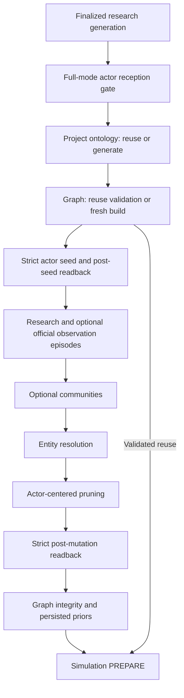
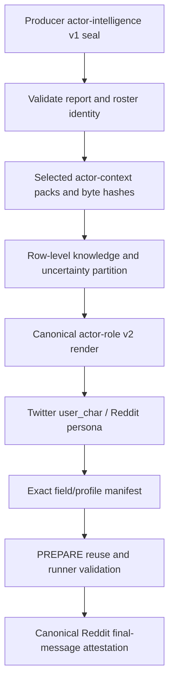
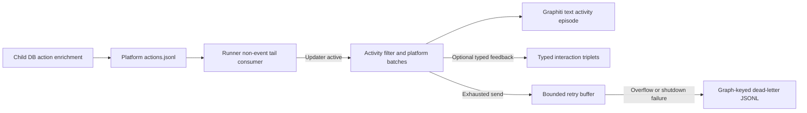

# Graph and actor architecture

This report documents committed main only. All source anchors are relative to the frozen mirror at commit `72545c65d8dbaee40e1c1e71e9909ab4741c7b9f`; they do not refer to live working-tree edits. The assigned inventory contains 23 application files and 23,401 lines. [Coverage receipt](graph-actors-coverage.json) separates full application reads from targeted supporting callers and tests. Full means every source line was read in bounded chunks, not merely indexed or parsed. No application modules, tests, providers, network services or saved runs were executed.

Navigation: [flow](#1-active-main-flow-and-entry-points), [ontology](#2-ontology-producer-and-dynamic-schema), [graph identity](#3-graph-seeding-identity-and-readback), [resolution and pruning](#4-resolution-pruning-and-retrieval-shapes), [artifacts and recovery](#5-artifacts-defaults-and-recovery), [runtime adapters](#6-graphiti-runtime-adapters), [actor contracts](#7-actor-contracts-and-knowledge-boundaries), [profiles and memory](#8-profile-tool-and-memory-consumers), [test evidence](#9-targeted-test-source-evidence), [limits](#10-coverage-and-explicit-uncertainties).

## 1. Active main flow and entry points

The full-pipeline authority in this area is `PipelineOrchestrator`, which receives the finalized research report, optional actor dossier and actors object, enforces current actor-intelligence reception before full-mode RESEARCH completion, then creates/reuses a project ontology, creates/reuses a graph, and passes that graph plus admitted actors and stored graph priors to simulation preparation. Research-only returns before ontology/graph (`backend/app/services/pipeline_orchestrator.py:12827-12876`, `backend/app/services/pipeline_orchestrator.py:12878-12958`, `backend/app/services/pipeline_orchestrator.py:13321-13424`). This is a source call chain, not a record of a particular run.

Diagram anchors: finalized reception `backend/app/services/pipeline_orchestrator.py:12827-12858`; ontology `:12878-12958`; graph reuse `:12960-13026`; seeding/episodes `:13112-13160`; communities/resolution/pruning `:13162-13225`; post-mutation gate and priors `:13227-13319`; PREPARE `:13321-13424`. All these abbreviated anchors name `backend/app/services/pipeline_orchestrator.py`.

There is also a standalone project/task graph API. Its ontology route extracts uploaded documents, invokes `OntologyGenerator.generate`, and stores `entity_types`, `edge_types` and analysis summary on the project. Its build worker chunks project text, creates a graph, installs ontology, adds batches of three, invokes the completion shim, optionally computes layout, fetches graph data and marks project/task completion; exceptions mark the project and task failed. This inspected path does not invoke the full-pipeline actor seed/resolve/prune sequence (`backend/app/api/graph.py:185-245`, `backend/app/api/graph.py:350-528`). The service's separate `build_graph_async`/`_build_graph_worker` helper has its own daemon-thread TaskManager sequence and batch-size default three; no application caller for this helper was found in the targeted name search, while the standalone route directly invokes lower-level builder methods (`backend/app/services/graph_builder.py:1082-1219`, `backend/app/api/graph.py:374-469`).

The builder, entity reader and historical Zep-named consumers import `Zep` from the repository's local `.graphiti_client` package. The name is a compatibility facade and does not by itself imply a Zep Cloud request (`backend/app/services/graph_builder.py:19-20`, `backend/app/services/zep_entity_reader.py:10`). Config supplies `local-graphiti` as a nonempty compatibility sentinel for historical API-key guards (`backend/app/config.py:1034-1038`). Runtime backend details appear in section 6.

## 2. Ontology producer and dynamic schema

`OntologyGenerator` consumes document strings, simulation requirement, optional context, template, central question and actors. It produces a dictionary containing `entity_types`, `edge_types`, `analysis_summary` and any retained extra metadata. Entity definitions carry name/description/attributes/examples; edge definitions carry name/description/source_targets/attributes. Two prompt templates exist: social opinion and general forecast. The former asks for exactly ten actor-oriented entity types including Person/Organization; general forecast asks for six to ten domain-specific types and conditional fallbacks. These are prompt requests; the postprocessor enforces a maximum of ten types/edges, not a mandatory minimum of six or exact count of ten (`backend/app/services/ontology_generator.py:64-139`, `backend/app/services/ontology_generator.py:254-289`, `backend/app/services/ontology_generator.py:948-1146`).

Actual Config defaults enable automatic template selection, rich schema and dossier-derived ontology seeds. The generator's absent-Config fallback and old comments say auto selection is off; the frozen configuration declares it on. Main passes `template=None`, allowing central question or simulation requirement to select social opinion when public-reaction/social-media keywords match and general forecast otherwise. Explicit templates take precedence; unknown template names fall back to social opinion (`backend/app/config.py:360-379`, `backend/app/services/ontology_generator.py:483-537`, `backend/app/services/ontology_generator.py:568-580`, `backend/app/services/pipeline_orchestrator.py:12905-12930`).

Rich prompts append entity archetype, simulation tier, role class, selection rule and anti-examples, plus edge family, valence and direction semantics. Normalization fills missing archetype from ordered type-name hints, fills missing edge family/valence, and fixes the five named causal families to causal/directional. Other explicit values remain. `relation_types` can alias missing/empty `edge_types` when rich schema is enabled (`backend/app/services/ontology_generator.py:310-328`, `backend/app/services/ontology_generator.py:890-946`, `backend/app/services/ontology_generator.py:962-973`). Main preserves the full rich ontology object on the project, while the standalone API keeps only the two core arrays (`backend/app/services/pipeline_orchestrator.py:12932-12948`, `backend/app/api/graph.py:228-234`).

Evidence enters model prompts through sanitized, delimited blocks. Each document is first sanitized with a 120,000-character cap; the combined string may then be sampled head/middle/tail. This is the actual order and does not imply every original document byte reaches ontology generation. Main puts a nonempty actor dossier before the report and adds bounded actor context; its v1 context projection uses structural identity and canonical sourced claims rather than flat role/stance/hot-topic fields (`backend/app/services/ontology_generator.py:640-669`, `backend/app/services/ontology_generator.py:703-759`, `backend/app/services/pipeline_orchestrator.py:12917-12930`, `backend/app/services/pipeline_orchestrator.py:7350-7452`).

Generation invokes `chat_json` at temperature 0.3/max_tokens 8192, normalizes the response, and retries once with the social-opinion template if a nondefault result has no entity types after processing. Exceptions from `chat_json` are not caught in this method. Postprocessing coerces the top-level/array fields, drops non-dictionaries and unnamed/duplicate entity types, bounds descriptions, rewrites reserved attributes as `entity_<name>`, injects fallbacks, caps types, and reconciles final edge endpoints by exact or case-insensitive name; undefined endpoint pairs are dropped while the edge definition itself remains (`backend/app/services/ontology_generator.py:597-638`, `backend/app/services/ontology_generator.py:948-1212`).

`GraphBuilderService.set_ontology` converts definitions into dynamic Pydantic subclasses. Entity attributes become optional `EntityText`; edge attributes become optional strings. It renames reserved properties, isolates malformed individual types, and registers only edges with source-target pairs. It calls the facade only if there are entity types or edge definitions (`backend/app/services/graph_builder.py:1233-1343`). Main catches a whole-schema installation failure and continues with text extraction without ontology; its reuse path re-registers project ontology because the runtime registry is process-local (`backend/app/services/pipeline_orchestrator.py:13016-13025`, `backend/app/services/pipeline_orchestrator.py:13085-13090`).

## 3. Graph seeding, identity and readback

### Current sealed actor plane

The strict path is selected by top-level or migration row-level `actor-intelligence/v1`. Any explicit unsupported version raises `ActorGraphSeedError`; unversioned data takes the compatibility path. UUID5 identity includes graph ID, seed kind and actor/relationship identity, preventing tenant conflation (`backend/app/services/graph_builder.py:131-165`).

Before graph I/O, `_prepare_actor_intelligence_v1_seed` checks a nonempty object roster, counts when supplied, unique actor IDs and normalized canonical names, aliases without identity collisions, canonical intelligence dimensions, sealed claims, and relationship endpoints in that same roster. Claim support must contain source identity, nonempty quote, positive span, receipt ID and 64-hex content digest. Flat role/description/stance/memory is deliberately absent from the v1 claim projection (`backend/app/services/graph_builder.py:206-323`, `backend/app/services/graph_builder.py:1764-1926`, `backend/app/services/graph_builder.py:2031-2103`).

The plan emits one actor-to-type `IS_A` identity edge per actor, curated `ALSO_KNOWN_AS` bridges and canonical typed relationship edges. Required UUIDs, node/edge attributes, sanitized/delimited model text and `deterministic_seed=True` go to the facade. Actor attributes contain actor/dossier identity aliases, canonical claims JSON and hashes, intelligence/seed-record hashes and report/dossier/sources bindings. Relationship attributes retain canonical endpoint IDs, claim identity, causal attributes, source-support/quote/span/receipt/content-hash JSON and seed-record digest (`backend/app/services/graph_builder.py:1841-1887`, `backend/app/services/graph_builder.py:1928-2029`, `backend/app/services/graph_builder.py:2104-2286`).

Relationship identity is `relation_` plus the first twenty hex characters of canonical JSON SHA256 over source actor ID, target actor ID, type, relation label, claim hash and causal attributes. Supplied mismatching IDs or duplicate IDs/edge UUIDs fail preflight; scalar causal attributes normalize NFKC whitespace and reject nonfinite numbers/non-scalars (`backend/app/services/graph_builder.py:99-128`, `backend/app/services/graph_builder.py:2132-2179`).

The physical manifest is separate from successful write counts. It binds graph/source-contract identity, expected node/edge counts, actor/alias/relationship projections, exact labels, summary/fact hashes, required attributes and canonical digests. Every required operation must return an edge UUID; exceptions or missing writes fail strict seeding (`backend/app/services/graph_builder.py:326-529`, `backend/app/services/graph_builder.py:1514-1546`).

Readback recomputes manifest digest, verifies graph ID and schema, fetches the runtime's seed-only physical state, rejects duplicate/extra/missing seed UUIDs and checks labels, names, summary/fact hashes, endpoints and every required attribute. Alias-node collapse is allowed only when the canonical actor's aliases JSON preserves the alias, with the matching absent bridge edge accounted for. It does not permit actor/type node or relationship identity/provenance drift (`backend/app/services/graph_builder.py:1548-1762`).

Main makes v1 seeding mandatory even if the feature flag is disabled, independently verifies the expected manifest and audit shape, and persists `actor_graph_seed_manifest.json`. It records phase-specific readback in state options at post-seed, post-mutation and reuse; failed persisted or physical reuse validation falls back to graph rebuild (`backend/app/services/pipeline_orchestrator.py:7566-7717`, `backend/app/services/pipeline_orchestrator.py:12973-12997`, `backend/app/services/pipeline_orchestrator.py:13112-13122`, `backend/app/services/pipeline_orchestrator.py:13227-13239`). The immutable preflight is not a promise of database-wide transactional rollback after a later write error.

### Unversioned compatibility plane

Legacy seeding extracts usable actor/relationship rows, maps common actor categories to Person/Organization/Entity, inserts typed relations with flat causal fact tokens, seeds otherwise isolated actors through `IS_A`, and adds alias bridges. Unknown relation types use a cleaned relation label or `RELATES_TO`. With rich schema enabled, explicitly supplied archetype/tier/salience and valence/polarity augment legacy facts. Each failed triplet logs and continues; the return is the number of writes that succeeded (`backend/app/services/graph_builder.py:1345-1512`). The parent permits this best-effort behavior only for legacy payloads (`backend/app/services/pipeline_orchestrator.py:7670-7717`).

## 4. Resolution, pruning and retrieval shapes

### Episodes and extraction accounting

Main sanitizes complete research text before splitting and delimits every episode, using the raw length plus replacement-growth allowance rather than a presentation cap. It removes embedded data-URI image noise, uses configured chunk size/overlap, chooses report/dossier/both input according to configuration and dossier presence, and can append stored official historical observations as modeler evidence. The graph's inclusion of an observation does not itself grant actor knowledge (`backend/app/services/pipeline_orchestrator.py:1298-1338`, `backend/app/services/pipeline_orchestrator.py:13030-13082`).

Actor seeding registers normalized cast terms from names, aliases and relation endpoints. Default-on cast filtering skips chunks with no cast mentions only when at least one chunk matches; a zero-match corpus bypasses the filter. Submitted chunks become `EpisodeData(data,type="text",reference_time)` and are sent through `add_batch`. Batch failures and missing returned UUIDs count as failed chunks, while intentional cast skips have their own count. `last_ingest_stats` contains total, failed, succeeded, skip_ratio, skip_reasons, input_chunks and skipped_cast_filter. All submitted chunks failing raises; partial failure warns and continues. `GRAPHITI_REMOTE` adds a one-second pause, but `_wait_for_episodes` is currently just a completion callback, with no remote polling implementation (`backend/app/services/graph_builder.py:701-742`, `backend/app/services/graph_builder.py:2288-2443`). Main records failure ratio and a degradation option when it exceeds the configured threshold (`backend/app/services/pipeline_orchestrator.py:13136-13155`).

### Entity resolution

The resolver is name/alias/embedding based in the inspected code; it does not call an LLM despite its historical module headline. The small-graph plan combines normalized exact/containment matches, node alias metadata and curated dossier aliases, then applies compatible primary labels, canonical protection, seed-kind exclusions and cosine rules. Without embeddings it requires exact name/alias/dossier evidence. Curated same-canonical dossier aliases bypass a low cosine in this small-graph path. A generic Entity cannot transitively bridge distinct typed labels; two distinct canonicals never merge, and sealed actor/type seeds are protected. Survivors prefer the canonical actor seed, then canonical, typed, longest normalized name and deterministic UUID/name order (`backend/app/services/zep_entity_resolver.py:39-181`, `backend/app/services/zep_entity_resolver.py:200-349`, `backend/app/services/zep_entity_resolver.py:441-475`).

Above the configured node threshold, the fast planner buckets exact names, aliases and dossier canonical identity, without all-pairs containment. When both embeddings exist, this fast branch still requires threshold cosine, including its dossier buckets. The orchestration embeds names with a fallback to no embeddings, applies a plan and isolates per-victim merge failures in the audit; the main caller catches broader resolution errors (`backend/app/services/zep_entity_resolver.py:352-438`, `backend/app/services/zep_entity_resolver.py:480-542`, `backend/app/services/pipeline_orchestrator.py:13178-13197`).

### Pruning and structural priors

Pruning core nodes are exact normalized actor canonical/alias matches. The pure plan preserves all cores, ranks only nodes within configured N hops by distance, mention-plus-degree importance, name and UUID, then applies capacity and per-type limits to noncore candidates. Effective capacity is max(configured cap, core count). The retained legacy `min_degree` parameter no longer lets nodes outside this keep-set escape deletion (`backend/app/services/graph_pruner.py:57-240`).

The effectful pass reads nodes/edges/mention counts and skips destructive work if no cores match or curated actor-row coverage falls below its threshold. It distinguishes planned from actual counts, deletes only plan victims, re-reads actual survivors, retries once only originally planned remaining victims, and reports survivor equality, core survival, capacity and deletion failures. A post-delete read failure marks verification unknown/failed; it does not invent successful counts. Errors are returned as degraded audits, with mutation-state qualification when relevant (`backend/app/services/graph_pruner.py:244-428`). The parent then performs the separate strict v1 seed readback after extraction/resolution/pruning (`backend/app/services/pipeline_orchestrator.py:13227-13239`).

GraphInfo computes weak components, top five degree hubs and normalized name-to-centrality priors. Optional bounded Brandes betweenness and articulation points produce structural priors; oversized/error cases skip that enhancement. Alias-prior folding uses exact curated alias groups and max-within-group, never containment and never lowering existing values (`backend/app/services/graph_builder.py:628-690`, `backend/app/services/graph_builder.py:2456-2595`). Main stores `graph_priors.json` after resolution/pruning, optional `graph_priors_structural.json`, and passes the flat priors to both normal and seed PREPARE paths; the report constructor also receives stored priors (`backend/app/services/pipeline_orchestrator.py:13275-13313`, `backend/app/services/pipeline_orchestrator.py:9287-9304`, `backend/app/services/pipeline_orchestrator.py:13393-13424`, `backend/app/services/pipeline_orchestrator.py:13900-13920`).

### Entity selection and graph presentation

`EntityNode` carries UUID/name/labels/summary/attributes plus related_edges/related_nodes; `FilteredEntities` adds type set and total/filtered counts. Reader filtering requires a non-generic label and optionally one of requested types. The tier gate consults explicit node classification, matched actor classification (including configured media detection), then optional ontology-type classification; no classification signal preserves the node. Related edges retain direction/fact/other endpoint, and related nodes retain basic identity/summary. The normal SimulationManager call initially passes only graph ID, requested types and enrichment, then performs its separate dossier stand-in and authoritative cast selection; it does not pass actors/ontology into this first reader call (`backend/app/services/zep_entity_reader.py:34-172`, `backend/app/services/zep_entity_reader.py:319-499`, `backend/app/services/simulation_manager.py:916-940`). Direct detail methods retry reads and return empty edges/None after failure (`backend/app/services/zep_entity_reader.py:192-229`, `backend/app/services/zep_entity_reader.py:286-317`, `backend/app/services/zep_entity_reader.py:501-579`).

Paging defaults to pages of 100, a Config-resolved node cap of 8000 and edge cap of 10000. It deduplicates UUIDs across pages and stops on no-new-UUID, item cap, short/empty page or missing cursor, logging cap/cursor conditions. Only transient IO/connection/internal-server/rate errors retry; other errors propagate. Rate pacing parses Retry-After or reset timestamps from error text, adds a buffer and clamps max sleep (`backend/app/utils/zep_paging.py:20-247`, `backend/app/utils/zep_rate_limit.py:10-52`). Thus the word "all" in these utility names is bounded by these caps and termination conditions.

UI raw graph payloads include node UUID/name/labels/summary/attributes/created_at and edge UUID/name/fact/type/endpoints/names/attributes/temporal fields/episodes. A process-local TTL cache stores graph raw data. Optional min-degree then top-K filtering creates an induced subgraph; slim mode retains only identity, labels, endpoints and valid/invalid time. Neighborhood BFS clamps depth 1-3 and caps output while keeping the center. Layout loads missing/corrupt files as empty; precomputation uses fixed-seed spring layout or deterministic radial fallback, writes positions atomically and invalidates the graph cache (`backend/app/services/graph_builder.py:751-949`, `backend/app/services/graph_builder.py:2597-2819`).

## 5. Artifacts, defaults and recovery

| Boundary artifact/state | Producer and contents | Consumer/admission |
|---|---|---|
| Project ontology and handoff `ontology.json` | Main retains full rich schema; saves project and attempts atomic handoff write (`backend/app/services/pipeline_orchestrator.py:12932-12957`). | Graph dynamic schema; reuse re-registers it (`backend/app/services/pipeline_orchestrator.py:13016-13025`). |
| `actor_graph_seed_manifest.json` | Exact deterministic physical expectations and source-contract digest (`backend/app/services/graph_builder.py:326-529`; `backend/app/services/pipeline_orchestrator.py:7652-7666`). | Parent post-seed/post-mutation/reuse proof (`backend/app/services/pipeline_orchestrator.py:7566-7667`). |
| `entity_merges.json` | Resolution audit written only when merges exist (`backend/app/services/pipeline_orchestrator.py:13185-13192`). | Stored inspection evidence; no automatic rollback consumer established in this study. |
| `graph_prune.json` | Complete plan/execution/readback audit; scalar subset enters state options (`backend/app/services/pipeline_orchestrator.py:13204-13217`). | Health/navigation evidence and actual graph survivors; strict seed proof follows (`backend/app/services/pipeline_orchestrator.py:13227-13239`). |
| `communities.json` | Best-effort `{uuid,name,summary}` rows if community discovery is enabled and nonempty (`backend/app/services/graph_builder.py:2445-2454`; `backend/app/services/pipeline_orchestrator.py:13162-13176`). | Optional downstream community retrieval; disabled by source default (`backend/app/config.py:1266-1277`). |
| `graph_priors.json` and structural companion | Post-pass GraphInfo priors; curated alias max-folding (`backend/app/services/pipeline_orchestrator.py:13275-13313`). | PREPARE selection and ReportAgent arguments (`backend/app/services/pipeline_orchestrator.py:13393-13424`, `:13900-13920`). |
| `GRAPHITI_DATA_DIR/layouts/<graph_id>/positions.json` | Atomic layout coordinate map (`backend/app/services/graph_builder.py:858-949`). | UI graph/subgraph/neighborhood results (`backend/app/services/graph_builder.py:2702-2723`, `:2769-2785`). |
| Pipeline graph ID/options/artifacts | Stage completion stores graph ID after successful build; reuse requires stage/artifact/physical health (`backend/app/services/pipeline_orchestrator.py:12960-13026`, `:13315-13319`). | Resume/reuse and GC reference scanner (`backend/app/services/graph_builder.py:970-1004`). |

Table source abbreviations `pipeline_orchestrator.py` and `graph_builder.py` mean their paths under `backend/app/services/`.

Selected **source defaults**, not observed deployment configuration: ontology auto-select/rich schema/from dossier on; graph actor seeding on; episode build concurrency 4; max Graphiti coroutines 16; graph resolution on with cosine threshold 0.88/full-plan threshold 1200; prune on with max 400, radius 2, per-type 150, core coverage 0.8; communities off and community retrieval follows that flag; cast chunk filter on; chunk full-attempt ceiling 2; remote pacing flag off; operation timeout 900 seconds; UI TTL 60 seconds/layout on; main actor cast cap 20, media exclusion and tier eligibility on (`backend/app/config.py:360-379`, `backend/app/config.py:1234-1368`, `backend/app/config.py:1544-1554`). Old default-off comments and `getattr` fallback values are distinguished from these concrete Config assignments.

Graph reuse requires a completed graph stage and ID, `_reuse_ok` artifact admission, current-v1 persisted manifest/physical readback, and nonzero typed entity health. Any failed check changes reuse to a rebuild and records a reason; successful reuse re-registers ontology (`backend/app/services/pipeline_orchestrator.py:12960-13026`). PREPARE has its own artifact/config-seal reuse gates and can rebuild independently (`backend/app/services/pipeline_orchestrator.py:13321-13364`).

GC scans pipeline-state and project JSON graph references, retains referenced graphs plus newest configured unreferenced graphs, and skips wholesale when an active/unreadable pipeline lacks a recorded graph. It enumerates through the runtime, deletes per graph with isolated failures and invalidates UI cache. Main's best-effort lifecycle hook skips retain<=0; the direct graph API accepts explicit retain including zero (`backend/app/services/graph_builder.py:952-1023`, `backend/app/services/graph_builder.py:2821-2873`, `backend/app/services/pipeline_orchestrator.py:8259-8292`, `backend/app/api/graph.py:676-697`). This study did not inspect any actual saved state or run GC.

## 6. Graphiti runtime adapters

### Facade, storage and concurrency

`graphiti_client` exports local compatibility types/exceptions and namespaces. `Zep` accepts/stores the historical key and constructs graph namespaces using a singleton `get_runtime()`. Wrappers expose both UUID spellings, ISO temporal values and episode aliases. This is an in-process Graphiti adapter, with optional remote database storage; it is not an implemented remote Zep Cloud or remote Graphiti HTTP client (`backend/app/services/graphiti_client/__init__.py:1-33`, `backend/app/services/graphiti_client/compat.py:1-56`, `backend/app/services/graphiti_client/client.py:24-108`, `backend/app/services/graphiti_client/client.py:349-357`).

The cached backend selector accepts auto/falkordblite/falkordb/kuzu. Auto chooses server FalkorDB when an explicit `FALKORDB_HOST` is present, otherwise importable embedded redislite, otherwise Kuzu, otherwise raises. This selection is not a live reachability probe and does not imply connection success. Embedded storage uses `falkor.db`; Kuzu has a directory per graph. No Neo4j selector/driver branch exists in these assigned files. Graph ID is the driver database and Graphiti group ID. Index/constraint creation errors are logged without blocking Graphiti-instance caching (`backend/app/services/graphiti_client/runtime.py:283-416`). `GRAPHITI_REMOTE` is a separate pacing/query-size control rather than the backend selector (`backend/app/config.py:579`, `backend/app/config.py:1344-1350`, `backend/app/services/graph_builder.py:2367-2369`).

The sanitizing Falkor driver converts nested properties into JSON strings, preserves primitive arrays and delegates dates to the base driver. Its query/session/clone surfaces retain that transformation (`backend/app/services/graphiti_client/falkor_driver.py:28-99`). Dynamic ontology bases ignore extra fields; runtime stores `(entity_types,edge_types,edge_type_map)` in memory, keyed by graph, with endpoint-type pairs mapping to allowed edge names (`backend/app/services/graphiti_client/ontology.py:22-47`, `backend/app/services/graphiti_client/runtime.py:442-461`).

Synchronous Flask/service consumers bridge into a background asyncio loop. `run()` waits on a thread-safe future and cancels it on timeout. Mutation locks are per graph; reads take that lock only with `GRAPH_SERIALIZE_READS`, whose source default is off. Concurrent ingestion holds the outer graph write lock while allowing intra-batch semaphore fan-out, so external write serialization is different from episode parallelism (`backend/app/services/graphiti_client/runtime.py:187-281`, `backend/app/services/graphiti_client/runtime.py:1092-1208`). Timeout cancellation is implemented control flow, not proof that arbitrary dependency CPU work can always be preempted.

### Embedding, extraction and retry boundaries

Package initialization sets upstream `EMBEDDING_DIM` from `GRAPHITI_EMBED_DIM` before importing the facade. SentenceTransformer is loaded lazily; encoding uses normalized vectors in its dedicated executor and slices computed rows to the configured width. Keys hash model identity plus whitespace-normalized text. Lookup uses a 50,000-entry memory LRU, optional SQLite float blobs, then deduplicated encoding; disk hits must match the configured width. SQLite failure disables that layer, while model/encode errors are not universally swallowed. Normal disk-cache configuration resolves to `GRAPHITI_DATA_DIR/embed_cache.sqlite` (`backend/app/services/graphiti_client/__init__.py:19-33`, `backend/app/services/graphiti_client/embedder.py:226-362`, `backend/app/config.py:1251-1256`). These are configuration and validation mechanics, not measurement of an installed model's output dimensions.

`AppGraphitiLLMClient` routes Graphiti extraction through application `chat_json`, copies context into a dedicated executor and maps small/medium model sizes to the fast tier. It validates structured response models, unwraps usable schema envelopes and permits a corrective-temperature sequence. Thus local graph storage/embeddings do not establish provider-free extraction (`backend/app/services/graphiti_client/llm_adapter.py:139-275`). Runtime classifies bounded exception chains, shares a full-extraction attempt budget across schema retries, optional fallback-provider use and eligible rate-limit serial replay, and attaches reason/attempt metadata to final errors. The facade omits failed episodes; the builder then accounts for their absence. Compatibility episode handles report `processed=True`; the builder's wait method only reports completion (`backend/app/services/graphiti_client/runtime.py:513-790`, `backend/app/services/graphiti_client/runtime.py:1128-1208`, `backend/app/services/graph_builder.py:2382-2443`).

Ordinary triplets call Graphiti's node/edge resolution path. Deterministic actor seeds require explicit UUIDs and delimited model records, embed those records, then save node/edge records directly under the graph lock, incorporating existing creation times/labels/attributes. The seed readback returns `{nodes,edges}` filtered to `actor-graph-seed/v1` and deliberately preserves duplicate edge UUIDs for the builder's validation. Merge code protects canonical actor/type seeds, preserves seeded edge identities and refuses victim deletion after required seed-edge rewire failure (`backend/app/services/graphiti_client/runtime.py:791-1070`, `backend/app/services/graphiti_client/runtime.py:1931-1984`, `backend/app/services/graphiti_client/runtime.py:2020-2206`).

### Retrieval and direct graph access

Explicit search recipes take precedence over legacy reranker mapping. Runtime supports RRF, MMR, node-distance, cross-encoder and combined recipes; absent node-distance centers and the no-op cross-encoder degrade to appropriate RRF variants. The default local cross-encoder is a no-op/RRF-compatible component; configured BGE is optional. Type/date dictionaries are converted to Graphiti SearchFilters; malformed specifications warn and fall back to unfiltered retrieval (`backend/app/services/graphiti_client/client.py:300-345`, `backend/app/services/graphiti_client/cross_encoder.py:1-26`, `backend/app/services/graphiti_client/runtime.py:1448-1716`, `backend/app/config.py:1028-1029`).

Direct node paging uses ordered UUIDs. Edge reads scan/parse edges, with Kuzu's reified-edge projection handled separately, then apply Python group/cursor filtering. Runtime also exposes community listing, bounded causal paths and N-hop subgraphs with temporal predicates, physical seed state, mention counts, embedding, merge/delete and graph enumeration/deletion APIs. These are concrete local adapter surfaces; whether a backend supplies usable results is unverified (`backend/app/services/graphiti_client/runtime.py:1209-1447`, `backend/app/services/graphiti_client/runtime.py:1717-2020`, `backend/app/services/graphiti_client/runtime.py:2207-2369`).

## 7. Actor contracts and knowledge boundaries

This boundary separates the producer's admitted actor plane, selected per-actor context packs, canonical role text and exact platform/profile serialization. Both the actor-contract and profile readers returned their terminal source synthesis and receipts.

Diagram sources: producer/context validation `backend/app/services/actor_context.py:1207-1425`; pack persistence and validation `backend/app/services/actor_context.py:1428-1592`; knowledge partition `backend/app/services/actor_context.py:970-1045`; canonical role boundary and rendering `backend/app/services/actor_role_prompt.py:937-1127`, `backend/app/services/actor_role_prompt.py:1500-2026`; profile serialization/sidecar `backend/app/services/oasis_profile_generator.py:2642-2791`, `backend/app/services/oasis_profile_generator.py:3062-3264`; runner launch admission `backend/app/services/simulation_runner.py:680-759`; canonical Reddit message attestation `backend/scripts/run_parallel_simulation.py:574-672`, `backend/scripts/run_parallel_simulation.py:5285-5332`.

The directly reread access partition checks top-level and qualifier `actor_knows` values using literal JSON booleans. False wins; otherwise true or an allowlisted actor-known visibility grants access. Analyst inference stays modeler-only even if it asserts knowledge. Contested/unknown evidence is partitioned by access while preserving uncertainty; evidence-gap query/receipt/result metadata remains audit information. Placement in a knowledge-state dimension alone is not an access grant (`backend/app/services/actor_context.py:970-1045`). This is the per-row access gate. A separate traced shared-world consumer collects explicit denials across validated canonical packs and closes claim-ID/text aliases before public-world admission; that consumer is described below (`backend/app/services/simulation_config_generator.py:1675-1798`).

### Producer plane and digest recipes

The research producer's `normalize_actor_intelligence_contract` assigns producer-owned stable actor IDs, normalizes 17 intelligence dimensions, admits claims with fetched-source support and records unsupported assertions as omission hashes. Missing dimensions receive explicit evidence gaps. Claims retain evidence type, explicit claim-valid date, horizon/status/confidence, sources/support, dependencies/contradictions, qualifiers and identity; quote/span support binds source, receipt/content hash, thread/lane/purpose (`deerflow_bridge/deerflow_research.py:3090-3526`, `deerflow_bridge/deerflow_research.py:3793-4042`).

Producer stable IDs derive from NFKC/casefold/whitespace-normalized canonical names, overwriting model-supplied IDs and rejecting collisions. Consumers preserve explicit actor IDs with a name-derived compatibility fallback. Digest recipes are deliberately distinct: producer `actor_ids_sha256` hashes canonical JSON of the ID multiplicity map; producer's separate ordered digest hashes newline-joined IDs; the context manifest hashes the selected ordered JSON ID list. These values are not interchangeable (`deerflow_bridge/deerflow_research.py:1374-1405`, `deerflow_bridge/deerflow_research.py:3975-4042`, `backend/app/services/actor_context.py:447`, `backend/app/services/actor_context.py:1207-1298`, `backend/app/services/actor_context.py:1476`).

The research finalizer verifies current extraction bytes, dossier accountability, ordered roster, identity multiset, claim projection and behavior-family coverage before persisting sources/actors/lineage. The actor-enabled research call follows final report/chart mutation with `required=True`; extract-only has an explicit dossier-less report-only branch. This establishes available conditional call paths, not the mode of any saved run (`deerflow_bridge/deerflow_research.py:4296-4545`, `deerflow_bridge/deerflow_research.py:17420-17470`, `deerflow_bridge/deerflow_research.py:19060-19120`).

### Context producer, epistemic partitions and config consumers

PREPARE reconciles graph entities with the dossier, selects the cast, rejects dropped eligible actors, persists the cast manifest and builds/validates context packs before profiles. Canonical context requires the producer contract, matching report/roster, evidence-or-gap dimension coverage and actor-relevant report sections. Pack JSON retains full intelligence, source/identity bindings, epistemic planes, report sections/structured rows, coverage, bounded prose and omission audits. The default 16,000-character bound applies to `bounded_context`, not to the whole JSON artifact (`backend/app/services/simulation_manager.py:927-1007`, `backend/app/services/actor_context.py:1207-1425`).

Context and manifest files seal serialized bytes and return decoded copies. Validation checks schema, identity/counts, allowed relative paths, hashes, source bindings, roster and prose bounds. Runtime provenance therefore spans selected cast -> context pack -> role -> serialized profile, rather than equating a graph name with a prepared actor (`backend/app/services/actor_context.py:1428-1592`, `backend/app/services/oasis_profile_generator.py:454-595`).

The role knowledge-state projection applies the same literal-boolean/visibility policy described above to known context and information access. Canonical legacy `memory` cannot bypass it; research-only knowledge claims remain labeled calibration evidence. Canonical role compilation excludes the raw pack `bounded_context`, which may contain private gap queries and receipt/result IDs. Typed gaps remain in audit contracts; prompt summaries expose sanitized reason/count/exhaustion rather than those identifiers (`backend/app/services/actor_role_prompt.py:700`, `backend/app/services/actor_role_prompt.py:867`, `backend/app/services/actor_role_prompt.py:1065-1127`, `backend/app/services/actor_role_prompt.py:1372-1405`).

Global simulation configuration has its own authority gates. Canonical relationships require sources plus explicit public visibility and verified-fact/actor-stated evidence; canonical events require sealed dossier membership, sources, public visibility and permitted epistemic status. Public-world claims exclude analyst inference and apply explicit denial propagation over claim IDs/text aliases gathered from canonical packs. Per-agent activity projections retain documented behavior, separately labeled inference/contested context and a gap audit outside the behavioral view. The canonical path bypasses legacy follow/graph-neighbor supplementation (`backend/app/services/simulation_config_generator.py:851`, `backend/app/services/simulation_config_generator.py:1507-1798`, `backend/app/services/simulation_config_generator.py:3651-4035`). Inclusion in retained research or in the graph therefore does not imply shared-world or actor-local knowledge admission.

### Role compilation, utility projections and reuse

`actor-role/v2` contains structural identity, behavioral categories, relationships, knowledge/report boundaries, uncertainty, sources and provenance. Explicit unsupported intelligence versions produce no low-level role; mismatched optional context is omitted with an audit gap. Strict runtime batch admission separately requires matching persisted context and rejects invalid canonical inputs. Full, balanced and emergency rendering layouts enforce a default 6,000-character cap, clamped to 1,800-12,000; inability to fit the emergency form raises (`backend/app/services/actor_role_prompt.py:937-1009`, `backend/app/services/actor_role_prompt.py:1500-2026`, `backend/app/services/oasis_profile_generator.py:476-595`).

`actors.py` provides compatibility extractors/renderers, canonical/alias-first matching, tier eligibility, relationship/follow/schedule/source/forecast projections and cast reconciliation. Exact canonical/alias matching searches the roster before heuristic matching; ambiguity returns None. Reconciliation retains intelligence variants, source unions, conflicts and provenance snapshots. Presence of these helpers is not evidence that every canonical consumer uses every compatibility projection (`backend/app/utils/actors.py:445-492`, `backend/app/utils/actors.py:928-967`, `backend/app/utils/actors.py:1270`, `backend/app/utils/actors.py:1398`, `backend/app/utils/actors.py:1713`, `backend/app/utils/actors.py:2201-2448`, `backend/app/utils/actors.py:2613`, `backend/app/utils/actors.py:2765`).

The dossier compactor ranks by tier/salience/name, selects deduplicated cast-touching one-hop relationships and uses default actor/relationship/neighbor caps 20/80/40. It renders structured Markdown, stops at whole lines and returns selection/truncation telemetry. The parallel research merge caller enables this by source default and falls back to its longest surviving dossier within the configured cap when the compacted text is below 800 characters (`backend/app/services/actor_dossier_compactor.py:151-192`, `backend/app/services/actor_dossier_compactor.py:304-320`, `backend/app/services/pipeline_orchestrator.py:12200-12258`). This is a merge-context representation, not a replacement for the canonical intelligence seals.

Config seals bind exact/canonical configuration hashes plus cast/context/role manifests. Failed PREPARE reuse validation rebuilds. Scenario forks reuse research/ontology/graph and preserve base actor policy while creating fresh PREPARE/RUN/REPORT stages; sanctioned overlays are resealed before RUN. Canonical Reddit final role/world/calendar system-message composition is attested into `reddit_runtime_system_messages.json` (`backend/app/services/simulation_manager.py:52-222`, `backend/app/services/pipeline_orchestrator.py:8766-8865`, `backend/app/services/pipeline_orchestrator.py:13321-13364`, `backend/app/services/pipeline_orchestrator.py:13451-13540`, `backend/scripts/run_parallel_simulation.py:574-693`, `backend/scripts/run_parallel_simulation.py:5285-5332`).

## 8. Profile, tool and memory consumers

### Profile generation and exact platform artifacts

SimulationManager passes the same selected actor packs to profile and config generation, providing pack/manifest/report, dossier and cast fingerprints. Canonical dossier/row markers trigger synchronous batch preflight before worker submission: each entity must match a canonical actor and `actor-context/v1` with matching identity/name/intelligence/dossier/report and persisted seals. Canonical profile generation branches before graph retrieval and both persona generators, builds/compiles/hashes `actor-role/v2` and uses the role as the entire persona. Structural name/type provide bio/profession fields. Canonical errors propagate; legacy batches retain error-stub recovery. Low-level helpers/stubs remain separate callable boundaries from strict batch admission (`backend/app/services/simulation_manager.py:978-1109`, `backend/app/services/oasis_profile_generator.py:454-729`, `backend/app/services/oasis_profile_generator.py:865-926`, `backend/app/services/oasis_profile_generator.py:2291-2309`, `backend/app/services/oasis_profile_generator.py:2382-2455`).

Legacy generation uses attributes/related edges/neighbors, retrying secondary searches with empty-context fallback; bundled context can suppress extra graph searches. Optional ego retrieval requests relationship-filtered node-distance search. It sanitizes dossier text, generates a base LLM/rule persona and appends a separately compiled role. LLM generation retries three times, attempts JSON repair and falls back to a marked rule persona. Optional eight-field persona design can fall back to dossier extraction; statistics distinguish rule fallback and error stubs (`backend/app/services/oasis_profile_generator.py:735-863`, `backend/app/services/oasis_profile_generator.py:938-1349`, `backend/app/services/oasis_profile_generator.py:1508-1645`, `backend/app/services/oasis_profile_generator.py:1770-1926`, `backend/app/services/oasis_profile_generator.py:2459-2507`).

Twitter CSV columns are `user_id,name,username,user_char,description`; canonical `user_char` is the role with CR/LF converted to spaces. Reddit JSON has structural identity/bio/persona and loader keys; canonical demographic values are empty strings. Realtime previews retain only the completed contiguous prefix, keeping entity index alignment. Adjacent `*_roles.json` sidecars use `actor-role-manifest/v2` and bind profile file, original prompt, transformed fragment, full runtime field, compiler limit, context/roster fingerprints and canonical Reddit base-message seals. V2 validation recompiles with the recorded limit; genuine legacy v1 uses recorded fragment verification (`backend/app/services/oasis_profile_generator.py:2316-2351`, `backend/app/services/oasis_profile_generator.py:2642-3060`, `backend/app/services/oasis_profile_generator.py:3062-3264`).

The runner validates every prepared platform, even a prepared platform not requested for a specific launch. The parallel child replaces canonical Reddit's generic demographic system wrapper with the role-only wrapper and verifies final composition after permitted world/calendar additions before environment execution (`backend/app/services/simulation_runner.py:680-759`, `backend/scripts/run_parallel_simulation.py:576-670`, `backend/scripts/run_parallel_simulation.py:5291-5324`). Twitter's serialized field/admission was traced; its instantiated final system message was not independently inspected.

### Action log to graph memory

Diagram/source boundary: action enrichment/log calls `backend/scripts/run_parallel_simulation.py:1435-1625`, `backend/scripts/run_parallel_simulation.py:5125-5158`; JSONL schema `backend/scripts/action_logger.py:22-99`; tail consumer `backend/app/services/simulation_runner.py:1168-1287`; updater `backend/app/services/zep_graph_memory_updater.py:320-596`; facade episode `backend/app/services/graphiti_client/client.py:200-208`.

The action producer enriches named actions with post/comment content and target names, and the logger appends `{round,timestamp,agent_id,agent_name,action_type,action_args,result,success}`. The runner forwards non-event action dictionaries only when an updater is active. The updater ignores event dictionaries and `DO_NOTHING`, groups by platform and sends five-activity natural-language batches through `graph.add(type="text")`; the facade turns these into activity episodes with source description `mirofish-activity` (`backend/scripts/action_logger.py:22-66`, `backend/app/services/simulation_runner.py:1168-1287`, `backend/app/services/zep_graph_memory_updater.py:23-198`, `backend/app/services/zep_graph_memory_updater.py:320-448`, `backend/app/services/graphiti_client/client.py:200-208`).

After send retries exhaust, counters record failed batches/items. Running updaters rebuffer up to 500 activities; overflow/shutdown failures write `_zep_dead_letter/{graph_id}.jsonl` with rendered text, actor/action identity, round/time metadata and flush/fsync. Failed-item totals mean exhausted sends, not necessarily permanent loss. Optional typed feedback maps interactions to edges such as LIKED/REPLIED_TO/FOLLOWED with parsed valid_at. Interview persistence has an independent gate and at most 1,500 statement characters (`backend/app/services/zep_graph_memory_updater.py:450-641`).

Frozen Config defaults general, typed and interview graph feedback to false. Main enables memory update through pinned policy plus graph ID; the runner records requested versus active status and initialization errors. Ego retrieval defaults false, bundled-context secondary-search skipping defaults true, community retrieval follows the default-off community-building flag unless explicitly set (`backend/app/config.py:380-387`, `backend/app/config.py:1260-1276`, `backend/app/config.py:1380-1392`, `backend/app/services/pipeline_orchestrator.py:13586-13592`, `backend/app/services/simulation_runner.py:843-871`). These switches do not prove any feedback occurred.

### Graph/report tools and separate evidence sources

`SearchResult` contains facts, projected edges/nodes, query, count and `degraded`. Expected backend/connection errors and exhausted rate limiting trigger keyword fallback marked degraded; unexpected search exceptions propagate. Optional query caches include graph/query/limit/scope/recipe/filter keys; separate bulk node/edge caches retain loaded collections. Search invalidation clears search/forge caches. Parsed as-of values become temporal filters; invalid dates fall back to unfiltered search (`backend/app/services/zep_tools.py:75-108`, `backend/app/services/zep_tools.py:558-571`, `backend/app/services/zep_tools.py:613-952`, `backend/app/services/zep_tools.py:1142-1241`).

Report search explicitly requests `cross_encoder`, which the facade maps into its effective recipe; Config's general RRF default alone does not establish this call's recipe. Runtime's optional/no-op cross-encoder fallback then determines actual local recipe behavior (`backend/app/services/zep_tools.py:676-690`, `backend/app/services/graphiti_client/client.py:305-345`, `backend/app/services/graphiti_client/runtime.py:1647-1716`).

InsightForge generates subqueries, retrieves/deduplicates facts, joins endpoints, supplements entity search and renders edge-reference chains. Panorama keeps loaded graph collections while limiting ranked active/historical fact lists. InterviewAgents selects profiles and invokes live runner interviews, preserving platform-specific responses/placeholders; graph persistence is separately gated. Outcome, coalition, opinion-shift and scenario-diff tools aggregate runner data rather than treating all observations as graph evidence; cascade/community tools call runtime graph surfaces. Report dispatch exposes optional tools conditionally, renders results as text and turns tool failures into textual errors (`backend/app/services/zep_tools.py:1482-1920`, `backend/app/services/zep_tools.py:1957-2191`, `backend/app/services/zep_tools.py:2457-2854`, `backend/app/services/report_agent.py:2323-2341`, `backend/app/services/report_agent.py:10993-11226`). Coverage export/cache-enrichment helpers exist, but the reader's scoped application symbol search found no external calls to `flush_coverage` or `search_from_cache`; no universal use claim is made.

## 9. Targeted test-source evidence

Tests were read as evidence and were not run. These tests show encoded expectations and synthetic boundaries, not live database/provider acceptance.

- `backend/tests/test_graph_actor_v1_seed.py:501-611` asserts deterministic expected manifests, exact counts, allowed alias collapse, and rejection of altered relationship endpoints/provenance/missing/duplicate records/actor UUIDs or manifest digest. Only this targeted range was read locally.
- `backend/tests/test_wave9_kg.py:277-471` asserts disabled/no-core/low-core prune skips, normal deletion/readback, partial-deletion failed postconditions and explicit post-delete read failures using fake runtimes. The receipt extends to line 475, including the next test header only; its body was not read here.
- `backend/tests/test_audit_fixes_graph.py:126-155` asserts partial/all ingest failure accounting; `:281-304` asserts optional type classification and explicit node priority using synthetic reader inputs.

Additional targeted test-source evidence returned by readers (none executed):

- `backend/tests/test_actor_dossier_compactor.py:16-57`: selection, determinism/bounds and malformed-input expectations.
- `backend/tests/test_actor_role_prompt.py:1072-1137`: runtime-field tamper and recompilation mismatch expectations.
- `backend/tests/test_actor_context_runtime.py:332-417`, `backend/tests/test_actor_context_runtime.py:801-942`: access/inference/contested partitions, sealed-pack isolation/tamper, canonical admission and propagation of generation failure.
- `backend/tests/test_oasis_v1_provenance.py:165-253`: canonical retrieval/persona bypass and role-only serialization despite base-persona changes.
- `backend/tests/test_graph_optimizations.py:120-205`, `backend/tests/test_graph_optimizations.py:208-365`: embedding cache, LLM adapter, serial ingestion and timeout-cancellation expectations.
- `backend/tests/test_graph_cost_containment.py:260-418`, `backend/tests/test_wave9_kg.py:733-907`: shared attempt caps, fallback slot, error classification, cooldown and selective serial replay.

## 10. Coverage and explicit uncertainties

All 23 assigned application files (23,401 lines) were fully read, with every frozen SHA256 matched against the inventory and continuous read-range unions checked. All three nested readers returned terminal results and were closed after receipt. Supporting caller/producer/config modules and tests remain partial at their exact recorded ranges; they do not inflate assigned-file coverage. The receipt retains overlapping rereads rather than counting them twice. One supporting runner command spanned 251 lines (510-760), a one-line overrun of the reader's chosen 250-line target without truncation; all assigned full-source chunks stayed bounded. Truncated discovery/repeated status output was not used as full-source evidence.

No live backend selection, environment values, model downloads/vector dimensions, index creation, provider responses, graph contents, byte sealing on a real simulation, successful memory feedback, or runtime performance is established. Twitter final system-message instantiation remains outside the inspected boundary; Reddit has a source-traced attestation path, without executed proof. Source defaults and static gates are described as implemented control flow. External dependency internals are outside the 23-file ownership; their use is described through local adapters only. Broader workflow authority/research/simulation/report/API/deployment is covered by peer area reports and the coordinator's synthesis.

## Checkpoint ledger

- Initial checkpoint: graph-builder lines 1-500; other receipts explicitly partial.
- Local milestone: graph builder, ontology, entity reader/resolver, pruner and paging/rate helpers fully read in bounded chunks, with targeted orchestration/API/config/test excerpts recorded separately.
- Resumption milestone: all three originally errored child sessions were closed and reopened with their original assignments. Full-read receipts were checkpointed incrementally.
- Completion milestone: terminal Graphiti, actor-contract, and profile/tool/memory syntheses collected; all three completed children closed. All 23 assigned hashes and full-range unions verified. Only this area report and its coverage JSON were written.

## Final static validation receipt

The documentation-only validation matched all 42 recorded source hashes, verified full continuous unions for the 23 assigned application files (23,401 unique lines), and checked 246 full-path source anchors for existence, valid line bounds and inclusion in recorded read ranges. Nineteen supporting files remain partial, including nine test-source files. Three Mermaid source diagrams are present; no application/runtime tests were run. All three delegated readers returned terminal results before finalization and were closed: graph-runtime (Anscombe), actor-contracts (Carson), and profile-memory-tools (Galileo). No assigned-file ranges remain missing.

2026-10-15T20:03:16.183262+00:00: Finalized the area report and coverage receipt. Only `areas/graph-actors.md` and `areas/graph-actors-coverage.json` were written; application files, other readers outputs, Git/index and existing handoffs were not modified.
