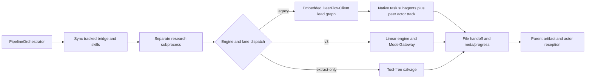
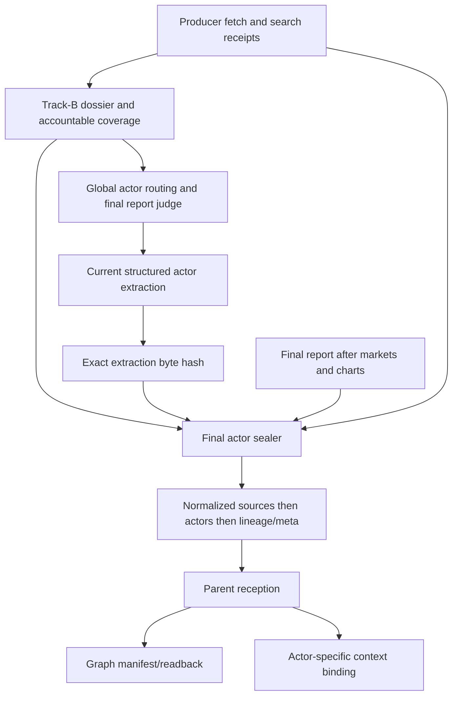
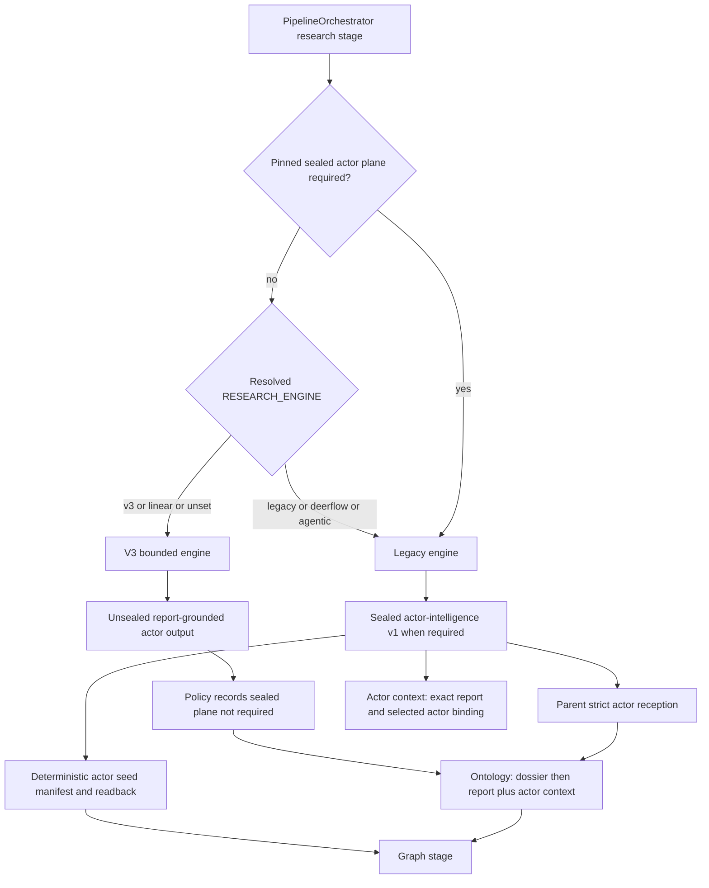

# Legacy harness and research bridge

## 1. Authority, scope and navigation

Authority is committed main `72545c65d8dbaee40e1c1e71e9909ab4741c7b9f` in the frozen mirror above. `study-contract.json` and `python-inventory.json` define this owner’s scope. All **14 assigned application files / 27,786 lines** were read completely, using direct reads for 11 overlay/provider files and six nested readers for the bridge, gateway and skill-sync helper. All six readers returned final receipts and were closed. `legacy-harness-coverage.json` records SHA-256 and actual ranges; large assigned modules retain their bounded read chunks. Supplemental caller modules remain explicitly partial. Inventory/AST/search results were navigation, never substituted for source reads.

No application import/execution, tests, provider/network calls, saved-run inspection, overlay deployment or Git/index mutation occurred. Only this report and its coverage receipt were written. Runtime and deployment descriptions below are source-defined contracts; none assert that a live run exercised them. Earlier memory was navigation only; current frozen source supports the behavior claims.

Navigate by boundary:

- [Process boundary and engine selection](#2-process-boundary-and-engine-selection)
- [Checkpoint, recovery and artifacts](#3-checkpoint-recovery-and-artifacts)
- [Legacy research and actor stages](#4-legacy-research-and-actor-stages)
- [Synthesis, lanes, citations and tool-free calls](#5-synthesis-lanes-citations-and-tool-free-calls)
- [Actor provenance, normalization and sealing](#6-actor-provenance-normalization-and-sealing)
- [V3 gateway and tools](#7-v3-gateway-and-tools)
- [Runtime skill synchronization](#8-runtime-skill-synchronization)
- [Harness overlays and provider adapters](#9-harness-overlays-and-provider-adapters)
- [Parent reception, graph and actor-context consumers](#10-parent-reception-graph-and-actor-context-consumers)
- [Evidence, coverage and explicit uncertainties](#11-evidence-coverage-and-explicit-uncertainties)

| Assigned source | Lines | Responsibility |
|---|---:|---|
| `deerflow_bridge/deerflow_research.py` | 19136 | Shared subprocess CLI; legacy lead/peer tracks; provenance, synthesis, extraction and actor sealing |
| `deerflow_bridge/research_gateway.py` | 4709 | V3 provider/tool gateway, source ledger and stored data evidence |
| `deerflow_bridge/runtime_skill_sync.py` | 622 | Exact managed skill deployment and child verification |
| `deerflow_bridge/patches/apply_lead_agent_overlays.py` | 138 | Narrow lead factory transforms |
| `deerflow_bridge/patches/apply_model_factory_overlays.py` | 65 | Local context metadata exclusion |
| `deerflow_bridge/patches/apply_subagent_overlays.py` | 410 | Embedded config/model inheritance, task outcomes and usage deltas |
| `deerflow_bridge/patches/middlewares/loop_detection_middleware.py` | 635 | Run-scoped repetition detection and deferred warnings |
| `deerflow_bridge/patches/middlewares/model_concurrency_middleware.py` | 76 | Exact provider and subagent admission helpers |
| `deerflow_bridge/patches/middlewares/summarization_middleware.py` | 513 | Summary hooks and paired skill rescue |
| `deerflow_bridge/patches/middlewares/title_middleware.py` | 194 | Local/async thread-title metadata |
| `deerflow_bridge/patches/middlewares/tool_error_handling_middleware.py` | 257 | Tool errors/status and shared middleware assembly |
| `deerflow_bridge/patches/models/claude_provider.py` | 514 | Claude auth/cache/thinking/retry adapter |
| `deerflow_bridge/patches/models/credential_loader.py` | 278 | Credential carrier loaders |
| `deerflow_bridge/patches/models/patched_minimax.py` | 239 | MiniMax reasoning serialization adapter |

The remainder gives the source anchors supporting this module map.

## 2. Process boundary and engine selection

The application-facing integration is `PipelineOrchestrator` → `DeerFlowResearchRunner` → a separately launched deployed `deerflow_research.py` → file handoff. The runner creates a private prompt file, passes the configured interpreter/flags/environment, sets deployed cwd, merges stdout/stderr and starts a new process session. It parses progress/usage, watches timeout/cancellation and reads output artifacts. This process boundary is distinct from the embedded DeerFlow client used *inside* the legacy child. `backend/app/services/pipeline_orchestrator.py:2163-2204`, `backend/app/services/pipeline_orchestrator.py:2305-2371`, `backend/app/services/pipeline_orchestrator.py:2493-2763`.

Legacy constructs `deerflow.client.DeerFlowClient` with selected config/model, thinking enabled, the requested native subagent setting and a six-skill allowlist. It then mutates that client's loaded AppConfig to register eligible official-data tools before lazy agent creation. Track A and Track B share the client but use separate thread IDs; Track B uses an `-actor` suffix. They are peer bridge workflows, separate from task-tool subagents. `deerflow_bridge/deerflow_research.py:18020-18049`, `deerflow_bridge/deerflow_research.py:18251-18392`.

V3 dispatches to `linear_research.run` before legacy client construction. It uses DeerFlow `create_chat_model` with thinking disabled, `ModelGateway`, `ResearchTools` and its own state/phase machine. It can call bridge artifact/normalization helpers without running the legacy lead graph. Extract-only also returns before legacy client construction. Thus the shared subprocess/script name does not identify the selected research engine. `deerflow_bridge/deerflow_research.py:17615-17677`, `deerflow_bridge/deerflow_research.py:18013-18029`, `deerflow_bridge/linear_research.py:8097-8198`.

| Source entry | Engine default | Other important source defaults |
|---|---|---|
| Backend Config/parent resolver | v3; empty/unknown → v3 | depth deep; model alias claude; native subagents on |
| Direct bridge CLI | legacy; empty/unknown → legacy | depth standard; model from DEERFLOW_RESEARCH_MODEL or claude; subagents only with flag |
| Pinned run requiring sealed actor plane | legacy | Required policy takes precedence over current engine default |
| Extract/evidence/global-manifest lane mode | legacy | These modes are legacy lane contracts even with v3 requested |

The alias sets are `v3`/`linear` and `legacy`/`deerflow`/`agentic`. The parent explicitly supplies `RESEARCH_ENGINE` to the child and v3's effective watchdog budget; it forces one outer v3 lane. This reconciles the differing standalone and parent defaults. These are source defaults, not effective host settings. `backend/app/config.py:1148-1187`, `backend/app/services/pipeline_orchestrator.py:2341-2371`, `backend/app/services/pipeline_orchestrator.py:6378-6453`, `deerflow_bridge/deerflow_research.py:17496-17530`, `deerflow_bridge/deerflow_research.py:17685-17718`, `deerflow_bridge/deerflow_research.py:17791-17803`.

The process/dispatch edges are anchored in the paragraphs above; required skill payload/reverification is described in section 8. This diagram is a source map, not an executed trace.

### Active authority and optional paths

The normal parent-selected v3 engine actively uses this gateway through its production factories; the legacy harness remains selectable and is required for the sealed actor-plane policy and special lane/salvage modes. The tracked overlay modules are deployment inputs targeting an installed harness, not independently launched research services. Provider adapters are selected through model configuration, and title/guardrail/vision/deferred-tool middleware is conditional on configuration. `deerflow_bridge/linear_research.py:8174-8198`, `deerflow_bridge/deerflow_research.py:17496-17530`, `backend/app/services/pipeline_orchestrator.py:6409-6424`, `deerflow_bridge/patches/middlewares/tool_error_handling_middleware.py:129-257`.

KG MCP registration is optional and separate from actor graph ingestion. The parent renders/deploys an extensions template, then points the research child at it only with a supplied graph ID, enabled RESEARCH_MCP_KG and an existing deployed template. Otherwise that branch skips wiring and research continues. This read establishes registration conditions, not server execution or v3 tool reachability. `backend/app/services/pipeline_orchestrator.py:1615-1641`, `backend/app/services/pipeline_orchestrator.py:2479-2491`.

## 3. Checkpoint, recovery and artifacts

The bridge CLI requires exactly one prompt source and an output directory. Empty stripped questions return 3; otherwise it creates the directory and immediately atomically writes `prediction_requirement.txt`. It verifies runtime skills, presets missing provider/config-referenced environment names without overwriting existing values, and performs selected-model credential checks before dispatch/client construction. Missing credentials and required skill verification rejection return 3. `deerflow_bridge/deerflow_research.py:17548-17612`, `deerflow_bridge/deerflow_research.py:17685-17790`, `deerflow_bridge/deerflow_research.py:17945-18024`.

Legacy `research_checkpoint.json` records thread, normalized question hash, depth, run/attempt/lane identity, completed passes, fetched count, gaps, timestamp and a checkpoint fingerprint. The question hash folds whitespace/case; the checkpoint identity excludes the timestamp. Missing/corrupt/non-object checkpoints are absent; resume rejects question/depth/fingerprint or supplied lineage mismatches. Recorder writes are atomic and additive failures do not interrupt research. `deerflow_bridge/deerflow_research.py:900-1169`.

Main applies the legacy skip plan only for legacy resume. It restores sources after checkpoint validation and accepts prior evidence packs only if usable. Skipped passes remain valid only if a durable evidence pack exists or thread messages can reconstruct one; otherwise it clears skips and starts a fresh thread. V3 instead opens `v3/state.json` using question/depth/model/language/engine identity, automatically reuses matching state, and archives mismatched/corrupt work. Its phases are plan → data → gather → gap → synthesize → QA → finalize. `deerflow_bridge/deerflow_research.py:17849-17894`, `deerflow_bridge/deerflow_research.py:18051-18082`, `deerflow_bridge/linear_research.py:1213-1235`, `deerflow_bridge/linear_research.py:4646-4677`, `deerflow_bridge/linear_research.py:4978-4993`.

The runner's timeout salvage requires changed size/hash plus usable report/evidence. A fresh report without actors can trigger a bounded extract-only child, default 600 seconds. Nonsalvaged nonzero exits, missing/empty/too-short reports and short provider-error reports raise. Return payload includes report/path, optional evidence pack, dossier, actors, sources, timeline, exit code and telemetry; a file on disk is therefore separate from accepted research completion. `backend/app/services/pipeline_orchestrator.py:2277-2304`, `backend/app/services/pipeline_orchestrator.py:2645-2763`, `backend/app/services/pipeline_orchestrator.py:4201-4280`.

| Producer path | Persisted artifact/carrier | Consumer or stopping condition |
|---|---|---|
| CLI/startup and progress | `prediction_requirement.txt`, `research_progress.log`, `meta.json` | Parent launch/progress/telemetry and explicit terminal status |
| Legacy pass recorder | `research_checkpoint.json` plus graph thread messages/evidence pack | Validated skip plan with reconstructable evidence |
| Evidence lane | `evidence_pack.md`, `sources.json`, optional required `actor_dossier.md` / `actor_dossier_coverage.json` / `actor_dossier_judge.json` | Global manifest loader; evidence-only stops before full extraction/enhancements |
| Full prose/judge | `research_report.md`, `research_report_judge.json` | Exact current-input judging required for global/deep before extraction |
| Structured extraction | `actors.json`, optional `timeline.json`, `quantitative.json`, `contested.json`, sources | Current extraction fingerprint; forensic rejected-output records on failure |
| Actor sealing | final actors/source bytes, `actor_intelligence_lineage.json`, contract metadata | Parent reception, graph seed and actor-context validation |
| Market/chart enhancements | `prediction_markets.json`, `market_price_history.json`, `charts.json`, stored data artifacts | Deterministic sections/chart references before final actor sealing |
| V3 engine/gateway | `v3/state.json`, `usage.json`, source pages/ledger and stored data manifest/files | V3 reuse/admission/telemetry; distinct from legacy checkpoint |

Artifact names and write boundaries: `deerflow_bridge/deerflow_research.py:861-875`, `deerflow_bridge/deerflow_research.py:8997-9047`, `deerflow_bridge/deerflow_research.py:18394-18677`, `deerflow_bridge/deerflow_research.py:18716-19096`, `deerflow_bridge/linear_research.py:7279-7323`, `deerflow_bridge/linear_research.py:7790-7823`. Market/data/actor details follow below. Optional sidecars are not universal required outputs.

Ordinary full legacy completion writes terminal completed meta, flushes available telemetry and returns 0; caught ordinary exceptions record failed meta/traceback and return 2. Deep/global judge FAIL preserves report/judge but returns 2 before extraction. Actor-enabled normal completion requires current-extraction sealing after later report mutations. Visualization shortfall is advisory unless strict mode is selected; the 0.45 local research-quality floor is warning telemetry. The script flushes stdio and uses `os._exit` after main's return. Argparse/early file operations and interpreter-level exceptions have separate boundaries. `deerflow_bridge/deerflow_research.py:18589-18677`, `deerflow_bridge/deerflow_research.py:18900-19136`.

## 4. Legacy research and actor stages

- Non-deep research uses one standard pass; standard top-ups require explicit gaps rather than low source count. Deep mode retains pass evidence, schedules isolated middle/forecast/adaptive threads, and records completed work only after successful evidence absorption into the durable main thread. Evidence-only returns an evidence pack before report synthesis; empty ordinary deep synthesis raises. `deerflow_bridge/deerflow_research.py:12954-13089`, `deerflow_bridge/deerflow_research.py:13378-13767`.
- Track B runs initial and cast-wide completion research, builds a tool-free dossier from checkpoint evidence plus producer search receipts, and applies live source-bound coverage. The required ledger has Tier-1/2 actors and all 17 dimensions; critical gaps need two bound query-result attempts, and behavior-ready families need source-supported visible claims. Disabled/length-skipped AI judging still requires accountable live coverage. Enabled final judging additionally requires exact current input identity and a passing complete scorecard; failure returns an empty dossier. `deerflow_bridge/deerflow_research.py:13783-14517`, `deerflow_bridge/deerflow_research.py:14756-15112`.
- Prediction-market paths distinguish prepass transport unavailability, captured tool candidates, post-research refresh, report relevance and degraded-horizon fallback. Snapshot collection uses bounded deadlines and cancellation without waiting for running HTTP work. Empty outcomes receive explicit status markers; successful selection writes `prediction_markets.json` and upserts its report section. History independently writes `market_price_history.json` only with nonempty results. `deerflow_bridge/deerflow_research.py:15115-15138`, `deerflow_bridge/deerflow_research.py:15687-15840`, `deerflow_bridge/deerflow_research.py:16065-16411`.
- Charts and official-data finalization consume stored retrieval generations. Source identity publication precedes dataset publication/citation remapping; chart manifests admit known stored series and existing owned chart files. Data telemetry does not start providers. Deterministic forecast rendering invokes a selected Python subprocess and audits chart families; the visual gate is advisory by default and strict only when configured. The official quantitative join updates actor bytes and the expected extraction hash before sealing. `deerflow_bridge/deerflow_research.py:16590-16786`, `deerflow_bridge/deerflow_research.py:16899-17134`.
- Legacy extract-only validates existing actor lineage before a model call when a dossier or lineage exists. Report-only extraction strips unsealed intelligence markers; existing source bytes retain positional meaning during structured extraction, while later official-data finalization is a separate possible rewrite. Required extraction failure returns before enhancements. Dossier extraction ends in final actor sealing; no-actors explicitly skips that branch. `deerflow_bridge/deerflow_research.py:17142-17473`.

### Extraction and report-judge boundaries

- Tool-free structured extraction uses a string-compatible result carrying truncation/provider error metadata. Parsing accepts fenced or balanced objects and repairs completed JSON prefixes, but admission rejects provider-declared truncation and requires a named actor. Provider failure receives one primary retry; a real incomplete response can receive one compact recovery. Rejected candidates and empty/provider failures get structured forensic records, with files only for nonblank raw text. `deerflow_bridge/deerflow_research.py:8776-8803`, `deerflow_bridge/deerflow_research.py:8807-9057`, `deerflow_bridge/deerflow_research.py:9483-9801`.
- `run_streamed_turn` accumulates text by message ID and salvages it on stream interruption. Malformed tool-call streaks and structured budget-denial streaks can trigger corrective continuation or local interruption. Usage comes from stream end metadata, with missing counters kept unknown. Zero-model-turn `inject_thread_message` updates the embedded client's graph state. `deerflow_bridge/deerflow_research.py:10741-10975`.
- Bridge KIQ fanout creates isolated worker thread IDs and bounded executors, records complete worker notes for synthesis, and has an explicit off-by-default gate separate from harness task delegation. Gap ledgers distinguish missing headings from explicit empty headings and preserve/reconcile concurrent worker state. `deerflow_bridge/deerflow_research.py:11008-11402`, `deerflow_bridge/deerflow_research.py:12918-12951`.
- Report PASS requires seven exact finite score dimensions, explicit PASS, threshold checks, no fatal gap, and any required sealed actor coverage. Deterministic scenario consistency and visible sealed actor/family marker audits supplement judging. Refinement can retain an improved failing draft for another round, but final deep/global acceptance separately requires an identity-bound passing judge. `deerflow_bridge/deerflow_research.py:11521-12140`, `deerflow_bridge/deerflow_research.py:12174-12611`.
- Section patches and triangulation produce candidates. They do not themselves prove final report acceptance; candidate adoption finalizes citations, judges the exact report, and can restore earlier report/judge state on failure. `deerflow_bridge/deerflow_research.py:12425-12504`, `deerflow_bridge/deerflow_research.py:12623-12915`.

## 5. Synthesis, lanes, citations and tool-free calls

### Lead delegation and synthesis ownership

Legacy lead delegation is prompt-driven through `scoped-researcher` and depends on the active delegation flag plus default-on `RESEARCH_AGENTIC_SEARCH`. The configurable batch cap defaults to five, clamped to 1-8. The lead retains synthesis, evidence grading and the source ledger; delegated verification is an instruction rather than a runtime guarantee. Bridge KIQ fanout is a separate off-by-default feature and is suppressed under active harness delegation unless stacking is explicitly allowed. Deep evidence-lane phase prompts suppress ordinary delegation unless enabled for that lane. `deerflow_bridge/deerflow_research.py:4684-4781`, `deerflow_bridge/deerflow_research.py:5570-5586`.

`_invoke_model` leases individual provider calls. Streaming itself holds no workflow-long permit, leaving exact model-node admission to harness middleware. SQLite model permits are enabled by configured DB paths; expiration, heartbeat/release and capacity waits are distinct from degraded admission on other acquisition failures. The implementation is a source mechanism, not proof of configured runtime capacity. `deerflow_bridge/deerflow_research.py:4698-4734`, `deerflow_bridge/research_budget.py:74-106`, `deerflow_bridge/research_budget.py:902-1064`.

### Synthesis and citation contracts

Deep multipart synthesis defaults on; ordinary non-deep synthesis is single-call unless explicitly enabled. Deep defaults are 15000 minimum/22000 maximum words, four workers and a 35200 aggregate output-token reservation limit. Section/outline/expansion/summary calls reserve allowances before invocation under a lock, without refund. This is a planned execution allowance, separate from actual usage and provider retry accounting. Outline parsing can use a deterministic 16-section fallback, then contract enrichment/rebalancing. Routed evidence and citations are bounded by section scope while preserving global source numbers; the complete actor plane has a dedicated owner allowance. `deerflow_bridge/deerflow_research.py:5849-6373`, `deerflow_bridge/deerflow_research.py:7013-7036`, `deerflow_bridge/deerflow_research.py:7229-7464`.

Section results retain outline order regardless of completion order. Truncation retries, expansion of thin sections, cross-section deduplication and summary are distinct bounded operations. Too few written sections return empty; oversize, execution-budget and actor-boundary errors propagate. At the shared synthesis boundary, generic multipart failure on deep returns empty rather than attempting one large fallback call; non-deep can use single-call synthesis. Final citation/judge acceptance follows synthesis, so a returned string does not itself establish a passing report. `deerflow_bridge/deerflow_research.py:7370-7651`, `deerflow_bridge/deerflow_research.py:8612-8773`, `deerflow_bridge/deerflow_research.py:12351-12370`.

Citation indices preserve accepted fetched iteration order, normalized URL identity and contiguous positional S numbers; ordinary index cap defaults to 100 with additional official-data capacity. Finalization reconciles stored official-data references, then trusts a parseable report References section, otherwise the pinned index, otherwise strips unresolved markers. This checks membership/numbering and does not establish claim entailment. `deerflow_bridge/deerflow_research.py:4812-5049`.

### Evidence lanes and sealed actor routing

Evidence collection takes tool/AI messages and specially tagged absorbed-evidence HumanMessages from the latest checkpoint with messages, then supplements missing worker notes. Packs deduplicate blocks by content hash and use numbered HTML block markers. Manifest versions 2/3 verify global sources, declared nonempty lanes, rooted file paths, exact lane byte/hash identity and strict source ledgers; lane-local S citations remap by normalized URL before round-robin evidence interleaving. Version 1 retains a less strict compatibility path. `deerflow_bridge/deerflow_research.py:7654-8042`.

Global actor routing requires version 3 and a hash/length-bound dossier plus accountable coverage. Optional judge evidence must match that exact dossier and pass. The loader reruns source-bound Track-B coverage with carried thread/search receipts and requires complete equality with the sealed sidecar. The family projection checks roster order, required family set, permitted dimensions, sealed claim identity, normalized substantive visible text and admitted source membership. Per-actor blocks carry all 17 dimensions and canonical family markers; the writer assigned the actor section receives every actor block together or raises an explicit boundary error. `deerflow_bridge/deerflow_research.py:8045-8509`, `deerflow_bridge/deerflow_research.py:7356-7443`.

The five behavior families are identity/history; incentives/motivations/values; capabilities/constraints; actions/plans/investments; and decisions/likely actions/red lines. Final global coverage checks every exact actor/family marker once and requires colocated visible actor identity, sealed claim text and an admitted source citation. Hidden comments alone cannot satisfy the check. `deerflow_bridge/deerflow_research.py:2744-2782`, `deerflow_bridge/deerflow_research.py:11797-12010`.

### Legacy official-data tool registration

Registration mutates the loaded AppConfig before lazy agent creation. It adds reflected `data_search`/`data_get` implementations when compatible, respects explicit disabling, custom name conflicts, guardrails and scoped-agent tool/skill restrictions, and returns `legacy-data-registration/v1` status. Ready/partial status enables guidance; unavailable/disabled does not. Baseline-lane prefetch selects bounded strong catalog matches and carries stored observations/projections into prompts as evidence with units/period/source identity. Registration and prompt instructions are separate from actual successful retrieval. `deerflow_bridge/deerflow_research.py:5055-5410`.

### Tool-free provider failover

Bare calls create selected models with thinking disabled and optional local completion caps. An explicit different fallback model enables a process-local primary/fallback circuit, default cooldown 900 seconds. Successful fallback service opens/extends it; fallback failure clears it and may probe primary once. Dual failure raises ModelProvidersUnavailable; noneligible primary errors remain unchanged. Usage normalization keeps cached tokens within input totals and records missing usage separately. `deerflow_bridge/deerflow_research.py:6795-7226`.

## 6. Actor provenance, normalization and sealing

Source evidence has several noninterchangeable carriers. Fetch accounting v2 pairs pending fetches with exact tool-call IDs and accepts an ID-less result only when one unresolved fetch remains. Short/error/control/already-available outputs do not become page evidence. Confirmed fetched rows merge after the streamed turn; `_retry_dead_fetches` is explicitly a no-op. Search-result receipts separately bind query/result hashes, thread/lane/purpose and can establish gap attempts; they are not fetched pages. Shared subagent receipts can supply authoritative fetched provenance through the optional budget module. `deerflow_bridge/deerflow_research.py:1521-1938`, `deerflow_bridge/deerflow_research.py:2074-2216`.

Evidence sanitization normalizes whole documents before length capping and detects instruction patterns across line/message boundaries. Tool-free native messages keep governing instructions in SystemMessage and delimited evidence in HumanMessage; compatibility fallback can fold these when SystemMessage is unavailable. Sealing provides provenance/integrity and does not turn evidence prose into executable instructions or universal actor knowledge. `deerflow_bridge/deerflow_research.py:144-442`, `deerflow_bridge/deerflow_research.py:8317-8509`.

Cast selection defaults to 20 actors, with zero disabling the cap; excess/context actors move to `context_entities` and off-cast relationships are removed. Final sealing normalizes a single NFKC/casefold/whitespace namespace across names and list aliases, rejecting homonyms/alias collisions before retaining Tier 1/2. Semantic actor IDs derive from canonical names, ignoring model IDs. `deerflow_bridge/deerflow_research.py:1374-1396`, `deerflow_bridge/deerflow_research.py:2464-2741`, `deerflow_bridge/deerflow_research.py:3834-3851`.

A covered intelligence claim must resolve to an admitted fetched source with receipt ID, content SHA and an exact or normalized matching quote. Supplied receipt/hash/offset data must agree. Normalization regenerates source_refs from admitted support, retains epistemic/confidence/temporal fields and allowlisted qualifiers including actor_knows and visibility, and does not invent claim-valid time from cutoff or publication date. Unsupported candidates are omitted with hashed omission audit. Relationships reuse quote-bound support, resolve retained endpoints, preserve scalar causal attributes and reject duplicate canonical identities. `deerflow_bridge/deerflow_research.py:2812-3435`, `deerflow_bridge/deerflow_research.py:3503-3735`, `deerflow_bridge/deerflow_research.py:3881-3918`.

Gap normalization records reason, queries, producer fetch/search IDs, attempt count and exhaustion. Legacy strings or absent evidence become honest zero-attempt unexhausted gaps. Normalization alone can produce gap-bearing objects; final persistence adds the admission gates. The behavior-family floor requires supported claims with known evidence/confidence plus claim-valid time, horizon and status; it does not require every admitted claim to be a high-confidence verified fact. `deerflow_bridge/deerflow_research.py:3738-3790`, `deerflow_bridge/deerflow_research.py:3920-3949`, `deerflow_bridge/deerflow_research.py:4249-4293`.

`normalize_actor_intelligence_contract` binds report/dossier text, canonical sources, ordered semantic actor IDs, the actor-ID multiplicity map, Tier-1/2 roster, claim-projection multiplicity, canonical relationships and fetched provenance. `generated_at` comes from caller/cutoff rather than implicitly being wall-clock sealing time. `persist_final_actor_intelligence_contract` additionally requires nonempty current actors, optionally checks exact current extraction bytes, reaudits pinned dossier receipts, compares Plan-A/Plan-B roster/semantic IDs/multiplicity/claim projection, and checks all behavior families. Required handled failures raise ActorIntelligenceFinalizationError; optional mode warns/returns None. It writes normalized sources before actors, then lineage and meta. `deerflow_bridge/deerflow_research.py:3793-4088`, `deerflow_bridge/deerflow_research.py:4296-4571`.

`actor_intelligence_lineage.json` uses `actor-artifact-lineage/v1` and binds question/depth, run/attempt/lane/thread/checkpoint, report/dossier text hashes, exact source/actor file hashes and semantic identity summaries; its identity excludes `sealed_at`. Validation checks current nonempty lineage expectations, all four artifact fingerprints and any recorded checkpoint identity/thread. Legacy dossier-backed extract-only must validate that lineage before model work, then reseal after enhancement changes. Fresh dossier-less salvage instead records report-only mode and withholds unsealed intelligence markers. Existing source order is preserved during structured extraction; later official-data finalization is separately allowed to update source identities. `deerflow_bridge/deerflow_research.py:4095-4246`, `deerflow_bridge/deerflow_research.py:17175-17473`.

The sealing edges derive from `deerflow_bridge/deerflow_research.py:4296-4571`, `deerflow_bridge/deerflow_research.py:19078-19096`; global routing from `deerflow_bridge/deerflow_research.py:8045-8509`; downstream edges from the sources in section 10. It depicts the required sealed path, not every legacy/report-only/v3 path.

## 7. V3 gateway and tools

This module supplies v3's model/tool layer and does not choose the engine. V3 constructs one SourceLedger, ResearchTools and ModelGateway per engine, with lazy web/data imports and production factory selection through DeerFlow model construction. Legacy's streamed harness path is separate from this gateway. `deerflow_bridge/research_gateway.py:44-72`, `deerflow_bridge/research_gateway.py:429-447`, `deerflow_bridge/linear_research.py:4654-4696`, `deerflow_bridge/linear_research.py:8174-8198`.

Provider profiles detect GLM first by name/host, otherwise Claude ancestry, OpenAI-compatible ancestry, or other. Default agent/JSON/write caps are 6000/16000/20000 output tokens and 240/360/600 seconds, with environment overrides. GLM parameters have a request-local degradation ladder whose successful level can stick for the model slot. Message construction and Claude prefix-layout handling are explicit; actual cache reuse is unmeasured. SDK retries are suppressed where model copy/client options support it. `deerflow_bridge/research_gateway.py:450-466`, `deerflow_bridge/research_gateway.py:577-792`, `deerflow_bridge/research_gateway.py:1189-1248`, `deerflow_bridge/research_gateway.py:1300-1360`.

ModelGateway separates transient/unknown retries, quota/auth sticky primary disablement, fallback, parameter degradation, empty-output retry and widened output retry. Filter finishes raise; nonempty length-truncated replies carry truncation to the consumer. Usage records returned responses before finish policy. The local semaphore and optional external lease delimit provider attempts, with sleeps outside permits. Deadline checks bound entry/retries and recheck after admission; daemon timeout bounds the caller's wait rather than forcibly terminating provider work. Ordinary budget admission estimates uncached prompt cost against accumulated units; it does not reserve concurrent in-flight calls or ordinary output caps, while the special widened retry checks full projected output too. `deerflow_bridge/research_gateway.py:1511-1874`.

UsageLedger records total/per-phase input/cache/output/reasoning, weighted units, retries/failures/fallback/estimation, with detailed rows capped at 2000 while totals continue. Missing counters are estimated and marked. JSON parses have logical repair attempts beyond transport attempts; required keys mean presence, not schema validation. Fanout preserves input order, returns ordinary exceptions as results, and can warm a first sibling before the rest. `deerflow_bridge/research_gateway.py:846-1056`, `deerflow_bridge/research_gateway.py:1887-2007`, `deerflow_bridge/research_gateway.py:2021-2220`.

SourceLedger canonicalizes URLs, preserves existing SID addresses, and gives the lowest SID canonical lookup when older identities collide. Registration persists provenance/fetch/page/hash metadata with dirty/debounced atomic writes. Model-facing copies neutralize instructions and page-owned citation labels; stored page bytes remain separate. Web tools enforce per-run/per-agent budgets, casefold query deduplication, singleflight, cached focus-dependent excerpts and one permitted later retry of a transient fetch failure. Successful page content is persisted/hash-bound before fetched-ledger metadata. The v3 KIQ dispatcher converts escaping tool exceptions to bounded error text. `deerflow_bridge/research_gateway.py:2241-2615`, `deerflow_bridge/research_gateway.py:2618-3323`, `deerflow_bridge/research_gateway.py:4342-4709`, `deerflow_bridge/linear_research.py:4055-4097`.

Official-data discovery is metadata-only; successful data_get/prefetch becomes citable persisted evidence. One series/transform keeps one immutable stored window per run. Cache/stored evidence remains readable after admission freezes. Provider reading can occur in a daemon, but only the control caller commits after deadline/freeze checks. Persistence orders page bytes, source identity, dataset files/manifest/citations, fetched ledger/flush and in-memory adoption. Restore verifies series/source agreement, non-symlink page/hash and exact rendered text; invalid pinned identities do not silently refresh. Engine telemetry persists `usage.json` and meta usage/tool/data/phase/KIQ summaries on exit. `deerflow_bridge/research_gateway.py:3858-4315`, `deerflow_bridge/linear_research.py:4717-4807`, `deerflow_bridge/linear_research.py:7790-7823`, `deerflow_bridge/linear_research.py:8245-8298`.

The production v3 lease wrapper can continue without the cross-process lease after acquisition failure; this is distinct from the local gateway semaphore. `deerflow_bridge/linear_research.py:8097-8153`. Underlying web/data/SDK implementation ownership remains with other areas; this reader inspected only the gateway and listed consumer ranges.

## 8. Runtime skill synchronization

The default required set is actor-ontology-research, data-sources, data-visuals, deep-research, forecast-visuals and prediction-markets. Discovery manages every eligible source skill directory, not just required names. Manifests bind sorted paths plus every included file's SHA/size, separately expose SKILL.md and lazy-resource hashes, and reject symlink/nonregular resources within managed bundles. Source discovery excludes cache/session noise; actual deployed manifests do not apply those exclusions. `deerflow_bridge/runtime_skill_sync.py:40-219`.

`.drf-runtime-skill-manifest.json` records managed ownership/schema/names; malformed state raises. `.drf-runtime-skill-sync.lock` serializes writers using POSIX flock with a default 60-second timeout. The unchanged path requires exact state, actual bundle/skill hashes and no removed managed names. Otherwise the helper builds a complete sibling staging tree, preserves unmanaged directories/links, prunes removed managed names, rebuilds source-managed bundles and omits unallowlisted root regular files. `deerflow_bridge/runtime_skill_sync.py:222-321`, `deerflow_bridge/runtime_skill_sync.py:412-494`.

After staging verification, existing deployments use macOS rename-swap or Linux rename-exchange; unsupported exchange support raises. Initial deployment uses os.replace. Parent directory fsync and installed rechecks follow; explicit post-promotion mismatch swaps the prior existing tree back. Successful old-tree cleanup failure is reported as cleanup_warning. Outcomes distinguish verified and updated. `deerflow_bridge/runtime_skill_sync.py:324-371`, `deerflow_bridge/runtime_skill_sync.py:485-537`.

The parent calls the tracked helper before research launch, sends its payload in DRF_RUNTIME_SKILL_SYNC and requires verification. Child startup independently checks schema, resolved path, complete actual manifests, inventory, source/deployed/actual bundle equality and persisted state bundle hash before runtime_verified becomes true. Standalone invocation without required telemetry remains explicitly standalone-unverified; malformed/required-missing verification fails main with 3 before client construction. Sync CLI itself returns 0 or failed JSON/2. `backend/app/services/pipeline_orchestrator.py:2269-2275`, `backend/app/services/pipeline_orchestrator.py:2372-2383`, `deerflow_bridge/deerflow_research.py:480-515`, `deerflow_bridge/deerflow_research.py:17737-17790`, `deerflow_bridge/runtime_skill_sync.py:540-622`.

Skill activation estimates are a different plane: core characters and ceil(chars/4), excluding lazy references. Legacy ordinary research records slash activation, v3/extract-only no activation, and global synthesis a direct final-dossier resource read. These planning labels do not measure actual tokenization or prove model use. `deerflow_bridge/deerflow_research.py:445-477`, `deerflow_bridge/deerflow_research.py:17804-17843`.

## 9. Harness overlays and provider adapters

### Runtime acquisition

The committed setup script prefers a local `deer-flow-2.0.0` vendor build, otherwise clones upstream with default ref `799bef6d9dbc3a2cb37ce8177eeeabe2a33d8971`. A failed pin fetch warns and keeps the cloned default branch; an existing runtime is preserved. Newly acquired runtimes are trimmed to headless research essentials before overlay deployment. Therefore the source pin is an acquisition default, not proof of an installed runtime revision. `setup.sh:485-571`.

The bridge entry point, bare-name tool modules, v3 engine/gateway and official-data modules are copied beside deployed config. Skills are synchronized through the shared verifier; provider/middleware patches and narrow vendor-file transforms target the installed harness package. Source comments distinguish that installed runtime from the tracked bridge. This study has not read an installed gitignored runtime or executed setup. `setup.sh:574-730`, `backend/app/services/pipeline_orchestrator.py:1504-1809`.

### Narrow factory and subagent transforms

The tracked lead-agent overlay targets the installed `backend/packages/harness/deerflow/agents/lead_agent/agent.py`. Its transforms pass an explicit null trim value and make an unset summary model inherit the active model. Missing targets return `missing`, unexpected source context raises, and successful edits use a temporary file plus `os.replace`. This describes the transformer, not proof of deployment. `deerflow_bridge/patches/apply_lead_agent_overlays.py:23-89`, `deerflow_bridge/patches/apply_lead_agent_overlays.py:92-138`.

The model-factory overlay excludes local `context_window_tokens` metadata from provider constructor kwargs and rejects unexpected source context. `deerflow_bridge/patches/apply_model_factory_overlays.py:16-55`.

The subagent overlay propagates per-client `AppConfig`, resolves inherited model from runtime metadata/configurable fields, and accounts positive deltas for repeated message IDs with growing cumulative usage. It wraps async executor work in a subagent lifecycle lease and classifies provider fallback and typed blocked/all-denied evidence outcomes as failed tasks. The installer validates expected source shapes before writing its collected updates. `deerflow_bridge/patches/apply_subagent_overlays.py:25-153`, `deerflow_bridge/patches/apply_subagent_overlays.py:155-267`, `deerflow_bridge/patches/apply_subagent_overlays.py:293-404`.

The concurrency middleware takes one provider-call permit at sync/async model handler boundaries and exposes a separate async subagent lifecycle lease. Without the bridge budget implementation it yields as a no-op. `deerflow_bridge/patches/middlewares/model_concurrency_middleware.py:19-76`.

### Middleware map

| Tracked module | Entry and state | Behavior and failure boundary |
|---|---|---|
| `loop_detection_middleware.py` | `before_agent`/`after_model`/`wrap_model_call` and async counterparts; lock-protected per-thread history, tool-frequency counters, and thread/run warning queues | Normalizes dict/JSON-string tool args, hashes sorted call multisets, buckets `read_file` ranges by 200 lines, and includes full write payloads for content-changing tools. Default identical-call warning/hard limits are 3/5 in a 20-entry window; default tool-frequency limits are 30/50. Run start resets counters. Warnings are queued until all previous tool responses exist, then appended as a HumanMessage. A hard stop removes tool metadata and normalizes finish reason. Source defaults can be overridden by config. `deerflow_bridge/patches/middlewares/loop_detection_middleware.py:63-160`, `deerflow_bridge/patches/middlewares/loop_detection_middleware.py:205-245`, `deerflow_bridge/patches/middlewares/loop_detection_middleware.py:322-616`. |
| `summarization_middleware.py` | `before_model`/`abefore_model`; inherits LangChain's trigger/cutoff logic | Optional `RESEARCH_TRIM_TOKENS_TO_SUMMARIZE` accepts a positive cap or full/null sentinel; invalid values preserve config. Partitions messages, rescues paired skill reads under default 5-skill/25,000-total/5,000-per-skill token limits, preserves dynamic context reminders, fires best-effort hooks, summarizes with a nostream-tagged model under a provider lease, and replaces old graph messages with a hidden summary HumanMessage plus preserved messages. A provider exception becomes an error-summary string; rescue failures retain the default partition. `deerflow_bridge/patches/middlewares/summarization_middleware.py:32-67`, `deerflow_bridge/patches/middlewares/summarization_middleware.py:145-257`, `deerflow_bridge/patches/middlewares/summarization_middleware.py:265-513`. |
| `title_middleware.py` | `after_model`/`aafter_model`; optional `title` graph-state field | Runs only after the first complete user/assistant exchange when enabled and title absent; excludes hidden dynamic reminders. Sync uses a local user-text fallback. Async optionally invokes a configured model under a lease, strips think tags and normalizes output, then falls back locally on failure/empty output. This is a metadata title, not research evidence. `deerflow_bridge/patches/middlewares/title_middleware.py:23-89`, `deerflow_bridge/patches/middlewares/title_middleware.py:146-194`. |
| `tool_error_handling_middleware.py` | Sync/async tool wrappers and shared lead/subagent builders | Preserves LangGraph `GraphBubbleUp` signals; converts other exceptions to error ToolMessages with bounded detail. Task-tool terminal strings receive structured subagent status; Commands and unknown/nonterminal shapes pass through. Shared ordering keeps provider retry wrapper outside the exact-attempt concurrency lease, then adds sandbox audit and tool-error handling. Lead includes uploads; subagent can add vision, deferred MCP-tool filtering, and safety-finish middleware based on config. `deerflow_bridge/patches/middlewares/tool_error_handling_middleware.py:29-126`, `deerflow_bridge/patches/middlewares/tool_error_handling_middleware.py:129-257`. |
| `model_concurrency_middleware.py` | Sync/async model wrappers plus standalone permit helpers | Reserves one provider call only while its handler runs. Separate subagent lifecycle admission wraps complete async tasks. These delegate to `research_budget` when present; ordinary DeerFlow deployments without it yield as no-ops. `deerflow_bridge/patches/middlewares/model_concurrency_middleware.py:19-76`. |

The tracked files are deployment inputs. `setup.sh` copies middleware/provider patches and invokes narrow transforms; the parent drift guard hashes bridge modules and middleware patches, then applies lead/model-factory/subagent transforms. Required skill-sync and safety-overlay failures are re-raised; other sync failures can warn after skill verification succeeds. Target-existence checks matter: the parent invokes the required lead transform only when the lead target exists and subagent transforms only when all three targets exist. `setup.sh:574-708`, `backend/app/services/pipeline_orchestrator.py:1504-1614`, `backend/app/services/pipeline_orchestrator.py:1656-1809`.

The setup path copies provider patches; the inspected parent drift-guard pairs explicitly include root bridge modules and middleware patches. Existing deployed config is intentionally preserved, and differences only produce a warning. These source branches do not establish which bytes or configuration are installed on a particular host. `setup.sh:620-629`, `setup.sh:710-721`, `backend/app/services/pipeline_orchestrator.py:1579-1614`, `backend/app/services/pipeline_orchestrator.py:1781-1809`.

### Provider adapters

`ClaudeChatModel` subclasses ChatAnthropic. It preserves an already resolved OAuth token; otherwise it tries the Claude Code credential loader and prefers that credential over a non-OAuth ambient API key. With no OAuth credential it retains the explicit API-key path. OAuth clients replace API-key auth with Bearer auth and required beta headers. The payload path prepends a billing system block and supplies billing metadata. This documents adapter construction and request shape only; no credentials or auth stores were read for this study. `deerflow_bridge/patches/models/claude_provider.py:112-225`, `deerflow_bridge/patches/models/claude_provider.py:238-305`.

Prompt caching is default enabled in this adapter, with an environment override. Each request strips earlier cache markers, places a stable system/tool anchor and recent message breakpoints, and limits the total to four; the disabled path removes markers. Thinking budget is filled at half `max_tokens` only for enabled thinking with no explicit budget. Sync/async non-stream generation retries RateLimitError/InternalServerError up to configured attempts (default three), with exponential delay plus a fixed 20% increment. Numeric Retry-After above the default 120-second cap raises a dedicated error; zero disables the cap. These are source-level controls, not observed cache savings or successful provider calls. `deerflow_bridge/patches/models/claude_provider.py:44-81`, `deerflow_bridge/patches/models/claude_provider.py:227-268`, `deerflow_bridge/patches/models/claude_provider.py:307-514`.

The credential helper checks direct Claude token environment variables, then an inherited file descriptor, configured/default credential JSON paths, and finally macOS Keychain with a 10-second subprocess timeout. Parsed file/Keychain credentials reject expired tokens with a one-minute margin. Direct token carriers have no expiry metadata. It also exposes a Codex CLI loader accepting legacy top-level and nested token shapes. Availability of that helper does not prove that a particular run selects a Codex provider. `deerflow_bridge/patches/models/credential_loader.py:31-58`, `deerflow_bridge/patches/models/credential_loader.py:90-198`, `deerflow_bridge/patches/models/credential_loader.py:201-278`.

`PatchedChatMiniMax` subclasses ChatOpenAI. It forces `extra_body.reasoning_split=true`, removes internal names on user-role request messages, translates structured streaming reasoning to `additional_kwargs.reasoning_content`, preserves reported usage/finish metadata, and strips inline think blocks into reasoning content for non-stream responses. It is an adapter available through provider configuration, not a separate research engine. `deerflow_bridge/patches/models/patched_minimax.py:31-118`, `deerflow_bridge/patches/models/patched_minimax.py:120-239`.

## 10. Parent reception, graph and actor-context consumers

The parent pins `actor_intelligence_policy_v1` at admission. Legacy plus dual-track can require the sealed actor plane; v3 records `research_engine_v3_emits_unsealed_actor_plane` with `required=false`. On resume, a required pinned policy selects legacy regardless of the current default. Runs predating the policy retain their historical no-policy path. `backend/app/services/pipeline_orchestrator.py:829-852`, `backend/app/services/pipeline_orchestrator.py:6145-6179`, `backend/app/services/pipeline_orchestrator.py:6409-6424`.

For a current full run, research finalization precedes strict actor reception and completion of RESEARCH. Reception checks the received actor object against report/dossier/sources, handoff artifacts, original question/depth/run ID and research attempt identities; it persists pass/errors in options and raises before ontology/graph on failure. A research-only run completes after research finalization and takes its own terminal branch. `backend/app/services/pipeline_orchestrator.py:6181-6209`, `backend/app/services/pipeline_orchestrator.py:12827-12876`.

Cast reconciliation and forecast-input fallback distinguish sealed v1 from pre-v1. Sealed actor objects receive a read-only duplicate audit and no post-seal scenario injection. Legacy payloads may be reconciled and supplemented before the outer research generation is sealed. Dossier coverage and research quality telemetry are separate observations. `backend/app/services/pipeline_orchestrator.py:6235-6254`, `backend/app/services/pipeline_orchestrator.py:12712-12831`.

Ontology consumes a nonempty actor dossier before the research report, plus actor-derived additional context, question and actor object. Graph ingestion independently chooses `both`, `report_only`, or `dossier_only` prose chunks; stored official historical observations can be appended as modeler evidence. Typed actor seeding occurs before episode text extraction, with the research cutoff/fallback as temporal anchor. A graph seed is not the same thing as an actor's permitted knowledge. `backend/app/services/pipeline_orchestrator.py:12917-12930`, `backend/app/services/pipeline_orchestrator.py:13028-13122`.

Strict actor graph preflight checks the complete roster and claim count, rejects duplicate identities/ambiguous aliases, validates canonical source-bound relationships and endpoint identities, and builds deterministic actor identity, alias and relationship writes with explicit UUIDs, claim/source/hash attributes and model text. The parent independently verifies the manifest hash, graph ID, strict schema, expected counts and service readback. Disabled/raised/zero/partial strict seeding fails; pre-v1 seeding can degrade. Reuse checks a persisted strict seed manifest and readback, falling back to graph rebuild on mismatch. `backend/app/services/graph_builder.py:1764-2286`, `backend/app/services/pipeline_orchestrator.py:7566-7717`, `backend/app/services/pipeline_orchestrator.py:12973-12997`.

The actor-context compiler independently validates top-level v1 binding before accepting nested v1 rows. It verifies exact report bytes, SHA shapes for other producer inputs, actor count, and roster digest using a canonical JSON actor-ID multiplicity map. The selected actor must be exactly the bound roster row; a sealed actor requires complete dimensions and a relevant report section before bounded context construction. This runtime boundary carries other producer hashes into provenance rather than re-reading every producer input. Hard public relationship authority additionally requires source references plus an allowed evidence type and public visibility. `backend/app/services/actor_context.py:1207-1360`, `backend/app/services/actor_context.py:415-439`.

### Engine and sealed-consumer diagram

The engine/policy edges derive from `backend/app/services/pipeline_orchestrator.py:829-852`, `backend/app/services/pipeline_orchestrator.py:6378-6445`; reception and ontology edges derive from `backend/app/services/pipeline_orchestrator.py:12827-12930`; seed/context edges derive from `backend/app/services/pipeline_orchestrator.py:7566-7717`, `backend/app/services/actor_context.py:1207-1360`. The diagram shows source control flow and contracts, not observed runtime execution.

Backend source defaults are `RESEARCH_ENGINE=v3`, research depth `deep`, model alias `claude`, harness subagents enabled, three configured outer tracks and global synthesis enabled. The v3 outer-track rule still forces one lane. Main source also declares global subagent cap 9, per-track max 5 and a derived model-concurrency envelope when the explicit cap is zero. Depth defaults are 900/7200/21600 seconds, multiplied by 1.5 when the method sees any configured dual-track/subagent/fanout mode. Explicit run/configuration choices can override these values; no effective environment was read. `backend/app/config.py:1148-1228`, `backend/app/config.py:1579-1613`, `backend/app/services/pipeline_orchestrator.py:6293-6345`, `backend/app/services/pipeline_orchestrator.py:6427-6445`.

## 11. Evidence, coverage and explicit uncertainties

### Targeted tests inspected only

`test_lead_agent_trim_none.py` statically shows assertions for explicit null trim forwarding, active-model inheritance, explicit summarizer precedence and factory call-site wiring. `test_client_usage_overlay.py` uses a synthetic client scaffold to assert positive same-ID usage deltas, duplicate suppression, no subtraction, no-ID accounting, idempotence and context-drift rejection; its deployed-client assertion skips when the runtime tree is absent. These are source evidence of intended checks, not passing results from this study. `deerflow_bridge/patches/tests/test_lead_agent_trim_none.py:57-191`, `deerflow_bridge/patches/tests/test_client_usage_overlay.py:34-137`.

### Read receipts and completed readers

| Reader | Exact assigned span | Final status |
|---|---|---|
| research-core | deerflow_research.py 1-4573 | Complete; closed |
| research-synthesis | deerflow_research.py 4574-8803 | Complete; closed |
| research-loop | deerflow_research.py 8804-12953 | Complete; closed |
| research-stages | deerflow_research.py 12954-17495 | Complete; closed |
| research-entry | deerflow_research.py 17496-19136; runtime_skill_sync.py 1-622 | Complete; closed |
| research-gateway | research_gateway.py 1-4709 | Complete; closed |
| Owner direct reads | 11 overlay/middleware/provider modules, 3319 lines | Complete |

Transport interruptions were resumed from confirmed checkpoints. Reported clipping was repaired: bridge schema 9154-9403, stage chunk 13554-13853, supplemental bridge 17927-18200 and 10800-10801, gateway 2927-2970, and local tool-error builder 160-205. Source-range coverage is an honest read receipt, not execution evidence or a guarantee that every interpretation is infallible.

### Explicit limits

- The installed gitignored DeerFlow runtime, effective config/credentials, interpreter/dependency versions, provider availability and actual skill deployment were not inspected. Acquisition/overlay code states how deployment is intended to occur; target-shape drift and preserved config mean installed behavior cannot be inferred solely from the tracked defaults.
- No saved checkpoint/run, provider response, graph readback, generated report, cache hit, timeout, or actor simulation was exercised. Resume, deadline, source-support and publication statements describe source branches and validation rules.
- Supplemental orchestrator, linear engine, graph builder, actor context, Config and budget reads cover only ranges listed in the receipt; the other owner reports carry their full module/accounting detail. The web/data/SDK/server implementations and renderer internals are boundary callees here. Template server descriptions were read for registration context, not treated as implementation proof.
- V3 emits an unsealed actor plane by design and its parent policy discloses that limit. Dossier-backed legacy sealing, report-only salvage and pre-policy permissive paths have distinct contracts. Source integrity, deterministic evidence admission, AI judge verdict and actual factual/behavioral validity are separate claims.
- Model/token/cache/deadline settings are source defaults or heuristics. Usage telemetry, synthesis allowance reservations, gateway weighted units and external monetary billing are different quantities; no billing evidence was inspected.

The scope is documentation of current committed behavior. This report contains no proposed changes or bug allegations.

### Static validation receipt

Final validation matched all 14 owned file hashes to the inventory, reconciled complete read-range unions to 27,786 assigned lines, verified every cited source path/range against frozen file lengths and receipt coverage, and confirmed six of six delegated readers completed and were closed. No runtime acceptance or tests are implied by these documentation checks.
