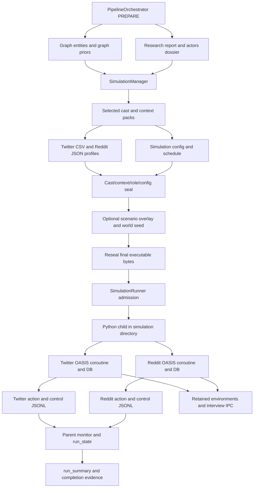
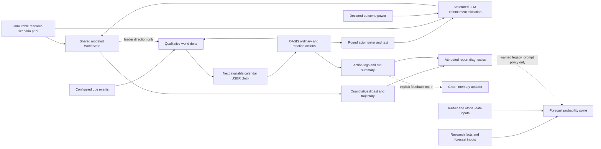
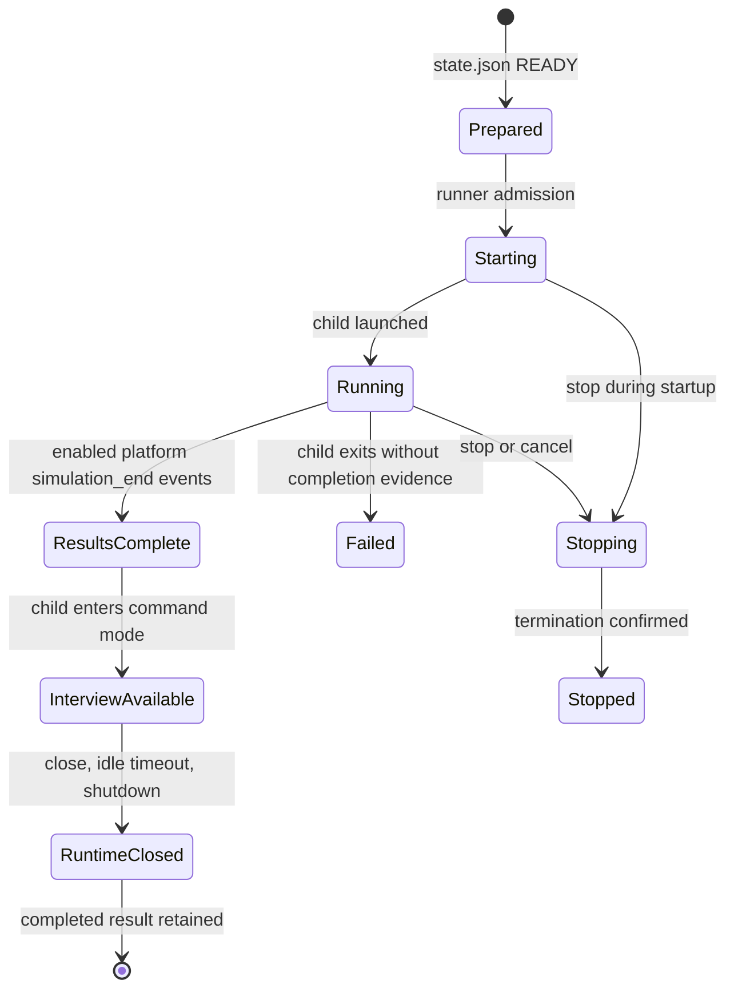

# Simulation architecture

**Source:** committed main `72545c65d8dbaee40e1c1e71e9909ab4741c7b9f`, frozen mirror `/tmp/drf-main-study-20261016-72545c65d8db`.
**Status:** Complete source study. All three delegated readers returned terminal results; their recovered final receipts are integrated below. All references are relative to the frozen mirror. No application imports, execution, provider/network calls, tests, saved-run mutation, Git/index changes, or application edits were performed.

## Scope and progress

The simulation owner has 12 application files and 19,844 lines. All assigned lines have complete source-read coverage, with primary/delegated ranges retained in `simulation-coverage.json`. All 22 receipt file hashes were recomputed from the frozen mirror and matched the current inventory. Full means complete source reading, including delegated reading where identified, rather than inventory or AST processing. Supplemental caller/consumer files remain partial except the fully inspected model-factory helper and separate calendar test source. Three children completed: Wegener (parallel runtime), Epicurus (config), and Dewey (standalone scripts/logger/dynamics); all were closed after receipt preservation.

Navigation: [diagrams](#source-linked-diagrams), [preparation](#main-entry-points-and-preparation-contracts), [configuration](#configuration-generation-and-evidence-inputs), [parallel runtime](#parallel-runtime-rounds-models-and-diagnostics), [standalone scripts](#standalone-platform-scripts-and-action-logger), [recovery](#parent-process-live-state-and-recovery), [consumers](#action-log-consumers-graph-memory-and-report-diagnostics), [IPC](#file-ipc-and-decision-channel-are-separate-mechanisms), [world state](#world-state-details-and-producer-differences), [limits](#defaults-compatibility-and-verification-limits).

## Principal boundary facts

1. **Preparation seals executable input.** `build_simulation_config_seal()` binds exact and canonical config hashes to simulation identity plus cast, context, and platform-role manifest hashes. `validate_simulation_config_seal()` checks those bytes and bindings; historical unsealed configurations remain possible when the caller does not require sealing (`backend/app/services/simulation_manager.py:52–221`). Dossier actors without graph nodes receive deterministic stand-in entities; ineligible/context rows remain explicit exclusions (`backend/app/services/simulation_manager.py:224–318`).

2. **Parallel means one subprocess with two asynchronous OASIS environments.** The service selects the parallel script and passes config, optional seal SHA, round limit, and admitted resume flag; it redirects output to `simulation.log` and records process identity (`backend/app/services/simulation_runner.py:873–976`). The script runs Twitter and Reddit coroutines through `asyncio.gather(..., return_exceptions=True)` with separate graphs, models, environments, databases, and action loggers (`backend/scripts/run_parallel_simulation.py:5916–5943`). A platform exception is isolated into a missing platform result; completion is subsequently assessed by the parent.

3. **Prepared inputs become runtime roles and actions.** Twitter loads CSV profiles and Reddit JSON profiles. Reddit has canonical actor-message replacement and exact composition attestation in `reddit_runtime_system_messages.json`, after optional behavior hints and before execution (`backend/scripts/run_parallel_simulation.py:559–697`, `backend/scripts/run_parallel_simulation.py:4731–4746`, `backend/scripts/run_parallel_simulation.py:5267–5324`). Config seals are revalidated in the child, and the exact parsed config bytes are checked (`backend/scripts/run_parallel_simulation.py:1270–1345`, `backend/scripts/run_parallel_simulation.py:5841–5850`).

4. **Action evidence has several producers.** Initial posts and follows, scheduled posts, autonomous OASIS actions, helper-agent thread reactions, and optional sampled likes are distinct. Ordinary actions come from the SQLite trace cursor and are enriched with platform rows; control/action records go to per-platform JSONL (`backend/scripts/run_parallel_simulation.py:1348–1719`, `backend/scripts/run_parallel_simulation.py:2460–2588`, `backend/scripts/run_parallel_simulation.py:4501–4682`, `backend/scripts/run_parallel_simulation.py:5008–5189`). Sampled likes are counted/logged but are not appended to the `actual_actions` supplied to in-band world evolution (`backend/scripts/run_parallel_simulation.py:3977–4066`, `backend/scripts/run_parallel_simulation.py:5165–5182`).

5. **Calendar rounds and hours rounds are different contracts.** Calendar mode uses prepared date periods/n_rounds and preserves its horizon against a positive runtime round limit. Hours mode uses total hours/minutes-per-round and applies an explicit positive limit (`backend/scripts/run_parallel_simulation.py:2591–2623`). Calendar activation includes principal agents outside the ordinary sample quota; daily active-hour gating belongs to hours mode (`backend/scripts/run_parallel_simulation.py:1738–1875`). Calendar world-clock text is appended as USER memory; optional dynamics uses SYSTEM memory (`backend/scripts/run_parallel_simulation.py:1886–2020`).

6. **In-band world evolution is shared but is not a lockstep round barrier.** One evolution object per absolute simulation directory merges round deliveries and waits for platform watermarks before evolving pending rounds. Empty/failed rounds send heartbeats; each platform can proceed with the latest available qualitative delta (`backend/scripts/run_parallel_simulation.py:3380–3572`, `backend/scripts/run_parallel_simulation.py:5071–5075`, `backend/scripts/run_parallel_simulation.py:5179–5182`). It elicits scenario/magnitude/confidence decisions through the shared decision channel, weighted by outcome power rather than activation influence (`backend/scripts/run_parallel_simulation.py:3574–3623`, `backend/app/services/decision_channel.py:216–340`, `backend/app/services/decision_channel.py:350–439`).

7. **World-state shares are model projections.** `WorldState` normalizes seeded scenario shares, defaults to an explicitly labeled uniform prior, blends resource-weighted commitments with inertia, and optionally mixes toward the immutable seed prior. Failed/missing/silent/infeasible rounds freeze shares and convergence EWMA. Convergence requires a settled EWMA, at least three valid transitions, at least 0.5 valid coverage, and zero failed rounds (`backend/app/services/worldstate.py:59–78`, `backend/app/services/worldstate.py:130–281`). `outcome()` carries round accounting and `epistemic_status="elicited_model_projection"` (`backend/app/services/worldstate.py:283–304`).

8. **Agent-facing deltas are qualitative.** `build_world_delta()` formats scheduled events, up to five action texts ranked by supplied influence, and a direction-only leader momentum line, capped at 900 characters. It never formats the numerical share fields; quantitative state is persisted separately (`backend/app/services/world_delta.py:21–80`). This is a formatter contract, not validation of arbitrary incoming text.

9. **Forecast authority is downstream and separate.** Post-hoc replay is gated by the raw `SIM_DECISION_CHANNEL` environment value, existing seed scenarios, and absence of a successful in-band trajectory. Its actual log reader passes identities/rounds, not action text or affect (`backend/scripts/run_parallel_simulation.py:3264–3289`, `backend/scripts/run_parallel_simulation.py:5972–6026`). Post-hoc validity can force `no_update`; other results remain diagnostic-only, without promotion to `validated_update` (`backend/app/services/decision_channel.py:721–775`). The report consumer suppresses no-update signals and ordinarily passes an empty simulation signal pack into probability generation; only its warned `legacy_prompt` branch supplies one (`backend/app/services/report_agent.py:3697–3794`, `backend/app/services/report_agent.py:4180–4239`).

10. **Result completion and process lifetime are distinct.** Platform `simulation_end` events let the parent mark results complete while the child remains alive for interviews. Enabled platforms must all emit completion; a zero process exit without required end events becomes failed (`backend/app/services/simulation_runner.py:1053–1112`, `backend/app/services/simulation_runner.py:1187–1221`). After simulation, IPC command mode handles explicit interview ManualActions, batches, status, and close requests until shutdown/idle timeout (`backend/scripts/run_parallel_simulation.py:840–1267`, `backend/scripts/run_parallel_simulation.py:6028–6090`).

11. **Checkpoint recovery is partial-state continuation.** Parallel checkpoints include completed round, trace cursor, total rounds/actions, normalized config hash, and RNG state. Admitted resume keeps the DB, skips seed/follow injection, advances to the next round, and attempts RNG restore. It does not restore prior process actor conversation memory or in-memory world evolution (`backend/scripts/run_parallel_simulation.py:3747–3863`, `backend/scripts/run_parallel_simulation.py:4792–4851`, `backend/scripts/run_parallel_simulation.py:4992–5001`, `backend/app/services/simulation_runner.py:761–786`). Fresh service starts rotate enumerated prior-run artifacts (`backend/app/services/simulation_runner.py:1289–1337`).

## Test-source evidence inspected separately

The delegated parallel reader fully inspected `backend/tests/test_calendar_round_loop.py:1–547`. It uses the real Twitter coroutine with fake graph/model/environment components and temporary SQLite trace rows; its assertions cover calendar activation/clock, in-band artifacts, dead-round checkpoints, resume, and hours behavior. These are test-source assertions; no tests were run, and this harness does not establish parent subprocess startup, live OASIS/provider behavior, dual-platform gather, or canonical Reddit attestation (`backend/tests/test_calendar_round_loop.py:40–140`, `backend/tests/test_calendar_round_loop.py:202–248`, `backend/tests/test_calendar_round_loop.py:282–547`).

## Explicit uncertainties

- Complete assigned source coverage does not establish live OASIS/CAMEL runtime behavior or successful execution of any provider path.
- Frozen source describes default/configuration branches, not a verified deployed OASIS/CAMEL version, runtime overlay, environment, successful provider call, saved-run state, or published forecast.
- Cross-owner research/graph/report details are limited to targeted callers/consumers read here; the coordinator must reconcile them with those owners' reports.

## Source-linked diagrams

### Preparation and execution spine

Diagram anchors: research-generation binding and graph-prior/config inputs are at `backend/app/services/pipeline_orchestrator.py:13364–13424`; preparation context/profile/config work is at `backend/app/services/simulation_manager.py:927–1178`, with closure validation at `backend/app/services/simulation_manager.py:1223–1302`. Overlay/seed mutation and resealing are at `backend/app/services/pipeline_orchestrator.py:13457–13530`. Parent dispatch and process construction are at `backend/app/services/simulation_runner.py:873–976`; dual-coroutine construction is at `backend/scripts/run_parallel_simulation.py:5916–5943`; log consumption/completion is at `backend/app/services/simulation_runner.py:1149–1287`. Summary and the pipeline completion-evidence gate are at `backend/app/services/pipeline_orchestrator.py:13702–13739`.

Open frozen source: [PREPARE inputs](/tmp/drf-main-study-20261016-72545c65d8db/backend/app/services/pipeline_orchestrator.py:13364), [prepared authority](/tmp/drf-main-study-20261016-72545c65d8db/backend/app/services/simulation_manager.py:927), [process launch](/tmp/drf-main-study-20261016-72545c65d8db/backend/app/services/simulation_runner.py:873).

### Action, world-state and forecast boundaries

Diagram anchors: active-roster power separation is at `backend/app/services/decision_channel.py:350–439`; elicitation is at `backend/app/services/decision_channel.py:173–340`. In-band deliveries and state stepping are at `backend/scripts/run_parallel_simulation.py:3452–3689`. Quantitative finalization is at `backend/scripts/run_parallel_simulation.py:3508–3551`; the qualitative formatter is at `backend/app/services/world_delta.py:21–80`. Report diagnostic attribution is at `backend/app/services/report_agent.py:3777–3794`; normal forecast-spine inputs exclude simulation signals at `backend/app/services/report_agent.py:4180–4239`. Optional graph feedback is requested and initialized at `backend/app/services/simulation_runner.py:853–871`, consumed at `backend/app/services/simulation_runner.py:1277–1280`, and gated by the main caller at `backend/app/services/pipeline_orchestrator.py:13586–13592`.

Open frozen source: [world evolution](/tmp/drf-main-study-20261016-72545c65d8db/backend/scripts/run_parallel_simulation.py:3452), [power separation](/tmp/drf-main-study-20261016-72545c65d8db/backend/app/services/decision_channel.py:350), [forecast input policy](/tmp/drf-main-study-20261016-72545c65d8db/backend/app/services/report_agent.py:4180).

### Result and resource lifecycles

The diagram intentionally shows two kinds of state. `ResultsComplete` is the runner result terminal state; `InterviewAvailable`/`RuntimeClosed` describe the retained child resource. Completion is published from control events (`backend/app/services/simulation_runner.py:1187–1221`). Later process exit preserves existing terminal results (`backend/app/services/simulation_runner.py:1053–1112`); shutdown cleanup does likewise (`backend/app/services/simulation_runner.py:2423–2468`). IPC command mode and idle-close live at `backend/scripts/run_parallel_simulation.py:6028–6090`. Confirmed stop becomes STOPPED, while inability to confirm termination becomes FAILED (`backend/app/services/simulation_runner.py:1665–1718`).

Open frozen source: [completion events](/tmp/drf-main-study-20261016-72545c65d8db/backend/app/services/simulation_runner.py:1187), [terminal result retention](/tmp/drf-main-study-20261016-72545c65d8db/backend/app/services/simulation_runner.py:1053), [command-mode resource lifetime](/tmp/drf-main-study-20261016-72545c65d8db/backend/scripts/run_parallel_simulation.py:6028).

## Main entry points and preparation contracts

The main full-pipeline caller creates both platforms, passes the final research report as `document_text`, the actors dossier, optional `graph_priors.json`, provider-dependent profile concurrency, `max_rounds`, and research language into `prepare_simulation()`. It also binds the consumed research generation to the newly created simulation; binding conflicts propagate, while other official-data binding errors are recorded as unavailable. This source trace does not inspect or refresh that research generation (`backend/app/services/pipeline_orchestrator.py:13364–13424`).

The explicit simulation API accepts `twitter`, `reddit`, or `parallel`; validates a positive `max_rounds`; defaults `enable_graph_memory_update` to false; can stop/clean an already prepared simulation under `force`; and calls the same runner. It reports requested versus successfully initialized feedback separately (`backend/app/api/simulation.py:1540–1678`). The pipeline's normal launch always selects `parallel`; its feedback decision uses a pinned safety policy (`backend/app/services/pipeline_orchestrator.py:13577–13592`). These are observed callers, not a claim that all service methods are reachable only through those callers.

The manager creates `sim_<12 hex>` IDs and per-simulation directories under `backend/uploads/simulations`. Its `state.json` carries project/graph identity, enabled platforms, preparation status/counts, role/context contract versions and fingerprints, exact executable-config fingerprints, timestamps, and error text. It has a process-local cache; saves are atomic under the shared runner lock. A manager object loading a cached state does not re-read disk on every getter (`backend/app/services/simulation_manager.py:620–824`, `backend/app/services/simulation_manager.py:826–860`).

Preparation proceeds in the following source order:

1. Set PREPARING and read graph entities filtered by defined types with relationship enrichment. Create missing eligible dossier-actor stand-ins, then select the agent pool. Current `actor-intelligence/v1`, recognized at the dossier root or actor-row intelligence, admits only distinct eligible matched actors, ignoring both legacy maximum controls. Unversioned dossiers retain the main-cast/legacy capped selection and all-context safety fallback. Graph centrality can influence ranking; it does not independently become an actor identity (`backend/app/services/simulation_manager.py:224–599`, `backend/app/services/simulation_manager.py:906–940`).
2. Write `actor_cast_manifest.json` with dossier hash, eligibility/candidate/selection/exclusion decisions, selected names/count, and entity identity. Any eligible dossier actors missing from the selected cast cause an error (`backend/app/services/simulation_manager.py:941–975`).
3. Compile and validate exact actor research-context artifacts **before** persona generation. The state stores context count, manifest/report/actors hashes and contract version; zero filtered entities becomes FAILED with a stored error (`backend/app/services/simulation_manager.py:978–1030`). Context-pack internals belong to the graph/actor area; this owner traces their producer invocation, fingerprints, and consumers.
4. Generate profiles with graph retrieval, optional LLM enhancement, parallel count, actors, and exact context packs. English research requests English personas. Prefer Reddit JSON for incremental profile saving when enabled; final outputs include each enabled platform. Require generated role count to equal selected actor count (`backend/app/services/simulation_manager.py:1043–1136`).
5. Generate config from the same entities, report, actors/context packs, platform flags, round budget, and language. Optional audience configurations have corresponding rule-built personas appended in the same index order; audience-generation errors are logged and skipped (`backend/app/services/simulation_manager.py:1165–1221`).
6. Atomically write `simulation_config.json`, validate context/role coverage and enabled-platform role manifests, create/validate the config seal, then set READY. Scripts remain in `backend/scripts`; the old step description about copying scripts is not the implementation. Exceptions store FAILED and error text, then re-raise (`backend/app/services/simulation_manager.py:1223–1316`).

`simulation-config-manifest/v1` records simulation identity, the executable filename, its exact-byte SHA-256, its canonical-JSON SHA-256, and `{file,sha256}` bindings for cast/context and platform-role manifests. Discovered cast/context authorities are included even without supplied expected hashes. Validation checks canonical filename/schema, identity, exact/canonical config hashes, and bound upstream bytes (`backend/app/services/simulation_manager.py:35–221`). Completed preparation validation discovers adjacent role/context evidence and requires state-bound fingerprints for current contracts while retaining a genuinely legacy unsealed path (`backend/app/services/simulation_manager.py:1352–1452`).

The main caller may mutate config with a deterministic scenario overlay or a research-derived world-state seed; it then calls `reseal_simulation_config()` before completing PREPARE. Calendar config supplies final horizon metadata. Already completed/reusable simulation results skip these mutation blocks, preserving their config generation (`backend/app/services/pipeline_orchestrator.py:13427–13540`; `backend/app/services/simulation_manager.py:1318–1350`).

## Configuration generation and evidence inputs

`SimulationConfigGenerator.generate_config()` returns `SimulationParameters`; the manager owns executable-file persistence. Top-level serialization contains simulation/project/graph identity, requirement, time settings, agent rows, event settings, fixed platform configs, provider/model/base URL, dossier cutoff, and generation metadata. Optional `world_brief`, `temporal_config`, and output language are omitted when empty. Agent rows include activity/frequencies/active hours/delays, sentiment, stance, activation influence, topics, incentives, context-projection digest, separate evidence-gap audit, urgency and cadence. Events include initial posts, scheduled events, topics, narrative direction and follows (`backend/app/services/simulation_config_generator.py:193–407`, `backend/app/services/simulation_config_generator.py:423–470`, `backend/app/services/simulation_config_generator.py:784–809`). These shapes describe generated inputs rather than proof that every serialized presentation field affects OASIS.

Generation constructs shared context, time/timeline, events/world brief, agent batches of at most 15, seed publishers, optional audience rows, cadence, follows, schedules and platform settings (`backend/app/services/simulation_config_generator.py:533–809`). The source has materially different canonical and legacy paths:

| Boundary | Canonical actor-intelligence path | Legacy/unversioned path |
|---|---|---|
| Private actor inputs | Requires a sealed actor-context pack matching schema, actor identity/name, intelligence hash and provenance; cross-actor shared authority checks the complete dossier fingerprint (`backend/app/services/simulation_config_generator.py:1396–1504`). | Shared context uses sanitized/delimited requirement, entity summaries, brief, actor digest, forecast inputs and bounded document text (`backend/app/services/simulation_config_generator.py:2214–2352`). |
| Shared evidence | Public source-bound claims exclude analyst inference, preserve uncertainty labels, and obey explicit `actor_knows=false` vetoes across normalized identities/text. Public relationships/events match sealed row fingerprints; events require date/text/sources/public visibility and behavioral evidence (`backend/app/services/simulation_config_generator.py:1506–1795`). | Actor context and graph summaries can inform shared config context; actor stances and graph neighbors can seed content and follows (`backend/app/services/simulation_config_generator.py:2214–2352`, `backend/app/services/simulation_config_generator.py:1142–1337`, `backend/app/services/simulation_config_generator.py:2762–3025`). |
| Activity rows | Skips batch LLM generation and uses neutral deterministic activity 0.5, posts 0.5/hour, comments 1/hour, influence 1.0, neutral stance/zero sentiment, plus context-derived topics. Defensive unmatched nodes receive `Unbound Actor <id>`/`Actor` (`backend/app/services/simulation_config_generator.py:3038–3169`). Main current-dossier manager admission already rejects unrelated graph nodes (`backend/app/services/simulation_manager.py:483–522`). | LLM rows match integer ID, then position, then entity-type rules. Researched influence is enforced after LLM/rules; optional stance fallback classifies dossier stance when needed. Statistics distinguish LLM/rule batches and agents (`backend/app/services/simulation_config_generator.py:3232–3414`, `backend/app/services/simulation_config_generator.py:3925–4071`). |

The behavior projection is a bounded 1,800-character view prioritizing incentives and retaining complete bounded intelligence/public-relationship/provenance/urgency/epistemic items. A separate typed evidence-gap audit has its own 65,536-byte budget/hash and is removed from the behavior view. `gains_if`/`loses_if` reach saved rows for the decision channel. This file does not itself implement a calibrated decision result or executable action union (`backend/app/services/simulation_config_generator.py:3334–3386`, `backend/app/services/simulation_config_generator.py:3455–3504`, `backend/app/services/simulation_config_generator.py:3650–3895`).

Calendar config generation resolves horizon deterministically, then through a bounded LLM date fallback, then a configurable month default. LLM dates must follow cutoff and be within 30 years. Round budgets choose timeline granularity; calendar mode skips LLM time generation and writes compatibility values `total_simulation_hours=n_rounds`, `minutes_per_round=60`. Timeline construction errors fall back to hours. Calendar scheduling maps events to date intervals, retains beyond-horizon events, warns on unparsed dates and prefixes dates in scheduled text; hours scheduling uses execution-budget-constrained rounds (`backend/app/services/simulation_config_generator.py:546–589`, `backend/app/services/simulation_config_generator.py:940–1140`).

Hours-mode time parsing coerces/clamps duration to 24–168 hours and round length to 30–120 minutes, adjusts activation bounds, and supplies profile-specific hours/multipliers. China social, US business and global market profiles exist; unknown profiles use China social, while English research selects global market if no explicit profile environment value exists. LLM config calls have up to three attempts, reduced temperatures, parsing/repair and backoff; time errors yield defaults, event errors empty content, and legacy agent errors rule rows (`backend/app/services/simulation_config_generator.py:113–190`, `backend/app/services/simulation_config_generator.py:502–519`, `backend/app/services/simulation_config_generator.py:2354–2582`, `backend/app/services/simulation_config_generator.py:2749–2760`, `backend/app/services/simulation_config_generator.py:3237–3299`).

Empty initial-post lists can be filled from canonical public evidence or legacy actor stances. Publisher matching considers name/type/aliases and then highest influence. Canonical follows use sealed public relationships; legacy follows can include graph neighbors, stance/topic clusters, influence bridges and optional valenced relationships. Principal cadence selects influential eligible nonaudience actors, capped at 20, with a guard preserving a sampled tier for a larger otherwise-all-principal cast (`backend/app/services/simulation_config_generator.py:821–938`, `backend/app/services/simulation_config_generator.py:1142–1337`, `backend/app/services/simulation_config_generator.py:2762–3025`).

Legacy world briefs include question/situation/topics and optional top-five market pricing plus historical official data; canonical briefs use public source-bound claims and official statistics. Statistical blocks preserve delimiters/whole rows within the shared budget. Optional audience generation defaults locally to zero, supports the old size name, caps at 5,000, uses an independent seeded RNG, and assigns contiguous synthetic IDs with sampled activity/stance/topics/influence (`backend/app/services/simulation_config_generator.py:1339–1394`, `backend/app/services/simulation_config_generator.py:1797–2212`, `backend/app/services/simulation_config_generator.py:4073–4281`). Official-data retrieval/generation is outside this module's ownership; this is the consumption of available stored context, not evidence of a live data fetch.

## Parallel runtime rounds, models and diagnostics

`run_parallel_simulation.py` imports CAMEL/OASIS and project model helpers after process setup and conditional environment loading, before `main()` validates prepared config. The child admission then validates the seal and hashes the exact config bytes it parses before calling a platform coroutine. Twitter consumes CSV/non-boost model settings; Reddit consumes JSON/boost settings. Missing profiles return an empty platform container; startup includes free-space rejection and an advisory index/agent-ID consistency warning (`backend/scripts/run_parallel_simulation.py:32–207`, `backend/scripts/run_parallel_simulation.py:1270–1345`, `backend/scripts/run_parallel_simulation.py:4731–4746`, `backend/scripts/run_parallel_simulation.py:5267–5281`, `backend/scripts/run_parallel_simulation.py:5827–5906`). Service requests for standalone platforms dispatch separate scripts; this parallel file's own `--twitter-only`/`--reddit-only` direct CLI modes still use its richer coroutines (`backend/scripts/run_parallel_simulation.py:5916–5943`; `backend/app/services/simulation_runner.py:873–888`).

The model wrapper delegates to `create_oasis_model()`: provider resolution is environment, serialized config, `Config`, then CLI fallback. CLI providers use `CLIModel`; other providers use CAMEL OpenAI-compatible models with general/boost settings, an empty-response guard and optional provider headers/reasoning configuration. Eligible direct-path content-filter/rate/quota failures can fall back through `LLMClient`; if fallback fails, the original exception is rethrown. Successful fallback may append `llm_fallback.jsonl`. CLI/text action-tool emulation turns recognized JSON tool choices into completion tool calls and degrades unrecognized output to text; it does not re-emulate after tool-result messages (`backend/scripts/run_parallel_simulation.py:1722–1735`; `backend/app/utils/oasis_llm.py:60–146`, `backend/app/utils/oasis_llm.py:264–451`, `backend/app/utils/oasis_llm.py:481–616`). The underlying `LLMClient` provider retry implementation and actual provider behavior were not read/executed here.

Each coroutine creates its own OASIS environment, DB, graph and logger. Autonomous action unions omit INTERVIEW; IPC constructs that manual action explicitly (`backend/scripts/run_parallel_simulation.py:210–241`, `backend/scripts/run_parallel_simulation.py:988–995`, `backend/scripts/run_parallel_simulation.py:4809–4819`, `backend/scripts/run_parallel_simulation.py:5362–5372`). Optional role policies restrict registered actions/hints per agent, defaulting off; canonical Reddit runtime message replacement then composes only allowed world-brief/calendar blocks and attests effective bytes against role/config authority (`backend/scripts/run_parallel_simulation.py:403–793`, `backend/scripts/run_parallel_simulation.py:5283–5324`). This is an observed Reddit message boundary, not an attestation of equivalent Twitter internals.

`SIM_WIRE_RECSYS=false` does not by itself imply the Twitter default platform type: the separate true-default model-free Twitter-feed branch attempts a Platform with Reddit-style recommender settings, with fallback to the default platform type on construction failure. Explicit wiring consumes configured feed lengths/recommender, echo strength and parsed start date; presentation weights such as recency/popularity/relevance and viral threshold are not consumed by this builder (`backend/scripts/run_parallel_simulation.py:2626–2743`).

Fresh startup manually logs/injects seeds, adds initial graph-follow edges and executes capped manual follow passes, then consumes startup trace rows at round 0. Scheduled posts use prepared zero-based round buckets before ordinary activation. Ordinary DB extraction advances an increasing trace-row cursor, including across filtered refresh/sign-up rows, and enriches retained actions with post/comment/user/target data without content truncation (`backend/scripts/run_parallel_simulation.py:1348–1719`, `backend/scripts/run_parallel_simulation.py:2460–2588`, `backend/scripts/run_parallel_simulation.py:4861–4937`, `backend/scripts/run_parallel_simulation.py:5414–5488`). Manually logged seed/scheduled rows are consumed to avoid later ordinary-action recounting. Configured due events used by world-clock/evolution remain a different signal from the successful scheduled-action count (`backend/scripts/run_parallel_simulation.py:5037–5048`, `backend/scripts/run_parallel_simulation.py:5083–5092`).

The round sequence is shutdown/time/free-space check; scheduled-event firing; activation and round-start; dynamics/calendar-clock injection; `env.step(LLMAction)`; DB action extraction; optional thread-reaction helper; dynamics observation; optional sampled likes; in-band evolution; round-end and checkpoint. Empty rounds instead log zero action, heartbeat evolution and checkpoint. Consecutive `env.step` failures of the same exception class become a hard failure at the default limit of three; ordinary failures before that are logged, heartbeat and checkpointed (`backend/scripts/run_parallel_simulation.py:3866–3889`, `backend/scripts/run_parallel_simulation.py:5008–5189`, `backend/scripts/run_parallel_simulation.py:5559–5740`).

Hours activation combines active-hour eligibility, time multipliers, activity and normalized influence plus recency. Weighted sampling is without replacement; calendar mode removes the daily-hour gate and prepends every prepared principal outside the ordinary sampled quota. Missing generated graph agents are skipped. `SIM_SEED` seeds a shared process RNG when valid; it does not alone establish end-to-end deterministic LLM/async outcomes (`backend/scripts/run_parallel_simulation.py:98–114`, `backend/scripts/run_parallel_simulation.py:1738–1875`). The calendar clock uses USER memory with period/horizon/due events/output language/latest qualitative delta; dynamics injects a separate SYSTEM memory block (`backend/scripts/run_parallel_simulation.py:1886–2020`).

The true-default reaction phase ranks recent candidate threads using mentions, prior participation, topical interests, follows, stance, recency and dispersion. A new helper ChatAgent shares actor identity/model/tool bindings but has separate memory, one iteration, a 240-second timeout, and comment/like tools rather than standalone posting. Extracted reactions join ordinary actions and a short note returns to the original actor memory (`backend/scripts/run_parallel_simulation.py:4091–4135`, `backend/scripts/run_parallel_simulation.py:4260–4689`). Optional sampled engagement is separate manual likes; `auto` disables it when reactions are on. Sampled rows are marked and counted, but not added to in-band `actual_actions` (`backend/scripts/run_parallel_simulation.py:3897–3916`, `backend/scripts/run_parallel_simulation.py:3977–4066`, `backend/scripts/run_parallel_simulation.py:5165–5182`).

Tool-argument normalization drops unsupported keys and handles selected aliases; the self-like guard checks DB authorship but proceeds when target information cannot be resolved. These are best-effort tool wrappers installed in both rich platform paths (`backend/scripts/run_parallel_simulation.py:2318–2457`, `backend/scripts/run_parallel_simulation.py:4773–4783`, `backend/scripts/run_parallel_simulation.py:5326–5336`).

The pure dynamics tracker initializes bounded mood, opinion strength, energy and fatigue from config. Positive/negative received attention shifts mood; received attention increases opinion strength; own activity increases fatigue with per-round decay and complementary energy. Rendered state appears at thresholds. `extract_round_signals()` maps the first available target-name field through `name_to_id`; `dynamics_summary.active` means a received-interaction signal was observed in at least one round, **not** an attestation that a model received the injected state (`backend/app/services/agent_dynamics.py:39–231`). Other pure helpers provide organic action classification, weighted non-self likes, seed-follow caps, broadcast-only streak detection and simulated-hours calculation (`backend/app/services/agent_dynamics.py:231–405`). Runtime tracker initialization/injection/observation failures are contained; available platform summaries are included by the parent (`backend/scripts/run_parallel_simulation.py:1886–1937`, `backend/scripts/run_parallel_simulation.py:5202–5216`; `backend/app/services/simulation_runner.py:2149–2213`).

Diagnostics include platform model call/error rates in `llm_health.json`, process token/error/source/model/elapsed/run-token accounting in `sim_llm_telemetry.json`, optional dynamics summaries, and false-default emergent metrics. Emergent `final_stance_share` counts speech under configured stance labels; cascade depth is the direct count of replies/reposts/likes, separate from modeled scenario commitments. Usage source can be provider, estimate or missing; these are telemetry categories rather than billing evidence (`backend/scripts/run_parallel_simulation.py:2047–2308`, `backend/scripts/run_parallel_simulation.py:2792–3252`, `backend/scripts/run_parallel_simulation.py:5954–5970`). Main writes usage after platform loops and again during final cleanup; later instrumented decision/interview work can therefore change the final snapshot (`backend/scripts/run_parallel_simulation.py:5949–5952`, `backend/scripts/run_parallel_simulation.py:6101–6154`).

Parallel checkpoints contain completed round, trace cursor, planned rounds/actions, config hash and RNG state. Accepted continuation keeps the DB, skips startup seeds/follows, resumes the next round, advances cursor to at least the existing DB maximum and attempts RNG restore. The new process does not restore prior actor conversations or its predecessor's in-memory evolution state; a new evolution object starts from the seed (`backend/scripts/run_parallel_simulation.py:3380–3442`, `backend/scripts/run_parallel_simulation.py:3747–3863`, `backend/scripts/run_parallel_simulation.py:4792–4851`, `backend/scripts/run_parallel_simulation.py:4992–5001`). Shutdown first sets an event, and subsequent handled signal invokes exit; calendar convergence does not terminate the calendar loop (`backend/scripts/run_parallel_simulation.py:3624–3689`, `backend/scripts/run_parallel_simulation.py:6101–6154`).

## Standalone platform scripts and action logger

The standalone Reddit/Twitter scripts are separate supported service entry points, not equivalent wrappers around the parallel file. They accept config/max-rounds/no-wait, load ordinary JSON, recreate their platform DB, and execute hours-formula rounds. Reddit uses JSON profiles/boost settings and a richer post/comment/search/refresh/follow/mute action set; Twitter uses CSV/non-boost and create/like/repost/quote/follow/inactivity. Both use the model-factory helper, generated graph and default platform environment (`backend/scripts/run_reddit_simulation.py:692–884`; `backend/scripts/run_twitter_simulation.py:692–902`). Parent admission still runs before a service launch, but standalone direct CLIs do not perform the rich parallel child's second config-seal/Reddit attestation path; only parallel receives `--config-seal` and resume (`backend/app/services/simulation_runner.py:773–786`, `backend/app/services/simulation_runner.py:907–921`; `backend/scripts/run_reddit_simulation.py:728–750`; `backend/scripts/run_twitter_simulation.py:721–742`).

Standalone activation uses hour eligibility, activity probability/time multipliers and random sampling. Round zero logs configured initial posts; Reddit accumulates multiple seed actions for an agent while Twitter assigns one dictionary entry per agent. DB extraction normalizes/enriches trace rows and advances across filtered rows; the initial seed trace is consumed after its manual log. Empty/failed rounds write zero-action endings and continue. These complete standalone reads contain no dynamics tracker, calendar world-clock/delta, in-band evolution or post-hoc decision calls (`backend/scripts/run_reddit_simulation.py:392–691`, `backend/scripts/run_reddit_simulation.py:750–986`; `backend/scripts/run_twitter_simulation.py:392–691`, `backend/scripts/run_twitter_simulation.py:742–996`). They may consume calendar compatibility values as hours fields but do not implement the rich calendar contract.

After `simulation_end`, standalone scripts normally wait for commands with retained env/graph, mtime-ordered JSON polling and matching response-file writes/deletion. Manual interviews read the latest interview trace; close/no-wait closes the environment. Their command loops have no idle-close timeout and do not share the parallel local cancellation-aware server's exact implementation (`backend/scripts/run_reddit_simulation.py:141–390`, `backend/scripts/run_reddit_simulation.py:987–1108`; `backend/scripts/run_twitter_simulation.py:141–390`, `backend/scripts/run_twitter_simulation.py:997–1117`).

`PlatformActionLogger` appends UTF-8 JSONL ordinary records `{round,timestamp,agent_id,agent_name,action_type,action_args,result,success}` plus control records for simulation/round start/end; platform comes from the directory. Calendar labels and cumulative simulated hours are optional logger parameters, omitted by standalone callers. Parallel uses signature filtering, so only fields accepted by this logger survive richer runtime period kwargs. `SimulationLogManager` supplies platform loggers to parallel main; the combined `ActionLogger`/`get_logger()` are compatibility interfaces rather than the active per-platform logging contract (`backend/scripts/action_logger.py:22–323`; `backend/scripts/run_parallel_simulation.py:1785–1799`, `backend/scripts/run_parallel_simulation.py:5858–5870`).

## Parent process, live state and recovery

`SimulationRunner` maintains process-local registries of run-state objects, child handles, queues, monitor threads, log handles and graph updaters. `run_state.json` supplies a durable projection with platform enable/completion flags, rounds/action counts, PID/PGID, graph feedback requested/active/error, truncation/resume provenance, optional calendar fields and recent actions. Scalar snapshots and recent-action changes use a per-state reentrant lock; saves are atomic under the shared class lock and can be throttled, but terminal states save immediately (`backend/app/services/simulation_runner.py:102–307`, `backend/app/services/simulation_runner.py:340–448`). The declared PAUSED enum is retained; the runner documents that it does not actively implement pause/resume transitions (`backend/app/services/simulation_runner.py:266–275`).

Startup rejects unsupported platforms, checks an apparently active saved run against an actually live/identity-matching process, and admits prepared cast/context/role/config authorities before launch. Adjacent prepared manifests are checked even for a platform not requested in this execution. Automatic checkpoint resume applies to parallel mode and an unfinished saved run with usable checkpoints; fresh starts rotate enumerated previous artifacts (`backend/app/services/simulation_runner.py:451–786`, `backend/app/services/simulation_runner.py:1289–1385`).

The child uses the backend process's `sys.executable`, an absolute script and config path, the simulation directory as CWD, copied environment plus UTF-8 settings, optional per-run `SIM_SEED` and resume flag. Only the parallel script gets `--config-seal` and checkpoint-resume behavior. Combined stdout/stderr go to `simulation.log`; `start_new_session=True` establishes a process group and PID/PGID are persisted. A daemon parent monitor follows per-platform JSONL offsets every two seconds (`backend/app/services/simulation_runner.py:873–1051`). This is source configuration, not verification of the interpreter/environment installed on a live host.

The monitor turns action records into `AgentAction {round_num,timestamp,platform,agent_id,agent_name,action_type,action_args,result,success}` and keeps the most recent 50 by default. `round_end` updates platform rounds/hours and the latest period end; overall round/hours use the maximum platform progress. `simulation_end` sets per-platform completion and permits COMPLETED only when all enabled platforms have completed and the state is STARTING/RUNNING. Late completion events do not promote STOPPING/STOPPED/FAILED (`backend/app/services/simulation_runner.py:48–72`, `backend/app/services/simulation_runner.py:133–134`, `backend/app/services/simulation_runner.py:189–202`, `backend/app/services/simulation_runner.py:1187–1287`).

At process exit, existing terminal results remain terminal. A zero exit without required end events becomes FAILED with a bounded log tail; unexpected monitor exceptions also fail. The monitor closes log/process registries and stops optional graph feedback, then marks IPC stopped after observed process exit (`backend/app/services/simulation_runner.py:988–1146`).

Recovery/resource cleanup has separate operations:

- **Stop:** accepts STARTING/RUNNING/PAUSED, writes STOPPING, terminates the process group/tree, and publishes STOPPED only on confirmed termination; uncertainty becomes FAILED. Known terminated runtimes get `env_status=stopped` (`backend/app/services/simulation_runner.py:1609–1730`).
- **Backend restart reclaim:** optionally probes the configured backend port before collecting persisted active states; on a new owner, checks recorded PID identity using script name plus simulation ID on Unix, uses a liveness fallback on Windows, terminates identified orphan groups, and records FAILED in both run/prepared state plus stopped IPC (`backend/app/services/simulation_runner.py:1418–1606`). App creation registers this outside TESTING/`DRF_TEST_PROCESS=1` (`backend/app/__init__.py:118–145`).
- **Fresh-run rotation/force cleanup:** rotation and cleanup cover explicit prior log/checkpoint/derived-output lists; force cleanup also removes platform DBs and run/env state while keeping config/profiles (`backend/app/services/simulation_runner.py:1289–1337`, `backend/app/services/simulation_runner.py:2300–2385`). This is an enumerated list, not a claim that every possible runtime file is removed.
- **Server shutdown:** marks active result lifecycles STOPPING before terminating children, preserves already terminal results when reclaiming command-mode resources, syncs prepared state and closes handles/updaters. Cleanup is idempotent within the process (`backend/app/services/simulation_runner.py:2387–2579`).

The main pipeline independently polls completion, handles cancellation, and has inline plus independent stall watchdogs. It always retires the watchdog on exit and records child telemetry on failure as well as success. When feedback was requested under pinned policy, it attempts a bounded monitor join and updater drain; timeout becomes a warning. It publishes a run summary and requires enabled-platform end evidence plus a valid summary before admitting RUN completion (`backend/app/services/pipeline_orchestrator.py:13593–13739`).

## Action log consumers, graph memory and report diagnostics

Complete action-history getters read platform JSONL with platform supplied by its directory, skip control/no-agent rows, tolerate JSON-decode failures, and fall back to the old combined `actions.jsonl` when no selected platform actions are found. Paging happens after full-history aggregation. Timeline and per-agent statistics use full history, aggregate action types and counts, and compare first/last timestamps; these are simulated activity summaries (`backend/app/services/simulation_runner.py:1733–2023`).

`run_summary.json` includes agent/action totals, organic/seed counts, real executed rounds, simulated hours, rounds with organic actions, health, peak round, top agents, round volumes, post samples, and optional communities/LLM health/dynamics/ratio warnings. `top_posts` is explicitly a chronological sample of up to 25 non-seed, non-scheduled posts/quotes, **not an engagement-ranked list**. Health prioritizes error, no organic activity, truncation, then optional LLM degradation. The organic-activity counter excludes round 0 and scheduled actions; the separate organic-ratio detector also excludes sampled likes. Calendar summaries add period count, actual coverage end, covered span days, horizon and horizon provenance. The hours compatibility metric is retained even in calendar mode; calendar span fields convey natural-date coverage (`backend/app/services/simulation_runner.py:2026–2298`).

Graph feedback is optional. Parent action-log consumption forwards raw action dictionaries only after updater creation succeeds (`backend/app/services/simulation_runner.py:853–871`, `backend/app/services/simulation_runner.py:1168–1172`, `backend/app/services/simulation_runner.py:1277–1280`). The updater ignores control records and DO_NOTHING, batches platform activities into episode text, retries graph writes, and optionally emits typed author/target edges. The inspected writer calls a graph-client facade; it does not put agents directly in the Graphiti process (`backend/app/services/zep_graph_memory_updater.py:320–448`, `backend/app/services/zep_graph_memory_updater.py:515–564`, `backend/app/services/zep_graph_memory_updater.py:655–689`). `SIM_GRAPH_FEEDBACK`, `SIM_TYPED_FEEDBACK_EDGES`, and `SIM_INTERVIEW_GRAPH_FEEDBACK` all declare false defaults; the pipeline additionally uses its pinned policy (`backend/app/config.py:1385–1392`; `backend/app/services/pipeline_orchestrator.py:13586–13592`). This report does not promote synthetic graph activity to observed evidence.

The report tool's `simulation_outcomes()` derives actor counts and round volumes directly from runner getters. `coalition_map()` uses shared interaction targets to build connected components. `interview_agents()` selects prepared profiles, generates/combines questions, calls `SimulationRunner.interview_agents_batch()` directly with a 600-second base timeout, combines platform answers with explicit platform labels, and returns structured interview objects. Optional interview graph persistence has its own false-default gate (`backend/app/services/zep_tools.py:1995–2170`, `backend/app/services/zep_tools.py:2457–2552`; `backend/app/services/zep_graph_memory_updater.py:566–596`).

The signal pack can include modeled world shares, activity tiers, coalitions and optional scenario differences, with explicit simulation attribution. Global `no_update` suppresses the pack. `_world_state_block()` displays model-projection labels, available validity warnings, dated waypoints and default-horizon disclosure. Normal forecast-spine derivation sets `signal_pack=""`; only the warned `legacy_prompt` policy supplies one. Research forecast inputs, market block and official quantitative facts are separate inputs to `derive_forecast_spine()` (`backend/app/services/report_agent.py:3697–3866`, `backend/app/services/report_agent.py:4180–4239`). These branches establish the source policy boundary; this study does not prove the wording or probability provenance of any generated report.

## File IPC and decision channel are separate mechanisms

The file IPC client produces UUID-named command JSON under `ipc_commands`, polls matching response JSON under `ipc_responses`, and returns `IPCResponse {command_id,status,result,error,timestamp}`. Supported commands are interview, batch interview and close; command payloads carry one `{agent_id,prompt,platform?}` or a list of interview items plus optional default platform. Timeout writes `.cancel`, removes any remaining command JSON and raises `TimeoutError`; new commands sweep old command/response/claim/cancel files using a timeout-derived age floor. `check_env_alive()` reads `env_status.json` rather than probing a process (`backend/app/services/simulation_ipc.py:81–184`, `backend/app/services/simulation_ipc.py:194–439`).

Optional `ipc_telemetry.jsonl` records command type, agent/platform, round-trip latency, result/timeout status, polling count and timeout budget. Its summarizer reports counts, timeout rates and p50/p95 overall/by-command; absent telemetry returns zero-valued structure, so an absent record does not establish that no interviews were attempted (`backend/app/services/simulation_ipc.py:36–62`, `backend/app/services/simulation_ipc.py:441–544`).

The reusable `SimulationIPCServer` claims a command by renaming it to `<id>.processing` and checks cancellation before/after claiming and before response. This is separate from the script-local servers used by the executable scripts; the parallel reader observed local mtime polling, cancellation checks, atomic-response writes with fallback, and cleanup rather than this reusable server's exact claim implementation (`backend/app/services/simulation_ipc.py:547–732`; `backend/scripts/run_parallel_simulation.py:823–957`). The client protocol is shared; server implementation details are not interchangeable.

Runner interview helpers check the environment marker, send the command, and convert completed/failed responses. Batch timeout scales upward with item count/provider concurrency; all-agent interview builds its item list from `agent_configs`. Close-env timeout is interpreted as potentially still closing and reported accordingly. Historical interviews are read from each platform DB's `trace` rows with action `interview`, then merged by timestamp (`backend/app/services/simulation_runner.py:2649–3021`). The decision channel instead makes its own structured LLM call over a round roster; it is not an IPC request to interview retained OASIS agents (`backend/app/services/decision_channel.py:216–340`).

## World-state details and producer differences

Scenario seed inputs are `{scenarios,base_rates,as_of_date?,horizon_date?}`. Activation influence ranks active-roster selection; only explicit outcome-power values populate the power map. Missing outcome power becomes declared-neutral 1.0 with `outcome_power_known=false`; overflow actors may become one `__public__` row whose power sums the tail. Prompt inputs optionally include incentives, action text and affect; the immutable seed shares, rather than evolving shares, anchor structured elicitation (`backend/app/services/decision_channel.py:58–114`, `backend/app/services/decision_channel.py:173–213`, `backend/app/services/decision_channel.py:350–439`).

Elicitation validates candidate scenario membership and distinguishes committed, explicit abstention, silent, failed/malformed, and missing-input results. `elicit_round()` writes the typed status into its mutable `period_ctx` and returns commitments carrying audit identity/round/confidence/magnitude/power plus computed weight. Weight is outcome power times clamped confidence; magnitude supplies the commitment's size in the state aggregation (`backend/app/services/decision_channel.py:216–340`; `backend/app/services/worldstate.py:81–119`, `backend/app/services/worldstate.py:203–231`).

The post-hoc path groups positive action rounds by distinct agent, caches elicitation by roster signature/date or calendar-period label, fans unique tasks into a bounded thread pool, and replays state serially in round order. Calendar records include period end and schema v3; hours retain schema v2. Date-gap inertia is clamped to 0.3–0.95; calendar entropy mixing returns toward the seed prior. It records a windowed convergence signal without shortening calendar replay (`backend/app/services/decision_channel.py:442–775`). The **actual child caller** passes round and actor identity from action logs; optional `posts_by_round`/`affect_by_agent` parameters are not supplied there (`backend/scripts/run_parallel_simulation.py:3264–3289`, `backend/scripts/run_parallel_simulation.py:5991–6026`).

The in-band calendar path merges ordinary/reaction actions and configured due events from participating platforms. Its pending-round watermarks determine when a round can evolve; platform loops do not await a strict shared barrier. Each completed step writes a quantitative digest row and supplies a bounded qualitative delta for subsequent available clocks. A finalization requires at least one successfully executed evolution step, which does not itself mean a valid commitment was obtained (`backend/scripts/run_parallel_simulation.py:3452–3689`).

The two trajectory producers share `WorldState` accounting but do not emit identical outer schemas. Post-hoc replay adds top-level `round_accounting`, `validity`, `forecast_effect`, and `epistemic_status`; invalid/inconclusive results force `no_update`, and valid results remain diagnostic-only unless policy requests no-update. The in-band finalizer writes outcome/trajectory/decisions/convergence/scenarios/calendar metadata; accounting and epistemic label are in its `outcome()`, while the post-hoc outer validity/effect fields are not constructed by this finalizer. Do not assume producer interchangeability from the common filename (`backend/app/services/decision_channel.py:721–775`; `backend/scripts/run_parallel_simulation.py:3508–3551`; `backend/app/services/worldstate.py:283–304`).

`WorldState.step()` freezes both shares and EWMA for uninformative typed statuses. Valid committed/abstained transitions update the normalized inertia blend and optional entropy floor `min(0.05,0.0005*days)`. Settled EWMA becomes convergence only after the frozen evidence guards; the returned accounting counts typed statuses separately (`backend/app/services/worldstate.py:159–304`). The qualitative formatter ranks supplied action texts; it omits numeric **model-share formatting**, but does not strip numbers embedded in event/post text (`backend/app/services/world_delta.py:21–80`).

## Persisted artifact index

Paths below are relative to a simulation directory unless another location is stated. Existence is conditional on the producing path; the index describes source producers and consumers, not files observed in a saved run.

| Artifact | Producer, payload and consumer |
|---|---|
| `state.json` | Manager preparation state/identities/platform flags/counts/context-role-config fingerprints; read by manager and runner admission (`backend/app/services/simulation_manager.py:620–824`; `backend/app/services/simulation_runner.py:497–759`). |
| `actor_cast_manifest.json` | Manager dossier fingerprint, per-actor eligibility/selection/entity decisions; config-seal/role/context closure admission (`backend/app/services/simulation_manager.py:941–1002`, `backend/app/services/simulation_manager.py:52–134`). |
| Actor context artifacts including `actor_context_manifest.json` | Invoked actor-context producer compiles research packs before profiles; manager stores expected report/actors/manifest hashes and runtime validates coverage (`backend/app/services/simulation_manager.py:978–1007`, `backend/app/services/simulation_manager.py:1242–1254`). Pack-file internals are the actor owner's scope. |
| `twitter_profiles.csv`, `reddit_profiles.json`, adjacent `*_profiles_roles.json` | Profile generator writes enabled-platform personas/role authority; rich runtime builds OASIS graphs, with Reddit effective-message attestation (`backend/app/services/simulation_manager.py:1081–1136`, `backend/app/services/simulation_manager.py:1255–1274`; `backend/scripts/run_parallel_simulation.py:4731–4746`, `backend/scripts/run_parallel_simulation.py:5267–5324`). |
| `simulation_config.json`, `simulation_config_manifest.json` | Manager executable config plus exact/canonical/upstream hashes; optional pipeline overlay/seed mutation reseals before RUN (`backend/app/services/simulation_manager.py:118–134`, `backend/app/services/simulation_manager.py:1223–1302`; `backend/app/services/pipeline_orchestrator.py:13457–13530`). |
| `reddit_runtime_system_messages.json` | Rich Reddit path attests deterministic effective system-message composition against current roles/config; diagnostic authority receipt, not itself a forecast (`backend/scripts/run_parallel_simulation.py:559–697`, `backend/scripts/run_parallel_simulation.py:5283–5324`). |
| `twitter_simulation.db`, `reddit_simulation.db` | OASIS platform state and trace/action/interview records; extraction/log enrichment and interview history consume them (`backend/scripts/run_parallel_simulation.py:1348–1719`, `backend/scripts/run_parallel_simulation.py:4809–4819`, `backend/scripts/run_parallel_simulation.py:5362–5372`; `backend/app/services/simulation_runner.py:2913–3021`). |
| `twitter/actions.jsonl`, `reddit/actions.jsonl` | Per-platform action/control append logs; parent progress/completion, complete-history summaries, report tools and post-hoc replay consume distinct subsets (`backend/scripts/action_logger.py:22–131`; `backend/app/services/simulation_runner.py:1149–1287`, `backend/app/services/simulation_runner.py:1733–1859`; `backend/scripts/run_parallel_simulation.py:3264–3289`). |
| `run_state.json` | Parent durable live/result projection, recent actions, enabled/completed flags, PID/PGID, feedback/recovery/calendar fields; API/orchestrator poll it (`backend/app/services/simulation_runner.py:102–263`, `backend/app/services/simulation_runner.py:340–448`; `backend/app/services/pipeline_orchestrator.py:13617–13655`). |
| `run_summary.json` | Parent full-history health/volume/organic/post-sample/calendar summary; pipeline publication/evidence admission and reporting consume it (`backend/app/services/simulation_runner.py:2026–2298`; `backend/app/services/pipeline_orchestrator.py:13702–13739`). |
| `<platform>/checkpoint.json` | Rich runtime completed-round/trace/config/RNG continuation carrier; parent checks resume availability and each rich coroutine checks its own DB/hash (`backend/scripts/run_parallel_simulation.py:3747–3863`, `backend/scripts/run_parallel_simulation.py:4792–4851`; `backend/app/services/simulation_runner.py:1357–1385`). |
| `world_digest.jsonl`, `world_state_trajectory.json`, `decisions.jsonl` | In-band quantitative round/state/decision artifacts; post-hoc can write the latter two with different outer validity/effect fields. Report renders model-projection diagnostics (`backend/scripts/run_parallel_simulation.py:3508–3551`, `backend/scripts/run_parallel_simulation.py:3624–3689`, `backend/scripts/run_parallel_simulation.py:5991–6026`; `backend/app/services/report_agent.py:3796–3866`). |
| `ipc_commands/`, `ipc_responses/`, `env_status.json` | File command/response protocol and interview-resource marker; parent/client and script-local servers participate (`backend/app/services/simulation_ipc.py:194–439`; `backend/scripts/run_parallel_simulation.py:840–957`, `backend/scripts/run_parallel_simulation.py:6028–6090`). |
| `ipc_telemetry.jsonl` | Optional best-effort round-trip diagnostic; summary uses count/status/timeout/latency, no probability authority (`backend/app/services/simulation_ipc.py:441–544`). |
| `llm_health.json`, `sim_llm_telemetry.json`, `llm_fallback.jsonl` | Model health, usage/source/run-token accounting, and optional fallback diagnostics; parent health/telemetry handling consumes relevant data (`backend/scripts/run_parallel_simulation.py:2047–2308`; `backend/app/utils/oasis_llm.py:264–376`; `backend/app/services/simulation_runner.py:2134–2147`; `backend/app/services/pipeline_orchestrator.py:13665–13671`). |
| `*_dynamics_summary.json`, optional `*_emergent_metrics.json`/`emergent_metrics.json` | Interaction-state and social-activity diagnostics; separate from scenario outcome commitments and published forecast probabilities (`backend/scripts/run_parallel_simulation.py:2792–3252`, `backend/scripts/run_parallel_simulation.py:5202–5216`, `backend/scripts/run_parallel_simulation.py:5954–5970`; `backend/app/services/simulation_runner.py:2149–2159`). |
| `simulation.log`, enumerated previous-run files | Parent combined child stdout/stderr; bounded failure tail and rotation/cleanup helpers consume them (`backend/app/services/simulation_runner.py:923–977`, `backend/app/services/simulation_runner.py:988–999`, `backend/app/services/simulation_runner.py:1289–1337`, `backend/app/services/simulation_runner.py:2300–2385`). |

## Defaults, compatibility and verification limits

| Source branch/default | What can be stated from frozen code |
|---|---|
| Calendar generation | `SIM_TEMPORAL_MODE` declares `calendar`; soft/hard round budgets are 36/48 and fallback horizon is 12 months. Runtime dispatch follows the serialized temporal block, preserving old hours configs (`backend/app/config.py:1063–1079`; `backend/app/services/simulation_runner.py:797–849`). |
| Dynamics | Config declares true, while older module/script comments describe default-off history; actual builder reads Config (`backend/app/config.py:1396–1399`; `backend/scripts/run_parallel_simulation.py:1886–1937`). |
| Decision execution | Config declares `SIM_DECISION_CHANNEL=true`; the post-hoc child's raw-environment gate defaults false when absent. Calendar in-band is a separate true-default gate requiring seed scenarios (`backend/app/config.py:1512–1518`; `backend/scripts/run_parallel_simulation.py:3692–3720`, `backend/scripts/run_parallel_simulation.py:5972–5986`). |
| Forecast effects | Declared default is diagnostic-only. Post-hoc rejects promotion to validated-update; report only forwards simulation signals under warned legacy-prompt policy (`backend/app/config.py:1519–1532`; `backend/app/services/decision_channel.py:742–749`; `backend/app/services/report_agent.py:4191–4204`). |
| Concurrency | Config declares CLI cap 8 and direct cap 24; the OASIS helper's environment-default direct cap is 30 and divides across platforms. Document the actual helper/caller rather than assuming Config's value was passed (`backend/app/config.py:1082–1091`; `backend/app/utils/oasis_llm.py:603–616`; `backend/scripts/run_parallel_simulation.py:5930–5935`). |
| Recovery | Checkpoint writing declares true, resume declares false, completed-result reuse declares true. Checkpoint/DB continuation differs from pipeline reuse of already completed sealed artifacts (`backend/app/config.py:590–600`; `backend/app/services/simulation_runner.py:761–786`; `backend/app/services/pipeline_orchestrator.py:13427–13456`, `backend/app/services/pipeline_orchestrator.py:13543–13575`). |

No application, OASIS/CAMEL runtime, model/provider, graph database or saved simulation was executed or imported in this study. Hash checks and source ranges bind the documentation to the frozen mirror; they do not verify installed dependency behavior, deployed overlays, environment values, provider success, deterministic reruns, economic calibration, report publication, or live recovery. Those remain explicit execution uncertainties. The graph/actor and report/forecast owners retain whole-system authority for their modules; supplemental reads here are limited and labeled in the receipt.

## Checkpoint ledger

- 2026-10-16: Read contract, inventory and existing study handoff without modifying them. Delegated disjoint config, parallel-runtime, and single-platform reads. Recorded the completed parallel result and resumed the disconnected readers.
- 2026-10-16: Wrote this requested durable checkpoint and coverage record. Remaining local work is full manager/runner/IPC reading, integrating resumed readers, and validating report anchors/hashes.
- 2026-10-16: Completed manager and IPC directly and the full parent-runner coverage union with the parallel reader. Current actor dossiers are an authority switch; preparation compiles contexts before personas, checks complete role coverage, writes config, validates/seals it, then reaches READY (`backend/app/services/simulation_manager.py:927–1029`, `backend/app/services/simulation_manager.py:1081–1109`, `backend/app/services/simulation_manager.py:1223–1316`). Parent stop/reclaim/cleanup preserve terminal result status when collecting retained interview resources; restart reconciliation has a configured port-owner probe (`backend/app/services/simulation_runner.py:1520–1606`, `backend/app/services/simulation_runner.py:1665–1730`, `backend/app/services/simulation_runner.py:2423–2468`). IPC client timeout writes cancellation and can record best-effort latency/status telemetry; the module's reusable server has atomic command claiming, which must be distinguished from the script-local implementations (`backend/app/services/simulation_ipc.py:231–341`, `backend/app/services/simulation_ipc.py:599–717`).
- 2026-10-16: Traced the main pipeline caller through research-generation binding, graph priors, PREPARE, scenario/world-seed injection and resealing, RUN reuse/launch, stall/cancel paths, graph-feedback joining, summary publication and completion-evidence admission (`backend/app/services/pipeline_orchestrator.py:13340–13740`). Read targeted report/graph/action/interview consumers; added their honest partial coverage receipts. Repeated child transport failures were explicitly resumed, and the disconnected readers were asked to return their existing terminal receipts before the parent covers any remaining ranges. The completed parallel reader was closed after its receipt was preserved.
- 2026-10-16: Both recovered readers returned full assigned receipts. They reported no completed reads were recoverable from their earlier disconnected turns; their successful recovery reads therefore did not repeat confirmed source coverage. Integrated config (4,281 lines), standalone scripts/logger/dynamics (2,953 lines), and the previously completed parallel runtime. All three children completed and were closed after receipt preservation. No missing child receipt was counted as full.
- 2026-10-16: Primary recomputed all 22 receipt hashes against the supplied inventory and reconciled full coverage for all 12 assigned application files/19,844 lines. Added three source-linked Mermaid diagrams, producer/consumer contracts, standalone/rich-runtime differences, artifact index, and explicit defaults/runtime/forecast limits. Source-only documentation validation checks paths, bounds, coverage unions, source hashes and anchor coverage; no application quality gates or test execution apply to this documentation-only study.

## Final source-only validation

Validation confirmed 12/12 assigned application files and all 19,844 assigned lines covered by the recorded primary/delegated read-range unions. All 22 receipt SHA-256 values match frozen mirror bytes and the supplied inventory. All 328 source anchors are within both file bounds and recorded read coverage; all 9 clickable frozen-source links resolve, and the three Mermaid fences are balanced. This is static documentation validation, not executed simulation acceptance. All three children returned terminal completed results and were closed after receipt preservation.
