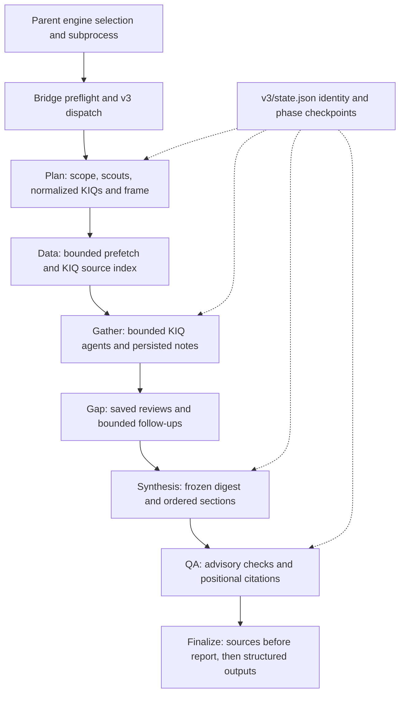

# V3 research, official data and chart contracts

## 1. Source authority, scope and navigation

This report describes committed main `72545c65d8dbaee40e1c1e71e9909ab4741c7b9f`, read from `/tmp/drf-main-study-20261016-72545c65d8db`, under the shared `study-contract.json`. The v3-data assignment is exactly the 11 application entries with `owner="v3-data"` in `python-inventory.json`: 25,357 lines. The companion `v3-data-coverage.json` records raw-file SHA-256, inclusive ranges actually read, reader identity and full/partial depth. Application behavior was studied statically; no app import, pipeline execution, network/provider invocation, or saved-run inspection was used.

Read §2 for entry-point authority, §3 for plan→KIQ→evidence→synthesis→QA, §4 for search/fetch and shared budgets, §5 for catalog/MCP transport, §6 for normalization and persistence, §7 for charts, and §8 for cross-area/output contracts. Source anchors are repository-relative and refer exclusively to the frozen mirror. An `S<n>` citation marker and a source-quality tier string such as `S1` are distinct uses of the same-looking text; this report calls them “marker” and “tier” explicitly.

## 2. Active entry points and deployment boundaries

The normal backend resolver defaults empty or unknown engine settings to v3; `linear` aliases v3 and `legacy/deerflow/agentic` select legacy. `research_engine_for_run` selects legacy when the run's pinned `actor_intelligence_policy_v1.required` is true. V3 has one outer research track even when multiple tracks are configured; its KIQ workers fan out internally over shared evidence. These are source selection rules, not observations of a running deployment. `backend/app/services/pipeline_orchestrator.py:6358-6453`.

The parent explicitly sets `RESEARCH_ENGINE` for the research subprocess, forces legacy for evidence-only/global-synthesis lane contracts, and supplies v3 its effective watchdog timeout. The standalone bridge resolver has a different unset/unknown default: legacy. Bridge main also routes `--extract-only`, `--evidence-only` and `--synthesis-manifest` to legacy even when v3 was requested. Thus a bare direct CLI launch is not evidence of the backend's default engine. `backend/app/services/pipeline_orchestrator.py:2338-2371`; `deerflow_bridge/deerflow_research.py:17496-17530`, `deerflow_bridge/deerflow_research.py:17791-17810`.

The bridge writes the prediction requirement immediately, verifies the runtime skill bundle, presets empty provider-variable defaults for config loading, performs selected-model credential preflight, then dispatches `linear_research.run(..., bridge=_bridge_module())`. V3 does not activate the legacy slash skill; it uses its own static system prompt. The engine owns its artifact and metadata lifecycle; bridge main owns closing the progress log. A preflight failure returns 3; engine failures ordinarily return 2; interrupts are recorded then propagated. `deerflow_bridge/deerflow_research.py:17631-17677`, `deerflow_bridge/deerflow_research.py:17720-17762`, `deerflow_bridge/deerflow_research.py:17804-17810`, `deerflow_bridge/deerflow_research.py:17945-18018`; `deerflow_bridge/linear_research.py:8245-8298`.

The parent synchronizes the bridge's bare-import modules into the DeerFlow runtime: market/search/fetch/budget, linear engine/gateway, and all four official-data modules. These files are tracked application producers; the installed runtime's actual bytes/configuration were not inspected here. The frozen mirror contains no `deerflow_bridge/config.yaml`, so decorated tool entrypoints and deployment lists do not establish an external YAML's current contents. `backend/app/services/pipeline_orchestrator.py:1353-1366`, `backend/app/services/pipeline_orchestrator.py:1576-1618`; `deerflow_bridge/market_tools.py:619-648`, `deerflow_bridge/search_tools.py:727-746`, `deerflow_bridge/cached_fetch.py:820-854`.

## 3. V3 control plane and evidence lifecycle

### 3.1 Presets, identities and durable work

The source version is `v3.0`; phases are `plan,data,gather,gap,synthesize,qa,finalize`. Quick/standard/deep presets use respectively 4/7/10 planned KIQs, 5/7/9 agent steps, 3/4/5 searches and 3/4/6 fetches per KIQ; gap settings are 0×0, 1×3 and 2×4 rounds×follow-ups. Workers default to four. Report targets are 3,000/6,000/11,000 units, with 6–8/8–12/11–16 sections. Model budget units are 1.2m/2.5m/5m and time budgets 1,200/2,700/5,400 seconds; these are internal budget units, not monetary billing. Overrides use `RESEARCH_LINEAR_<KEY>`, parse/clamp values, keep defaults on invalid input, cap workers against model concurrency and cap time at 85% of the parent watchdog. Implicit aggregate web budgets grow toward the schedule, while explicit lower budgets remain and can trim later gap work. `deerflow_bridge/linear_research.py:104-187`, `deerflow_bridge/linear_research.py:855-1002`.

Work identity binds normalized question SHA-256, depth, model, language and engine version. `v3/state.json` records identity, phase state and per-KIQ state; matching identity and valid phase/KIQ maps permit reuse, otherwise the work directory is renamed to a timestamped stale directory. This phase checkpoint is distinct from legacy `research_checkpoint.json`. State updates serialize under an RLock using an injected writer; source reads return unavailable values on the specified read/parse errors. `deerflow_bridge/linear_research.py:835-846`, `deerflow_bridge/linear_research.py:1128-1235`, `deerflow_bridge/linear_research.py:4622-4715`; `deerflow_bridge/deerflow_research.py:17855-17861`.

Execution runs plan, possible outage replan, data acquisition, follow-up loading, gather, gap, synthesis, QA and finalization. Phase context marks running, assigns a bounded share of remaining wall time, labels calls and records elapsed seconds; phase methods set completion explicitly. Invalidation removes downstream synthesis/QA artifacts and resets their state. Cancellation freezes data admission, expires the run clock and prevents later paid work. SIGINT/SIGTERM handlers operate only under their specified main-thread/disposition conditions; repeated SIGTERM is ignored during unwind, terminal metadata is attempted in finally, and log ownership remains with main. `deerflow_bridge/linear_research.py:4813-4841`, `deerflow_bridge/linear_research.py:4928-4993`, `deerflow_bridge/linear_research.py:8205-8298`.

### 3.2 Plan → data needs → KIQs

Planning performs scope JSON, concurrent scout searches, then a plan JSON call. Its normalized result carries question/language/as-of, restated question/horizon, `kiqs`, ordered `sections`, one canonical `scenarios` frame, actors/entities, scout queries and fallback flags. KIQs carry `{id,question,queries,kind,why,round,data_needs}`; IDs are assigned as `K1…`, duplicate questions collapse, kind is general/actor/data, and data needs retain up to three series/query/geography hints. Section references are reconciled to KIQ IDs and exactly one scenario section is retained or inserted. Sparse/unusable plan components fall back to localized templates. Scenarios retain 2–6 usable named outcomes, with largest-remainder integer weights summing to 100; absent usable scenarios use the default 50/25/25 frame. These are plan assumptions supplied to later writing and simulation inputs, not calibrated prediction intervals. `deerflow_bridge/linear_research.py:1280-1400`, `deerflow_bridge/linear_research.py:1421-1767`, `deerflow_bridge/linear_research.py:5381-5563`.

The plan and byte-stable run brief persist to `v3/plan.json` and `brief.md`. Outage-derived planning is distinguished from an answered but unusable plan. A saved outage plan with no gathered facts can reset KIQ/downstream state; a same-attempt replan is time-gated, with one provider attempt per JSON call and no JSON repair. `deerflow_bridge/linear_research.py:1718-1796`, `deerflow_bridge/linear_research.py:5381-5563`.

Official-data capability restores saved evidence before enabling providers. Acquisition on an applicable resumed/pinned downstream generation becomes stored-only; disabled capability preserves the web-only schema. The data phase has a bounded child deadline of at most 150 seconds. IDs route directly, query needs require strong catalog concept/geography matches, and unresolved needs remain agent discovery work. Catalog-preferred equivalents and eligible BLS→FRED routing select available routes. No-needs fallback matches question clauses/data KIQs, defers slower providers, and can extend base-rate history or publisher-projection windows before first storage. KIQ→source-marker links persist in `v3/data/index.json`; catalog discovery alone creates no evidence marker. `deerflow_bridge/linear_research.py:4717-4807`, `deerflow_bridge/linear_research.py:4996-5310`.

Seeder and agent quotas are separate: default agent data-call limits are quick 24/3, standard 50/4 and deep 90/5 total/per-agent, subject to clamped overrides. Seeder acquisition is capped at 60% of run dataset capacity and gets its own three-calls-per-prefetch-slot allowance. The first stored window of a series/transform is immutable for the run; later wider requests return the stored page with a window note. These constraints avoid interpreting a later re-query as the same evidence generation. `deerflow_bridge/linear_research.py:4622-4715`; `deerflow_bridge/research_gateway.py:3366-3417`, `deerflow_bridge/research_gateway.py:4141-4159`, `deerflow_bridge/research_gateway.py:4267-4298`.

### 3.3 Gather → grounded notes → gap rounds

Up to two seed web queries per KIQ are deduplicated run-wide and executed concurrently; results are tier-ranked, capped at six web rows per KIQ, and supplemented by indexed official datasets. Agent prompts delimit web text as untrusted and include per-investigation allowances. A fixed engine-core/run-brief prefix is shared; task-specific content is last, and each agent conversation appends model/tool turns. `deerflow_bridge/linear_research.py:3680-3912`, `deerflow_bridge/linear_research.py:5809-5918`.

V3 model-visible tools are `web_search`/`web_fetch`, plus `data_search`/`data_get` when enabled. They do not include the decorated market tool or legacy `data_anchor`. Each step limits recognized calls to three, suppresses duplicate calls and near-identical stored-page focuses, bounds rereads, and returns ordered responses. Data search contributes discovery novelty without allocating a source; fetch/get source IDs come from result headers. Notes are forced by steps, novelty, context, deadline/grace, protected reserve or repeated malformed responses. Output-cap retries are bounded and retained cut notes lose incomplete tails. `deerflow_bridge/research_gateway.py:3420-3497`; `deerflow_bridge/linear_research.py:117-163`, `deerflow_bridge/linear_research.py:3602-4097`.

Notes parse findings/conflicts/open questions/discovered leads into facts `{kiq,text,sids,tag,verified_numbers}`. Known/seen sources constrain admitted markers. VERIFIED requires a fetched cited source and numeric/unit presence checks against stored pages; missing fetched support demotes to REPORTED, while unmatched required figures become UNVERIFIED with missing-number evidence. The checks establish numeric presence and unit classes, not semantic entailment of every sentence. Applicable stored-dataset claims with non-observed statuses are demoted; deterministic official-series findings preserve status and attribution. `deerflow_bridge/linear_research.py:2246-2777`, `deerflow_bridge/linear_research.py:2780-3002`, `deerflow_bridge/linear_research.py:4256-4568`, `deerflow_bridge/linear_research.py:5346-5378`, `deerflow_bridge/linear_research.py:5752-5807`.

Each KIQ persists ledger → Markdown notes → structured JSON → state done, so accepted completion follows its evidence writes. Records include question/kind/round, facts and other note parts, sources, finish timestamp, and tool/steps/fallback/truncation/fetched/seen/data statistics. A resumed gather can retry deadline/budget/provider/unstructured/no-sourced-facts/truncated-note fallbacks before completed synthesis. Zero facts fails resumably; provider interruption can continue only with the implemented evidence and nonfallback-KIQ threshold, otherwise gather fails. Optional gap rounds persist reviews to `v3/gap/roundN.json`, reject near-duplicate questions, bound follow-ups by remaining web capacity, and stop for sufficient evidence, budget/deadline, provider interruption or diminishing returns. Interrupted gap state is partial and may resume pending follow-ups unless synthesis already pinned the report. `deerflow_bridge/linear_research.py:219-227`, `deerflow_bridge/linear_research.py:5565-5807`, `deerflow_bridge/linear_research.py:5973-6129`.

### 3.4 Evidence digest → synthesis → QA → finalization

The digest takes sourced findings in deterministic KIQ order, preserves whole lines and drops lower-priority material to fit its caps; a source index indicates tier and fetched/snippet status. Synthesis freezes data and persists `v3/digest.md`; all writers/repairs/resumes share its byte-identical wrapped context. Contiguous groups of one to three sections run in parallel and persist `v3/sections/NN.md` individually, with `.trimmed` flags when needed. Assembly follows outline order, removes cross-section duplicate paragraphs through a bridge helper and may refill or omit emptied sections. The executive summary is written last from section leads. Provider failure in synthesis is resumable failure; other unusable writing can fall back to sourced notes. `deerflow_bridge/linear_research.py:3108-3178`, `deerflow_bridge/linear_research.py:6193-6655`.

QA removes error markers, runs at most three repairs and optional bounded critique rewrites, preserves at least 80% of old citations on adopted rewrites, corrects canonical scenario restatements and removes extra ungrounded scenario probabilities. It checks heading order, minimum section length, citation density, canonical frame, stale markers, omitted/truncated sections, error markers and Chinese-language share when applicable. Dataset-only numerical consistency and data exhibits add checks. QA writes `qa.json` and `qa_report.md` and marks its phase done even when `passed=false`; that result is advisory rather than a universal publication gate. `deerflow_bridge/linear_research.py:6658-6775`, `deerflow_bridge/linear_research.py:6968-7018`, `deerflow_bridge/linear_research.py:7033-7228`.

Citation cleanup accepts recognized grouped/alternate forms, strips unresolved/unknown markers, then renumbers first-use citations to contiguous report positions. Citable IDs derive from the digest, recorded facts and accepted datasets; invalid dataset IDs are excluded. References are generated in code from the resulting citation order, and `sources.json[n-1]` is the source for final `[Sn]`. Root dataset and `data_` chart metadata are remapped to those positions under the shared chart lock, while v3's internal ledger keeps its original IDs. `deerflow_bridge/linear_research.py:2535-2642`, `deerflow_bridge/linear_research.py:3530-3555`, `deerflow_bridge/linear_research.py:6746-6756`, `deerflow_bridge/linear_research.py:6893-6930`, `deerflow_bridge/linear_research.py:7020-7031`, `deerflow_bridge/linear_research.py:7336-7378`.

Finalization rechecks official-data reuse, handles whether any model output contributed, and requires at least 400 report characters. An outage in which calls failed and none answered invalidates deterministic downstream work and returns resumable failure; all-content-filter and pre-payment-budget refusal cases have separate flagged fallback behavior. Sources are written before the report, then report-hash-memoized actors/facts extraction runs. Missing extraction falls back to plan actors or empty fact lists, with degradation metadata. The four structured files are always written; v3 removes sealed actor-intelligence fields. `deerflow_bridge/linear_research.py:7235-7556`.

Official quantitative rows are merged after generic research charts, avoiding replotting a stored series through the generic quantitative renderer. They contain latest truly observed actuals and separately labelled publisher projection points, with unit/geography/provider/as-of/period/source marker/dataset file; estimates, preliminary and unknown points do not automatically become deterministic “actual” rows. `forecast_inputs` carries canonical scenario probabilities, empty base-rate/driver arrays and stored-series indicators. Telemetry includes usage totals/phases/call counts, tools, data-source outcomes, phase seconds, KIQ coverage and degradation events; source telemetry is not a provider billing receipt. `deerflow_bridge/linear_research.py:7553-7668`, `deerflow_bridge/linear_research.py:7670-7823`.

## 4. Search, fetch, budgets and market tools

### 4.1 Web adapters and cache layers

`web_search_impl(query,max_results,revisit_reason)` chooses a backend at call time from configured keys: Serper→Tavily→Firecrawl→DDG. Missing selected modules/tools/dependencies can fall back to DDG; a delegate's runtime exception instead becomes error JSON. The adapter unwraps a community tool's `.func` and uses signature inspection for `max_results`. V3 calls the function directly, while legacy can use its optional decorated LangChain entrypoint. `deerflow_bridge/search_tools.py:338-367`, `deerflow_bridge/search_tools.py:530-746`; `deerflow_bridge/research_gateway.py:3715-3813`.

`cached_fetch(url,fetch_fn,revisit_reason)` is asynchronous; production `_resilient_fetch` tries keyed Firecrawl→Jina→keyed Exa→opt-in direct HTTP, stops at acceptable content, and can skip providers with open circuits or exhausted ceilings. Additional provider attempts reserve additional network units. V3 uses a synchronous coroutine adapter and a nonempty revisit reason so full results reach its own ledger/cache. The injectable cache core can re-raise a delegate exception; this differs from provider adapters returning failure text. `deerflow_bridge/cached_fetch.py:275-504`, `deerflow_bridge/cached_fetch.py:692-854`; `deerflow_bridge/research_gateway.py:3715-3747`.

Disk caches default to source cache 72 hours/500 MiB and search cache six hours/200 MiB, with independent root/TTL/size overrides. Fetch keys hash the supplied URL; search keys bind actual backend, normalized query and result limit. Envelopes store text/time/length and request metadata. Expiration uses fetch time; hit-touched mtime orders eviction. Nonpositive TTL disables positive caching, while nonpositive size disables eviction. Writes use temporary files, fsync and replace; cache errors become misses or logged best-effort failures. Search's special pytest default is source behavior only; no tests were run here. `deerflow_bridge/cached_fetch.py:547-690`; `deerflow_bridge/search_tools.py:113-164`, `deerflow_bridge/search_tools.py:259-337`, `deerflow_bridge/search_tools.py:599-615`.

Fetch acceptance requires at least 200 characters, rejects Error/blocked-page/recognized error-JSON content; search rejects short/error/empty-result envelopes while accepting sufficiently long non-JSON text. Source-domain policy filters fetches before budget/cache admission and structured search rows on both fresh/cache paths. Direct HTTP separately requires HTTP(S), globally routable DNS addresses and repeated redirect validation, bounds response size, limits PDF extraction and text length, and uses readability/local HTML parsing. These source controls do not prove any provider response safe or useful at runtime. `deerflow_bridge/cached_fetch.py:136-274`, `deerflow_bridge/cached_fetch.py:505-609`, `deerflow_bridge/cached_fetch.py:702-733`; `deerflow_bridge/search_tools.py:165-258`.

### 4.2 Shared admission versus run-local evidence

V3 `ResearchTools` adds run-memory query dedup, canonical-URL/page/failure reuse, per-agent and run totals, and focused untrusted passages over the disk-cache adapters. Durable official pages are written and hash-bound before a fetched marker is exposed. Separately, `research_budget.py` uses SQLite for cross-process attempt/network admission, global and lane counters, negative-result retry claims, positive-repeat IDs, global exact-request claims, provider health, source receipts and expiring model/subagent leases. These are different scopes and counters, not additive estimates of network work. `deerflow_bridge/research_gateway.py:3786-3893`, `deerflow_bridge/research_gateway.py:4216-4326`, `deerflow_bridge/research_gateway.py:4342-4680`; `deerflow_bridge/research_budget.py:109-208`.

Attempt admission includes cache hits and negative suppression; network admission occurs after caches/suppression/singleflight and reserves before the delegate. Default cross-process caps are 1,800 attempts, 900/360 search global/lane and 450/180 fetch global/lane. Negative caching permits one exact retry within 600 seconds; request identity is hashed and generic negative telemetry avoids raw query/URL previews. Successful fetched-source provenance intentionally keeps URL/content hash/excerpt/provider/receipt in the run-local SQLite table, separately from generic telemetry. Positive compaction is opt-in and a revisit reason retrieves full cached content. `deerflow_bridge/research_budget.py:32-49`, `deerflow_bridge/research_budget.py:260-484`, `deerflow_bridge/research_budget.py:501-617`, `deerflow_bridge/research_budget.py:766-867`; `deerflow_bridge/search_tools.py:576-726`, `deerflow_bridge/cached_fetch.py:702-817`.

Provider health uses consecutive transport failures, cooldown and a single half-open probe lease. Weighted model leases and whole-lifecycle subagent leases acquire atomically, heartbeat and expire after process death. Healthy saturation waits or times out; SQLite unavailability generally fails open and emits degraded telemetry. V3's bridge-lease adapter additionally caps wait at 300 seconds/deadline, proceeds without a failed lease, and ends leasing for that run after a capacity timeout. Thus the library's healthy-lease wait rule must not be described as an unconditional v3 hard global cap. `deerflow_bridge/research_budget.py:620-764`, `deerflow_bridge/research_budget.py:901-1251`; `deerflow_bridge/linear_research.py:8053-8153`.

The parent injects run budget paths/lane/run/epoch, while a separate application lease database remains configured even with tool budgets disabled. Telemetry merges the two databases but labels application lifetime lease counters separately from run tool counters, and atomically writes a throttled JSON snapshot. V3's model gateway and shared SQLite are separate accounting boundaries. `backend/app/services/pipeline_orchestrator.py:2050-2096`, `backend/app/services/pipeline_orchestrator.py:2438-2478`; `deerflow_bridge/research_budget.py:1254-1508`; `deerflow_bridge/linear_research.py:7790-7823`.

### 4.3 Prediction-market tool boundary

`prediction_market_search_impl` accepts at most six unique comma/newline phrases and queries public Polymarket Gamma search. Normalization requires a market ID/question, unclosed status, Yes probability strictly between 0 and 1 and minimum volume (default 200). It retains exchange/question/price/volume/liquidity/event/query/URL/end-date, optional outcomes/prices/CLOB IDs, and resolves the Yes token by outcome position. Results deduplicate by market ID, sort by volume and cap total/per-event (defaults 20/3). `deerflow_bridge/market_tools.py:142-315`, `deerflow_bridge/market_tools.py:532-579`.

A bounded 128-entry process cache and singleflight distinguish success, verified empty, partial success/transport failure and in-flight timeout. Empty successes default to a 30-second TTL; transport degradation is not cached. Cache owner results can append `prediction_market_candidates.jsonl` under the parent's trusted artifact directory, best effort and bounded per record. The bridge reads a bounded tail, skips malformed lines and keeps newest rows by market ID. This candidate log is provenance before final relevance selection. The market tool is not in the v3 KIQ schema; v3's finalizer separately invokes the bridge's market collector. Legacy internals beyond that boundary belong to legacy-harness. `deerflow_bridge/market_tools.py:318-616`; `deerflow_bridge/deerflow_research.py:15984-16029`; `deerflow_bridge/research_gateway.py:3420-3497`; `deerflow_bridge/linear_research.py:7302-7306`.

## 5. Official-data catalog and MCP process boundary

### 5.1 Catalog, discovery and provider routes

`CatalogEntry` is a frozen description of canonical `provider:native` identity, English/Chinese titles, units, frequency, seasonal adjustment, geography, topics/keywords, citation URL, native unit/dimension pins, aggregation/status policy, equivalent/preferred route, minimum history and required key. Construction normalizes keywords and validates policies; lookup is separate from key availability. The catalog's verification date is a source declaration, not fresh provider verification by this study. Catalog search scores identities, concept/keyword coverage and geography, handles compound clauses, renders Chinese terms deterministically and prioritizes suitable preferred equivalents. `deerflow_bridge/data_catalog.py:90-150`, `deerflow_bridge/data_catalog.py:600-700`, `deerflow_bridge/data_catalog.py:2056-2090`, `deerflow_bridge/data_catalog.py:2421-2688`.

`DataSources.search` returns discovery `SearchHit(series,title,units,frequency,coverage,provider,note)` rows. Strong catalog matches lead, with keyed FRED/Data360 search and BIS/Treasury discovery supplementing insufficient matches; failures preserve accumulated hits. An ID/title/unit/geography match is metadata, not an observation or citation. The catalog digest supplies bounded planning context (default 40 choices/~6,000 characters), including unanswered clauses. The catalog CLI can generate an index plus six provider-reference Markdown strings into an existing directory; it is documentation generation rather than research execution. `deerflow_bridge/data_sources.py:315-335`, `deerflow_bridge/data_sources.py:1800-1926`; `deerflow_bridge/data_catalog.py:2564-2688`, `deerflow_bridge/data_catalog.py:2848-3038`.

| Provider | Retrieval identity and actual adapter contract |
|---|---|
| FRED | `fred:<ID>`; keyed `fred_get_series` requests identity/window/linear units/order/offset/limit and validates pagination. Absent/rejected keys use fixed-origin `fredgraph.csv`; unavailable-server fallback and selected curated-series transient fallback have separate branches. Free-text provider search requires a key. Longer daily histories can combine earlier monthly aggregation with recent daily provenance. `deerflow_bridge/data_sources.py:2312-2492`. |
| BLS | `bls:<ID>`; `get_multiple_series` carries IDs and string year bounds in ten-year chunks. Keyless work reserves a shared file-locked 20-request UTC-day quota; rejected keys can restart without the key and retry once. Annual-summary periods are excluded, P means preliminary, and other footnotes remain provenance. `deerflow_bridge/data_sources.py:2493-2639`. |
| BIS | `bis:<FLOW>/<KEY>`; cataloged dimension order and flow version drive `fetch_dataset` arguments. No key is configured. Returned identity/version/dimensions/truncation/units/scale are checked; an existing series with an empty requested window differs from an unknown native key. `deerflow_bridge/data_catalog.py:302-333`; `deerflow_bridge/data_sources.py:407-470`, `deerflow_bridge/data_sources.py:2640-2692`. |
| IMF | `imf:<FLOW>/<KEY>`, including WEO, PCPS, CPI and named WEO vintages. Parameter definitions resolve dimension aliases into nested `params` singleton-list filters/year bounds/max rows; database/vintage identity is checked. No API key is configured; child settings include IMF application name. Preferred equivalents are routing metadata consumed by callers. `deerflow_bridge/data_catalog.py:334-349`, `deerflow_bridge/data_catalog.py:848-900`; `deerflow_bridge/data_sources.py:2693-2737`. |
| World Bank Data360 | `wb:<INDICATOR>/<ISO3>` for WDI, IMF WEO and WB GEP families. Separate metadata precedes paginated data; identity/geography/annual periodicity/disaggregation/units/cursor/counts/repeated pages are checked. WEO accepts the V_LST vintage dimension. No key is configured. `deerflow_bridge/data_catalog.py:350-370`; `deerflow_bridge/data_sources.py:2738-2843`. |
| US government | Fixed `usgov:<recipe>[/parameter]` routes for Treasury, USAspending, EIA and BEA. Treasury validates accounting row identity and pagination; spending uses fiscal-year grouping/period identity; EIA requires a key and fixed route/facets/units; BEA requires a key and bounded year chunks selecting curated lines/industries. SEC's annual/as-of recipe is defined but disabled/unavailable; a Census key can enable the gateway child without adding a catalog fetch recipe here. `deerflow_bridge/data_catalog.py:371-599`; `deerflow_bridge/data_sources.py:2844-3117`; `deerflow_bridge/data_mcp.py:96-166`. |

### 5.2 Registry and child-process lifecycle

The default registry retains all six providers, including unavailable specs and reasons. FRED/BLS/BIS/usgov use Node build products; IMF/Data360 use vendored Python environments. Default startup timeout/concurrency pairs in provider order are FRED 30s/4, BLS 30s/2, BIS 30s/4, IMF 45s/1, Data360 60s/4 and usgov 30s/4. Tool timeout defaults to 60 seconds (configurable up to 900), with a 120-second minimum for IMF. Node eligibility requires version 18 generally and 22 for usgov; version-success caching binds path/mtime/size. Missing runtime/build products or invalid cwd mark unavailable. These are launch specifications, not successful runtime handshakes. `deerflow_bridge/data_mcp.py:239-470`.

Paths resolve provider root/cache/Node overrides from documented inputs; explicit Node selection does not fall back. Cwd setup avoids the repository root and can use temporary fallback directories; custom specs reject empty, relative or repository-root cwd. Children receive selected identity/locale/temp/proxy/CA variables and explicit per-provider allowlisted settings/credentials, rather than the whole ambient environment. The usgov child has a 40,000-byte response budget/cache location; Data360 gets local/update settings. `deerflow_bridge/data_mcp.py:96-166`, `deerflow_bridge/data_mcp.py:303-431`, `deerflow_bridge/data_mcp.py:1099-1204`.

One daemon event-loop thread hosts independent owner tasks/sessions per server. Calls lazily launch sessions; explicit prewarm shares demand. New-session child processes exchange newline JSON-RPC, perform initialization and bounded tool-list pagination (at most 20 pages), ignore nonprotocol stdout lines and send stderr to a file or devnull. Parsed `CallResult` exposes `ok,text,error,elapsed_s,structured,is_tool_error`; text/resource content is joined, capped and redacted, while tool-error content remains distinguishable from transport failure. `deerflow_bridge/data_mcp.py:167-238`, `deerflow_bridge/data_mcp.py:594-829`, `deerflow_bridge/data_mcp.py:1099-1234`.

With an absolute deadline, admission locks, queued launch, readiness, scheduling, semaphore waits and tool-write admission use the same monotonic bound. Without it, startup and invocation budgets are separate. Expiring a request cancels its invocation/write budget without canceling another caller's shared startup/session. FRED additionally has rolling-minute admission, default 50 calls. DataSources adds its own request locks/provider concurrency and cache layer; those are not MCP session counts. `deerflow_bridge/data_mcp.py:830-926`, `deerflow_bridge/data_mcp.py:1235-1441`; `deerflow_bridge/data_sources.py:1991-2190`.

An owner/session failure permits one automatic restart after five seconds; another leaves the circuit open. Ordinary failed tool invocations do not themselves consume that owner restart. `restart_without` changes the spec/reset state while preserving counters and rate-window history (used for rejected BLS keys). Shutdown closes stdin and escalates process-group TERM/KILL; hub close handles outstanding owners/futures/thread shutdown through bounded stages. The singleton is PID-aware and registers exit cleanup. `deerflow_bridge/data_mcp.py:871-1098`, `deerflow_bridge/data_mcp.py:1442-1523`.

## 6. Normalized data, status, persistence and anchor contracts

### 6.1 Shapes, status and provenance

`Observation` is `{date,value,flag}`: date is normalized to an ISO period start, missing numeric tokens become null, and booleans/nonfinite values are rejected. `Series` carries canonical identity/provider, bilingual titles, units/frequency/seasonal adjustment, observations, source/API URLs, retrieval/update times, transform/projection boundary/notes/route, geography/vintage/provenance and KIQ links. It validates provider/transform identity, sorts/deduplicates observations, rejects conflicting values at a date and caps observations at 5,000. `from_dict` deep-copies recognized fields and tolerates additional fields. `deerflow_bridge/data_sources.py:111-314`.

Canonical flags are observed, unknown, preliminary, estimate and projection; unfamiliar status text becomes unknown and combination uses conservative precedence. Consumer display adds partial for incomplete aggregates. Under normalization policy 3+, WDI history before retrieval year can be inferred observed; WEO/GEP vintage year V yields projections from V, estimates at V−1 and observed earlier history. Named IMF vintages and Data360 metadata determine V, with retrieval-year fallback. These inferred statuses remain `resolution_safe=False`. Older saved normalization policies keep their conservative status path rather than silently adopting current inference. `deerflow_bridge/data_sources.py:253-306`, `deerflow_bridge/data_sources.py:471-556`, `deerflow_bridge/data_sources.py:771-854`, `deerflow_bridge/data_sources.py:1381-1464`.

Curated titles remain stable and differing provider titles enter provenance. Native unit code/label/multiplier, dimension pins and authority basis constrain display-unit normalization; eligible curated siblings can supply units across economies. Uncurated SDMX/Data360 paths reject contradictory/unsupported scale information; uncurated IMF units may remain unavailable. Provenance records requested/delivered windows, native frequency, intentional trimming, route, retrieval evidence, response receipts and their digest. MCP response receipts hash decoded canonical content; FRED CSV receipts hash original bytes. Provider strings are scrubbed before cache/persistence. `deerflow_bridge/data_sources.py:1402-1560`, `deerflow_bridge/data_sources.py:1756-1799`, `deerflow_bridge/data_sources.py:2190-2311`.

`DataSources` enables only for stripped/lowercased `DATA_SOURCES_ENABLED=="true"`; legacy `data_enabled` uses its own false-token check. Default history is 25 years for annual, two years for non-FRED daily and otherwise ten years; projection families default through six future years. Requests enforce 1900–2100, catalog history floors and observation caps (default delivery 240, accepted 1–5,000). The hub is lazy; construction also prunes eligible old cache files. These source defaults do not establish live credentials/provider availability. `deerflow_bridge/data_sources.py:1591-1755`, `deerflow_bridge/data_sources.py:1927-1980`; `deerflow_bridge/data_tools.py:66-136`.

Cache identity binds normalization version, transformed canonical ID, normalized window and cap. Restores require matching envelope hashes, identity, current normalization version and TTL: six hours for native daily/weekly, twelve hours for intermediate frequencies and one day annual. Hits preserve retrieval evidence and expose cache route. IMF/BLS provider concurrency is one, others three; `get_many` deduplicates up to 200 IDs, uses eight workers and BLS batches of 25, retaining per-ID deadline/error outcomes. `deerflow_bridge/data_sources.py:1981-2190`.

Daily-to-monthly aggregation follows catalog mean/end-of-period rules, retaining completeness/native daily provenance and remaining resolution-unsafe. YoY uses exact twelve-month predecessor; pct uses preceding month/quarter/year or seven-day weekly point, computing `(current/prior−1)×100`. Missing/zero predecessors yield missing values; statuses combine; weekly YoY and partial fiscal-year transformations are refused. Stored pages/briefs cap displayed text at 12,000/900 characters, while the dataset retains omitted rows. `deerflow_bridge/data_sources.py:557-770`, `deerflow_bridge/data_sources.py:855-1038`, `deerflow_bridge/data_sources.py:2204-2286`.

### 6.2 Evidence admission and immutable publication

V3 `ResearchTools` reserves data calls before provider work, executes only API reads in bounded workers, and commits under a data lock only while the deadline/admission remains open. Dataset identity is series plus transform; first stored window wins. It writes the exact rendered page, registers a dataset-specific ledger row, persists JSON/CSV and manifest, then marks the row fetched and flushes. Failed persistence removes the never-shown row; a value is exposed as fetched evidence only after successful commitment. Restore requires validated dataset bytes, matching ledger identity/page hash and exact page rerender; rejected generations cannot be replaced by live re-fetch within that run. `deerflow_bridge/research_gateway.py:3858-3893`, `deerflow_bridge/research_gateway.py:3939-4326`.

`write_dataset_files` writes immutable identity/content-hash-named JSON/CSV generations before atomically replacing `data/datasets.json`. Manifest schema 1 indexes metadata, count/coverage/latest statistics, file/CSV paths, full persisted-byte hashes, source attribution and expected chart path. CSV contains date/value; JSON retains status/provenance. An indexed chart path does not mean a chart was rendered. Loaders check hashes, identity/metadata/path agreement and citability; invalid rows are skipped and invalid manifests return an empty list. `load_official_data` ranks anchored, cited, KIQ-linked and remaining series, defaults to 24 (max 200), bounds each to latest 240 observations and reports omitted IDs. `deerflow_bridge/data_sources.py:1039-1204`.

V3 publishes only its current identity-bound root generation, with `producer="v3"`, run identity and KIQ routing metadata, while keeping internal ledger IDs. QA remaps root source IDs and data-chart captions/source_ids to final report positions. Dataset rows and chart PNG paths/hashes are recorded in QA artifact proof and checked on applicable reuse. A changed v3 root identity retires only its owned manifest/chart entries under lock, archives the manifest and retains old immutable data/images; a busy lock is a retryable engine failure. `deerflow_bridge/linear_research.py:4775-4807`, `deerflow_bridge/linear_research.py:5312-5344`, `deerflow_bridge/linear_research.py:6767-6798`, `deerflow_bridge/linear_research.py:6893-6930`.

### 6.3 Legacy tool facade and exact anchors

`data_tools.py` exports decorated `data_search` and `data_get`; `data_anchor` is a structured forecasting contract, not a third tool. Retrieval requires an existing canonical parent-provided artifact directory. Candidate JSON/page files and `data_series_candidates.jsonl` bind request, canonical series, snapshot URL, hashes and provisional citation number. Restores require exact rerendered page equality and strict journal validation; repeated identity requests reuse the first generation with wider-window notes. Model-visible results delimit provider text as untrusted. These legacy receipts share the normalizer/publisher but are distinct from the v3 source-ledger/page path. `deerflow_bridge/data_tools.py:66-387`, `deerflow_bridge/data_tools.py:789-864`.

Legacy admission/commit uses process locking plus flock, performs provider work outside the lock and reconciles charged attempts in schema-1 state. Defaults are 50 run calls, six searches/eight gets per worker; six strong catalog matches can answer without provider charge. Retryable failures allow two further charged attempts after 20-second backoffs. APIs use stable input/window/identity/recipe/transform/quota/key/timeout/persistence/provider codes; model text distinguishes `DATA_UNAVAILABLE[code]`, `DATA_BUDGET_EXHAUSTED` and `NO_DATA_MATCH`. Failed persistence does not commit evidence. Legacy research orchestration beyond registration/capture/publication is owned by legacy-harness. `deerflow_bridge/data_sources.py:336-406`; `deerflow_bridge/data_tools.py:388-788`; `deerflow_bridge/deerflow_research.py:5055-5299`, `deerflow_bridge/deerflow_research.py:16580-16879`.

Anchor validation requires a single matching canonical series, finite threshold, comparator in >/>=/</<=, known/matching units, matching supplied transform and frequency-exact target period; stored fiscal labels can identify annual starts. It does not require the target observation already exist. Resolution separately returns manual, pending or resolved/boolean and requires an observed nonmissing exact point, resolution-safe metadata, period completion and retrieval availability within cutoff. Date-only cutoffs include the full UTC day, timestamps remain exact instants and naive timestamps are UTC. Vintage/update/free-form availability fields do not replace retrieval proof. `deerflow_bridge/data_sources.py:1205-1380`.

The resolution monitor is an explicit live-data consumer: it can fetch the bounded ended period and persist hash-bound resolved snapshots; dry-run skips fetching, and existing recorded outcomes are checked against saved proof without refreshing replacement evidence. This differs from report/context consumers reading stored generations. This study inspected those paths without invoking them. `backend/scripts/resolution_monitor.py:320-650`; `backend/app/services/official_data.py:240-336`.

## 7. Quantitative render scripts and attribution

The two scripts have concrete subprocess callers. Bridge helpers search tracked/deployed skill locations and select existing `RESEARCH_CHARTS_PYTHON`, backend virtualenv Python, then `sys.executable`; timeout defaults to 180 seconds. Official-data rendering also receives a stage deadline and can skip when too short. V3 calls official rendering during QA and generic research rendering during finalization. Legacy normal/extract-only paths have separate visualization gates; those gates must not be described as universal v3 behavior. Runtime interpreter/library installation was not inspected. `deerflow_bridge/deerflow_research.py:16489-16525`, `deerflow_bridge/deerflow_research.py:16700-16752`, `deerflow_bridge/deerflow_research.py:17043-17449`, `deerflow_bridge/deerflow_research.py:19022-19136`; `deerflow_bridge/linear_research.py:6806-6844`, `deerflow_bridge/linear_research.py:7302-7306`.

### 7.1 Official stored-series renderer

`data-visuals/scripts/render_data.py --dir RUN [--lang en|zh] [--max N]` reads schema-1 `data/datasets.json` and contained dataset paths. Payload metadata generally wins over manifest metadata. It sorts normalized dated points, retains the last duplicate date, treats invalid numeric values as gaps, keeps up to 2,400 points and requires two numeric values. USAspending requires fiscal metadata for every retained point. This direct renderer input validation is distinct from the byte-hash validation in the upstream dataset loaders. `deerflow_bridge/skills/data-visuals/scripts/render_data.py:447-609`, `deerflow_bridge/skills/data-visuals/scripts/render_data.py:970-1077`.

The cap is CLI max, environment `DATA_SOURCES_CHARTS_MAX`, then eight, clamped at zero. Selection prioritizes KIQ association, citation and catalog order. Up to two comparisons of at most six economies replace individual members when units/frequency/transform/seasonal adjustment/calendar/native identity align; partial fiscal aggregates are excluded. Outputs return to catalog order. `deerflow_bridge/skills/data-visuals/scripts/render_data.py:1078-1221`, `deerflow_bridge/skills/data-visuals/scripts/render_data.py:1938-2184`, `deerflow_bridge/skills/data-visuals/scripts/render_data.py:2514-2623`.

Stored status/projection boundary/retrieval/period/completeness/policy determine point kinds. Observed uses solid, unknown lighter solid, preliminary dotted triangles, partial hollow circles, estimates dash-dot squares and projections dashed/shaded treatment; the less-certain status owns transitions. Null points break lines, isolated values receive markers and latest observed gets the observation callout. A conditional derived twelve-month mean requires consecutive observed months and suitable noisy nonseasonal/nonpercentage history. Axes preserve data units; English/Chinese scale labels change presentation only. PNG language/font fallback is separate from HTML language. `deerflow_bridge/skills/data-visuals/scripts/render_data.py:169-250`, `deerflow_bridge/skills/data-visuals/scripts/render_data.py:610-969`, `deerflow_bridge/skills/data-visuals/scripts/render_data.py:1254-1400`, `deerflow_bridge/skills/data-visuals/scripts/render_data.py:2427-2462`.

Footer attribution identifies underlying provider/database/native ID/retrieval date, including IMF/WB sources relayed by Data360 and agency-specific usgov credit. Renderer entries are `{id,title,caption,source_data:"data/datasets.json",data_class:"official_statistics",path,series}`, plus optional html_path. The script describes data/status/gaps/comparison/derived-average context; the bridge adds valid source markers from dataset attribution, and v3 QA later remaps them to final report positions. `deerflow_bridge/skills/data-visuals/scripts/render_data.py:1222-1253`, `deerflow_bridge/skills/data-visuals/scripts/render_data.py:2266-2426`; `deerflow_bridge/deerflow_research.py:16650-16799`; `deerflow_bridge/linear_research.py:6893-6930`.

Matplotlib Agg emits fixed 1600×900 PNGs; optional Plotly HTML uses a local JS bundle with inline fallback. Image/HTML writes are atomic. Locked manifest updates replace data-owned rows, preserve other dictionaries and retain old image files. Handled outcomes print JSON with charts/skipped/dropped and optional error; exits are 0 with successful charts, 2 disabled/unavailable/unrenderable and 3 missing Matplotlib unless cap zero. Argument parsing and uncaught filesystem/manifest errors are outside that handled-summary guarantee. V3 admits contained existing non-symlink data PNGs for current series; with no admitted charts it embeds the stored-observation table. `deerflow_bridge/skills/data-visuals/scripts/render_data.py:2185-2265`, `deerflow_bridge/skills/data-visuals/scripts/render_data.py:2463-2623`; `deerflow_bridge/linear_research.py:6806-6891`.

### 7.2 Generic research/forecast visual renderer

`forecast-visuals/scripts/render.py --dir RUN` consumes typed first-class actors/timeline/quantitative/prediction-market/sources/meta artifacts, with `charts_data.json` only as fallback when the corresponding primary artifact has unsuitable type. Correctly typed empty inputs remain authoritative. Five domain jobs are enabled by default; actor context and source diagnostics are opt-in. `deerflow_bridge/skills/forecast-visuals/scripts/render.py:1986-2138`.

Benchmark panels require value/metric/comparable unit/source/definition/as-of, reject generic unscoped units and require at least two rows sharing measure/time/denominator/subject context. Intervals supply midpoint/whiskers. Trajectories group compatible metric/region/technology/unit, require three distinct years and keep the best-tier point per year; forecasts require external HTTP(S) provenance and exclude explicitly internal interpolation. Their plotted x-coordinate is integer year, with period_end retained in metadata; missing years are not inserted as gap rows. Revision charts require three distinct named vintages, identifiable target year, matching publisher/metric/definition/unit; their provenance check differs from trajectory's external-URL requirement. `deerflow_bridge/skills/forecast-visuals/scripts/render.py:341-614`, `deerflow_bridge/skills/forecast-visuals/scripts/render.py:789-1182`, `deerflow_bridge/skills/forecast-visuals/scripts/render.py:1507-1730`.

Timeline deduplicates dated events and retains forty recent rows; Plotly uses dates/lanes and Matplotlib ordinal positions with date labels. Markets normalize probabilities, exclude resolved endpoints, deduplicate IDs and keep twelve volume-ranked rows. Optional actor networks use declared scores/tiers/aliases/edges and deterministic positions; source diagnostics deduplicate and calculate freshness against a run/inferred anchor. `deerflow_bridge/skills/forecast-visuals/scripts/render.py:615-788`, `deerflow_bridge/skills/forecast-visuals/scripts/render.py:1183-1506`.

Research chart outputs use inline Plotly HTML; PNG tries Kaleido then Matplotlib. Entries carry id/title/caption/source_data/data_class/path and optional HTML; PNG is preferred when both exist. Seven owned IDs are replaced under the shared lock, foreign IDs preserved, with legacy output-stem ownership fallback. Preparation precedes per-render exception handling. Exits are 0 for successful entries, 2 for none and 3 with neither graphics library. Embedding excludes diagnostics, avoids duplicate paths and can link HTML-only outputs. `deerflow_bridge/skills/forecast-visuals/scripts/render.py:1363-1439`, `deerflow_bridge/skills/forecast-visuals/scripts/render.py:1908-2138`; `deerflow_bridge/deerflow_research.py:16526-16579`.

## 8. Output contracts and integration with other areas

| Producer | Payload/artifact and admission | Consumer / stopping boundary |
|---|---|---|
| Bridge main | `prediction_requirement.txt`, `meta.json`, `research_progress.log`; requirement is written before research and main owns log closure. `deerflow_bridge/deerflow_research.py:861-875`, `deerflow_bridge/deerflow_research.py:17631-17677`, `deerflow_bridge/deerflow_research.py:17729-17737`. | Parent research runner/progress/reception; filenames do not alone establish usable report publication. |
| V3 planning/state | `v3/state.json`, plan.json, brief.md; question/depth/model/language/version identity gates reuse, stale work is archived. `deerflow_bridge/linear_research.py:1128-1235`, `deerflow_bridge/linear_research.py:4622-4715`, `deerflow_bridge/linear_research.py:5381-5563`. | Same engine's resumed phases and stable prompt brief. Legacy checkpoint is separate. |
| ResearchTools and KIQ agents | Internal source ledger, content-hashed `v3/pages/*.txt`, per-KIQ notes/JSON, `v3/data/index.json`, gap round JSON. Writes precede shown fetched IDs or KIQ-done state. `deerflow_bridge/research_gateway.py:4216-4257`; `deerflow_bridge/linear_research.py:4996-5063`, `deerflow_bridge/linear_research.py:5752-5807`, `deerflow_bridge/linear_research.py:6035-6045`. | Digest/synthesis/QA consume admitted evidence, with internal ledger IDs. |
| DataSources publication | `data/datasets.json` plus immutable JSON and CSV; paths/identity/persisted-byte hashes/metadata gate loading. JSON retains flags/provenance; CSV is date/value. `deerflow_bridge/data_sources.py:1039-1204`. | Renderer, backend official carrier and exact-anchor validation. Expected chart path is not chart-existence proof. |
| Synthesis and QA | `v3/digest.md`, section Markdown/trim flags, synth.json, synth_report.md, qa.json, qa_report.md and official-artifact hash proof. QA result may be false with phase done. `deerflow_bridge/linear_research.py:6193-6330`, `deerflow_bridge/linear_research.py:6447-6459`, `deerflow_bridge/linear_research.py:6658-6775`. | Finalizer requires its separate report/model/data-reuse conditions. |
| Final source/report export | `sources.json` first, then `research_report.md`; ordered source rows bind report [S#], hash/excerpt/fetched or official-data origin and dataset reference. `deerflow_bridge/linear_research.py:7284-7298`, `deerflow_bridge/linear_research.py:7336-7378`. | Backend research reception, report attribution and later generation binding. |
| Final structured export | `actors.json` object with situation/cast/relationships/hot topics/events/quant/contested/forecast_inputs; separate timeline/quantitative/contested lists always overwrite current outputs, even empty. No sealed intelligence plane is produced here. `deerflow_bridge/linear_research.py:7484-7556`, `deerflow_bridge/linear_research.py:7864-8046`. | Ontology/graph/actor/forecast areas receive the shared handoff; their internal processing remains outside this owner. |
| Official quantitative view | Latest observed actuals and labelled publisher projections merged into quantitative.json; `forecast_inputs.indicators` preserve period/status/units/frequency/source marker. `deerflow_bridge/linear_research.py:7558-7668`. | Forecast/report consumers can distinguish historical observations from publisher outlook statements. |
| Renderers | Shared locked charts.json, charts PNG and optional HTML; families own specific IDs/prefixes and preserve foreign rows. `deerflow_bridge/skills/data-visuals/scripts/render_data.py:2463-2623`, `deerflow_bridge/skills/forecast-visuals/scripts/render.py:1908-2138`. | Bridge embedding and report/data citation mapping; chart failure can leave a table or partial chart set. |
| Tool budget/market capture | SQLite budget/provenance and JSON telemetry; optional market candidate JSONL with structured outcome states. `deerflow_bridge/research_budget.py:109-208`, `deerflow_bridge/research_budget.py:1254-1508`; `deerflow_bridge/market_tools.py:318-616`. | Separate runtime admission, analytics and bridge market reconciliation; market candidate capture is not final selection. |

The active downstream generation boundary captures fingerprints after finalized research reception, then compares that consumed generation before binding a fresh simulation. Fingerprints cover report, actors, sources, optional actor dossier/seal and dataset manifest. `official_research_binding.json` schema 2 stores simulation/pipeline identity, a relative-or-absolute handoff path and file hashes; schema 1 absolute bindings have relocation compatibility. Atomic create-only publication accepts the same generation on retry and raises `ResearchBindingConflict` for another already-pinned generation. Ordinary capture/bind failures make enrichment unavailable; the conflict branch propagates. `backend/app/services/official_data.py:29-35`, `backend/app/services/official_data.py:90-217`; `backend/app/services/pipeline_orchestrator.py:12835-12863`, `backend/app/services/pipeline_orchestrator.py:13355-13385`.

`load_research_dossier_for_simulation` admits official data only for a valid generation binding, and rechecks proof after reading. Missing/invalid bindings can retain legacy dossier lookup behavior but do not adopt current mutable official datasets. `load_official_data` supplies the bounded persisted carrier; report/context readers do not fetch replacements. The explicit resolver/client accessor remains a different provider-capable path. Report helper code inspects official rows and report-local carrier digest; complete forecast, graph, simulation and publication internals belong to their other owners. `backend/app/services/pipeline_orchestrator.py:7216-7262`; `backend/app/services/official_data.py:220-254`, `backend/app/services/official_data.py:312-336`; `backend/app/services/report_agent.py:1688-1900`.

Settings probes are a separate explicit operational entrypoint: a private hub/client handshakes enabled providers, can sample cached/live data, reports per-provider states and closes clients; BLS data requests are omitted in the inspected probe. Those paths are provider-capable source, not work performed by this study. `backend/app/api/settings.py:221-470`.

## 9. Source-linked diagrams

### 9.1 V3 phases and durable artifacts

Node links point to frozen local source; the same supporting anchors are `backend/app/services/pipeline_orchestrator.py:6358-6453`, `deerflow_bridge/deerflow_research.py:18013-18018`, and `deerflow_bridge/linear_research.py:1128-1235`, `deerflow_bridge/linear_research.py:4978-4993`, `deerflow_bridge/linear_research.py:5381-5807`, `deerflow_bridge/linear_research.py:5973-6006`, `deerflow_bridge/linear_research.py:6260-6330`, `deerflow_bridge/linear_research.py:6658-6775`, `deerflow_bridge/linear_research.py:7279-7323`.

### 9.2 Official evidence publication and downstream binding

```mermaid
flowchart LR
    P["Plan data needs and KIQ tool calls"] --> R["ResearchTools: quota, singleflight, commit"]
    R --> S["DataSources: catalog routes and normalization"]
    S --> M["McpHub: stdio child process sessions"]
    M --> S
    S --> R
    R --> V["v3 datasets, exact pages and source ledger"]
    V --> Q["Frozen synthesis and QA citation order"]
    Q --> O["Root data manifest, JSON/CSV and data charts"]
    O --> X["Captured research-generation fingerprints"]
    X --> Y["Simulation binding proof"]
    Y --> Z["Persisted official_data carrier for downstream consumers"]
    click P "/tmp/drf-main-study-20261016-72545c65d8db/deerflow_bridge/linear_research.py:4996"
    click R "/tmp/drf-main-study-20261016-72545c65d8db/deerflow_bridge/research_gateway.py:4141"
    click S "/tmp/drf-main-study-20261016-72545c65d8db/deerflow_bridge/data_sources.py:1591"
    click M "/tmp/drf-main-study-20261016-72545c65d8db/deerflow_bridge/data_mcp.py:830"
    click V "/tmp/drf-main-study-20261016-72545c65d8db/deerflow_bridge/research_gateway.py:4216"
    click Q "/tmp/drf-main-study-20261016-72545c65d8db/deerflow_bridge/linear_research.py:6746"
    click O "/tmp/drf-main-study-20261016-72545c65d8db/deerflow_bridge/linear_research.py:6777"
    click X "/tmp/drf-main-study-20261016-72545c65d8db/backend/app/services/official_data.py:90"
    click Y "/tmp/drf-main-study-20261016-72545c65d8db/backend/app/services/official_data.py:138"
    click Z "/tmp/drf-main-study-20261016-72545c65d8db/backend/app/services/pipeline_orchestrator.py:7216"
```

ResearchTools writes exact dataset pages and validated dataset files before exposing a fetched marker; QA publishes the root generation and remaps report-facing citations. Downstream binding checks the consumed generation and reads persisted enrichment. Source anchors: `deerflow_bridge/research_gateway.py:4141-4326`; `deerflow_bridge/linear_research.py:6746-6798`, `deerflow_bridge/linear_research.py:6893-6930`; `backend/app/services/official_data.py:90-100`, `backend/app/services/official_data.py:138-217`; `backend/app/services/pipeline_orchestrator.py:7216-7262`. Catalog, normalization and transport edges are detailed in §§5–6: `deerflow_bridge/data_sources.py:1591-1799`; `deerflow_bridge/data_mcp.py:830-1098`, `deerflow_bridge/data_mcp.py:1235-1441`.

## 10. Evidence limits, verification and continuation record

All 11 owned application files have complete source-read coverage when lead and six reader receipts are combined. The two large linear helper/engine ranges were read by separate children and reconciled into one file receipt. All six delegated readers returned terminal completed results; each was closed after receipt capture. Transport disconnects were resumed against their saved progress. Initial combined-output truncations were reread in bounded source chunks before credit; the final receipt contains actual inclusive chunks and overlaps, not AST/inventory-only coverage.

The static validation checks cover owned-path inventory equality, fresh SHA-256 equality, line-count/range bounds, complete range unions, source-anchor path/line validity and Mermaid source-link targets. They establish documentation/source accounting. They do not establish successful providers, runtime installation, rendered appearance, current credentials, production deployment, saved-run recovery, semantic correctness of model claims or customer publication.

Tests were inspected as source evidence only:

| Test file | Actual ranges inspected | What the inspected source exercises |
|---|---|---|
| `backend/tests/test_loop007_research_budget.py` | 397–443, 742–759 | Shared attempt cap, negative retry/expiry, positive-cache admission setup and ledger-failure degraded telemetry. The latter range also begins the orchestrator injection case. |
| `backend/tests/test_v3_official_data.py` | 196–234, 273–307 | Stored-generation/corruption replay using fixtures; synthetic chart admission and positional dataset/chart/source remapping, including unsupported data-number checks. |
| `backend/tests/test_data_visuals_render.py` | 1–300 | Synthetic inputs, chart output contracts, projection/gap/comparison assertions. |
| `backend/tests/test_forecast_visuals_manifest.py` | 1–300 | Manifest ownership/cleanup, opt-in context, locking, market and freshness assertions. |

No test was run. Test setup uses synthetic/fixture providers and, in the inspected QA case, fixture PNG bytes; it is not live-provider or real chart-render proof. `backend/tests/test_loop007_research_budget.py:397-443`, `backend/tests/test_loop007_research_budget.py:742-759`; `backend/tests/test_v3_official_data.py:196-234`, `backend/tests/test_v3_official_data.py:273-307`; `backend/tests/test_data_visuals_render.py:1-300`, `backend/tests/test_forecast_visuals_manifest.py:1-300`.

Explicit uncertainties are effective deployment config/environment, available runtimes/libraries, live provider schemas/availability/keys, model response quality and actual artifact production. The frozen source documents fallback and recovery decisions but this study does not exercise them. External DeerFlow configuration/vendor process internals were traced only through the local deployment/adapter boundary. Supporting caller files below were read partially; their full-file architecture belongs to the relevant area owners.

For continuation, use this frozen commit and companion coverage receipt as the source baseline, reconcile §§2/8/9 with the coordinator's pipeline/simulation/report maps, and preserve source defaults versus executed evidence. No outstanding assigned module/range remains. This area produced only its Markdown report and JSON coverage record; application, Git/index, other readers' outputs and existing handoffs were not modified.

### Supporting caller and test read receipts

These are partial-file reads and do not count toward the 25,357 owned application lines. Ranges are actual bounded reads; overlaps are retained. Hashes bind full frozen files but do not imply full reads.

| Supporting path | Depth | Actual inclusive ranges | SHA-256 |
|---|---|---|---|
| `backend/app/api/settings.py` | partial | 221-470 | `e80e11a668f1e8b9ca042f9051a8511ebfd809b0d7db235862ec023ed941c6d7` |
| `backend/app/config.py` | partial | 1380-1629 | `61fd71f5714ac49602f7cfce452c81cbe61296285ef4a28a4dc11e859d399007` |
| `backend/app/services/official_data.py` | partial | 1-255, 275-338, 200-499, 201-500 | `3dc344a86e5b760c597611123dcf48c8b0071cb957e0a3661b6a17519d4fab1b` |
| `backend/app/services/pipeline_orchestrator.py` | partial | 6355-6465, 2338-2388, 2048-2115, 1348-1380, 2438-2475, 2472-2495, 12835-12865, 13355-13390, 7215-7265, 1350-1372, 1576-1618 | `f5bd4154c48f35bcb388f09f42146009ee8847e6f3cef2c68712d49ac749dddd` |
| `backend/app/services/report_agent.py` | partial | 1601-1900 | `c7b33f0ad5c18779466391de5c3a861d574d874855b7365d1533d858beb1d641` |
| `backend/scripts/resolution_monitor.py` | partial | 320-619, 351-650 | `2d994b9f46053aeffbc46f5b4ec3b66bbeccaaa4e72d0403806bf10ffb9fa1fe` |
| `backend/tests/test_data_visuals_render.py` | partial | 1-300 | `41d110378a8ff073b18e9e8788b0ebef73ef80854750b6e0695b1a08da2eb91a` |
| `backend/tests/test_forecast_visuals_manifest.py` | partial | 1-300 | `98ad53b4abbbb98270d0e28ddf2639f66721a773a8cac00bbdc0ae17251ec037` |
| `backend/tests/test_loop007_research_budget.py` | partial | 397-443, 742-759 | `8b691edbed40e2cd036ad8d01f2f3eba1ea217c59e5f487e680fd4f533a60950` |
| `backend/tests/test_v3_official_data.py` | partial | 196-234, 273-307 | `14472b131ea7631871ee58bb7ef0da274895911e178c2d55d1225fa23b4e6aea` |
| `deerflow_bridge/deerflow_research.py` | partial | 17600-17865, 17485-17555, 17940-18025, 15984-16035, 853-880, 1415-1478, 1477-1520, 4720-4750, 10810-10940, 18018-18052, 5000-5299, 16580-16879, 4750-4999, 16400-16749, 16750-17099, 17100-17449, 18900-19136 | `4608299a7a125c563371d622282f52165d2f64598d679f51e77c008ee4cc3532` |
| `deerflow_bridge/research_gateway.py` | partial | 3366-3525, 3890-4020, 4020-4370, 3786-3893, 2360-2378, 2440-2485, 3680-3698, 3699-3865, 4325-4385, 4380-4535, 4550-4680, 3900-4299 | `831dc381b7eafa5fdf443cce48da805ba4f23639111e047184fd24768d2e3929` |

### Final static verification result

Owned coverage: 11/11 application files and 25,357/25,357 lines. Fresh file hashes: 11/11 match inventory. Python source anchors: 250 valid. Frozen-source diagram links: 20 valid. Delegated readers: 6/6 completed and closed. Application/provider/test executions: zero.
