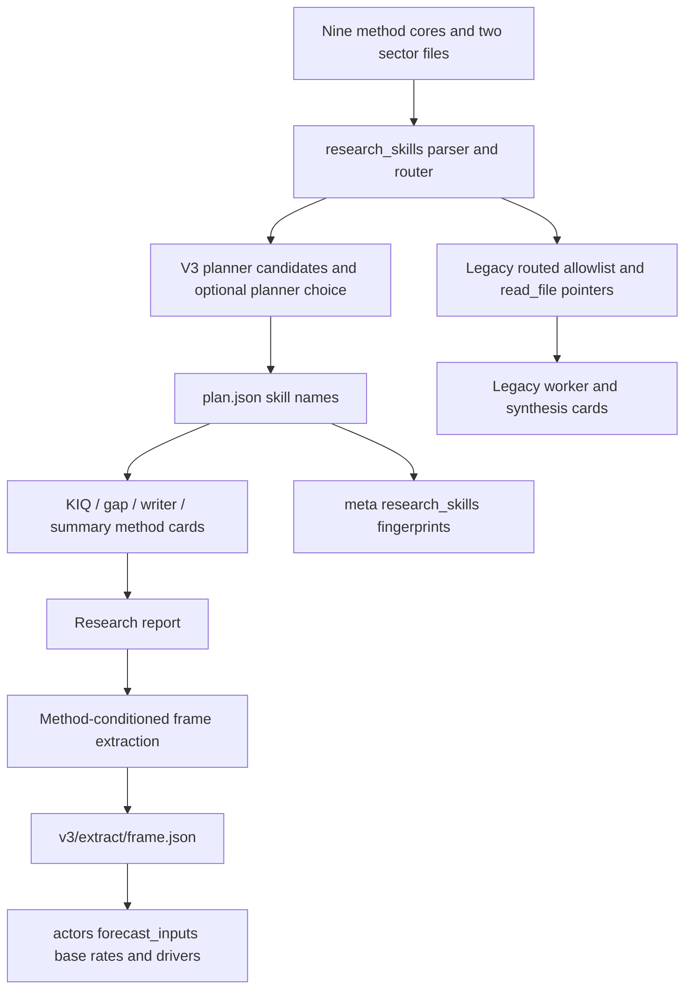

# Main advance: research-method skills

## 1. Two source generations and scope

The completed core study remains bound to main `72545c65d8dbaee40e1c1e71e9909ab4741c7b9f`. This addendum studies only its committed delta through `8852ce123fa15a6b4f4c3e6e4e492435c0e3137b`: `0b78ef4` adds tailored research-method skills to both engines; `8852ce1` records design/review/verification documentation. All source anchors in this addendum refer to **8852ce**, using relative paths into `/tmp/drf-main-delta-8852ce123fa1`. Original area/core reports and their older anchors remain unchanged. This is **not a complete core study at 8852ce**.

The 60 changed blobs were frozen or verified directly against Git. The new 769-line helper, the 152-line authoring checker and new 582-line test module were read fully. Every changed Python hunk in the other six changed Python files was read with bounded committed context. Targeted callers, nine complete SKILL cores and the two automatically loaded sector files support the boundary trace; other Markdown references/design/review material are indexed only. Exact hashes, full/partial ranges, categories and delta-read status are in `main-advance-coverage.json`. No added subagents, tests, checker execution, application imports, provider/network calls, installed-runtime inspection or saved-run access were used. Only this addendum and its receipt were written in the project.

Navigate: [helper and selection](#2-new-helper-registry-loading-and-selection), [v3](#3-v3-planner-prompt-and-checkpoint-boundaries), [legacy](#4-legacy-prompt-and-native-skill-boundaries), [forecast-frame data flow](#5-new-v3-forecast-frame-artifact-and-consumer), [deployment and references](#6-runtime-deployment-and-reference-mechanics), [checker/tests](#7-checker-and-tests-evidence-only), [diagram/policy effects](#8-effect-on-existing-diagrams-and-research-policies), [limits/validation](#9-coverage-validation-and-explicit-limits).

## 2. New helper: registry, loading and selection

`deerflow_bridge/research_skills.py` is a stdlib-only method registry/parser/router/prompt-card module. It does not select the engine, add a provider, or perform retrieval. `RESEARCH_SKILLS` defaults to auto; off/false/0/none/disabled disable the capability, while unknown values warn and use auto. Directory precedence is a usable RESEARCH_SKILLS_DIR override, deployed sibling `skills/public`, then source sibling `skills`. A candidate is usable if any registered SKILL.md exists; parsing/loading then determines which entries survive. [deerflow_bridge/research_skills.py:20–89](/tmp/drf-main-delta-8852ce123fa1/deerflow_bridge/research_skills.py:20).

| Registry name | Method ownership described by its committed core | Source |
|---|---|---|
| industry-research | Current industry perimeter, demand/supply/cycle/profit/share baseline | [deerflow_bridge/skills/industry-research/SKILL.md:1–28](/tmp/drf-main-delta-8852ce123fa1/deerflow_bridge/skills/industry-research/SKILL.md:1) |
| industry-forecasting | Target-year industry state and feasible transition path | [deerflow_bridge/skills/industry-forecasting/SKILL.md:1–28](/tmp/drf-main-delta-8852ce123fa1/deerflow_bridge/skills/industry-forecasting/SKILL.md:1) |
| competitive-landscape-forecasting | Leadership/ranking/share outcomes and persistence | [deerflow_bridge/skills/competitive-landscape-forecasting/SKILL.md:1–25](/tmp/drf-main-delta-8852ce123fa1/deerflow_bridge/skills/competitive-landscape-forecasting/SKILL.md:1) |
| macro-research | Economy-wide quantities and central-bank decisions | [deerflow_bridge/skills/macro-research/SKILL.md:1–19](/tmp/drf-main-delta-8852ce123fa1/deerflow_bridge/skills/macro-research/SKILL.md:1) |
| policy-and-trade-forecasting | Legal/administrative acts, trade instruments and implementation | [deerflow_bridge/skills/policy-and-trade-forecasting/SKILL.md:1–21](/tmp/drf-main-delta-8852ce123fa1/deerflow_bridge/skills/policy-and-trade-forecasting/SKILL.md:1) |
| geopolitical-forecasting | Security/conflict states, escalation and negotiation | [deerflow_bridge/skills/geopolitical-forecasting/SKILL.md:1–21](/tmp/drf-main-delta-8852ce123fa1/deerflow_bridge/skills/geopolitical-forecasting/SKILL.md:1) |
| election-forecasting | Electoral outcomes, control and majority/coalition paths | [deerflow_bridge/skills/election-forecasting/SKILL.md:1–38](/tmp/drf-main-delta-8852ce123fa1/deerflow_bridge/skills/election-forecasting/SKILL.md:1) |
| financial-markets-forecasting | Market-determined settlement statistics, listings/defaults | [deerflow_bridge/skills/financial-markets-forecasting/SKILL.md:1–28](/tmp/drf-main-delta-8852ce123fa1/deerflow_bridge/skills/financial-markets-forecasting/SKILL.md:1) |
| reference-class-forecasting | Cross-cutting reference classes, base rates and probability conventions | [deerflow_bridge/skills/reference-class-forecasting/SKILL.md:1–21](/tmp/drf-main-delta-8852ce123fa1/deerflow_bridge/skills/reference-class-forecasting/SKILL.md:1) |

These are project method resources, not newly installed global Codex skills. The runtime helper uses a fixed registry and compiled bilingual trigger patterns; the long frontmatter descriptions are parsed as metadata, **not interpreted as the router's rules**. Industry matching combines sector terms with strong/weak industry wording and future intent. Matching normalizes NFKC and separates CJK/ASCII boundaries. A deadline in the reference year still counts as future; a bare year must exceed that year. Reference year is supplied by callers or defaults to current UTC year. [deerflow_bridge/research_skills.py:35–60](/tmp/drf-main-delta-8852ce123fa1/deerflow_bridge/research_skills.py:35), [deerflow_bridge/research_skills.py:221–445](/tmp/drf-main-delta-8852ce123fa1/deerflow_bridge/research_skills.py:221), [deerflow_bridge/research_skills.py:459–525](/tmp/drf-main-delta-8852ce123fa1/deerflow_bridge/research_skills.py:459).

The router retains at most two domain methods with score at least 2, ranked by score and registry order. Sector-only industry matches yield to an eligible non-industry method when no strong industry term is present. Industry outlooks can retain the baseline method; leadership intent can replace the industry-baseline slot with competitive-landscape. A forecast trigger **or any selected domain method** adds reference-class-forecasting, with at most three total routed names. Thus cross-cutting inclusion is broader than only explicitly dated questions. [deerflow_bridge/research_skills.py:528–564](/tmp/drf-main-delta-8852ce123fa1/deerflow_bridge/research_skills.py:528).

The v3 planner can override router candidates with available names, accepting normalized names/mappings, list/tuple or comma-separated text. Unknowns and repeats drop; a cross-cutting-only choice does not discard router domain candidates. Planner selection preserves request order, caps at three total and places retained reference-class last. Router domain count and planner list count are distinct limits. [deerflow_bridge/research_skills.py:567–602](/tmp/drf-main-delta-8852ce123fa1/deerflow_bridge/research_skills.py:567).

KIQ routing ranks the plan's domain methods by the KIQ's own text, falls back to the primary domain method on no match, and adds a second only if it meets the score floor; it never pairs both industry methods. A base-rate KIQ puts reference-class first when present on the plan. The kind argument is deliberately ignored, so actor KIQs can receive their domain's actor-record methodology. Industry paired with another method contributes sector adapters instead of another Investigate text. Writers receive up to two primary domains, adding reference-class for scenario sections. [deerflow_bridge/research_skills.py:605–632](/tmp/drf-main-delta-8852ce123fa1/deerflow_bridge/research_skills.py:605), [deerflow_bridge/research_skills.py:695–747](/tmp/drf-main-delta-8852ce123fa1/deerflow_bridge/research_skills.py:695).

## 3. V3 planner, prompt and checkpoint boundaries

Engine construction initializes the optional library after official-data configuration. Off returns without loading; missing/unreadable capability is recorded as meta.research_skills.status=unavailable. The library itself is loaded once per attempt, while method helper functions construct task suffixes from it. The unchanged work-directory identity remains question/depth/model/language/engine_version; the added Plan.skills list is a plan artifact field, separate from that identity. [deerflow_bridge/linear_research.py:4665–4745](/tmp/drf-main-delta-8852ce123fa1/deerflow_bridge/linear_research.py:4665), [deerflow_bridge/linear_research.py:4801–4821](/tmp/drf-main-delta-8852ce123fa1/deerflow_bridge/linear_research.py:4801).

Fresh planning appends routed Plan sections, the available-method menu and an optional JSON skills key to the final planning task **after** official-data guidance. Candidates use the question plus scope restatement/entities. `_assign_skills` selects valid planner names or router fallback, then records the choice. The normal plan and bounded outage-replan paths both assign before writing `v3/plan.json`. The existing KIQ/section/scenario JSON requirements remain the required planning shape. [deerflow_bridge/linear_research.py:4823–4860](/tmp/drf-main-delta-8852ce123fa1/deerflow_bridge/linear_research.py:4823), [deerflow_bridge/linear_research.py:5508–5539](/tmp/drf-main-delta-8852ce123fa1/deerflow_bridge/linear_research.py:5508), [deerflow_bridge/linear_research.py:5585–5604](/tmp/drf-main-delta-8852ce123fa1/deerflow_bridge/linear_research.py:5585), [deerflow_bridge/linear_research.py:5639–5681](/tmp/drf-main-delta-8852ce123fa1/deerflow_bridge/linear_research.py:5639).

Plan serialization writes skills only when nonempty; reload accepts up to three bounded string names. A completed valid saved plan plus brief is reused, records source=plan.json and returns without rerouting. An older plan with no skills field reloads with an empty list rather than acquiring new methods automatically. Fresh/replanned metadata source is planner or router. [deerflow_bridge/linear_research.py:1360–1420](/tmp/drf-main-delta-8852ce123fa1/deerflow_bridge/linear_research.py:1360), [deerflow_bridge/linear_research.py:4854–4872](/tmp/drf-main-delta-8852ce123fa1/deerflow_bridge/linear_research.py:4854), [deerflow_bridge/linear_research.py:5508–5516](/tmp/drf-main-delta-8852ce123fa1/deerflow_bridge/linear_research.py:5508).

V3's future-year routing uses plan.as_of once a plan exists, current UTC date before one exists. Resume retains the selected names and reference year, but method text is rebuilt from the currently loaded library; neither raw SKILL text nor its hashes are embedded in Plan.skills. Metadata fingerprints describe that loaded library. They are not added to the work-directory identity or the report-hash extraction cache in this delta. These are persistence boundaries, not a live-resume result. [deerflow_bridge/linear_research.py:4686–4691](/tmp/drf-main-delta-8852ce123fa1/deerflow_bridge/linear_research.py:4686), [deerflow_bridge/linear_research.py:4835–4867](/tmp/drf-main-delta-8852ce123fa1/deerflow_bridge/linear_research.py:4835), [deerflow_bridge/linear_research.py:7528–7540](/tmp/drf-main-delta-8852ce123fa1/deerflow_bridge/linear_research.py:7528).

| Prompt boundary | Added suffix | Scope/preservation |
|---|---|---|
| Planner task | Routed Plan sections and method menu | Existing shape/count limits and canonical scenario weights still govern |
| KIQ task | Selected Investigate cards and matching industry sectors | After official-data text; no-data runs receive a web-statistics note |
| Gap review | Plan methods' Gaps checks | Propose only open checks that can change the forecast |
| Section/rewrite task | Domain Synthesize cards; reference-class for scenario-containing groups | Existing section ownership; exhibit only where evidence and section scope fit |
| Executive summary | Domain Synthesize cards under summary-only framing | Definitions/labels, no tables/exhibits requested by this header |

Call sites: [deerflow_bridge/linear_research.py:5668–5669](/tmp/drf-main-delta-8852ce123fa1/deerflow_bridge/linear_research.py:5668), [deerflow_bridge/linear_research.py:5983–6000](/tmp/drf-main-delta-8852ce123fa1/deerflow_bridge/linear_research.py:5983), [deerflow_bridge/linear_research.py:6226–6243](/tmp/drf-main-delta-8852ce123fa1/deerflow_bridge/linear_research.py:6226), [deerflow_bridge/linear_research.py:6525–6544](/tmp/drf-main-delta-8852ce123fa1/deerflow_bridge/linear_research.py:6525), [deerflow_bridge/linear_research.py:6767–6784](/tmp/drf-main-delta-8852ce123fa1/deerflow_bridge/linear_research.py:6767); shared governing headers: [deerflow_bridge/research_skills.py:635–659](/tmp/drf-main-delta-8852ce123fa1/deerflow_bridge/research_skills.py:635).

These method cards are engine guidance appended to tasks, separate from untrusted fetched evidence. They instruct base-rate-first planning, Findings bullets with positional citations and VERIFIED/REPORTED distinctions, no duplicate section exhibits and no invented values. Those instructions do not establish model compliance or new evidence by themselves. [deerflow_bridge/research_skills.py:639–659](/tmp/drf-main-delta-8852ce123fa1/deerflow_bridge/research_skills.py:639), [deerflow_bridge/research_skills.py:679–738](/tmp/drf-main-delta-8852ce123fa1/deerflow_bridge/research_skills.py:679).

## 4. Legacy prompt and native-skill boundaries

The bridge adds lazy package/bare imports and wrappers that return no methods/cards when off, unreadable or unmatched. Selection is router-only from the original question; it does not call the v3 planner-choice function. The wrappers call route without a year override, so routing uses current UTC year. They emit metadata with source=router and detected sectors. There is no new method-selection field added to the legacy checkpoint by these hunks. [deerflow_bridge/deerflow_research.py:5201–5276](/tmp/drf-main-delta-8852ce123fa1/deerflow_bridge/deerflow_research.py:5201), [deerflow_bridge/research_skills.py:459–473](/tmp/drf-main-delta-8852ce123fa1/deerflow_bridge/research_skills.py:459), [deerflow_bridge/research_skills.py:762–769](/tmp/drf-main-delta-8852ce123fa1/deerflow_bridge/research_skills.py:762).

Opening prompts in evidence-only, deep and non-deep research receive pointers such as `read_file /mnt/skills/public/macro-research/SKILL.md`. Deep phases, coverage top-up, gap closing and scoped workers receive focus-selected Investigate cards and sectors. Forced synthesis and outline planning receive Synthesize cards; section synthesis adds reference-class only when title/scope/focus mentions scenario/情景/场景; summary uses conventions-only framing with scenario=false. [deerflow_bridge/deerflow_research.py:5504–5520](/tmp/drf-main-delta-8852ce123fa1/deerflow_bridge/deerflow_research.py:5504), [deerflow_bridge/deerflow_research.py:5535–5551](/tmp/drf-main-delta-8852ce123fa1/deerflow_bridge/deerflow_research.py:5535), [deerflow_bridge/deerflow_research.py:5575–5591](/tmp/drf-main-delta-8852ce123fa1/deerflow_bridge/deerflow_research.py:5575), [deerflow_bridge/deerflow_research.py:5658–5674](/tmp/drf-main-delta-8852ce123fa1/deerflow_bridge/deerflow_research.py:5658), [deerflow_bridge/deerflow_research.py:5739–5755](/tmp/drf-main-delta-8852ce123fa1/deerflow_bridge/deerflow_research.py:5739), [deerflow_bridge/deerflow_research.py:5777–5793](/tmp/drf-main-delta-8852ce123fa1/deerflow_bridge/deerflow_research.py:5777), [deerflow_bridge/deerflow_research.py:5849–5865](/tmp/drf-main-delta-8852ce123fa1/deerflow_bridge/deerflow_research.py:5849), [deerflow_bridge/deerflow_research.py:6271–6287](/tmp/drf-main-delta-8852ce123fa1/deerflow_bridge/deerflow_research.py:6271), [deerflow_bridge/deerflow_research.py:6787–6803](/tmp/drf-main-delta-8852ce123fa1/deerflow_bridge/deerflow_research.py:6787), [deerflow_bridge/deerflow_research.py:6869–6885](/tmp/drf-main-delta-8852ce123fa1/deerflow_bridge/deerflow_research.py:6869), [deerflow_bridge/deerflow_research.py:11136–11152](/tmp/drf-main-delta-8852ce123fa1/deerflow_bridge/deerflow_research.py:11136).

Native legacy client construction extends the existing six-skill allowlist with only routed method names, then records research_skills metadata if available. It does not activate all nine methods unconditionally. The actor-ontology Track-B prompt/stage and final actor sealer are not rewritten by this delta; native availability should not be confused with proof that a model read a resource. [deerflow_bridge/deerflow_research.py:18125–18148](/tmp/drf-main-delta-8852ce123fa1/deerflow_bridge/deerflow_research.py:18125).

## 5. New v3 forecast-frame artifact and consumer

Method-bearing v3 runs add a third structured extraction kind, frame, beside actors/facts. The new template requests report-stated outside-view base rates and causal drivers only, preserving numbers/source markers; caps are six base rates and eight drivers. This is a model extraction task, not a deterministic recomputation of historical counts. [deerflow_bridge/linear_research.py:494–506](/tmp/drf-main-delta-8852ce123fa1/deerflow_bridge/linear_research.py:494), [deerflow_bridge/linear_research.py:7522–7560](/tmp/drf-main-delta-8852ce123fa1/deerflow_bridge/linear_research.py:7522).

Finalization passes the report with References removed into `_structured`, which shares the existing cached report prefix and extraction gateway/budget/deadline. `v3/extract/frame.json` stores report_sha256, result and truncated, and is reused on the same report hash. Failed frame extraction logs and continues with no frame; cut replies use the existing extraction recovery and meta.frame_truncated path. `--no-actors` skips the actors extraction, not the frame kind when method skills are selected. [deerflow_bridge/linear_research.py:7421–7443](/tmp/drf-main-delta-8852ce123fa1/deerflow_bridge/linear_research.py:7421), [deerflow_bridge/linear_research.py:7528–7630](/tmp/drf-main-delta-8852ce123fa1/deerflow_bridge/linear_research.py:7528).

`_frame_rows` admits mapping rows whose first field is nonempty, collapses accepted string/numeric fields to bounded strings, and caps list length. It is shape/bounding logic; source entailment and exact-number copying are requested by the prompt rather than checked here. `_write_structured` attaches forecast_inputs to actors.json. Its scenarios still derive from canonical plan weights divided by 100, and official indicators retain their existing producer. Base_rates and drivers now come from `_frame`; absent/disabled/failed frames yield empty lists. V3 still removes actor_intelligence_contract and nested intelligence before writing its actor output. [deerflow_bridge/linear_research.py:4271–4287](/tmp/drf-main-delta-8852ce123fa1/deerflow_bridge/linear_research.py:4271), [deerflow_bridge/linear_research.py:7679–7709](/tmp/drf-main-delta-8852ce123fa1/deerflow_bridge/linear_research.py:7679).

| New carrier | Shape / role |
|---|---|
| `v3/plan.json.skills` | Chosen method names; omitted if empty |
| `meta.json.research_skills` | status, selected names, selection source, sectors, per-core 16-hex SHA prefixes; sector_hash when sectors apply |
| `v3/extract/frame.json` | Report fingerprint, extracted object, truncation flag |
| `actors.json.forecast_inputs.base_rates` | reference_class, outcome_frequency, basis |
| `actors.json.forecast_inputs.drivers` | variable, direction, why_it_matters |

Metadata producer: [deerflow_bridge/research_skills.py:168–169](/tmp/drf-main-delta-8852ce123fa1/deerflow_bridge/research_skills.py:168), [deerflow_bridge/research_skills.py:762–769](/tmp/drf-main-delta-8852ce123fa1/deerflow_bridge/research_skills.py:762); artifact producers are anchored above. The unchanged backend utility already accepts these four forecast_inputs list families and renders base-rate/driver fields into its calibration scaffold. This delta fills an existing consumer schema; it does not prove a forecast or simulation changed. [backend/app/utils/actors.py:1933–1948](/tmp/drf-main-delta-8852ce123fa1/backend/app/utils/actors.py:1933), [backend/app/utils/actors.py:2880–2924](/tmp/drf-main-delta-8852ce123fa1/backend/app/utils/actors.py:2880).

## 6. Runtime deployment and reference mechanics

Setup's colocated bridge-module list and the orchestrator's launch-time `_DEPLOYED_BRIDGE_MODULES` now include research_skills.py, allowing both engines' package/bare import paths to resolve beside the deployed script. The existing parent loop turns that list into source/deployed file pairs. `setup.sh:594-625`, [backend/app/services/pipeline_orchestrator.py:1358–1374](/tmp/drf-main-delta-8852ce123fa1/backend/app/services/pipeline_orchestrator.py:1358), [backend/app/services/pipeline_orchestrator.py:1587–1600](/tmp/drf-main-delta-8852ce123fa1/backend/app/services/pipeline_orchestrator.py:1587).

`runtime_skill_sync.py` is unchanged between the generations. Its six default required names remain the original workflow bundles, but discovery manages every eligible SKILL.md directory, so the new method folders and their references join the managed deployment when present. Complete bundle manifests include every file's SHA/size and lazy-resource hashes; staging/promotion verifies all source-managed bundles. The checker/parser accepting a method is a separate boundary from deployment hashing its folder. [deerflow_bridge/runtime_skill_sync.py:40–71](/tmp/drf-main-delta-8852ce123fa1/deerflow_bridge/runtime_skill_sync.py:40), [deerflow_bridge/runtime_skill_sync.py:113–219](/tmp/drf-main-delta-8852ce123fa1/deerflow_bridge/runtime_skill_sync.py:113), [deerflow_bridge/runtime_skill_sync.py:412–537](/tmp/drf-main-delta-8852ce123fa1/deerflow_bridge/runtime_skill_sync.py:412). Setup and parent still invoke that shared sync helper: `setup.sh:636-653`, [backend/app/services/pipeline_orchestrator.py:1541–1557](/tmp/drf-main-delta-8852ce123fa1/backend/app/services/pipeline_orchestrator.py:1541).

The runtime parser requires matching name frontmatter plus nonempty Activation/Plan/Investigate/Synthesize/Gaps sections. Description and mandate are stored; the menu uses a bounded first sentence of the mandate. Its five section caps are 900/1800/2400/1500/700 characters. Cutting prefers a complete line/sentence/clause/word in the latter half of the cap, otherwise returns the bounded prefix. It does not enforce the author's complete References/order/frontmatter-key contract. [deerflow_bridge/research_skills.py:49–64](/tmp/drf-main-delta-8852ce123fa1/deerflow_bridge/research_skills.py:49), [deerflow_bridge/research_skills.py:92–150](/tmp/drf-main-delta-8852ce123fa1/deerflow_bridge/research_skills.py:92), [deerflow_bridge/research_skills.py:664–692](/tmp/drf-main-delta-8852ce123fa1/deerflow_bridge/research_skills.py:664).

The library automatically reads **nine SKILL cores plus exactly two special reference files**, industry-research/references/sectors-technology.md and sectors-economy.md. Their `### key` blocks become up-to-1200-character adapters. Sector detection selects up to two for a KIQ, preferring its own text before the whole-question fallback. Examples directly inspected: semiconductor definitions/metrics/traps and data-centre power/IT-MW distinction; economy power-utility and commodity adapters use the same seven-label shape. [deerflow_bridge/research_skills.py:176–218](/tmp/drf-main-delta-8852ce123fa1/deerflow_bridge/research_skills.py:176), [deerflow_bridge/research_skills.py:482–490](/tmp/drf-main-delta-8852ce123fa1/deerflow_bridge/research_skills.py:482), [deerflow_bridge/research_skills.py:695–716](/tmp/drf-main-delta-8852ce123fa1/deerflow_bridge/research_skills.py:695), [deerflow_bridge/skills/industry-research/references/sectors-technology.md:1–20](/tmp/drf-main-delta-8852ce123fa1/deerflow_bridge/skills/industry-research/references/sectors-technology.md:1), [deerflow_bridge/skills/industry-research/references/sectors-economy.md:1–29](/tmp/drf-main-delta-8852ce123fa1/deerflow_bridge/skills/industry-research/references/sectors-economy.md:1).

Other References entries are conditional on-demand resources. For example, industry outlook links methods/lead-times/reconciliation documents; reference-class links counting/probability/market-anchoring documents. Their bodies are not concatenated by load_library. Legacy's lead can follow SKILL read_file pointers and those links; actual tool use is not established. V3's automatic method-card path reads only core sections and the two sector files. [deerflow_bridge/skills/industry-forecasting/SKILL.md:76–79](/tmp/drf-main-delta-8852ce123fa1/deerflow_bridge/skills/industry-forecasting/SKILL.md:76), [deerflow_bridge/skills/reference-class-forecasting/SKILL.md:62–65](/tmp/drf-main-delta-8852ce123fa1/deerflow_bridge/skills/reference-class-forecasting/SKILL.md:62), [deerflow_bridge/skills/industry-research/SKILL.md:74–80](/tmp/drf-main-delta-8852ce123fa1/deerflow_bridge/skills/industry-research/SKILL.md:74), [deerflow_bridge/research_skills.py:183–209](/tmp/drf-main-delta-8852ce123fa1/deerflow_bridge/research_skills.py:183), [deerflow_bridge/research_skills.py:750–759](/tmp/drf-main-delta-8852ce123fa1/deerflow_bridge/research_skills.py:750).

Library caching keys on directory and core/two-sector-file mtime/size, keeps one parsed cache generation, and metadata uses 16-hex core hashes plus a combined two-sector-file hash. This is distinct from sync's complete-resource hashes. A usable custom RESEARCH_SKILLS_DIR takes precedence over the deployed location, so metadata from that override is not automatically evidence that the parent verified those custom bytes. [deerflow_bridge/research_skills.py:78–89](/tmp/drf-main-delta-8852ce123fa1/deerflow_bridge/research_skills.py:78), [deerflow_bridge/research_skills.py:168–218](/tmp/drf-main-delta-8852ce123fa1/deerflow_bridge/research_skills.py:168), [deerflow_bridge/research_skills.py:762–769](/tmp/drf-main-delta-8852ce123fa1/deerflow_bridge/research_skills.py:762).

## 7. Checker and tests: evidence only

The new `docs/handoff/research-skills/check_skill.py` is an authoring checker, not a research startup hook. It finds the checkout and imports data_catalog; it was **read, not imported or run**. It checks exactly name/description frontmatter, matching folder name, title, six ordered headings, size caps, no dollar/concrete numbered-source tokens in injected sections, referenced-file existence, reference size/linking and catalog-ID existence. Sector mode checks exact ordered keys, seven labels and adapter limits. Exit is 0 when no violations, 1 when found. None of those results was executed here. [docs/handoff/research-skills/check_skill.py:15–39](/tmp/drf-main-delta-8852ce123fa1/docs/handoff/research-skills/check_skill.py:15), [docs/handoff/research-skills/check_skill.py:60–152](/tmp/drf-main-delta-8852ce123fa1/docs/handoff/research-skills/check_skill.py:60).

| Test source read | Static assertions added/adjusted; no passing-run claim |
|---|---|
| new test_research_skills.py, all 582 lines | Format/reference/catalog contract; bilingual/false-positive/year routing; planner choice; method/sector caps and pairing; off/missing library; v3 prompt/plan/resume metadata; legacy pointers/cards |
| test_research_engine_v3.py, all changed hunks | Hermetic method env, synthetic frame response, phase method cards, plan/meta hashes, actors forecast frame and off branch |
| test_legacy_official_data.py, changed hunks | Source-return assertion and question injected into synthetic native-client-construction fixture |
| test_drf2_skills_config.py, changed hunk | Git dirty-skill discovery now requests all untracked paths with -uall |

Evidence anchors: [backend/tests/test_research_skills.py:44–118](/tmp/drf-main-delta-8852ce123fa1/backend/tests/test_research_skills.py:44), [backend/tests/test_research_skills.py:121–315](/tmp/drf-main-delta-8852ce123fa1/backend/tests/test_research_skills.py:121), [backend/tests/test_research_skills.py:327–429](/tmp/drf-main-delta-8852ce123fa1/backend/tests/test_research_skills.py:327), [backend/tests/test_research_skills.py:466–582](/tmp/drf-main-delta-8852ce123fa1/backend/tests/test_research_skills.py:466), [backend/tests/test_research_engine_v3.py:809–884](/tmp/drf-main-delta-8852ce123fa1/backend/tests/test_research_engine_v3.py:809), [backend/tests/test_legacy_official_data.py:217–233](/tmp/drf-main-delta-8852ce123fa1/backend/tests/test_legacy_official_data.py:217), [backend/tests/test_legacy_official_data.py:536–554](/tmp/drf-main-delta-8852ce123fa1/backend/tests/test_legacy_official_data.py:536), [backend/tests/test_drf2_skills_config.py:172–188](/tmp/drf-main-delta-8852ce123fa1/backend/tests/test_drf2_skills_config.py:172). Init's smoke-compile list also gains the helper; init was not executed. `init.sh:17-31`.

## 8. Effect on existing diagrams and research policies

The original component/process and six-stage lifecycle maps remain a description of 72545c. This delta adds an optional method-resource layer **inside** the research child and a frame extraction carrier inside v3 finalize. It does not add a new top-level pipeline stage, change parent/child engine dispatch, create another research subprocess or alter the actor-intelligence policy/sealer implementation. V3 still writes its unsealed actor plane. These limits follow the complete changed-hunk trace and current write boundary, not a full reread of every newer module. [deerflow_bridge/deerflow_research.py:5201–5276](/tmp/drf-main-delta-8852ce123fa1/deerflow_bridge/deerflow_research.py:5201), [deerflow_bridge/deerflow_research.py:18125–18148](/tmp/drf-main-delta-8852ce123fa1/deerflow_bridge/deerflow_research.py:18125), [deerflow_bridge/linear_research.py:7522–7576](/tmp/drf-main-delta-8852ce123fa1/deerflow_bridge/linear_research.py:7522), [deerflow_bridge/linear_research.py:7679–7709](/tmp/drf-main-delta-8852ce123fa1/deerflow_bridge/linear_research.py:7679).

For the evidence/forecast-authority map, method cards are governing research instructions, not citable fetched observations. The frame extraction repackages report prose into existing forecast_inputs fields; it is not an independent evidence source. Scenario weights still come from the canonical plan; the new method headers ask writers to preserve them, and method exhibits are requested only where cited evidence supports them. This is a new influence on research planning/writing and downstream input richness, with no measured forecast-quality or probability effect established. [deerflow_bridge/research_skills.py:639–659](/tmp/drf-main-delta-8852ce123fa1/deerflow_bridge/research_skills.py:639), [deerflow_bridge/linear_research.py:494–506](/tmp/drf-main-delta-8852ce123fa1/deerflow_bridge/linear_research.py:494), [deerflow_bridge/linear_research.py:7701–7709](/tmp/drf-main-delta-8852ce123fa1/deerflow_bridge/linear_research.py:7701).

Diagram anchors: helper [deerflow_bridge/research_skills.py:176–218](/tmp/drf-main-delta-8852ce123fa1/deerflow_bridge/research_skills.py:176), [deerflow_bridge/research_skills.py:528–769](/tmp/drf-main-delta-8852ce123fa1/deerflow_bridge/research_skills.py:528); v3 assignment/persistence [deerflow_bridge/linear_research.py:4835–4882](/tmp/drf-main-delta-8852ce123fa1/deerflow_bridge/linear_research.py:4835), [deerflow_bridge/linear_research.py:5508–5539](/tmp/drf-main-delta-8852ce123fa1/deerflow_bridge/linear_research.py:5508); legacy [deerflow_bridge/deerflow_research.py:5201–5276](/tmp/drf-main-delta-8852ce123fa1/deerflow_bridge/deerflow_research.py:5201), [deerflow_bridge/deerflow_research.py:18125–18148](/tmp/drf-main-delta-8852ce123fa1/deerflow_bridge/deerflow_research.py:18125); extraction [deerflow_bridge/linear_research.py:7522–7576](/tmp/drf-main-delta-8852ce123fa1/deerflow_bridge/linear_research.py:7522), [deerflow_bridge/linear_research.py:7679–7709](/tmp/drf-main-delta-8852ce123fa1/deerflow_bridge/linear_research.py:7679). Off/unavailable/unmatched paths omit the relevant cards; sync includes more resource bytes than the helper automatically reads.

## 9. Coverage, validation and explicit limits

- Full new Python reads: research_skills.py 1-769; authoring check_skill.py 1-152; test_research_skills.py 1-582. Nine SKILL cores and two sector resources were fully read as targeted support. All other changed Python files are partial whole-file reads with complete changed-hunk coverage; the 19k bridge and 8k v3 engine were not reread wholesale.
- Every frozen/read/indexed blob hash is bound to 8852ce. Receipt ranges distinguish source reading from index-only reference/docs entries. Unchanged runtime sync and actor utility have targeted current-generation ranges only. No earlier full-read receipt was relabelled as a current full-read receipt.
- The remaining reference bodies and authored design/review result documents were not read or relied on for success claims. References were indexed; selected core links and automatic-loading code establish their mechanics. Source instructions about methods, data priors or factual examples are documented as instructions, without checking external factual accuracy.
- No tests or authoring checks ran; no runtime skill sync, credential lookup, provider/model request, saved-plan resume, report generation or downstream forecasting was exercised. Missing capability, metadata provenance, saved-name reuse and extraction fallbacks describe source branches only.
- The original study contract and core diagrams remain pinned to 72545c. This separate bounded addendum documents the source advance; it does not claim full architectural acceptance at 8852ce.

Final documentation validation checks blob hashes, range bounds, complete changed-Python-hunk coverage and each cited source range against its actual receipt. Those static checks do not prove runtime behavior.

Validation result: all 62 receipt blobs match committed 8852ce; all nine changed Python files have complete changed-hunk coverage; all 112 cited source ranges lie within recorded reads. Fourteen files have full reads, while 37 indexed-only files have empty read ranges. One citation was narrowed by two lines to match the actual read context. No application tests were run.
