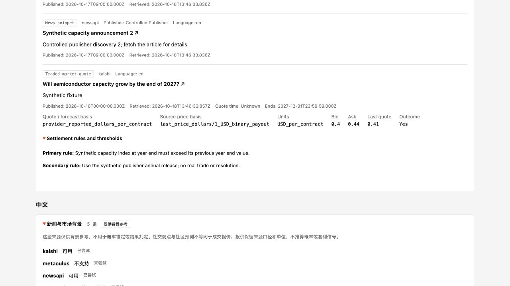

# Oddsense integration delivery and verification

All three user-approved slices are implemented and accepted locally on
`codex/oddsense-integration` in the isolated managed worktree. The original
checkout's 91-entry dirty baseline was preserved; its previously hashed files
have no drift. Runtime deployment and paid live-model evaluation were outside
the approved verification scope. Remote Git delivery remains blocked by the
previously observed invalid configured GitHub authentication.

## Delivered behavior

**OS-1:** Both research engines expose `news_search`, optional `social_search`
and the shared context tool boundary. Configured NewsAPI discovery is actually
prefetched before investigation, selected publisher pages use the existing fetch
owner, and provider/type/publication/retrieval metadata survives ledger storage,
QA citation renumbering and research output. The same owner enforces physical
request budgets, cross-process singleflight, interrupted captures, safe bounded
storage, sealed replay and strict tamper/identity checks. An explicitly new run
can archive its previous exact capture/state and retire the old cached client;
resume cannot use that transition to recover missing or corrupt evidence.

**OS-2:** `market_compare` uses the existing Polymarket normalization and a
current-schema Kalshi adapter. Native identity, literal outcome, quote prices,
basis, units, rules, thresholds/horizon and unknown quote age remain explicit.
The shared store reserves every physical request before I/O, including across
processes/crashes. Metaculus reports unsupported until authenticated access is
established. Bounded catalog search discloses incomplete recall. New contextual
rows never become Polymarket IDs, automatic forecast anchors or settlement data.

**OS-3:** The immutable carrier participates in research promotion, merge,
fingerprints, stage reuse and consumed-generation binding. Ordinary, manual and
seed/ensemble report construction share the carrier. Report-local persistence,
audited Markdown, APIs and exports retain its evidence; the shared EN/ZH UI shows
source states/times, quote values/bases/units, original-ledger labels and optional
native settlement rules/horizons/thresholds. Only exact validated machine-owned
metadata receives metadata treatment before final audit. Authored/forged prose,
modified captures and ambiguous owned boundaries remain rejected.

## Executed evidence

The final resumed gate supersedes the historical gates below: **1,455 passed,
two existing harness skips**, across 22 suites on the exact final backend bytes.
[Final completion](evidence/delivery-reviewed-completed.json) and
[final JUnit](evidence/delivery-reviewed-junit.xml) record exit zero, no source drift
and preserved identity. The earlier verdict is retained in
[the pre-timing record](evidence/pre-idle-budget-verification.json).

| Gate | Result | Durable or original evidence |
|---|---|---|
| Complete relevant backend matrix, 21 suites | 1,397 passed, two existing vendored-harness skips, zero failures/errors | [Completion](evidence/joint-final-completed.json), [JUnit](evidence/joint-final-junit.xml) |
| Final mixed official/context metadata delta | 92 passed, including real Chinese/English publication/API/download/export and foreign-authored-prose rejection | [Completion](evidence/mixed-metadata-final-completed.json), [JUnit](evidence/mixed-metadata-final-junit.xml) |
| Final bilingual and affected report/E2E regression | 61 passed | [Completion](evidence/bilingual-final-completed.json), [JUnit](evidence/bilingual-final-junit.xml) |
| Distinct backend cases across those accepted gates | 1,437 passed, two skipped; overlapping runs are not added together | [Machine-readable verdict](final-verification.json) |
| Frontend full suite / production build | 187 passed; build passed, 708 modules | [Unit log](evidence/frontend-unit-final.log), [Build log](evidence/frontend-build-final.log) |
| Existing native deployment fixtures | Nine fixture cases and nine boundary controls passed | [Parent receipt](evidence/native-deployment-completed.json), [Worker receipt](evidence/native-deployment-worker.json) |
| Static env-pin fixtures in a separate OS sandbox | 18 passed; outside read/write and network controls denied as expected | [Receipt](evidence/native-envpins-completed.json), [JUnit](evidence/native-envpins-junit.xml) |
| Python lint / shell / env documentation | Zero introduced F/E9 findings across changed Python files; eight findings match baseline. Shell parses and every Config variable is documented. | [Lint/source receipt](lint-verification.json), `check_env_drift.py --strict`, `bash -n setup.sh` |
| Independent review | All concrete provider/research and downstream/lifecycle findings closed for recorded bytes, including the final backend/UI deltas | [Provider review](provider-review.md), [Downstream review](downstream-review.md) |

The complete backend matrix records four denied subprocess and 18 denied
external-read attempts from contained discovery paths, plus 26 allowed guarded
children including intentional crash controls. These are retained attempts, not
zero activity. Focused new-tool/E2E gates separately demonstrate their declared
boundaries. The CPython audit hook is not an OS sandbox. Native sidecar evidence
is distinct. All accepted receipts preserve identity and report no source drift.

The final language-metadata change affected only `report_agent.py` and
`test_news_report_metadata.py` after the complete matrix freeze. Its 92-case and
61-case gates cover those current bytes, including the complete four-case
workflow. The final UI additions have their own 187-case/current build and visual
evidence. Historical receipts are not reassigned to newer source hashes.

## What the end-to-end test actually exercised

[The controlled workflow receipt](evidence/oddsense-workflow.json) records the
production `_Engine.execute`, actual new tool dispatch, native-shaped HTTP
decoding, selected page fetching, SourceLedger reload/provenance, real QA,
pre-QA sealing, parent promotion and consumed-generation binding. It then uses
actual ReportManager assembly, report stabilization, final read-only audit and
publication admission, real Flask dossier/report/download routes and the actual
Markdown/demo exporter. Download/export bytes match the audited Markdown.

The investigator and writer inputs, research output, final report and export
retain the supplied native quotes, units, literal Yes outcome, both settlement
rules and explicitly unknown quote time. Three physical scripted market HTTP
requests equal the persisted admissions: Polymarket one, Kalshi two, Metaculus
zero. Replay performs no new acquisition; research/report tampering receives
real provenance/publication rejection. Optional Reddit denial/unknown-time and
feature-off cases remain distinct. No publication or QA gate was bypassed.

Model responses, publisher pages and provider payloads in this controlled test
are scripted. This establishes actual workflow wiring and consumer behavior,
not live LLM selection, forecast quality or production deployment.

## Separate live source compatibility

The final client probe used the supplied NewsAPI credential only in transient
process memory and the HTTP auth header. It returned **19 dated news articles**.
The final source-aware client also returned **eight Polymarket context rows**;
Kalshi's bounded catalog scan correctly reported partial coverage. Independent
earlier public Kalshi list/detail/cursor probes returned HTTP 200 with the current
singular/dollar/fixed-point schema. Reddit returned HTTP 403 and remains disabled
by default; Metaculus is explicitly unsupported without authenticated access.

[The sanitized final live receipt](evidence/live-final-compatibility.json) and
[status/count summary](evidence/live-final-summary.json) retain exact tested code
hashes and capture digests. Full live article/market payloads stay outside Git.
Two bounded keyed NewsAPI requests were used across the separate compatibility
probes. No actual credential value was saved to configuration, code, argv,
fixtures, logs or the repository. No existing run or paid model was used.

## Visual verification and use

The actual compiled shared component was rendered with the actual controlled
workflow capture, not hand-authored substitute widget markup. Its EN/ZH native
details controls, source statuses, timestamps, quote basis/units/prices, unknown
quote age and settlement rules were inspected in a temporary localhost preview.
The preview server and temporary tabs were stopped afterward.

For new runs in this checkout, supply `NEWSAPI_API_KEY` through the backend's
runtime environment and follow [.env.example](../../../.env.example). The source
key's actual subscription is not inferred: NewsAPI delay/history/access limits
remain plan-dependent. Existing setup/launch synchronization deploys the three
new bare-import modules and preserves user configuration. This task does not
restart a running backend, merge over unrelated dirty work, enable schedules,
launch paid simulations or publish a remote branch.

The implementation/acceptance work is complete. Remaining external work is valid
Git authentication for remote delivery and any separately requested deployment
or live model evaluation. Existing unrelated Polymarket price/status findings
remain in [the scoped issue ledger](issues.md), with no unrequested repair.

## Final resume: source-acquisition timing

A final source check found that ten seconds measured from first prefetch included
model planning time. Deterministic scenarios reproduced both news and market
non-dispatch after a simulated two-minute gap. The shared envelope now tracks
cumulative monotonic acquisition time, reserving time before I/O and retaining
that reservation on process interruption. Native market transport receives the
store residual deadline. Caller deadlines and physical request caps still apply.
Legacy unsealed captures with unknowable elapsed time conservatively permit no
new acquisition; sealed replays stay unchanged.

The first transition run passed188/two failures: one fixture incorrectly expected
`ok` for an empty market capture, and one old crash fixture expected fresh I/O
after an interrupted callback whose elapsed time is unknowable. Corrected tests
require `verified_empty` and conservative durable time exhaustion, respectively.
The final focused gate passed196; the full22-suite gate passed1448/two existing
harness skips. The actual Engine-to-QA/ledger/promotion/binding/report/publication/
API/export test also simulates the planning gap before its real investigator
source calls. The prior end-to-end receipt is preserved as
[historical trace](evidence/pre-idle-budget-workflow.json); the
[current trace](evidence/oddsense-workflow.json) records the current18 hashes.

The latest full gate retains four denied subprocess,18 denied external-read
attempts, three denied `os.kill` operations from existing controls and26 guarded
children including explicit crash/termination tests. The focused196-case gate
has no blocked events and22 admitted children. No guard was relaxed.
Prior live-source results retain their own source hashes; provider endpoints,
authentication and decoding were not changed by this timing repair.

## Independent timing review closure evidence

PR-4 and PR-5 were independently found after the1448-case timing pass; that
receipt applies only to its earlier bytes. The new focused red run produced
four failures/three controls, confirming false late classification after a slow
pending write and fresh allowance for three legacy positive-count shapes.
The repair compares against the original absolute grant and recognizes root
and per-query legacy physical-request counts when elapsed time is unknown.
Untouched legacy zero-count generations can acquire both permitted news
requests; sealed legacy replay preserves exact bytes.

The current22-suite reviewed gate passed **1455 tests/two existing harness
skips**, including all seven new controls and the actual full Engine-to-report
workflow on matching current source hashes. Its guard event categories match
the preceding broad gate. Red and green receipts are retained alongside
[evidence](evidence/receipt-index.json), and the preceding timing verdict/trace
are preserved as pre-review-timing-verification.json and pre-review-timing-workflow.json.

The independent exact-byte recheck closed PR-4 and PR-5 after the final reviewed
gate. All scoped provider and downstream findings are closed; see
[the final provider disposition](provider-review.md) and
[the downstream disposition](downstream-review.md).

## Local delivery

Implementation and evidence are committed as `69c124b34740ceed40dc670e33fc52b75d4f86b7` on
`codex/oddsense-integration`. The isolated worktree was clean after that commit;
this final documentation record adds no source changes. The original checkout
still has its91 pre-existing status entries and no hashed-file drift.
Remote push remains uncompleted after the earlier GitHub authentication failure.
No unchanged-credential retry, merge over original dirt, or deployment occurred.
