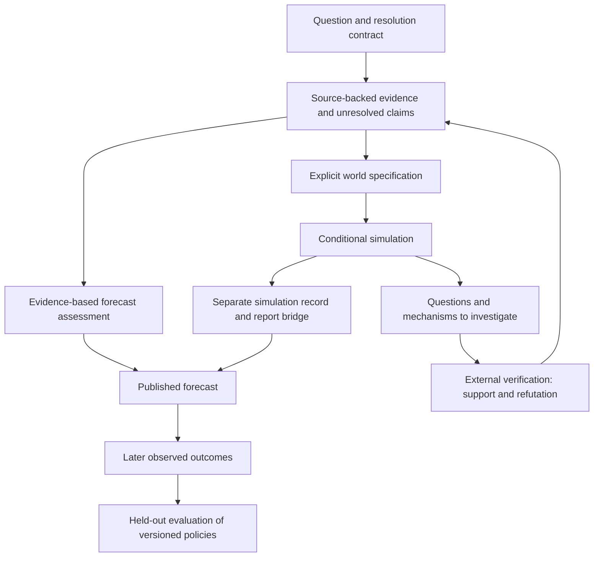

# First-principles review of DeepResearchForecast

The next architectural step should make the forecasting problem explicit, the evidence inspectable, the simulated mechanisms testable, and the value of each expensive stage measurable. Existing world contracts, provenance boundaries, private observations, deterministic mechanics and scoring infrastructure provide a foundation. This is a proposal to extend those foundations in bounded slices, not an implementation claim.

Evidence fidelity, simulation validity, forecast skill and operational reliability require separate scorecards. A faithful record says what the model did. It does not establish that its mechanisms describe the real world. A well-supported research report can still forecast poorly. Many plausible narratives or many model draws are not independent observations of the future.

## 1. Make the question and resolution contract authoritative

Concurrent working changes now add a source-bound `forecast_task_v1` calendar/objective contract in PREPARE. Extend that contract upstream to research and to outcome settlement rather than create a second competing contract. Before substantial research, represent the forecast target explicitly: proposition or quantity, population/geography, threshold and unit, horizon, information cutoff, settlement source, and treatment of revisions, ambiguity and missing observations. Broad outlooks can have several linked targets. Do not force every qualitative question into an arbitrary number of binary claims merely to satisfy a report quota.

Distinguish the event being forecast from the scenarios used to explain it. Keep the event contract stable. Scenario partitions may be revised when evidence reveals overlap or an omitted outcome, but the change needs an explicit version and mapping. A change in proposition definition must never appear as an evidence-driven probability update.

For example, “10 GW operational by the deadline” differs from capacity announced, financed, permitted, under construction or connected to the grid. That distinction determines the relevant sources, variables, actors and causal model. Work backward from the target: financing, permissions, construction, equipment, grid access and commissioning. Select actors because their feasible decisions affect those dependencies. Fame, mention count and graph centrality are insufficient selection rules.

Use the question to select an appropriate method. Some forecasts primarily need reference classes, time series or accounting constraints; some need strategic interaction. A simulation should have a stated reason to run and an explicit adequacy assessment when critical inputs or mechanisms are unknown.

## 2. Build on a register of pivotal claims

The current v3 note processor admits known citations and checks some numbers for findings already labeled VERIFIED. This is useful, but it does not establish semantic support: the correct number on the correct page may concern another company, year or metric. Ordinary source exports also leave `supports=[]` and `independent=None`.

A pivotal claim should carry its exact assertion, entity, metric, unit, reference period, modality, supporting/contradicting passage, source origin and observation/publication/retrieval/vintage dates. Keep three distinct judgments: the citation resolves; the values match; the passage supports the assertion. Then distinguish a source's assertion from independently corroborated observation and analytical inference. An accurately quoted company production target remains a target.

Apply the detailed contract first to claims that materially affect the forecast, world seed or action rights. A blanket annotation requirement for every sentence would be expensive and could encourage empty formal compliance. Missing data should remain unknown, with a consequence for model adequacy or uncertainty, rather than becoming zero, unlimited capacity or a fabricated point estimate.

Source independence belongs at the claim-origin level. Ten articles repeating one press release supply one origin for that claim. Conversely, a single data host can publish two independently produced measurements. Capture provenance before research agents summarize it away; preserve unresolved conflicts rather than resolving them by majority count.

The [FActScore paper](https://aclanthology.org/2023.emnlp-main.741/) provides a useful precedent for evaluating atomic claims against supporting sources. Its reported performance on its tasks is not a guarantee that an automated verifier will be reliable on this project's forecast claims.

Acceptance examples: reject right-number/wrong-entity, wrong-period, reversed-relation and target-as-actual cases; retain supported statements; duplicated origin evidence must not count as fresh independent corroboration. Fetching an old release today must not make its observations current.

Current anchors: [claim processing](/Users/rogerlin/Downloads/DeepResearchForecast/deerflow_bridge/linear_research.py:3035), [source-origin fields](/Users/rogerlin/Downloads/DeepResearchForecast/deerflow_bridge/linear_research.py:8387), [official-data numeric checks](/Users/rogerlin/Downloads/DeepResearchForecast/deerflow_bridge/linear_research.py:7965).

## 3. Let research revise the assessment

The v3 path constructs its scenario frame during scout/plan and later rewrites scenario-weight restatements to match that frame. This establishes consistency, but there is no dedicated evidence-conditioned revision step after the substantial gathering work. It is an anchoring risk in the research artifact; it is not proof that every final report probability is mechanically fixed there. The downstream scalar/band handoff is itself inconsistent: the producer emits `probability`, while one renderer reads `probability_band`; the report also consumes other carriers, including prose.

Preserve a labeled initial assessment, then produce a post-research assessment with the evidence and assumptions responsible for revisions. Freeze the accepted assessment before final writing. If scenario definitions change, version that change separately. Use “posterior” only when a specified probabilistic update warrants the term; another LLM judgment is still a judgment to evaluate.

The research controller should maintain unresolved pivotal claims and competing explanations. Search for evidence that could discriminate between them, including evidence against the currently favored account. Direct the budget toward uncertainty that could alter the answer. A practical triage heuristic is sensitivity of the forecast × unresolved uncertainty × likelihood that available evidence will resolve it, divided by investigation cost. This is a heuristic, not an exact value-of-information calculation.

Completion should distinguish sufficient evidence, budget exhausted, evidence inaccessible, and follow-ups rejected. Counts of new facts, search calls or citations are poor substitutes for the status of a decisive contradiction. One decisive document can matter more than dozens of new background facts.

A separate current forecasting issue deserves early attention: `_binary_quality` treats spread and a minimum number of high-conviction calls as publication-quality conditions. Justified 50% forecasts should be allowed. Keep collapse-to-0.5 as a diagnostic, but evaluate the model's sharpness and calibration over a fixed prospective question distribution. Publication gates should not manufacture confidence or reward selection of easier questions.

Acceptance: hold scouting constant and vary decisive evidence in opposite directions; require a properly justified changed assessment. Duplicate the same evidence and require no additional evidential update. Changing a scenario definition must trigger a non-comparability/version notice. A set of genuinely ambiguous forecasts must not fail solely for insufficient probability spread.

Current anchors: [planning](/Users/rogerlin/Downloads/DeepResearchForecast/deerflow_bridge/linear_research.py:6404), [weight enforcement](/Users/rogerlin/Downloads/DeepResearchForecast/deerflow_bridge/linear_research.py:7690), [scalar/band consumer](/Users/rogerlin/Downloads/DeepResearchForecast/backend/app/utils/actors.py:2973), [conviction gate](/Users/rogerlin/Downloads/DeepResearchForecast/backend/app/services/forecast_extractor.py:3318).

## 4. Make the world model an explicit hypothesis

A knowledge graph records entities and relationships. A causal simulation additionally needs mechanisms, constraints, time scales and an outcome evaluator. A relationship edge does not by itself specify the consequence of an intervention.

For each important mechanism, record what can change, who has the right to change it, prerequisites, resources consumed, counterpart consent, onset/completion times, effect rule, empirical basis and parameter uncertainty. Separate enforceable accounting/institutional constraints from uncertain behavioral or economic response models. A deterministic rule is reproducible; it is not automatically empirically correct.

World-v1 already implements important parts of this: conserved transfers, mandate and funding checks, consent, private observations and elapsed-time mechanics. Extend and validate these capabilities in a narrow domain before broadening the ontology. Model compiler proposals must bind rights and effect parameters to evidence or explicit assumptions; a technically valid generated model can still encode the wrong institution.

Institutional identity and role identity need special care. A government, its president, legislature and ministry can disagree and hold different powers, but they must not independently spend the same budget or acquire duplicate authority over one decision. Conserve resources and decision rights while retaining real internal conflicts. A generic influence weight cannot replace a veto, voting threshold, permission or appropriation rule.

Constrain actions before applying consequences. In the default OASIS path, incoming offer responses can crowd substantive options out of a truncated menu; custom moves and capacity accounting deserve the same admission checks. Option lag and an announced commitment should not be mistaken for mechanically completed investment. Accepted commitments also need operative terms: offer expiry, delivery deadline, duration and fulfillment condition are different quantities. The current generated OASIS acceptance path defaults to next-period obligations; world-v1 already supports template-duration and beyond-horizon pending commitments.

Acceptance: cost-2 actions cannot execute with capacity 1; adding offers must not silently remove every substantive affordable option; announcements do not increase completed capacity; no double spending across institutional roles; a valid veto changes the applicable outcome despite unchanged opinion counts; obligations beyond the horizon stay pending. A 90-day pause is not automatically a delivery deadline on day 90.

The [ODD model-description protocol](https://www.jasss.org/23/2/7.html) is a useful design discipline: make purpose, variables, scheduling, initialization, mechanisms and evaluation criteria explicit. Adopting its checklist would improve inspectability; it would not validate the model by itself.

Current anchors: [world-v1 mechanisms](/Users/rogerlin/Downloads/DeepResearchForecast/backend/app/services/world_simulation/kernel.py:104), [institutional checks](/Users/rogerlin/Downloads/DeepResearchForecast/backend/app/services/world_simulation/kernel.py:638), [OASIS menu](/Users/rogerlin/Downloads/DeepResearchForecast/backend/app/services/agent_decision.py:407), [OASIS acceptance deadline](/Users/rogerlin/Downloads/DeepResearchForecast/backend/app/services/world_model.py:1617).

## 5. Reflexivity requires a distinction between state, observation and belief

The desired loop is modeled state → actor-accessible observations → beliefs and incentives → feasible actions → consequences → new observations and revised behavior.

“Authoritative state” here means true inside the simulated model, not verified real-world truth. Keep that state distinct from what each actor observes and believes. An actor may receive delayed or incomplete evidence, misinterpret it, make a misleading public statement, or hold a mistaken belief. Those properties should affect its decisions through explicit information channels.

World-v1 already has actor-specific projections, private state and provenance-bound belief updates. Strengthen that existing mechanism with proposition-level semantics, uncertainty and explicit supersession: typed expectations with proposition identity, observation provenance, event/observation times, uncertainty and supersession. Avoid requiring invented numerical beliefs for every topic; introduce them where the model needs them. Preferences and beliefs should not share an undifferentiated prose memory.

Beliefs influence actions; actions and communicated signals can affect consequences. Private expected reactions should not become an independent instruction to the arbiter about what the world must do. During this review, concurrent arbiter changes removed private expected-reaction text from the visible move block. Preserve that separation and pin it with controlled-intervention tests; this is a later source observation, not a runtime acceptance claim.

Test actual behavior, not merely whether agents mention recent events. Deliver the same important signal now versus one period later; before delivery, observations and scripted decisions must be identical. After delivery, a predefined decision contrast should change appropriately. An irrelevant or inaccessible signal should not leak into the action. Private-state changes should not appear publicly without an admitted communication or action channel.

A [2024 study of LLM social simulations](https://arxiv.org/abs/2412.05093) found sensitivity even to incidental prompt changes in the models/tasks it studied. This motivates local robustness tests; it is not an empirical verdict on the models currently configured here. Use opaque-ID, formatting and non-informative-label perturbations, alongside substantive interventions, to distinguish prompt artifacts from causal behavior.

Current anchors: [observations](/Users/rogerlin/Downloads/DeepResearchForecast/backend/app/services/world_simulation/observations.py:46), [belief updates](/Users/rogerlin/Downloads/DeepResearchForecast/backend/app/services/world_simulation/contracts.py:384), [arbiter inputs](/Users/rogerlin/Downloads/DeepResearchForecast/backend/app/services/world_update.py:272).

## 6. Give alternative worlds their own subsequent decisions

The current K-path implementation varies world updates, seeded shocks/effects and arbiter calls while sharing path-0 actor decisions. This is useful fixed-decision consequence variation. It does not model how actors adapt to each sibling's different world.

Add selective closed-loop branching at consequential decisions or events. After a branch, build each actor's subsequent observations, beliefs, options and decisions from that branch. Sampling one alternative decision and then sharing all later decisions would still miss adaptation. Start with a few pivotal actors and events; branch count alone is not a quality goal.

Separate uncertainty about initial conditions, model parameters, mechanisms, actor strategy, external shocks and model sampling. Draw persistent unknown parameters consistently within a path; do not replace them with unrelated noise every period. Controlled paired scenarios can share appropriately keyed exogenous randomness to make causal differences easier to interpret.

Curated stress scenarios and probabilistic samples have different meanings. Record the sampling/selection design and any defensible weights. K-path quantiles and self-consistency ranges are conditional summaries, not calibrated real-world prediction intervals. A path frequency is not a real-world event probability unless the model and sampling distribution justify that interpretation.

Acceptance: close a trade route in one branch and keep it open in another. Affected actors must observe the branch-specific state and have the opportunity to reroute; controls receive no premature information. Within each open-route/closed-route scenario, compare fixed and adaptive policies using identical initial conditions and keyed exogenous draws. Match external inputs rather than realized consequences, since actions can change exposure. Record both behavioral differences and incremental cost.

Replay is a prerequisite for attributing these effects. Persist OASIS decisions, exact observations/menus, validated arbiter updates, effective settings and random-draw identity. World-v1 already provides deterministic transition checking; extend it. Replaying unchanged decisions through a changed kernel tests mechanical sensitivity, but cannot measure the actors' subsequent adaptation.

Current anchors: [K-path contract](/Users/rogerlin/Downloads/DeepResearchForecast/backend/app/services/world_paths.py:1), [decision reuse](/Users/rogerlin/Downloads/DeepResearchForecast/backend/scripts/run_parallel_simulation.py:4747), [world-v1 replay](/Users/rogerlin/Downloads/DeepResearchForecast/backend/app/services/world_simulation/store.py:1153), [arbiter update recording](/Users/rogerlin/Downloads/DeepResearchForecast/backend/app/services/world_update.py:1015).

## 7. Use simulation to propose investigations under a strict boundary

A promising use of simulation is to discover mechanisms, assumptions and evidence gaps that the initial research missed. Its output can be a bounded question queue: what assumption would make this path feasible, and what external observation could corroborate or refute it?

There is no simulation-events-to-evidence shortcut. A simulated financing problem might lead to investigation of real maturities, covenants and funding commitments. Only admitted external evidence can change the research assessment. Keep the information cutoff, source-dependence checks and hypothesis origins intact.

External verification alone does not eliminate selection bias: a simulation can repeatedly suggest questions supporting its preferred story. Include opportunities for refutation and compare the resulting discoveries with a simpler pivotal-claim gap selector. Ideally verification is blind to how the question was generated. Failure to find evidence is not automatically evidence against a hypothesis.

Do not build an unbounded loop. Begin with a bounded experiment, then retain the loop only if it discovers useful independently supported material at acceptable total cost.

A key correction to the previous roadmap: under the completed diagnostic-only boundary, changing simulation while holding admitted evidence fixed must leave effective probability requests unchanged; replaying the same model responses should give the same probabilities. Independent stochastic provider calls can differ without a simulation effect. A same-evidence simulation-on/off comparison is therefore an isolation test. It cannot establish forecast-probability lift for this policy.

To test forecasting value, compare simulation-guided investigation with equal-total-cost investigation without simulation. If direct simulation-based probability updates are ever desired, preregister a separate shadow policy and test it prospectively; do not weaken the current boundary to make the comparison interesting.

## 8. Let measurement determine which components deserve their cost

The project already has backtest, scoring, publication and typed outcome infrastructure. Extend these rather than build a second measurement stack. Existing arm names do not isolate research, graph and simulation effects: some arms change market policy, simulation arms use legacy probability exposure, and every arm requests a full pipeline. The world-channel arm is not a test of the opt-in world-v1 engine.

Use one primary contrast at a time:

| Component | Controlled comparison | Useful outcome |
|---|---|---|
| Research acquisition | Lightweight retrieval vs deeper research with the same forecaster, market policy and total budget | Pivotal-claim quality and prospective score/cost tradeoff |
| Graph representation | The same admitted propositions in a source-linked table vs ontology/graph | Better retrieval/reasoning or lower cost, then forecast outcomes |
| Simulation diagnostics | Simulation vs equal-budget structured adversarial review, with probabilities fixed | Independently supported omissions found, false alarms and reviewer effort |
| Simulation-guided research | Simulation questions vs a simpler gap selector; same evidence admission format | Better external discoveries and forecasts at matched total cost |
| Feedback policy | Frozen recalibration or lesson selection fitted on earlier event families | Improvement on untouched future families |

Enroll questions and arms before outcomes, preserving the full denominator: failed runs, abstentions, pending, overdue, disputed and void cases. Resolve outcomes against predeclared criteria and vintages. Do not resolve unknowns as No. A market's extreme price is not automatically an authoritative final settlement. Manual adjudication needs an explicit evidence and revision policy.

Use appropriate base-rate, persistence and timestamped market baselines where relevant. Keep questions fixed across arms and allow cheaper methods to use their saved budget productively. Charge acquisition, simulation, verification, retries, failures and synthesis—not just successful model calls. Separate coverage, latency, cost, calibration and overall probabilistic accuracy.

Evaluate related questions and revisions as event families. Seeds, agents, paraphrases and paths do not create independent real-world outcomes. Use family-aware uncertainty estimates and a preregistered practical improvement margin. A small pilot validates measurement and estimates variance; it does not prove superiority. No generic “30 resolved questions” or “six weeks” threshold is justified without effect-size and dependence assumptions.

Historical source cutoffs do not remove outcome knowledge already in model weights. Use historical cases for debugging and controlled behavior tests, and future unresolved events for predictive evaluation. [ForecastBench's published design](https://proceedings.iclr.cc/paper_files/paper/2025/hash/ea74e45a229dac70b5b63b28d8934db6-Abstract-Conference.html) provides a relevant example of submitting forecasts before outcomes are known. Its existence does not establish this application's accuracy.

Current anchors: [arm policy](/Users/rogerlin/Downloads/DeepResearchForecast/backend/app/services/backtest_mode.py:36), [full-pipeline requests](/Users/rogerlin/Downloads/DeepResearchForecast/backend/scripts/backtest_eval.py:82), [paired scoring](/Users/rogerlin/Downloads/DeepResearchForecast/backend/scripts/backtest_eval.py:326), [forward scoring](/Users/rogerlin/Downloads/DeepResearchForecast/backend/scripts/backtest_eval.py:517), [typed outcome registry](/Users/rogerlin/Downloads/DeepResearchForecast/backend/app/services/forecast_feedback.py:236).

## 9. Suggested next increments

Start prospective enrollment and outcome-quality checks alongside engineering. Then take these narrow slices in order, adjusting from evidence rather than assumed calendar durations.

| Priority | Slice | Acceptance evidence |
|---|---|---|
| 1 | Forecast contract plus pivotal-claim support; review conviction/spread gate policy | Correctly reject entity/period/modality substitutions; preserve justified uncertainty and exact resolution identity |
| 2 | Versioned post-research assessment and explicit stopping reasons | Decisive counterevidence changes the assessment; duplicated evidence does not; inaccessible evidence is not called complete |
| 3 | One domain's action/authority/deadline contracts plus replay-complete traces | Resource conservation, no duplicate authority, correct deadlines and reproducible transitions |
| 4 | Selective closed-loop branches and information interventions | Correct branch-local behavior, no hidden-information leakage, measured incremental cost |
| 5 | Bounded simulation-generated investigation experiment | More useful externally verified findings than the simpler selector at equal total cost; later prospective score evidence |

A well-observed capacity-deployment problem is a plausible pilot because financing, permitting, construction and commissioning have distinct observable milestones. A specific institutional policy process is another option. Treat pilot selection as a scope decision; success in one domain does not establish realism for geopolitical crises or decade-long industry forecasts.

Use existing provenance/checkpoint infrastructure to pin effective model/prompt/configuration versions and resume only affected work. Separate provider failure, insufficient evidence and model inadequacy. Make upstream typed artifacts the authority and render prose from them where practical; avoid repeated prose-to-JSON-to-prose reinterpretation of the same numbers and dates.

No runtime behavior, model, automation, engine default or probability policy was changed in this review. The proposals require their own implementation plan and acceptance. The source observations are static evidence; the suggested gains remain hypotheses.

## Review boundary and concurrent work

Three bounded readers covered research, simulation and evaluation; a separate skeptical pass found no blocking recommendation issue after clarifying existing belief updates and matching exogenous inputs across policy arms. During the final source check, `world_update.py` and `run_parallel_simulation.py` changed concurrently. Their inspected earlier bytes were recoverable by hash; a bounded recheck found new strict arbiter contracts/repair diagnostics, removal of private expectations from the move prompt, and forecast-task/calendar validation. The main recommendation is therefore to extend this work semantically, not duplicate it. The new `forecast_task.py` was inspected for its horizon-binding scope only. No acceptance verdict is given for those other working changes. The updated hashes and earlier observation identities are retained in source-evidence.json.
