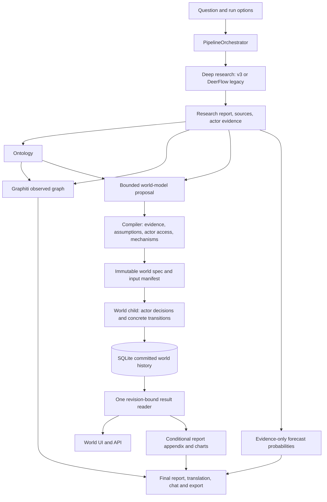
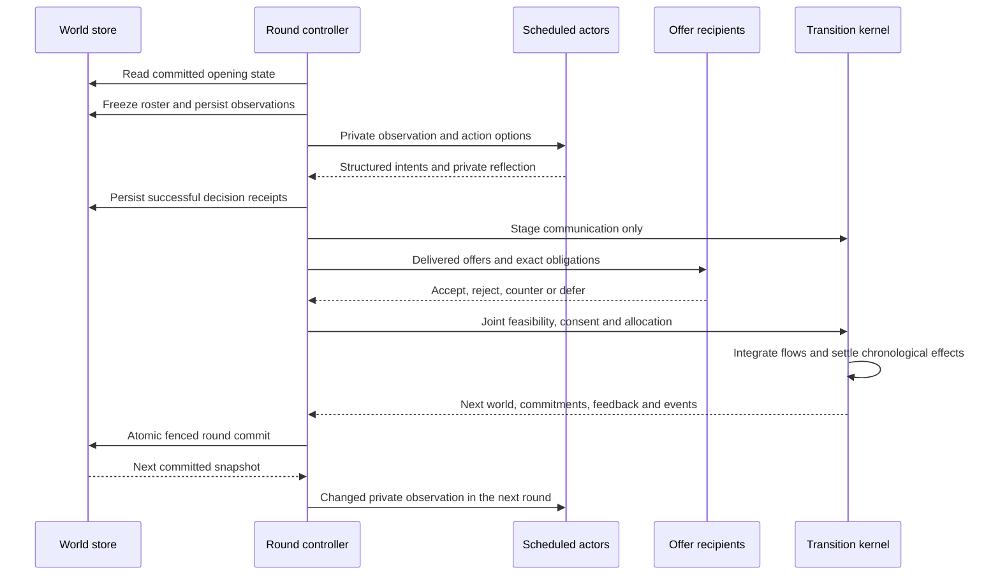

# Reflexive world simulation: architecture and workflow

This implementation branch is `codex/reflexive-world-simulation`, based on main commit `8852ce123fa15a6b4f4c3e6e4e492435c0e3137b`. The existing [system atlas](../../architecture/DEEPRESEARCHFORECAST_SYSTEM_ATLAS.md) and [DeerFlow atlas](../../architecture/deerflow2/DEERFLOW_2_ARCHITECTURE.md) describe their explicitly dated earlier snapshots. This report documents the changed Python workflow and its current consumer boundaries. The implementation is available by explicit opt-in. The live study did not pass the promotion gate, so the default remains `oasis-legacy`. The [delivery and evaluation report](DELIVERY.md) records results and limits; synthetic mechanics and model behavior are separate evidence gates.

## From evidence to an evolving world

The existing [PipelineOrchestrator](../../../backend/app/services/pipeline_orchestrator.py) remains the workflow authority. It runs research, ontology, graph, preparation, simulation and reporting, retaining durable stage state and artifact manifests. Research engine selection and simulation engine selection are separate: either research path can prepare `world-v1`. Missing historical simulation pins mean `oasis-legacy`; unknown or conflicting pins fail admission.

The [DeerFlow bridge](../../../deerflow_bridge/deerflow_research.py) dispatches the researched evidence workflow; the current v3 path is implemented in [linear_research.py](../../../deerflow_bridge/linear_research.py), while the legacy path uses the DeerFlow agent harness. The [actor research skill](../../../deerflow_bridge/skills/actor-ontology-research/SKILL.md) and [actor context validator](../../../backend/app/services/actor_context.py) remain source-authority boundaries. The new [compiler](../../../backend/app/services/world_simulation/compiler.py) derives a separate world model; it does not edit or manufacture research seals.

The orchestrated research default is v3; a pinned sealed-actor requirement selects legacy. Direct bridge CLI runs retain their historical legacy default when `RESEARCH_ENGINE` is unset. V3 runs seven durable phases: plan, official data, bounded agentic gathering, gap filling, synthesis, QA and finalization. The legacy route retains the DeerFlow agent harness and its research contracts. Both reach the same downstream report/source/actor handoff, while their evidence grades remain distinct. The world child is a separate execution harness with a causal round barrier; it does not replace the research harness or send its generated future events back as research evidence.

Legacy actor input uses the exact actor object, source ledger and dossier so existing source fingerprints can be verified. Unsealed v3 candidates keep their lower evidence grade. Actor names and identities cannot be reassigned through invented aliases. Private/modeler claims cannot enter actor profiles, visible records, action descriptions or effect values merely by being relabeled as assumptions. A number in prose does not establish spendable cash, installed capacity, a vote entitlement or a causal coefficient. Operational source quantities need matching typed evidence and units; otherwise preparation requires an explicit scenario assumption or reports a modeling gap.

The [modeler producer](../../../backend/app/services/world_simulation/modeler.py) can generate a candidate from the research report, actor evidence, ontology and question using an explicitly supplied supported HTTP policy. It persists an attempt reservation before dispatch, allows two attempts across resume, retains unknown exposure, and deducts preparation charges from the remaining actor-run budget. The model may propose JSON, never executable transition code. The deterministic compiler owns admission.

## What happens during a round

The [controller](../../../backend/app/services/world_simulation/controller.py) reads one committed opening snapshot. Each scheduled actor receives a private [observation](../../../backend/app/services/world_simulation/observations.py), its own goals/values/incentives/beliefs/constraints, permitted world facts and a bounded action menu. Menus omit privileged mechanism parameters and hidden counterparty feasibility. The same observation bytes are used on retry. A single allowed repair can also receive a bounded, JSON-quoted message about its own validation error; that message is included in request-cost admission and grants no new world facts or actions.

The [kernel](../../../backend/app/services/world_simulation/kernel.py) supports transfers, investments, agreements, policy changes, formal votes, messages, explicit breach and waiting. Parameters declare costs, lead times, prerequisites, counterparties, units and authority. Messages do not create capacity or cast votes. Agreements require exact terms-version consent from every obligated principal before reservations. Gross debit checks prevent circular transfers from manufacturing funds. Votes are independent and institutional funds follow the declared voting mechanism. Accepted commitments can be grandfathered across later policy changes.

Time advances even during quiet rounds. Initial due effects settle before the first observation; newly accepted immediate effects occur after that round's decisions; interval flows are integrated between effect boundaries; horizon effects settle without an extra terminal decision. Pending commitments and offers survive beyond the horizon and remain visible as unsettled obligations. Unsupported coupled-flow allocation is rejected instead of assigning an invented physical rule.

Actors receive their own generic action results and a bounded permitted-event history at the next decision. This includes rejected actions, allowing revision rather than silent repetition. Delayed communications cannot leak through early event receipts. Belief and plan updates retain decision/observation provenance; stable values/goals cannot be rewritten by arbitrary model output. Priority changes require declared visible triggers.

## State, recovery and request budgets

| Authority | Owner and durable artifact | Contract |
|---|---|---|
| Workflow stage | PipelineOrchestrator and `pipeline_state.json` | Research/prepare/run/report authority stays in the existing pipeline. |
| Prepared model | [artifacts.py](../../../backend/app/services/world_simulation/artifacts.py), `world_spec.json`, `world_input_manifest.json` | Exclusive preparation; canonical byte pins; immutable generation. |
| Committed world | [WorldStore](../../../backend/app/services/world_simulation/store.py), `world.sqlite3` | SQLite WAL/FULL; one fenced writer; complete world/actor/pending/sampling closure. |
| Tentative round | SQLite observations, decisions and dispatch receipts | Stable slots, exact identities, nonrenewable attempt allowance, successful peers reused on resume. |
| Runtime projection | [service.py](../../../backend/app/services/world_simulation/service.py), `world_run.json` | Lifecycle status follows the admitted launch and committed completion. |
| Public result | [results.py](../../../backend/app/services/world_simulation/results.py), result JSON and manifest | One committed revision; public/actor/analyst projections; GET never repairs. |

The [child entry](../../../backend/scripts/run_world_simulation.py) receives the parent's admitted manifest digest and launch identity. The launch lock prevents concurrent processes; SQLite fencing also rejects stale tentative writes. A rejected second child cannot overwrite the active owner's status. Cancellation preserves valid receipts and stops before another dispatch or commit. A final commit followed by an interrupted export can be recovered only when each existing export piece matches a real committed revision; arbitrary modified result bytes are rejected.

Fresh preparations pin `interactionQueuePolicy: "presented-v1"`. When a recipient's eligible inbox exceeds its cap, the committed world records which offers that recipient actually saw, including after a valid wait. The next round prioritizes less recently presented offers. Cursors stay outside actor/API projections, do not grant consent, and cannot advance on a failed round. Saved worlds without this pin keep their original ordering and exact replay behavior; forks inherit the parent's choice. The public list and detail endpoints both derive status from the same world runtime projection without rewriting preparation artifacts.

The [strict HTTP policy](../../../backend/app/services/world_simulation/policy.py) disables SDK/transport retries, redirects, auth flows, tools and implicit provider fallback. It uses pinned provider/model/endpoint, context/output bounds and conservative tariffs. Each actor has at most two actual requests per stable phase slot, including malformed output and unknown disconnected calls. The modeler has its own durable two-attempt allowance. Opaque CLI providers do not satisfy this contract. Usage is parsed before SDK type coercion; mismatched model identity or untrustworthy counters retain unknown exposure. Request ceilings are not a billing statement.

Fresh actor HTTP replies now pass public input-grammar and exact offer-reference checks against the observation captured from the serialized request before dispatch. A rejection retains known usage and may use only the existing second attempt. The shared scalar helper omits private actor-roster membership only in this public preflight; normal kernel checks retain it. Hidden economic feasibility remains with the kernel, and legal choices are not rewritten to match a rationale or evaluator. Historical receipts, cached decisions and modeler output do not pass through this new response gate, preserving prior rejected-action replay. Failed generation attempts and committed rejections are reported separately. The [versioned behavior reruns](behavior-rerun/public-grammar/REPORT.md) preserve their original outcomes; no default promotion follows from mechanical validation alone.

## Graphiti, forecasts and user-facing consumers

[Graph construction](../../../backend/app/services/graph_builder.py) continues to represent observed research and source relationships, and supports the existing report retrieval tools. World preparation receives the research/actor artifacts and ontology directly; this version does not fetch a second world model from Graphiti. Graph centrality supplies no monetary balance, legal authority or vote entitlement. Concrete simulation state lives in SQLite. World mode does not write hypothetical events into the observed Graphiti graph; actors instead receive committed feedback through the world observation path. No separate simulated graph namespace is activated in this version.

The [simulation API](../../../backend/app/api/simulation.py) exposes one committed result with revision conflict handling. [SimulationView](../../../frontend/src/components/research/SimulationView.vue) selects the saved engine; [WorldSimulationView](../../../frontend/src/components/research/WorldSimulationView.vue) presents world state, decisions/actions, commitments and assumptions. Actor and analyst views explicitly label private modeled state. Unknown values remain unknown. Future records are labeled simulated, link their committed round and retain initial evidence separately. Request epochs and cancellation protect run/view/round A→B→A changes.

[ReportAgent](../../../backend/app/services/report_agent.py) derives the saved engine itself and requires the frozen result and all state pins. It copies and binds exact result bytes into the report, builds a deterministic conditional-pathway appendix, and preserves that content through translation and export. [ReportVisualizer](../../../backend/app/services/report_visualizer.py) consumes the bound metrics and seals chart assets/dependencies. Report chat, direct generation, regeneration and [report APIs](../../../backend/app/api/report.py) use the same bindings.

The pinned `diagnostic_only` policy permits a dedicated conditional pathway; `no_update` keeps the world visible in simulation while excluding it from report reasoning and plots. Neither admits simulated trajectories into probability-generating input. Normal, failed/no-spine, missing-research, binary and repair paths use clean evidence. Simulated frequencies are not automatically calibrated probabilities.

## Operation and verification

The evaluated release decision retains `oasis-legacy` as the default; `world-v1` remains an experimental opt-in. An explicit `simulation_engine: "world-v1"` research request supplies either `world_spec` or `world_policy_spec` for automatic modeling. Direct preparation accepts the same sources and policy through `SimulationManager.prepare_world_simulation`; preparation pins the exact source generation. Use the existing run/status/stop endpoints. `GET /api/simulation/<id>/world` takes `view`, optional `actor_id`, `round` and `revision`. Changing a sealed model requires a new simulation/fork, not force-regeneration in place.

The [executable contract](implementation-contract.md) defines schemas, mechanisms and fields; [examples.py](../../../backend/app/services/world_simulation/examples.py) supplies synthetic investment/supply, trade/policy and coalition/institution examples. They exercise one engine, not three scenario-specific simulators. [acceptance-scenarios.md](acceptance-scenarios.md) maps requirements RW-01–RW-18 to their scenario checks.

The [offline wrapper](run_offline.py) freezes source outside the managed `.codex` path and invokes the existing guarded runner. The guard remains a CPython audit boundary, not an OS sandbox. Tests distinguish deliberate blocked controls from zero attempts. The [UI record](ui-implementation.md) distinguishes compiled component/SSR checks from browser acceptance. The [held-out evaluation](heldout-evaluation.md) uses 18 reflexive cases and 18 matched feedback-ablation controls, fixed case budgets, recorded model requests, independent qualitative review and separate responsiveness contrasts. Failure or missing cases remain in the denominator. This is a behavior experiment under declared mechanisms, not empirical forecast calibration.

## Observed results and release decision

The frozen live matrix reached 36 terminal cases: 30 completed and received independent-agent reviews of both focal decisions; six coalition cases failed or were stopped after transport failures. The unchanged rubric scored investment 84/96 (87.5%), trade 47/96 (48.95%), and coalition 48/96 (50%, incomplete). Paired feedback contrasts were seven passed, seven failed and four incomplete. These results do not meet the default-promotion gate. [Frozen report](live-evidence/report.json) and [individual reviews](live-evidence/qualitative-review.json) retain the original denominator and exact decision references.

Trade exposed a mismatch between its one-good objective and a proxy expecting repeated route choices: many actors had already bought a good and legitimately waited. Some actors also made unsupported explanatory claims, while the kernel rejected invalid interaction IDs, terms or quantities. The ablation changes a specified record field; public actor messages can still transmit related information. It is not a complete removal of external feedback. These limitations are recorded without changing the preregistered scores.

Across the five development/evaluation phases, conservative consumed exposure is USD9.222150955664 of the original USD25 authorization; USD15.777849044336 remains unused. This includes unknown calls and conservative earlier interruption ceilings and is not audited billing. No further provider batch is active. The final queue-fairness change was verified offline after this live batch; the recorded unpinned cases preserve their original behavior. See [live-budget.json](live-budget.json), [offline evidence](offline-verification.json) and [delivery verdict](DELIVERY.md).
