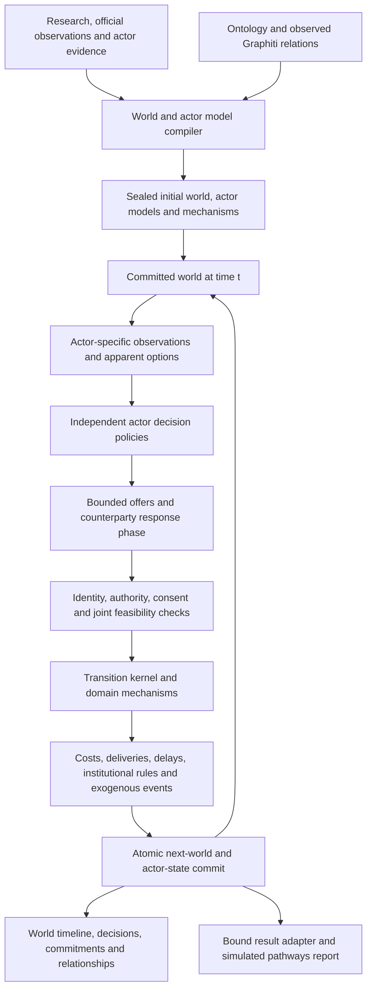

# Reflexive world simulation — implementation plan

**Status:** Independently reviewed; awaiting user approval before application implementation.
**Date:** 2026-10-16, Asia/Singapore.
**Branch:** `codex/reflexive-world-simulation`.
**Base:** committed main `8852ce123fa15a6b4f4c3e6e4e492435c0e3137b`.
**Authority:** this plan and [contracts.md](contracts.md) define the proposed interfaces. [handoff.md](handoff.md) records progress. [acceptance-scenarios.md](acceptance-scenarios.md) defines observable completion criteria.

## 1. Intended result

Make simulation an evolving model of actors and their environment. An actor can invest, negotiate, contract, allocate resources, seek or exercise authority, vote, withdraw, communicate or wait where its role and the scenario mechanisms permit. The environment records what those actions actually accomplish, including costs, delays, counterparty consent, constraints and uncertain outcomes. Subsequent choices use the changed world and each actor's own information.

The user selected **general cross-domain examples**. The same kernel must support investment/supply-chain, policy/trade and coalition/institutional cases. Domain packs define explicit mechanisms; the engine does not infer a universal law of economics or politics from graph edges or narrative plausibility.

The primary user experience becomes a dated world trajectory, consequential actions, pending commitments, changing relationships and actor responses. Public statements remain useful signals, but an announcement and a completed physical or institutional action have distinct records.

## 2. What current main supplies, and what must change

- `worldstate.py:122` represents a distribution over scenario names, updated by weighted commitments. It does not hold resource balances, asset ownership, rights or delayed obligations.
- `decision_channel.py:173` elicits `{scenario, magnitude, confidence}` from a roster. This is not an executable action or bilateral agreement contract.
- `run_parallel_simulation.py:3433` orders updates with platform watermarks; the two platform loops can continue before their shared world transition has committed. Platform checkpoints do not persist one coherent world/private-actor state.
- Existing actor intelligence, context and role code supplies identity, evidence and visibility machinery. Its textual capability/constraint claims need a separate executable model. The current canonical role also leaves objectives unspecified, and modeler material in actor-facing prompts cannot be reused as private-observation isolation.
- Pipeline admission, runner dispatch, completion evidence, API and UI assume Twitter/Reddit platforms. Their boundaries must recognize the new engine directly.
- Report generation currently has a no-spine fallback that extracts probabilities from report prose. Adding richer simulation prose requires closing that indirect path under the existing safe forecast policy.

These are current-source findings, not live-run reproductions. Exact anchors and analysis are in [runtime-input.md](runtime-input.md), [actor-input.md](actor-input.md) and [consumer-input.md](consumer-input.md).

## 3. Architecture decisions proposed for approval

1. **A new `world-v1` simulation engine.** Introduce it alongside explicitly identified `oasis-legacy`. Research engine selection remains independent. Old runs without new engine metadata remain legacy; existing results are not migrated by guessing physical state from posts.
2. **One authoritative world per simulation.** Use a simulation-local transactional SQLite store for committed rounds, events, commitments and actor policy state. The existing `PipelineOrchestrator` remains the overall six-stage workflow authority. This is not the broader workflow-database cutover described in ADR 0001.
3. **Structured actor decisions; validated world transitions.** LLMs choose actions and update modeled beliefs within bounded actor contexts. A pure transition kernel and registered domain mechanisms validate and apply consequences. Models cannot submit arbitrary state patches or executable code.
4. **One causal barrier.** All required decisions for a period resolve before its next world state is published. No actor starts the next period using an uncommitted or stale preceding state.
5. **Concrete stocks, flows, institutions and relationships.** Scenario probabilities are not the world-state storage model. Source evidence, assumptions, modeled actor beliefs, simulated changes and forecast outputs retain distinct provenance.
6. **Three domain packs through the same path.** The initial release contains bounded resources/projects, trade-policy/permissions and coalition/voting mechanisms. Each can be configured from a scenario model with explicit parameters. New mechanisms extend a registry, not ad hoc generated Python.
7. **World mode becomes the intended default for fresh full runs after acceptance.** It is opt-in while being built and evaluated. Existing runs retain their pinned engine. Unsupported world models produce explicit preparation gaps rather than silently falling back to a social simulation.

## 4. Component and round flow

The authoritative timing contract is in `contracts.md`. At a decision epoch, actors share one committed physical-state version but receive different permitted views. One proposal phase and one bounded counterparty response phase operate against it. A counteroffer requiring another decision remains pending for a later epoch. Resolution then stages immediate effects and advances physical/institutional processes over the declared interval. All due events through the interval end are resolved in explicit chronological order. The resulting `S(t+1)` is committed once, including its actor-state and pending-event closure.

An initial snapshot includes admitted events through the research cutoff. Later intervals are `(start, end]`; no future completion appears in an earlier observation. The time grid must resolve material decision/lead-time mechanisms. Physical substeps can occur within a period; actor responses occur at their declared decision epochs. A budget cap cannot silently coarsen away a critical institutional deadline or claim an unreached horizon was completed.

## 5. World model and causal mechanisms

The prepared model defines typed metrics with IDs, units, stock/flow/category semantics, ownership, initial values and provenance; assets and projects; active rules and mandates; relationships and agreements; scheduled events; and outcome predicates used for later analysis. Every mechanism has a versioned parameter schema, preconditions, effect semantics, timing, observability, resource accounting and uncertainty specification.

The initial primitives are resource reservation/transfer, delayed project completion, conditional agreements, scoped permission changes, quorum/vote decisions, disclosure and explicit wait. Domain packs compose these primitives with declared production/route/institution rules. They do not manufacture a price response, conflict-escalation probability or capacity-growth equation when no such model has been supplied.

Physical/resource impossibility and lack of execution authority are hard constraints. Contractual duties, norms and strategic red lines can instead carry modeled costs or penalties where the scenario declares a breach mechanism. A plausible violation is not silently equated with impossible behavior, and an unmodeled violation is not an unrestricted bypass.

Unknown values remain unknown. Zero, known empty and not applicable are distinct. Required missing authority, units or mechanism parameters block that action family or model readiness with a concrete reason. Explicit scenario assumptions can supply bounded values or alternatives and feed sensitivity runs; they are never relabeled as sourced facts. The first implementation has no universal scalar utility function and no universal causal solver.

## 6. Actor behavior and information

Compile a new `simulation-actor/v1` model from full admitted research evidence, before existing lossy profile/config projections. Preserve the current 17-dimension actor-intelligence schema and seal. Two adapters handle sealed legacy intelligence and unsealed v3 research with different evidence grades; neither adapter invents claim receipts or silently promotes v3 into the legacy contract.

An actor model includes objectives and ordinal priorities, durable values, preferences and incentives/disincentives, modeled beliefs, capabilities, controlled resources, decision rights, hard constraints, obligations, red lines, relationships, decision cadence and information channels. Values and facts are different concepts; public statements do not prove sincere beliefs. Where supported, objectives reference observable target predicates and deadlines. Missing weights remain missing instead of becoming arbitrary numbers.

The new actor renderer takes only permitted fields. Research-only calibration findings and another actor's private state are excluded from actual prompt/tool/history/retry bytes. Each actor has separately persisted beliefs, memory and current plans. A short declared rationale references visible observations and relevant objectives; hidden model reasoning is not an output requirement.

Menus show actions the actor can propose using known rights, own resources and visible information. They do not disclose hidden counterparty capacity by removing options. Global feasibility is checked later; rejection responses expose only information the actor is entitled to learn. Belief updates may be wrong or uncertain, while world facts and authority are still enforced by the kernel. Unsupported claims can remain labeled hypotheses but cannot create resources, rights or another actor's consent.

Deliberate decisions are independent actor calls with isolated contexts. Background flows and explicitly modeled nonstrategic entities can use rule policies. Actors may wait, maintain a prior plan, negotiate, withdraw or change priorities within their admitted model; the engine does not force constant activity or a preselected forecast scenario. Global forecast probabilities and hidden future event schedules are not actor beliefs.

## 7. Persistence, recovery and completion

Persist visible observations and accepted decision responses before resolving a round. Reuse them on a retry of the same decision slot; do not re-ask successful peers solely because one actor failed. A model response lost before durable recording can require another paid call; only the accepted recorded response influences the world. Exact replay means recorded inputs/events reproduce state, not that a fresh LLM invocation must return identical text.

One transaction commits events, resource changes, actor-state changes, pending obligations, unaccepted offers/messages and their delivery/response queues, randomness draws/state and the next snapshot/head. Stable idempotency keys and a fenced writer generation reject duplicate/stale effects and stale tentative receipts. Durable provider-attempt reservations survive crashes and resume; an exhausted allowance cannot silently reset. Provider failure, malformed responses, missing required actors and cancellation leave the last committed world intact and stop advancement after bounded retries. Valid abstention or deliberately inactive participation still permits due work and background processes to advance.

API/report/graph artifacts are derived projections. A crash after the transaction but before export rebuilds them from committed records without repeating actions. A world completion receipt binds engine, prepared model, actor roster, final world/round, horizon coverage, validity and result manifest. It replaces platform-end predicates for world mode rather than fabricating Twitter/Reddit completion. Pending commitments beyond the horizon remain pending and visible. No stopping rule declares success merely because agents were silent or scenario shares stopped changing.

## 8. Changes across the existing workflow

| Surface | Planned change |
|---|---|
| Deep research | Add an additive modeling-candidate sidecar for operational quantities, rights, dependencies, action families and unresolved needs; support both v3 and legacy. Keep actuals, plans, estimates and assumptions distinct. Bounded targeted research can fill missing inputs before preparation under the run's normal research budget. |
| Ontology/Graphiti | Add explicit asset, resource, project, mandate, institution and commitment relations where supported. Graph extraction supplies candidates/provenance; graph centrality is not cash, authority or votes. The simulation's structured store is authoritative for its own state. Optional simulated graph projections use a separate namespace and committed revision, never the observed evidence graph. |
| PREPARE | Compile world/actor models, validate readiness, pin mechanisms/assumptions/engine/effective policy and seal all referenced bytes. Keep research-generation binding before preparation. No post-seal mutation without a new sealed generation. |
| RUN and lifecycle | Add a thin engine facade used by pipeline and direct API admission, status, cancellation, completion, reuse, fork and seed execution. World mode launches its own child/controller. Preserve legacy OASIS semantics and avoid requiring CAMEL/OASIS for the new world's causal core. |
| API | Add one bounded world-result reader and cursor-bound projections for world state, decisions/actions and commitments. Views always refer to one committed revision. GET performs no provider calls or repair. |
| UI | Add engine-aware World, Decisions/Actions, Commitments and Assumptions views; round navigation, causal links, metric units and pending work. Preserve the legacy feed for old runs. Private modeled state is a separately labeled analyst view. Test EN/ZH, keyboard access and stale A→B→A responses. |
| Report and charts | Consume one frozen world result through main/direct/regeneration/chat/translation/export paths. Add dated simulated pathways, metric charts, causal chains and unsettled obligations. Simulated citations identify run/round/event; initial-source citations do not certify future simulated outcomes. |
| Forecasts | Preserve current safe probability policy, passed explicitly from the pinned run instead of ambient config. Supply clean evidence-only probability inputs even when the pre-prose spine fails. Simulation trajectories remain conditional modeled outputs; empirical simulation outcome frequencies are not automatically calibrated probabilities. |
| Existing harness | Append the approved feature/acceptance records without changing unrelated feature descriptions or pass flags. Use the current offline runner, fixture patterns and progress log; align English/Mandarin docs. |

The forecast work is part of this feature because rich simulation prose otherwise expands an existing fallback input path. Under `diagnostic_only`, simulated pathways may appear in dedicated analysis but cannot change probability-generating input bytes. Under `no_update`, they remain available in the simulation view but are omitted from report reasoning. A future calibrated promotion requires separate outcome-blind evidence under ADR 0002; this plan does not claim it has been earned.

## 9. Bounded implementation surfaces

Proposed new Python package: `backend/app/services/world_simulation/` containing contracts, compiler, observation projection, actor policy, mechanism registry, pure reducer, transactional store, round engine and result reader. Add one world child entry script and one thin shared engine facade; keep the facade contract centrally defined before consumers change.

Existing integration surfaces include `pipeline_orchestrator.py`, `simulation_manager.py`, `simulation_runner.py`, `simulation_ipc.py`, actor/context/role and ontology helpers, both research engines, `api/research.py`, `api/simulation.py`, `api/report.py`, report/forecast/visualizer code and the research simulation/report Vue components. Changes stay attached to concrete milestones. This plan does not authorize a wholesale rewrite of the workflow engine or import unaccepted Finharness/drf2 implementations.

## 10. Delivery milestones and evidence gates

| Milestone | Complete slice | Gate before moving on |
|---|---|---|
| M0 — Contract and baseline | Freeze reviewed schemas, mechanism definitions and three synthetic scenario fixtures. Characterize existing boundaries and record meaningful failing user-scenario evidence. | Failure reaches actual behavior, not a missing module/import. Shared interfaces, fixture assumptions and expected traces are checked in. |
| M1 — Executable world | Pure transitions, resource/authority/consent rules, delayed events, world store and recorded replay, using scripted actor policies. | All three domains show action→world→new-options→response; conservation, timing, conflicts, no-action and crash/duplicate controls pass. |
| M2 — Acting agents and preparation | Research adapters, typed actor/world compiler, private observations, actor policy calls with durable attempt reservations, one bounded response phase, durable policy/offer/message state. | Both research modes reach the same contract with honest evidence grades. Actual decision prompts exclude denied facts; feasible/action/rationale behavior and failed-provider handling pass with strict fixtures. |
| M3 — Pipeline and lifecycle | New engine selected and pinned through API/PREPARE/RUN, child process, status/completion, resume/cancel/fork and engine-aware seed paths. | Real public producer-to-consumer tests pass without bypassing seals or completion. Legacy fixture paths retain their original semantics. |
| M4 — Visible world and report integration | World UI/API, causal/pending views, bound report/visual/export/translation/chat adapters and safe forecast fallback. | One committed result agrees across API/UI/report/export; tampering/stale-view/visibility/policy negative controls pass. Each domain uses the same consumers. |
| M5 — Behavior evaluation and rollout | Held-out cross-domain model behavior review, bounded cost/latency accounting, documentation and default-admission decision. | Offline gates plus a separately authorized bounded live-model evaluation support the claimed behavior. New default admission is enabled only after reviewed evidence; rollback preserves old/new readers. |

Do not mark the overall feature passing after M1 alone. Each milestone has one bounded implementation/verification scope, and every producer change is accepted through its real consumer. Implementation can proceed through these approved milestones autonomously after plan approval; ordinary reversible design details do not require repeated approvals.

## 11. Acceptance and realism evidence

The mandatory matrix is in [acceptance-scenarios.md](acceptance-scenarios.md). It includes three complete cross-domain loops, five paired perturbations per domain, barrier/order controls, hidden-menu leakage, commitment timing, soft-obligation consequences, provider failure, crash/replay, engine identity, report policy and UI fidelity.

Mechanical acceptance requires zero accepted physical/authority/visibility violations, no duplicated settled effects, and complete causal references for consequential changes. Every cross-domain case must show the actor receiving changed permissible information/options and making the expected scripted response. Each round and action has an explicit outcome, including wait, not scheduled, rejected, failed and pending.

Model behavior is evaluated separately with held-out variants against an external-feedback-ablation baseline: goal/incentive consistency, appropriate response, feasible choices and explanation/record agreement. Proposed live evaluation is 18 reflexive runs (three domains × three held-out variants × two seeds) and 18 matched external-feedback-ablation controls, four decision periods and four principal actors, with a predeclared cost/token ceiling before launch. Freeze cases/rubric before execution; target at least 80% of 0–2 rubric points in each domain, with no hard validity/privacy failures. This is a behavior gate, not a demonstration of real-world forecasting accuracy. Historical/prospective forecast scoring requires its own uncontaminated dataset and promotion decision.

Use `backend/scripts/main_offline_pytest.py` with the existing compatible interpreter, `-I -S -B`, fresh evidence directories and its self-tests/receipts; inspect blocked-attempt counters. The guard is not an OS sandbox. Run focused actual Vue component tests and build after frontend changes, plus a focused browser scenario once implemented. No application tests or paid model/provider calls are part of this planning turn.

## 12. Assumptions, limits and approval boundary

- The first engine is single-host, with one writer per simulation and bounded concurrent actor calls. It uses existing backend provider infrastructure, not a new model/vendor dependency. World-mode preflight requires a transport with controllable request/retry/output/context boundaries; an opaque CLI is unsupported in strict-budget mode until those capabilities are demonstrated.
- Initial modeling cap proposal: 20 principal actors, at most three intents per actor per phase, one initial decision slot and at most one recipient response slot per actor; routine belief reflection is folded into those responses. Each slot permits at most two actual provider attempts in total, including retries, fallback and JSON repair. The world policy adapter must account at the actual provider boundary, preventing nested SDK/client retries from multiplying that cap. Caps, deadlines and mechanism/event limits are pinned in the run specification, never silently exceeded. Scenarios requiring more decisions than the budget can cover are explicitly incomplete or need a larger specification.
- Filtering proves controlled input isolation, not erasure of a model's pretrained knowledge. Behavior/backtest evaluation needs anonymous or outcome-blinded cases and prospective evidence before predictive claims.
- Domain equations, time resolution and initial resource parameters require evidence or labeled assumptions. Missing required mechanisms cannot be repaired by an unconstrained world-update LLM.
- The default world engine is promoted only after M5. Saved runs are never reinterpreted, resealed or resumed under a different engine/model generation. Rollback stops new world admission while preserving readable committed results.
- Existing source changes in the primary checkout and work on other branches are outside this isolated branch. Remote authentication was previously rejected; no retry with unchanged credentials is part of planning.

**Approval requested:** adopt this architecture and the staged implementation, including the cross-workflow changes and all three domain acceptance packs. The user's supplied AGENTS.md explicitly says to create PLANS.md and obtain plan approval before coding a complex feature. Application implementation is therefore pending that approval; the branch, source/design inputs, contracts and acceptance plan are prepared first.
