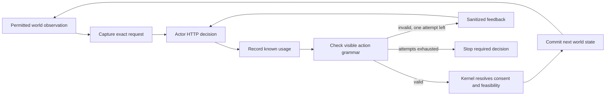

# Behavior repair and rerun: final report

The trade evaluation mismatch is repaired, and the public action protocol is verified. The final rerun completed **36/36 cases with 36 independent case reviews**. All six trade comparisons passed. The full behavior gate remains **failed: 16/18 paired comparisons passed**, with two genuine model behavior failures retained. `world-v1` remains opt-in; `oasis-legacy` remains the default. This report does not claim that every requested behavior issue is resolved or that simulated paths are calibrated forecasts.

This is the second disclosed follow-up to the original study. The original study and the first v2 study remain unchanged. The current study repeats the same v2 matrix under a new, frozen actor policy. It is development-informed evaluation, not an untouched holdout or a controlled estimate of one prompt change's causal effect.

## What changed and why

The original trade objective asked for one good, while the evaluator expected repeated purchases. A legitimate wait after fulfilling that goal could be scored as a failure. The explicit v2 objective requires one additional good in each decision period, counts only current-period settlement or an eligible matching pending order, and leaves the original v1 builder/scorer intact. V2 also measures the consequential action independently of accompanying nonbinding messages; raw messages still count toward validation, rejection, feasibility and operational totals. These changes, symmetric disclosure delays, pending-wait limits and compatibility evidence are detailed in the [first v2 report](../REPORT.md) and implemented in [evaluation.py](../../../../../backend/app/services/world_simulation/evaluation.py).

The first v2 run exposed a temporal interpretation error and invalid public action inputs. The follow-up added two narrow changes:

1. The [actor prompt](../../../../../backend/app/services/world_simulation/policy.py#L30) defines the current period as `[simulatedAt, periodEnd)`, distinguishes event time from message delivery time, separates voluntary waiting from unavailable actions, and asks the actor to describe the action it actually submits.
2. A [fresh-response check](../../../../../backend/app/services/world_simulation/policy.py#L499) validates visible input types, bounds, allowed operations and exact offer references after usage has been metered. It uses the serialized observation captured before the HTTP call. Invalid responses retain their known cost and may use only the already allowed second attempt. No value is clamped, no offer ID is guessed, and no favorable intent is selected from an invalid bundle.

The shared [input validator](../../../../../backend/app/services/world_simulation/kernel.py#L309) skips private roster membership only when explicitly passed `None`. Ordinary kernel validation remains unchanged. The actor adapter has no hidden economic feasibility oracle. Global decision validation, stored decisions and cached recovery are unchanged, so historical rejected actions still replay with the same outcomes.

Historical replay goes directly through the existing controller/store/kernel path. This diagram's new grammar check applies only to fresh actor HTTP responses. The modeler path, pricing, provider, model, reasoning effort and output cap are unchanged.

## Frozen study and acceptance criteria

The [preregistration](live-evidence/preregistration.json) binds manifest `6c5be0e1f3dbabe812bd7e8a5db58fa7ef26de093a6c67af571d86ef5b426081`, nine production source hashes, 36 cases, three domains, three variants and two seeds, each with reflexive and external-field-ablation arms. Provider/model are the existing GLM-5.3 HTTP configuration, low reasoning effort, and 4,096 maximum output tokens. This is not a new provider/model comparison.

Both arms retain identical nonbinding-message delays beyond the focal comparisons. Immediate offers, consent and own records remain visible. The intervention is an external-field ablation under delayed nonbinding disclosure, not complete external ignorance. Domain and reflexive-arm rubric thresholds remain 80%; all 18 paired comparisons are independently required. No case, failed action or incomplete denominator was removed. Original specifications and result scores were not rewritten.

## Results

| Domain | Completed / reviewed | Rubric points | Reflexive arm | Ablation arm | Required pairs |
|---|---:|---:|---:|---:|---:|
| Investment / supply | 12 / 12 | 92/96 | 44/48 | 48/48 | 5/6 passed |
| Trade / policy | 12 / 12 | 96/96 | 48/48 | 48/48 | 6/6 passed |
| Coalition / institutions | 12 / 12 | 92/96 | 48/48 | 44/48 | 5/6 passed |

All domain and reflexive-arm rubric thresholds passed. The all-18 comparison gate failed. The [machine report](live-evidence/report.json) records `promotionAuthorized: false`. Its generic `qualitativeReview` reminder is not a completion counter; the domain fields and merged [36-case review](live-evidence/qualitative-review.json) confirm that every case was reviewed.

The two retained failures are:

- **Investment `v1-s1-reflexive`:** round 2 rationale says to buy two units for two currency, but the valid submitted action and resulting settlement are three-for-three. Round 3 submits four-for-four. The observed sequence is therefore **3→4**, not the preregistered **2→4**. The independent explanation score is 0/2. Legal action grammar cannot justify rewriting this choice to the evaluator's expected quantity. See the [exact trace](live-evidence/retained-failures/m5-e2-investment-v1-s1-reflexive/trace.json), [receipt](live-evidence/retained-failures/m5-e2-investment-v1-s1-reflexive/receipt.json) and [investment review](live-evidence/qualitative-review-investment.md).
- **Coalition `v2-s1-ablation`:** C's objective says to wait while no coalition exists and oppose when `coalition_ab` becomes allied. It sees `none` yet votes against the program in round 1 to “prepare” for an alliance, then waits in round 2. Its legal action conflicts with the goal's trigger; the independent explanation score is 0/2. See the [exact trace](live-evidence/retained-failures/m5-e2-coalition-v2-s1-external-feedback-ablation/trace.json), [receipt](live-evidence/retained-failures/m5-e2-coalition-v2-s1-external-feedback-ablation/receipt.json) and [coalition review](live-evidence/qualitative-review-coalition.md).

All twelve trade cases received 2/2 explanation scores. Their recurring-demand and route-choice behavior matched the current records, including the earlier failure involving a prior-period settlement. See the [trade review](live-evidence/qualitative-review-trade.md). Investment review also retains nonfocal arithmetic errors and mistaken treatment of delayed statements as current restrictions. These findings limit any broad realism claim.

| Evidence layer | Final follow-up result | Interpretation |
|---|---:|---|
| Actual generation attempts | 695 | 690 succeeded; five failed with known usage |
| Existing second-attempt repairs | 5 | All five recovered; no new retry allowance |
| Unknown-metering attempts | 0 | Current phase has no unknown exposure |
| Committed intents | 432 | Zero committed-action rejections |
| Committed abstentions | 269 | Waiting remains a legitimate option |
| Required paired comparisons | 16 passed, 2 failed | Overall behavior gate not met |

The five failed generations occurred in investment. Their successful-slot records do not retain individual failure codes, so they cannot all be attributed to the new grammar checker. Zero committed rejections is a property of the repaired pipeline in this run, not a claim of first-response perfection or proof that every model explanation is true.

## Preserve the full chronology

| Study | Cases completed | Paired comparisons | Domain points: investment / trade / coalition | Disposition |
|---|---:|---|---|---|
| [Original v1](../../live-evidence/report.json) | 30/36 | 7 passed, 7 failed, 4 incomplete | 84/96 · 47/96 · 48/96 incomplete | Preserved unchanged |
| [First v2](../live-evidence/report.json) | 36/36 | 17 passed, 1 failed | 93/96 · 92/96 · 94/96 | Preserved unchanged |
| [Public grammar follow-up](live-evidence/report.json) | 36/36 | 16 passed, 2 failed | 92/96 · 96/96 · 92/96 | Current result; opt-in retained |

The pair count did not improve monotonically. The study demonstrates the trade correction and stronger protocol handling while exposing remaining model choice errors. It does not support claiming that the final policy is uniformly better. The [preservation manifest](preservation.json) and [closure receipt](live-evidence/closure.json) verify **273 prior artifacts unchanged**, including original reports, receipts, traces and database bytes. Prior databases were not opened for repair. Both failed current traces are archived above; all current raw records remain at `/private/tmp/drf-world-behavior-v2-public-grammar-20261016` with hashes in the closure receipt.

## Verification and review

The accepted guarded gate passed **537 tests in 58.84 seconds**, with zero failures/errors/skips and no drift across **523 frozen files**. It includes 216 policy cases and 28 replay/helper cases. Three actual historical captures, totaling 59 decision slots, replay their original accepted/rejected outcomes; cached recovery does not dispatch another HTTP call. See [verification.json](verification.json), [policy acceptance](policy.md), [replay acceptance](replay.md), [policy tests](../../../../../backend/tests/test_world_policy.py) and [replay tests](../../../../../backend/tests/test_world_public_grammar.py).

Epicurus independently reviewed the changed source and found no remaining findings. Three separate reviewers assessed all 72 focal decisions against exact traces and observations. After all live calls ended, the final summary was regenerated under the same frozen code and existing guard: **one closeout check passed in 1.78 seconds**, with unchanged case/store bytes and no provider dispatch. The [closeout completion record](live-evidence/summary-completed.json) and [JUnit](live-evidence/summary-junit.xml) preserve this result.

The 537-test gate recorded three storage redirects and two blocked SDK metadata subprocess probes, with no recorded network attempts. The summary-only check recorded three storage redirects and no network/process events. These are CPython audit-hook boundaries, not OS-sandbox guarantees. UI and earlier lifecycle/report acceptance remain separately recorded in the [original delivery](../../DELIVERY.md); they were not rerun for a Python actor-boundary change.

## Budget and release decision

The final phase's conservative metered exposure is **USD4.815778**, with unknown exposure USD0 and 2,146,585 tokens. The phase ceiling was the original authorization remainder, **USD11.285825044336**. Lifetime maximum quotes total USD34.273114, but released quotes are audit telemetry and are not additive spending.

Across all seven phases, conservative closed exposure is **USD18.529952955664 of the original USD25**, leaving **USD6.470047044336** unused. This is tariff-based conservative accounting, not audited billing. The [global budget ledger](../../live-budget.json) has no active output; every phase is closed. No further run was launched to seek a passing outcome.

Engineering protocol fixes and the requested rerun are delivered. **General behavioral reliability remains unresolved**, specifically faithful execution of stated choices, conditional goals, arithmetic and current evidence. These remain local release blockers in [implementation-issues.json](../../implementation-issues.json). The overall feature flag remains false and world mode stays opt-in. A future behavior improvement needs a separately reviewed general mechanism, regression evidence and a new preregistration within any remaining authorization. Predictive calibration additionally requires appropriate empirical data, not more repetitions of these development-informed synthetic cases.
