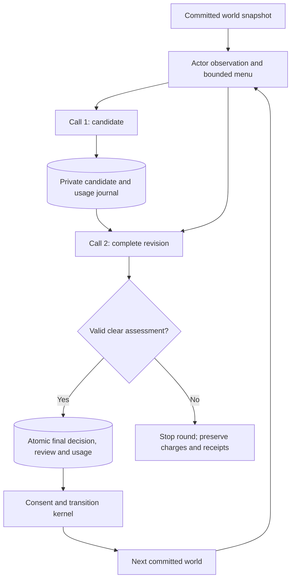

# Actor consistency repair and confirmation

This follow-up adds an optional, durable candidate/revision step for newly prepared `world-v1` simulations. It addresses the retained investment quantity-versus-rationale mismatch and coalition action before its declared trigger. The original studies remain unchanged. `oasis-legacy` remains the default; `world-v1` remains opt-in and its full behavior-promotion gate remains unmet.

The implementation is on `codex/reflexive-world-simulation`, based on main `8852ce123fa15a6b4f4c3e6e4e492435c0e3137b`. [The architecture report](../../ARCHITECTURE.md) maps deep research, the DeerFlow harness, actor ontology, Graphiti, simulation and forecasting. [The executable contract](../../implementation-contract.md) defines current APIs. This report concerns the consistency follow-up, not a claim of general realism or calibrated prediction.

## Why another step was necessary

The preceding [36-case study](../public-grammar/REPORT.md) completed every case and passed all six trade comparisons, but only 16 of 18 required paired comparisons passed overall. Valid JSON and feasible physical actions did not guarantee that a model followed its own stated quantity or waited for a declared goal condition. A guarded reproduction on the accepted earlier controller/store/kernel committed both defects: a three-unit purchase where the rationale selected two, and an opposing vote before alliance formation. The [red receipt](red-junit.xml) preserves those failures.

The repair is general: review the proposed final action against the actor's own permitted observation and objectives. Production prompts contain no experiment identifiers, expected domain actions, rubric answers or hidden state. The kernel still independently enforces consent, resources, authority and timing; an assessment cannot override those rules.

## How it works

A new spec can pin `policy.decisionReview: "actor-consistency-v2"` with `limits.maxAttemptsPerSlot: 2`. There is no global default. The [controller](../../../../../backend/app/services/world_simulation/controller.py) reserves one candidate call and one revision call in the same stable actor/round/phase slot. Only the final decision can act. A malformed candidate, failed revision or unresolved assessment stops the round; there is no third request, replacement slot or fabricated wait.

The [strict actor adapter](../../../../../backend/app/services/world_simulation/policy.py) keeps the exact observation as user JSON and quotes the saved candidate as untrusted data. It captures request mode and inputs before dispatch, preserving them even if callers mutate their objects during HTTP. The revised response is exactly `{decision, assessment}`. Four checks cover goal alignment, conditional timing, quantities, and consistency of explanations with final intents. The v2 prompt distinguishes an existing rule from a currently satisfied predicate, a snapshot from a future guarantee, and a coherent proposal from certain fulfillment. It still requires known affordability, authority and protocol constraints to be respected.

[review.py](../../../../../backend/app/services/world_simulation/review.py) checks four distinct `{kind, explanation}` entries, `clear|unresolved`, exact keys and 400-character explanation bounds. Whole-observation/candidate/final hashes establish the scope of the review; they do not certify the truth of its prose. Earlier v1 review references and absent-mode wire behavior remain supported unchanged.

[WorldStore](../../../../../backend/app/services/world_simulation/store.py) persists a private stage journal. Candidate completion saves the draft and metering together; revision completion atomically saves the final decision, assessment and usage. The existing fence, observation identity and budget remain authoritative. Resume reuses a durable final, or proceeds only to an unconsumed revision after a saved candidate. Unknown or exhausted stages cannot renew their allowance. Old databases do not acquire a review journal, and historical cached/rejected decisions retain their replay behavior. No review content enters public world exports or actor observations.

## What was tested

The [six captured contexts](cases.md) contain the two actual failures and four positive controls: a valid current purchase, waiting before a coalition trigger, opposition after that trigger, and a current-period trade order. Actor payloads remain byte-bound to the original observations/candidates; analyst expectations are separate. Each live confirmation revises each saved candidate twice, for 12 fixed calls. It does not generate new candidates or simulate a complete new world trajectory.

The [directed evaluator](../../../../../backend/app/services/world_simulation/consistency_evaluation.py) journals each request before dispatch and never replaces failed/unknown rows. It checks all 12 action outcomes and requires independent qualitative review of every complete result. The diagnostic gate needs all 12 to pass. Failed rows stay in the denominator. The full 36-case gate and forecast-calibration requirements are unchanged.

| Confirmation | Calls | Admitted actions / matches | Independent full explanation passes | Retained findings | Exposure USD |
|---|---:|---:|---:|---|---:|
| Initial v1 |12|9 /9|9|3 invalid assessments; exact rule unavailable in saved diagnostics|0.102994|
| V1 diagnostic replication |12|10 /10|6|4 wrong option references;2 failed responses|0.102118|
| Compact v2 |12|11 /11|9|2 conditional/timing explanation defects;1 unresolved|0.088024|
| V2 temporal clarification |12|12 /12|10|1 existing condition called absent;1 unsupported within-period voting opportunity|0.090280|

The v1 diagnostic run changed only safe error recording. One failure was a fixed index-validation error; the other was `policy_invalid_response`, whose saved evidence does not establish a more specific cause. V2 removes redundant generated index/path metadata and binds review scope on the server. Its first run exposed two substantive wording errors, which motivated the final prompt clarification. No earlier result was regraded or replaced. Detailed evidence is preserved under [initial](live-evidence/report.json), [diagnostic](diagnostics/live-evidence/report.json), and [first v2](server-bound-review/live-evidence/report.json) records.

## Final confirmation: actions corrected, qualitative gate still failed

The final twelve-call confirmation completed without runtime failures or unresolved rows. Both investment failure contexts were corrected from quantity 3/total price 3 to quantity 2/total price 2. Both premature coalition votes were removed while the alliance trigger was absent. All eight positive-control actions remained correct. All twelve final actions matched the fixed expectations.

Independent review read all twelve decisions, rationales and 48 compact assessment explanations. Ten complete results passed; two remained failures:

- `investment-consistent-current-purchase-r1` correctly proposes 4/4, but its timing check says no conditional triggers exist. The objective contains an explicit wait condition for an unexpired matching pending offer. That condition is currently unmet, not absent.
- `coalition-opposition-before-trigger-r0` correctly waits, but claims it retains a voting opportunity later within this same period. The current observation establishes the present menu and snapshot, not an additional eligible decision opportunity before `periodEnd`.

These failures are retained even though their consequential actions are correct. The unchanged all-twelve qualitative requirement therefore **failed**. The revised mode has not passed a fresh 36-case study, and `world-v1` remains opt-in. The source correction improves the intended contract but does not guarantee model adherence; it would be misleading to declare all behavior issues resolved.

The [final report](temporal-clarification/live-evidence/report.json), [exact journal](temporal-clarification/live-evidence/journal.json) and [independent review](temporal-clarification/live-evidence/qualitative-review.md) preserve every row. No discarded or unresolved response from earlier phases receives inferred credit. No further paid repetition is scheduled simply to obtain a passing result.

The final phase used USD0.090280 of known tariff-based exposure and zero unknown exposure. All eleven phases together consume a conservative USD18.913368955664 of the original USD25 authorization, leaving USD6.086631044336. The ledger includes earlier unknown/interruption ceilings and is **not audited billing**. Reservation quote totals are audit telemetry, not additional spending. [live-budget.json](../../live-budget.json) remains the budget authority; all phases are closed and there is no active provider process.

All 410 prior study artifacts were rehashed unchanged, including original databases, traces, reports and previous reviews. The current 535-file source snapshot remained unchanged during dispatch and independent review. The final report was generated under that frozen source with a guarded closeout check; [closure.json](temporal-clarification/live-evidence/closure.json) records raw-before/final hashes and the receipt.

## Verification and limits

The implementation passed 853 broad guarded checks, then 345 focused checks after evaluator integrity fixes. The v2 mode passed 882 broad checks; a subsequent actual-SDK directed-journal/resume test passed in a 56-test focused run. The final prompt-only delta passed 308 focused checks in 8.25 seconds with zero failures/errors/skips and no drift across 535 frozen files. These are separate runs, not additive unique coverage. Exact receipts and hashes are in [v1 verification](verification.json), [v2 verification](server-bound-review/verification.json) and [temporal verification](temporal-clarification/verification.json).

The final focused guard recorded three storage-import redirects and two blocked SDK metadata process probes, with no recorded network attempts. It is a CPython audit boundary, not an OS sandbox. Meaningful tests cover actual SDK/controller/store repair, two-call exhaustion and reopening, unknown metering, candidate/final atomicity, mode isolation, caller mutation, old replay, and the real physical consequences of corrected decisions. Independent reviewers closed source findings; live explanation review is a separate check.

The live contexts were selected from observed failures and controls during development. Twelve directed revisions cannot establish general behavior reliability, statistical independence, a fresh 36-case pass, or forecast accuracy. The assessment is generated by the actor model and can itself be wrong. The architecture deliberately preserves failures and withholds world commit when review is unresolved. Original studies, old mode behavior, price ceilings and release thresholds remain intact.

## Remaining work and use

The implementation can be exercised on a new opt-in generation with the v2 review pin; it must not be resealed into an old simulation. Request budgets should account for a deliberate candidate plus revision for each actor/phase slot. Unsupported or exhausted stages halt without silently dropping an actor. The mode and its private audit are additional experimental controls, not proof that natural-language reasoning is correct.

The remaining release blocker is stronger semantic grounding and fresh end-to-end evidence. A next design should distinguish structured conditions from free-text objectives and make eligible future decision times explicit without manufacturing future opportunities or forcing desired actions. That would change observation/role contracts and requires a separate bounded design and acceptance plan. Any evaluation must preserve these development results, retain all required cases/contrasts and use only a reconciled authorized budget. General realism and predictive calibration require independent empirical validation beyond these synthetic domains.

The current work is recorded in [handoff.md](../../handoff.md), [implementation issues](../../implementation-issues.json) and [delivery.json](../../delivery.json). Changes are isolated from the primary checkout. Remote publication remains blocked by previously rejected authentication; no unchanged credential retry or deployment was performed.
