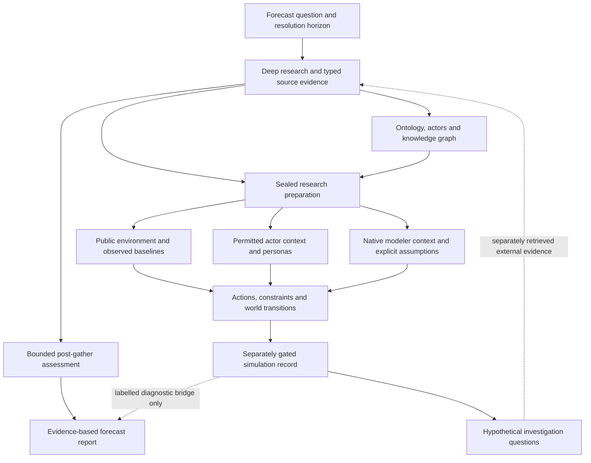

# Research-guided preparation: contracts and operation

The forecasting pipeline has two outputs with different authority. External research supports the forecast report and its probability estimates. The simulation record describes a conditional experiment: actors, actions, consequences, uncertainty and alternative paths. Its findings may motivate new research questions, but become evidence only after independent external retrieval and admission.



## Preparation contract

`preparation_adapter.admit_research_inputs` checks the saved generation and exact report/actor bytes before graph access or preparation writes. Declared dataset JSON and CSV payloads must pass the existing dataset validator in strict mode. Missing optional data remains missing; an invalid declared payload stops admission. Unbound manual inputs cannot discover unrelated run enrichment. The effective information cutoff and research window are captured once.

`research_preparation.compile_preparation_context` produces `research-preparation/v1`. `research_preparation.json` and its completion manifest contain a canonical digest, original source hashes and caller generation identity. The executable simulation config pins that identity and seals both files. Native world inputs bind the same preparation through `sourceBindings.preparationContext`. Reload and fork use the original admitted artifact, never a fresh dossier lookup.

| Projection | Content | Actual consumers |
| --- | --- | --- |
| Public | Admitted public claims, native observed/preliminary baselines, separately labelled guidance, typed gaps | Environment generation, shared briefs, default consequence arbiter |
| Actor | Public context plus permitted owner claims, goals, constraints, plans and relationships | Actual platform persona and strategic-decision requests |
| Modeler | Broader admitted research, uncertainties and private modeling context | Native world compiler/modeler, with independent output visibility checks |

Unsealed v3/legacy actor summaries retain their existing qualitative synthesis under an explicit unverified-context label; they do not acquire canonical claim authority merely because a preparation bundle exists. Their numerical observations use the sealed quantitative projection. Retained unmatched legacy graph actors receive an explicit public-only view.

The default consequence arbiter produces shared text, so it receives **public context only**. A disclaimer in a prompt cannot prevent private facts from being echoed into a shared narrative. Native modelers can use broader context because compiled metric/action visibility is validated before actor observation. Denials override positive access claims; global hashes are kept out of actor-visible projections when they would reveal private-only changes.

Numeric baselines preserve series/provider/entity, metric, full native unit, original period, availability cutoff, status, source references and history. Observations and preliminary values can seed state; estimates, targets and projections remain guidance. Historical ranges are diagnostic summaries, not causal coefficients or hard limits. Full history stays in the artifact; prompts retain complete latest measurements and conditions with explicit omission counts. Actor-owned goals and question relevance determine prompt ordering.

Native initial metrics may use `basis.kind="official_observation"` with an exact observation ID, preparation digest, target `value`, native unit and period. Budgets, costs, delays and causal mappings still require explicit source or assumption references. Native baselines remain immutable when simulated values change. Default-world variables retain the same distinction in `research_evidence`.

## Causal transitions and optional adaptive paths

Fresh seeds pin `action_policy="affordable-menu-v2"` and `agreement_policy="operative-deadline-v1"`. Action admission checks full cost before effects; menus retain substantive options and complete response groups. Agreements carry explicit operative terms, and delivery deadlines are distinct from offer expiry and duration. Missing historical policy markers retain legacy behavior.

Every accepted default-world round emits a `world-replay/v1` record containing initial state, decisions, scheduled events, RNG state, deterministic state, accepted arbiter update and final state. `replay_world_round` runs without a provider and rejects content or transition drift. Rejected or partially failed arbiter updates acquire neither narrative nor probability-pressure authority.

Adaptive sibling decisions are an explicit experimental config. Before sealing, set these fields in `world_model.settings`:

```json
{
  "branch_policy": "adaptive-v1",
  "path_count": 2,
  "path_seed": 17,
  "path_temperature": 0.7,
  "branch_decision_budget": 24,
  "branch_max_actors": 4,
  "branch_max_rounds": 3
}
```

The budget is additional sibling structured-decision attempts, including failed calls; it is not a monetary limit or a count of underlying provider retries. Bounds are path count 2–8, attempts 1–4096, actors 1–64 per sibling per round, and rounds 1–256. These are saved settings, independent of legacy environment defaults. Personas are frozen before decisions. Each branch keeps local observations, memory, discourse, commitments and shares. Calls reserve allowance durably before dispatch. Missing or incomplete execution checkpoints fail closed; neither fresh reset nor resume refunds uncertain calls. Both platforms wait for durable round commit before checkpointing. The default remains `shared-v1`.

## Research assessment and forecast quality

Fresh v3 research pins `post-gather-assessment/v1`, retains the initial scenario frame, and performs at most one admitted assessment attempt before writing. Definitions, order, horizon and scenario IDs remain fixed. Revisions require source-linked evidence and reasons. Duplicate quotations do not become independent corroboration. Numeric occurrence alone does not establish semantic support; typed evidence retains entity, metric, value, unit, period and modality. Insufficient evidence or unavailable budget retains the initial frame with an explicit stopping reason. Cached assessment and QA artifacts are validated on recovery, and `research_assessment.json` participates in the research-generation fingerprint.

Fresh pipeline safety policies pin `binary_quality_policy="evidence-quality/v1"`. Distribution spread and high-conviction counts are diagnostics, while valid probabilities and objective resolution criteria remain requirements. Historical or unmarked report policies keep `conviction-quality/v0`; ReportAgent forwards the pinned method through initial and resilient extraction. This does not change the simulation forecast-effect policy: `diagnostic_only` remains the safe production default.

## Investigation questions and prospective evaluation

`simulation_record.write_record` writes `simulation_discovery_questions.json` separately from the record/report bridge. At most 128 candidates produce six hypothetical questions, each with a support and refutation query. Origins identify simulated record locations, not external corroboration. The queue records omissions, input hashes and a stopping reason; it dispatches no searches or model calls. `load_discovery_questions` accepts only the exact deterministic sidecar of a published record.

Existing evaluation commands now support prospective enrollment:

```text
python backend/scripts/backtest_eval.py forward-enroll --design DESIGN.json --enrollment COHORT.jsonl --ledger-dir REGISTRY
python backend/scripts/backtest_eval.py forward-record --trial TRIAL.json --enrollment COHORT.jsonl --ledger-dir REGISTRY
python backend/scripts/backtest_eval.py forward-score --enrollment COHORT.jsonl --ledger-dir REGISTRY
```

The design declares exact question/resolution contracts, event families, arms, budgets and contrasts. Official outcomes require an exact vintage. The journal references immutable registry publications and admitted outcomes. Failed, abstained, pending, overdue, void and disputed cases remain in the denominator. Already-known market settlements or official measurements cannot become prospective cases under new publication IDs or rephrased predicates. Costs retain unknowns and known-spend lower bounds. Same-evidence diagnostic comparisons cannot demonstrate probability lift; equal-cost investigation comparisons require appropriate cost evidence and event-family grouping.

The local enrollment clock and operator-supplied cost/evidence receipts are not an external attestation service. Offline fixtures establish these software contracts; they do not establish statistical accuracy, calibration gains, live-provider behavior or production adoption. See [handoff.md](handoff.md) for exact verification and delivery status.
