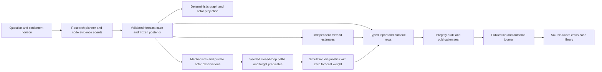

# Target-first forecasting architecture and operator guide

Date: 2026-10-28. Implementation source is the isolated `codex/target-first-forecast` branch. The attached reviews are the requirements, not proof of forecast skill.

## Existing workflow and authority

The application entrypoint is Vue `ResearchView` → Flask research API → `PipelineOrchestrator`. Durable `pipeline_state.json` owns lifecycle and stage state. The six stages are research, ontology, graph, prepare, run and report. The ordinary route uses v3/legacy research, Graphiti, OASIS and the report agent. `drf2` remains outside this route. Publication requires ReportManager's matching artifact/audit seal; a completed simulation or 100% stage progress is not publication.

The new authority is explicit: `forecast_authority: "target-first-v1"`. It follows the same lifecycle manager through an additive target pipeline. Existing runs retain their authority. New typed cases branch before the legacy prose-extraction pipeline. Report and simulation probabilities remain separate; the simulation weight is zero.



## What each stage consumes

| Stage | Authority and output |
|---|---|
| Research | `forecast-case/v1` contains target/settlement, nodes, source passages and dates, claims, actor levers, mechanism parameters, scenario predicates, prior/posterior assessments and update ledger. Fresh planner evidence cannot authenticate itself. A post-gather phase binds mechanism parameters to evidence or records bounded assumptions. |
| Method estimates | The frozen case and policy produce reference-class, trend and adversarial shadow estimates through bounded injected gateways. Exact stored market anchors supply their own lane. Inputs and per-lane results are retained in `target_estimators.json` before simulation. Missing inputs/providers remain explicit unavailable estimates. |
| Ontology and graph | Deterministic projections of case nodes and actor decision rights, without Graphiti extraction calls. The graph API returns source/date-bearing typed data; actor-private variables are excluded from the public graph. |
| Prepare | The case hash, structural projection, path settings and decision budget are pinned in `target_input.json`. Required LLM actors need a configured provider; rule-only casts can run without one. |
| Run | Whitelisted dimensional mechanisms propagate bounded parameter draws and typed actor edits. Capacity, rights, consent, lag, plans/triggers and private observations bind. Opaque identities and visible-information lookahead are the default decision boundary. Scenario shares are terminal predicate frequencies; votes are not inputs. |
| Report | Frozen case rows, saved estimators, stored official/market/news evidence and separately fenced simulation diagnostics. Report rendering does not re-extract probabilities from prose. Epistemic shortfalls receive grades/disclosures; integrity failures remain hard failures. |
| Feedback | The existing immutable publication/outcome journal owns scoring. Named-source manual resolution requires an exact frozen contract hash and source/time evidence. Approximate market matches stay outstanding unless independently retained source terms establish the exact same settlement contract. |

## Request example

```json
{
  "prompt": "What will the specified quantity be by the specified future date?",
  "forecast_authority": "target-first-v1",
  "mode": "full",
  "target_simulation": {"paths": 32, "periods": 12, "seed": 0}
}
```

POST this to `/api/research/run` or `/api/v1/run`. The UI exposes the same explicit mode. `research_only` publishes the case and frozen method estimates; continuing later reuses their exact generation. Target results use `GET /api/simulation/<simulation_id>/target?pipeline_id=<pipeline_id>` and ordinary report IDs. Graph data remains available through the graph API.

Manual settlement is `POST /api/v1/resolve-binary/<report_id>` with `forecast_id`, boolean `outcome`, `contract_sha256`, `resolved_at` and source `evidence` (text, URL, publisher, publication/retrieval timestamps, adjudicator). The service verifies the admitted publication and settlement deadline before adding a durable journal event. This endpoint cannot turn an unsupported proxy into an exact outcome.

## Persistence, replay and cost

Every typed stage has required SHA-256 artifact receipts. Completed stages reject changed inputs instead of silently mixing generations. Source and retained-passage checkpoints bind original page bytes. The pipeline freezes `target_library.json`, `target_evidence.json` and `target_estimators.json`; downstream consumers use these snapshots. Cross-case library entries retain original uncertainty/provenance and cannot establish freshly fetched evidence or authorize estimator promotion.

`TARGET_DECISION_MAX_CALLS` defaults to128 distinct actor decision requests and is pinned per run. Identical observations reuse cached decisions; exhausted budgets hold remaining discretionary actions and disclose the exhaustion. Provider-internal retries are separately accounted by existing telemetry. At most eight actors may use LLM decision rules. Paths and periods are bounded at admission.

Primary comparisons enroll in a shared immutable registry before the future target resolves. Seed forks use private artifacts and characterization/evaluation records, preserving the parent and the prospective denominator. Publishing a diagnostic fork does not enroll another production forecast.

## Defaults and rollback

| Control | Source default | Rollback / limit |
|---|---|---|
| `forecast_authority` | Legacy unless explicitly selected | Omit target mode for new runs; saved authority remains fixed |
| `REPORT_PUBLISH_GATE_MODE` | `grade` | `fail` restores strict epistemic publication failure |
| `REPORT_SPINE_RESEARCH_PRIOR` | `true` | `false` restores historical prior rendering |
| `REPORT_TOURNAMENT` | `true` | `false` avoids extra method calls; shadow weights remain zero |
| `FORECAST_BINARIES_SOURCE` | `tree` when a typed case is supplied | `prose` keeps legacy extraction |
| `SIM_WORLD_ARBITER_REPAIR` | `field` | `round` restores whole-response rejection |
| `SIM_SHARE_PRIOR` | `uniform` for newly prepared explicit policy | `research`; policy-free saved seeds keep historical interpretation |
| `SIM_SHARE_SOURCE` | `auto`: typed predicates, otherwise trusted power votes | `votes`; unknown power/resolution freezes with a reason |
| `PREDICTION_MARKETS_CACHE` | `on` | `off`; cached failures are explicitly stale and expire after seven days |
| `RESOLUTION_MONITOR_AUTORUN_HOURS` | `24` | `0`; existing deployment environment overrides remain effective |

This branch does not start a service, live probe, paid cohort or scheduler. The monitor runs only through the existing production entrypoint after deployment/configuration. No simulation or structural estimator is promoted above zero weight by these controls.

## Validation boundaries

Controlled tests can establish case integrity, actual producer/consumer execution, deterministic paths, source/identity isolation, publication, replay, scoring joins and UI behavior. Publisher-vintage consistency is distinct from realized-outcome skill. Live provider realism, real transport availability, realized historical actor episodes, conditional calibration, bill reconciliation and prospective paired lift need separate evidence. The system exposes missing evidence; tests do not manufacture it.

See `handoff.md`, per-owner reports and the final verification record for exact source hashes, checks and remaining gates.
