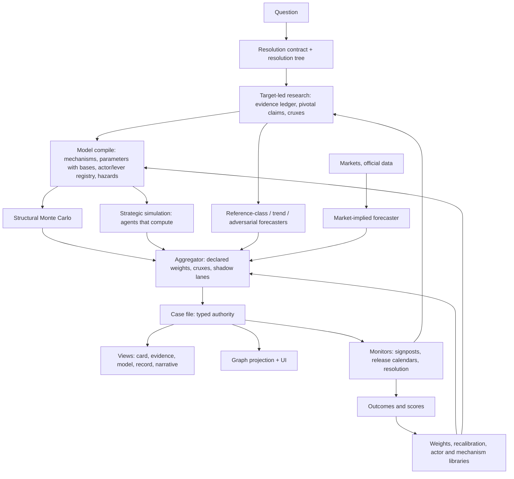

# DeepResearchForecast from first principles — part 2: what the remaining maps show, and six architectures (2026-10-27)

Part 1 covered research, the simulation's agents and adjudicator, context passing, and the simulation–report relationship. This part adds two more code maps (the report stage; the graph, markets, feedback and backtest subsystems) and the specimen's cost telemetry, then proposes six architectures that go beyond part 1. Facts first, designs second. Report-stage line references are to the working tree, which carries uncommitted changes in `report_agent.py`, `forecast_extractor.py` and the translation modules.

## 0. New findings

**Three of the pipeline's external inputs are dead in production.**
- *Markets:* all 12 most recent `prediction_markets.json` are empty with `empty_reason=transport_failure`; every report published since 2026-10-22 has 0 market-anchored binaries.
- *News and market context (Oddsense):* the 6 most recent captures hold 0 items (NewsAPI timed out in 5, unavailable in 1).
- *Outcomes:* the publication journal holds 12 forecasts (178 binaries: 27 official-data, 151 unanchored, 0 market) and 0 outcomes; the legacy `ledger.jsonl` has 214 rows and 0 resolutions, and its writer `append_forecast` has no caller; `RESOLUTION_MONITOR_AUTORUN_HOURS=0`. The track record frozen into every report is a table of nulls. Near-equivalence market anchors can never resolve (the join requires `exact`), and the unanchored lane has no resolution path at all.

So the system's "ensemble" today is one LLM call (the spine) reading digests. Markets, the best-calibrated external estimator available to it, are offline, and nothing notices in the forecast.

**The graph is the most expensive stage and the least used.** Where telemetry attributes it, the graph build takes 47–68% of a run's estimated LLM spend (1,146–2,044 calls, ~26–30 per 2,500-char chunk) and 19–36% of wall time; the specimen spent 35 of its 96 minutes of stage wall building ~130 nodes, pruned to 92 by the 2-hop rule. Its consumers: the PREPARE cast candidate list (then ranked with +0.5 × degree centrality), persona context (all related edge facts, uncapped), the writer's four tools (12 calls in the specimen), and chart sizes. The forecast spine receives no graph output and no priors. Prose-extracted graph facts carry no source id and no date, yet `insight_forge` returns them under a header that tells the writer to quote them verbatim ("请在报告中引用这些原文"), while the outline prompt labels the same facts "模拟记录，非证据" and the tool descriptions call the store a "模拟图谱". The quote gate then removes what the tool asked for. `graph_priors` is degree/max-degree over all nodes and is dominated by concept nodes ("LME copper official settlement price" = 1.0).

**The report stage's gates fail the run instead of lowering confidence.** A binary set that fails `_binary_quality` (needs stdev ≥ 0.12, ≤ 40% of probabilities in 0.40–0.60, ≥ 3 convictions, 80% regex-sharp criteria) or a citation coverage below threshold is an "epistemic" issue in name but a hard failure in effect: `_require_final_publish_audit` raises, the report is FAILED and the pipeline fails (`tests/test_final_publish_audit.py:250` asserts it). The deployment's `.env` sets the coverage threshold to 0.05, so the one gate still live is the spread gate, which penalises honest 50% forecasts. Elsewhere: prose is written before the binaries exist and never compared with them (binaries move afterwards through market revision and partition reconciliation); the deterministic quantitative pass can delete the report's own restated probabilities because "本报告估计" has no code exemption; the pre-mortem is gated on a config key that does not exist; K self-consistency = 1, extremizing = identity, ledger recalibration has no caller; the "Baseline vs Scenario" chart for what-if runs is built from simulated shares and placed outside the bridge without a "simulated" label; the fast and strong tiers are the same model in this deployment; the LLM cache is an in-process exact-key LRU, and no provider-side prompt caching exists in `app/`.

**Binaries are generated to a quota, not from a target.** The prompt extracts whatever the analyst stated, then derives more until ≥ 10, with a rule that 40–50% must sit below 0.5; `criteria_sharp` is a regex; implicit scenario-partition reconciliation is hard-coded to US House/Senate wording; the `named_source_event` anchor exists only as a proposal. The specimen's 13 binaries: 0 anchored, 0 market comparisons.

These findings sharpen part 1's thesis. The pipeline is not short of machinery; it is short of a target, a model of what moves it, and live feedback. The architectures below are organised around supplying those three.

## 1. Forecast as a program: one structural model behind the spine and the simulation

**Idea.** Compile the resolution tree (part 1 §2) into an executable probabilistic model: nodes are random variables with priors from research (value, vintage, range), edges are mechanisms (identities, reaction functions, elasticities with uncertainty), exogenous hazards are the documented shocks, and actor policies are functions from observable state to lever settings. Monte Carlo over parameters, shocks and policies yields a distribution over the target; scenario probabilities are the mass in each scenario's region of outcome space; binaries are predicates evaluated on the same draws. The "spine" becomes the model's output explained by an LLM, not guessed by one. The "simulation" becomes the same model with strategic actors switched on.

**What the LLM does instead.** It writes and justifies the model: a model-writing agent proposes the tree, binds each parameter to a research fact or a stated assumption, and the model must pass deterministic checks before it runs: dimensional consistency, identities hold on the seed values, each parameter has a basis, a hindcast of the last two or three published vintages lands within the stated range. Runs are then cheap (no LLM per period except for discretionary actors), replayable, and inspectable: a reader can see which parameter moved the answer.

**Why this follows from first principles.** It gives the one thing none of the three current estimators has: the target computed from its determinants. It also collapses the spine/simulation duplication: there is one model, with and without strategic behaviour, so the difference between them is interpretable (the strategic premium) rather than an unexplained 84.6-versus-38 table.

**Fit.** Quantitative targets (prices, market sizes, yields, capacity, counts) fit directly. Qualitative or event targets compile into event trees or logic models with conditional probabilities, which the same machinery (predicates on draws) can evaluate. Where the question has no credible structure, the model-writing agent should say so, and the pipeline should fall back to the forecaster tournament (§3) alone.

**Cost and risk.** A domain template library is the main cost (part 1 §3 lists six templates that would cover most questions seen so far). The risk is false precision: a wrong equation with narrow priors. Mitigations: wide priors for anything not bound to a fact, mandatory hindcast, a sensitivity table published with every forecast, and the forecaster tournament as a check that does not share the model's structure.

**Test.** On the specimen: a four-term growth model with vintages binds to the five Gartner data points; the hindcast of the 2026 vintage from 2025 data lands within range; the baseline run (no actors) reproduces the trend path; the strategic run shows where it departs and why.

## 2. Agents that compute: the model as the actor's calculator

Part 1 proposed lever-holding institutions with plans and triggers. Two additions become possible once §1 exists.

**One-step lookahead.** Before a discretionary actor decides, it may query the model: "if I set this lever to X, what happens to the variables I care about over the next k periods, under my beliefs about others?" The query is deterministic and free. The decision prompt then asks for a choice among evaluated options, not an improvisation from a menu. Cheap talk falls because a statement that changes nothing in the actor's objective is visibly worthless, and reflexivity becomes concrete because the expectation channel is one of the mechanisms the actor can see. Level-k reasoning is a natural extension: an actor runs the model with its belief about others' policies, which is also how its `expected_reactions` should be produced and scored.

**Opaque identities by default.** Models know the real actors and will play their public image, which is a bias in live runs and fatal in backtests. Describe institutions by mandate, levers, stakes and record, with opaque ids in the decision and adjudication prompts; render names only in the record. The earlier review proposed opaque-id perturbation as a *test*; I propose it as the production default for the decision and effect-estimation calls, with the named variant kept as a placebo arm. The cost is the loss of some useful prior knowledge; the gain is that behaviour follows from the declared structure, which is the only part that is auditable.

**Consequence-weighted credibility.** Track records should be computed on typed commitments against realised lever settings (did the tariff reach 25% by Q2), not on the mechanical "did a non-hold move occur" rule that produced the specimen's 53 `fulfill:` decisions. Credibility then enters other actors' belief updates as a weight, which is the mechanical consumer reputation currently lacks.

## 3. A forecaster tournament instead of one spine call

**Idea.** Replace the single spine call with N method-diverse forecasters over the same case file, each returning a distribution, a rationale and *cruxes* (propositions whose truth would move its number most): a reference-class forecaster (base rates, vintages), a trend and persistence forecaster, the structural model (§1), a market-implied forecaster when markets are live, the strategic simulation, and an adversarial forecaster whose brief is the strongest case for each tail. An aggregator pools them in log-odds with weights learned from the track record (uniform until the forward cohort resolves), extremizes by a calibrated factor, and publishes the per-forecaster numbers beside the pooled one. Disagreement is not noise to be averaged away: the cruxes where forecasters differ become the report's key uncertainties, the research engine's next follow-ups, and the simulation's signposts.

**Why.** It is the cheapest way to buy independence of errors (a few thousand tokens per forecaster against 3.3M for the social feed), it turns the dead calibration knobs (K draws, extremizing, recalibration) into things with inputs, and it gives the simulation a seat at the table under exactly the rule ADR 0003 requires: weight zero until a held-out lift exists, promotable by an outcome-blind gate.

**Crux debate as the depth mechanism.** For the two leading scenarios, a short structured exchange over the evidence ledger (pro, con, judge) produces cruxes with the evidence that would settle them. This is where "depth" should be spent: one decisive document per crux beats another round of topic searches. It also fixes the current anchoring: the frame's weights are set from six scout searches and never revised; a crux list is a revision agenda.

**Test.** Score each forecaster separately on the forward cohort; refuse to raise any weight without a paired lift with a confidence interval excluding zero; check that pooled forecasts are not less calibrated than the best single forecaster on the first 40 resolved questions.

## 4. The graph as a projection, not a stage

**Idea.** Stop building the knowledge graph by LLM extraction from report prose. Build it deterministically from the case file: actors and institutions, variables and tree nodes, pivotal claims with sids and dates, mechanisms, commitments and simulation events, each edge carrying its provenance. Run LLM extraction only over text the case file does not cover, and only on demand. Keep the UI (it is useful) and the writer's retrieval, but make retrieval return typed records with `sid`, date and node id rather than un-sourced triples, so a quoted fact can carry its citation and the quote gate stops deleting what the tool recommended.

**Why.** The build is the largest single spend (47–68% of LLM cost) for a store the forecast never reads, whose facts cannot be cited, and whose centrality priors reward concept nodes. ADR 0002 already declares the graph a rebuildable projection; the code treats it as a mandatory stage between research and everything else. Making it a projection also removes two re-extractions of the same prose (Graphiti's and the research engine's finalize step), which is where tags, dates and passages are lost.

**Cost and risk.** The Graphiti pipeline and its ontology are mature code; the risk is losing emergent relations the LLM finds in prose that the typed artifacts miss. Mitigation: keep extraction as a bounded supplement over uncovered chunks, measured by how often the writer or the cast selection actually uses an extracted-only node.

**Test.** Rebuild the specimen's graph from its case file in under a minute and zero LLM calls; the writer's 12 tool calls return the same or better facts, each with a `[S#]`; the cast candidate list is at least as good when ranked by lever ownership as by degree.

## 5. The report as views of the case file, with conditional forecasts and gates that degrade

**Views.** The deliverable should be layered and rendered from typed data: (1) a one-page forecast card (target and resolution contract, pooled probabilities with per-forecaster numbers and bands, the update ledger summary, cruxes, signposts with dates); (2) the evidence appendix (pivotal claims with passages, dates and independence); (3) the model (tree, parameters, sensitivity tornado, hindcast); (4) the simulation record (paths, tails, turning points, what-if tables); (5) the narrative, written last, with every number a token resolved from typed rows by code. Today the narrative is written first, from graph tools, before the binaries exist, and the deterministic passes then police numbers the writer never had.

**Conditional forecasts are the simulation's distinctive product.** Research can estimate P(outcome); only a mechanism-plus-actors model can estimate P(outcome | lever setting) and P(outcome | shock). A table of conditional probabilities ("if CIRCIA is finalised by Q2 2027, spending growth distribution shifts by …", "if a second incident of Hugging Face scale occurs before mid-2027 …") is what a decision-maker actually wants from a simulation, it does not require the simulation to move the unconditional probability, and it is testable: the conditions are observable, so conditional calibration can be scored once outcomes arrive.

**Gates that degrade.** Publication gates should be monotone in confidence and disclosure, not binary on the whole stage. A low-spread binary set is a property to report ("the model's binaries are mostly near 50%, which is consistent with the stated uncertainty"), not a reason to discard twenty minutes and 270k tokens of work; a coverage shortfall should mark the uncited sentences and lower the grade. The only hard failures should be integrity failures: numbers in prose that contradict `forecast.json`, quotes that are not verbatim, simulated content outside the bridge. The prose–binary comparison that does not exist today becomes a join when both are rendered from the same rows.

**Binaries from the target, not a quota.** Generate propositions as predicates over tree nodes with settlement contracts (official series, market, named-source event with publisher and deadline), so every binary is resolvable by construction and the "contrarian 40–50% below 0.5" rule becomes unnecessary: the distribution of probabilities follows from the distribution over the target.

## 6. Closing the loop for real

The 2026-10-23 inventory's first finding stands: a complete scoring stack and no scores. Four additions make the loop turn.

**Resolvable by construction and auto-resolution first.** With §5's binaries, the unanchored lane shrinks from 151 of 178 to the few propositions that genuinely have no settlement source; the official-data lane resolves on release calendars; a `named_source_event` lane resolves on a publisher's dated statement. Turn the monitor on. Until outcomes exist, every other improvement is judged by taste.

**Living forecasts.** A forecast should be an object with monitors, not a one-shot document. Signposts from the simulation and tree nodes with release calendars become triggers; when a release lands or a signpost fires, re-run only the affected nodes (incremental research), update the posterior with a logged delta, and re-render the card with a diff. The resolution monitor already exists; this generalises it from scoring to updating. The cost per update is a fraction of a full run, and each update is a calibration observation.

**Hindcasts for the engine, separate from scoring the forecasts.** Compile two or three documented historical episodes (a tariff round, an OPEC+ decision cycle, a rate cycle) with cutoffs, run the structural model and the actors, and score lever settings and timing against the documented record and variable paths against realised series. This validates mechanisms and actor models in weeks rather than years. It is debugging, not proof, because model weights know the outcomes; mitigate with opaque identities (§2) and less famous episodes, and never pool hindcast scores with prospective ones.

**Memory across cases, including actor behaviour.** Three stores that outlive a run: a reference-class library (base rates computed from official series with comparators, reusable across questions); a mechanism library with parameter ranges that hindcasts have validated; and an actor registry with *real-world* behavioural track records. The last is new: when outcomes resolve, compare what the simulation had an actor do with what it actually did (did the Commission hold the AI Act milestone; did the regulator finalise the rule when the model said), and use that to calibrate the actor's decision rule next time. It is the only feedback loop that improves the agents themselves rather than the probabilities.

## 7. Cross-cutting: input health, cost allocation, telemetry

- **Input health belongs in the forecast.** Each external input (markets, news, official data, provider) should carry a liveness status that the card and the exec brief show and the aggregator respects (a dead market feed is a forecaster with weight zero and a visible "offline" flag, not a silently empty pack). Markets have been offline since at least 2026-10-22 without any forecast saying so.
- **Budget by marginal information.** The specimen spent roughly 3.3M tokens on the simulation (three quarters of it on the social feed), about 1–2M on the graph in comparable runs, and 270k on the report; research spend was not recorded at all. Allocate per stage by expected information gain: the simulation gets its budget only when the adequacy assessment finds strategic interaction that matters to the target; the graph gets LLM extraction only for uncovered text; research gets the budget the crux list says it needs.
- **Telemetry that can answer "what did this cost and why".** Record research and simulation tokens in the pipeline telemetry (today only the report stage is attributed in the specimen), break the report stage into phases (spine, outline, sections, binaries, repair, stabiliser), and keep stage attribution across resumes. Use provider-side prompt caching for the report's repeated prefixes as the research engine already does for its own calls.
- **Two tiers that differ.** With `fast` and `strong` both `glm-5.3`, the tier plumbing buys nothing; either route cheap calls (graph extraction, critique, sub-query decomposition) to a cheaper model or remove the pretence. Configure a fallback provider so a tripped content-filter breaker degrades instead of failing fast.

## 8. The target picture



What changes, in order: the contract and tree (research), then the structural model and the removal of votes from the share path (simulation), then the tournament and the card (report), then the graph as projection, then the loop (resolution, living forecasts, hindcasts, memory). Each step is independently valuable and testable; none requires the others to be finished first, but the order minimises rework because each later step reads the typed artifacts the earlier ones create.

## 9. Pros and cons at a glance

| Architecture | Main gain | Main risk | Cheapest decisive test |
|---|---|---|---|
| Forecast as a program | the target is computed, one model behind spine and sim, replayable | false precision from a wrong equation | hindcast on published vintages; sensitivity table |
| Agents that compute | consequence-aware decisions, cheap talk falls, reflexivity becomes mechanical | losing useful prior knowledge under opaque ids | placebo arm named vs opaque; decision-kind distributions |
| Forecaster tournament | independence of errors, dead calibration knobs get inputs | aggregator overfits to a short record | per-forecaster Brier on the forward cohort; weights frozen until n ≥ 40 |
| Graph as projection | removes ~50–70% of LLM spend and two re-extractions; facts become citable | loss of emergent relations | rebuild in zero LLM calls; writer facts all carry `[S#]` |
| Views, conditional forecasts, degrading gates | the deliverable a decision-maker wants; no discarded runs | more surfaces to keep consistent | prose–JSON number join is byte-exact; zero failed publications for epistemic reasons |
| Closing the loop | the first real scores; agents improve, not just probabilities | memorisation in hindcasts; selection in what gets resolved | resolvable share > 80%; monitor on; first 40 outcomes |

Everything here is advisory; nothing in the code, docs, runs or settings was changed. The source observations are static facts about this checkout and its saved runs; the gains are hypotheses until outcomes resolve against them.

Remedies for every issue raised in parts 1 and 2

Format per item: Issue → Fix (what to change and where) → Check (acceptance evidence) → effort: S (≤1 day), M (2–5 days), L (1–3 weeks). Anchors name functions, since the working tree is moving. Items marked ★ are the ten I would do first; §H gives their order. Nothing here has been implemented.

A. The estimators and the probabilities

A1 ★ Three estimators never meet; no combination rule.
Fix: a typed aggregator (backend/app/services/forecast_aggregator.py) that takes every estimator’s output in one shape ({source, scenario_distribution, binaries, rationale, cruxes}), pools in log-odds under an aggregation_policy_v1 pinned at admission (default weights: research posterior 1.0, everything else 0 and recorded as a shadow lane), and writes forecast.json.estimators[] and .aggregation. The bridge’s shares table becomes an estimator table with a deterministic divergence note (which assumptions or actors each estimator needed).
Check: with all shadow weights at 0 the published probabilities are byte-identical to today’s; every estimator’s number is stored and scored separately once outcomes exist. M.

A2 ★ The frame’s weights never reach the spine (probability vs probability_band).
Fix: in utils/actors.py forecast_inputs_block, render probability when probability_band is absent, labelled “research prior, set at plan time from scout evidence, dated …”; require the spine (forecast_extractor.derive_forecast_spine) to return a per-scenario prior → posterior row with a cited reason for each move. Decide this deliberately rather than leaving the independence accidental.
Check: the spine output carries prior_reference and per-scenario deltas; a run with no new evidence reproduces the prior within rounding. S.

A3 ★ The simulation is seeded from the frame prior (circularity).
Fix: in pipeline_orchestrator where world_state_seed is injected, stop copying forecast_inputs.scenarios probabilities; start shares uniform (interim) and record share_prior: uniform; long term remove the share path altogether (C3).
Check: trajectory round 0 is uniform; the bridge labels the prior. S.

A4 ★ No estimator computes the target quantity; the world holds incidental facts.
Fix: PREPARE derives a target node from forecast_task_v1 plus the binaries’ resolution criteria (metric, unit, settlement source, current value and vintage from quantitative.json), and world_model_seed.build_world_model_seed includes it as the first state variable with an explicit identity (e.g. spending₍t₎ = spending₍t−1₎ × (1 + g₍t₎)); the kernel evaluates the identity every period; the arbiter may size only the identity’s inputs, never the target directly.
Check: the seed contains the target variable; the record’s “final versus seed” table lists it; a run with no decisions reproduces the trend path. M.

B. Research

B1 ★ Topic-led KIQs (one per outline section) instead of target-led.
Fix: add phase_decompose between phase_plan and phase_data in deerflow_bridge/linear_research.py: one call returning resolution_tree.json (nodes with kind, current value, vintage, settlement source, sensitivity rank, actors with levers), validated deterministically (units, identities, every node has a status); KIQs are generated from nodes (node_id on each) and the outline from the tree.
Check: the specimen’s tree names 2027 spending as the target with its terms; every KIQ carries a node id; the outline is a projection of the tree. M.

B2 Fetch rate 17%, zero dated sources, independence unset, social domains as origins.
Fix: capture dates at fetch time in research_gateway before HTML stripping (Last-Modified, article:published_time, JSON-LD, <time>) and on search rows; add tier S4 for social platforms and aggregators and refuse S4 as the sole origin of a pivotal claim; raise the fetch budget for pivotal nodes; fill independent by origin clustering (eTLD+1 plus shared shingles plus named-publisher attribution) at finalize.
Check: >80% of ledger rows dated; no VERIFIED pivotal fact whose only origin is S4; independent populated on every sources.json row. M.

B3 Tags, provenance and cited passages are lost in the typed→prose→re-extract round trip.
Fix: make the KIQ fact records the authority: export facts.json as the union of KIQ facts (tag, sids, passage offsets, numbers verified); derive quantitative.json by typing those facts, not by re-reading prose; set sources.json.excerpt to the cited passage recorded at verification time; keep the finalize extraction calls only for fields the facts cannot supply.
Check: every quantitative row carries fact_id and tag; every excerpt contains the cited number; finalize makes at most one LLM call. M.

B4 VERIFIED means only “the numbers appear on a fetched page”.
Fix: split the tag into three flags in postprocess_notes: citation_resolves, numbers_on_page, passage_supports; the third is a bounded entailment check with the passage, run only for pivotal claims; VERIFIED requires all three for pivotal claims and the first two otherwise.
Check: fixtures with right number/wrong entity, wrong period, reversed relation and target-as-actual are rejected; genuine matches pass. M.

B5 The gap reviewer sees counts; no numeric-conflict adjudication; stopping by “fewer than three new VERIFIED”.
Fix: in phase_gap give the reviewer the tree with node status and sensitivity, the single-origin pivotal claims and the conflicts list; add a deterministic numeric-disagreement detector (normalise metric, period, unit; flag differences beyond tolerance across origins and against official series) that writes contested.json before synthesis; stop when every pivotal node is settled or declared unknowable, recording stop_reason ∈ {sufficient, budget, inaccessible, rejected}.
Check: a planted conflict is detected and rendered as a range; stop_reason is in meta. M.

B6 ★ Evidence never changes a probability; QA rewrites restated weights back to plan time.
Fix: versioned assessment: keep frame_prior (plan), add one post-gap call that returns frame_posterior with per-scenario deltas, cited reasons and the base rate used, under deterministic bounds; fix_scenario_weights enforces the posterior; a scenario-definition change bumps frame_version. Shadow field first, adopt after a paired check.
Check: duplicated evidence → no change; decisive counter-evidence → a justified change; a definition change → version bump and non-comparability notice. M.

B7 Thin hazard supply (one risk row).
Fix: carry the hazard KIQ’s “no published probability” as a typed gap on the tree; add a constructed base-rate path that computes the frequency of comparable moves from stored official series with a comparator, and read from a cross-run reference-class library (G6).
Check: every scenario has a documented or constructed base rate, each labelled. S–M.

C. The simulation (default engine)

C1 ★ Variables change only through the arbiter; actions map to nothing; lag delays nothing.
Fix: compile mechanism_graph.json at PREPARE from the tree: edges typed as identity, elasticity, reaction or delay, each with a parameter prior and basis; bind catalogue kinds (policy, economic, legal, operational) to lever→variable edges so a move of magnitude m applies the mapped delta after its lag with no LLM; the arbiter sizes only unmodelled edges and returns typed effect_estimates.
Check: an impose_measure of magnitude m moves its bound variable by the declared mapping after lag periods with the arbiter disabled; replaying the specimen’s decisions moves the target variable. L.

C2 Undisclosed dampers (50% clamp, 15% mean reversion, ±35% band).
Fix: disclose the bounds in build_arbiter_prompt; replace the global constants with per-variable clamps from each series’ own historical volatility; drop mean reversion toward the research anchor for any variable that has a mechanism; log every clamp as a clamp event with before/after.
Check: clamp events appear in the record; the announced-figure path is unchanged; a variable with a mechanism is not pulled back toward its seed. M.

C3 ★ Shares are self-declared votes with uniform power; they collapsed to 84.6%.
Fix: remove votes from the share path; compute shares as the mass of the target variable’s distribution inside each scenario’s predicate (requires A4 and C9); interim, weight votes by declared outcome_power only, abstain when unknown (restores invariant I-3), and multiply by the arbiter’s resolution (blocked or failed = 0).
Check: all actors voting X while the target variable says Y yields shares that follow Y; with unknown power and no mechanism the shares stay frozen and the record says why. M (interim S).

C4 Relationships and reputation have no mechanical consumer.
Fix: use credibility (kept/total on typed commitments) as a weight in three places: the recipient’s offer prompt shows it numerically; the arbiter’s expectation channel scales announcement effects by it; coalition eligibility requires a floor. Relationships gate which offers are admissible (hostile pairs need a prior open_talks).
Check: the same offer from a breaker and a keeper produces different acceptance text and different arbiter effect sizes under a scripted LLM. M.

C5 ★ Cast chosen by graph-entity match; 8 of 15 without plans; agency classes wrong.
Fix: select the cast by lever ownership and exposure over the tree (actors_for_node), require an agency_class basis (dossier role text or ontology type, with a confidence) written to the manifest; when more than half the cast lacks plans, record cast_underspecified, shrink the LLM-decided roster to actors with documented levers, and give the rest rule-based stand-ins.
Check: on the specimen CrowdStrike and Anthropic are firms, Munich Re a financial institution; the manifest states each class’s basis; the roster shrinks when plans are missing. M.

C6 ★ One move per period from a ten-option menu; fulfill, plan_1 and statements dominate.
Fix: each actor holds a plan (3–5 intended lever settings with trigger conditions) decided once at round 1 and re-decided only when a trigger fires, on cadence, or when a counterparty acts on it; fulfilment is automatic execution of due plan steps, not a menu item; the menu becomes “revise plan / respond / hold”.
Check: decision calls per run fall 5–10×; fulfill share < 10%; per-actor option entropy rises; capacity binds on plan steps. L.

C7 Free-text offer terms; three quarters of calls are social-feed chatter re-entering as 12 × 240 chars.
Fix: typed offer terms (lever, value, due, condition) validated by the kernel; messages as typed signals (claim about a lever or variable, confidence); reaction phase off for deciding actors by default and the discourse block replaced by two aggregate variables (public salience, market sentiment) updated by a cheap mechanism.
Check: simulation tokens fall from ~3.3M to under 1M on a comparable run; the decision prompt carries the two aggregates instead of the discourse lines. M.

C8 Arbiter validation is all-or-nothing (4 of 14 rounds lost); it reads private expectations.
Fix: repair by field in validate_arbiter_update: apply valid fields, drop invalid ones with a typed problem list, fall back to the mechanism’s own propagation for the rest; remove expected_reactions from build_arbiter_prompt; phase 2 splits the call into a feasibility judge and an effect estimator.
Check: replaying the specimen’s saved arbiter responses commits all 14 rounds; the prompt contains no private text; a response with one bad field commits the others. S for the first two, M for the split.

C9 Scenarios are names, not regions of outcome space.
Fix: the frame defines each scenario as a predicate over the target node (thresholds, optional indicator conditions), validated for exhaustiveness and exclusivity; research, simulation, binaries and the resolution contract all use the predicates; the “status quo/other” bucket disappears.
Check: every scenario has a predicate; the predicates partition the target’s range; binaries are derivable from them. M.

C10 world-v1: eight kinds, hard modeling_gap failures, parameters become assumptions, no outcome mapping, gate not met, compiler never run live.
Fix: do not promote; harvest. Port conservation, consent and the actor-private observation model into the default engine’s kernel; in world-v1 itself make modeling_gap emit wide-prior parameters instead of failing, add outcome predicates (C9), and run the compiler path live once on a real dossier before any further gate.
Check: the compiler compiles the specimen’s dossier with every gap listed; the default kernel conserves accounts and refuses unilateral agreements. L.

C11 Quick kernel fixes.

Capacity binds: charge cost across the period including plan steps; validate custom-move cost; raise class capacity or lower cost so every catalogue entry is reachable for its class. Check: a test enumerates the catalogue and asserts reachability. S.
Agreements due from their own terms (parse dates and durations; default to horizon-relative) with one period of grace; delivery no longer consumes the single move. Check: replay the saved runs and count reclassified breaches. S.
The decision call gets its own system prompt (no OASIS “perform actions by tool calling” template); world-model calls go through an HTTP provider so temperature is live, or the K-path temperatures are documented as inert under claude-cli. Check: prompt-assembly test; sibling paths differ under an HTTP provider. S.
Breach blame when both parties lapse is symmetric, not dict-order. S.
Red lines render first in the private brief; statement truncation uses one constant per consumer declared in one module. S.
D. Context passing

D1 ★ Typed → prose → LLM → typed, repeatedly.
Fix: a case_file/v1 under the handoff directory (contract, tree, facts with tags and passages, actor/lever registry, mechanism graph, assessment versions, simulation paths, report rows) written by producers and read by consumers; prose is rendered from it and never parsed back. Start with B1 and B3, then PREPARE (D3), then the writer (D2).
Check: finalize makes no re-extraction calls; PREPARE reads the registry; report numbers are byte-identical to case-file rows. L (incremental).

D2 The writer never sees the research text; it reaches facts through graph tools.
Fix: pin a per-section evidence block rendered from the case file (facts for the section’s nodes with sids and dates, capped by relevance not position) into the section prompt; graph tools become optional retrieval.
Check: section prompts contain the research facts; tool calls per section drop; citation coverage rises without the stabiliser. M.

D3 PREPARE’s caps and re-derivations (50k head, first goal only, no risks, horizon via two LLM calls, heuristic plans).
Fix: compile PREPARE from the registry (all goals, levers, stakes); include risks and the posterior; export horizon from v3’s plan.json scope so admit_forecast_task binds without re-derivation; replace the plan/red-line heuristics with a typed actor-intelligence extraction over tagged facts.
Check: forecast_task_v1 derives from the research scope with no LLM; actors with documented plans > 80% on the specimen. M.

D4 In-loop caps: 3,200/1,300 briefs, red lines last, 12 × 240 discourse, ≤24 variables for the arbiter.
Fix: render briefs per actor by relevance (variables it holds levers on or has stakes in, events aimed at it, its offers) with red lines first; give the arbiter and the engine the full typed state as JSON; unify truncation constants (C11).
Check: a composition test proves red lines are always present; the arbiter prompt contains every variable. S–M.

D5 The spine sees 2,000 chars of brief; binaries read 48k of prose head and tail.
Fix: the spine receives the tree, the posterior and the ledger summary as typed blocks; binaries are generated from tree nodes (F6), so neither reads prose slices.
Check: the spine prompt contains the tree; binary extraction makes no prose slice. M.

E. The simulation–report relationship

E1 ★ The bridge shows an unexplained divergence; the simulation is conditioned on probabilities, not structure.
Fix: condition the simulation on structure only (A3, C1, C5); replace the shares table with (a) the estimator table from A1, (b) a deterministic divergence note listing the assumptions, actors and mechanisms each path needed, and (c) a conditional-forecast table P(target | lever setting) and P(target | shock) computed from the paths.
Check: the bridge carries the conditional table; the unconditional probabilities are byte-identical with the simulation on or off (the existing RW-11 test, kept). M.

F. Report stage

F1 ★ Epistemic gates fail the run.
Fix: in _apply_publish_gate and _require_final_publish_audit, make epistemic issues (binary spread, coverage shortfall) produce a quality.grade and disclosure lines in the card, never a raise; keep hard failures for integrity only (prose numbers contradicting forecast.json, non-verbatim quotes, simulated content outside the bridge); re-pin tests/test_final_publish_audit.py; remove the spread requirement from _binary_quality and report sharpness instead.
Check: a low-spread forecast publishes with a disclosure; an integrity violation still fails; zero epistemic publication failures over the next ten runs. S–M.

F2 Prose is written before binaries exist and never compared with them.
Fix: generate binaries immediately after the spine and pin the binary table into section prompts; add an S12 check that matches every probability in prose to forecast.json by proposition key (not exact name) or to an explicit estimate token; keep S11 but require all occurrences to match.
Check: a prose “60%” for a 0.15 binary is a hard issue; a prose restatement of the binary table passes. M.

F3 The quantitative pass deletes the report’s own restated probabilities.
Fix: forecast numbers in prose are tokens ({{P:F1}}, {{P:scenario:…}}) that the renderer resolves from forecast.json; the stabiliser skips resolved tokens; the "本报告估计" convention becomes code.
Check: restated probabilities survive the stabiliser byte-exact; a hand-typed probability without a token is flagged. S–M.

F4 Dead calibration knobs (pre-mortem on an undefined key, K = 1, extremizing identity, recalibration unwired, a note reading a ledger with no writer).
Fix: define REPORT_PREMORTEM in Config or delete the path; wire recalibration_param into the aggregator’s shadow lane; use K draws only inside the tournament (F7); delete the calibration_summary read of the dead legacy ledger or point it at the publication journal; add an env-drift check that fails on any _cfg key not defined in Config.
Check: the drift check passes; every knob either has inputs or is gone. S.

F5 The “Baseline vs Scenario” chart renders simulated shares outside the bridge, unlabelled.
Fix: classify comparison_bars as simulated in sim_provenance so it is placed inside the bridge with “Simulated” in the title.
Check: the placement test. S.

F6 Binaries are produced to a quota with a contrarian rule, a regex sharpness test and a US-election reconciliation heuristic.
Fix: generate propositions as predicates over tree nodes, each with a typed resolution_contract (official series/comparator/threshold/period, market id with exact equivalence, or named-source event with publisher and deadline) validated deterministically; drop the quota and the 40–50% rule; replace criteria_sharp with contract validation; reconcile with the scenario partition through declared scenario_membership only.
Check: 100% of binaries carry a contract; the regex gate is gone; the specimen’s 13 binaries become resolvable. M.

F7 One spine call is the only estimator.
Fix: the forecaster tournament (part 2 §3): reference-class, trend, structural model, market-implied, simulation and adversarial forecasters over the case file, each returning distribution, rationale and cruxes; pooled by A1; cruxes feed B5’s follow-ups and the watchlist.
Check: per-forecaster scores recorded; pooled calibration no worse than the best single forecaster on the first 40 outcomes. M.

F8 The market divergence rule moves probabilities by LLM revision; market priors sit in agent system prompts.
Fix: markets become a forecaster in A1 with a declared weight when equivalence is exact; enforce_market_divergence is replaced by the aggregator; SIM_MARKET_PRIORS defaults to false so agents never see outcome probabilities (parity with the herding guard).
Check: agent prompts are byte-identical with markets on or off; market influence is a recorded weight, not a rewrite. S–M.

F9 Section critique sees 6,000 chars; concurrent sections see only outline titles; “no repetition” cannot work.
Fix: critique on the full draft in chunks with the binary table in view; give brief-mode sections their node-specific evidence block (D2), which removes most overlap at source; a post-assembly near-duplicate pass by sentence embedding.
Check: cross-section duplicate paragraphs < 2% on the demo corpus. S–M.

F10 Translation on the live model-translation/v1 path does not protect numbers and dates; it is all-or-nothing.
Fix: route numbers and dates through the existing protected-token path (_protect_translation_tokens) or, better, render numeric rows per language from the case file so they are never translated; restore the partial status for filter-safe verbatim regions.
Check: numeric and date multisets identical across languages; a partial translation publishes as partial. M. (This path has uncommitted changes in the working tree; align with that work rather than around it.)

F11 Prompt hygiene (spine block twice, language override not first, Chinese templates for English output, graph tool labels).
Fix: one spine block per prompt; _lang_override first; language-neutral templates with per-language constants; rename the tool descriptions and outline labels (the store holds research data, not a "模拟图谱"); insight_forge stops asking the writer to quote.
Check: a prompt-assembly test asserts order, single spine block and no simulation vocabulary in tool labels. S.

G. Inputs, feedback, graph, cost

G1 ★ Markets dead (transport_failure in all 12 recent runs).
Fix: diagnose the Gamma/CLOB transport (endpoint, user agent, timeout, TLS) with a preflight probe; cache the last good snapshot with its age; retry across stages; carry inputs.markets.status in forecast.json and the card.
Check: a live probe returns markets; every forecast states the input status; the aggregator treats “offline” as weight 0 with a visible flag. S–M.

G2 News context dead (NewsAPI timeouts at a 10 s deadline).
Fix: prefetch asynchronously at admission with a 60 s budget; treat as optional with a recorded status; stop blocking the KIQ task on it.
Check: status recorded; items > 0 in an owner-approved live check. S.

G3 ★ Zero outcomes; monitor off; near anchors and unanchored binaries cannot resolve; a dead legacy ledger.
Fix: set RESOLUTION_MONITOR_AUTORUN_HOURS=24; re-anchor markets exactly at publication (or resolve near anchors when the contract hash matches and the market settled, flagged); add the named_source_event lane and a manual-resolution API for unanchored binaries that requires evidence text and the contract hash; delete append_forecast and the ledger.jsonl readers or wire them to the journal; start the weekly forward cohort the earlier review specified.
Check: outcome events appear within a week of the first release; n_resolved > 0 in a frozen track record; the resolvable share exceeds 80% of binaries (F6). M.

G4 ★ The graph is the most expensive stage and the least used; facts carry no source or date.
Fix: GRAPH_MODE=projection|extract with projection default: build the graph deterministically from the case file (actors, nodes, claims with sids and dates, mechanisms, events); LLM extraction only over uncovered text on demand; writer retrieval returns typed records with sid and date; replace degree-centrality graph_priors with lever-based salience; keep the UI.
Check: the specimen’s graph rebuilds in under a minute with zero LLM calls; every fact the writer retrieves carries a [S#]; run cost falls by the graph’s share. L.

G5 Telemetry misses research and simulation tokens; no report phase breakdown; attribution lost on resume.
Fix: record the research child’s usage for every phase (today usage.json holds only finalize), fold sim_llm_telemetry.json into by_stage.run, add report phase meters (spine, outline, sections, binaries, repair, stabiliser), and carry cumulative_total by stage across resumes.
Check: by_stage sums agree with the provider bill within 5%; a resumed run shows every stage’s spend. S–M.

G6 Memory across cases does not exist.
Fix: three stores under backend/uploads/_library/: reference classes (base rates from official series with comparators), mechanisms (templates with hindcast-validated parameter ranges), and actors (levers, classes, and real-world behavioural records compared with what the simulation had them do). Writes gated by the outcome-blind rule (I-21).
Check: a second run on a related question reuses at least one base rate and one mechanism with provenance. M.

G7 Tiers identical; in-process cache only; no fallback provider.
Fix: set LLM_FAST_MODEL to a cheaper model for critique, graph extraction and sub-query decomposition; enable provider-side prompt caching for the report’s repeated prefixes where the provider supports it; configure LLM_FALLBACK_PROVIDER so a tripped content-filter breaker degrades instead of failing fast.
Check: telemetry shows cached tokens on the report stage; a forced 1301 storm completes the run on the fallback. S.

G8 Budget is not allocated by information value; input health is invisible.
Fix: per-stage budgets in the RunSpec set from the adequacy assessment (the simulation runs only when strategic interaction matters to the target); an inputs_health block in forecast.json, the card and the exec brief; the aggregator respects it.
Check: a question without strategic structure skips the simulation and says so; an offline input is named in the published forecast. M.

G9 Hindcast and placebo harnesses for the engine.
Fix: compile two or three documented episodes with cutoffs, score lever timing and magnitude against the record and variable paths against realised series; add placebo arms (frozen brief, shuffled roles, opaque ids) with L1 distance on decision-kind distributions against seed-to-seed variance.
Check: the engine reproduces the documented decisions’ direction and timing on at least two episodes; placebo deltas exceed seed variance where reflexivity is claimed. M.

H. The first ten, in order
F1 gates that degrade — stops discarding finished runs. (days)
A2 + A3 the frame reaches the spine deliberately; the simulation stops starting from it. (a day)
C8 + C11 arbiter repair-by-field, no private expectations, capacity and due-date fixes, decision-prompt hygiene. (days)
G1 + G3 markets back online with status; monitor on; resolvable lanes. (days to a week)
B1 the resolution tree as a research phase. (a week)
A4 + C3 the target as a state variable; shares from predicates, votes out. (a week)
F6 binaries from tree nodes with contracts. (days)
A1 + F7 the aggregator and the tournament, shadow-weighted. (a week)
C1 + C5 + C6 mechanisms, lever-based cast, plans with triggers. (weeks)
G4 + D1 graph as projection; the case file as authority. (weeks, incremental)

The order front-loads what stops losing work and what starts producing outcomes, then builds the typed backbone the larger changes read. Each step has its own check above; none should be believed on taste.

# Remedies for every issue raised in parts 1 and 2 (2026-10-27)

Format per item: **Issue** → **Fix** (what to change and where) → **Check** (the acceptance evidence) → effort: S (≤1 day), M (2–5 days), L (1–3 weeks). Anchors name functions, not line numbers, since the working tree is moving. Items marked ★ are the ten I would do first; §H gives their order. Nothing here has been implemented.

## A. The estimators and the probabilities

**A1 ★ Three estimators never meet; no combination rule.**
Fix: a typed aggregator (`backend/app/services/forecast_aggregator.py`) that takes every estimator's output in one shape (`{source, scenario_distribution, binaries, rationale, cruxes}`), pools in log-odds under an `aggregation_policy_v1` pinned at admission (default weights: research posterior 1.0, everything else 0 and recorded as a shadow lane), and writes `forecast.json.estimators[]` and `.aggregation`. The bridge's shares table becomes an estimator table with a deterministic divergence note (which assumptions or actors each estimator needed).
Check: with all shadow weights at 0 the published probabilities are byte-identical to today's; every estimator's number is stored and scored separately once outcomes exist. M.

**A2 ★ The research frame's weights never reach the spine (`probability` vs `probability_band`).**
Fix: in `utils/actors.py` `forecast_inputs_block`, render `probability` when `probability_band` is absent, labelled "research prior, set at plan time from scout evidence, dated …"; require the spine (`forecast_extractor.derive_forecast_spine`) to return a per-scenario `prior → posterior` row with a cited reason for each move. Decide this deliberately rather than leaving the independence accidental.
Check: the spine output carries `prior_reference` and per-scenario deltas; a run with no new evidence reproduces the prior within rounding. S.

**A3 ★ The simulation is seeded from the frame prior (circularity).**
Fix: in `pipeline_orchestrator` where `world_state_seed` is injected, stop copying `forecast_inputs.scenarios` probabilities; start shares uniform (interim) and record `share_prior: uniform`; long term remove the share path altogether (C3).
Check: trajectory round 0 is uniform; the bridge labels the prior. S.

**A4 ★ No estimator computes the target quantity; the world holds incidental facts.**
Fix: PREPARE derives a `target` node from `forecast_task_v1` plus the binaries' resolution criteria (metric, unit, settlement source, current value and vintage from `quantitative.json`) and `world_model_seed.build_world_model_seed` includes it as the first state variable with an explicit identity (e.g. spending₍t₎ = spending₍t−1₎ × (1 + g₍t₎)); the kernel evaluates the identity every period; the arbiter may size only the identity's inputs, never the target directly.
Check: the seed contains the target variable; the record's "final versus seed" table lists it; a run with no decisions reproduces the trend path. M.

## B. Research

**B1 ★ Topic-led KIQs (one per outline section) instead of target-led.**
Fix: add `phase_decompose` between `phase_plan` and `phase_data` in `deerflow_bridge/linear_research.py`: one call that returns `resolution_tree.json` (nodes with kind, current value, vintage, settlement source, sensitivity rank, actors with levers), validated deterministically (units, identities, every node has a status); KIQs are generated from nodes (`node_id` on each KIQ) and the outline from the tree.
Check: the specimen's tree names 2027 spending as the target with its terms; every KIQ carries a node id; the outline is a projection of the tree. M.

**B2 Fetch rate 17%, zero dated sources, independence unset, social domains as origins.**
Fix: capture dates at fetch time in `research_gateway` before HTML stripping (Last-Modified, `article:published_time`, JSON-LD, `<time>`) and on search rows; add tier S4 for social platforms and aggregators and refuse S4 as the sole origin of a pivotal claim; raise the fetch budget for pivotal nodes; fill `independent` by origin clustering (eTLD+1 plus shared shingles plus named-publisher attribution) at finalize.
Check: >80% of ledger rows dated; no VERIFIED pivotal fact whose only origin is S4; `independent` populated on every `sources.json` row. M.

**B3 Tags, provenance and cited passages are lost in the typed→prose→re-extract round trip.**
Fix: make the KIQ fact records the authority: export `facts.json` as the union of KIQ facts (tag, sids, passage offsets, numbers verified); derive `quantitative.json` by typing those facts (not by re-reading prose); set `sources.json.excerpt` to the cited passage recorded at verification time; keep the three finalize extraction calls only for fields the facts cannot supply.
Check: every quantitative row carries `fact_id` and `tag`; every excerpt contains the cited number; the finalize phase makes at most one LLM call. M.

**B4 VERIFIED means only "the numbers appear on a fetched page".**
Fix: split the tag into three flags in `postprocess_notes`: `citation_resolves`, `numbers_on_page`, `passage_supports`; the third is a bounded entailment check with the passage, run only for pivotal claims; VERIFIED requires all three for pivotal claims and the first two otherwise.
Check: fixtures with right number/wrong entity, wrong period, reversed relation and target-as-actual are rejected; genuine matches pass. M.

**B5 The gap reviewer sees counts; no numeric-conflict adjudication; stopping by "fewer than three new VERIFIED".**
Fix: in `phase_gap` give the reviewer the tree with node status and sensitivity, the single-origin pivotal claims and the conflicts list; add a deterministic numeric-disagreement detector (normalise metric, period, unit; flag differences beyond tolerance across origins and against official series) that writes `contested.json` before synthesis; stop when every pivotal node is settled or declared unknowable, and record `stop_reason` from {sufficient, budget, inaccessible, rejected}.
Check: a planted conflict is detected and rendered as a range; `stop_reason` is populated in meta. M.

**B6 ★ Evidence never changes a probability; QA rewrites restated weights back to plan time.**
Fix: versioned assessment: keep `frame_prior` (plan), add one post-gap call that returns `frame_posterior` with per-scenario deltas, cited reasons and the base rate used, under deterministic bounds; `fix_scenario_weights` enforces the posterior; a scenario-definition change bumps `frame_version`. Ship as a shadow field first, adopt after a paired check.
Check: duplicated evidence → no change; decisive counter-evidence → a justified change; a definition change → version bump and a non-comparability notice. M.

**B7 Thin hazard supply (one risk row).**
Fix: carry the hazard KIQ's "no published probability" as a typed gap on the tree; add a constructed base-rate path that computes the frequency of comparable moves from stored official series with a comparator, and read from a cross-run reference-class library (G6).
Check: every scenario has either a documented or a constructed base rate, each labelled. S–M.

## C. The simulation (default engine)

**C1 ★ Variables change only through the arbiter; actions map to nothing; `lag` delays nothing.**
Fix: compile `mechanism_graph.json` at PREPARE from the tree: edges typed as identity, elasticity, reaction or delay, each with a parameter prior and basis; bind catalogue kinds (`policy`, `economic`, `legal`, `operational`) to lever→variable edges so a move of magnitude m applies the mapped delta after its lag with no LLM; the arbiter sizes only unmodelled edges and returns typed `effect_estimates`.
Check: an `impose_measure` of magnitude m moves its bound variable by the declared mapping after `lag` periods with the arbiter disabled; replaying the specimen's decisions moves the target variable. L.

**C2 Undisclosed dampers (50% clamp, 15% mean reversion, ±35% band).**
Fix: disclose the bounds in `build_arbiter_prompt`; replace the global constants with per-variable clamps from each series' own historical volatility; drop the mean reversion toward the research anchor for any variable that has a mechanism; log every clamp as a `clamp` event with before/after.
Check: clamp events appear in the record; the announced-figure path is unchanged; a variable with a mechanism is not pulled back toward its seed. M.

**C3 ★ Shares are self-declared votes with uniform power; they collapsed to 84.6%.**
Fix: remove votes from the share path; compute shares as the mass of the target variable's distribution inside each scenario's predicate (requires A4 and C9); interim, weight votes by declared `outcome_power` only, abstain when unknown (restores invariant I-3), and multiply by the arbiter's resolution (blocked or failed = 0).
Check: all actors voting X while the target variable says Y yields shares that follow Y; with unknown power and no mechanism the shares stay frozen and the record says why. M (interim S).

**C4 Relationships and reputation have no mechanical consumer.**
Fix: use credibility (kept/total on typed commitments) as a weight in three places: the recipient's offer prompt shows it numerically; the arbiter's expectation channel scales announcement effects by it; coalition eligibility requires a floor. Relationships gate which offers are admissible (hostile pairs need a prior `open_talks`).
Check: the same offer from a breaker and a keeper produces different acceptance text and different arbiter effect sizes under a scripted LLM. M.

**C5 ★ Cast chosen by graph-entity match; 8 of 15 without plans; agency classes wrong.**
Fix: select the cast by lever ownership and exposure over the tree (`actors_for_node`), require an `agency_class` basis (dossier role text or ontology type, with a confidence) and write it to the manifest; when more than half the cast lacks plans, record `cast_underspecified`, shrink the LLM-decided roster to actors with documented levers, and give the rest rule-based stand-ins.
Check: on the specimen CrowdStrike is a firm, Anthropic a firm, Munich Re a financial institution; the manifest states each class's basis; the roster shrinks when plans are missing. M.

**C6 ★ One move per period from a ten-option menu; `fulfill`, `plan_1` and statements dominate.**
Fix: each actor holds a plan (3–5 intended lever settings with trigger conditions) decided once at round 1 and re-decided only when a trigger fires, on cadence, or when a counterparty acts on it; fulfilment is automatic execution of due plan steps, not a menu item; the menu becomes "revise plan / respond / hold".
Check: decision calls per run fall by 5–10×; `fulfill` share < 10%; per-actor option entropy rises; capacity binds on plan steps. L.

**C7 Free-text offer terms; three quarters of calls are social-feed chatter re-entering as 12 × 240 chars.**
Fix: typed offer terms (lever, value, due, condition) validated by the kernel; messages as typed signals (claim about a lever or variable, confidence); reaction phase off for deciding actors by default and the discourse block replaced by two aggregate variables (public salience, market sentiment) updated by a cheap mechanism.
Check: simulation tokens fall from ~3.3M to under 1M on a comparable run; the decision prompt carries the two aggregates instead of the discourse lines. M.

**C8 Arbiter validation is all-or-nothing (4 of 14 rounds lost); it reads private expectations.**
Fix: repair by field in `validate_arbiter_update`: apply valid fields, drop invalid ones with a typed problem list, fall back to the mechanism's own propagation for the rest; remove `expected_reactions` from `build_arbiter_prompt`; phase 2 splits the call into a feasibility judge and an effect estimator.
Check: replaying the specimen's saved arbiter responses commits all 14 rounds; the prompt contains no private text; a response with one bad field commits the others. S for the first two, M for the split.

**C9 Scenarios are names, not regions of outcome space.**
Fix: the frame defines each scenario as a predicate over the target node (thresholds, optional indicator conditions), validated for exhaustiveness and exclusivity; research, simulation, binaries and the resolution contract all use the predicates; the "status quo/other" bucket disappears.
Check: every scenario has a predicate; the predicates partition the target's range; binaries are derivable from them. M.

**C10 world-v1: eight kinds, hard `modeling_gap` failures, parameters become assumptions, no outcome mapping, gate not met, compiler never run live.**
Fix: do not promote; harvest. Port conservation, consent and the actor-private observation model into the default engine's kernel; in world-v1 itself make `modeling_gap` emit wide-prior parameters instead of failing, add outcome predicates (C9), and run the compiler path live once on a real dossier before any further gate.
Check: the compiler compiles the specimen's dossier with every gap listed; the default kernel conserves accounts and refuses unilateral agreements. L.

**C11 Quick kernel fixes.**
- Capacity binds: charge cost across the period including plan steps; validate custom-move cost; raise class capacity or lower cost so every catalogue entry is reachable for its class. Check: a test enumerates the catalogue and asserts reachability. S.
- Agreements due from their own terms (parse dates and durations; default to horizon-relative) with one period of grace; delivery no longer consumes the single move. Check: replay the saved runs and count reclassified breaches. S.
- Decision call gets its own system prompt (no OASIS "perform actions by tool calling" template); world-model calls go through an HTTP provider so temperature is live, or the K-path temperatures are documented as inert under `claude-cli`. Check: prompt assembly test; sibling paths differ under an HTTP provider. S.
- Breach blame when both parties lapse is symmetric, not dict-order. S.
- Red lines render first in the private brief; statement truncation uses one constant per consumer declared in one module. S.

## D. Context passing

**D1 ★ Typed → prose → LLM → typed, repeatedly.**
Fix: a `case_file/v1` under the handoff directory (contract, tree, facts with tags and passages, actor/lever registry, mechanism graph, assessment versions, simulation paths, report rows) written by producers and read by consumers; prose is rendered from it and never parsed back. Start with B1 and B3 (tree and facts), then PREPARE (D3), then the writer (D2).
Check: finalize makes no re-extraction calls; PREPARE reads the registry; report numbers are byte-identical to case-file rows. L (incremental).

**D2 The writer never sees the research text; it reaches facts through graph tools.**
Fix: pin a per-section evidence block rendered from the case file (facts for the section's nodes with sids and dates, capped by relevance not position) into the section prompt; graph tools become optional retrieval.
Check: section prompts contain the research facts; tool calls per section drop; citation coverage rises without the stabiliser. M.

**D3 PREPARE's caps and re-derivations (50k head, first goal only, no risks, horizon via two LLM calls, heuristic plans).**
Fix: compile PREPARE from the registry (all goals, levers, stakes); include risks and the posterior; export `horizon` from v3's `plan.json` scope so `admit_forecast_task` binds without re-derivation; replace the plan/red-line heuristics with a typed actor-intelligence extraction over tagged facts.
Check: `forecast_task_v1` is derived from the research scope with no LLM; actors with documented plans > 80% on the specimen. M.

**D4 In-loop caps: 3,200/1,300 briefs, red lines last, 12 × 240 discourse, ≤24 variables for the arbiter.**
Fix: render briefs per actor by relevance (variables it holds levers on or has stakes in, events aimed at it, its offers) with red lines first; give the arbiter and the engine the full typed state as JSON; unify truncation constants (C11).
Check: a composition test proves red lines are always present; the arbiter prompt contains every variable. S–M.

**D5 The spine sees 2,000 chars of brief; binaries read 48k of prose head and tail.**
Fix: the spine receives the tree, the posterior and the ledger summary as typed blocks; binaries are generated from tree nodes (F6), so neither reads prose slices.
Check: the spine prompt contains the tree; binary extraction makes no prose slice. M.

## E. The simulation–report relationship

**E1 ★ The bridge shows an unexplained divergence; the simulation is conditioned on probabilities, not structure.**
Fix: condition the simulation on structure only (A3, C1, C5); replace the shares table with (a) the estimator table from A1, (b) a deterministic divergence note listing the assumptions, actors and mechanisms each path needed, and (c) a conditional-forecast table P(target | lever setting) and P(target | shock) computed from the paths.
Check: the bridge carries the conditional table; the unconditional probabilities are byte-identical with the simulation on or off (the existing RW-11 test, kept). M.

## F. Report stage

**F1 ★ Epistemic gates fail the run.**
Fix: in `_apply_publish_gate` and `_require_final_publish_audit`, make epistemic issues (binary spread, coverage shortfall) produce a `quality.grade` and disclosure lines in the card, never a raise; keep hard failures for integrity only (prose numbers contradicting `forecast.json`, non-verbatim quotes, simulated content outside the bridge); re-pin `tests/test_final_publish_audit.py` accordingly; remove the spread requirement from `_binary_quality` (report sharpness instead).
Check: a low-spread forecast publishes with a disclosure; an integrity violation still fails; zero epistemic publication failures over the next ten runs. S–M.

**F2 Prose is written before binaries exist and never compared with them.**
Fix: generate binaries immediately after the spine and pin the binary table into section prompts; add an S12 check that matches every probability in prose to `forecast.json` by proposition key (not exact name) or to an explicit estimate token; keep S11 but require all occurrences to match.
Check: a prose "60%" for a 0.15 binary is a hard issue; a prose restatement of the binary table passes. M.

**F3 The quantitative pass deletes the report's own restated probabilities.**
Fix: forecast numbers in prose are tokens (`{{P:F1}}`, `{{P:scenario:…}}`) that the renderer resolves from `forecast.json`; the stabiliser skips resolved tokens; the "本报告估计" convention becomes code.
Check: restated probabilities survive the stabiliser byte-exact; a hand-typed probability without a token is flagged. S–M.

**F4 Dead calibration knobs (pre-mortem on an undefined key, K = 1, extremizing identity, recalibration unwired, a note that reads a ledger with no writer).**
Fix: define `REPORT_PREMORTEM` in Config or delete the path; wire `recalibration_param` into the aggregator's shadow lane; use K draws only inside the tournament (F7); delete the `calibration_summary` read of the dead legacy ledger or point it at the publication journal; add an env-drift check that fails on any `_cfg` key not defined in Config.
Check: the drift check passes; every knob either has inputs or is gone. S.

**F5 The "Baseline vs Scenario" chart renders simulated shares outside the bridge, unlabelled.**
Fix: classify `comparison_bars` as simulated in `sim_provenance` so it is placed inside the bridge with "Simulated" in the title.
Check: the placement test. S.

**F6 Binaries are produced to a quota with a contrarian rule, a regex sharpness test and a US-election reconciliation heuristic.**
Fix: generate propositions as predicates over tree nodes, each with a typed `resolution_contract` (official series/comparator/threshold/period, market id with exact equivalence, or named-source event with publisher and deadline) validated deterministically; drop the quota and the 40–50% rule; replace `criteria_sharp` with contract validation; reconcile with the scenario partition through declared `scenario_membership` only.
Check: 100% of binaries carry a contract; the regex gate is gone; the specimen's 13 binaries become resolvable. M.

**F7 One spine call is the only estimator.**
Fix: the forecaster tournament (part 2 §3): reference-class, trend, structural model, market-implied, simulation and adversarial forecasters over the case file, each returning distribution, rationale and cruxes; pooled by A1; cruxes feed B5's follow-ups and the watchlist.
Check: per-forecaster scores recorded; pooled calibration no worse than the best single forecaster on the first 40 outcomes. M.

**F8 The market divergence rule moves probabilities by LLM revision; market priors sit in agent system prompts.**
Fix: markets become a forecaster in A1 with a declared weight when equivalence is exact; `enforce_market_divergence` is replaced by the aggregator; `SIM_MARKET_PRIORS` defaults to false so agents never see outcome probabilities (parity with the herding guard).
Check: agent prompts are byte-identical with markets on or off; market influence is a recorded weight, not a rewrite. S–M.

**F9 Section critique sees 6,000 chars; concurrent sections see only outline titles; "no repetition" cannot work.**
Fix: critique on the full draft in chunks with the binary table in view; give brief-mode sections their node-specific evidence block (D2), which removes most overlap at source; a post-assembly near-duplicate pass by sentence embedding.
Check: cross-section duplicate paragraphs < 2% on the demo corpus. S–M.

**F10 Translation on the live `model-translation/v1` path does not protect numbers and dates; it is all-or-nothing.**
Fix: route numbers and dates through the existing protected-token path (`_protect_translation_tokens`) or, better, render numeric rows per language from the case file so they are never translated; restore the `partial` status for filter-safe verbatim regions.
Check: numeric and date multisets are identical across languages; a partial translation publishes as partial. M. (This path has uncommitted changes in the working tree; align with that work rather than around it.)

**F11 Prompt hygiene (spine block twice, language override not first, Chinese templates for English output, graph tool labels).**
Fix: one spine block per prompt; `_lang_override` first; language-neutral templates with per-language constants; rename the tool descriptions and outline labels (the store holds research data, not a "模拟图谱"); `insight_forge` stops asking the writer to quote.
Check: a prompt-assembly test asserts order, single spine block and no simulation vocabulary in tool labels. S.

## G. Inputs, feedback, graph, cost

**G1 ★ Markets dead (`transport_failure` in all 12 recent runs).**
Fix: diagnose the Gamma/CLOB transport (endpoint, user agent, timeout, TLS) with a `preflight` probe; cache the last good snapshot with its age; retry across stages; carry `inputs.markets.status` in `forecast.json` and the card.
Check: a live probe returns markets; every forecast states the input status; the aggregator treats "offline" as weight 0 with a visible flag. S–M.

**G2 News context dead (NewsAPI timeouts at a 10 s deadline).**
Fix: prefetch asynchronously at admission with a 60 s budget; treat as optional with a recorded status; stop blocking the KIQ task on it.
Check: status recorded; items > 0 in an owner-approved live check. S.

**G3 ★ Zero outcomes; monitor off; near anchors and unanchored binaries cannot resolve; a dead legacy ledger.**
Fix: set `RESOLUTION_MONITOR_AUTORUN_HOURS=24`; re-anchor markets exactly at publication (or resolve `near` anchors when the contract hash matches and the market settled, flagged); add the `named_source_event` lane and a manual-resolution API for unanchored binaries that requires evidence text and the contract hash; delete `append_forecast` and the `ledger.jsonl` readers or wire them to the journal; start the weekly forward cohort the earlier review specified.
Check: outcome events appear within a week of the first release; `n_resolved > 0` in a frozen track record; the resolvable share exceeds 80% of binaries (F6). M.

**G4 ★ The graph is the most expensive stage and the least used; facts carry no source or date.**
Fix: `GRAPH_MODE=projection|extract` with `projection` default: build the graph deterministically from the case file (actors, nodes, claims with sids and dates, mechanisms, events); LLM extraction only over uncovered text on demand; writer retrieval returns typed records with `sid` and date; replace degree-centrality `graph_priors` with lever-based salience; keep the UI.
Check: the specimen's graph rebuilds in under a minute with zero LLM calls; every fact the writer retrieves carries a `[S#]`; run cost falls by the graph's share. L.

**G5 Telemetry misses research and simulation tokens; no report phase breakdown; attribution lost on resume.**
Fix: record the research child's usage for every phase (today `usage.json` holds only finalize), fold `sim_llm_telemetry.json` into `by_stage.run`, add report phase meters (spine, outline, sections, binaries, repair, stabiliser), and carry `cumulative_total` by stage across resumes.
Check: `by_stage` sums agree with the provider bill within 5%; a resumed run shows every stage's spend. S–M.

**G6 Memory across cases does not exist.**
Fix: three stores under `backend/uploads/_library/`: reference classes (base rates from official series with comparators), mechanisms (templates with hindcast-validated parameter ranges), and actors (levers, classes, and real-world behavioural records compared with what the simulation had them do). Writes gated by the outcome-blind rule (I-21).
Check: a second run on a related question reuses at least one base rate and one mechanism with provenance. M.

**G7 Tiers identical; in-process cache only; no fallback provider.**
Fix: set `LLM_FAST_MODEL` to a cheaper model for critique, graph extraction and sub-query decomposition; enable provider-side prompt caching for the report's repeated prefixes where the provider supports it; configure `LLM_FALLBACK_PROVIDER` so a tripped content-filter breaker degrades instead of failing fast.
Check: telemetry shows cached tokens on the report stage; a forced 1301 storm completes the run on the fallback. S.

**G8 Budget is not allocated by information value; input health is invisible.**
Fix: per-stage budgets in the RunSpec set from the adequacy assessment (the simulation runs only when strategic interaction matters to the target); an `inputs_health` block in `forecast.json`, the card and the exec brief; the aggregator respects it.
Check: a question without strategic structure skips the simulation and says so; an offline input is named in the published forecast. M.

**G9 Hindcast and placebo harnesses for the engine.**
Fix: compile two or three documented episodes with cutoffs, score lever timing and magnitude against the record and variable paths against realised series; add placebo arms (frozen brief, shuffled roles, opaque ids) with L1 distance on decision-kind distributions against seed-to-seed variance.
Check: the engine reproduces the documented decisions' direction and timing on at least two episodes; placebo deltas exceed seed variance where reflexivity is claimed. M.

## H. The first ten, in order

1. **F1** gates that degrade — stops discarding finished runs. (days)
2. **A2 + A3** the frame reaches the spine deliberately; the simulation stops starting from it. (a day)
3. **C8 + C11** arbiter repair-by-field, no private expectations, capacity and due-date fixes, decision prompt hygiene. (days)
4. **G1 + G3** markets back online with status; monitor on; resolvable lanes. (days to a week)
5. **B1** the resolution tree as a research phase. (a week)
6. **A4 + C3** the target as a state variable; shares from predicates, votes out. (a week)
7. **F6** binaries from tree nodes with contracts. (days)
8. **A1 + F7** the aggregator and the tournament, shadow-weighted. (a week)
9. **C1 + C5 + C6** mechanisms, lever-based cast, plans with triggers. (weeks)
10. **G4 + D1** graph as projection; the case file as authority. (weeks, incremental)

The order front-loads what stops losing work and what starts producing outcomes, then builds the typed backbone the larger changes read. Each step has its own check above; none should be believed on taste.
# PLANS.md — the first ten remedies (draft for approval, 2026-10-27)

**Status:** Draft, awaiting the owner's approval. No code has been written.
**Source documents:** first-principles review part 1, part 2 and the remedy register (2026-10-27); the 2026-10-23 review and ideas inventory; ADR 0001–0003.
**Base:** `main` f773f61 (shared with a Codex process; compare-and-swap only).
**The key words MUST, SHOULD and MAY are used as in RFC 2119.**

## 0. Ground rules for every slice

1. **One branch per remedy, off `main`, in its own worktree.** Nothing is committed to the deployment checkout `/Users/rogerlin/Downloads/DeepResearchForecast`; its working tree and `backend/uploads` are never written. Suites run on frozen rsync copies without `backend/uploads`; guarded modules run under `backend/scripts/main_offline_pytest.py` with a new evidence dir; `main` advances only by `git update-ref` compare-and-swap after the merged tree is tested; pushes are fast-forward with `env -u GH_TOKEN -u GITHUB_TOKEN`.
2. **Every behaviour change sits behind a flag whose previous value restores byte-identical behaviour.** The flag table in §12 is the rollback plan. A slice MUST ship its flag, its default, and a test that the old value is byte-identical before the default changes.
3. **Invariants that no slice may weaken:** I-1 (agents never see scenario shares), I-3 (unknown outcome power stays unknown), I-11 (simulated records never merge with observed or forecast records), I-16 (hollow runs yield stubs, not narrative), I-21 (no probability policy is promoted without held-out prospective evidence), and ADR 0003's RW-11 byte-level test (two runs differing only in simulation artifacts produce byte-identical probability prompts and `forecast.json` apart from the bridge hash). Slices that touch probabilities (A2, F6, A1) MUST extend RW-11, not bypass it.
4. **No paid live run, no network probe, no scheduled job is started without the owner's explicit approval** (§11 lists the ones this plan needs).
5. **Verification per slice:** the slice's own unit tests red before and green after; the plain suite (`--junitxml`, no extra `-q`; 19 known `test_legacy_official_data.py` errors tolerated); the guarded runner (3 known failures tolerated); frontend tests when the UI changes; `ruff --select F,E9`; `check_env_drift.py --strict` for every new config key; a handoff entry with the evidence dir.
6. **Records:** `docs/handoff/first-ten-remedies/handoff.md` (created at T0 of implementation, template per CLAUDE.md §10) plus one ADR amendment where a published-probability input changes (slice 2 and slice 8).

## 1. Slice F1 — publication gates that degrade instead of failing

**Goal.** An epistemic shortfall (binary spread, citation coverage) lowers a grade and adds a disclosure; only integrity failures stop publication.

**Scope.** `report_agent._apply_publish_gate`, `_require_final_publish_audit`, `_binary_quality` in `forecast_extractor.py`, `exec_brief._render_brief`, `tests/test_final_publish_audit.py`, `forecast.json` schema (`quality.grade`, `quality.disclosures[]`).

**Design.** Issues are classified: *integrity* (probability sum off by > 0.05, no residual scenario, non-verbatim quote, prose scenario mismatch S11, simulated content outside the bridge) remain hard and raise; *epistemic* (coverage below `REPORT_PUBLISH_GATE_MIN_COVERAGE`, low sharpness, single theme, scenario-partition fallback) set `quality.grade ∈ {A, B, C}` and append one deterministic disclosure line each, rendered in a "Quality notes" block before References, in the exec brief's honesty line and in `publication_status`. `_binary_quality` returns `sharpness` metrics (stdev, midband share, conviction count) and `issues`; it no longer owns `passed`. `passed` becomes "no integrity issue".

**Slices.**
1. Compute grade and disclosures in shadow (still raising); tests for the classification table.
2. Flip under `REPORT_PUBLISH_GATE_MODE=grade` (new default); `fail` restores today's behaviour byte for byte; re-pin `test_final_publish_audit.py::…:250` to assert grade B instead of a raise.
3. Remove the spread requirement from the gate; keep it as a reported metric.
4. Exec brief and demo exporter show the grade.

**Acceptance.** A fixture with 13 binaries in 0.45–0.55 and coverage 0.70 publishes with grade C, two disclosure lines and a journal row carrying `grade`; a fixture with an ungrounded quote still raises; with `REPORT_PUBLISH_GATE_MODE=fail` the first fixture raises exactly as today. New module `tests/test_publish_gate_grades.py`.

**Rollback.** `REPORT_PUBLISH_GATE_MODE=fail`. **Effort.** 2–3 days. **Risk.** Consumers reading `quality.passed` (demo exporter, SDK) must be checked; the grade is additive.

## 2. Slice A2 + A3 — the research prior reaches the spine deliberately; the simulation stops starting from it

**A2 Scope.** `utils/actors.forecast_inputs_block`, `forecast_extractor.derive_forecast_spine` prompt and schema, `forecast.json.scenarios[].prior`, RW-11 test.

**A2 Design.** `forecast_inputs_block` renders `probability` when `probability_band` is absent, under the label "research prior (set at plan time from scout evidence; dated …)". The spine schema gains an optional `scenario_updates[{name, prior, posterior, reason}]`, validated so that every posterior equals the published probability and every move has a reason; `forecast.json.scenarios[].prior` is stored. Flag `REPORT_SPINE_RESEARCH_PRIOR=true`; `false` restores today's prompt byte for byte.

**A3 Scope.** `pipeline_orchestrator` where `world_state_seed` is injected (~14494), `worldstate` seed, record and bridge labels.

**A3 Design.** `SIM_SHARE_PRIOR=uniform|research`, default `uniform`; the seed records `share_prior`; the record's shares section and the bridge state "shares started uniform; the research prior was not used". No agent-facing text changes (I-1 holds trivially).

**Acceptance.** Spine prompt contains the labelled prior; a scripted model returning the prior unchanged yields `scenario_updates` with zero deltas and a report byte-identical apart from the new field; trajectory round 0 is uniform; K-path artifacts identical apart from shares; RW-11 extended passes. New tests in `tests/test_report_spine_and_turns.py` and `tests/test_world_state_seed_prior.py`.

**Rollback.** The two flags. **Effort.** 1–2 days. **Owner decision D-2, D-3 (§11).**

## 3. Slice C8 + C11 — arbiter repair-by-field, private text out, kernel fixes, decision-prompt hygiene

**Scope.** `world_update.validate_arbiter_update`, `build_arbiter_prompt`, `run_world_round`; `world_model.register_decisions`, `lapse_overdue_commitments`, `resolve_interaction`, brief renderers; `agent_decision.build_option_menu`, `parse_decision`; `run_parallel_simulation._run_decisions` (system prompt); a new `world_text_budgets.py`.

**Design.**
- **Repair by field.** Validation returns `(update, problems)`; valid fields apply, invalid ones are dropped with typed problems; `arbiter_status ∈ {applied, applied_partial, invalid, failed}`; the temperature-0 correction call remains only for unparseable JSON. The raw response and the validated update are persisted per round (`arbiter_raw.jsonl`), which also gives the replay harness its input. Flag `SIM_WORLD_ARBITER_REPAIR=field|round`, default `field`.
- **Private text out.** The "Expectations in play" block leaves the arbiter prompt; the announcement-effect instruction refers to public statements and terms only. The private brief's expectation checks are unchanged.
- **Deliveries beside moves.** The decision JSON gains `deliveries: [commitment_id]` (zero cost); `fulfill:` menu options are removed; the existing confirmed-delivery rule (the arbiter confirms a delivery attempt) is kept. Capacity binds: custom-move cost is validated against remaining capacity; catalogue costs are reconciled with class capacity so every entry is reachable (a test enumerates the catalogue).
- **Due dates and breaches.** Agreement obligations fall due from parsed terms (dates, durations; `parse_dated_window` reused) with the current rule as fallback and `due_basis ∈ {terms, default}`; one period of grace before lapse; when both parties lapse in the same round both are breached, none released.
- **Prompt hygiene.** The decision call gets `DECISION_SYSTEM_PROMPT` (role brief + world brief; no OASIS tool-calling template). Truncation budgets move to `world_text_budgets.py`; red lines render first in the private brief.

**Acceptance.** Synthetic arbiter responses with one invalid field commit the others and record the problem; the specimen's saved rounds replay with 0 failed rounds under `field`; the arbiter prompt contains no `expected_reactions` text; an actor moves and delivers in one period; the catalogue reachability test passes; replaying `sim_1838cf014c0b` and `sim_2a4f7d0e73de` reports reclassified breaches with `due_basis`; the private brief at its cap still contains red lines; the decision system prompt contains no "tool calling". Modules: `tests/test_world_update.py`, `test_world_interactions.py`, `test_agent_decision.py`, new `test_world_arbiter_repair.py`, `test_world_catalogue_reachability.py`.

**Rollback.** `SIM_WORLD_ARBITER_REPAIR=round`; kernel semantics changes are reverted by commit (each is its own commit). **Effort.** 3–4 days. **Owner decision D-8.**

## 4. Slice G1 + G3 — markets back with status; outcomes start flowing

**G1 Scope.** `deerflow_research._collect_prediction_markets` and its transport (`PREDICTION_MARKETS_API_BASE`, CLOB base; the code already records that `gamma-api` is SNI-blocked on some networks and that Cloudflare rejects the default urllib user agent), a new `backend/scripts/probe_markets.py`, `forecast.json.inputs_health`, exec brief.

**G1 Design.** The probe runs the exact client path against Gamma and CLOB and prints status, latency and the first rows; the fix follows the diagnosis (user agent, base override, timeout, TLS). A last-good snapshot cache keyed by query hash (`backend/uploads/_markets_cache/`, age ≤ 7 days) is used when live fetches fail, flagged `stale`. `inputs_health {markets, news, official_data, provider}` with `{status, as_of, rows}` is written into `forecast.json` by the report stage and rendered in the card and the exec brief's honesty line.

**G3 Scope.** `config.RESOLUTION_MONITOR_AUTORUN_HOURS`, `resolution_autorun`, `forecast_feedback` lanes, `scripts/resolution_monitor.py`, `api/sdk.py`, the legacy `forecast_ledger.append_forecast` path and `calibration_summary`.

**G3 Design.** Monitor default 24 h. Market anchors are re-matched for `exact` equivalence at publication; a `near` anchor may resolve when the contract sha matches and the market settled, in a separate lane `market_binary_near`. New lane `named_source_event` with a typed contract `{publisher, event, deadline}` and `POST /api/v1/resolve-binary/<report_id>` requiring evidence text and the contract hash (`adjudication: manual`). The dead legacy ledger reader in `calibration_summary` is removed or pointed at the journal. `forward_cohort.py propose --dry-run` (no LLM) is included; starting the cohort is a separate paid approval.

**Acceptance.** The probe returns markets on this network (D-5); a forecast carries `inputs_health` and the exec brief shows it; a monitor run under a fake clock fires at 24 h; a near-anchor fixture resolves into its own lane; the manual lane rejects a wrong hash and records a correct one; `--dry-run` yields ≥ 6 valid questions on a frozen fixture. Modules: `tests/test_inputs_health.py`, `test_forecast_feedback_*.py` (extended), `test_resolution_monitor.py`.

**Rollback.** `RESOLUTION_MONITOR_AUTORUN_HOURS=0`; `FORECAST_MARKET_NEAR_RESOLUTION=false`; the cache is bypassed with `PREDICTION_MARKETS_CACHE=off`. **Effort.** 3–5 days. **Owner decisions D-5, D-6, D-7.**

## 5. Slice B1 — the resolution tree as a research phase

**Scope.** `deerflow_bridge/linear_research.py` (`phase_plan` → new `phase_decompose` → `phase_data`), `build_plan`, `render_brief`, `phase_gap` reviewer inputs, `phase_finalize` export, `research_skills` planning header.

**Design.** One call after planning returns `v3/tree.json` (`resolution-tree/v1`): `target {id, kind, metric, unit, settlement {source, series_id?, release_calendar}, current {value, vintage, sid}}`, `nodes[] {id, kind, parent, relation ∈ identity|driver|indicator, expression?, current, status ∈ settled|contested|unknown, sensitivity 1–5, actors[{name, lever}]}`. Deterministic validation: units consistent, identities hold on current values within tolerance, every node has a status, the target has a settlement source. KIQs are generated from nodes (`node_id` on each; presets for counts unchanged) and the outline from the tree; the gap reviewer receives the tree with status and sensitivity; `tree.json` is exported to the handoff. Flag `RESEARCH_V3_TREE=true` for method-skill runs; `false` is byte-identical to today.

**Acceptance.** Offline, with scripted model replies built from the specimen's plan: the tree names 2027 spending with ≥ 4 terms each with a status; every KIQ carries a node id; the outline is a projection of the tree; the QA checks are unchanged; v3 tests (1,355 in the audit's count) stay green. A paid confirmation on one question is a separate approval (D-7). Modules: `deerflow_bridge/tests/test_v3_tree.py`.

**Rollback.** The flag. **Effort.** 4–6 days.

## 6. Slice A4 + C3 — the target as a state variable; shares from predicates, votes out

**Scope.** `world_model_seed.build_world_model_seed`, `world_model.WorldModel` (derived variables, identities), `world_update.validate_arbiter_update` (reject writes to derived variables), `worldstate.step` and `pressure_commitments`, the frame (`_T_PLAN` and frame extraction gain an optional `predicate` per scenario: thresholds on the target), `simulation_record` and bridge.

**Design.** The seed emits the target first with `identity {expression, inputs}` read from `tree.json` (fallback: `forecast_task_v1` plus the matching `quantitative.json` row); the kernel evaluates identities after each arbiter apply; the arbiter prompt marks derived variables read-only and validation rejects writes to them. `SIM_SHARE_SOURCE=votes|power_votes|predicates`: `votes` is today; `power_votes` weights by declared `outcome_power` only, abstains when unknown (I-3) and multiplies by the move's resolution (success 1, partial 0.5, blocked or failed 0); `predicates` sets shares from the target variable's position in each scenario's predicate (with K paths, the mass across paths), smoothed by the existing inertia. Default `predicates` when the frame carries predicates, else `power_votes`. The record states which source applied and why.

**Acceptance.** Seed contains the target with its identity; an arbiter write to the target is rejected; all actors voting X while the target says Y yields shares following Y under `predicates`; unknown power under `power_votes` freezes shares with a stated reason; `votes` is byte-identical to today. Modules: `tests/test_world_model_seed.py`, `test_world_pressure_channel.py`, new `test_world_share_sources.py`.

**Rollback.** `SIM_SHARE_SOURCE=votes`. **Effort.** 4–6 days. **Owner decision D-4.**

## 7. Slice F6 — binaries from tree nodes with resolution contracts

**Scope.** `forecast_extractor` (new `derive_binaries_from_tree`, `_binary_quality`, `criteria_sharp`, `reconcile_forecast_contract`), `forecast_feedback` lane assignment, `report_agent._finalize_structured_forecast`.

**Design.** Propositions are predicates over tree nodes: target thresholds from the scenario predicates, driver nodes with settlement sources, dated indicator events. Each carries a typed `resolution_contract` (`official_data {series, comparator, threshold, period}` | `polymarket {market_id, equivalence: exact}` | `named_source_event {publisher, event, deadline}`), validated by the existing anchor validators and the new lane. Probabilities come from the spine's distribution over the target where derivable (partition sums), otherwise one LLM assignment with rationale. The quota and the 40–50%-below-0.5 rule do not apply to tree-derived sets; `criteria_sharp` is replaced by `contract_valid`; partition reconciliation uses declared `scenario_membership` only (the US House/Senate heuristic is retired behind the flag). Prose extraction remains the fallback when no tree exists. Flag `FORECAST_BINARIES_SOURCE=tree|prose`, default `tree` when `tree.json` exists.

**Acceptance.** From a fixture tree: ≥ 6 binaries, every one with a valid contract, anchorable share > 80%, partition-consistent with the spine; `prose` mode byte-identical to today; the specimen's binaries re-derived are all resolvable. Modules: `tests/test_binaries_from_tree.py`, `test_forecast_binary_resilience.py` (extended).

**Rollback.** `FORECAST_BINARIES_SOURCE=prose`. **Effort.** 3–4 days.

## 8. Slice A1 + F7 — the aggregator and the forecaster tournament, shadow-weighted

**Scope.** New `forecast_aggregator.py` and `forecast_tournament.py`; `report_agent` (spine step), `forecast.json` (`estimators[]`, `aggregation`), the bridge (estimator table), `forecast_feedback` (per-estimator scoring), RW-11.

**Design.** `estimator/v1 {source, kind, scenario_distribution, binaries[{id, p}], rationale, cruxes[], inputs_hash}`; `aggregation_policy_v1 {weights, extremize_a, floor}` pinned at admission in `pipeline_state.options`; default weights spine 1.0, everything else 0 (shadow lanes). Pooling is weighted log-odds with the 0.03 floor and renormalisation. Forecasters: `reference_class`, `trend`, `adversarial` (three bounded LLM calls over typed blocks: tree, posterior, base rates, quantitative rows, markets when live), `market_implied` (deterministic from exact anchors), `simulation` (shares from slice 6 when present). Cruxes are merged into `key_uncertainties` with their source label. The journal stores `estimators[]` so `forward-score` can score each lane. Flag `REPORT_TOURNAMENT=true`; `false` makes no extra calls and `estimators[]` holds the spine only.

**Acceptance.** With the default policy the published probabilities are byte-identical to the spine; RW-11 extended: simulation on/off changes only the `simulation` estimator entry and the bridge; pooling math tests; policy pin immutable for the run; the bridge renders the estimator table. Modules: `tests/test_forecast_aggregator.py`, `test_forecast_tournament.py`, `test_world_report_consumers.py` (RW-11).

**Rollback.** `REPORT_TOURNAMENT=false`; weights are a pinned policy, so changing them is a new run, never a mutation. **Effort.** 4–6 days. **ADR amendment:** a short note to ADR 0003 recording that estimator lanes exist and are shadow-only under I-21.

## 9. Slice C1 + C5 + C6 — mechanisms, lever-based cast, plans with triggers (phase 2; its own detailed plan after slices 1–8 land)

**Scope.** `world_model_seed` (mechanism compile), `world_model` (lever→variable edges, lags, plan state), `agent_decision` (plan/trigger decision contract), `simulation_manager.select_agent_pool`, `actor_cast_manifest`, `world_update` (typed `effect_estimates`).

**Design in outline.** `mechanism_graph.json` compiled from the tree (identity, elasticity, reaction, delay edges with parameter priors and bases); catalogue kinds bound to lever→variable edges so moves apply mapped deltas after their lag without an LLM; the arbiter sizes unmodelled edges only. Cast selected by lever ownership and exposure, with an `agency_class` basis in the manifest; `cast_underspecified` shrinks the LLM roster and adds rule-based stand-ins. Each actor holds a plan (3–5 lever settings with triggers) re-decided only on trigger, cadence or counterparty action; fulfilment is automatic plan execution. Flags `SIM_WORLD_MECHANISMS`, `SIM_CAST_SELECTION=levers|graph`, `SIM_DECISION_MODE=plans|moves`, all defaulting to today's behaviour until their acceptance runs pass.

**Acceptance (to be detailed).** An `impose_measure` of magnitude m moves its bound variable after `lag` periods with the arbiter off; replaying the specimen's decisions moves the target; the specimen's cast reclassifies (CrowdStrike and Anthropic firms, Munich Re a financial institution) with stated bases; decision calls fall 5–10× and `fulfill` share < 10% under `plans`.

**Rollback.** The three flags. **Effort.** 3–5 weeks. **Decision point:** a second PLANS section for approval before coding.

## 10. Slice G4 + D1 — the graph as a projection; the case file as authority (phase 2, incremental)

**Scope.** New `case_file/v1` writer (`backend/app/services/case_file.py`) fed first by `tree.json` and the KIQ facts (a small B3-lite step exports `facts.json` with tags, sids and passages); `graph_builder` gains `GRAPH_MODE=projection|extract`; `zep_tools` retrieval returns typed records with `sid` and date; `graph_priors` replaced by lever-based salience when the registry exists; PREPARE and the writer read the case file in later increments.

**Design in outline.** Projection mode builds the graph deterministically from the case file (actors, nodes, claims with sids and dates, mechanisms, events) with zero LLM calls; `extract` keeps today's Graphiti build; a bounded `extract_uncovered` mode runs Graphiti only over text the case file does not cover. The UI and the entity resolver are unchanged.

**Acceptance (to be detailed).** The specimen's graph rebuilds in under a minute with zero LLM calls; every fact the writer retrieves carries a `[S#]`; the GraphPanel loads; `extract` is byte-identical to today.

**Rollback.** `GRAPH_MODE=extract`. **Effort.** 2–4 weeks. **Decision point:** a second PLANS section for approval before coding.

## 11. Decisions the owner must make

| ID | Decision | Recommendation |
|---|---|---|
| D-1 | Make `grade` the default publication gate mode (epistemic issues no longer fail runs) | Yes; `fail` remains available |
| D-2 | Let the spine see the research prior and publish an update table (will move published probabilities toward evidence-anchored priors) | Yes, with the update table mandatory |
| D-3 | Start simulated shares uniform instead of from the research prior | Yes |
| D-4 | Interim share source: `power_votes` freezes shares whenever outcome power is undeclared (today: every run) until predicates exist | Accept the honest freeze; it is the record's job to say why |
| D-5 | Allow a free network probe of Polymarket's Gamma and CLOB endpoints from this machine | Yes (no LLM, public API) |
| D-6 | Turn the resolution monitor on at 24 h (scheduled network calls to official-data MCPs and Polymarket) | Yes |
| D-7 | Paid runs: one v3 confirmation of the tree phase; the weekly forward cohort | Separate approval per run, as today |
| D-8 | Catalogue cost and class-capacity reconciliation changes which moves are available to which classes | Yes; the reachability test documents the result |
| D-9 | Where `PLANS.md` and the handoff live | `docs/handoff/first-ten-remedies/` on each remedy branch |

## 12. Flag and rollback table

| Flag | Default after the slice | Rollback value |
|---|---|---|
| `REPORT_PUBLISH_GATE_MODE` | `grade` | `fail` |
| `REPORT_SPINE_RESEARCH_PRIOR` | `true` | `false` |
| `SIM_SHARE_PRIOR` | `uniform` | `research` |
| `SIM_WORLD_ARBITER_REPAIR` | `field` | `round` |
| `RESOLUTION_MONITOR_AUTORUN_HOURS` | `24` | `0` |
| `FORECAST_MARKET_NEAR_RESOLUTION` | `true` | `false` |
| `PREDICTION_MARKETS_CACHE` | `on` | `off` |
| `RESEARCH_V3_TREE` | `true` (method-skill runs) | `false` |
| `SIM_SHARE_SOURCE` | `predicates`, else `power_votes` | `votes` |
| `FORECAST_BINARIES_SOURCE` | `tree` when a tree exists | `prose` |
| `REPORT_TOURNAMENT` | `true` | `false` |
| `SIM_WORLD_MECHANISMS`, `SIM_CAST_SELECTION`, `SIM_DECISION_MODE` | today's behaviour | — |
| `GRAPH_MODE` | `extract` until slice 10 passes | `extract` |

## 13. Dependencies and order

```
F1 ──────────────────────────────────────────┐
A2+A3 ───────────────────────────────────────┤
C8+C11 ──────────────────────────────────────┤  independent; can run in parallel worktrees
G1+G3 ───────────────────────────────────────┘
B1 (tree) ──► A4+C3 (target variable, shares) ──► F6 (binaries) ──► A1+F7 (aggregator)
B1 + A4 ──► C1+C5+C6 (phase 2)
B1 + B3-lite ──► G4+D1 (phase 2)
```

Slices 1–4 are independent and small; slices 5–8 are sequential because each reads the typed artifact the previous one creates; 9 and 10 need their own detailed plans once 5–8 exist. Estimated calendar: slices 1–4 in about two weeks of work, 5–8 in about three to four, 9–10 after.

## 14. Risks

- **Semantic drift between branches.** Four parallel slices touch `report_agent.py` and the world kernel; each branch merges `main` before its suite run, and a merge-order note goes in the handoff.
- **Test re-pinning.** F1 and C11 change asserted semantics; every re-pinned test states the old and new expectation in its docstring.
- **The .env of the deployment.** Several defaults are overridden there (`REPORT_PUBLISH_GATE_MIN_COVERAGE=0.05`, `N_FORECAST_SEEDS=1`, tiers); new flags are documented in `.env.example` and the drift check; the deployment is not switched by this plan.
- **Codex concurrency on `main`.** Compare-and-swap on every advance; a failed swap means re-merge and re-test, never force.
- **Paid confirmation lag.** Slices 5–8 are verified offline with scripted models; their first paid run is an owner decision and may surface prompt-level issues; each has a flag to hold at today's behaviour meanwhile.

## 15. Out of scope for this plan

Promotion of any estimator's weight above zero; world-v1 promotion; the social-feed redesign (C7) beyond turning the reaction phase off for deciding actors; translation changes (F10), which overlap uncommitted work in the working tree; the full case-file migration of the report writer (D2) beyond slice 10's first increment.

## 16. Approval

Reply "approve" to start slices 1–4 in parallel worktrees, or "approve with changes" naming the decisions in §11 you want otherwise. Nothing starts before that.
